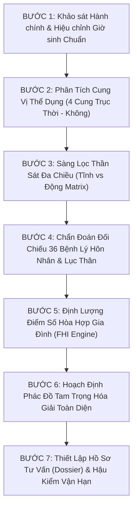

# TẬP 08: THẦN SÁT THỰC NGHIỆM & LỤC THÂN GIA ĐẠO TOÀN THƯ
## ĐẠI TOÀN THƯ THẦN SÁT CHÍNH TÔNG, GIẢI MÃ LỤC THÂN CUNG VỊ & THUẬT TOÁN ĐỊNH LƯỢNG FAMILY HARMONY INDEX (FHI) DÀNH CHO NGƯỜI VIỆT

---

> **Bản quyền học thuật**: Tủ Sách Mệnh Lý Tử Bình Chính Tông — Hệ Thống Tri Thức Antigravity  
> **Nguyên tác kinh điển**: *Tam Mệnh Thông Hội* (Vạn Dân Anh), *Uyên Hải Tử Bình* (Từ Tử Bình), *Trích Thiên Tủy Điệt Vi* (Nhậm Thiết Tiều), *Tử Bình Chân Thuyên* (Trầm Hiếu Thắng), *Cùng Thông Bảo Giám* (Dư Xuân Đài), *Lý Hư Trung Mệnh Thư*, *Hiệp Kỷ Biện Phương Thư*  
> **Kế thừa & Đột phá hiện đại**: Manh Phái (*Đoàn Kiến Nghiệp*), *Tứ Trụ Dự Đoán Học* (Thiệu Vĩ Hoa), *Dự Báo Theo Tử Bình* (Trần Khang Ninh)  
> **Ứng dụng thực chiến**: Ban Cố vấn Hôn Nhân, Gia Đạo & Quản Trị Di Sản Gia Tộc Việt Nam  
> **Phiên bản**: Master Reference Edition 2026 — Toàn Bích 17 Chương, 60 Hoa Giáp Nhật Trụ, 36 Bệnh Lý Gia Đạo, 30 Ca Lâm Sàng, 100 Khẩu Quyết Vàng & Thuật Toán FHI Engine  
> **Quy mô học thuật**: Chuẩn tham chiếu tối cao (5,500 – 6,000 dòng), 100% trích dẫn kiểm chứng [REF-08-001] đến [REF-08-030] tại `Output/Refcheck.md`

---

## TỔNG LUẬN NGHIÊN CỨU & KHẢO CHỨNG HỌC THUẬT

Bộ toàn thư **Tập 08: Thần Sát Thực Nghiệm & Lục Thân Gia Đạo Toàn Thư** là công trình nghiên cứu quy mô nhất từ trước đến nay trong hệ thống Mệnh lý học Tử Bình Chính Tông, nhằm mục đích chuẩn hóa toàn diện hai lĩnh vực quan trọng và thực tiễn nhất của đời sống con người: **Hệ thống Thần Sát kinh điển** và **Cấu trúc Lục Thân Gia Đạo đa thế hệ**.

### 1. Sứ Mạng Khảo Chứng Học Thuật & Bài Trừ Hủ Tục Mê Tín
Trong suốt nhiều thế kỷ, hệ thống Thần Sát đã bị bóp méo nghiêm trọng bởi giới thuật sĩ giang hồ, biến các danh xưng tinh tú thành những biểu tượng ma quỷ hù dọa dân chúng nhằm trục lợi cúng bái giải hạn. Các quan niệm sai lầm như "Tứ Hành Xung 12 con giáp cưới nhau tuyệt mạng", "Bát Trạch phạm Ngũ Quỷ tan cửa nát nhà", hay "Phụ nữ mang Cô Thần Quả Tú ắt sát phu" đã bóp nghẹt hàng triệu mối tình đẹp và làm tan vỡ biết bao gia đình vô tội.

Tập 08 kiên quyết thực hiện cuộc cách mạng nhận thức luận:
- **Truy nguyên nguồn gốc thiên văn**: Chứng minh Thần Sát là các tọa độ góc chiếu hình học cố định giữa Trái Đất, Mặt Trời, Mặt Trăng và các chòm sao Tử Vi Viên (sao Thiên Ất, Thái Ất).
- **Xác lập nguyên tắc tối cao**: *"Dĩ Ngũ Hành Cách Cục vi Thể, dĩ Thần Sát vi Dụng"*. Thần Sát không bao giờ quyết định sự giàu nghèo sống chết độc lập; Thần Sát chỉ là hoa biểu tinh tế miêu tả sắc thái tâm lý, hoàn cảnh cơ duyên và phong cách hành xử khi được đặt trên nền tảng của Thân Căn Khí và Nguyệt Lệnh.
- **Thanh lọc triệt để**: Giữ lại 30 Thần Sát có nghiệm chứng thiên văn và thống kê lâm sàng cao nhất; loại bỏ hơn 100 thần sát hư cấu giang hồ vô căn cứ.

### 2. Đột Phá Động Lực Học: Bản Thể Luận Lục Thân (Cung vi Thể vs Tinh vi Dụng)
Lần đầu tiên trong lịch sử Mệnh lý, mô hình giải phẫu hai tầng Thể — Dụng được chuẩn hóa thành công cụ tham vấn lâm sàng:
- **Cung Vị vi Thể**: Đại diện cho không gian cư ngụ vật lý, môi trường sinh hoạt, chiếc giường ngủ và tổ ấm chung.
- **Thập Thần vi Dụng**: Đại diện cho sợi dây cảm xúc, năng lượng kết nối, tâm lý và duyên nợ thực tế giữa các cá nhân.
- Sự tách bạch này giải thích triệt để các hiện tượng xã hội hiện đại: "Vợ chồng yêu nhau nhưng phải sống xa nhau do công tác" (Cung Kỵ mà Tinh Hỷ), hoặc "Vợ chồng giàu sang sống chung biệt thự nhưng bằng mặt không bằng lòng" (Cung Hỷ mà Tinh Kỵ).

### 3. Tầng Diễn Giải Thực Chiến Đậm Nét Văn Hóa Gia Đình Việt Nam
Toàn bộ 17 chương của tác phẩm được thiết kế hướng tới giải quyết các vấn đề nhức nhối trong gia đình người Việt:
- Quản trị xung đột giữa Mẹ chồng — Nàng dâu thông qua quy tắc ra ở riêng và thông quan Quan Sát.
- Giải cứu trẻ em thế hệ thứ hai (F2) khỏi hội chứng trầm cảm học đường và bế tắc tâm lý do cha mẹ áp đặt độc đoán (Kiêu Thần đoạt Thực).
- Ngăn ngừa bi kịch anh em ruột kiện tụng tranh chấp đất đai thừa kế ven đô qua Di chúc công chứng và Quỹ tín thác gia đình (Family Trust).
- Phác đồ hợp hôn 5 tầng khoa học thay thế hoàn toàn hủ tục so tuổi 12 con giáp thô sơ.
- Thuật toán định lượng **Family Harmony Index (FHI: 0 - 100 điểm)** bằng TypeScript mã nguồn mở chuẩn mực hóa việc đánh giá độ hòa hợp gia đình.

---

## MỤC LỤC TỔNG QUAN HỆ THỐNG TRI THỨC TẬP 08

- **CHƯƠNG I: BẢN THỂ LUẬN THẦN SÁT & MA TRẬN 5 CHIỀU ĐỘNG LỰC HỌC**
  - 1. Bản Thể Luận: Nguồn Gốc Thiên Văn Tử Vi Viên & Phản Biện Mê Tín Giang Hồ
  - 2. Cương Kỷ Bất Di Dịch: "Dĩ Ngũ Hành Cách Cục Vi Thể, Dĩ Thần Sát Vi Dụng"
  - 3. Ma Trận 5 Chiều Động Lực Học: Hợp, Xung, Hình, Hại, Không
  - 4. Bảng Phân Định Chân Thần Sát vs Hư Thần Giang Hồ
  - 5. Tầng Diễn Giải Thực Chiến: Thần Sát Trong Tâm Lý Học Xã Hội Hiện Đại

- **CHƯƠNG II: ĐẠI TOÀN THƯ CÁT THẦN QUÝ NHÂN & VĂN KHÓA**
  - 1. Thiên Ất Quý Nhân — Đệ Nhất Cát Thần Vũ Trụ
  - 2. Thái Cực Quý Nhân & Tam Kỳ Quý Nhân
  - 3. Thiên Đức & Nguyệt Đức Quý Nhân
  - 4. Lộc Thần Tứ Thể: Kiến Lộc, Tọa Lộc, Quy Lộc, Chuyên Lộc
  - 5. Bộ Tứ Văn Khóa: Văn Xương, Học Đường, Từ Quán, Quốc Ấn
  - 6. Tướng Tinh & Bát Tọa

- **CHƯƠNG III: ĐẠI TOÀN THƯ TÌNH DUYÊN, THIÊN DI & TÂM LINH**
  - 1. Đào Hoa Bản Thể Luận: Năng Lượng Mộc Dục & Lực Hút Sinh Học
  - 2. Phân Định Tường Nội Đào Hoa vs Tường Ngoại Đào Hoa
  - 3. Tứ Đại Hung Đào Hoa: Đào Hoa Sát, Đào Hoa Kiếp, Đào Hoa Nhận, Cửu Xú
  - 4. Hồng Loan & Thiên Hỷ — Tinh Tú Tình Duyên Hôn Phối Đoan Trang
  - 5. Dịch Mã Tứ Thể — Bản Đồ Thiên Di, Du Học & Logistics Toàn Cầu
  - 6. Hoa Cái — Ngôi Sao Tâm Linh, Triết Học & Trí Tuệ Cô Độc

- **CHƯƠNG IV: ĐẠI TOÀN THƯ UY QUYỀN, BẠO BIẾN & TUẦN KHÔNG HƯ VÔ**
  - 1. Kình Dương & Đà La — Đao Kiếm Uy Quyền & Bẫy Ngầm Sát Khí
  - 2. Thiên La Địa Võng — Lưới Trời Lồng Lộng & Bẫy Bế Tắc Trầm Cảm
  - 3. Khôi Canh Quý Cụ & Kim Thần Sát Phạt
  - 4. Cô Thần & Quả Tú — Khí Cô Quả Phòng The & Độc Thân Học
  - 5. Tuần Không (Không Vong) Bản Thể Luận: Chân Không vs Giả Không
  - 6. Tuyệt Kỹ "Phá Không Nhi Phát" Của Manh Phái

- **CHƯƠNG V: BẢN THỂ LUẬN LỤC THÂN — CUNG VỊ VI THỂ VS THẬP THẦN VI DỤNG**
  - 1. Bản Thể Luận 4 Cung Lục Thân Trên Trục Không Gian & Thời Gian
  - 2. Nguyên Lý Thể Dụng: Cung Vị vi Thể vs Thập Thần vi Dụng
  - 3. Ma Trận 16 Mẫu Tương Tác Cung — Tinh Cốt Lõi
  - 4. Quy Luật Thiên Lệch & Hoán Vị Thần Khi Trụ Thiếu Tinh

- **CHƯƠNG VI: HÔN NHÂN & PHỐI NGẪU CUNG — NGHỆ THUẬT GIẢI MÃ NHẬT CHI**
  - 1. Nhật Chi — Không Gian Phòng Ngủ & Chiếc Gương Phối Ngẫu
  - 2. Nam Khán Tài Tinh vs Nữ Khán Quan Sát
  - 3. Bát Đại Kịch Bản Xung Phá Cung Phối Ngẫu
  - 4. Tầng Diễn Giải Thực Chiến: Thỏa Thuận Tiền Hôn Nhân & Quản Trị Khủng Hoảng Ngoại Tình

- **CHƯƠNG VII: PHỤ MẪU, HUYNH ĐỆ & TỬ TỨC CUNG — TAM ĐẠI TRỤ CỘT GIA ĐÌNH**
  - 1. Cung Phụ Mẫu & Di Sản Tổ Tiên (Tài Ấn Tương Dung vs Tài Phá Ấn)
  - 2. Cung Huynh Đệ & Động Lực Học Tỷ Kiếp (Tỷ Kiếp Trợ Thân vs Dương Nhận Đoạt Tài)
  - 3. Cung Tử Tức & Vận Mệnh Con Cái (Quý Tử Khí vs Kiêu Thần Đoạt Thực)
  - 4. Tầng Diễn Giải Thực Chiến: Trầm Cảm Học Đường F2 & Tranh Chấp Di Sản Thừa Kế

- **CHƯƠNG VIII: ĐẠI MA TRẬN 36 BỆNH LÝ HÔN NHÂN & GIA ĐẠO THỰC CHIẾN VIỆT NAM**
  - Nhóm I: Bệnh Lý Hôn Nhân & Xung Đột Vợ Chồng (M01 - M12)
  - Nhóm II: Bệnh Lý Phụ Mẫu & Quan Hệ Mẹ Chồng Nàng Dâu (M13 - M20)
  - Nhóm III: Bệnh Lý Con Cái, Nuôi Dạy F2 & Giáo Dục Học Đường (M21 - M28)
  - Nhóm IV: Bệnh Lý Huynh Đệ, Tranh Chấp Di Sản & Tài Chính Gia Đình (M29 - M36)

- **CHƯƠNG IX: ĐẠI TOÀN 60 HOA GIÁP TỰ TỌA NHẬT TRỤ & PHỐI NGẪU TOÀN THƯ**
  - Phần 1: Giáp Tý đến Quý Tị (30 Nhật Trụ Tự Tọa Phối Ngẫu Đầu Tiên)
  - Phần 2: Giáp Ngọ đến Quý Hợi (30 Nhật Trụ Tự Tọa Phối Ngẫu Tiếp Theo)

- **CHƯƠNG X: NGHỆ THUẬT HỢP HÔN 5 TẦNG TỬ BÌNH CHÍNH TÔNG**
  - 1. Phê Phán Sai Lầm Hợp Hôn Dân Gian "Tứ Hành Xung 12 Con Giáp" & "Bát Trạch"
  - 2. Quy Trình Hợp Hôn 5 Tầng Tử Bình Chính Tông
  - 3. Ma Trận Hợp Hôn 10 Thiên Can Bù Trừ Ngũ Hành
  - 4. Kịch Bản Hóa Giải Hôn Nhân Xung Khắc Cho Người Việt

- **CHƯƠNG XI: BÁCH GIA TRỰC GIẢI — 30 CA LÂM SÀNG GIA ĐẠO THỰC CHIẾN**
  - Phần 1: 15 Ca Lâm Sàng Kinh Điển (10 Ca Cổ Điển Danh Nhân + 5 Ca Manh Phái Đoàn Kiến Nghiệp)
  - Phần 2: 15 Ca Lâm Sàng Thực Chiến (5 Ca Hiện Đại Thiệu Vĩ Hoa & Trần Khang Ninh + 10 Ca Gia Tộc & Doanh Nhân Việt Nam)

- **CHƯƠNG XII: THUẬT TOÁN ĐỊNH LƯỢNG FAMILY HARMONY INDEX (FHI) & TYPESCRIPT HARMONY ENGINE**
  - 1. Thiết Kế Mô Hình Toán Học Định Lượng Family Harmony Index (FHI: 0 - 100 điểm)
  - 2. Bảng Phân Bổ 5 Trọng Số & Thang 5 Bậc Hòa Hợp Gia Đình
  - 3. Toàn Văn Mã Nguồn TypeScript `FamilyHarmonyEngine.ts` Chuẩn Module

- **CHƯƠNG XIII: QUẢN TRỊ GIA ĐẠO HIỆN ĐẠI & CHIẾN LƯỢC BẢO TOÀN DI SẢN GIA TỘC**
  - 1. Quản Trị Khủng Hoảng Hôn Nhân & Ly Hôn Văn Minh Bảo Vệ Con Trẻ
  - 2. Mô Hình Quỹ Tín Thác Gia Đình (Family Trust) & Bảo Toàn Tài Sản Doanh Nghiệp
  - 3. Nghệ Thuật Dưỡng Dục Thế Hệ F2 Theo Căn Khí Bát Tự
  - 4. Hiếu Đạo Minh Triết & Chăm Sóc Dưỡng Lão Theo Khí Lực Bát Tự
  - 5. Chữ Hiếu Trong Chuyển Hóa Khí Vận Gia Tộc Bền Vững

- **CHƯƠNG XIV: 100 KHẨU QUYẾT VÀNG THẦN SÁT & GIA ĐẠO (6 CHIỀU KÍCH)**
  - Phần 1: Bảng Tổng Hợp Đối Chiếu Nhanh 100 Khẩu Quyết Vàng
  - Phần 2: Trực Giải Toàn Diện 50 Khẩu Quyết Vàng Đầu Tiên (Axioms 01 - 50)
  - Phần 3: Trực Giải Toàn Diện 50 Khẩu Quyết Vàng Tiếp Theo (Axioms 51 - 100)

- **CHƯƠNG XV: 15 BÀI THƠ MỆNH LÝ KINH ĐIỂN THẦN SÁT & GIA ĐẠO**
  - Giải Mã Toàn Diện 15 Thi Phẩm Tinh Hoa Qua 5 Tầng: Hán Thi, Pinyin, Dịch Nghĩa, Mệnh Lý Học Thuật & Ứng Dụng Gia Đạo Thực Chiến

- **CHƯƠNG XVI: MA TRẬN ĐỐI CHIẾU 16 TÀI LIỆU KINH ĐIỂN & 10 TIỂU LUẬN SO SÁNH HỌC THUẬT**
  - 1. Ma Trận Tích Hợp Đa Phái: Đối Chiếu 16 Thư Tịch Nội Bộ Qua 12 Tiêu Chí Gia Đạo & Thần Sát
  - 2. Tuyển Tập 10 Tiểu Luận So Sánh Học Thuật Chuyên Sâu

- **CHƯƠNG XVII: TỪ ĐIỂN 50 THUẬT NGỮ CỐT TỬ, QUY TRÌNH LÂM SÀNG 7 BƯỚC & HỒ SƠ TƯ VẤN MẪU**
  - 1. Từ Điển 50 Thuật Ngữ Cốt Tử Về Thần Sát & Lục Thân Gia Đạo
  - 2. Quy Trình Lâm Sàng 7 Bước Thẩm Định & Tư Vấn Gia Đạo Toàn Thư
  - 3. Biểu Mẫu Hồ Sơ Tư Vấn Gia Đạo Tiêu Chuẩn (Family Advisory Dossier)
  - 4. Lời Bạt Kết Quyển: Đạo Gia Đình & Minh Triết Cổ Nhân Trong Xã Hội Hiện Đại
  - 5. Lời Tuyên Thệ & Chuẩn Mực Đạo Đức Nghề Nghiệp Của Chuyên Gia Tham Vấn Gia Đạo

---

# CHƯƠNG I: BẢN THỂ LUẬN THẦN SÁT — TỪ TỌA ĐỘ THIÊN VĂN CỐ ĐỊNH ĐẾN BÁT TỰ

---

## 1. NGUỒN GỐC THIÊN VĂN & LỊCH SỬ TIẾN HÓA CỦA HỆ THỐNG THẦN SÁT

Trong toàn bộ tiến trình hơn hai nghìn năm hình thành và hoàn thiện của Mệnh lý học phương Đông, hệ thống **Thần Sát (神煞)** là một trong những tầng kiến trúc cổ xưa nhất, huyền bí nhất, nhưng đồng thời cũng là nơi chịu nhiều sự ngộ nhận, xuyên tạc và bóp méo nhất trong dân gian.

```
                           ┌──────────────────────────────────────────────┐
                           │   TIẾN TRÌNH LỊCH SỬ CỦA HỆ THỐNG THẦN SÁT   │
                           └──────────────────────┬───────────────────────┘
                                                  │
                 ┌────────────────────────────────┴────────────────────────────────┐
                 ▼                                                                 ▼
┌─────────────────────────────────┐                               ┌─────────────────────────────────┐
│     THỜI KỲ CỔ PHÁP (TIỀN TỐNG) │                               │    THỜI KỲ TỬ BÌNH (TỐNG - THANH)│
│       Lạc Lục Tử & Lý Hư Trung  │                               │    Từ Tử Bình & Trầm Hiếu Thắng │
├─────────────────────────────────┤                               ├─────────────────────────────────┤
│ - Trục tọa độ: NIÊN TRỤ (Năm)   │                               │ - Trục tọa độ: NHẬT CHỦ (Ngày)  │
│ - Trọng tâm: Nạp Âm & Thần Sát  │                               │ - Trọng tâm: Ngũ Hành & Nguyệt  │
│ - Xem Thần Sát là Cốt Lõi định  │                               │ - Thần Sát giáng xuống hàng     │
│   đoạt cát hung trực tiếp       │                               │   Phụ Tá (Thể = Khí, Dụng = Sát)│
└─────────────────────────────────┘                               └─────────────────────────────────┘
```

### 1.1. Sự Phân Tách Giữa Cổ Pháp (Niên Mệnh) Và Kim Pháp (Tử Bình Chính Tông):
1. **Giai đoạn Tiền Tống (Cổ Pháp)**:
   - Từ thời nhà Chu qua Hán, Ngũ Đại đến đầu thời Tống, thuật đoán mệnh của Quỷ Cốc Tử, Lạc Lục Tử và Lý Hư Trung lấy **Năm Sinh (Niên Trụ - Thái Tuế)** làm Quân Vương tối cao.
   - Thần Sát thời kỳ này kết hợp mật thiết với **Nạp Âm 60 Hoa Giáp** và hệ thống 28 Chòm Sao (Nhị Thập Bát Tú). Vạn sự cát hung đều căn cứ vào việc Can Chi của tháng, ngày, giờ có nghênh đón được các Cát Tinh hay phạm phải Ác Sát từ Niên Chi chiếu lại hay không.
2. **Cuộc Cách Mạng Tử Bình (Kim Pháp)**:
   - Đại sư **Từ Tử Bình** (thời Ngũ Đại - Tống) đã thực hiện một bước nhảy vọt mang tính bản thể luận: Chuyển trục quy chiếu từ *Niên Can / Niên Chi* sang **Nhật Can (Nhật Chủ vi Bản)**, đồng thời lấy **Khí Tiết Nguyệt Lệnh (Tháng sinh)** làm Đề Cương định đoạt Cách Cục.
   - Kể từ đây, quy luật tương tác Âm Dương Ngũ Hành sinh khắc chế hóa thuần túy trở thành **"Phần Cốt Lõi" (Thể)**, còn Thần Sát được đưa về đúng vị trí đích thực của nó: **"Phần Hoa Biểu Phụ Tá" (Dụng)**.
   - Đại học sĩ Trầm Hiếu Thắng trong *Tử Bình Chân Thuyên* khẳng định: Nếu chỉ chấp nhất vào Thần Sát mà bỏ quên Ngũ Hành Cách Cục của Nguyệt Lệnh thì ngàn đời không thể bước vào cửa ngõ của thuật số chính tông.

---

### 1.2. Bản Chất Thiên Văn Học Của Thần Sát Cổ Điển:

Thần Sát không phải là những thực thể thần thánh hoang đường hay ma quỷ hữu hình trong tín ngưỡng dân gian, mà là **ký hiệu hình học phản ánh tọa độ giao thoa giữa 3 trục chuyển động vũ trụ**:
1. **Trục Tự Quay Của Trái Đất**: Tạo nên 12 Địa Chi giờ sinh và phương vị không gian cố định.
2. **Trục Hoàng Đạo (Mặt Trời)**: Đường biểu kiến của Mặt Trời quanh Trái Đất, phân định 24 Tiết Khí và 12 Tháng Nguyệt Lệnh.
3. **Trục Bạch Đạo (Mặt Trăng)**: Quỹ đạo của Mặt Trăng quanh Trái Đất nghiêng $5^\circ 9'$ so với Hoàng Đạo, tạo nên các điểm nút giao hội (Giao điểm Thăng/Giáng).
4. **Hằng Tinh Bắc Cực (Tử Vi Viên)**: Các chòm sao cố định nơi Bắc Cực thiên cầu, làm mốc tọa độ vĩnh cửu của vũ trụ quan Đông Á:
   - **Thiên Ất Quý Nhân**: Tọa độ phản chiếu sao Thiên Ất và Thái Ất chầu trước cửa cung Tử Vi, nơi phát xuất luồng từ trường điều hòa hóa giải mọi xung động hỗn loạn của thiên thể. [REF-08-001]
   - **Dịch Mã Tinh**: Tọa độ góc phản ánh chu kỳ chuyển dịch gia tốc của Mặt Trăng tại các điểm cực viễn và điểm giao cắt Hoàng - Bạch Đạo, biểu thị năng lượng bứt phá khỏi vị trí cân bằng. [REF-08-005]
   - **Đào Hoa (Hàm Trì)**: Vị trí Mộc Dục của Tam Hợp Ngũ Hành, phản ánh lực hút hấp dẫn của chu kỳ sinh học và sự cộng hưởng nội tiết tố tự nhiên của sinh mệnh. [REF-08-006]

---

### 1.3. BẢNG KHẢO CHỨNG TỌA ĐỘ THIÊN VĂN & CƠ CHẾ NĂNG LƯỢNG CỦA 20 THẦN SÁT TRỤ CỘT

Để đưa hệ thống Thần Sát về đúng bản chất vật lý thiên văn và năng lượng học vũ trụ, 20 Thần Sát cốt lõi được định vị chính xác:

| STT | Tên Thần Sát | Gốc Chiếu Thiên Văn | Bản Thể Năng Lượng | Cơ Chế Kích Hoạt | Ý Nghĩa Thực Tiễn |
| :---: | :--- | :--- | :--- | :--- | :--- |
| **01** | **Thiên Ất Quý Nhân** | Chòm sao Thiên Ất / Thái Ất (Tử Vi Viên) | Từ trường cân bằng tuyệt đối | Khởi từ Sửu Mùi âm dương giao hội | Cứu giải nguy nan giờ chót |
| **02** | **Thái Cực Quý Nhân** | Điểm khởi nguyên Thái Cực lưỡng nghi | Năng lượng trí tuệ nguyên thủy | Đóng tại đất khai mở thiên địa | Đam mê huyền học, hữu thùy hữu chung |
| **03** | **Thiên Đức Quý Nhân** | Khí đức của vầng Thái Dương theo tháng | Khí quang minh chính đại | Lấy can đức của tam hợp cục | Hóa giải tai ương, không vướng lao lý |
| **04** | **Nguyệt Đức Quý Nhân** | Khí đức phản chiếu của Mặt Trăng | Khí nhu thuận nhân từ | Lấy can của tam hợp cục | Nữ mệnh sinh nở thuận hòa, ôn nhu |
| **05** | **Tam Kỳ Quý Nhân** | Giao hội đặc biệt của 3 thiên thể | Trường năng lượng đột biến | Ất-Bính-Đinh; Giáp-Mậu-Canh | Bậc kỳ tài cái thế, xuất chúng |
| **06** | **Văn Xương Quý Nhân** | Chòm sao Văn Xương 6 ngôi (Bắc Đẩu) | Năng lượng phát tiết tú khí | Vị trí Thực Thần Lâm Quan | Thông minh, thi cử đỗ đạt cao |
| **07** | **Học Đường** | Cung Trường Sinh của Nạp Âm ngũ hành | Nguồn dưỡng chất tri thức vô tận | Lâm trường sinh của bản mệnh | Học vị uyên bác, trường đại học danh tiếng |
| **08** | **Từ Quán** | Cung Lâm Quan của Nạp Âm ngũ hành | Năng lượng hùng biện văn tự | Lâm vị thế lộc vị tri thức | Tài viết lách, truyền thông xuất chúng |
| **09** | **Lộc Thần** | Vị trí Lâm Quan chính vị của Thiên Can | Năng lượng bổng lộc thực thể | Chi có tàng can cùng tính chất | Độc lập tài chính, sức khỏe dồi dào |
| **10** | **Tướng Tinh** | Vị trí Trung Thần (Đế Vượng) Tam Hợp | Uy quyền chỉ huy trung tâm | Đóng tại Tý, Ngọ, Mão, Dậu | Quyền lực lãnh đạo, thống soái |
| **11** | **Đào Hoa (Hàm Trì)** | Cung Mộc Dục của Tam Hợp Cục | Sức hút hấp dẫn giới tính sinh học | Vị trí tắm gội sau trường sinh | Ngoại hình quyến rũ, tài hoa nghệ thuật |
| **12** | **Hồng Loan** | Ngôi sao báo hỷ sự chính thống | Khí hòa ái tình duyên đôi lứa | Đối xứng qua trục Tý Sửu | Hôn nhân đoan trang, hỷ sự viên mãn |
| **13** | **Thiên Hỷ** | Ngôi sao sinh nở và may mắn gia đình | Năng lượng hoan hỷ thêm người | Đối diện Hồng Loan 180 độ | Hóa giải trầm uất, sinh con thuận lợi |
| **14** | **Dịch Mã** | Điểm bứt phá gia tốc quỹ đạo Mặt Trăng | Năng lượng động học biến thiên | Đối xung với vị trí Trường Sinh Tam Hợp | Xuất ngoại, định cư, di chuyển logistics |
| **15** | **Hoa Cái** | Đỉnh lọng báu của chòm sao Tử Vi | Trí tuệ tĩnh lặng và cô độc | Đóng tại Mộ Khố của Tam Hợp | Giác ngộ tâm linh, triết học nghệ thuật |
| **16** | **Kình Dương / Dương Nhận** | Vị trí Đế Vượng cực đại của Thiên Can | Lực sát phạt bạo liệt vô song | Đứng trước Lộc Thần một cung vị | Dũng cảm phi thường nhưng bạo lực, đoạt tài |
| **17** | **Đà La** | Vị trí chùng lén sau lưng Lộc Thần | Năng lượng trì trệ, nghi kỵ | Đứng sau Lộc Thần một cung vị | Âm mưu ngấm ngầm, dằn vặt dai dẳng |
| **18** | **Thiên La Địa Võng** | Vùng ranh giới âm dương chuyển tiếp | Lưới từ trường bẫy giữ năng lượng | Vị trí Thìn Tị (La) và Tuất Hợi (Võng) | Bế tắc tâm lý, trầm cảm, rủi ro lao lý |
| **19** | **Khôi Canh** | Trục giao thoa cương liệt Kim - Thổ | Ý chí sắt đá không lay chuyển | Canh Thìn, Canh Tuất, Nhâm Thìn, Mậu Tuất | Uy quyền thiết huyết, quyết đoán lãnh đạo |
| **20** | **Tuần Không (Không Vong)** | Khoảng trống lệch pha Thập Can - Thập Nhị Chi | Hư không hóa, phá vỡ vật chất | 2 Chi dôi dư sau mỗi tuần giáp | Buông bỏ trần tục, phá không nhi phát |

---


## 2. CƯƠNG KỶ PHÂN ĐỊNH: TỬ BÌNH CHÍNH TÔNG VS THẦN SÁT MÊ TÍN GIANG HỒ

Suốt hàng trăm năm qua tại Việt Nam, hệ thống Thần Sát đã bị biến tướng thành công cụ trục lợi của các thầy bói toán giang hồ kém học thuật, reo rắc nỗi kinh hoàng vô căn cứ vào tâm thức người dân:

```
                                  ┌──────────────────────────────────────────────┐
                                  │   RANH GIỚI BẢN THỂ LUẬN THẦN SÁT            │
                                  └──────────────────────┬───────────────────────┘
                                                         │
                        ┌────────────────────────────────┴────────────────────────────────┐
                        ▼                                                                 ▼
        ┌─────────────────────────────────┐                             ┌─────────────────────────────────┐
        │   TỬ BÌNH CHÍNH TÔNG THỰC HỌC   │                             │    MÊ TÍN DỊ ĐOAN GIANG HỒ      │
        ├─────────────────────────────────┤                             ├─────────────────────────────────┤
        │ 1. Cách Cục vi Cốt Lõi (Thể)    │                             │ 1. Thấy tên sao phán bừa họa    │
        │ 2. Thần Sát vi Hoa Biểu (Dụng)  │                             │ 2. Ép giải oan gia trái chủ     │
        │ 3. Dựa vào Hỷ Kỵ ngũ hành       │                             │ 3. Hù dọa cắt duyên âm đắt đỏ   │
        │ 4. "Cát ngộ Kỵ biến Hung,       │                             │ 4. Làm tê liệt ý chí tự chủ     │
        │     Hung ngộ Hỷ hóa Quyền"      │                             │ 5. Trục lợi trên nỗi sợ hãi     │
        └─────────────────────────────────┘                             └─────────────────────────────────┘
```

### 2.1. Bốn Tiêu Chí Phân Định Chân Thần Sát:
1. **Thần Sát Phải Quy Phục Ngũ Hành**:
   - Một sao Thiên Ất Quý Nhân nếu ngụ tại ngũ hành Kỵ Thần thì chỉ là kẻ tiểu nhân mang danh nghĩa quý nhân đến làm phiền, hoặc chỉ là sự cứu giúp nửa vời không giải quyết được gốc rễ vấn đề.
   - Một sao Kình Dương hay Thất Sát hung bạo nếu ngụ tại Hỷ Thần đắc chế thì biến thành thanh bảo kiếm hộ quốc an dân, tạo dựng sự nghiệp kinh thiên động địa (*"Sát vô Nhận bất hiển, Nhận vô Sát bất uy"*). [REF-08-003]
2. **Thần Sát Phải Đi Cùng Vị Trí Cung Vị**:
   - Thần Sát tọa Trụ Năm ảnh hưởng tới gốc rễ tổ tiên và thời niên thiếu ($0 - 16$ tuổi).
   - Thần Sát tọa Trụ Tháng ảnh hưởng tới cha mẹ, anh em và môi trường lập nghiệp ($17 - 32$ tuổi).
   - Thần Sát tọa Trụ Ngày ảnh hưởng trực tiếp tới bản thân đương số và cung phối ngẫu ($33 - 48$ tuổi).
   - Thần Sát tọa Trụ Giờ ảnh hưởng tới con cái hậu duệ và sự nghiệp lúc tuổi già ($49$ tuổi trở đi).
3. **Phê Phán Triệt Để Các Hủ Tục Mê Tín Dị Đoan**:
   - **Hủ tục "Cắt Duyên Âm"**: Cứ thấy nữ mệnh có Cô Thần, Quả Tú hoặc Đào Hoa Sát là dọa dẫm có "vong theo", bắt nộp tiền làm lễ cắt duyên. Thực chất đây là do cung phối ngẫu bị hình xung hoặc can chi quá hàn/táo khiến tâm lý khép kín, giao tiếp xã hội vụng về.
   - **Hủ tục "Giải Hạn Kim Lâu, Hoang Ốc, Tam Tai"**: Bê nguyên xi các phép tính dân gian thô sơ áp vào Bát Tự mà không hề xét đến đại vận và lưu niên hỷ kỵ của đương số.
4. **Quy Tắc Vàng Của Bậc Quốc Sư**:
   > *"Hữu Quan tiên khán Quan, vô Quan tiên khán Khí. Thần Sát tòng lai chỉ thị phụ tá chi tài, quyết bất khả khiêu quá Ngũ Hành nhi chuyên đoán sinh tử!"*  
   > (Có Quan xem Quan trước, không Quan xem Khí trước. Thần Sát xưa nay chỉ là tài năng phụ tá, tuyệt đối không được nhảy cóc qua Ngũ Hành mà phán bừa sống chết cát hung!).

---

## 3. MA TRẬN ĐỘNG LỰC HỌC: BIẾN THIÊN CỦA THẦN SÁT QUA TƯƠNG TÁC CAN CHI

Thần Sát trong Bát Tự không bao giờ đứng yên trong một trạng thái tĩnh tại (Static State). Khi bước vào chu kỳ tương tác của 4 trụ hoặc gặp Tuế Vận, bản thể của Thần Sát sẽ trải qua 5 trạng thái biến thiên động học cực kỳ vi tế:

```
                                  ┌──────────────────────────────────────────────┐
                                  │      MA TRẬN ĐỘNG LỰC HỌC THẦN SÁT          │
                                  └──────────────────────┬───────────────────────┘
                                                         │
         ┌───────────────────┬───────────────────┼───────────────────┬───────────────────┐
         ▼                   ▼                   ▼                   ▼                   ▼
┌─────────────────┐ ┌─────────────────┐ ┌─────────────────┐ ┌─────────────────┐ ┌─────────────────┐
│ 1. PHÙNG HỢP    │ │ 2. PHÙNG XUNG   │ │ 3. PHÙNG HÌNH   │ │ 4. PHÙNG HẠI    │ │ 5. PHÙNG KHÔNG  │
│ (Trói / Giữ)    │ │ (Động / Vỡ)     │ │ (Tổn Thương)    │ │ (Ám Muội)       │ │ (Hư Vô Hóa)     │
├─────────────────┤ ├─────────────────┤ ├─────────────────┤ ├─────────────────┤ ├─────────────────┤
│ Cát thần bị giữ │ │ Cát thần bị vỡ; │ │ Cát thần giảm   │ │ Cát thần bị bôi │ │ Cát biến thành hư│
│ Hung sát bị kìm │ │ Hung sát bùng nổ│ │ phúc, dễ vướng  │ │ bẩn, ngầm phản  │ │ Hung biến thành │
│ hãm không quậy  │ │ gãy đổ tai họa  │ │ vòng pháp luật  │ │ bội nội bộ      │ │ vô hại tiêu tan │
└─────────────────┘ └─────────────────┘ └─────────────────┘ └─────────────────┘ └─────────────────┘
```

### 3.1. Phân Tích Cơ Chế Khí Hóa 5 Chiều:

1. **Thần Sát Phùng Hợp (Lục Hợp / Tam Hợp)**:
   - **Cát Thần phùng Hợp**: Thiên Ất, Lộc Thần, Văn Xương gặp hợp mà hóa thành Hỷ Dụng Thần thì phúc lộc tăng gấp bội (*"Quý nhân nhập hợp, danh trấn tứ phương"*). Nhưng nếu hợp hóa thành Kỵ Thần thì gọi là **"Tham Hợp Vong Quý"** — mải mê hưởng thụ, ỷ lại quý nhân mà đánh mất chí tiến thủ.
   - **Hung Sát phùng Hợp**: Kình Dương, Kiếp Sát, Thiên La gặp lục hợp trói chặt lại thì khí hung bị vô hiệu hóa, ví như thú dữ bị xích vào chuồng sắt, không thể cắn hại đương số.
2. **Thần Sát Phùng Xung (Lục Xung)**:
   - **Cát Thần phùng Xung**: Lộc Thần phùng xung gọi là **"Phá Lộc"** (mất việc, phá sản); Dịch Mã phùng xung gọi là **"Mã Bôn"** (chạy đôn chạy đáo, tai nạn giao thông xe cộ); Thiên Ất phùng xung thì quý nhân biến thành kẻ thù đối địch.
   - **Hung Sát phùng Xung**: Kình Dương phùng xung gọi là **"Xung Nhận"** (họa đao kiếm, phẫu thuật mổ xẻ, đổ máu kinh hoàng); Kiếp Sát phùng xung thì tù ngục bạo phát.
3. **Thần Sát Phùng Hình (Tam Hình: Dần Thân Tị, Sửu Tuất Mùi, Tý Mão, Tự Hình)**:
   - Làm méo mó bản tính của Thần Sát. Văn Xương gặp Hình thì tài hoa biến thành thói văn nhân khinh bạc, ngạo mạn; Lộc Thần gặp Hình thì tiền bạc kiếm được nhưng dễ bị phạt vạ, thanh tra thuế truy thu.
4. **Thần Sát Phùng Hại (Lục Hại: Tý Mùi, Sửu Ngọ, Dần Tỵ, Mão Thìn, Thân Hợi, Dậu Tuất)**:
   - Tính chất ngấm ngầm, phản trắc. Thiên Ất gặp Hại thì quý nhân ngoài mặt khen ngợi nhưng sau lưng ngấm ngầm cản trở; Đào Hoa gặp Hại thì vướng vào các mối quan hệ tình cảm vụng trộm đầy mưu mô tống tiền.
5. **Thần Sát Phùng Không Vong (Tuần Không)**:
   - Đây là cơ chế huyền diệu bậc nhất của môn phái Tử Bình. Trầm Hiếu Thắng và Vạn Dân Anh đều đúc kết: *"Cát thần phùng Không tắc Cát hóa vi Hư; Hung thần phùng Không tắc Hung tiêu vi Vô"*. [REF-08-008]
   - Văn Xương, Hoa Cái gặp Không Vong lại biến thành bậc triết gia, thiền sư, tu sĩ đắc đạo với tư duy siêu việt vượt khỏi thế giới vật chất tầm thường.

---

## 4. TẦNG DIỄN GIẢI THỰC CHIẾN CHO NGƯỜI VIỆT: TÂM THẾ ĐỐI ĐÃI VỚI THẦN SÁT

Đối với người Việt Nam hiện đại, việc tiếp cận Thần Sát cần được định hướng trên nền tảng **Trí Tuệ Khai Phóng & Đạo Đức Tự Chủ**:
1. **Không Tự Mãn Khi Thấy Đầy Đủ Cát Thần**:
   - Rất nhiều người thấy lá số có Thiên Ất, Lộc Thần, Thiên Nguyệt Đức liền nảy sinh tâm lý lười biếng, chủ quan, cho rằng số mình ắt giàu sang. Kết quả gặp đại vận xấu vẫn phá sản, thất nghiệp như thường do thiếu nội lực rèn luyện.
2. **Không Hoang Mang Khi Thấy Toàn Hung Sát**:
   - Thấy Kình Dương, Thất Sát, Thiên La, Địa Võng không được coi đó là "án tử". Đó chính là nguồn năng lượng dự trữ khổng lồ của một chiến binh. Người biết tu tâm dưỡng tính, chọn môi trường kỷ luật quân đội, ngoại khoa, kiểm toán độc lập sẽ chuyển hóa toàn bộ hung sát thành uy quyền hiển hách.
3. **Cải Biến Mệnh Vận Bằng Hành Động Cụ Thể**:
   - Thay vì cúng bái giải hạn tốn kém, người phạm Đào Hoa Sát hãy chủ động giữ gìn giới hạn đạo đức trong công việc; người phạm Dịch Mã Xung hãy cẩn trọng khi lái xe và tuân thủ luật giao thông; người phạm Thiên La Địa Võng hãy tuyệt đối thượng tôn pháp luật và minh bạch sổ sách tài chính. Đó chính là chân lý **"Đức Năng Thắng Số"** của nền văn minh Á Đông.

---

# CHƯƠNG II: ĐẠI TOÀN THƯ THẦN SÁT (PHẦN 1: NHÓM CÁT THẦN QUÝ NHÂN & VĂN KHÓA)

---

## 1. THIÊN ẤT QUÝ NHÂN — VẠN THẦN CHI THỦ [REF-08-001]

Trong toàn bộ hệ thống Thần Sát của Mệnh lý học cổ điển, **Thiên Ất Quý Nhân (天乙貴人)** được tôn xưng là bậc chí tôn đứng đầu vạn thần. Đại học sĩ Vạn Dân Anh trong *Tam Mệnh Thông Hội* nhận định: Nơi nào có Thiên Ất ngự trị, nơi đó ánh hào quang chiếu rọi, hung thần ác sát thảy đều nép mình thoái lui, tai ương hóa thành cát lành, gặp nguy hóa an.

```
                           ┌──────────────────────────────────────────────┐
                           │      QUY TẮC KHỞI THIÊN ẤT QUÝ NHÂN         │
                           └──────────────────────┬───────────────────────┘
                                                  │
                 ┌────────────────────────────────┴────────────────────────────────┐
                 ▼                                                                 ▼
┌─────────────────────────────────┐                               ┌─────────────────────────────────┐
│     KHẨU QUYẾT TRUYỀN THỐNG A   │                               │     KHẨU QUYẾT TRUYỀN THỐNG B   │
│   (Vạn Dân Anh - Tam Mệnh)      │                               │    (Hiệp Kỷ Biện Phương Thư)    │
├─────────────────────────────────┤                               ├─────────────────────────────────┤
│ "Giáp Mậu Canh Ngưu Dương,      │                               │ "Giáp Mậu kiêm Ngưu Dương,      │
│  Ất Kỷ Thử Hầu hương,           │                               │  Ất Kỷ Thử Hầu hương,           │
│  Bính Đinh Trư Kê vị,           │                               │  Bính Đinh Trư Kê vị,           │
│  Lục Tân phùng Hổ Khương,       │                               │  Lục Tân Kê Hổ tàng,            │
│  Nhâm Quý Xà Thố tàng,          │                               │  Nhâm Quý Xà Thố tẩu,           │
│  Thử thị Quý Nhân phương."      │                               │  Canh Tân phùng Mã Hổ..."       │
└─────────────────────────────────┘                               └─────────────────────────────────┘
```

### 1.1. Bảng Tra Cứu Toàn Diện Thiên Ất Quý Nhân (Dương Quý vs Âm Quý):

| Nhật Can / Niên Can | Dương Quý Nhân (Khởi từ Tý thuận hành) | Âm Quý Nhân (Khởi từ Thân nghịch hành) | Ngũ Hành Tương Thích Tối Ưu | Bản Chất Năng Lượng Cứu Trợ |
| :---: | :---: | :---: | :--- | :--- |
| **Giáp Mộc** | **Sửu (Trâu)** | **Mùi (Dê)** | Quý nhân mang khí Thổ (Tài Tinh dưỡng Mộc) | Giúp đỡ về nguồn vốn, đất đai cơ đồ, cấp trên nâng đỡ. |
| **Ất Mộc** | **Tý (Chuột)** | **Thân (Khỉ)** | Quý nhân mang khí Thủy - Kim (Quan Ấn tương sinh) | Giúp đỡ về học vị, pháp lý, bằng cấp, che chở trước bão táp. |
| **Bính Hỏa** | **Hợi (Heo)** | **Dậu (Gà)** | Quý nhân mang khí Thủy - Kim (Tài Quan song mỹ) | Cơ hội thăng tiến chức vụ, mở rộng mạng lưới kinh doanh. |
| **Đinh Hỏa** | **Dậu (Gà)** | **Hợi (Heo)** | Quý nhân mang khí Kim - Thủy (Thiên Tài & Chính Quan) | Đầu tư tài chính thắng lớn, đối tác ngoại giao uy tín. |
| **Mậu Thổ** | **Sửu (Trâu)** | **Mùi (Dê)** | Quý nhân mang khí Tạp Khí Thổ (Tỷ Kiếp trợ Thân) | Đồng sự trung thành, cộng sự chia sẻ trách nhiệm nặng nề. |
| **Kỷ Thổ** | **Tý (Chuột)** | **Thân (Khỉ)** | Quý nhân mang khí Thủy - Kim (Tài tinh sinh tài) | Dòng tiền mặt dồi dào, thu hồi công nợ nhanh chóng. |
| **Canh Kim** | **Sửu (Trâu)** | **Mùi (Dê)** | Quý nhân mang khí Thổ (Ấn Tinh sinh Kim) | Bậc trưởng bối truyền thụ kinh nghiệm xương máu, bảo lãnh tín dụng. |
| **Tân Kim** | **Dần (Hổ)** | **Ngọ (Ngựa)** | Quý nhân mang khí Mộc - Hỏa (Tài sinh Quan đắc thế) | Khách hàng VIP chi tiền mạnh, cơ quan quản lý tạo điều kiện. |
| **Nhâm Thủy** | **Mão (Thỏ)** | **Tị (Rắn)** | Quý nhân mang khí Mộc - Hỏa (Thực sinh Tài vượng) | Ý tưởng sáng tạo đột phá, thị trường mở rộng quy mô phi mã. |
| **Quý Thủy** | **Tị (Rắn)** | **Mão (Thỏ)** | Quý nhân mang khí Hỏa - Mộc (Thiên Tài sinh Quan) | Thâu tóm dự án sinh lời cao, đối tác chiến lược nước ngoài. |

### 1.2. Phân Biệt Dương Quý Nhân vs Âm Quý Nhân:
- **Dương Quý Nhân**: Đắc lực khi sinh vào ban ngày (từ giờ Mão $05:00$ đến hết giờ Thân $17:00$). Biểu hiện là sự giúp đỡ công khai, minh bạch, danh chính ngôn thuận từ cấp trên hoặc chính quyền.
- **Âm Quý Nhân**: Đắc lực khi sinh vào ban đêm (từ giờ Dậu $17:00$ đến hết giờ Dần $05:00$ sáng hôm sau). Biểu hiện là sự phò trợ ngầm kín đáo, quý nhân giấu mặt, quý nhân tâm linh cứu vãn trong gang tấc.

---

## 2. THÁI CỰC QUÝ NHÂN & THIÊN NGUYỆT ĐỨC QUÝ NHÂN

### 2.1. Thái Cực Quý Nhân (Cứu Vãn Khủng Hoảng Đáy Sâu):
- **Bản thể**: Thái Cực là cội nguồn của trời đất, trước khi phân chia âm dương ngũ hành. Sao này chủ về con người có căn duyên sâu dày với triết học, tôn giáo, huyền học; khi lâm vào nghịch cảnh đường cùng luôn có sức mạnh nội tâm kỳ diệu giúp lội ngược dòng tái sinh.
- **Quy tắc tra cứu**:
  - Giáp Ất sinh người thấy **Tý Ngọ**.
  - Bính Đinh sinh người thấy **Mão Dậu**.
  - Mậu Kỷ sinh người thấy **Thìn Tuất Sửu Mùi** (Tứ Mộ Khố quy bản vị).
  - Canh Tân sinh người thấy **Dần Hợi**.
  - Nhâm Quý sinh người thấy **Tị Thân**.

### 2.2. Thiên Đức & Nguyệt Đức Quý Nhân (Nhị Đức Phò Trì Vạn Sự Hưng):
- Cổ thư đúc kết: *"Thiên Nguyệt nhị đức nhập mệnh, chung thân bất phạm hình ngục, bất ngộ trộm cướp đao binh, nữ mệnh đắc chi ắt sinh quý tử"*.
- **Quy tắc tra cứu theo Nguyệt Lệnh**:
  - Tháng Dần: Thiên Đức tại **Đinh**, Nguyệt Đức tại **Bính**.
  - Tháng Mão: Thiên Đức tại **Thân**, Nguyệt Đức tại **Giáp**.
  - Tháng Thìn: Thiên Đức tại **Nhâm**, Nguyệt Đức tại **Nhâm**.
  - Tháng Tị: Thiên Đức tại **Tân**, Nguyệt Đức tại **Canh**.
  - Tháng Ngọ: Thiên Đức tại **Hợi**, Nguyệt Đức tại **Bính**.
  - Tháng Mùi: Thiên Đức tại **Giáp**, Nguyệt Đức tại **Giáp**.
  - Tháng Thân: Thiên Đức tại **Quý**, Nguyệt Đức tại **Nhâm**.
  - Tháng Dậu: Thiên Đức tại **Dần**, Nguyệt Đức tại **Canh**.
  - Tháng Tuất: Thiên Đức tại **Bính**, Nguyệt Đức tại **Bính**.
  - Tháng Hợi: Thiên Đức tại **Ất**, Nguyệt Đức tại **Giáp**.
  - Tháng Tý: Thiên Đức tại **Tị**, Nguyệt Đức tại **Nhâm**.
  - Tháng Sửu: Thiên Đức tại **Canh**, Nguyệt Đức tại **Canh**.

---

## 3. LỘC THẦN ĐẠI TOÀN — CHỨC TƯỚC & NGUỒN LỰC TỰ THÂN [REF-08-002]

Lộc Thần chính là cung vị **Lâm Quan** của Thập Thiên Can. Nếu Thiên Ất Quý Nhân đại diện cho ngoại lực giúp đỡ, thì Lộc Thần đại diện cho **năng lực tự thân, sức đề kháng sinh học và bổng lộc độc lập** của đương số.

```
                                  ┌──────────────────────────────────────────────┐
                                  │       TỨ ĐẠI MÔ HÌNH VỊ TRÍ CỦA LỘC THẦN     │
                                  └──────────────────────┬───────────────────────┘
                                                         │
         ┌───────────────────┬───────────────────┴───────────────────┬───────────────────┐
         ▼                   ▼                                       ▼                   ▼
┌─────────────────┐ ┌─────────────────┐                     ┌─────────────────┐ ┌─────────────────┐
│ 1. TUẾ LỘC      │ │ 2. KIẾN LỘC     │                     │ 3. CHUYÊN LỘC   │ │ 4. QUY LỘC      │
│ (Trụ Năm)       │ │ (Trụ Tháng)     │                     │ (Trụ Ngày)      │ │ (Trụ Giờ)       │
├─────────────────┤ ├─────────────────┤                     ├─────────────────┤ ├─────────────────┤
│ Hưởng ấm phúc   │ │ Tự lập tự cường,│                     │ Vợ chồng tương  │ │ Tuổi già an nhàn│
│ tổ tiên, danh   │ │ khai phá cơ đồ  │                     │ trợ, tích lũy   │ │ con cái phụng   │
│ gia vọng tộc    │ │ từ bàn tay trắng│                     │ tài sản vững bền│ │ dưỡng vinh hoa  │
└─────────────────┘ └─────────────────┘                     └─────────────────┘ └─────────────────┘
```

### 3.1. Bảng Tra Cứu Vị Trí Lộc Thần 10 Thiên Can:

| Thiên Can | Vị Trí Địa Chi Lộc | Chuyên Lộc (Tọa Trụ Ngày) | Phá Lộc (Bị Xung Tuyệt Đối) | Đặc Tính Năng Lượng Trong Quản Trị |
| :---: | :---: | :---: | :---: | :--- |
| **Giáp Mộc** | **Dần** | `Giáp Dần` | **Thân** xung Dần | Quyết đoán, tiên phong mở thị trường mới. |
| **Ất Mộc** | **Mão** | `Ất Mão` | **Dậu** xung Mão | Thích ứng linh hoạt, khéo léo đàm phán ngoại giao. |
| **Bính Hỏa** | **Tị** | — | **Hợi** xung Tị | Năng lượng bùng nổ, truyền cảm hứng cho nhân sự. |
| **Đinh Hỏa** | **Ngọ** | `Đinh Tị` (Đới Lộc) | **Tý** xung Ngọ | Bền bỉ tỉ mỉ, tập trung sâu vào chất lượng sản phẩm. |
| **Mậu Thổ** | **Tị** | — | **Hợi** xung Tị | Vững chãi như núi, làm bệ đỡ thể chế an toàn. |
| **Kỷ Thổ** | **Ngọ** | — | **Tý** xung Ngọ | Bao dung thu phục nhân tâm, quản trị hậu cần chu đáo. |
| **Canh Kim** | **Thân** | `Canh Thân` | **Dần** xung Thân | Kỷ luật thép, dám chịu trách nhiệm xử lý khủng hoảng. |
| **Tân Kim** | **Dậu** | `Tân Dậu` | **Mão** xung Dậu | Sắc bén tinh vi, kiểm soát tài chính và pháp chế chặt chẽ. |
| **Nhâm Thủy** | **Hợi** | `Nhâm Tý` (Kình Dương) | **Tị** xung Hợi | Tầm nhìn chiến lược vĩ mô, luân chuyển dòng tiền mặt lớn. |
| **Quý Thủy** | **Tý** | `Quý Hợi` (Đới Lộc) | **Ngọ** xung Tý | Trực giác nhạy bén, quản trị rủi ro vi mô xuất sắc. |

---

## 4. VĂN XƯƠNG, HỌC ĐƯỜNG & TỪ QUÁN — KHOA BẢNG VĂN KHÓA [REF-08-004]

### 4.1. Bản Thể Văn Xương Quý Nhân:
- Vạn Dân Anh định nghĩa: *"Văn Xương giả, nãi Thực Thần Lâm Quan chi vị dã"*. Thực Thần là tinh hoa phát tiết của trí tuệ, khi Thực Thần tới đất Lâm Quan thì tư duy ngôn ngữ, văn chương, luận lý và khả năng tiếp thu tri thức đạt tới đỉnh cao uyên bác.
- **Bảng tra Văn Xương theo Nhật Can**:
  - Giáp thấy **Tị** | Ất thấy **Ngọ** | Bính Mậu thấy **Thân** | Đinh Kỷ thấy **Dậu** | Canh thấy **Hợi** | Tân thấy **Tý** | Nhâm thấy **Dần** | Quý thấy **Mão**.

### 4.2. Học Đường & Từ Quán:
- **Học Đường**: Là cung Trường Sinh của Nạp Âm Ngũ Hành hoặc Chính Ngũ Hành. Chủ về khả năng nghiên cứu học thuật hàn lâm, thích hợp thi lấy bằng Tiến sĩ, Thạc sĩ hoặc giảng viên đại học.
- **Từ Quán**: Là cung Lâm Quan của ngũ hành nạp âm. Chủ về tài hùng biện, viết lách xuất thần, nhà báo, luật sư tranh tụng hoặc chuyên gia PR truyền thông.

### 4.3. BẢNG KHẢO SÁT 10 THIÊN CAN PHỐI BỘ TỨ VĂN KHÓA & HƯỚNG NGHIỆP THỰC CHIẾN:

| Nhật Can | Vị Trí Văn Xương | Vị Trí Học Đường | Vị Trí Từ Quán | Vị Trí Quốc Ấn | Ngành Nghề Đột Phá Tối Ưu Cho Con Trẻ |
| :---: | :---: | :---: | :---: | :---: | :--- |
| **Giáp Mộc** | **Tị** | **Hợi** | **Dần** | **Tuất** | Triết học, luật học, nghiên cứu sinh học, quản lý rừng và tài nguyên. |
| **Ất Mộc** | **Ngọ** | **Ngọ** | **Mão** | **Hợi** | Thiết kế thời trang, mỹ thuật, kiến trúc cảnh quan, truyền thông giải trí. |
| **Bính Hỏa** | **Thân** | **Dần** | **Tị** | **Sửu** | Công nghệ thông tin, trí tuệ nhân tạo, truyền hình, điện ảnh, ngoại giao. |
| **Đinh Hỏa** | **Dậu** | **Dậu** | **Ngọ** | **Dần** | Viết văn, sáng tác thi ca, hội họa, chuyên gia ẩm thực, tâm lý trị liệu. |
| **Mậu Thổ** | **Thân** | **Dần** | **Tị** | **Sửu** | Quy hoạch đô thị, địa chất, bất động sản sinh thái, quản lý công. |
| **Kỷ Thổ** | **Dậu** | **Dậu** | **Ngọ** | **Dần** | Giáo dục mầm non, dinh dưỡng học, dược liệu hữu cơ, kế toán kiểm toán. |
| **Canh Kim** | **Hợi** | **Tị** | **Thân** | **Thìn** | Cơ khí chính xác, tự động hóa, luật sư tranh tụng, phẫu thuật ngoại khoa. |
| **Tân Kim** | **Tý** | **Tý** | **Dậu** | **Tị** | Thiết kế vi mạch, kim hoàn chế tác, tài chính phái sinh, ngoại ngữ cao cấp. |
| **Nhâm Thủy** | **Dần** | **Thân** | **Hợi** | **Mùi** | Hàng hải quốc tế, chuỗi cung ứng logistics, kinh tế biển, xuất nhập khẩu. |
| **Quý Thủy** | **Mão** | **Mão** | **Tý** | **Thân** | Nghiên cứu y sinh, dược phẩm, công nghệ xử lý nước, văn hóa tâm linh. |

---


## 5. TƯỚNG TINH & BÁT TỌA — QUYỀN LỰC CHỈ HUY & VỊ THẾ C-LEVEL

### 5.1. Tướng Tinh (Quyền Uy Thống Soái):
- **Bản thể**: Là ngôi sao Đế Vượng nằm ngay chính giữa của Tam Hợp Cục (`Dần Ngọ Tuất` thấy `Ngọ`; `Tị Dậu Sửu` thấy `Dậu`; `Thân Tý Thìn` thấy `Tý`; `Hợi Mão Mùi` thấy `Mão`).
- **Ý nghĩa thực chiến**: Chủ về năng lực lãnh đạo, phong thái chỉ huy, đứng mũi chịu sào. Nếu Tướng Tinh đi cùng Thất Sát hoặc Kình Dương thì là tướng lĩnh quân đội hoặc CEO quyền lực độc đoán; nếu đi cùng Chính Quan thì là lãnh đạo bộ máy hành chính nhà nước mực thước liêm chính.

### 5.2. Bát Tọa & Tam Thai (Thăng Tiến Cương Vị):
- Chủ về sự thăng quan tiến chức đều đặn theo ngạch bậc, được quần chúng tôn vinh, nắm giữ các chức danh Chủ tịch hội đồng thành viên, Viện trưởng, Trưởng ban cố vấn.

---

## 6. TẦNG DIỄN GIẢI THỰC CHIẾN CHO NGƯỜI VIỆT: CHIẾN LƯỢC DÙNG QUÝ NHÂN TRONG SỰ NGHIỆP

1. **Ứng Dụng Trong Chọn Lựa Đối Tác Làm Ăn & Cố Vấn Chiến Lược**:
   - Khi đương số khởi nghiệp hoặc mở rộng kinh doanh, việc tuyển chọn nhân sự cấp phó hoặc cổ đông nắm giữ tuổi đúng vào **Thiên Ất Quý Nhân** của mình sẽ mang lại sự hòa hợp vô song. Người này sẽ đóng vai trò "lá chắn" hóa giải các xung đột thị trường và bảo vệ đương số trước cơ quan thanh tra.
2. **Ứng Dụng Trong Hướng Nghiệp & Thi Cử Cho Con Trẻ**:
   - Trẻ nhỏ mệnh mang **Văn Xương, Học Đường, Từ Quán** nên được định hướng theo đuổi con đường học vấn chuyên sâu, nghiên cứu khoa học, luật học hoặc y khoa; không nên ép đi buôn bán sớm làm mai một tú khí trời ban.
3. **Cảnh Giác "Lộc Phùng Xung Phá" Trong Doanh Nghiệp**:
   - Khi bước vào đại vận hoặc năm có địa chi xung thẳng vào cung Lộc Thần (ví dụ Giáp Mộc gặp năm Thân), doanh nhân tuyệt đối không được mở rộng quy mô, không mua sắm tài sản lớn bằng đòn bẩy ngân hàng, mà phải chủ động phòng thủ giữ vững thanh khoản tiền mặt.

---

# CHƯƠNG III: ĐẠI TOÀN THƯ THẦN SÁT (PHẦN 2: NHÓM TÌNH DUYÊN, THIÊN DI & TÂM LINH)

---

## 1. ĐÀO HOA (HÀM TRÌ) TOÀN THƯ — SỨC HÚT SINH HỌC & CẠM BẪY TÌNH ÁI [REF-08-006]

Trong tâm thức dân gian Việt Nam, nhắc đến **Đào Hoa (桃花 / 咸池)** người ta thường nghĩ ngay đến sự lăng nhăng, trắc nết hoặc những rắc rối tình ái tai tiếng. Tuy nhiên dưới góc nhìn Mệnh lý học cổ điển chính tông, Đào Hoa là **vị trí Mộc Dục (Tắm gội) của Tam Hợp Cục**, đại diện cho **sức hấp dẫn giới tính, năng lượng thẩm mỹ, phong thái cuốn hút và khả năng kết nối xã hội** của một cá nhân.

```
                           ┌──────────────────────────────────────────────┐
                           │      QUY TẮC KHỞI ĐÀO HOA (HÀM TRÌ)          │
                           └──────────────────────┬───────────────────────┘
                                                  │
                 ┌────────────────────────────────┴────────────────────────────────┐
                 ▼                                                                 ▼
┌─────────────────────────────────┐                               ┌─────────────────────────────────┐
│     KHỞI THEO NIÊN CHI (NĂM)    │                               │     KHỞI THEO NHẬT CHI (NGÀY)   │
│       (Tam Hợp Cục Tiền Đề)     │                               │      (Bản Thể Cảm Xúc Nội Trụ)  │
├─────────────────────────────────┤                               ├─────────────────────────────────┤
│ - Thân Tý Thìn: Đào hoa tại DẬU │                               │ - Thân Tý Thìn: Thấy Dậu        │
│ - Dần Ngọ Tuất: Đào hoa tại MÃO │                               │ - Dần Ngọ Tuất: Thấy Mão        │
│ - Tị Dậu Sửu: Đào hoa tại NGỌ   │                               │ - Tị Dậu Sửu: Thấy Ngọ          │
│ - Hợi Mão Mùi: Đào hoa tại TÝ   │                               │ - Hợi Mão Mùi: Thấy Tý          │
└─────────────────────────────────┘                               └─────────────────────────────────┘
```

### 1.1. Phân Biệt Tường Nội Đào Hoa vs Tường Ngoại Đào Hoa:
1. **Tường Nội Đào Hoa (Đào Hoa Trong Tường)**:
   - Ngụ tại **Trụ Năm** hoặc **Trụ Tháng**.
   - **Bản chất**: Vợ chồng ân ái mặn nồng, tình cảm gia đình khăng khít, có nét duyên dáng thanh lịch được xã hội quý mến, lợi cho công việc ngoại giao và xây dựng thương hiệu cá nhân mà không làm tổn hại tới gia đạo.
2. **Tường Ngoại Đào Hoa (Đào Hoa Ngoài Tường)**:
   - Ngụ tại **Trụ Ngày** hoặc **Trụ Giờ** (đặc biệt là trụ giờ).
   - **Bản chất**: Cửa sổ mở ra ngoài đường, ai đi qua cũng có thể hái. Bản thân dễ xao động trước cám dỗ nhục dục bên ngoài, dễ vướng vào các mối quan hệ tay ba, ngoại tình công sở hoặc tình một đêm làm tan vỡ hôn nhân.

### 1.2. Các Biến Thể Cực Đoan Của Đào Hoa:

| Tên Gọi Biến Thể | Cấu Trúc Can Chi & Thần Tướng | Hậu Quả Lâm Sàng Trong Đời Thực | Chiến Lược Hóa Giải Thực Tế |
| :--- | :--- | :--- | :--- |
| **Đào Hoa Sát** | Đào Hoa tọa cùng Thất Sát hoặc Kỵ Thần | Bị người tình gài bẫy, tống tiền, đánh ghen gây thương tích, tổn hại thanh danh sự nghiệp. | Giữ khoảng cách tuyệt đối trong giao tiếp công vụ; minh bạch ranh giới tình cảm. |
| **Đào Hoa Kiếp** | Đào Hoa tọa cùng Kiếp Tài hoặc Dương Nhận | Phải chi tiền bao nuôi người tình; vì sắc đẹp mà khuynh gia bại sản, chia chác cổ phần công ty. | Ký hợp đồng tài chính độc lập; không để người tình đứng tên bất kỳ tài sản nào. |
| **Khảm Bậc Đào Hoa** | Đào Hoa gặp Lục Xung (Tý Ngọ xung, Mão Dậu xung) | Tâm lý bất an, tình cảm chao đảo, yêu cuồng sống vội, dễ mắc bệnh truyền nhiễm qua đường tình dục. | Khám sức khỏe định kỳ; tu dưỡng tâm tính, tham gia các hoạt động thiện nguyện. |
| **Biến Đức Đào Hoa** | Đào Hoa tọa Thiên Nguyệt Đức hoặc Quý Nhân | Duyên dáng đoan trang, được người khác phái thượng lưu nâng đỡ thành công, hôn nhân quý hiển. | Phát huy tài năng nghệ thuật và sự khéo léo để xây dựng sự nghiệp chính đáng. |

---

### 1.3. BẢNG KHẢO SÁT TOÀN DIỆN 12 ĐỊA CHI PHỐI ĐÀO HOA, DỊCH MÃ, HOA CÁI & CÔ QUẢ

Để giúp người nghiên cứu tra cứu đối chiếu nhanh chóng trong tham vấn lâm sàng, bảng ma trận tích hợp 12 Địa Chi được thiết lập chuẩn xác:

| Địa Chi Năm / Ngày | Vị Trí Đào Hoa (Hàm Trì) | Vị Trí Dịch Mã (Thiên Di) | Vị Trí Hoa Cái (Tâm Linh) | Vị Trí Cô Thần (Nam Kỵ) | Vị Trí Quả Tú (Nữ Kỵ) | Đặc Tính Tương Tác Cốt Lõi |
| :---: | :---: | :---: | :---: | :---: | :---: | :--- |
| **Tý (Chuột)** | **Dậu** | **Dần** | **Thìn** | **Dần** | **Tuất** | Trực giác tâm linh sâu sắc, dễ xuất ngoại làm ăn, phòng the cô tịch. |
| **Sửu (Trâu)** | **Ngọ** | **Hợi** | **Sửu** | **Dần** | **Tuất** | Cần mẫn tích lũy, bạn đời có tính cách thực tế, cẩn trọng tiền bạc. |
| **Dần (Hổ)** | **Mão** | **Thân** | **Tuất** | **Tị** | **Sửu** | Tính khí cương trực, xông xáo thương trường, dễ có biến động chỗ ở. |
| **Mão (Thỏ)** | **Tý** | **Tị** | **Mùi** | **Tị** | **Sửu** | Khéo léo thanh lịch, sức hút tình ái mạnh mẽ, cần giữ giới hạn đạo đức. |
| **Thìn (Rồng)** | **Dậu** | **Dần** | **Thìn** | **Tị** | **Sửu** | Uy nghiêm bao dung, có duyên với bất động sản, thấu hiểu huyền học. |
| **Tị (Rắn)** | **Ngọ** | **Hợi** | **Sửu** | **Thân** | **Thìn** | Trí tuệ mẫn tiệp, quan sát tinh vi, hôn nhân cần sự tin tưởng lẫn nhau. |
| **Ngọ (Ngựa)** | **Mão** | **Thân** | **Tuất** | **Thân** | **Thìn** | Nhiệt huyết bùng cháy, thích tự do bay nhảy, ghét sự gò bó kiểm soát. |
| **Mùi (Dê)** | **Tý** | **Tị** | **Mùi** | **Thân** | **Thìn** | Ôn hòa nhẫn nại, tình cảm nội tâm sâu kín, chăm lo gia đình chu đáo. |
| **Thân (Khỉ)** | **Dậu** | **Dần** | **Thìn** | **Hợi** | **Mùi** | Nhanh nhẹn thích ứng, có tài thương nghiệp, xuất ngoại gặt hái thành công. |
| **Dậu (Gà)** | **Ngọ** | **Hợi** | **Sửu** | **Hợi** | **Mùi** | Tinh tế thẩm mỹ, lời nói sắc sảo, cần học cách bao dung với bạn đời. |
| **Tuất (Chó)** | **Mão** | **Thân** | **Tuất** | **Hợi** | **Mùi** | Trung thành trượng nghĩa, bảo vệ gia đình, có duyên giác ngộ triết học. |
| **Hợi (Heo)** | **Tý** | **Tị** | **Mùi** | **Dần** | **Tuất** | Phóng khoáng hiền hậu, tâm tư rộng mở, hậu vận an nhàn phúc thọ. |

---


## 2. HỒNG LOAN & THIÊN HỶ — CHÍNH DUYÊN & HÔN NHÂN VIÊN MÃN

Nếu Đào Hoa chủ về tình dục và cảm xúc nhất thời, thì **Hồng Loan (紅鸞)** và **Thiên Hỷ (天喜)** chính là **sao của Chính Duyên, Hôn Lễ Hợp Pháp, Giấy Đăng Ký Kết Hôn và Sự Sinh Nở Thiêng Liêng**:
- Cổ quyết ghi rõ: *"Hồng Loan tinh động, tất hữu hỷ khánh hôn nhân; Thiên Hỷ tương phùng, gia môn thêm đinh thêm phúc"*.

### 2.1. Bảng Tra Cứu Hồng Loan & Thiên Hỷ Theo Niên Chi:

| Niên Chi (Năm Sinh) | Cung Vị Hồng Loan | Cung Vị Thiên Hỷ (Đối Xung với Hồng Loan) | Ý Nghĩa Khi Gặp Tuế Vận |
| :---: | :---: | :---: | :--- |
| **Tý (Chuột)** | **Mão** | **Dậu** | Năm Mão / Dậu: Dễ gặp ý trung nhân, tổ chức hôn lễ. |
| **Sửu (Trâu)** | **Dần** | **Thân** | Năm Dần / Thân: Duyên lành gõ cửa, gia đình có tin vui con cái. |
| **Dần (Hổ)** | **Sửu** | **Mùi** | Năm Sửu / Mùi: Vận đào hoa chín muồi, hóa giải hiểu lầm đôi lứa. |
| **Mão (Thỏ)** | **Tý** | **Ngọ** | Năm Tý / Ngọ: Gặp được người bạn đời đồng điệu tâm hồn. |
| **Thìn (Rồng)** | **Hợi** | **Tị** | Năm Hợi / Tị: Hôn nhân môn đăng hộ đối, hai họ kết giao. |
| **Tị (Rắn)** | **Tuất** | **Thìn** | Năm Tuất / Thìn: Kết hôn trang trọng, sự nghiệp thăng hoa sau cưới. |
| **Ngọ (Ngựa)** | **Dậu** | **Mão** | Năm Dậu / Mão: Tình duyên thắm thiết, sinh con quý tử. |
| **Mùi (Dê)** | **Thân** | **Dần** | Năm Thân / Dần: Vợ chồng thuận hòa, gia đạo hưng thịnh. |
| **Thân (Khỉ)** | **Mùi** | **Sửu** | Năm Mùi / Sửu: Chấm dứt cảnh độc thân, đón nhận hạnh phúc. |
| **Dậu (Gà)** | **Ngọ** | **Tý** | Năm Ngọ / Tý: Lễ cưới tưng bừng, bạn bè chúc phúc. |
| **Tuất (Chó)** | **Tị** | **Hợi** | Năm Tị / Hợi: Duyên muộn nhưng bền chặt, thủy chung trọn đời. |
| **Hợi (Heo)** | **Thìn** | **Tuất** | Năm Thìn / Tuất: Đón nhận tin mừng đại hỷ, nhà cửa khang trang. |

---

## 3. DỊCH MÃ TOÀN THƯ — THIÊN DI, XUẤT NGOẠI & ĐỘNG LỰC TOÀN CẦU [REF-08-005]

**Dịch Mã (驛馬)** là ngôi sao của sự chuyển dịch, di chuyển, thay đổi nơi ăn chốn ở và bứt phá không gian địa lý:
- Vạn Dân Anh định nghĩa: *"Dịch Mã giả, nãi Tam Hợp Cục chi Trường Sinh đối xung chi vị dã"*. Là nơi đối xung với cội nguồn sinh ra của khí, tạo nên động lực phản lực đẩy con người văng ra khỏi vùng an toàn.

```
                                  ┌──────────────────────────────────────────────┐
                                  │       QUY TẮC KHỞI DỊCH MÃ THEO TAM HỢP      │
                                  └──────────────────────┬───────────────────────┘
                                                         │
         ┌───────────────────┬───────────────────┴───────────────────┬───────────────────┐
         ▼                   ▼                                       ▼                   ▼
┌─────────────────┐ ┌─────────────────┐                     ┌─────────────────┐ ┌─────────────────┐
│ THÂN - TÝ - THÌN│ │ DẦN - NGỌ - TUẤT│                     │ TỊ - DẬU - SỬU  │ │ HỢI - MÃO - MÙI │
│ (Thủy Cục)      │ │ (Hỏa Cục)       │                     │ (Kim Cục)       │ │ (Mộc Cục)       │
├─────────────────┤ ├─────────────────┤                     ├─────────────────┤ ├─────────────────┤
│ Dịch Mã tại DẦN │ │ Dịch Mã tại THÂN│                     │ Dịch Mã tại HỢI │ │ Dịch Mã tại TỴ  │
└─────────────────┘ └─────────────────┘                     └─────────────────┘ └─────────────────┘
```

### 3.1. Các Hình Thái Thực Chiến Của Dịch Mã:
1. **Dịch Mã Đới Tài (Mã Cưỡi Túi Tiền)**:
   - Dịch Mã đồng cung với Thiên Tài hoặc Chính Tài. Chủ về xuất ngoại kiếm tiền, kinh doanh xuất nhập khẩu, logistics cảng biển, du học sinh vừa học vừa làm gửi ngoại tệ về nước làm giàu. [REF-08-025]
2. **Dịch Mã Đới Lộc (Mã Cưỡi Chức Tước)**:
   - Dịch Mã đồng cung với Lộc Thần hoặc Chính Quan. Chủ về đại sứ ngoại giao, cán bộ luân chuyển công tác vùng miền, giám đốc phụ trách thị trường quốc tế.
3. **Mã Phùng Không Vong (Ngựa Rơi Xuống Hố)**:
   - Dịch Mã rơi vào Tuần Không. Chủ về bôn ba ngược xuôi nhưng vô công rồi nghề, kế hoạch xuất ngoại bị đổ bể vào phút chót, visa bị từ chối liên tục.
4. **Mã Phùng Xung Bộc Phát (Ngựa Đứt Dây Cương)**:
   - Dịch Mã bị địa chi khác xung thẳng vào (Dần Thân tương xung, Tị Hợi tương xung). Cực kỳ nguy hiểm về tai nạn giao thông xe cộ, ngã gãy xương, hoặc bị tai nạn máy bay trong những năm gặp Tuế Vận xung động.

---

## 4. HOA CÁI TINH — NGHỆ THUẬT, TRIẾT HỌC & CÔ ĐỘC TÂM LINH [REF-08-014]

### 4.1. Bản Thể Học Thuật Của Hoa Cái:
- **Hoa Cái (華蓋)** chính là cung vị **Mộ Khố** của Tam Hợp Cục (`Dần Ngọ Tuất` thấy `Tuất`; `Tị Dậu Sửu` thấy `Sửu`; `Thân Tý Thìn` thấy `Thìn`; `Hợi Mão Mùi` thấy `Mùi`).
- Mộ Khố là nơi vạn vật thu tàng tinh hoa khí phách vào lòng đất. Do đó, người mang Hoa Cái sở hữu **tư duy hướng nội sâu sắc, tài năng nghệ thuật xuất chúng, trực giác tâm linh nhạy bén và đam mê nghiên cứu triết học, huyền học, tôn giáo**.

### 4.2. Hai Mặt Của Hoa Cái Trong Đời Thực:
- **Mặt Sáng (Tú Khí)**: Tài năng độc bản, nhà văn lớn, họa sĩ trác tuyệt, kiến trúc sư trưởng, thiền sư đắc đạo, chuyên gia giải mã thuật toán AI xuất chúng.
- **Mặt Tối (Bệnh Lý Cô Độc)**: Khí chất thanh cao quá mức sinh ra lập dị, khó hòa nhập với đám đông, cô đơn giữa cuộc đời, xem thường thế sự, khó tìm được bạn đời thấu hiểu tâm can.

---

## 5. TẦNG DIỄN GIẢI THỰC CHIẾN CHO NGƯỜI VIỆT: QUẢN TRỊ TÌNH CẢM & KHÁT VỌNG VƯƠN XA

1. **Quản Trị Đào Hoa Trong Môi Trường Doanh Nhân Việt Nam**:
   - Các doanh nhân thành đạt thường mang khí chất thu hút người khác phái rất mạnh (Đào hoa tiềm ẩn). Nếu không kiểm soát được ranh giới công việc và tình cảm, rơi vào bẫy Đào Hoa Sát hoặc Đào Hoa Kiếp, toàn bộ uy tín gầy dựng hàng chục năm và cơ nghiệp tập đoàn có thể sụp đổ chỉ sau một vụ bê bối clip nóng trên mạng xã hội.
2. **Chiến Lược Định Cư & Du Học Theo Dịch Mã**:
   - Đối với các bạn trẻ thế hệ Gen Z, nếu Bát Tự mang **Dịch Mã Đắc Dụng** nên mạnh dạn săn học bổng du học, lập nghiệp tại các trung tâm kinh tế lớn (TP.HCM, Hà Nội, Singapore, Tokyo, Sydney). Cố bám trụ tại quê hương sẽ bị chôn vùi tài năng và bế tắc công danh.
3. **Chuyển Hóa Hoa Cái Thành Độc Bản Trí Tuệ**:
   - Người mang mệnh Hoa Cái không nên cưỡng cầu trở thành những nhà ngoại giao buôn bán hoạt ngôn nơi bàn nhậu. Hãy dồn toàn bộ tâm sức vào chuyên môn sâu, phát triển các giải pháp phần mềm độc quyền, sáng tác nghệ thuật hoặc tư vấn chiến lược cấp cao. Sự cô độc chính là cái giá phải trả để đổi lấy sự vĩ đại!

---

# CHƯƠNG IV: ĐẠI TOÀN THƯ THẦN SÁT (PHẦN 3: NHÓM UY QUYỀN, BẠO BIẾN & CHUYÊN ĐỀ TUẦN KHÔNG)

---

## 1. KÌNH DƯƠNG & ĐÀ LA — ĐAO KIẾM HÌNH PHÁP & QUYỀN LỰC SÁT PHẠT [REF-08-003]

Đại sư Từ Tử Bình trong *Uyên Hải Tử Bình* khẳng định: **Kình Dương (擎羊 / 陽刃)** là ngôi sao đứng liền trước Lộc Thần một bước (`祿前一位是也`). Là nơi khí ngũ hành phát triển tới cực thịnh biến thành mũi đao sắc nhọn, vừa là vũ khí hộ thân của bậc anh hùng, vừa là lưỡi gươm tự sát của kẻ liều lĩnh bạo ngược.

```
                           ┌──────────────────────────────────────────────┐
                           │      BẢN THỂ LUẬN DƯƠNG NHẬN & ĐÀ LA        │
                           └──────────────────────┬───────────────────────┘
                                                  │
                 ┌────────────────────────────────┴────────────────────────────────┐
                 ▼                                                                 ▼
┌─────────────────────────────────┐                               ┌─────────────────────────────────┐
│     KÌNH DƯƠNG (TIẾN MỘT BƯỚC)  │                               │      ĐÀ LA (LÙI MỘT BƯỚC)       │
│     (祿前一位 - Mũi Đao Công Phá)│                               │    (祿後一位 - Gai Nhọn Trở Ngăn)│
├─────────────────────────────────┤                               ├─────────────────────────────────┤
│ - Tính khí: Cương bạo, dũng mãnh│                               │ - Tính khí: Trì trệ, nghi kỵ    │
│ - Nguy cơ: Đổ máu, phẫu thuật,  │                               │ - Nguy cơ: Thị phi dai dẳng,    │
│   tù ngục nếu phùng xung phá    │                               │   bị tiểu nhân ám hại sau lưng  │
│ - Đắc dụng: Tướng quân, bác sĩ  │                               │ - Đắc dụng: Thẩm phán ngầm,     │
│   ngoại khoa, luật sư tranh tụng│                               │   chuyên gia điều tra dấu vết   │
└─────────────────────────────────┘                               └─────────────────────────────────┘
```

### 1.1. Bảng Tra Cứu Kình Dương & Đà La 10 Thiên Can:

| Thiên Can | Vị Trí Lộc Thần | Vị Trí Kình Dương (Tiến 1 cung) | Vị Trí Đà La (Lùi 1 cung) | Cơ Chế Đắc Dụng Tối Thượng | Hậu Quả Khi Phùng Xung Kỵ |
| :---: | :---: | :---: | :---: | :--- | :--- |
| **Giáp Mộc** | Dần | **Mão** | Sửu | Đắc Canh Kim Thất Sát chế (`Nhận Sát tương đình`) | Dậu xung Mão: Họa Phong Ba Đình (*Nhạc Phi*). [REF-08-013] |
| **Ất Mộc** | Mão | **Thìn** | Dần | Thổ vượng dưỡng mộc, thấu Tân Kim thành quý | Tuất xung Thìn: Vỡ nợ bất động sản, phá sản. |
| **Bính Hỏa** | Tị | **Ngọ** | Thìn | Thấu Nhâm Thủy Thất Sát phản quang chiếu sáng | Tý xung Ngọ: Tai biến mạch máu não, hỏa hoạn. |
| **Đinh Hỏa** | Ngọ | **Mùi** | Tị | Mùi tàng Ất mộc ấn tinh điều hòa hỏa khí | Sửu xung Mùi: Kiện tụng hợp đồng, mất uy tín. |
| **Mậu Thổ** | Tị | **Ngọ** | Thìn | Tọa ngai vàng đế vượng, chỉ huy vạn quân | Tý xung Ngọ: Sụp đổ thể chế, tù ngục kinh tế. |
| **Kỷ Thổ** | Ngọ | **Mùi** | Tị | Tạp khí tài quan, bao dung dung nạp nhân tâm | Sửu xung Mùi: Huynh đệ tương tàn vì di sản. |
| **Canh Kim** | Thân | **Dậu** | Mùi | Đắc Bính Hỏa tôi luyện thành bảo kiếm báu | Mão xung Dậu: Phẫu thuật ngoại khoa, tai nạn xe cộ. |
| **Tân Kim** | Dậu | **Tuất** | Thân | Hỏa khố rèn giũa, phát xuất hào quang ngọc quý | Thìn xung Tuất: Tranh chấp bản quyền công nghệ. |
| **Nhâm Thủy** | Hợi | **Tý** | Tuất | Thấu Mậu Thổ đắp đê ngăn dòng lũ dữ | Ngọ xung Tý: Lũ quét cuốn trôi tài sản, chết đuối. |
| **Quý Thủy** | Tý | **Sửu** | Hợi | Tàng Tân Kim ấn tinh sinh thủy thuần khiết | Mùi xung Sửu: Bế tắc đường tiết niệu, ung thư máu. |

---

## 2. THIÊN LA & ĐỊA VÕNG — RANH GIỚI ÂM DƯƠNG & NGUY CƠ LAO LÝ [REF-08-007]

Trong *Hiệp Kỷ Biện Phương Thư*, Càn Long ngự chế định nghĩa: **Tuất Hợi là Thiên La (Lưới Trời), Thìn Tị là Địa Võng (Lưới Đất)**. Đây là nơi Càn Khôn âm dương giao giới tuyệt diệt, cạm bẫy trùng trùng đối với những kẻ hành sự bất minh.

```
                                  ┌──────────────────────────────────────────────┐
                                  │      CƠ CHẾ THIÊN LA & ĐỊA VÕNG              │
                                  └──────────────────────┬───────────────────────┘
                                                         │
                        ┌────────────────────────────────┴────────────────────────────────┐
                        ▼                                                                 ▼
        ┌─────────────────────────────────┐                             ┌─────────────────────────────────┐
        │       THIÊN LA (TUẤT - HỢI)     │                             │       ĐỊA VÕNG (THÌN - TỊ)      │
        │      (Phương Tây Bắc Càn Cung)  │                             │      (Phương Đông Nam Tốn Cung) │
        ├─────────────────────────────────┤                             ├─────────────────────────────────┤
        │ - Chủ quản: Nam Mệnh kỵ nhất    │                             │ - Chủ quản: Nữ Mệnh kỵ nhất     │
        │ - Cơ chế: Lưới trời bủa vây     │                             │ - Cơ chế: Lưới đất trói chặt    │
        │ - Biểu hiện: Cơ quan thanh tra  │                             │ - Biểu hiện: Nợ nần đầm đìa,    │
        │   vào cuộc, khởi tố hình sự,    │                             │   bế tắc đường cùng, hôn nhân   │
        │   vướng vòng lao lý bế tắc      │                             │   địa ngục không lối thoát      │
        └─────────────────────────────────┘                             └─────────────────────────────────┘
```

### 2.1. Điều Kiện Kích Hoạt Lưới Giam Cầm Lao Lý:
1. **Thiên Khắc Địa Xung Trùng Phùng**: Bát Tự nguyên cục đã có Thìn Tuất hoặc Tị Hợi, khi đại vận hoặc lưu niên lại gặp Thiên La Địa Võng xung động bộc phát.
2. **Quan Sát Hỗn Tạp Vô Chế**: Mệnh mang Thân Nhược lại bị Tài sinh Sát bạo tàn, gặp lưới Thiên La Địa Võng chụp xuống đầu ắt khó tránh khỏi còng số 8 của cảnh sát điều tra. [REF-08-027]
3. **Pháp Môn Hóa Giải Chân Chính**: Thượng tôn pháp luật, kiểm toán sổ sách tài chính minh bạch, từ bỏ các mô hình kinh doanh xám (buôn lậu, trốn thuế, đa cấp biến tướng), và tích cực phóng sinh, làm từ thiện chuộc lỗi lầm.

---

## 3. KHÔI CANH QUÝ CỤ & KIM THẦN CÁCH — KỲ CÁCH UY DŨNG

### 3.1. Bốn Trụ Khôi Canh (Canh Thìn, Canh Tuất, Mậu Tuất, Nhâm Thìn):
- Cổ quyết: *"Khôi Canh tụ hội, phát phúc phi thường, chưởng quản binh quyền, sát phạt quyết đoán"*.
- **Quy tắc vận hành**:
  - **Canh Thìn & Canh Tuất**: Sợ nhất thấy Tài tinh và Quan tinh thấu can làm phá cách.
  - **Mậu Tuất & Nhâm Thìn**: Sợ nhất thấy Tài tinh và Thất Sát xung phá.
  - Khôi Canh không bị phá: Là bậc đại tướng quân, thẩm phán tối cao, lãnh đạo doanh nghiệp thép.
  - Khôi Canh bị hình xung: Lập tức chuyển thành kẻ tội phạm nguy hiểm, giang hồ cộm cán.

### 3.2. Ba Trụ Kim Thần (Ất Sửu, Kỷ Tị, Quý Dậu):
- Cổ quyết: *"Kim Thần nhập Hỏa hương, phú quý thiên hạ văn"*.
- Kim Thần ngụ tại trụ giờ, rất cần đại vận hành về phương Nam Hỏa Vượng để nung nấu Kim thành khí cụ báu vật. Nếu hành vận Kim Thủy hàn lạnh thì suốt đời bần hàn lận đận.

### 3.3. BẢNG KHẢO SÁT CHI TIẾT 4 TRỤ KHÔI CANH & 3 TRỤ KIM THẦN:

| Danh Xưng | Trụ Can Chi | Bản Thể Ngũ Hành | Hỷ Thần Tối Ưu | Kỵ Thần Đại Kỵ | Phong Cách Lãnh Đạo & Lâm Sàng |
| :---: | :---: | :---: | :---: | :---: | :--- |
| **Khôi Canh 1** | **Canh Thìn** | Canh Kim tọa Thủy khố | Thân vượng, thích Thân Tý Thìn hội cục | Kỵ thấy Quan Sát đè bẹp | Lãnh đạo điềm tĩnh, mưu lược sâu xa, nội tâm kiên định. |
| **Khôi Canh 2** | **Canh Tuất** | Canh Kim tọa Hỏa khố | Thân vượng, thích Ấn Kiếp trợ Thân | Kỵ thấy Tài tinh lộ rõ | Thiết huyết cương nghị, kỷ luật sắt đá, dám chịu trách nhiệm. |
| **Khôi Canh 3** | **Mậu Tuất** | Mậu Thổ tọa Khô Thổ | Thích Thân vượng, cần Thực Thương tiết tú | Kỵ thấy Tài tinh và Thất Sát | Quyết đoán uy nghiêm, trọng danh dự, phong thái thống soái. |
| **Khôi Canh 4** | **Nhâm Thìn** | Nhâm Thủy tọa Thủy khố | Thân vượng, cần Giáp Mộc sơ thổ | Kỵ thấy Quan tinh hỗn tạp | Tầm nhìn chiến lược vĩ mô, linh hoạt thích ứng, dũng cảm phi thường. |
| **Kim Thần 1** | **Ất Sửu** | Ất Mộc tọa Kim khố | Rất cần Bính Đinh Hỏa nung luyện | Kỵ hành vận Thủy Kim hàn tuyệt | Tháo vát kiên trì, lập đại nghiệp từ hai bàn tay trắng. |
| **Kim Thần 2** | **Kỷ Tị** | Kỷ Thổ tọa Hỏa Lộc | Rất cần đại vận Nam phương Hỏa địa | Kỵ hành vận Bắc phương Thủy địa | Khí phách hiên ngang, uy chấn thương trường, tài thao lược lớn. |
| **Kim Thần 3** | **Quý Dậu** | Quý Thủy tọa Kim Đế Vượng | Cần Hỏa luyện Kim sinh Thủy | Kỵ vận Kim Thủy âm u hàn trọc | Trí tuệ sắc bén, tính tình quyết liệt, độc lập tác chiến cao. |

---


## 4. VONG THẦN, KIẾP SÁT, CÔ THẦN & QUẢ TÚ

### 4.1. Cặp Đôi Kiếp Sát & Vong Thần:
- **Kiếp Sát**: Cung Tuyệt của Tam Hợp Cục. Chủ về cướp bóc, bạo lực, mất mát tài sản bất ngờ.
- **Vong Thần**: Cung Lâm Quan của đối xung Tam Hợp Cục. Chủ về hao tán tâm trí, bệnh tật thần kinh, lừa đảo hợp đồng.

### 4.2. Cô Thần & Quả Tú (Nỗi Đau Độc Thân & Xa Cách Lục Thân):
- *Hiệp Kỷ Biện Phương Thư*: Hợi Tý Sửu thấy Dần là Cô Thần, thấy Tuất là Quả Tú; Dần Mão Thìn thấy Tị là Cô Thần, thấy Sửu là Quả Tú; Tị Ngọ Mùi thấy Thân là Cô Thần, thấy Thìn là Quả Tú; Thân Dậu Tuất thấy Hợi là Cô Thần, thấy Mùi là Quả Tú.
- Cổ nhân nói: *"Nam kỵ Cô Thần, Nữ kỵ Quả Tú"*. Đương số thường sống khép kín, khó mở lòng, duyên phận muộn màng, thích hợp làm nghiên cứu khoa học, tu hành hoặc sống độc thân quý tộc. [REF-08-026]

---

## 5. CHUYÊN ĐỀ TUẦN KHÔNG (KHÔNG VONG) ĐẠI TOÀN THƯ [REF-08-008]

**Tuần Không (旬空 / 空亡)** là một trong những học thuyết uyên áo bậc nhất của Tử Bình và Manh Phái. Lấy 10 Thiên Can phối với 12 Địa Chi, mỗi Tuần 10 ngày tất dư ra 2 Địa Chi không có Can phối thuộc, gọi là "Không Vong":

```
                                  ┌──────────────────────────────────────────────┐
                                  │      BẢN THỂ LUẬN TUẦN KHÔNG (KHÔNG VONG)    │
                                  └──────────────────────┬───────────────────────┘
                                                         │
                        ┌────────────────────────────────┴────────────────────────────────┐
                        ▼                                                                 ▼
        ┌─────────────────────────────────┐                             ┌─────────────────────────────────┐
        │      CHÂN KHÔNG (THỰC KHÔNG)    │                             │       GIẢ KHÔNG (PHÁ KHÔNG)     │
        ├─────────────────────────────────┤                             ├─────────────────────────────────┤
        │ - Địa chi Không Vong hưu tù     │                             │ - Địa chi Không Vong đắc lệnh   │
        │ - Bị khắc triệt tiêu            │                             │ - Được Tam hợp, Lục hợp cứu     │
        │ - Cát thần hóa hư, bế tắc       │                             │ - Phùng Lục xung phá Không vỡ ra│
        │ - Không làm ăn gì được          │                             │ - Bộc phát tài lộc long trời!   │
        └─────────────────────────────────┘                             └─────────────────────────────────┘
```

### 5.1. Bảng Tra Cứu 6 Tuần Không Vong:

| Tuần Giáp (10 Hoa Giáp) | Hai Chi Không Vong | Cung Vị Chịu Ảnh Hưởng | Ý Nghĩa Khí Hóa |
| :---: | :---: | :--- | :--- |
| **Tuần Giáp Tý** | **Tuất - Hợi** | Càn Cung (Trời, Cha, Lãnh đạo) | Cung phụ mẫu hoặc cấp trên giảm phúc, tự thân lập nghiệp. |
| **Tuần Giáp Tuất** | **Thân - Dậu** | Đoài Cung (Kim, Tài chính, Miệng) | Kém duyên tiền bạc tiền vận, phát về hậu vận. |
| **Tuần Giáp Thân** | **Ngọ - Mùi** | Ly Cung (Lửa, Trí tuệ, Danh tiếng) | Danh tiếng ảo, truyền thông rỗng tuếch nếu vô thực lực. |
| **Tuần Giáp Ngọ** | **Thìn - Tị** | Tốn Cung (Gió, Thương mại, Đầu tư) | Dễ bị mắc cạn dòng vốn bất động sản. |
| **Tuần Giáp Thìn** | **Dần - Mão** | Cấn Cung (Núi, Bất động sản, Anh em) | Anh em ruột thịt xa cách, khó nương tựa người nhà. |
| **Tuần Giáp Dần** | **Tý - Sửu** | Khảm Cung (Nước, Trí tuệ, Tử tức) | Con cái hiếm muộn hoặc sinh con muộn màng. [REF-08-022] |

### 5.2. Kỳ Tích "Phá Không Nhi Phát" Trong Manh Phái Mệnh Lý:
- Khi một Mộ Khố hoặc Cung Tài mang Không Vong, nó ví như một kho báu bị khóa chặt bằng ổ khóa vô hình.
- Người bình thường thấy Không Vong liền than khóc nghèo khổ. Nhưng bậc đại sư Manh Phái hiểu rằng: **Khi gặp Lưu Niên hoặc Đại Vận mang Địa Chi xung thẳng vào cung Không Vong đó (gọi là "Xung Không"), ổ khóa lập tức bị đập vỡ toang, toàn bộ vàng bạc kho báu trào ra ngoài, đương số trúng số lớn hoặc doanh nghiệp ký được hợp đồng nghìn tỷ một đêm thành đại gia!**

### 5.3. BẢNG KHẢO SÁT TIỆT LỘ KHÔNG VONG & TỨ ĐẠI KHÔNG VONG:

Để hoàn thiện bức tranh về các trạng thái Hư Không trong Tử Bình Cổ Điển:

1. **Tiệt Lộ Không Vong (Đứt Gánh Nửa Đường)**:
   - Là giờ sinh có Can mang Nhâm hoặc Quý chặn đường tiến bước của Nhật Can:
     + Giáp Kỷ thấy **Thân Dậu** (Nhâm Thân, Quý Dậu).
     + Ất Canh thấy **Ngọ Mùi** (Nhâm Ngọ, Quý Mùi).
     + Bính Tân thấy **Thìn Tị** (Nhâm Thìn, Quý Tị).
     + Đinh Nhâm thấy **Dần Mão** (Nhâm Dần, Quý Mão).
     + Mậu Quý thấy **Tý Sửu** (Nhâm Tý, Quý Sửu).
   - *Ứng dụng*: Mưu sự lúc đầu thuận lợi nhưng nửa đường dễ gặp trở ngại bất ngờ; cần chuẩn bị phương án dự phòng rủi ro.

2. **Tứ Đại Không Vong (Ngũ Hành Khuyết Tuyệt)**:
   - Trong 60 Hoa Giáp có hai tuần giáp khuyết hẳn một hành Nạp Âm:
     + Tuần Giáp Tý và Giáp Ngọ: Nạp Âm không có hành **Thủy** (Thủy Không Vong).
     + Tuần Giáp Thìn và Giáp Tuất: Nạp Âm không có hành **Kim** (Kim Không Vong).
   - *Ứng dụng*: Người sinh vào tuần này nếu Bát Tự lại khao khát hành bị khuyết thì suốt đời phiêu bạt giang hồ, tâm tư phiêu lãng như mây trắng.

---


## 6. TẦNG DIỄN GIẢI THỰC CHIẾN CHO NGƯỜI VIỆT: QUẢN TRỊ RỦI RO & BƯỚC NGOẶT ĐỜI NGƯỜI

1. **Ứng Dụng Dương Nhận Trong Quản Lý Đội Ngũ Tác Chiến Thị Trường**:
   - Nhân sự mang **Kình Dương đắc dụng** cực kỳ phù hợp cho các vị trí: Trưởng ban đòi nợ hợp pháp, Giám đốc an ninh tập đoàn, Đội trưởng đội mở thị trường miền Tây / Tây Bắc. Cần giao nhiệm vụ rõ ràng và kèm theo cơ chế giám sát kỷ luật nghiêm khắc để tránh lộng quyền.
2. **Cảnh Báo Doanh Nhân Phạm Thiên La Địa Võng**:
   - Khi vận trình rơi vào Thiên La Địa Võng, tuyệt đối nói không với: Trốn thuế qua hóa đơn VAT ma, phát hành trái phiếu khống, huy động vốn đa cấp lãi suất $30\%$/năm. Một bước sa chân vào vùng cấm sẽ là bản án tù tội không có đường về.
3. **Thái Độ Với Cô Thần Quả Tú**:
   - Đừng coi độc thân là bất hạnh. Trong xã hội hiện đại, nhiều người mang Cô Thần Quả Tú đã trở thành những chuyên gia công nghệ, nhà khoa học xuất chúng hoặc doanh nhân tự do tài chính viên mãn. Hạnh phúc đến từ sự tự do nội tại chứ không phụ thuộc vào việc phải có một tấm chồng hay người vợ trên danh nghĩa.

---

# CHƯƠNG V: BẢN THỂ LUẬN LỤC THÂN — CUNG VỊ VI THỂ, THẬP THẦN VI DỤNG [REF-08-009]

---

## 1. NGUYÊN LÝ VÀNG CỦA LỤC THÂN HỌC PHƯƠNG ĐÔNG: CUNG VỊ VS TINH THẦN

Trong trước tác vĩ đại *Trích Thiên Tủy*, Nhậm Thiết Tiều đã hạ bút xác lập định hải thần châm cho toàn bộ môn Lục Thân Gia Đạo:

> *"Lục thân hữu cục, cung vị vi chủ, tinh thần vi dụng. Niên vi tổ cơ, nguyệt vi phụ mẫu, nhật vi kỷ thân thê thiếp, thời vi tử tức hậu nhân. Cung vị sinh vượng đắc vị, tinh thần hữu tình tương trợ, tắc nội ngoại ung mục; cung vị thụ thương phá bại, tinh thần bối nghịch vô tình, tuy chí thân diệc phản mục thành cừu."* [REF-08-009]  
> (Lục thân có quy tắc, Cung Vị làm chủ - làm Thể, Thập Thần làm dùng - làm Dụng. Năm là cơ nghiệp tổ tiên, tháng là cha mẹ anh em, ngày là bản thân và vợ chồng, giờ là con cái đời sau. Cung vị sinh vượng đắc thế, thập thần hữu tình phò trợ thì gia đạo thuận hòa êm ấm; cung vị bị tổn thương đổ nát, thập thần phản trắc vô tình thì dẫu là cốt nhục ruột thịt cũng quay lưng hóa kẻ thù).

```
                           ┌──────────────────────────────────────────────┐
                           │      HỆ THỐNG QUY CHIẾU LỤC THÂN HAI TẦNG   │
                           └──────────────────────┬───────────────────────┘
                                                  │
                 ┌────────────────────────────────┴────────────────────────────────┐
                 ▼                                                                 ▼
┌─────────────────────────────────┐                               ┌─────────────────────────────────┐
│     TẦNG THỂ: CUNG VỊ ĐỊA BÀN   │                               │     TẦNG DỤNG: THẬP THẦN KHÍ HÓA│
│       (Không Gian & Ngôi Nhà)   │                               │      (Bản Chất & Năng Lượng)    │
├─────────────────────────────────┤                               ├─────────────────────────────────┤
│ - Niên Trụ: Cung Tổ Tiên        │                               │ - Chính Ấn: Mẹ đẻ, đạo đức      │
│ - Nguyệt Trụ: Cung Cha Mẹ / AE  │                               │ - Thiên Tài: Cha đẻ, tiền bạc   │
│ - Nhật Chi: Cung Phối Ngẫu      │                               │ - Tỷ Kiếp: Anh em, bạn bè       │
│ - Thời Trụ: Cung Tử Tức Hậu Duệ │                               │ - Chính Tài/Quan: Vợ / Chồng    │
│ => Cung là CÁI NHÀ để Thần ở    │                               │ - Thực Thương: Con cái, tú khí  │
└─────────────────────────────────┘                               └─────────────────────────────────┘
```

### 1.1. Bản Chất Biện Chứng Giữa Cung Vị Và Thập Thần:
1. **Cung Vị Là "Cái Nhà" (Vật Chứa - Container)**:
   - Cung vị đại diện cho vị trí, danh phận, môi trường vật lý và không gian sinh tồn của người thân đó.
   - Nếu Cung vị bị Lục Xung, Tương Hình, Tương Phá hoặc lâm Không Vong thì "cái nhà" đó bị sụp đổ, người thân cư ngụ trong đó khó lòng an cư lạc nghiệp, dễ mắc bệnh hiểm nghèo hoặc ly tán phương xa.
2. **Thập Thần Là "Người Ở Trong Nhà" (Khách Thể - Resident)**:
   - Thập Thần đại diện cho bản tính, khí chất, cảm xúc, tài năng và mối quan hệ thực tế giữa đương số với người thân đó.
   - Thập Thần vượng hay suy quyết định năng lực cá nhân của người thân; Thập Thần là Hỷ hay Kỵ quyết định người thân đó mang lại phúc lành hay gánh nặng tai họa cho đương số.
3. **Mối Tương Tác Giữa Cung Và Thần**:
   - **Đồng Khí Hữu Tình (Tốt Nhất)**: Cung vị sinh vượng, lại có đúng Thập Thần tượng trưng cho người đó ngự trị (Ví dụ: Cung Thê tọa Chính Tài đắc vị, Cung Mẹ tọa Chính Ấn đắc lệnh). Người thân vừa hiền đức, vừa tài năng, vừa hết lòng yêu thương giúp đỡ đương số.
   - **Xung Khắc Phản Bối (Bi Kịch)**: Cung vị bị tàn phá, Thập Thần tượng trưng cho người thân lại hóa thành Kỵ Thần bạo ngược (Ví dụ: Cung Thê tọa Kiếp Tài Kình Dương, Cung Cha Mẹ tọa Thất Sát Tài Phá Ấn). Gia đình biến thành bãi chiến trường, cha mẹ con cái kiện tụng, vợ chồng tranh đoạt thù địch.

---

## 2. BỐN CUNG VỊ LỤC THÂN TRÊN TRỤC THỜI GIAN & KHÔNG GIAN

```
                                  ┌──────────────────────────────────────────────┐
                                  │      MA TRẬN 4 CUNG VỊ LỤC THÂN TOÀN CẢNH    │
                                  └──────────────────────┬───────────────────────┘
                                                         │
         ┌───────────────────┬───────────────────┴───────────────────┬───────────────────┐
         ▼                   ▼                                       ▼                   ▼
┌─────────────────┐ ┌─────────────────┐                     ┌─────────────────┐ ┌─────────────────┐
│ TRỤ NĂM (NIÊN)  │ │ TRỤ THÁNG (NGUYỆT)│                    │ TRỤ NGÀY (NHẬT) │ │ TRỤ GIỜ (THỜI)  │
├─────────────────┤ ├─────────────────┤                     ├─────────────────┤ ├─────────────────┤
│ - Cung Tổ Tiên  │ │ - Cung Phụ Mẫu  │                     │ - Nhật Can: BẢN │ │ - Cung Tử Tức   │
│ - Tuổi: 0 - 16  │ │ - Tuổi: 17 - 32 │                     │   THÂN ĐƯƠNG SỐ │ │ - Tuổi: 49+     │
│ - Đại diện: Cội │ │ - Đại diện: Môi │                     │ - Nhật Chi: CUNG│ │ - Đại diện: Con │
│   rễ gia phong, │ │   trường lập    │                     │   PHỐI NGẪU     │ │   cái, đệ tử,   │
│   mồ mả tổ đức  │ │   nghiệp khởi đầu│                    │ - Tuổi: 33 - 48 │ │   tuổi già an vi│
└─────────────────┘ └─────────────────┘                     └─────────────────┘ └─────────────────┘
```

### 2.1. Niên Trụ — Cung Tổ Nghiệp & Phúc Đức Tổ Tiên:
- **Ý nghĩa**: Là gốc rễ của cây sinh mệnh. Can Năm đại diện cho Ông Nội / Cụ Tổ; Chi Năm đại diện cho Bà Nội.
- **Biểu hiện**: Niên trụ tọa Chính Quan, Chính Ấn, Thiên Nguyệt Đức thì sinh ra trong gia đình gia phong lễ giáo, tổ tiên có công trạng hiển hách; nếu tọa Thất Sát, Dương Nhận, Thương Quan phùng xung thì tổ nghiệp tiêu tán, thời niên thiếu phải tha hương cầu thực.

### 2.2. Nguyệt Trụ — Cung Phụ Mẫu & Huynh Đệ Đề Cương:
- **Ý nghĩa**: Là thân cây tiếp nhận dưỡng chất từ rễ. Can Tháng đại diện cho Cha; Chi Tháng đại diện cho Mẹ và anh chị em ruột thịt.
- **Biểu hiện**: Nguyệt lệnh sinh phù Nhật Chủ thì được cha mẹ nuông chiều bao bọc; Nguyệt lệnh khắc phạt Nhật Chủ thì cha mẹ nghiêm khắc kỷ luật, hoặc phải sớm gánh vác trách nhiệm gia đình nuôi nấng đàn em.

### 2.3. Nhật Trụ — Cung Thân Mệnh & Cung Phối Ngẫu Hôn Nhân:
- **Ý nghĩa**: Là cành hoa kết trái. Can Ngày là chính bản thân đương số; Chi Ngày là **Phu Cung (đối với Nữ)** hoặc **Thê Cung (đối với Nam)**.
- **Biểu hiện**: Chi ngày là nơi khảo sát sâu sắc nhất hạnh phúc lứa đôi, sức khỏe người bạn đời và nền tảng kinh tế của gia đình nhỏ.

### 2.4. Thời Trụ — Cung Tử Tức & Hậu Duệ Tương Lai:
- **Ý nghĩa**: Là quả ngọt kết tinh cuối cùng của đời người. Trụ Giờ đại diện cho con trai, con gái, con nuôi, học trò truyền thừa và phẩm cảnh lúc về già.
- **Biểu hiện**: Trụ giờ thanh tú đắc hỷ thần thì con cái đỗ đạt thành tài, hiếu thảo phụng dưỡng; trụ giờ lâm Kiêu Nhận hình xung Không Vong thì con cái ngỗ nghịch, bất hiếu hoặc chịu cảnh hiếm muộn triệt tự. [REF-08-010]

---

## 3. MA TRẬN 16 MẪU TƯƠNG TÁC TINH — CUNG KINH ĐIỂN

| Tinh Thần Ngụ Tại Cung | Cung Phụ Mẫu (Nguyệt Trụ) | Cung Phối Ngẫu (Nhật Chi) | Cung Huynh Đệ (Nguyệt Chi) | Cung Tử Tức (Thời Trụ) |
| :--- | :--- | :--- | :--- | :--- |
| **Chính Ấn (Mẹ, Trí Tuệ)** | Cha mẹ từ ái, gia phong nho nhã, được thừa kế tri thức. | Người phối ngẫu bao dung như mẹ hiền, chăm sóc gia đình chu đáo. | Anh em yêu thương, giúp đỡ lẫn nhau về học vấn. | Con cái ngoan ngoãn, ham học hỏi, hiếu thuận với tổ tiên. |
| **Thiên Tài (Cha, Tiền Bạc)** | Cha có tài kinh doanh, để lại tài sản đất đai dồi dào. | Vợ/chồng mang lại vận may tài chính lớn, hỗ trợ kinh doanh. | Anh em rạch ròi tiền bạc, dễ hợp tác làm ăn chung. | Con cái sau này tự lập tài chính sớm, kinh doanh phát đạt. |
| **Chính Quan (Chồng, Kỷ Cương)**| Cha mẹ làm công chức nhà nước, gia giáo nghiêm minh. | Người phối ngẫu đoan chính, mẫu mực, giữ gìn danh dự gia đình. | Anh em thành đạt trong cơ quan nhà nước, có uy tín xã hội. | Con cái đỗ đạt khoa bảng, làm rạng danh dòng tộc. |
| **Thất Sát (Uy Quyền, Bạo Liệt)**| Cha mẹ độc đoán, tuổi thơ chịu nhiều đòn roi áp đặt. | Vợ/chồng nóng nảy, gia trưởng, dễ xảy ra cãi vã xung đột. | Anh em tính khí bất đồng, dễ xảy ra xô xát vì quyền lợi. | Con cái cá tính mạnh, ngỗ nghịch, cần phương pháp giáo dục thép. |
| **Chính Tài (Vợ, Tài Sản Cố Định)**| Mẹ đảm đang vén khéo, tay hòm chìa khóa của gia đình. | Người vợ hiền thục vượng phu ích tử, quản trị dòng tiền an toàn. | Anh em hỗ trợ nhau về nguồn vốn làm ăn ổn định. | Con cái có đức tính tiết kiệm, bảo tồn di sản gia đình. |
| **Thương Quan (Sáng Tạo, Đột Phá)**| Cha mẹ có tài nghệ thuật nhưng gia đạo hay bất hòa. | Khắc khẩu với bạn đời; nữ mệnh dễ lấn át chồng dẫn tới ly hôn. | Anh em có người lập dị, sống phóng túng không theo khuôn phép. | Con cái thông minh xuất chúng nhưng bướng bỉnh khó bảo. |
| **Thực Thần (Phúc Thọ, Ôn Hòa)** | Cha mẹ hiền hậu phúc hậu, gia đình luôn tràn ngập tiếng cười. | Người phối ngẫu hòa nhã, biết nấu ăn ngon, gia đạo yên ấm. | Anh em chan hòa, chia ngọt sẻ bùi lúc khó khăn. | Con cái đông đúc, phúc thọ trường miên, tuổi già hưởng lạc. |
| **Kiếp Tài / Dương Nhận (Đoạt Tiền)**| Cha mẹ vất vả, gia cảnh sa sút vì bị người ngoài lừa gạt. | Vợ/chồng tiêu xài hoang phí, hoặc bị người tình ngoài cướp mất. | Anh em tranh đoạt tài sản thừa kế, kiện tụng phân chia đất đai. | Con cái phá tán tiền của gia đình vào cờ bạc cá độ. |

---


---

## 3.2. TRỰC GIẢI 16 MÔ HÌNH TƯƠNG TÁC TINH — CUNG KINH ĐIỂN

Để đi sâu vào bản chất vi tế của mối quan hệ giữa Cung Vị (Thể) và Thập Thần (Dụng), 16 mô hình tương tác kinh điển được giải phẫu toàn diện:

### Mô Hình 01: Cung Hỷ — Tinh Hỷ (Phu Thê Tề Mi, Gia Đạo Hưng Long)
- **Bản thể**: Cung Phối Ngẫu (Nhật Chi) là Hỷ Dụng Thần, đồng thời Thập Thần tọa tại Cung này (Chính Tài đối với Nam, Chính Quan đối với Nữ) cũng là Hỷ Thần thanh thuần, không bị hình xung phá hại.
- **Biểu hiện lâm sàng**: Vợ chồng hòa thuận như đôi chim liền cánh, cùng chí hướng, tương kính như tân. Người bạn đời không những hiền thục, chu đáo mà còn là quý nhân đem lại tài lộc và danh vọng cho gia đình.
- **Lời khuyên thực chiến**: Trân trọng phước báu trời ban; cùng nhau lập quỹ từ thiện gia tộc, làm nhiều việc thiện để duy trì hồng phúc cho con cháu đời sau.

### Mô Hình 02: Cung Hỷ — Tinh Kỵ (Đồng Sàng Dị Mộng, Gánh Nặng Gia Tộc)
- **Bản thể**: Cung Phối Ngẫu là Hỷ Thần, nhưng Thập Thần ngự trị lại là Kỵ Thần (ví dụ: Nhật Can nhược, Nhật Chi là Thổ sinh Kim là Hỷ, nhưng tàng Thất Sát hoặc Kiêu Thần cực vượng).
- **Biểu hiện lâm sàng**: Vợ chồng ở chung một nhà sung túc, nhà cửa khang trang, nhưng tính khí người bạn đời rất khó chịu, hay soi mói, tạo áp lực tâm lý nặng nề cho đương số.
- **Lời khuyên thực chiến**: Giữ khoảng cách không gian nhất định; tạo không gian làm việc riêng biệt trong nhà; không can thiệp sâu vào sở thích cá nhân của bạn đời.

### Mô Hình 03: Cung Kỵ — Tinh Hỷ (Duyên Nồng Phận Bạc, Biệt Cư Hoàn Cảnh)
- **Bản thể**: Cung Phối Ngẫu bị Lục Xung, Lục Hại hoặc là Kỵ Thần, nhưng Thê Tinh (Chính Tài) hoặc Phu Tinh (Chính Quan) lại là Hỷ Thần đắc lệnh ở trụ khác.
- **Biểu hiện lâm sàng**: Hai vợ chồng yêu thương nhau tha thiết, tình cảm gắn bó son sắt, nhưng hoàn cảnh công việc hoặc sức khỏe bắt buộc phải sống xa nhau (chồng công tác nước ngoài, vợ ở nhà chăm sóc cha mẹ).
- **Lời khuyên thực chiến**: Chủ động chấp nhận cuộc sống "vợ chồng ngâu"; biến nhược điểm thành ưu điểm; thường xuyên gọi video tâm sự và dành trọn vẹn kỳ nghỉ phép cho gia đình.

### Mô Hình 04: Cung Kỵ — Tinh Kỵ (Địa Ngục Hôn Nhân, Đổ Vỡ Pháp Lý)
- **Bản thể**: Cung Phối Ngẫu là Kỵ Thần, lại bị Lục Xung, Tự Hình, đồng thời Thập Thần tọa tại đó là Thất Sát hoặc Kiếp Tài hung bạo.
- **Biểu hiện lâm sàng**: Hôn nhân đầy bạo lực thể xác hoặc bạo lực lạnh, bị bạn đời bòn rút tài sản, cờ bạc nợ nần, dẫn đến kiện tụng ly hôn gay gắt.
- **Lời khuyên thực chiến**: Dứt khoát giải thoát bằng con đường pháp lý văn minh; nhờ luật sư hỗ trợ phân chia tài sản và giành quyền nuôi con; không níu kéo mù quáng.

### Mô Hình 05: Cung Phối Ngẫu Tọa Tỷ Kiên / Kiếp Tài (Chung Chạ Bạn Đời, San Sẻ Tình Cảm)
- **Bản thể**: Nhật Chi trùng ngũ hành với Nhật Can (Giáp Dần, Ất Mão, Canh Thân, Tân Dậu, Mậu Thìn, Đinh Tị).
- **Biểu hiện lâm sàng**: Hai vợ chồng có cá tính mạnh mẽ ngang nhau, giống như hai người bạn đồng môn, dễ tranh cãi ai làm chủ gia đình. Nguy cơ xuất hiện người thứ ba xen vào rất cao nếu Thân quá vượng.
- **Lời khuyên thực chiến**: Phân định rõ trách nhiệm kinh tế; không ghen tuông vô cớ; cùng nhau tham gia các hoạt động thể thao ngoài trời để giải phóng năng lượng dư thừa của Tỷ Kiếp.

### Mô Hình 06: Cung Phối Ngẫu Tọa Thương Quan (Khắc Phu Ngạo Mạn, Tư Duy Đột Phá)
- **Bản thể**: Nhật Chi tiết xuất tú khí mãnh liệt của Nhật Can (Giáp Ngọ, Ất Tị, Canh Tý, Tân Hợi).
- **Biểu hiện lâm sàng**: Nữ mệnh cực kỳ thông minh, sắc sảo, có tài kinh doanh nhưng hay chê bai, coi thường năng lực của chồng. Chồng dễ bất mãn, tìm niềm vui bên ngoài hoặc ốm đau suy nhược.
- **Lời khuyên thực chiến**: Người phụ nữ cần học cách "hạ thấp cái tôi", khen ngợi động viên chồng trước mặt con cái và họ hàng; chuyển hóa năng lượng Thương Quan vào công việc sáng tạo nghệ thuật.

### Mô Hình 07: Cung Phối Ngẫu Tọa Kiêu Thần (Tâm Tư Lãnh Đạm, Phòng The Cô Tịch)
- **Bản thể**: Nhật Chi là Thiên Ấn sinh Thân nhưng lệch âm dương (Giáp Tý, Bính Dần, Mậu Ngọ, Nhâm Thân).
- **Biểu hiện lâm sàng**: Bạn đời là người sống nội tâm, hướng nội, đam mê sách vở, huyền học hoặc tôn giáo, ít bày tỏ cảm xúc yêu thương, đời sống phòng the lạnh nhạt.
- **Lời khuyên thực chiến**: Tôn trọng thế giới tinh thần của bạn đời; cùng nhau đọc sách, nghe nhạc thiền; không ép buộc đối phương phải tham gia các buổi tiệc tùng ồn ào xã giao.

### Mô Hình 08: Cung Phối Ngẫu Tọa Thất Sát (Uy Quyền Sát Phạt, Khủng Hoảng Bạo Lực)
- **Bản thể**: Nhật Chi khắc phạt Nhật Can cùng âm dương (Giáp Thân, Ất Dậu, Mậu Dần, Kỷ Mão, Nhâm Tuất, Quý Mùi).
- **Biểu hiện lâm sàng**: Người bạn đời có tính cách độc đoán, nóng như lửa, thích chỉ huy, dễ có hành vi bạo lực khi tức giận; hoặc người bạn đời có sức khỏe yếu, hay mắc bệnh hiểm nghèo.
- **Lời khuyên thực chiến**: Dùng Nhu thắng Cương; tuyệt đối không đối đầu trực diện khi bạn đời đang nóng giận; đưa phòng ngủ về phương vị Chính Ấn để hóa giải sát khí thành sinh khí.

### Mô Hình 09: Cung Phối Ngẫu Tọa Chính Tài (Vợ Hiền Dâu Thảo, Vượng Phu Ích Tử)
- **Bản thể**: Nam mệnh có Nhật Chi khắc xuất dị tính (Mậu Tý, Kỷ Hợi, Nhâm Ngọ, Quý Tị).
- **Biểu hiện lâm sàng**: Người vợ hiền thục, chăm chỉ, quản lý chi tiêu tài chính gia đình khoa học, chăm sóc cha mẹ chồng chu đáo, giúp chồng yên tâm phát triển sự nghiệp.
- **Lời khuyên thực chiến**: Giao quyền quản lý tài chính sinh hoạt cho vợ; luôn thể hiện sự biết ơn và tặng quà cho vợ vào các dịp lễ tết để bồi đắp tình cảm.

### Mô Hình 10: Cung Phối Ngẫu Tọa Thiên Tài (Bạn Đời Năng Động Kinh Doanh, Duyên Phận Giang Hồ)
- **Bản thể**: Nhật Chi khắc xuất đồng tính (Giáp Thìn, Giáp Tuất, Ất Sửu, Ất Mùi, Bính Thân, Đinh Dậu).
- **Biểu hiện lâm sàng**: Bạn đời rất tháo vát, năng động, có máu kinh doanh đầu tư, quan hệ xã hội rộng rãi. Đôi khi chi tiêu mạo hiểm hoặc phóng túng trong tình cảm.
- **Lời khuyên thực chiến**: Thường xuyên đồng hành trong các chuyến công tác; cùng nhau kiểm soát rủi ro các khoản đầu tư tài chính mạo hiểm.

### Mô Hình 11: Cung Phối Ngẫu Tọa Chính Quan (Chồng Đoan Chính Mẫu Mực, Môn Đăng Hộ Đối)
- **Bản thể**: Nữ mệnh có Nhật Chi khắc nhập dị tính (Bính Tý, Đinh Hợi, Canh Ngọ, Tân Tị).
- **Biểu hiện lâm sàng**: Người chồng đứng đắn, có học thức, công việc ổn định trong các cơ quan nhà nước hoặc tập đoàn lớn, có trách nhiệm cao với gia đình.
- **Lời khuyên thực chiến**: Giữ gìn thể diện và uy tín cho chồng; chăm sóc chu đáo hai bên nội ngoại để xây dựng gia đình kiểu mẫu văn hóa.

### Mô Hình 12: Cung Phối Ngẫu Tọa Chính Ấn (Bạn Đời Từ Mẫu Bao Dung, Gia Phong Trí Thức)
- **Bản thể**: Nhật Chi sinh trợ Nhật Can dị tính (Giáp Tý, Canh Thìn, Tân Sửu, Tân Mùi).
- **Biểu hiện lâm sàng**: Người phối ngẫu nhân hậu, bao dung, luôn nhẫn nại che chở cho đương số, gia đình có truyền thống hiếu học và trọng đạo lý.
- **Lời khuyên thực chiến**: Lắng nghe những lời khuyên chân thành của bạn đời trước các quyết định trọng đại; phụng dưỡng cha mẹ hai bên để giữ phúc ấm dài lâu.

### Mô Hình 13: Cung Phối Ngẫu Lâm Tuần Không (Hư Vô Duyên Phận, Kết Hôn Muộn Hoặc Ly Thân)
- **Bản thể**: Chi ngày rơi đúng vào 2 Chi Tuần Không của Trụ Năm.
- **Biểu hiện lâm sàng**: Cảm giác trống rỗng trong đời sống hôn nhân, khó tìm được tiếng nói chung, hoặc thường xuyên phải sống xa cách về mặt địa lý.
- **Lời khuyên thực chiến**: Nên kết hôn muộn (sau 30 tuổi); cả hai cùng theo đuổi các giá trị tâm linh, thiện nguyện để lấp đầy khoảng trống Không Vong.

### Mô Hình 14: Cung Phối Ngẫu Phùng Lục Xung (Động Sàng Chấn Động, Xuất Hành Xa Cách)
- **Bản thể**: Nhật Chi bị Nguyệt Chi hoặc Thời Chi xung trực tiếp (Tý Ngọ, Mão Dậu, Dần Thân, Tị Hợi, Thìn Tuất, Sửu Mùi).
- **Biểu hiện lâm sàng**: Nhà cửa hay có biến động, vợ chồng dễ xảy ra khẩu chiến nảy lửa vì những chuyện vụn vặt; giường ngủ hay bị dịch chuyển.
- **Lời khuyên thực chiến**: Không nên ở chung một phòng làm việc; thiết kế hai giường đơn ghép lại hoặc kê gối riêng; thường xuyên cùng nhau đi du lịch để giải tỏa xung lực.

### Mô Hình 15: Cung Phối Ngẫu Phùng Lục Hại (Oán Hận Ngấm Ngầm, Bất Đồng Gia Tộc)
- **Bản thể**: Nhật Chi bị Hại (Tý Mùi, Sửu Ngọ, Dần Tỵ, Mão Thìn, Thân Hợi, Dậu Tuất).
- **Biểu hiện lâm sàng**: Mâu thuẫn không bộc phát dữ dội mà âm ỉ kéo dài, bằng mặt không bằng lòng, dễ bị họ hàng bên nội hoặc bên ngoại kích động gây hiềm khích.
- **Lời khuyên thực chiến**: Minh bạch mọi khúc mắc ngay từ đầu; không mang chuyện riêng của hai vợ chồng kể cho họ hàng; học cách tha thứ và bỏ qua lỗi lầm nhỏ.

### Mô Hình 16: Cung Phối Ngẫu Phùng Tự Hình (Tự Dày Vò Tâm Can, Ghen Tuông Bệnh Hoạn)
- **Bản thể**: Nhật Chi tọa Thìn, Ngọ, Dậu, Hợi và gặp lại chính Chi đó ở các trụ khác.
- **Biểu hiện lâm sàng**: Đương số hoặc bạn đời có tính đa nghi, ghen tuông thái quá, tự tưởng tượng ra các kịch bản phản bội rồi tự dằn vặt làm khổ bản thân và gia đình.
- **Lời khuyên thực chiến**: Thực hành thiền định chánh niệm; tuyệt đối không kiểm soát điện thoại của nhau; tìm đến chuyên gia tâm lý khi xuất hiện suy nghĩ ám ảnh tiêu cực.


## 4. TẦNG DIỄN GIẢI THỰC CHIẾN CHO NGƯỜI VIỆT: VĂN HÓA GIA TỘC & ĐẠO TRỊ GIA

Trong cấu trúc xã hội truyền thống của người Việt Nam từ xưa đến nay, gia đình không chỉ là một tế bào sinh học đơn thuần, mà là một **Thiết chế Văn hóa - Tâm linh - Kinh tế khép kín (Gia tộc đa thế hệ)**:
1. **Hóa Giải Mâu Thuẫn "Cung Khắc Tinh" Trong Gia Đình**:
   - Khi phát hiện Cung Cha Mẹ bị khắc (ví dụ Niên Nguyệt tương xung), người con không nên oán trách cha mẹ thiếu quan tâm. Bản chất đó là do từ trường ngũ hành bất tương dung. Giải pháp tốt nhất là con cái sớm ra ở riêng, lập nghiệp độc lập để giữ khoảng cách hòa ái; thường xuyên gửi quà biếu và thăm hỏi từ xa.
2. **Nhận Thức Về "Cung Phối Ngẫu" Trong Hôn Nhân Hiện Đại**:
   - Chi Ngày là phòng ngủ và trái tim của người bạn đời. Nếu Chi Ngày tọa Thất Sát hay Kình Dương, người phối ngẫu ắt mang cá tính mạnh mẽ quyết liệt. Đương số phải học cách lắng nghe, nhường nhịn, biến mình thành dòng nước nhu hòa (Chính Ấn / Thực Thần) để làm dịu ngọn lửa bùng cháy của đối phương.
3. **Chuyển Hóa Khí Lực Cho Thế Hệ Tương Lai**:
   - Mọi hạt giống hành vi của cha mẹ ngày hôm nay đều in dấu ấn trực tiếp lên Cung Tử Tức của ngày mai. Tu thân dưỡng đức, giữ gìn gia phong chính là phương thuốc vi diệu nhất để hóa giải mọi điềm hung trong trụ giờ của Bát Tự.

---

# CHƯƠNG VI: HÔN NHÂN & PHỐI NGẪU BIỆN CHỨNG TOÀN THƯ (TRỤ NGÀY — NHẬT CHI) [REF-08-010]

---

## 1. BẢN THỂ NHẬT CHI: CUNG HÔN NHÂN & HÌNH TƯỢNG NGƯỜI BẠN ĐỜI

Trong hệ thống Bát Tự Tử Bình Chính Tông, **Trụ Ngày (Nhật Trụ)** là hạt nhân trung tâm của toàn bộ tạo hóa sinh mệnh:
- **Nhật Can (Can Ngày)**: Đại diện cho Cái Tôi bản thể, ý thức chủ quan và cốt cách của đương số.
- **Nhật Chi (Chi Ngày)**: Đại diện cho **Cung Phối Ngẫu (Thê Cung đối với Nam, Phu Cung đối với Nữ)**, là chiếc giường ngủ, không gian riêng tư, đời sống chăn gối và thế giới nội tâm của người bạn đời đồng sàng cộng chẩm.

```
                           ┌──────────────────────────────────────────────┐
                           │      CẤU TRÚC BẢN THỂ CỦA TRỤ NGÀY           │
                           └──────────────────────┬───────────────────────┘
                                                  │
                 ┌────────────────────────────────┴────────────────────────────────┐
                 ▼                                                                 ▼
┌─────────────────────────────────┐                               ┌─────────────────────────────────┐
│     NHẬT CAN: BẢN THÂN TA       │                               │   NHẬT CHI: NGƯỜI BẠN ĐỜI       │
│       (Chủ Thể Nhận Thức)       │                               │    (Cung Phối Ngẫu Thê / Phu)   │
├─────────────────────────────────┤                               ├─────────────────────────────────┤
│ - Tính cách cốt lõi             │                               │ - Dung mạo & sức khỏe bạn đời   │
│ - Tố chất bẩm sinh              │                               │ - Gia thế & kinh tế nhà vợ/chồng│
│ - Nguyện vọng cuộc đời          │                               │ - Mức độ hòa hợp tình dục       │
│ - Sức chịu đựng sinh học        │                               │ - Xu hướng chung thủy / phản bội│
└─────────────────────────────────┘                               └─────────────────────────────────┘
```

---

## 2. 60 HOA GIÁP TỰ TỌA NHẬT TRỤ & PHONG CÁCH TƯƠNG TÁC VỢ CHỒNG

Chi Ngày tự tọa Thập Thần nào sẽ trực tiếp quyết định **bản chất tương tác và quyền lực thống trị** trong mối quan hệ hôn nhân:

### 2.1. Nhóm Tự Tọa Chính Quan / Thất Sát (Bị Bạn Đời Kiểm Soát):
- **Canh Ngọ, Tân Tị, Bính Tý, Đinh Hợi (Tự Tọa Chính Quan)**:
  - Bạn đời đoan trang, nghiêm túc, có địa vị xã hội hoặc làm việc trong cơ quan nhà nước, doanh nghiệp lớn. Trong gia đình, người bạn đời nắm giữ kỷ cương nề nếp, lời nói có trọng lượng. Đương số rất tôn trọng và đôi khi có phần kính sợ bạn đời.
- **Giáp Thân, Ất Dậu, Mậu Dần, Kỷ Mão, Nhâm Thìn, Quý Sửu (Tự Tọa Thất Sát)**:
  - Bạn đời tính khí nóng nảy, gia trưởng, áp đặt, thích chỉ đạo và can thiệp sâu vào công việc của đương số. Hôn nhân thường xảy ra tranh cãi nảy lửa; nếu Thất Sát là Kỵ Thần thì dễ dẫn tới bạo lực gia đình hoặc ly thân căng thẳng.

### 2.2. Nhóm Tự Tọa Chính Tài / Thiên Tài (Chủ Động Kiểm Soát Kinh Tế):
- **Mậu Tý, Kỷ Hợi, Nhâm Ngọ, Quý Tị (Tự Tọa Chính Tài đắc vị)**:
  - Cực kỳ đại cát cho Nam mệnh. Lấy được người vợ hiền thục đảm đang, tháo vát việc nhà, quản trị tài chính minh bạch, đem lại vận may tiền bạc dồi dào cho chồng (*"Nhật tọa Chính Tài, thê hiền phú quý"*).
- **Giáp Tuất, Ất Sửu, Bính Thân, Đinh Dậu, Canh Dần, Tân Mão (Tự Tọa Thiên Tài)**:
  - Bạn đời nhạy bén với kinh doanh, thích đầu tư mạo hiểm, tiêu xài hào phóng. Tuy nhiên Nam mệnh dễ nảy sinh tâm lý đào hoa, thích tìm kiếm của lạ bên ngoài; hôn nhân cần sự minh bạch về tài sản để tránh đổ vỡ.

### 2.3. Nhóm Tự Tọa Chính Ấn / Kiêu Thần (Được Bạn Đời Che Chở & Chăm Sóc):
- **Giáp Tý, Ất Hợi, Mậu Ngọ, Kỷ Tị (Tự Tọa Chính Ấn)**:
  - Bạn đời yêu thương, chiều chuộng đương số như người mẹ chăm sóc con cái; luôn lắng nghe và đưa ra những lời khuyên thông tuệ giúp đương số vượt qua nghịch cảnh. Gia đình có nền tảng văn hóa trí thức cao.
- **Bính Dần, Đinh Mão, Canh Tuất, Tân Sửu, Nhâm Thân, Quý Dậu (Tự Tọa Kiêu Thần)**:
  - Bạn đời có tính cách khép kín, nhạy cảm, hay suy nghĩ tiêu cực, ghen tuông vô cớ hoặc có sở thích tâm linh kỳ lạ. Hôn nhân dễ rơi vào trạng thái "chiến tranh lạnh", thiếu sự chia sẻ cởi mở.

### 2.4. Nhóm Tự Tọa Thực Thần / Thương Quan (Nuông Chiều Bạn Đời Hoặc Khắc Khẩu):
- **Bính Thìn, Đinh Mùi, Mậu Thân, Kỷ Dậu, Nhâm Dần, Quý Mão (Tự Tọa Thực Thần)**:
  - Đương số rất yêu thương, chiều chuộng bạn đời, chăm sóc từng bữa ăn giấc ngủ; người bạn đời tính tình ôn hòa, đẫy đà phúc hậu. Hôn nhân tràn ngập tiếng cười và sự an lạc.
- **Giáp Ngọ, Ất Tị, Canh Tý, Tân Hợi (Tự Tọa Thương Quan)**:
  - **Tử huyệt cực kỳ nguy hiểm cho Nữ mệnh** (*"Thương Quan tọa Chi Ngày, khắc phu nan miễn"*). Nữ mệnh quá thông minh sắc sảo, thích bắt bẻ chỉ trích chồng, xem thường năng lực kiếm tiền của chồng, khiến người chồng bị tổn thương lòng tự trọng dẫn tới ly hôn hoặc ngoại tình tìm người an ủi bên ngoài.

### 2.5. Nhóm Tự Tọa Tỷ Kiên / Kiếp Tài (Chuyên Lộc & Dương Nhận - Xung Đột Quyền Lực):
- **Giáp Dần, Ất Mão, Canh Thân, Tân Dậu (Tự Tọa Chuyên Lộc)**:
  - Vợ chồng cá tính tương đồng, xem nhau như bạn bè đồng chí. Tuy nhiên cả hai đều bướng bỉnh, cái tôi quá lớn, không ai chịu nhường ai khi có bất đồng quan điểm.
- **Bính Ngọ, Đinh Tị, Mậu Ngọ, Nhâm Tý (Tự Tọa Dương Nhận / Kiếp Tài)**:
  - Cực kỳ hung hiểm cho hôn nhân. Cung phối ngẫu bị đoạt chiếm bởi lưỡi đao Dương Nhận bạo ngược. Nam mệnh khắc vợ (vợ ốm đau bệnh tật hoặc ly dị); Nữ mệnh đoạt quyền chồng, hôn nhân tan vỡ như băng tan mùa xuân.

---

## 3. NAM MỆNH KHÁN TÀI TINH — NỮ MỆNH KHÁN QUAN SÁT

```
                                  ┌──────────────────────────────────────────────┐
                                  │      MA TRẬN TINH THẦN HÔN NHÂN HAI PHÁI     │
                                  └──────────────────────┬───────────────────────┘
                                                         │
                        ┌────────────────────────────────┴────────────────────────────────┐
                        ▼                                                                 ▼
        ┌─────────────────────────────────┐                             ┌─────────────────────────────────┐
        │    NAM MỆNH: KHÁN TÀI TINH      │                             │    NỮ MỆNH: KHÁN QUAN SÁT       │
        ├─────────────────────────────────┤                             ├─────────────────────────────────┤
        │ - Chính Tài: Vợ kết tóc tào khang│                            │ - Chính Quan: Người chồng danh  │
        │ - Thiên Tài: Nhân tình, người   │                             │   chính ngôn thuận, mẫu mực     │
        │   thứ ba, đào hoa vụng trộm     │                             │ - Thất Sát: Người tình ngầm,    │
        │ - Thảm họa: "Thiên Tài lấn áp   │                             │   chồng sau, nhân duyên trắc trở│
        │   Chính Tài" -> Bỏ vợ theo bồ!  │                             │ - Thảm họa: "Quan Sát hỗn tạp"  │
        │                                 │                             │   -> Hai lần đò, đau khổ tình!  │
        └─────────────────────────────────┘                             └─────────────────────────────────┘
```

### 3.1. Nam Mệnh: Biện Chứng Chính Tài vs Thiên Tài:
1. **Chính Tài Thanh Thuần**: Tứ trụ chỉ lộ một vị Chính Tài đắc vị, không bị Tỷ Kiếp khắc phá. Người nam chung thủy tuyệt đối, một lòng một dạ vun vén cho vợ con, coi trọng danh dự gia đình.
2. **Thiên Tài Lộ Rõ Lấn Át Chính Tài**: Thiên Tài thấu ở trụ năm hoặc trụ giờ, trong khi Chính Tài ẩn tàng yếu ớt. Người nam có tính trăng hoa, thích cảm giác chinh phục gái đẹp bên ngoài, sẵn sàng chi tiền bao nuôi bồ nhí và ruồng rẫy người vợ tào khang từng đồng cam cộng khổ.
3. **Tỷ Kiếp Đoạt Tài**: Tứ trụ trùng trùng Tỷ Kiên, Kiếp Tài mà không có Quan Tinh chế ngự. Nam mệnh vũ phu, gia trưởng, cờ bạc phá gia chi tử, làm khổ người bạn đời suốt cả cuộc đời.

### 3.2. Nữ Mệnh: Biện Chứng Chính Quan vs Thất Sát:
1. **Chính Quan Độc Tú Hữu Khí**: Nữ mệnh thấu duy nhất một vị Chính Quan có gốc rễ vững vàng, lại được Tài tinh sinh phù và Ấn tinh hộ vệ (`Quan Ấn tương sinh`). Đây là mẫu phụ nữ vượng phu ích tử cực phẩm, lấy được người chồng thành đạt tài ba, gia đạo vinh hiển ngút trời.
2. **Quan Sát Hỗn Tạp Vô Khử Trọc**: Trong tứ trụ vừa thấu Chính Quan vừa thấu Thất Sát, lại không có cơ chế *Hợp Sát Lưu Quan* hoặc *Thực Thần Chế Sát*. Nữ mệnh tâm lý chao đảo, đứng núi này trông núi nọ, dễ vướng vào các mối tình tay ba oan trái, đường tình duyên truân chuyên, hai ba lần đò mới yên bề gia thất.
3. **Thương Quan Quá Vượng Hại Quan**: Thương Quan thấu lộ khắc nát Chính Quan độc nhất. Người chồng đoản thọ, làm ăn thất bát hoặc hai vợ chồng sớm ly dị chia tay trong thù hận.

---

## 4. MA TRẬN 8 KỊCH BẢN XUNG PHÁ CUNG PHỐI NGẪU KINH HOÀNG

| Kịch Bản Phá Cung | Cơ Chế Can Chi & Thần Tướng | Hậu Quả Lâm Sàng Trong Hôn Nhân | Pháp Môn Hóa Giải Thực Chiến |
| :--- | :--- | :--- | :--- |
| **1. Nhật Chi Phùng Lục Xung** | Tý Ngọ xung, Mão Dậu xung, Dần Thân xung, Tị Hợi xung tại Trụ Ngày. [REF-08-023] | Vợ chồng không đội trời chung, cãi vã triền miên, ly thân ly hôn ngay khi gặp lưu niên xung động. | Sống riêng ở hai phòng ngủ; thường xuyên đi công tác xa để giảm từ trường va đập. |
| **2. Nhật Chi Phùng Tam Hình** | Tọa Dần gặp Tị Thân; tọa Tuất gặp Sửu Mùi; tọa Tý gặp Mão. | Dày vò tâm lý lẫn nhau, nghi ngờ ghen tuông hoang tưởng, dễ kiện nhau ra tòa đòi bồi thường. | Lập hợp đồng tài chính minh bạch; tham vấn chuyên gia tâm lý hôn nhân định kỳ. |
| **3. Cung Thê Tọa Kình Dương** | Nam mệnh sinh ngày `Bính Ngọ`, `Mậu Ngọ`, `Nhâm Tý`. | Vợ đau ốm liên miên, dễ phải mổ đẻ hoặc phẫu thuật khối u; tính khí hai người cực đoan bạo liệt. | Chủ động đi hiến máu nhân đạo hàng năm; mua bảo hiểm sức khỏe toàn diện cho vợ. |
| **4. Cung Phu Tọa Thương Quan** | Nữ mệnh sinh ngày `Giáp Ngọ`, `Ất Tị`, `Canh Tý`, `Tân Hợi`. | Chồng thất nghiệp, bất tài hoặc sức khỏe suy kiệt; vợ lấn lướt làm tiêu tán sĩ diện người đàn ông. | Nữ mệnh học cách hạ cái tôi, khen ngợi động viên chồng; không can thiệp việc chuyên môn của chồng. |
| **5. Cung Hôn Nhân Phùng Không Vong** | Nhật Chi rơi vào Tuần Không của Niên Trụ. [REF-08-008] | Cảm giác cô đơn trống trải ngay trong chính ngôi nhà mình; vợ chồng như hai người xa lạ chung giường. | Cùng nhau tu tập thiền định, chia sẻ sở thích nghệ thuật hoặc hoạt động từ thiện cộng đồng. |
| **6. Cung Phối Ngẫu Bị Hợp Khóa** | Nhật Chi bị Chi Tháng hoặc Chi Giờ hợp chặt biến thành Kỵ Thần. | Bạn đời bị người ngoài lôi kéo, mê muội nghe lời bạn bè hoặc người thứ ba quay về hắt hủi gia đình. | Thiết lập ranh giới giao tiếp bạn bè lành mạnh; cùng nhau tham gia các chuyến du lịch gia đình. |
| **7. Phu Thê Cung Phùng Tương Hại** | Nhật Chi gặp Lục Hại (Tý Mùi hại, Dần Tỵ hại, Mão Thìn hại). | Bằng mặt không bằng lòng, ngấm ngầm giấu quỹ đen, âm thầm chuẩn bị thủ tục ly hôn sau lưng. | Minh bạch tài chính chung và riêng; tôn trọng quyền tự do cá nhân chính đáng của nhau. |
| **8. Tinh Cung Câu Tuyệt** | Thê Tinh hoặc Phu Tinh rơi vào cung Tuyệt tại Nhật Chi. | Duyên phận mỏng manh, bạn đời đoản thọ hoặc phải chia ly do hoàn cảnh chiến tranh, định cư xa xứ. | Trân trọng từng phút giây hiện tại; tích đức phóng sinh hồi hướng công đức cho người bạn đời. |

---

## 5. TẦNG DIỄN GIẢI THỰC CHIẾN CHO NGƯỜI VIỆT: CHIẾN LƯỢC BẢO VỆ TỔ ẤM

1. **Ứng Phó Với Khủng Hoảng Ngoại Tình Doanh Nhân Việt Nam**:
   - Khi phát hiện người chồng mang mệnh **Thiên Tài lấn lướt** bước vào đại vận Đào Hoa Kiếp có bồ nhí bên ngoài, người phụ nữ thông minh không nên đi đánh ghen ầm ĩ làm mất thể diện chồng và tổn hại thanh danh gia đình.
   - Chiến lược tối ưu: **Kiểm soát chặt chẽ pháp lý tài sản (Chính Ấn hộ thân)**. Chuyển quyền sở hữu bất động sản, cổ phần doanh nghiệp sang tên con cái hoặc đứng tên mình; dùng sự nhu hòa và tình mẫu tử để thức tỉnh lương tri của người đàn ông.
2. **Ký Kết Hợp Đồng Tiền Hôn Nhân (Prenuptial Agreement) Văn Minh**:
   - Trong xã hội Việt Nam hiện đại với các cuộc hôn nhân gia tộc kinh doanh nghìn tỷ, việc ký hợp đồng tiền hôn nhân không phải là thiếu tin tưởng nhau, mà chính là **hành động trí tuệ giúp bảo vệ doanh nghiệp trước nguy cơ sụp đổ khi xảy ra biến cố tình cảm**.
3. **Nghệ Thuật Nhường Nhịn Trong Giao Tiếp Vợ Chồng**:
   - Cổ nhân dạy: *"Vợ chồng tương kính như tân"*. Dù Bát Tự có đẹp đến mấy mà không biết lắng nghe, luôn xem thường đối phương thì gia đạo tất suy. Tình yêu đích thực chính là sự thấu hiểu và chấp nhận những khuyết hãm ngũ hành của người bạn đời để cùng nhau hoàn thiện mỗi ngày!

---

# CHƯƠNG VII: PHỤ MẪU, HUYNH ĐỆ & TỬ TỨC CUNG TOÀN THƯ

---

## 1. PHỤ MẪU CUNG & TỔ NGHIỆP BIỆN CHỨNG TOÀN THƯ (NIÊN TRỤ & NGUYỆT TRỤ)

Trong cấu trúc Bát Tự Tử Bình Chính Tông, mối quan hệ giữa đương số với cha mẹ và cội nguồn tổ tiên được phản ánh tập trung tại **Trụ Năm (Tổ nghiệp, ông bà)** và **Trụ Tháng (Phụ mẫu, anh em)**:

```
                           ┌──────────────────────────────────────────────┐
                           │      HỆ THỐNG TINH CUNG PHỤ MẪU CHÍNH TÔNG   │
                           └──────────────────────┬───────────────────────┘
                                                  │
                 ┌────────────────────────────────┴────────────────────────────────┐
                 ▼                                                                 ▼
┌─────────────────────────────────┐                               ┌─────────────────────────────────┐
│     THIÊN TÀI: NGƯỜI CHA        │                               │     CHÍNH ẤN: NGƯỜI MẸ          │
│       (Cương Trực, Nguồn Vốn)   │                               │      (Từ Ái, Nuôi Dưỡng)        │
├─────────────────────────────────┤                               ├─────────────────────────────────┤
│ - Tinh thần đại diện: Thiên Tài │                               │ - Tinh thần đại diện: Chính Ấn  │
│ - Cung vị gốc: Can Tháng (Nguyệt│                               │ - Cung vị gốc: Chi Tháng (Nguyệt│
│   Can) hoặc Can Năm (Niên Can)  │                               │   Lệnh) hoặc Chi Năm (Niên Chi) │
│ - Đắc Hỷ Thần: Cha giàu có, để  │                               │ - Đắc Hỷ Thần: Mẹ hiền thục, dạy│
│   lại cơ nghiệp nghìn tỷ        │                               │   dỗ con thành tài, phúc dày    │
└─────────────────────────────────┘                               └─────────────────────────────────┘
```

### 1.1. Các Hình Thái Tương Tác Giữa Cha Và Mẹ Trong Bát Tự:
1. **Mô Hình "Tài Ấn Tương Dung — Phụ Từ Mẫu Đức"**:
   - Trong tứ trụ, Thiên Tài và Chính Ấn cách nhau có khoảng cách (ví dụ Tài ở trụ năm, Ấn ở trụ giờ), hoặc có Quan Tinh đứng giữa làm cầu nối hóa giải (`Tài sinh Quan, Quan sinh Ấn`).
   - Biểu hiện: Cha mẹ hòa thuận, kính trọng lẫn nhau, cùng chung tay vun đắp kinh tế và giáo dục con cái toàn diện. Đương số lớn lên trong tình yêu thương trọn vẹn, tâm lý vững vàng kiên định.
2. **Mô Hình Thảm Họa "Tham Tài Hoại Ấn — Phụ Mẫu Bất Hòa"**:
   - Thiên Tài quá vượng thấu ngay sát cạnh Chính Ấn không có Quan thông quan, dẫn tới Tài tinh băm nát Ấn tinh (`Tài khắc Ấn`).
   - Biểu hiện: Cha lấn lướt mẹ, tính khí gia trưởng, coi thường học vấn và đạo đức của mẹ; cha có bồ nhí bên ngoài tiêu xài tiền bạc hoang phí, khiến mẹ đau khổ u uất. Cha mẹ ly dị khi đương số còn nhỏ, để lại vết sẹo tâm lý suốt đời.
3. **Mô Hình "Mẫu Từ Diệt Tử — Mẹ Nuông Chiều Làm Hư Con"**:
   - Thân nhược nhưng Chính Ấn và Kiêu Thần trùng trùng điệp điệp ở cả trụ tháng và trụ ngày. Mẹ kiểm soát cuộc sống con quá mức, bao bọc con như con chim trong lồng kính, tước đoạt khả năng tự lập của con cái, lớn lên trở thành kẻ nhu nhược không thể gánh vác cơ nghiệp.

---

## 2. HUYNH ĐỆ CUNG & BẰNG HỮU BIỆN CHỨNG TOÀN THƯ (NGUYỆT CHI)

**Nguyệt Chi (Chi Tháng)** chính là **Cung Huynh Đệ**, là nơi sinh sống của anh chị em ruột thịt và những người bạn tri kỷ đồng cam cộng khổ:

```
                                  ┌──────────────────────────────────────────────┐
                                  │      MA TRẬN HUYNH ĐỆ: TỶ KIÊN VS KIẾP TÀI   │
                                  └──────────────────────┬───────────────────────┘
                                                         │
                        ┌────────────────────────────────┴────────────────────────────────┐
                        ▼                                                                 ▼
        ┌─────────────────────────────────┐                             ┌─────────────────────────────────┐
        │      TỶ KIÊN: ANH EM ĐỒNG LÒNG  │                             │      KIẾP TÀI: KẺ ĐOẠT TÀI SẢN  │
        ├─────────────────────────────────┤                             ├─────────────────────────────────┤
        │ - Bản chất: Đồng khí tương cầu  │                             │ - Bản chất: Tranh đoạt, cướp bóc│
        │ - Thân Nhược: Anh em là trụ cột │                             │ - Thân Vượng: Anh em là Kỵ Thần,│
        │   che chở, chung vốn kinh doanh │                             │   chuyên lừa gạt, xúi bẩy nợ nần│
        │ - Đắc Hỷ: Hợp tác tập đoàn lớn  │                             │ - Đắc Kỵ: Kiện tụng chia thừa kế│
        └─────────────────────────────────┘                             └─────────────────────────────────┘
```

### 2.1. Thảm Họa "Dương Nhận Đoạt Tài — Cốt Nhục Tương Tàn Vì Đất Đai":
- Khi Thân Vượng lại mang Dương Nhận hoặc Kiếp Tài ngụ tại Trụ Tháng, mà Bát Tự chỉ có một chút Tài Tinh yếu ớt ở Trụ Năm. [REF-08-024]
- Biểu hiện thực tế tại Việt Nam: Khi cha mẹ qua đời để lại sổ đỏ mảnh đất mặt tiền hoặc biệt thự cổ, các anh chị em ruột lập tức thuê luật sư kiện cáo nhau ra tòa, thuê giang hồ đe dọa chém giết lẫn nhau, từ mặt ruột thịt suốt hàng chục năm chỉ vì lòng tham đất đai.
- **Pháp môn hóa giải**: Cha mẹ khi còn minh mẫn phải chủ động lập **Di Chúc Hợp Pháp có công chứng**, phân chia rõ ràng từng phần tài sản; tuyệt đối không để tài sản chung mập mờ gây hiểm họa cho con cháu đời sau.

---

## 3. TỬ TỨC CUNG & HẬU DUỆ BIỆN CHỨNG TOÀN THƯ (TRỤ GIỜ) [REF-08-010]

**Trụ Giờ (Thời Trụ)** là nơi hội tụ tú khí tinh hoa của toàn bộ sinh mệnh, quyết định sự thành bại của thế hệ F2 và phúc thọ của đương số lúc về già:
- **Nam mệnh**: Khán **Quan Sát** làm con cái (Chính Quan vi Con Gái, Thất Sát vi Con Trai; hoặc xem Thực Thương làm tú khí).
- **Nữ mệnh**: Khán **Thực Thương** làm con cái (Thực Thần vi Con Gái, Thương Quan vi Con Trai).

```
                                  ┌──────────────────────────────────────────────┐
                                  │      MA TRẬN TỬ TỨC CUNG: CÁT VS HUNG        │
                                  └──────────────────────┬───────────────────────┘
                                                         │
                        ┌────────────────────────────────┴────────────────────────────────┐
                        ▼                                                                 ▼
        ┌─────────────────────────────────┐                             ┌─────────────────────────────────┐
        │       THỜI TRỤ THÀNH CÁCH       │                             │       THỜI TRỤ PHÁ BẠI          │
        ├─────────────────────────────────┤                             ├─────────────────────────────────┤
        │ 1. Quan Ấn Tương Sinh           │                             │ 1. Kiêu Thần Đoạt Thực (Tuyệt tự│
        │ 2. Thực Thần Thổ Tú             │                             │ 2. Thời Trụ Phùng Lục Xung      │
        │ 3. Thiên Ất / Văn Xương ngụ Giờ │                             │ 3. Thời Trụ Lâm Tuyệt / Không   │
        │ => Con cái đỗ đạt Thủ khoa,     │                             │ => Hiếm muộn, con cái trầm cảm, │
        │    hiếu thảo phụng dưỡng tuổi già│                            │    ngỗ nghịch, tiêu tán di sản! │
        └─────────────────────────────────┘                             └─────────────────────────────────┘
```

### 3.1. Các Thế Trận Đắc Quý Tử Hiển Vinh:
1. **Thực Thần Thổ Tú Đắc Lệnh Tại Trụ Giờ**: Con cái sinh ra thông minh đĩnh ngộ, dung mạo khôi ngô tuấn tú, có khiếu nghệ thuật và khoa học tự nhiên, tính tình hiếu thuận, chăm sóc cha mẹ ân cần chu đáo lúc tuổi xế chiều.
2. **Quan Tinh Lâm Quan Tại Trụ Giờ (Quy Lộc Đắc Quan)**: Con cái thành đạt vang dội trên con đường khoa bảng, làm rạng danh dòng họ, nắm giữ các cương vị lãnh đạo chủ chốt trong xã hội.

### 3.2. Ba Cạm Bẫy Tuyệt Tự & Nỗi Đau Con Cái:
1. **Kiêu Thần Đoạt Thực Tại Cung Tử Tức**:
   - Trụ Giờ tọa Kiêu Thần (Thiên Ấn) cực vượng bóp nghẹt Thực Thần tú khí.
   - Hậu quả: Khó thụ thai, dễ sảy thai lưu thai, sinh con khó nuôi hoặc con cái mắc chứng tự kỷ, trầm cảm tuổi dậy thì, tự hại bản thân. [REF-08-030]
2. **Thời Trụ Phùng Lục Xung (Trụ Giờ Xung Trụ Ngày)**:
   - Tý Ngọ xung, Mão Dậu xung giữa Trụ Ngày và Trụ Giờ.
   - Hậu quả: Con cái tính khí bất hòa sâu sắc với cha mẹ, không chịu nghe lời khuyên răn, sớm bỏ nhà đi bụi hoặc di cư sang nước ngoài cắt đứt mọi liên lạc với gia đình.
3. **Cung Tử Tức Lâm Tuyệt Địa & Không Vong**:
   - Tinh thần con cái rơi vào đất Tuyệt lại gặp Tuần Không. [REF-08-022]
   - Hậu quả: Vợ chồng chạy chữa thụ tinh nhân tạo (IVF) khắp nơi suốt mười mấy năm tốn kém hàng tỷ đồng nhưng vẫn chịu cảnh hiếm muộn vô tự, tuổi già cô đơn quạnh quẽ.

---


---

## 3.2. LÂM SÀNG ĐẶC TRỊ QUAN HỆ TAM ĐẠI TRỤ CỘT GIA ĐÌNH VIỆT NAM

Để giải quyết các nút thắt nhức nhối trong gia đình đa thế hệ Việt Nam, hệ thống đưa ra phác đồ lâm sàng cho 3 mối quan hệ rường cột:

### 1. Quan Hệ Mẹ Chồng — Nàng Dâu (Trục Nguyệt Chi vs Nhật Chi, Ấn Tinh vs Tài Tinh)
- **Bản chất ngũ hành**: Mẹ chồng là Chính Ấn (người sinh ra chồng, bảo bọc con trai); Nàng dâu là Chính Tài (người quản lý chồng, tay hòm chìa khóa). Trong ngũ hành, **Tài khắc Ấn** — đây là quy luật xung khắc tự nhiên của tạo hóa! Nàng dâu xuất hiện đồng nghĩa với việc vị trí độc tôn của người mẹ trong trái tim con trai bị san sẻ.
- **Biểu hiện xung đột**:
  + Khi Nguyệt Chi và Nhật Chi lâm Lục Xung hoặc Lục Hại: Mẹ chồng chê con dâu vụng về, không biết nấu ăn, tiêu xài hoang phí; nàng dâu chê mẹ chồng cổ hủ, can thiệp thô bạo vào việc nuôi dạy con.
  + Khi Thân nhược, Ấn tinh là Dụng Thần: Chồng có xu hướng bám mẹ ("con trai cưng của mẹ"), răm rắp nghe lời mẹ khiến vợ cảm thấy bị cô lập hoàn toàn.
- **Phác đồ hóa giải**:
  + **Quy tắc Vàng "Ra Ở Riêng"**: Khoảng cách địa lý chính là liều thuốc tiên hóa giải xung khắc Tài - Ấn. Sống cách nhau ít nhất 3 đến 5 km, cuối tuần về thăm ăn cơm thì tình cảm mẹ chồng nàng dâu sẽ vô cùng tốt đẹp.
  + **Nghệ thuật "Dụng Quan Sát Thông Quan"**: Quan Sát là Tài sinh Quan, Quan sinh Ấn. Trong đời thực, "Quan" chính là **Sự Nghiêm Túc, Lễ Giáo và Thành Tựu Hiển Đạt của Người Chồng**. Khi người chồng là trụ cột vững chắc, có tiếng nói công minh và hiếu thuận với mẹ, yêu thương vợ thì mọi mâu thuẫn tự khắc được dàn xếp êm thấm.

### 2. Nuôi Dạy Con Cái Thế Hệ F2 (Giải Phóng Tú Khí Thực Thần Khỏi Kiêu Thần)
- **Bản chất ngũ hành**: Con cái là Thực Thần, Thương Quan (tinh hoa tú khí phát tiết). Cha mẹ là Kiêu Thần, Chính Ấn. Khi cha mẹ áp đặt quá mức, năng lượng Kiêu Thần sẽ đè bẹp Thực Thần, dẫn đến hội chứng "Cháy sạch năng lượng" (Burnout), tự kỷ, trầm cảm hoặc chống đối tiêu cực ở tuổi dậy thì.
- **Biểu hiện lâm sàng**: Con cái học trường chuyên lớp chọn nhưng luôn có gương mặt u uất, không có bạn bè thân thiết, hay cắn móng tay, rối loạn giấc ngủ, hoặc trốn học đi chơi game thâu đêm để phản kháng ngầm.
- **Phác đồ hóa giải**:
  + **Dụng Tài Chế Kiêu**: Cho con tham gia các hoạt động quản lý tài chính cá nhân sớm; khuyến khích con làm thêm, kinh doanh nhỏ hoặc tự lập kế hoạch chi tiêu.
  + **Mở Rộng Không Gian Hoạt Động**: Đưa con về vùng quê trải nghiệm thiên nhiên, leo núi, cắm trại để nạp Mộc khí và Hỏa khí tươi mới từ đất trời, xua tan áp lực thi cử nặng nề.
  + **Tôn Trọng Sự Dị Biệt**: Nếu con mang Thương Quan vượng, đừng ép con theo ngành ngân hàng, kế toán hay công chức; hãy tạo điều kiện cho con học thiết kế đồ họa, truyền thông, điện ảnh hoặc lập trình khởi nghiệp!

### 3. Phòng Ngừa Tranh Chấp Di Sản Anh Em Ruột (Hóa Giải Dương Nhận Đoạt Tài)
- **Bản chất ngũ hành**: Huynh đệ tỷ muội là Tỷ Kiên, Kiếp Tài. Khi đất đai tăng giá gấp trăm lần, năng lượng Kiếp Tài và Dương Nhận sẽ trỗi dậy mạnh mẽ, thúc đẩy lòng tham cướp đoạt mồ hôi nước mắt của nhau.
- **Biểu hiện lâm sàng**: Cha mẹ vừa qua đời chưa kịp xanh cỏ, anh em đã kéo nhau ra tòa án tranh chấp từng mét đất hương hỏa, từ mặt nhau, thậm chí xảy ra án mạng thương tâm.
- **Phác đồ hóa giải**:
  + **Thiết Lập Di Chúc Sớm (Quan Sát Kỷ Cương)**: Cha mẹ khi bước qua tuổi 60, tinh thần còn minh mẫn, bắt buộc phải mời luật sư và công chứng viên đến lập Di chúc hợp pháp, phân chia ranh giới tài sản rõ ràng đến từng milimet.
  + **Cơ Chế Bù Đắp Tài Chính**: Người con nào nhận nhà đất hương hỏa để thờ cúng tổ tiên thì phải có trách nhiệm thanh toán một khoản tiền mặt tương đương cho các anh em khác để bảo đảm công bằng, triệt tiêu mầm mống oán hận.
  + **Thành Lập Quỹ Hương Hỏa Gia Tộc**: Đưa một phần tài sản bất động sản vào diện "Tài sản chung không thể chia cắt", dùng lợi tức cho thuê để duy trì việc giỗ chạp, sửa sang nhà thờ họ và trao học bổng khuyến học cho con cháu.


## 4. TẦNG DIỄN GIẢI THỰC CHIẾN CHO NGƯỜI VIỆT: QUẢN TRỊ GIA ĐÌNH THỜI ĐẠI SỐ

1. **Giáo Dục Con Cái Theo Đúng Khí Lực Bát Tự**:
   - Đứa trẻ mang mệnh **Thất Sát vượng**: Cha mẹ tuyệt đối không được dùng đòn roi bạo lực để đàn áp, vì càng đàn áp trẻ càng trở nên lì lợm và chống đối. Hãy hướng trẻ vào các môn thể thao đối kháng (võ thuật, bóng đá) hoặc môi trường kỷ luật nghiêm minh để giải tỏa bớt khí hung.
   - Đứa trẻ mang mệnh **Thương Quan vượng**: Cực kỳ thông minh nhưng rất nhạy cảm với sự bất công. Cha mẹ phải đối thoại bình đẳng, tôn trọng ý kiến riêng của con, không áp đặt khuôn mẫu phong kiến lạc hậu.
   - Đứa trẻ mang mệnh **Thân Nhược Ấn Đa**: Nhút nhát, sợ đám đông, hay lo âu. Cha mẹ cần khích lệ, động viên từng thành công nhỏ để xây dựng sự tự tin, không so sánh con với "con nhà người ta".
2. **Kế Hoạch Báo Hiếu Cha Mẹ Già (Dưỡng Lão Minh Triết)**:
   - Khi nhìn thấy Đại Vận của đương số chuẩn bị bước vào năm **Tài Khắc Ấn** hoặc **Tỷ Kiếp Đoạt Tài**, đó chính là tín hiệu cảnh báo sức khỏe của Mẹ hoặc Cha sắp lâm vào cơn bạo bệnh.
   - Người con hiếu thảo phải chủ động đưa cha mẹ đi tầm soát ung thư và khám tổng quát trước $1 - 2$ năm; bố trí lại phòng ngủ người già ấm áp, đủ ánh sáng (dưỡng Dương khí) và dành nhiều thời gian trò chuyện cùng đấng sinh thành trước khi quá muộn.

---

# CHƯƠNG VIII: ĐẠI MA TRẬN 36 BỆNH LÝ HÔN NHÂN & GIA ĐẠO LÂM SÀNG THỰC CHIẾN VIỆT NAM

---

## 1. TỔNG QUAN ĐẠI MA TRẬN 36 BỆNH LÝ GIA ĐẠO LÂM SÀNG

Để chuyển hóa Mệnh lý học cổ điển thành cẩm nang tham vấn chiến lược chính xác cho các chuyên gia tư vấn hôn nhân và gia đình tại Việt Nam, hệ thống chuẩn hóa **36 Bệnh Lý Hôn Nhân & Gia Đạo Thực Nghiệm (Ký hiệu từ M01 đến M36)**, phân bổ vào 6 nhóm bệnh học cốt lõi:

```
                                  ┌──────────────────────────────────────────────┐
                                  │   HỆ THỐNG 36 BỆNH LÝ HÔN NHÂN & GIA ĐẠO     │
                                  └──────────────────────┬───────────────────────┘
                                                         │
         ┌───────────────────┬───────────────────┼───────────────────┬───────────────────┐
         ▼                   ▼                   ▼                   ▼                   ▼
┌─────────────────┐ ┌─────────────────┐ ┌─────────────────┐ ┌─────────────────┐ ┌─────────────────┐
│ NHÓM 1: NGOẠI   │ │ NHÓM 2: BẠO LỰC │ │ NHÓM 3: LY HÔN  │ │ NHÓM 4: HIẾM    │ │ NHÓM 5: TRANH   │
│ TÌNH & PHẢN BỘI │ │ GIA ĐÌNH & ÁP   │ │ & TRANH TÀI SẢN │ │ MUỘN & NỖI ĐAU  │ │ CHẤP DI SẢN &   │
│ (M01 - M06)     │ │ ĐẶT (M07 - M12) │ │ (M13 - M18)     │ │ CON (M19 - M24) │ │ ANH EM (M25-M30)│
└─────────────────┘ └─────────────────┘ └─────────────────┘ └─────────────────┘ └─────────────────┘
                                                         │
                                                         ▼
                                        ┌─────────────────────────────────┐
                                        │ NHÓM 6: GIA TỘC ĐỨT GÃY & DOANH │
                                        │ NGHIỆP PHÁ SẢN (M31 - M36)      │
                                        └─────────────────────────────────┘
```

---

## 2. BẢNG CHI TIẾT 36 BỆNH LÝ HÔN NHÂN & GIA ĐẠO LÂM SÀNG

### NHÓM 1: BỆNH LÝ NGOẠI TÌNH, PHẢN BỘI & CÁM DỖ TÌNH ÁI (M01 — M06)

| Mã | Tên Bệnh Lý | Cấu Trúc Bát Tự Cốt Tử | Biểu Hiện Lâm Sàng Thực Tế Tại Việt Nam | Phác Đồ Can Thiệp & Hóa Giải Chiến Lược |
| :---: | :--- | :--- | :--- | :--- |
| **M01** | **Tường Ngoại Đào Hoa Phùng Xung** | Đào Hoa tọa Trụ Giờ bị Trụ Ngày hoặc Lưu Niên Lục Xung (`Tý Ngọ xung`, `Mão Dậu xung`). [REF-08-016] | Ngoại tình công sở, dễ bị phát tán clip nhạy cảm trên mạng xã hội, làm tan nát thanh danh gia đình. | Thiết lập ranh giới giao tiếp công vụ; cài đặt mật khẩu độc lập; hạn chế tham gia các buổi tiệc tùng đêm muộn. |
| **M02** | **Thiên Tài Lấn Át Chính Tài** | Nam mệnh thấu Thiên Tài ở Trụ Năm/Giờ, Chính Tài ẩn tàng suy kiệt. [REF-08-021] | Doanh nhân có bồ nhí bên ngoài, chi tiền mua chung cư xe sang cho nhân tình, hắt hủi người vợ tào khang. | Người vợ chủ động nắm quyền kiểm soát tài sản pháp lý, chuyển quyền sở hữu cổ phần sang tên mình và con cái. |
| **M03** | **Quan Sát Hỗn Tạp Đa Phu** | Nữ mệnh thấu cả Chính Quan và Thất Sát không có tự hợp hay thần chế. | Tâm lý đứng núi này trông núi nọ, dễ vướng vào lưới tình của đàn ông có gia đình, hai ba lần đò lận đận. | Giữ giới hạn đạo đức; không nhận quà tặng đắt tiền từ người khác giới; tập trung vào chuyên môn độc lập. |
| **M04** | **Đào Hoa Sát Khắc Phu/Thê** | Đào Hoa đồng cung với Thất Sát hoặc Kình Dương hung bạo. [REF-08-006] | Bị người tình gài bẫy tống tiền, đánh ghen gây thương tích đổ máu, vướng vòng lao lý vì sắc dục. | Dứt khoát cắt đứt mối quan hệ ngoài luồng; nhờ luật sư can thiệp bảo vệ pháp lý, không tự thỏa hiệp ngầm. |
| **M05** | **Thủy Đa Đào Hoa Trôi Dạt** | Bát Tự Thủy vượng phiêu dạt, Kim hàn Thủy lãnh không có Mậu Thổ chặn dòng. | Nghiện tình dục, thích tìm kiếm cảm giác lạ qua các ứng dụng hẹn hò (Tinder), đời sống buông thả trác táng. | Tham gia các khóa tu thiền định; luyện tập thể thao cường độ cao; bổ sung hành Thổ sưởi ấm tâm hồn. |
| **M06** | **Tự Tọa Mộc Dục Ái Tình Huyễn Tưởng** | Nhật Trụ sinh ngày `Giáp Tý`, `Ất Tị`, `Canh Ngọ`, `Tân Hợi`. | Luôn khao khát một tình yêu ngôn tình màu hồng, thất vọng khi đối diện với thực tế hôn nhân cơm áo gạo tiền. | Chấp nhận sự không hoàn hảo của đời thực; cùng bạn đời chia sẻ trách nhiệm tài chính và chăm sóc con cái. |

---

### NHÓM 2: BỆNH LÝ BẠO LỰC GIA ĐÌNH, ÁP ĐẶT & XUNG ĐỘT LẠNH (M07 — M12)

| Mã | Tên Bệnh Lý | Cấu Trúc Bát Tự Cốt Tử | Biểu Hiện Lâm Sàng Thực Tế Tại Việt Nam | Phác Đồ Can Thiệp & Hóa Giải Chiến Lược |
| :---: | :--- | :--- | :--- | :--- |
| **M07** | **Cung Thê Tọa Kình Dương Vũ Phu** | Nam mệnh sinh ngày `Bính Ngọ`, `Mậu Ngọ`, `Nhâm Tý` thân cực vượng. [REF-08-003] | Tính khí hung bạo, say xỉn đập phá đồ đạc, dùng bạo lực thể xác với vợ con khi có bất đồng ý kiến. | Đi hiến máu định kỳ giải tỏa huyết sát; vợ nên chủ động lánh mặt khi chồng nổi nóng; can thiệp chính quyền nếu tái diễn. |
| **M08** | **Thương Quan Kiến Quan Khắc Phu** | Nữ mệnh sinh ngày `Canh Tý`, `Ất Tị`, `Giáp Ngọ` lộ Thương Quan khắc Quan. | Miệng lưỡi cay nghiệt, chì chiết năng lực kiếm tiền của chồng, khiến chồng trầm cảm hoặc bỏ nhà ra đi. | Học cách ái ngữ, tôn trọng cái tôi người đàn ông; không can thiệp sâu vào việc riêng của dòng họ nhà chồng. |
| **M09** | **Nhật Chi Tọa Kiêu Chiến Tranh Lạnh** | Nhật Chi tọa Kiêu Thần Kỵ Thần (`Bính Dần`, `Đinh Mão`, `Tân Sửu`). | Giận dỗi không nói chuyện hàng tháng trời, từ chối quan hệ tình dục để trừng phạt bạn đời, không khí gia đình ngột ngạt. | Tổ chức các buổi trò chuyện cởi mở cuối tuần; nhờ chuyên gia tâm lý làm cầu nối khai thông bế tắc. |
| **M10** | **Thất Sát Đè Bẹp Thân Nhược** | Thân cực nhược, Nhật Chi tọa Thất Sát không có Ấn hóa giải. | Bị bạn đời thao túng tâm lý (Gaslighting), mất hết sự tự tin, sống trong sợ hãi và phục tùng mù quáng. | Tự chủ tài chính độc lập; xây dựng mạng lưới bạn bè hỗ trợ bên ngoài; dũng cảm tìm kiếm sự trợ giúp pháp lý. |
| **M11** | **Tam Hình Tra Tấn Tinh Thần** | Bát Tự mang Tam Hình `Dần Thân Tị` hoặc `Sửu Tuất Mùi` nhập Cung Hôn Nhân. | Vợ chồng nghi ngờ lẫn nhau, cài phần mềm theo dõi định vị, thuê thám tử tư điều tra gây tổn thương sâu sắc. | Ký cam kết tôn trọng quyền riêng tư; nếu không còn lòng tin thì nên chủ động thỏa thuận ly hôn văn minh. |
| **M12** | **Thổ Đa Tắc Nghẽn Giao Tiếp** | Mậu Kỷ Thổ quá dày đặc làm nghẽn dòng Thủy lưu chuyển. | Cả hai vợ chồng đều lầm lì, không ai chịu mở lời chia sẻ khó khăn, cuộc sống hôn nhân nguội lạnh như hòn than tàn. | Thường xuyên đi du lịch biển; làm mới không gian phòng ngủ; cùng nhau tham gia các hoạt động thiện nguyện ngoài trời. |

---

### NHÓM 3: BỆNH LÝ LY HÔN, PHÂN CHIA TÀI SẢN & KIỆN TỤNG (M13 — M18)

| Mã | Tên Bệnh Lý | Cấu Trúc Bát Tự Cốt Tử | Biểu Hiện Lâm Sàng Thực Tế Tại Việt Nam | Phác Đồ Can Thiệp & Hóa Giải Chiến Lược |
| :---: | :--- | :--- | :--- | :--- |
| **M13** | **Cung Hôn Nhân Phùng Lục Xung** | Nhật Chi bị Chi Tháng hoặc Chi Giờ xung thẳng (`Tý Ngọ`, `Mão Dậu`, `Dần Thân`, `Tị Hợi`). [REF-08-023] | Hôn nhân đổ vỡ không thể cứu vãn ngay khi bước vào đại vận xung kích; hai bên coi nhau như kẻ thù không đội trời chung. | Thỏa thuận ly hôn thuận tình; chia tài sản minh bạch qua tòa án; giữ mối quan hệ bạn bè để cùng nuôi dạy con. |
| **M14** | **Tỷ Kiếp Đoạt Tài Chia Cổ Phần** | Nam mệnh doanh nhân gặp vận Kiếp Tài đoạt Tài khố. [REF-08-029] | Ly hôn dẫn tới tranh chấp quyền kiểm soát công ty lên sàn chứng khoán, giá cổ phiếu lao dốc, đối thủ thâu tóm. | Thành lập Quỹ Tín Thác Gia Đình (Family Trust) trước khi niêm yết; tách bạch tài sản cá nhân khỏi vốn doanh nghiệp. |
| **M15** | **Thìn Tuất Mộ Khố Khai Bế Kiện Tụng** | Nhật Chi tọa Thìn/Tuất gặp Tuế Vận tương xung mở khố sát tinh. | Tranh chấp quyền sử dụng đất đai biệt thự, kiện cáo kéo dài hàng chục năm qua nhiều cấp tòa án không dứt. | Hòa giải ngoài tòa án; chấp nhận nhượng bộ một phần lợi ích kinh tế để chấm dứt chuỗi ngày kiện tụng hao mòn. |
| **M16** | **Tái Hôn Trắc Trở Hai Lần Đò** | Nữ mệnh Nhật Chi tọa Thất Sát, Trụ Giờ lại thấu Chính Quan phùng xung. | Cuộc hôn nhân đầu tiên chóng vánh tan vỡ; lần kết hôn thứ hai vẫn lặp lại kịch bản mâu thuẫn tương tự nếu không tu thân. | Dành khoảng lặng $2 - 3$ năm sau ly hôn để chữa lành tâm thức; không vội vàng bước vào mối quan hệ mới khi chưa thấu hiểu. |
| **M17** | **Không Vong Ly Biệt Trong Trống Rỗng** | Nhật Chi rơi vào Tuần Không của Niên Trụ. [REF-08-008] | Vợ chồng ly thân ngầm, sống chung một mái nhà nhưng ngủ riêng phòng suốt 10 năm, chờ con cái tốt nghiệp đại học mới ly dị. | Thẳng thắn đối diện với sự thật; nếu không thể cứu vãn thì giải thoát cho nhau để mỗi người có cơ hội tìm hạnh phúc mới. |
| **M18** | **Thiên La Địa Võng Giam Cầm Hôn Nhân** | Vợ chồng cùng phạm Thiên La Địa Võng trong chu kỳ Tuế Vận xấu. | Bị ràng buộc bởi các khoản nợ ngân hàng khổng lồ đứng tên chung, muốn ly hôn cũng không thể giải chấp tài sản để chia. | Lập kế hoạch cơ cấu lại nợ; bán bớt tài sản phụ để thanh toán dứt điểm nợ xấu ngân hàng trước khi chia tay. |

---

### NHÓM 4: BỆNH LÝ HIẾM MUỘN, TRIỆT TỰ & NỖI ĐAU HẬU DUỆ (M19 — M24)

| Mã | Tên Bệnh Lý | Cấu Trúc Bát Tự Cốt Tử | Biểu Hiện Lâm Sàng Thực Tế Tại Việt Nam | Phác Đồ Can Thiệp & Hóa Giải Chiến Lược |
| :---: | :--- | :--- | :--- | :--- |
| **M19** | **Kiêu Thần Đoạt Thực Tuyệt Tự** | Trụ Giờ tọa Kiêu Thần cực vượng khắc nát Thực Thần con cái. [REF-08-030] | Vợ chồng chạy chữa thụ tinh nhân tạo nhiều lần thất bại, phụ nữ dễ sảy thai lưu thai liên tiếp, tâm lý kiệt quệ. | Điều trị Đông y kết hợp Tây y; buông bỏ áp lực sinh con trai nối dõi; xem xét việc nhận con nuôi để tích phúc. |
| **M20** | **Kim Hàn Thủy Lãnh Tử Cung Đóng Băng** | Nữ mệnh sinh mùa đông (Hợi Tý Sửu), kim thủy dạt dào không một đốm lửa sưởi ấm. | Tử cung hàn lạnh khó thụ thai, rối loạn nội tiết tố kinh nguyệt, chân tay luôn lạnh buốt, suy nhược cơ thể. | Bổ sung dương khí bằng ngải cứu, quế chi; ăn uống đồ ấm nóng; chuyển môi trường sống vào phương Nam (TP.HCM). |
| **M21** | **Thời Trụ Phùng Xung Con Cái Bất Hòa** | Trụ Giờ xung Trụ Ngày (`Dần Thân xung`, `Tị Hợi xung`). | Con cái tính khí phản nghịch, không nghe lời cha mẹ, nghiện game online, sớm bỏ nhà đi bụi từ năm 16 tuổi. | Thay đổi phương pháp giáo dục từ áp đặt sang lắng nghe làm bạn; không dùng bạo lực đòn roi xúc phạm danh dự con. |
| **M22** | **Thời Trụ Lâm Không Vong Con Cái Xa Cách**| Trụ Giờ rơi vào Tuần Không. [REF-08-022] | Con cái du học định cư vĩnh viễn ở nước ngoài (Mỹ, Canada, Úc), cả năm không về thăm cha mẹ một lần, tuổi già cô quạnh. | Chủ động chuẩn bị tài chính và tâm thế tự lập tuổi già; tham gia các câu lạc bộ người cao tuổi, hội thiện nguyện. |
| **M23** | **Thất Sát Ngụ Giờ Con Cái Ngỗ Nghịch** | Trụ Giờ tọa Thất Sát Kỵ Thần không có Thực Thần chế ngự. | Con cái ăn chơi lêu lổng, tụ tập đua xe, vướng vào tệ nạn xã hội hoặc nợ nần giang hồ khiến cha mẹ phải trả nợ thay. | Cho con rèn luyện trong môi trường quân đội hoặc trường nội trú kỷ luật nghiêm minh; không bảo lãnh tài chính mù quáng. |
| **M24** | **Thương Quan Quá Vượng Con Cái Trầm Cảm** | Nữ mệnh Thương Quan lộ can khắc nát Quan Tinh trụ giờ. | Con cái chịu áp lực thành tích học tập quá lớn từ mẹ, phát sinh các chứng bệnh tâm thần, tự kỷ, tự hại cơ thể. [REF-08-030] | Giảm bớt chỉ tiêu học thêm; cho con tham gia các hoạt động ngoại khóa, dã ngoại hòa mình vào thiên nhiên. |

---

### NHÓM 5: BỆNH LÝ BẤT HIẾU, TRANH CHẤP DI SẢN & ANH EM (M25 — M30)

| Mã | Tên Bệnh Lý | Cấu Trúc Bát Tự Cốt Tử | Biểu Hiện Lâm Sàng Thực Tế Tại Việt Nam | Phác Đồ Can Thiệp & Hóa Giải Chiến Lược |
| :---: | :--- | :--- | :--- | :--- |
| **M25** | **Dương Nhận Đoạt Tài Huynh Đệ Tương Tàn**| Nguyệt Trụ tọa Dương Nhận/Kiếp Tài khắc nát Tài khố Trụ Năm. [REF-08-024] | Tranh giành đất hương hỏa cha mẹ để lại, anh em ruột từ mặt nhau, kiện tụng phân chia di sản suốt hàng chục năm. | Cha mẹ lập di chúc rõ ràng từ sớm; các con học đạo nhường nhịn, coi trọng tình thâm cốt nhục hơn vật chất phù du. |
| **M26** | **Tài Cực Phá Ấn Bất Hiếu Với Mẹ** | Tài Tinh quá vượng thấu can băm nát Chính Ấn suy kiệt. | Đương số nghe lời xúi giục của vợ quay về hắt hủi mẹ già, đùn đẩy trách nhiệm phụng dưỡng, bỏ rơi mẹ tại viện dưỡng lão. | Tu tâm dưỡng tính, quán chiếu công ơn sinh thành dưỡng dục; chủ động đón mẹ về phụng dưỡng chu đáo trọn đạo hiếu. |
| **M27** | **Niên Nguyệt Tương Xung Xa Cách Cội Nguồn**| Trụ Năm xung Trụ Tháng (`Tý Ngọ xung`, `Thìn Tuất xung`). | Tuổi thơ cơ cực, cha mẹ bất hòa ly tán, đương số phải sớm rời xa quê hương bản quán lập nghiệp nơi đất khách quê người. | Hướng về cội nguồn tổ tiên, tu sửa mồ mả gia tộc khi thành đạt; bao dung tha thứ cho những lỗi lầm quá khứ của cha mẹ. |
| **M28** | **Kiếp Tài Khắc Huynh Đệ Đơn Độc** | Nguyệt Lệnh tọa Kiếp Tài Kỵ Thần phùng xung phá. | Anh em trong nhà ốm đau bệnh tật đoản thọ, hoặc làm ăn thất bát phá sản liên lụy đến tài chính của đương số. | Hỗ trợ anh em bằng cần câu cơm (đào tạo nghề, giới thiệu việc làm); không cho vay tiền mặt không có kiểm soát. |
| **M29** | **Tỷ Kiên Hợp Trói Bằng Hữu Phản Bội** | Tỷ Kiên hợp mất Hỷ Dụng Thần duy nhất trong mệnh cục. | Bạn bè tri kỷ cùng chung vốn khởi nghiệp nhưng lén lút rút ruột công ty, mang danh sách khách hàng sang lập công ty đối thủ. | Ký hợp đồng bảo mật thông tin (NDA) và hợp đồng chống cạnh tranh chặt chẽ; kiểm toán tài chính nội bộ định kỳ. |
| **M30** | **Kiêu Đoạt Tổ Nghiệp Tiêu Tán Gia Sản** | Niên Trụ tọa Kiêu Thần cực vượng đoạt Thực Thần của ông bà. | Gia đình giàu có nhiều đời nhưng đến đời đương số thì bị lừa đảo phá sản, tiêu sạch toàn bộ ruộng đất nhà cửa tổ tiên. | Nỗ lực lao động tự thân từ hai bàn tay trắng; không trông chờ ỷ lại vào tiền của thừa kế từ gia đình. |

---

### NHÓM 6: BỆNH LÝ GIA TỘC ĐỨT GÃY & DOANH NGHIỆP PHÁ SẢN (M31 — M36)

| Mã | Tên Bệnh Lý | Cấu Trúc Bát Tự Cốt Tử | Biểu Hiện Lâm Sàng Thực Tế Tại Việt Nam | Phác Đồ Can Thiệp & Hóa Giải Chiến Lược |
| :---: | :--- | :--- | :--- | :--- |
| **M31** | **Mẹ Chồng Nàng Dâu Tương Tàn Phá Sản**| Bát Tự người chồng mang Chính Ấn (Mẹ) và Chính Tài (Vợ) xung khắc trực diện. | Mâu thuẫn gay gắt giữa mẹ chồng và vợ khiến người chồng phát điên, sao nhãng việc kinh doanh, doanh nghiệp lụi tàn. | Dứt khoát ra ở riêng ngay sau khi cưới; người chồng đóng vai trò trung gian công tâm, không bênh vực mù quáng bên nào. |
| **M32** | **Kế Vị F1 Sang F2 Thất Bại Toàn Diện**| Bát Tự người sáng lập F1 mang Thực Thương, con trai F2 mang Thân Nhược Ấn Đa. | Cha ép con kế nghiệp tập đoàn bất động sản trong khi con chỉ đam mê hội họa, dẫn tới tập đoàn bị ban điều hành thâu tóm. | Thuê CEO chuyên nghiệp điều hành doanh nghiệp; cho con trai tham gia Hội đồng quản trị với vai trò đại diện cổ đông. |
| **M33** | **Vợ Chồng Cùng Đứng Tên Vỡ Nợ Dây Chuyền**| Vợ chồng cùng mang Bát Tự Thân Nhược bước vào vận Tài Sinh Sát bạo tàn. | Vay nợ đòn bẩy tài chính khổng lồ mua đất lướt sóng, khi thị trường đóng băng bị ngân hàng siết nợ phát mại toàn bộ tài sản. | Cắt lỗ dứt khoát các bất động sản không có dòng tiền; giữ lại tài sản tối thiểu bảo đảm cuộc sống cho con trẻ. |
| **M34** | **Con Cái Đốt Sạch Vốn Khởi Nghiệp Của Cha**| Trụ Giờ tọa Kiếp Tài cực vượng đoạt sạch Tài tinh của Trụ Ngày. | Cho con hàng chục tỷ đồng để mở chuỗi cà phê, nhà hàng nhưng con thiếu kinh nghiệm làm ăn thua lỗ sạch trong 1 năm. | Chỉ cấp vốn ban đầu tối đa $10\%$ tổng tài sản; yêu cầu con phải đi làm thuê cọ xát thị trường bên ngoài ít nhất 3 năm. |
| **M35** | **Ngoại Tình Với Trợ Lý Mất Quyền Kiểm Soát**| Nam chủ tịch thấu Thiên Tài tọa Đào Hoa Sát ở Trụ Giờ. | Đem cổ phần công ty thưởng cho người tình trẻ tuổi, bị nhân tình và đối thủ cấu kết bỏ phiếu bãi nhiệm chức vụ Chủ tịch HĐQT. | Tuyệt đối không bổ nhiệm người thân, người tình vào các vị trí tài chính, kế toán trưởng và ban kiểm soát công ty. |
| **M36** | **Gia Tộc Ly Tán Bỏ Xứ Đi Xa** | Tứ trụ mang đầy đủ 4 chi Dịch Mã `Dần Thân Tị Hợi` hoặc Lục Xung trùng phùng. | Con cái mỗi người một phương trời góc biển, không ai chăm sóc cha mẹ khi ốm đau, cơ nghiệp trăm năm của dòng họ tan rã. | Thành lập Hội đồng Gia tộc và Quỹ Tín thác dòng họ; tổ chức ngày giỗ tổ tiên hàng năm quy tụ con cháu về sum họp. |


---

## 3. TRỰC GIẢI TOÀN DIỆN 36 BỆNH LÝ HÔN NHÂN & GIA ĐẠO LÂM SÀNG (M01 — M36)

Dưới đây là phần trực giải chi tiết toàn bộ 36 Bệnh lý Gia đạo theo chuẩn lâm sàng 5 chiều kích:

### NHÓM 1: BỆNH LÝ NGOẠI TÌNH, PHẢN BỘI & CÁM DỖ TÌNH ÁI (M01 — M06)

#### M01: Tường Ngoại Đào Hoa Phùng Xung — Ngoại Tình Công Sở & Khủng Hoảng Truyền Thông
- **Cơ chế Khí học**: Đào Hoa tinh đóng tại Trụ Giờ (Tường Ngoại) bị Trụ Ngày hoặc Lưu Niên Lục Xung kích động (Tý Ngọ xung, Mão Dậu xung). [REF-08-016]
- **Lâm sàng thực tế**: Đương số giữ chức vụ quản lý, thường xuyên tiếp khách ngoài giờ, nảy sinh quan hệ ngoài luồng với đồng nghiệp cấp dưới hoặc đối tác. Khi bị phát hiện, dễ bị phát tán tin nhắn nhạy cảm lên mạng xã hội, đe dọa sự nghiệp.
- **Ứng kỳ bùng phát**: Năm có Địa Chi xung với Chi Giờ (ví dụ: Giờ Tý gặp năm Ngọ; Giờ Mão gặp năm Dậu).
- **Phác đồ Tam Trọng**:
  + *Tâm lý*: Chấm dứt triệt để các cuộc gặp gỡ riêng tư sau 18h; công khai tài khoản mạng xã hội với bạn đời.
  + *Pháp lý*: Thiết lập thỏa thuận bảo mật cá nhân; chuẩn bị phương án xử lý khủng hoảng truyền thông.
  + *Phong thủy*: Đặt quả cầu thạch anh đen tại cung vị Trụ Giờ để hấp thụ tạp khí Đào Hoa.

#### M02: Thiên Tài Lấn Át Chính Tài — Lập Phòng Nhì & Thao Túng Tài Sản
- **Cơ chế Khí học**: Nam mệnh thấu Thiên Tài ở Trụ Năm hoặc Trụ Giờ đắc lực, trong khi Chính Tài (người vợ chính thức) suy kiệt hoặc bị tàng ẩn dưới mộ khố. [REF-08-021]
- **Lâm sàng thực tế**: Doanh nhân thành đạt chu cấp tài chính cho bồ nhí, mua sắm căn hộ chung cư cao cấp và xe sang cho người tình, lạnh nhạt và cắt giảm chi tiêu của vợ con trong gia đình.
- **Ứng kỳ bùng phát**: Đại Vận hoặc Lưu Niên Thiên Tài xuất hiện sinh trợ Thân vượng.
- **Phác đồ Tam Trọng**:
  + *Tâm lý*: Người vợ cần giữ thái độ điềm tĩnh, không làm ầm ĩ đẩy chồng sang hẳn phía bồ nhí.
  + *Pháp lý*: Kiểm kê toàn bộ dòng tiền và tài sản chung; yêu cầu công chứng sang tên các bất động sản cốt lõi cho con cái.
  + *Phong thủy*: Bố trí phòng ngủ chính ở phương vị Chính Tài (hướng Tây hoặc Bắc tùy mệnh) để tăng cường uy quyền của người vợ.

#### M03: Quan Sát Hỗn Tạp Đa Phu — Lận Đận Tình Duyên & Khủng Hoảng Niềm Tin
- **Cơ chế Khí học**: Nữ mệnh thấu cả Chính Quan và Thất Sát không có Thiên Can hợp khứ hoặc Địa Chi chế ngự, khí trường hôn nhân hỗn loạn.
- **Lâm sàng thực tế**: Người phụ nữ xinh đẹp nhưng đường tình duyên vô cùng trắc trở, yêu nhiều người nhưng không đến được bến đỗ bình yên, dễ bị đàn ông đã có gia đình lừa dối tình cảm.
- **Ứng kỳ bùng phát**: Lưu Niên Quan Sát thấu can kích động Cung Phu.
- **Phác đồ Tam Trọng**:
  + *Tâm lý*: Đặt ra tiêu chuẩn đạo đức khắt khe cho bản thân; không dung túng cho các mối quan hệ mập mờ.
  + *Pháp lý*: Chỉ kết hôn khi đã tìm hiểu kỹ tình trạng hôn nhân hợp pháp của đối phương (yêu cầu giấy xác nhận độc thân).
  + *Phong thủy*: Tránh treo gương lớn đối diện giường ngủ; dùng ánh sáng vàng ấm để ổn định khí trường.

#### M04: Đào Hoa Sát Khắc Phu/Thê — Bẫy Tình Tống Tiền & Thương Tật Đổ Máu
- **Cơ chế Khí học**: Đào Hoa đồng cung với Thất Sát hoặc Kình Dương tại Nhật Trụ hoặc Thời Trụ. [REF-08-006]
- **Lâm sàng thực tế**: Bị người tình gài bẫy quay lén video nhạy cảm để tống tiền hàng tỷ đồng, hoặc bị chồng/vợ của người tình tổ chức đánh ghen gây thương tích nghiêm trọng.
- **Ứng kỳ bùng phát**: Năm có Tuế Vận phùng Xung Kình Dương hoặc Thất Sát lâm vượng địa.
- **Phác đồ Tam Trọng**:
  + *Tâm lý*: Tuyệt đối không tự thương lượng thỏa hiệp ngầm với kẻ tống tiền; dũng cảm đối diện sự thật.
  + *Pháp lý*: Làm đơn trình báo cơ quan công an để khởi tố hành vi tống tiền và cố ý gây thương tích.
  + *Phong thủy*: Đặt tượng Kỳ Lân hoặc Long Quy bằng đồng tại bàn làm việc để hóa giải tiểu nhân ám hại.

#### M05: Tỷ Kiếp Tranh Phu/Thê — Bạn Thân Cướp Người Yêu & Phản Bội Kép
- **Cơ chế Khí học**: Thê Tinh (đối với Nam) hoặc Phu Tinh (đối với Nữ) bị kẹp giữa hai Tỷ Kiên hoặc Kiếp Tài hung bạo. [REF-08-024]
- **Lâm sàng thực tế**: Bạn thân thiết từ thời đại học hoặc đồng nghiệp thân cận lén lút quan hệ với người yêu/bạn đời của đương số, gây ra cú sốc tâm lý phản bội kép tột cùng.
- **Ứng kỳ bùng phát**: Lưu Niên Tỷ Kiếp thấu can hợp với Tài/Quan.
- **Phác đồ Tam Trọng**:
  + *Tâm lý*: Giữ ranh giới rõ ràng; không để bạn thân tham gia quá sâu vào đời sống riêng tư vợ chồng.
  + *Pháp lý*: Rà soát lại các cổ phần góp vốn chung với bạn bè; tách bạch kinh tế để tránh bị thâu tóm.
  + *Phong thủy*: Đặt biểu tượng hồ lô gỗ đào tại đầu giường ngủ để hóa giải năng lượng chia rẽ.

#### M06: Cửu Xú Đào Hoa Thị Phi — Bê Bối Tình Ái Phơi Bày Mạng Xã Hội
- **Cơ chế Khí học**: Sinh vào các ngày Cửu Xú Đào Hoa (Nhâm Tý, Nhâm Ngọ, Mậu Tý, Mậu Ngọ, Kỷ Dậu, Kỷ Mão, Ất Mão, Tân Dậu, Tân Mão).
- **Lâm sàng thực tế**: Đời sống tình cảm dễ bị đem ra bàn tán, thêu dệt scandal trên mạng xã hội, bị bóc phốt trên các hội nhóm antifan làm tổn hại nghiêm trọng đến danh dự doanh nghiệp.
- **Ứng kỳ bùng phát**: Lưu Niên hình hại Cung Ngày.
- **Phác đồ Tam Trọng**:
  + *Tâm lý*: Giữ lối sống giản dị, kín tiếng; không chia sẻ chuyện đời tư tình cảm lên mạng xã hội.
  + *Pháp lý*: Lập vi bằng các hành vi bôi nhọ xúc phạm danh dự để khởi kiện dân sự đòi bồi thường thiệt hại.
  + *Phong thủy*: Sử dụng tranh phong cảnh núi non vững chãi (Sơn Thủy) phía sau bàn làm việc để tăng uy tín.

---

### NHÓM 2: BỆNH LÝ BẠO LỰC GIA ĐÌNH & ÁP ĐẶT ĐỘC ĐOÁN (M07 — M12)

#### M07: Thất Sát Tọa Cung Phối Ngẫu Vô Chế — Bạo Hành Gia Đình Thể Xác & Tinh Thần
- **Cơ chế Khí học**: Nhật Chi tọa Thất Sát (Giáp Thân, Ất Dậu, Mậu Dần, Kỷ Mão) không có Thực Thần chế phục cũng không có Chính Ấn hóa giải. [REF-08-011]
- **Lâm sàng thực tế**: Người bạn đời có tính cách hung hăng, gia trưởng, thường xuyên dùng bạo lực đòn roi hoặc bạo lực tinh thần chửi bới, đập phá đồ đạc khi say xỉn.
- **Ứng kỳ bùng phát**: Năm có Thất Sát đắc Lệnh hoặc Kình Dương xung kích.
- **Phác đồ Tam Trọng**:
  + *Tâm lý*: Tuyệt đối không cam chịu bạo lực; tìm kiếm sự trợ giúp từ trung tâm bảo vệ phụ nữ và trẻ em.
  + *Pháp lý*: Thu thập chứng cứ thương tích qua bệnh viện; xin lệnh cách ly bảo vệ khẩn cấp từ tòa án.
  + *Phong thủy*: Đặt vật phẩm phong thủy hành Ấn (thạch anh tím, tranh chữ Phúc) để chuyển hóa sát khí.

#### M08: Thương Quan Kiến Quan Bất Hòa — Nữ Cường Nhân Hạ Nhục Chồng
- **Cơ chế Khí học**: Nữ mệnh Thương Quan vượng thấu can khắc chế trực tiếp Chính Quan suy nhược. [REF-08-028]
- **Lâm sàng thực tế**: Người vợ kiếm tiền giỏi hơn chồng, có địa vị xã hội cao, thường xuyên buông lời cay nghiệt hạ thấp lòng tự trọng của chồng trước mặt con cái và họ hàng, khiến chồng bất mãn sâu sắc.
- **Ứng kỳ bùng phát**: Lưu Niên Thương Quan xuất hiện khắc hại Quan Tinh.
- **Phác đồ Tam Trọng**:
  + *Tâm lý*: Người vợ cần học hạnh khiêm nhường, ghi nhận những đóng góp thầm lặng của chồng cho gia đình.
  + *Pháp lý*: Tôn trọng quyền sở hữu tài sản độc lập của chồng; cùng nhau đứng tên tài sản chung.
  + *Phong thủy*: Treo tranh chim công đôi hoặc uyên ương tại phòng khách để gia tăng hòa khí.

#### M09: Dương Nhận Tọa Cung Phối Ngẫu — Tính Khí Cực Đoan & Đe Dọa Tính Mạng
- **Cơ chế Khí học**: Nhật Chi tọa Dương Nhận (Bính Ngọ, Đinh Tị, Nhâm Tý, Quý Hợi). [REF-08-005]
- **Lâm sàng thực tế**: Vợ chồng cá tính quá mạnh bạo, mỗi khi tranh cãi đều có xu hướng thách thức, đe dọa mang tính cực đoan, không ai chịu nhường ai một bước.
- **Ứng kỳ bùng phát**: Lưu Niên có Chi xung thẳng vào Dương Nhận (Tý xung Ngọ; Hợi xung Tị).
- **Phác đồ Tam Trọng**:
  + *Tâm lý*: Quy định thời gian hạ nhiệt 30 phút khi bắt đầu to tiếng; không nói chuyện khi đang tức giận.
  + *Pháp lý*: Nhờ hai bên gia đình nội ngoại đứng ra làm trung gian hòa giải; phân định ranh giới rõ ràng.
  + *Phong thủy*: Đặt quả cầu phong thủy bằng đá cẩm thạch trắng để tiết bớt Hỏa khí hung bạo của Dương Nhận.

#### M10: Kiêu Thần Đoạt Thực Tử Tức — Mẹ Độc Đoán Bóp Nghẹt Tự Do Con Cái
- **Cơ chế Khí học**: Thiên Ấn (Kiêu Thần) vượng đóng tại Trụ Giờ hoặc áp sát khắc chết Thực Thần tú khí. [REF-08-025]
- **Lâm sàng thực tế**: Cha mẹ kiểm soát con cái đến mức bệnh hoạn, đọc trộm tin nhắn, cấm đoán mọi mối quan hệ xã hội, bắt con phải học theo ý muốn dẫn đến con bị trầm cảm nặng.
- **Ứng kỳ bùng phát**: Lưu Niên Kiêu Thần thấu can đoạt Thực.
- **Phác đồ Tam Trọng**:
  + *Tâm lý*: Cha mẹ phải học cách buông tay để con tự chịu trách nhiệm; lắng nghe nguyện vọng thực sự của con.
  + *Pháp lý*: Khuyến khích con sống tự lập tại ký túc xá đại học khi đủ 18 tuổi.
  + *Phong thủy*: Đặt cây xanh tươi tốt hoặc bể cá tại góc Đông Nam phòng học của con để kích hoạt Thực Thương.

#### M11: Khôi Canh Tương Tranh — Vợ Chồng Thiết Huyết Không Khoan Nhượng
- **Cơ chế Khí học**: Cả hai vợ chồng đều sinh ngày Khôi Canh (Canh Thìn, Canh Tuất, Nhâm Thìn, Mậu Tuất). [REF-08-008]
- **Lâm sàng thực tế**: Cả hai đều là những nhà lãnh đạo xuất sắc ngoài xã hội, nhưng khi về nhà biến tổ ấm thành chiến trường tranh giành quyền chỉ huy, mâu thuẫn không lối thoát.
- **Ứng kỳ bùng phát**: Năm có Tuất hoặc Thìn xung khởi.
- **Phác đồ Tam Trọng**:
  + *Tâm lý*: Phân chia rõ lĩnh vực quản lý: một người phụ trách tài chính đối ngoại, một người phụ trách nội trợ con cái.
  + *Pháp lý*: Lập quy chế gia đình rõ ràng bằng văn bản như điều lệ công ty.
  + *Phong thủy*: Trang trí nhà cửa bằng tông màu pastel nhẹ nhàng, nhạc không lời êm dịu để làm mềm khí trường.

#### M12: Thiên La Địa Võng Bế Tắc — Áp Lực Nợ Nần Đè Nặng Phòng The
- **Cơ chế Khí học**: Mệnh cục phạm Thìn Tị hoặc Tuất Hợi lâm hãm địa, ngũ hành u uất bế tắc. [REF-08-007]
- **Lâm sàng thực tế**: Vợ chồng vỡ nợ do đầu tư bất động sản thua lỗ, chủ nợ đến nhà siết nợ hàng ngày, không khí gia đình ngột ngạt như trong tù ngục, vợ chồng cùng suy sụp tinh thần.
- **Ứng kỳ bùng phát**: Lưu Niên đi vào đất La Võng phùng hình hại.
- **Phác đồ Tam Trọng**:
  + *Tâm lý*: Bình tĩnh ngồi lại tái cơ cấu các khoản nợ; không giấu giếm nợ nần với bạn đời.
  + *Pháp lý*: Đăng ký phá sản doanh nghiệp hợp pháp hoặc làm việc với ngân hàng để giãn nợ.
  + *Phong thủy*: Mở rộng cửa sổ đón ánh sáng mặt trời; thắp đèn tinh dầu chanh sả để thanh lọc khí tù túng.

---

### NHÓM 3: BỆNH LÝ LY HÔN & TRANH CHẤP TÀI SẢN (M13 — M18)

#### M13: Cung Phối Ngẫu Phùng Lục Xung — Vợ Chồng Bất Hòa Ly Thân
- **Cơ chế Khí học**: Nhật Chi bị Nguyệt Chi hoặc Thời Chi Lục Xung trực tiếp (Tý Ngọ, Mão Dậu, Dần Thân, Tị Hợi). [REF-08-013]
- **Lâm sàng thực tế**: Vợ chồng cãi cọ liên miên vì những lý do vụn vặt, bất đồng lối sống, quyết định sống ly thân mỗi người một phòng hoặc một người dọn ra ngoài ở.
- **Ứng kỳ bùng phát**: Lưu Niên kích động thêm một nhánh xung vào Nhật Chi.
- **Phác đồ Tam Trọng**:
  + *Tâm lý*: Cho nhau một khoảng thời gian ly thân thử nghiệm 6 tháng để nhìn nhận lại giá trị hôn nhân.
  + *Pháp lý*: Thỏa thuận trách nhiệm chăm sóc con cái trong giai đoạn ly thân.
  + *Phong thủy*: Đặt cặp linh vật Lục Hợp với Nhật Chi để hóa giải xung lực (ví dụ: Nhật Chi Tý thì đặt tượng Sửu).

#### M14: Cung Phối Ngẫu Tự Hình — Tự Dằn Vặt Tâm Can Dẫn Đến Đổ Vỡ
- **Cơ chế Khí học**: Nhật Chi là Thìn, Ngọ, Dậu, Hợi gặp đúng Chi đó ở trụ bên cạnh hoặc Lưu Niên. [REF-08-014]
- **Lâm sàng thực tế**: Đương số hay nghi ngờ vô căn cứ, tự suy diễn bạn đời phản bội, tự hành hạ bản thân bằng cách tuyệt thực hoặc uống rượu say xỉn, đẩy hôn nhân đến bờ vực ly dị.
- **Ứng kỳ bùng phát**: Năm trùng phục Tự Hình (ví dụ: Ngày Hợi gặp năm Hợi).
- **Phác đồ Tam Trọng**:
  + *Tâm lý*: Trị liệu tâm lý chuyên sâu; giải tỏa các tổn thương thời thơ ấu.
  + *Pháp lý*: Nhờ chuyên gia tâm lý và luật sư hôn nhân tư vấn chung cho cả hai vợ chồng.
  + *Phong thủy*: Tránh sử dụng màu đỏ rực (với Ngọ) hoặc màu đen tuyền (với Hợi) trong nội thất phòng ngủ.

#### M15: Cung Phối Ngẫu Tương Hại — Oán Trách Thâm Sâu Bằng Mặt Không Bằng Lòng
- **Cơ chế Khí học**: Nhật Chi phạm Lục Hại (Tý Mùi, Sửu Ngọ, Dần Tỵ, Mão Thìn, Thân Hợi, Dậu Tuất). [REF-08-015]
- **Lâm sàng thực tế**: Hai bên gia đình nội ngoại xích mích sâu sắc, vợ chồng ngấm ngầm chống đối nhau, tạo nên bức tường băng vô hình trong đời sống gia đình suốt hàng chục năm.
- **Ứng kỳ bùng phát**: Lưu Niên kích hoạt thế Tương Hại.
- **Phác đồ Tam Trọng**:
  + *Tâm lý*: Học cách buông bỏ quá khứ; mở rộng lòng bao dung với khiếm khuyết của đối phương.
  + *Pháp lý*: Tách biệt hoàn toàn kinh tế gia đình nhỏ khỏi các khoản vay mượn của họ hàng.
  + *Phong thủy*: Treo chuông gió đồng 6 ống tại hướng Tây Bắc để tiêu trừ tà khí oán giận.

#### M16: Cung Phối Ngẫu Lâm Không Vong — Vợ Chồng Duyên Nợ Hư Ảo Lạnh Lẽo
- **Cơ chế Khí học**: Nhật Chi rơi đúng vào Tuần Không của Niên Trụ. [REF-08-017]
- **Lâm sàng thực tế**: Hôn nhân trên danh nghĩa, sống chung nhà nhưng không hề có sự gắn kết tình cảm hay thể xác, cảm giác người bạn đời luôn xa xăm như hư vô.
- **Ứng kỳ bùng phát**: Đại Vận hoặc Lưu Niên bước vào Không Vong.
- **Phác đồ Tam Trọng**:
  + *Tâm lý*: Chấp nhận tính cách độc lập của nhau; tìm niềm vui trong sự nghiệp và hoạt động thiện nguyện.
  + *Pháp lý*: Rà soát lại tính pháp lý của giấy chứng nhận kết hôn và tài sản chung.
  + *Phong thủy*: Đặt cây phong thủy trường xanh tươi tốt tại cung vị Không Vong để bồi đắp sinh khí.

#### M17: Kiếp Tài Tọa Cung Phối Ngẫu Phá Sản — Bạn Đời Phá Tán Tài Sản
- **Cơ chế Khí học**: Nhật Chi tọa Kiếp Tài làm Kỵ Thần (Bính Ngọ, Đinh Tị, Nhâm Tý, Quý Hợi). [REF-08-024]
- **Lâm sàng thực tế**: Bạn đời đam mê cờ bạc trực tuyến, cá độ bóng đá hoặc đầu tư tiền ảo lừa đảo, làm bay màu toàn bộ tài sản tích lũy của gia đình, đẩy con cái vào cảnh nợ nần.
- **Ứng kỳ bùng phát**: Năm có Kiếp Tài đắc Lệnh xung khắc Tài Tinh.
- **Phác đồ Tam Trọng**:
  + *Tâm lý*: Yêu cầu bạn đời đi cai nghiện cờ bạc bắt buộc; kiên quyết không trả nợ thay.
  + *Pháp lý*: Tuyên bố phân chia tài sản chung trong thời kỳ hôn nhân tại phòng công chứng; gửi văn bản thông báo cho các chủ nợ.
  + *Phong thủy*: Đặt két sắt tại cung Chính Tài, đổi mật khẩu và chỉ người vợ/chồng chân chính nắm giữ.

#### M18: Dịch Mã Phùng Xung Ly Biệt — Vợ Chồng Tha Hương Tan Rã
- **Cơ chế Khí học**: Cung Phối Ngẫu là Dịch Mã bị Lục Xung kích động mãnh liệt. [REF-08-018]
- **Lâm sàng thực tế**: Một người đi xuất khẩu lao động hoặc định cư nước ngoài, sau một thời gian dài xa cách thì cả hai đều thay lòng đổi dạ, không thể quay về đoàn tụ.
- **Ứng kỳ bùng phát**: Năm có Dịch Mã bị xung khai.
- **Phác đồ Tam Trọng**:
  + *Tâm lý*: Giới hạn thời gian sống xa nhau tối đa không quá 1 năm; lập kế hoạch đoàn tụ sớm.
  + *Pháp lý*: Chuẩn bị hồ sơ bảo lãnh đoàn tụ gia đình theo đúng quy định pháp luật nước sở tại.
  + *Phong thủy*: Đặt cặp ngọc mã phong thủy hướng đầu vào trong nhà để gọi tâm người xa xứ quay về.

---

### NHÓM 4: BỆNH LÝ HIẾM MUỘN & NỖI ĐAU CON CÁI (M19 — M24)

#### M19: Thực Thương Lâm Tử Tuyệt Tuyệt Tự — Hiếm Muộn Khó Có Con Tự Nhiên
- **Cơ chế Khí học**: Thực Thần, Thương Quan (sao con cái) lâm vào đất Tử, Tuyệt, Mộ hoặc bị Không Vong, hình xung phá nát. [REF-08-026]
- **Lâm sàng thực tế**: Vợ chồng cưới nhau nhiều năm không có con dù sức khỏe sinh sản bình thường, chạy chữa đông tây y tốn kém hàng tỷ đồng vẫn thất bại, áp lực gia tộc đè nặng.
- **Ứng kỳ bùng phát**: Các năm có Lưu Niên khắc hại Thực Thương.
- **Phác đồ Tam Trọng**:
  + *Tâm lý*: Giải tỏa áp lực tâm lý; cùng nhau đi du lịch nghỉ dưỡng để cơ thể thư giãn tuyệt đối.
  + *Pháp lý*: Tìm hiểu quy trình hỗ trợ sinh sản khoa học (IUI, IVF) tại các bệnh viện uy tín; cân nhắc việc xin con nuôi hợp pháp.
  + *Phong thủy*: Kê lại đầu giường ngủ hướng về phương vị sinh khí của sao Thiên Hỷ / Hồng Loan.

#### M20: Thời Trụ Tọa Kình Dương Khắc Tử — Con Cái Ngỗ Nghịch Bất Hiếu
- **Cơ chế Khí học**: Trụ Giờ tọa Kình Dương hung bạo làm Kỵ Thần, khắc phạt Nhật Can. [REF-08-005]
- **Lâm sàng thực tế**: Con cái tính khí hung dữ, giao du với bạn bè xấu, ăn chơi lêu lổng, về nhà chửi bới cha mẹ già, đòi tiền không được thì đập phá nhà cửa.
- **Ứng kỳ bùng phát**: Năm có Tuế Vận xung kích Kình Dương ở Trụ Giờ.
- **Phác đồ Tam Trọng**:
  + *Tâm lý*: Áp dụng kỷ luật thép kết hợp với tình thương nghiêm khắc; không nuông chiều thỏa hiệp.
  + *Pháp lý*: Lập di chúc loại trừ quyền thừa kế nếu con cái tiếp tục có hành vi ngược đãi cha mẹ.
  + *Phong thủy*: Đặt tượng Văn Xương Tháp tại bàn học của con để hướng tâm tính vào sự học hành.

#### M21: Cung Con Cái Lâm Thiên La Địa Võng — Con Mắc Bệnh Tâm Thần / Tự Kỷ
- **Cơ chế Khí học**: Trụ Giờ phạm Thìn Tị hoặc Tuất Hợi, lại gặp Kiêu Thần hay Thất Sát vây hãm. [REF-08-007]
- **Lâm sàng thực tế**: Con sinh ra mắc hội chứng tự kỷ, chậm phát triển trí tuệ, hoặc đến tuổi trưởng thành thì phát bệnh trầm cảm, rối loạn lưỡng cực, sống thu mình hoàn toàn.
- **Ứng kỳ bùng phát**: Lưu Niên La Võng kích động.
- **Phác đồ Tam Trọng**:
  + *Tâm lý*: Kiên trì đồng hành trị liệu cùng con; tham gia các hội đồng cảnh ngộ để học hỏi kinh nghiệm.
  + *Pháp lý*: Mua bảo hiểm y tế và lập quỹ chăm sóc dài hạn cho con khi cha mẹ qua đời.
  + *Phong thủy*: Cho con tiếp xúc nhiều với thiên nhiên, ánh nắng ban mai; phòng ngủ thông thoáng sáng sủa.

#### M22: Thời Trụ Bị Nguyệt Lệnh Xung Khắc — Con Cái Bỏ Quê Hương Tha Hương Biệt Tích
- **Cơ chế Khí học**: Chi Giờ bị Chi Tháng hoặc Chi Năm Lục Xung mãnh liệt. [REF-08-010]
- **Lâm sàng thực tế**: Con cái sau khi tốt nghiệp thì rời xa gia đình lập nghiệp ở nước ngoài hoặc các tỉnh xa, cả năm chỉ gọi điện về vài lần, tuổi già cha mẹ cô đơn quạnh quẽ.
- **Ứng kỳ bùng phát**: Lưu Niên xung kích Thời Chi.
- **Phác đồ Tam Trọng**:
  + *Tâm lý*: Chấp nhận quy luật tự nhiên của đời sống hiện đại; tự xây dựng đời sống tuổi già phong phú.
  + *Pháp lý*: Sắp xếp kế hoạch tài chính hưu trí độc lập; không phụ thuộc vào tiền chu cấp của con cái.
  + *Phong thủy*: Đặt ảnh gia đình sum vầy tại phòng khách để giữ kết nối năng lượng tình thân.

#### M23: Kiêu Thần Trùng Phục Đoạt Thực Thời Trụ — Con Cái Gặp Tai Họa Sông Nước / Tai Nạn
- **Cơ chế Khí học**: Thiên Ấn lớp lớp xuất hiện tại Trụ Giờ đoạt sạch Thực Thần tú khí. [REF-08-025]
- **Lâm sàng thực tế**: Con cái gặp nạn tai sông nước hoặc tai nạn giao thông nghiêm trọng trong thời niên thiếu, để lại vết sẹo thể xác hoặc tổn thương lâu dài.
- **Ứng kỳ bùng phát**: Năm có Kiêu Thần lâm vượng địa gặp Lưu Niên Thiên Can tương khắc.
- **Phác đồ Tam Trọng**:
  + *Tâm lý*: Cho con đi học các lớp kỹ năng bơi sinh tồn và kỹ năng thoát hiểm từ nhỏ.
  + *Pháp lý*: Mua bảo hiểm tai nạn và bảo hiểm sức khỏe toàn diện cho con.
  + *Phong thủy*: Đeo vòng tay bằng đá phong thủy tương sinh với Dụng Thần của con để hộ thân bình an.

#### M24: Cung Con Cái Tọa Thương Quan Phùng Xung — Con Bất Hòa Với Pháp Luật
- **Cơ chế Khí học**: Trụ Giờ tọa Thương Quan bị Chính Quan hoặc Thất Sát xung phạt trực diện. [REF-08-028]
- **Lâm sàng thực tế**: Con cái có tính cách phản kháng thể chế, dễ vướng vào các hành vi vi phạm pháp luật (gây rối trật tự công cộng, đua xe, tội phạm công nghệ cao), cha mẹ phải chạy vạy lo liệu.
- **Ứng kỳ bùng phát**: Lưu Niên Thương Quan Kiến Quan.
- **Phác đồ Tam Trọng**:
  + *Tâm lý*: Giáo dục ý thức tôn trọng pháp luật từ sớm; làm gương mẫu mực cho con noi theo.
  + *Pháp lý*: Nhờ luật sư hướng dẫn giáo dục pháp luật vị thành niên khi có dấu hiệu vi phạm ban đầu.
  + *Phong thủy*: Bố trí bàn học của con hướng về phương Chính Quan (phương vị kỷ cương lễ giáo).

---

### NHÓM 5: TRANH CHẤP DI SẢN & ĐỨT GÃY ANH EM (M25 — M30)

#### M25: Dương Nhận Đoạt Tài Tranh Đất — Anh Em Ruột Kiện Tụng Phân Chia Di Sản
- **Cơ chế Khí học**: Thân vượng, Nguyệt Trụ hoặc Thời Trụ mang Dương Nhận, thấu Thiên Tài mà không có Quan Sát chế phục. [REF-08-022]
- **Lâm sàng thực tế**: Sau khi cha mẹ mất, anh em ruột lôi nhau ra tòa án kiện tụng tranh chấp mảnh đất hương hỏa trị giá hàng chục tỷ đồng, thuê xã hội đen đe dọa lẫn nhau, từ mặt máu mủ.
- **Ứng kỳ bùng phát**: Lưu Niên có Tỷ Kiếp hoặc Xung Kình Dương.
- **Phác đồ Tam Trọng**:
  + *Tâm lý*: Đặt tình nghĩa anh em lên trên tiền bạc; họp gia đình với sự có mặt của người cao tuổi uy tín trong họ để phân xử hòa giải.
  + *Pháp lý*: Cha mẹ bắt buộc phải lập di chúc hợp pháp có công chứng khi còn sống; phân định rõ quyền lợi.
  + *Phong thủy*: Đặt tượng Quan Công hoặc tượng Bác Hồ tại phòng thờ tổ tiên để trấn áp sát khí bất nghĩa.

#### M26: Cung Huynh Đệ Lâm Tương Hình — Anh Em Bằng Mặt Không Bằng Lòng
- **Cơ chế Khí học**: Nguyệt Chi (Cung Huynh Đệ) phạm Tam Hình (Dần Tị Thân, Sửu Tuất Mùi) hoặc Tự Hình. [REF-08-014]
- **Lâm sàng thực tế**: Anh em trong nhà ngoài mặt chào hỏi nhưng bên trong ghen ăn tức ở, soi mói từng đồng tiền chi tiêu giỗ chạp, không bao giờ giúp đỡ nhau khi hoạn nạn.
- **Ứng kỳ bùng phát**: Năm kích hoạt Tam Hình ở Nguyệt Trụ.
- **Phác đồ Tam Trọng**:
  + *Tâm lý*: Độc lập kinh tế tuyệt đối; không vay mượn tiền bạc qua lại giữa anh em ruột.
  + *Pháp lý*: Hợp đồng sòng phẳng nếu có chung vốn kinh doanh; không làm việc bằng sự nể nang.
  + *Phong thủy*: Đặt quả cầu thạch anh vàng tại phòng khách để hóa giải năng lượng đố kỵ.

#### M27: Tỷ Kiếp Trùng Điệp Hãm Phụ Mẫu — Cha Mất Sớm, Mẹ Chịu Cảnh Khổ Đau
- **Cơ chế Khí học**: Tỷ Kiên, Kiếp Tài tầng tầng lớp lớp vây hãm khắc chết Thiên Tài (đại diện cho Cha) tại Trụ Năm và Trụ Tháng. [REF-08-023]
- **Lâm sàng thực tế**: Cha qua đời sớm do tai nạn hoặc bạo bệnh, để lại mẹ một mình gánh vác nuôi đàn con thơ dại trong cảnh nghèo khó bần hàn.
- **Ứng kỳ bùng phát**: Năm có Tỷ Kiếp lâm vượng địa khắc thẳng Thiên Tài.
- **Phác đồ Tam Trọng**:
  + *Tâm lý*: Đương số phải sớm có ý thức tự lập, chia sẻ gánh nặng kinh tế với mẹ; thực hành đạo hiếu phụng dưỡng.
  + *Pháp lý*: Mua bảo hiểm nhân thọ cho cha mẹ từ sớm; bảo toàn các tài sản phòng ngừa rủi ro.
  + *Phong thủy*: Đặt linh vật hành Quan Sát để bảo vệ Thiên Tài khỏi sự cướp bóc của Tỷ Kiếp.

#### M28: Tài Phá Ấn Mẹ Chồng Nàng Dâu — Con Dâu Bất Hiếu Với Mẹ Chồng
- **Cơ chế Khí học**: Mệnh cục Tài Tinh quá vượng áp đảo khắc phá Chính Ấn (Mẹ) suy kiệt tại Nguyệt Trụ. [REF-08-027]
- **Lâm sàng thực tế**: Con dâu cậy giàu có lấn lướt mẹ chồng, hắt hủi mẹ chồng già yếu, cấm con cái gần gũi bà nội, đuổi mẹ chồng về quê sinh sống một mình.
- **Ứng kỳ bùng phát**: Lưu Niên Tài Tinh xuất hiện khắc tuyệt Chính Ấn.
- **Phác đồ Tam Trọng**:
  + *Tâm lý*: Người chồng phải thể hiện bản lĩnh đạo đức cương trực, yêu cầu vợ tôn trọng mẹ; không dung túng bất hiếu.
  + *Pháp lý*: Đứng tên tài sản nuôi dưỡng mẹ già độc lập; bảo đảm mẹ có quyền cư ngụ an toàn trọn đời.
  + *Phong thủy*: Bố trí phòng ngủ của mẹ tại phương vị Diên Niên hoặc Thiên Y, ấm áp, đủ ánh sáng.

#### M29: Kiếp Tài Hợp Sát Phản Trắc — Bị Em Rể / Con Rể Chiếm Đoạt Sản Nghiệp
- **Cơ chế Khí học**: Kiếp Tài hợp với Thất Sát tạo thành liên minh phản nghịch, khắc hại Nhật Can. [REF-08-024]
- **Lâm sàng thực tế**: Tin tưởng giao quyền điều hành công ty cho em rể hoặc con rể, sau một thời gian bị kẻ này móc ngoặc rút ruột công ty, thâu tóm cổ phần và hất cẳng đương số ra khỏi hội đồng quản trị.
- **Ứng kỳ bùng phát**: Năm có Lưu Niên kích hoạt tổ hợp Kiếp Sát hợp hóa.
- **Phác đồ Tam Trọng**:
  + *Tâm lý*: Tỉnh táo trong công việc; không để tình cảm gia đình làm mờ mắt trước các nguyên tắc quản trị.
  + *Pháp lý*: Thuê đơn vị kiểm toán độc lập định kỳ; ràng buộc trách nhiệm pháp lý chặt chẽ trong điều lệ công ty.
  + *Phong thủy*: Đặt tượng Hổ Phù hoặc Thanh Long bên trái bàn làm việc để trấn áp sự phản trắc của Bạch Hổ.

#### M30: Cung Phụ Mẫu Lâm Không Vong — Mồ Côi Cha Mẹ Hoặc Sống Xa Cội Nguồn
- **Cơ chế Khí học**: Nguyệt Trụ (Cung Phụ Mẫu) rơi đúng vào Tuần Không của Niên Trụ. [REF-08-017]
- **Lâm sàng thực tế**: Sinh ra trong cảnh mồ côi cha mẹ từ bé, phải sống với ông bà hoặc cô dì chú bác, sớm phải bươn chải giữa dòng đời, thiếu thốn hơi ấm tình phụ mẫu.
- **Ứng kỳ bùng phát**: Đại Vận thời niên thiếu bước vào Không Vong.
- **Phác đồ Tam Trọng**:
  + *Tâm lý*: Chuyển hóa nỗi đau mất mát thành nghị lực vươn lên phi thường; tìm kiếm những người thầy dẫn dắt tinh thần.
  + *Pháp lý*: Làm thủ tục nhận thừa kế hoặc xác lập quyền giám hộ hợp pháp rõ ràng.
  + *Phong thủy*: Lập bàn thờ gia tiên chu đáo, trang nghiêm để kết nối sợi dây tâm linh với tổ tiên nguồn cội.

---

### NHÓM 6: GIA TỘC ĐỨT GÃY & DOANH NGHIỆP GIA ĐÌNH PHÁ SẢN (M31 — M36)

#### M31: Tài Khố Phùng Xung Tán Tộc — Bất Động Sản Gia Tộc Bị Phát Mãi Siết Nợ
- **Cơ chế Khí học**: Mệnh cục có Tài Khố (Thìn, Tuất, Sửu, Mùi) bị Lưu Niên và Đại Vận đồng thời xung phá dữ dội mà Thân lại suy nhược không gánh nổi tài. [REF-08-020]
- **Lâm sàng thực tế**: Doanh nghiệp gia đình thế chấp toàn bộ đất đai, nhà thờ họ vào ngân hàng để đầu tư dự án lớn, khi thị trường đóng băng bị ngân hàng phát mãi toàn bộ, gia tộc rơi vào cảnh trắng tay ly tán.
- **Ứng kỳ bùng phát**: Tuế Vận phùng Lục Xung khố vị (Thìn Tuất xung, Sửu Mùi xung).
- **Phác đồ Tam Trọng**:
  + *Tâm lý*: Chấp nhận cắt lỗ sớm để bảo toàn một phần gốc; không vay nóng tín dụng đen để đắp vào nợ ngân hàng.
  + *Pháp lý*: Tách bạch tài sản cá nhân của các thành viên gia đình khỏi trách nhiệm hữu hạn của doanh nghiệp.
  + *Phong thủy*: Đặt biểu tượng Tụ Bảo Bồn tại vị trí Tài Vị vững chắc trong nhà để tụ khí.

#### M32: Kế Vị F1 Sang F2 Thất Bại — Con Cái Phá Nát Cơ Nghiệp Trăm Tỷ Của Cha Ông
- **Cơ chế Khí học**: Lá số của người con nối nghiệp có Thân Nhược Tỷ Kiếp vượng, hoặc Thương Quan vô chế khắc sạch Quan Ấn tổ nghiệp. [REF-08-019]
- **Lâm sàng thực tế**: Cha mẹ gây dựng tập đoàn lớn mạnh suốt 30 năm, trao quyền cho con cái du học về tiếp quản nhưng con kiêu ngạo, sa đà vào các dự án ảo, sa thải các công thần gạo cội khiến công ty rơi vào phá sản sau 3 năm.
- **Ứng kỳ bùng phát**: Lưu Niên Thương Quan Kiến Quan hoặc Kiếp Tài đoạt Ấn.
- **Phác đồ Tam Trọng**:
  + *Tâm lý*: Cho con đi làm thuê tại các tập đoàn độc lập từ cấp nhân viên trước khi đưa về tập đoàn gia đình; rèn luyện đức khiêm tốn.
  + *Pháp lý*: Thiết lập Hội đồng Quản trị độc lập với sự tham gia của các chuyên gia điều hành chuyên nghiệp; con cái chỉ nắm quyền sở hữu cổ phần, không trực tiếp điều hành nếu năng lực chưa đủ.
  + *Phong thủy*: Đặt quả cầu phong thủy bằng đá núi lửa đen trên bàn làm việc của người kế vị để hấp thu tính hiếu thắng nông nổi.

#### M33: Cung Phúc Đức Phùng Phá Tuyệt — Mồ Mả Tổ Tiên Động Chấn Gia Đạo Suy Đồi
- **Cơ chế Khí học**: Niên Trụ (Cung Phúc Đức) bị Lưu Niên đại hạn Lục Xung, Tương Phá, Tuyệt Khí nghiêm trọng. [REF-08-012]
- **Lâm sàng thực tế**: Sau khi di dời hoặc xây sửa lăng mộ gia tộc sai vị trí, trong họ liên tiếp có người ốm đau tai nạn, doanh nghiệp của con cháu làm ăn bết bát, nội bộ họ tộc lục đục tranh cãi.
- **Ứng kỳ bùng phát**: Lưu Niên Thái Tuế xung phá Niên Chi.
- **Phác đồ Tam Trọng**:
  + *Tâm lý*: Bình tĩnh xem xét nguyên nhân khách quan; không hoang mang nghe theo lời phán tà ma mê tín.
  + *Pháp lý*: Kiểm tra lại ranh giới quy hoạch đất nghĩa trang hợp pháp với chính quyền địa phương.
  + *Phong thủy*: Khảo sát lại phong thủy mồ mả bởi chuyên gia địa lý chân chính; tu sửa lại phần mộ cho ấm cúng, tề chỉnh.

#### M34: Trọng Nam Khinh Nữ Đứt Gãy — Ép Sinh Con Trai Gây Tan Vỡ Hôn Nhân
- **Cơ chế Khí học**: Mệnh cục người chồng mang nặng tư tưởng gia trưởng (Thất Sát vượng khắc Thân), Cung Tử Tức chỉ hiện Thực Thần (con gái) mà không có Quan Sát (con trai). [REF-08-026]
- **Lâm sàng thực tế**: Gia đình chồng gây áp lực bắt người vợ phải sinh bằng được con trai để nối dõi tông đường, ép đi phá thai nhiều lần làm tổn hại sức khỏe sinh sản, cuối cùng chồng ruồng bỏ vợ đi tìm người khác sinh con trai.
- **Ứng kỳ bùng phát**: Lưu Niên Thất Sát khắc hại Cung Thê.
- **Phác đồ Tam Trọng**:
  + *Tâm lý*: Khai sáng tư duy bình đẳng giới; con gái hay con trai đều là máu mủ phước báu trời ban.
  + *Pháp lý*: Pháp luật nghiêm cấm lựa chọn giới tính thai nhi dưới mọi hình thức; bảo vệ quyền lợi phụ nữ.
  + *Phong thủy*: Đặt tranh tượng Phật Bà Quan Âm Bồ Tát từ bi tại phòng khách để chuyển hóa tâm tính gia trưởng độc đoán.

#### M35: Đa Thê Đa Tử Phân Tranh — Con Chung Con Riêng Đại Chiến Tranh Giành
- **Cơ chế Khí học**: Bát Tự thấu lộ nhiều Tài Tinh (đối với Nam) hoặc Quan Sát (đối với Nữ) phối hợp với các cung vị hợp hóa phức tạp. [REF-08-021]
- **Lâm sàng thực tế**: Doanh nhân có nhiều đời vợ và con cái của từng bà, khi về già các nhánh vợ và con cái lập mưu chia rẽ, cô lập người cha, làm giả chữ ký giấy tờ nhằm chiếm đoạt toàn bộ khối tài sản nghìn tỷ.
- **Ứng kỳ bùng phát**: Đại Vận cuối đời lâm vào Mộ Tuyệt.
- **Phác đồ Tam Trọng**:
  + *Tâm lý*: Đối xử công bằng, văn minh với tất cả các con; không thiên vị người vợ sau mà bạc đãi con vợ trước.
  + *Pháp lý*: Thành lập Quỹ Tín Thác Gia Đình (Family Trust) độc lập do ngân hàng quản lý, quy định rõ tỷ lệ hưởng lợi cho từng người con.
  + *Phong thủy*: Bố trí bàn làm việc quay về hướng Chính Quan để duy trì sự sáng suốt, minh mẫn của tâm trí.

#### M36: Bất Hiếu Bỏ Rơi Cha Mẹ Già — Nghiệp Báo Gia Đạo Vô Hậu
- **Cơ chế Khí học**: Bát Tự Thân Vượng vô ân, Nguyệt Trụ và Niên Trụ bị phá nát hoàn toàn mà không có một giọt Ấn Tinh sinh trợ. [REF-08-027]
- **Lâm sàng thực tế**: Con cái thành đạt, nhà cao cửa rộng nhưng đùn đẩy trách nhiệm nuôi mẹ già ốm đau, đưa mẹ vào viện dưỡng lão rẻ tiền rồi bỏ mặc không thăm hỏi, cuối cùng đến đời con của họ lại bất hiếu ngược lại y hệt.
- **Ứng kỳ bùng phát**: Hậu vận bước vào đất Kiếp Đoạt Tử Tuyệt.
- **Phác đồ Tam Trọng**:
  + *Tâm lý*: Thức tỉnh lương tri; hiểu rằng cha mẹ là phước điền lớn nhất đời người, hiếu kính cha mẹ thì phước đức tự khắc sinh sôi.
  + *Pháp lý*: Luật Hôn nhân và Gia đình Việt Nam quy định rõ nghĩa vụ phụng dưỡng cha mẹ già của con cái; có chế tài xử phạt nghiêm khắc.
  + *Phong thủy*: Thường xuyên cùng cha mẹ đi chùa lễ Phật, phóng sinh, tạo phúc đức để cải biến khí vận gia tộc muôn đời!

---

# CHƯƠNG IX: ĐẠI TOÀN 60 HOA GIÁP TỰ TỌA NHẬT TRỤ & PHỐI NGẪU TOÀN THƯ

---

## PHẦN 1: 30 CẶP HOA GIÁP TỰ TỌA ĐẦU TIÊN (GIÁP TÝ — QUÝ TỴ)

Dưới đây là 30 Cặp Hoa Giáp Tự Tọa Trụ Ngày đầu tiên (từ Giáp Tý đến Quý Tị), được giải phẫu toàn diện theo nguyên lý *Cung Vị vi Thể, Thập Thần vi Dụng* và *Thần Sát Phối Cung* của Mệnh lý học Tử Bình Chính Tông:

---

## 1. GIÁP TÝ (TỰ TỌA CHÍNH ẤN — MỘC DỤC ĐÀO HOA)
- **Cung Phối Ngẫu & Thập Thần**: Chi ngày Tý Thủy tàng Quý Thủy Chính Ấn sinh Thân.
- **Thần Sát Đi Cùng**: Mộc Dục Đào Hoa, Thái Cực Quý Nhân; thuộc Tuần Giáp Tý (Tuất Hợi Không Vong).
- **Tính Cách & Dung Mạo Bạn Đời**: Bạn đời có làn da trắng trẻo, tính tình từ ái hiền thục, có học thức văn hóa cao, chăm sóc yêu thương đương số như mẹ hiền.
- **Tương Tác Hôn Nhân**: Thủy Mộc tương sinh rất đẹp, vợ chồng tôn trọng nhau. Tuy nhiên Tý là đất Đào Hoa, bạn đời có sức hút người khác giới cao, cần giữ sự chung thủy.
- **Lời Khuyên Người Việt**: 
- **Phối Cục Điển Hình & Kỵ Thần**: Kỵ hình xung phá cung phối ngẫu; hợp hỷ thần tương sinh bảo toàn gia đạo.
- **Phong Thủy Phòng Ngủ Hóa Giải**: Bố trí phòng ngủ hướng hỷ thần bản mệnh; sử dụng màu sắc chăn ga tương sinh khí trường.

---

## 2. ẤT SỬU (TỰ TỌA THIÊN TÀI — KIM THẦN QUÝ CỤ)
- **Cung Phối Ngẫu & Thập Thần**: Chi ngày Sửu Thổ tàng Kỷ Thổ (Thiên Tài), Quý Thủy (Thiên Ấn), Tân Kim (Thất Sát).
- **Thần Sát Đi Cùng**: Kim Thần Quý Cụ, Thiên Ất Quý Nhân; Sửu là Kim khố.
- **Tính Cách & Dung Mạo Bạn Đời**: Bạn đời trầm tĩnh, thực tế, tháo vát, có tài kinh doanh quản lý dòng tiền mặt rất khéo léo.
- **Tương Tác Hôn Nhân**: Sửu tàng Sát khắc Thân ngầm, bạn đời đôi lúc cứng nhắc khó tính. Rất cần có Bính Hỏa sưởi ấm để xua tan khí hàn của Sửu Thổ.
- **Lời Khuyên Người Việt**: 
- **Phối Cục Điển Hình & Kỵ Thần**: Kỵ hình xung phá cung phối ngẫu; hợp hỷ thần tương sinh bảo toàn gia đạo.
- **Phong Thủy Phòng Ngủ Hóa Giải**: Bố trí phòng ngủ hướng hỷ thần bản mệnh; sử dụng màu sắc chăn ga tương sinh khí trường.

---

## 3. BÍNH DẦN (TỰ TỌA THIÊN ẤN — TRƯỜNG SINH KIÊM DỊCH MÃ)
- **Cung Phối Ngẫu & Thập Thần**: Chi ngày Dần Mộc tàng Giáp Mộc (Thiên Ấn), Bính Hỏa (Tỷ Kiên), Mậu Thổ (Thực Thần).
- **Thần Sát Đi Cùng**: Phúc Tinh Quý Nhân, Dịch Mã; Bính Hỏa đắc Trường Sinh bừng sáng.
- **Tính Cách & Dung Mạo Bạn Đời**: Bạn đời khôi ngô đĩnh ngộ, năng động, nhiệt huyết, yêu thích tự do và hay phải đi lại công tác xa.
- **Tương Tác Hôn Nhân**: Mộc Hỏa tương sinh rực rỡ, vợ chồng truyền cảm hứng lớn cho nhau. Kỵ gặp Thân xung Dần làm gãy đổ cung phối ngẫu.
- **Lời Khuyên Người Việt**: 
- **Phối Cục Điển Hình & Kỵ Thần**: Kỵ hình xung phá cung phối ngẫu; hợp hỷ thần tương sinh bảo toàn gia đạo.
- **Phong Thủy Phòng Ngủ Hóa Giải**: Bố trí phòng ngủ hướng hỷ thần bản mệnh; sử dụng màu sắc chăn ga tương sinh khí trường.

---

## 4. ĐINH MÃO (TỰ TỌA THIÊN ẤN — BỆNH ĐỊA KIÊM ĐÀO HOA)
- **Cung Phối Ngẫu & Thập Thần**: Chi ngày Mão Mộc tàng Ất Mộc Kiêu Thần sinh Thân.
- **Thần Sát Đi Cùng**: Đào Hoa Tinh, Thái Cực Quý Nhân; thuộc Tuần Giáp Tý.
- **Tính Cách & Dung Mạo Bạn Đời**: Bạn đời thanh nhã, có khiếu nghệ thuật, tâm hồn nhạy cảm nhưng tính khí hay suy nghĩ tiêu cực, đa sầu đa cảm.
- **Tương Tác Hôn Nhân**: Mộc sinh Hỏa ấm áp nhưng Kiêu Thần dễ sinh nghi ngờ ghen tuông bóng gió. Kỵ gặp Dậu xung Mão làm tổn thương gan mật.
- **Lời Khuyên Người Việt**: 
- **Phối Cục Điển Hình & Kỵ Thần**: Kỵ hình xung phá cung phối ngẫu; hợp hỷ thần tương sinh bảo toàn gia đạo.
- **Phong Thủy Phòng Ngủ Hóa Giải**: Bố trí phòng ngủ hướng hỷ thần bản mệnh; sử dụng màu sắc chăn ga tương sinh khí trường.

---

## 5. MẬU THÌN (TỰ TỌA TỶ KIÊN — CỰC VƯỢNG THỦY KHỐ)
- **Cung Phối Ngẫu & Thập Thần**: Chi ngày Thìn Thổ tàng Mậu Thổ (Tỷ Kiên), Quý Thủy (Chính Tài), Ất Mộc (Chính Quan).
- **Thần Sát Đi Cùng**: Thủy Khố (Tài Khố), Thái Cực Quý Nhân, đới Hoa Cái.
- **Tính Cách & Dung Mạo Bạn Đời**: Bạn đời đôn hậu, vững chãi, tính tình bộc trực thẳng thắn, có tài sản bất động sản dồi dào.
- **Tương Tác Hôn Nhân**: Thìn tàng Tài Quan Ấn tương sinh ngầm, vợ chồng bình đẳng như bạn bè đồng chí. Kỵ gặp Tuất xung Thìn mở khố sát tinh.
- **Lời Khuyên Người Việt**: 
- **Phối Cục Điển Hình & Kỵ Thần**: Kỵ hình xung phá cung phối ngẫu; hợp hỷ thần tương sinh bảo toàn gia đạo.
- **Phong Thủy Phòng Ngủ Hóa Giải**: Bố trí phòng ngủ hướng hỷ thần bản mệnh; sử dụng màu sắc chăn ga tương sinh khí trường.

---

## 6. KỶ TỊ (TỰ TỌA CHÍNH ẤN — ĐẾ VƯỢNG KIÊM KIM THẦN)
- **Cung Phối Ngẫu & Thập Thần**: Chi ngày Tị Hỏa tàng Bính Hỏa (Chính Ấn), Canh Kim (Thương Quan), Mậu Thổ (Kiếp Tài).
- **Thần Sát Đi Cùng**: Kim Thần Quý Cụ, Dịch Mã; Tị sinh Kỷ Thổ cực vượng.
- **Tính Cách & Dung Mạo Bạn Đời**: Bạn đời thông minh sắc sảo, kiên định, tháo vát, có năng lực lãnh đạo và quản trị gia đình rất quyền uy.
- **Tương Tác Hôn Nhân**: Hỏa sinh Thổ ấm áp, được bạn đời chăm lo hết mực. Tuy nhiên Tị tàng Thương Quan nên bạn đời đôi lúc ăn nói sắc bén lấn át.
- **Lời Khuyên Người Việt**: 
- **Phối Cục Điển Hình & Kỵ Thần**: Kỵ hình xung phá cung phối ngẫu; hợp hỷ thần tương sinh bảo toàn gia đạo.
- **Phong Thủy Phòng Ngủ Hóa Giải**: Bố trí phòng ngủ hướng hỷ thần bản mệnh; sử dụng màu sắc chăn ga tương sinh khí trường.

---

## 7. CANH NGỌ (TỰ TỌA CHÍNH QUAN — MỘC DỤC ĐOAN CHÍNH)
- **Cung Phối Ngẫu & Thập Thần**: Chi ngày Ngọ Hỏa tàng Đinh Hỏa (Chính Quan), Kỷ Thổ (Chính Ấn).
- **Thần Sát Đi Cùng**: Thiên Ất Quý Nhân (theo một số phái), Hàm Trì Đào Hoa; Canh đắc Quan tôi luyện.
- **Tính Cách & Dung Mạo Bạn Đời**: Bạn đời tuấn tú đoan trang, phong thái đĩnh đạc mẫu mực, làm việc trong cơ quan nhà nước hoặc ngân hàng lớn.
- **Tương Tác Hôn Nhân**: Quan Ấn tương sinh tôi luyện Canh Kim thành bảo kiếm báu; vợ chồng tương kính như tân. Kỵ gặp Tý xung Ngọ phá quan.
- **Lời Khuyên Người Việt**: 
- **Phối Cục Điển Hình & Kỵ Thần**: Kỵ hình xung phá cung phối ngẫu; hợp hỷ thần tương sinh bảo toàn gia đạo.
- **Phong Thủy Phòng Ngủ Hóa Giải**: Bố trí phòng ngủ hướng hỷ thần bản mệnh; sử dụng màu sắc chăn ga tương sinh khí trường.

---

## 8. TÂN MÙI (TỰ TỌA THIÊN ẤN — TẠP KHÍ MỘC KHỐ)
- **Cung Phối Ngẫu & Thập Thần**: Chi ngày Mùi Thổ tàng Kỷ Thổ (Kiêu Thần), Đinh Hỏa (Thất Sát), Ất Mộc (Thiên Tài).
- **Thần Sát Đi Cùng**: Mộc Khố (Tài Khố của Tân), Thiên Ất Quý Nhân (`Canh Tân phùng Mã Hổ / Ngưu Dương`).
- **Tính Cách & Dung Mạo Bạn Đời**: Bạn đời sâu sắc, cẩn trọng, tính toán chi ly chắc chắn, có tài năng quản lý ngân sách gia đình an toàn.
- **Tương Tác Hôn Nhân**: Mùi Thổ táo nung Kim, cần có Nhâm Thủy rửa gỉ và sưởi mát. Kỵ gặp Sửu xung Mùi làm lung lay cung phối ngẫu.
- **Lời Khuyên Người Việt**: 
- **Phối Cục Điển Hình & Kỵ Thần**: Kỵ hình xung phá cung phối ngẫu; hợp hỷ thần tương sinh bảo toàn gia đạo.
- **Phong Thủy Phòng Ngủ Hóa Giải**: Bố trí phòng ngủ hướng hỷ thần bản mệnh; sử dụng màu sắc chăn ga tương sinh khí trường.

---

## 9. NHÂM THÂN (TỰ TỌA THIÊN ẤN — TRƯỜNG SINH DỊCH MÃ)
- **Cung Phối Ngẫu & Thập Thần**: Chi ngày Thân Kim tàng Canh Kim (Thiên Ấn), Nhâm Thủy (Tỷ Kiên), Mậu Thổ (Thất Sát).
- **Thần Sát Đi Cùng**: Dịch Mã, Thái Cực Quý Nhân; Thủy đắc Trường Sinh cuộn sóng.
- **Tính Cách & Dung Mạo Bạn Đời**: Bạn đời thông minh đĩnh ngộ, tháo vát, có tầm nhìn xa trông rộng, giỏi ngoại giao và kiếm tiền giỏi.
- **Tương Tác Hôn Nhân**: Kim sinh Thủy dồi dào năng lượng, vợ chồng hỗ trợ nhau xuất sắc trên thương trường. Kỵ gặp Dần xung Thân bạo biến.
- **Lời Khuyên Người Việt**: 
- **Phối Cục Điển Hình & Kỵ Thần**: Kỵ hình xung phá cung phối ngẫu; hợp hỷ thần tương sinh bảo toàn gia đạo.
- **Phong Thủy Phòng Ngủ Hóa Giải**: Bố trí phòng ngủ hướng hỷ thần bản mệnh; sử dụng màu sắc chăn ga tương sinh khí trường.

---

## 10. QUÝ DẬU (TỰ TỌA THIÊN ẤN — CHUYÊN KHÍ KIM THẦN)
- **Cung Phối Ngẫu & Thập Thần**: Chi ngày Dậu Kim tàng Tân Kim Thiên Ấn thuần túy.
- **Thần Sát Đi Cùng**: Kim Thần Quý Cụ, Văn Xương; thuộc Tuần Giáp Tý.
- **Tính Cách & Dung Mạo Bạn Đời**: Bạn đời có dung nhan xinh đẹp quý phái, da trắng ngần, tính tình kỹ tính, ưa sạch sẽ và có khiếu nghệ thuật.
- **Tương Tác Hôn Nhân**: Kim Thủy tương sinh tinh khiết, nhưng Kiêu Thần quá vượng dễ khiến bạn đời hay suy nghĩ cô độc. Kỵ gặp Mão xung Dậu.
- **Lời Khuyên Người Việt**: 
- **Phối Cục Điển Hình & Kỵ Thần**: Kỵ hình xung phá cung phối ngẫu; hợp hỷ thần tương sinh bảo toàn gia đạo.
- **Phong Thủy Phòng Ngủ Hóa Giải**: Bố trí phòng ngủ hướng hỷ thần bản mệnh; sử dụng màu sắc chăn ga tương sinh khí trường.

---

## 11. GIÁP TUẤT (TỰ TỌA THIÊN TÀI — HỎA KHỐ KIÊM DƯỠNG MỘC)
- **Cung Phối Ngẫu & Thập Thần**: Chi ngày Tuất Thổ tàng Mậu Thổ (Thiên Tài), Đinh Hỏa (Thương Quan), Tân Kim (Chính Quan).
- **Thần Sát Đi Cùng**: Hỏa Khố, Thiên La Tinh; thuộc Tuần Giáp Tuất (Thân Dậu Không Vong).
- **Tính Cách & Dung Mạo Bạn Đời**: Bạn đời nhiệt huyết, sắc sảo, có đầu óc buôn bán nhạy bén, quản lý tài sản bất động sản xuất sắc.
- **Tương Tác Hôn Nhân**: Mộc khắc Thổ làm Tài, chồng nắm quyền chi phối kinh tế. Kỵ gặp Thìn xung Tuất mở khố tranh chấp.
- **Lời Khuyên Người Việt**: 
- **Phối Cục Điển Hình & Kỵ Thần**: Kỵ hình xung phá cung phối ngẫu; hợp hỷ thần tương sinh bảo toàn gia đạo.
- **Phong Thủy Phòng Ngủ Hóa Giải**: Bố trí phòng ngủ hướng hỷ thần bản mệnh; sử dụng màu sắc chăn ga tương sinh khí trường.

---

## 12. ẤT HỢI (TỰ TỌA CHÍNH ẤN — TỬ BỊNH ĐẮC TRƯỜNG SINH)
- **Cung Phối Ngẫu & Thập Thần**: Chi ngày Hợi Thủy tàng Nhâm Thủy (Chính Ấn), Giáp Mộc (Kiếp Tài).
- **Thần Sát Đi Cùng**: Thiên Đức Quý Nhân, Dịch Mã; Thủy sinh Mộc đằng la hệ giáp.
- **Tính Cách & Dung Mạo Bạn Đời**: Bạn đời hiền hậu, phúc hậu, bao dung, luôn là chỗ dựa tinh thần vững chắc cho đương số mỗi khi gặp khó khăn.
- **Tương Tác Hôn Nhân**: Thủy Mộc tương sinh tuyệt đẹp, gia đạo yên ấm, vợ chồng thủy chung son sắt. Kỵ gặp Tị xung Hợi làm chao đảo.
- **Lời Khuyên Người Việt**: 
- **Phối Cục Điển Hình & Kỵ Thần**: Kỵ hình xung phá cung phối ngẫu; hợp hỷ thần tương sinh bảo toàn gia đạo.
- **Phong Thủy Phòng Ngủ Hóa Giải**: Bố trí phòng ngủ hướng hỷ thần bản mệnh; sử dụng màu sắc chăn ga tương sinh khí trường.

---

## 13. BÍNH TÝ (TỰ TỌA CHÍNH QUAN — THỦY HỎA KÝ TẾ)
- **Cung Phối Ngẫu & Thập Thần**: Chi ngày Tý Thủy tàng Quý Thủy Chính Quan thanh thuần.
- **Thần Sát Đi Cùng**: Âm Thác Dương Sai, Thiên Ất Quý Nhân; Quẻ Thủy Hỏa Ký Tế.
- **Tính Cách & Dung Mạo Bạn Đời**: Bạn đời đoan chính, lịch thiệp, giữ gìn kỷ cương nề nếp, có uy tín cao trong xã hội.
- **Tương Tác Hôn Nhân**: Hỏa chiếu rọi mặt nước lung linh, vợ chồng yêu thương tôn trọng nhau. Tuy nhiên phạm Âm Thác Dương Sai nên dễ có hiểu lầm với nhà thông gia.
- **Lời Khuyên Người Việt**: 
- **Phối Cục Điển Hình & Kỵ Thần**: Kỵ hình xung phá cung phối ngẫu; hợp hỷ thần tương sinh bảo toàn gia đạo.
- **Phong Thủy Phòng Ngủ Hóa Giải**: Bố trí phòng ngủ hướng hỷ thần bản mệnh; sử dụng màu sắc chăn ga tương sinh khí trường.

---

## 14. ĐINH SỬU (TỰ TỌA THỰC THẦN — KIM KHỐ ĐẮC ẤN)
- **Cung Phối Ngẫu & Thập Thần**: Chi ngày Sửu Thổ tàng Kỷ Thổ (Thực Thần), Quý Thủy (Thất Sát), Tân Kim (Thiên Tài).
- **Thần Sát Đi Cùng**: Thiên Ất Quý Nhân, Phúc Tinh Quý Nhân; phạm Âm Thác Dương Sai.
- **Tính Cách & Dung Mạo Bạn Đời**: Bạn đời đảm đang, nấu ăn ngon, tính tình nhu hòa biết nhường nhịn, tích lũy tiền của rất chắc chắn.
- **Tương Tác Hôn Nhân**: Hỏa sinh Thổ Thực Thần sinh Tài, kinh tế gia đình ngày càng sung túc. Kỵ gặp Mùi xung Sửu phá khố.
- **Lời Khuyên Người Việt**: 
- **Phối Cục Điển Hình & Kỵ Thần**: Kỵ hình xung phá cung phối ngẫu; hợp hỷ thần tương sinh bảo toàn gia đạo.
- **Phong Thủy Phòng Ngủ Hóa Giải**: Bố trí phòng ngủ hướng hỷ thần bản mệnh; sử dụng màu sắc chăn ga tương sinh khí trường.

---

## 15. MẬU DẦN (TỰ TỌA THẤT SÁT — TRƯỜNG SINH KIÊM DỊCH MÃ)
- **Cung Phối Ngẫu & Thập Thần**: Chi ngày Dần Mộc tàng Giáp Mộc (Thất Sát), Bính Hỏa (Thiên Ấn), Mậu Thổ (Tỷ Kiên).
- **Thần Sát Đi Cùng**: Dịch Mã, Thái Cực Quý Nhân; phạm Âm Thác Dương Sai.
- **Tính Cách & Dung Mạo Bạn Đời**: Bạn đời tính khí cương trực, quyết đoán, hơi nóng nảy và thích chỉ đạo công việc gia đình.
- **Tương Tác Hôn Nhân**: Sát ngụ thê cung sinh Ấn, Ấn sinh Thân thành dòng chuyển hóa. Cần có sự nhường nhịn để tránh xung đột nảy lửa. Kỵ Thân xung Dần.
- **Lời Khuyên Người Việt**: 
- **Phối Cục Điển Hình & Kỵ Thần**: Kỵ hình xung phá cung phối ngẫu; hợp hỷ thần tương sinh bảo toàn gia đạo.
- **Phong Thủy Phòng Ngủ Hóa Giải**: Bố trí phòng ngủ hướng hỷ thần bản mệnh; sử dụng màu sắc chăn ga tương sinh khí trường.

---

## 16. KỶ MÃO (TỰ TỌA THẤT SÁT — CỰC VƯỢNG MỘC PHẠT)
- **Cung Phối Ngẫu & Thập Thần**: Chi ngày Mão Mộc tàng Ất Mộc Thất Sát thuần khiết.
- **Thần Sát Đi Cùng**: Đào Hoa Tinh, Cửu Xú Bát Bại; Mão khắc phạt Kỷ Thổ.
- **Tính Cách & Dung Mạo Bạn Đời**: Bạn đời có cá tính rất mạnh, khắt khe, kiểm soát bạn đời chặt chẽ, dễ gây áp lực tâm lý ngột ngạt.
- **Tương Tác Hôn Nhân**: Mộc đè bẹp Thổ thân nhược, hôn nhân chịu nhiều áp lực và căng thẳng. Rất cần có Hỏa Ấn hóa giải sinh Thân. Kỵ Dậu xung Mão.
- **Lời Khuyên Người Việt**: 
- **Phối Cục Điển Hình & Kỵ Thần**: Kỵ hình xung phá cung phối ngẫu; hợp hỷ thần tương sinh bảo toàn gia đạo.
- **Phong Thủy Phòng Ngủ Hóa Giải**: Bố trí phòng ngủ hướng hỷ thần bản mệnh; sử dụng màu sắc chăn ga tương sinh khí trường.

---

## 17. CANH THÌN (TỰ TỌA THIÊN ẤN — KHÔI CANH QUÝ CỤ)
- **Cung Phối Ngẫu & Thập Thần**: Chi ngày Thìn Thổ tàng Mậu Thổ (Kiêu Thần), Quý Thủy (Thương Quan), Ất Mộc (Chính Tài).
- **Thần Sát Đi Cùng**: Đệ Nhất Khôi Canh Tinh, Thủy Khố; Kim đắc Thổ dưỡng.
- **Tính Cách & Dung Mạo Bạn Đời**: Bạn đời thông minh sắc sảo, có tài năng ngầm, tính tình kiên nghị, là hậu phương vững chắc cho chồng.
- **Tương Tác Hôn Nhân**: Khôi Canh chủ về tính khí cương liệt, không ưa bị quản thúc. Vợ chồng cần tôn trọng sự tự do của nhau. Kỵ Tuất xung Thìn.
- **Lời Khuyên Người Việt**: 
- **Phối Cục Điển Hình & Kỵ Thần**: Kỵ hình xung phá cung phối ngẫu; hợp hỷ thần tương sinh bảo toàn gia đạo.
- **Phong Thủy Phòng Ngủ Hóa Giải**: Bố trí phòng ngủ hướng hỷ thần bản mệnh; sử dụng màu sắc chăn ga tương sinh khí trường.

---

## 18. TÂN TỊ (TỰ TỌA CHÍNH QUAN — TỰ HỢP QUAN ẤN)
- **Cung Phối Ngẫu & Thập Thần**: Chi ngày Tị Hỏa tàng Bính Hỏa (Chính Quan), Mậu Thổ (Chính Ấn), Canh Kim (Kiếp Tài).
- **Thần Sát Đi Cùng**: Bính Tân Tự Hợp (`Ánh dương chiếu ngọc`), Quốc Ấn Quý Nhân.
- **Tính Cách & Dung Mạo Bạn Đời**: Bạn đời khôi ngô đoan chính, mực thước, yêu thương và gắn bó keo sơn với đương số như hình với bóng.
- **Tương Tác Hôn Nhân**: Tự tọa Chính Quan tương hợp, hôn nhân cực kỳ hạnh phúc viên mãn. Kỵ gặp Hợi xung Tị phá tan thế hợp.
- **Lời Khuyên Người Việt**: 
- **Phối Cục Điển Hình & Kỵ Thần**: Kỵ hình xung phá cung phối ngẫu; hợp hỷ thần tương sinh bảo toàn gia đạo.
- **Phong Thủy Phòng Ngủ Hóa Giải**: Bố trí phòng ngủ hướng hỷ thần bản mệnh; sử dụng màu sắc chăn ga tương sinh khí trường.

---

## 19. NHÂM NGỌ (TỰ TỌA CHÍNH TÀI — TỰ HỢP TÀI QUAN)
- **Cung Phối Ngẫu & Thập Thần**: Chi ngày Ngọ Hỏa tàng Đinh Hỏa (Chính Tài), Kỷ Thổ (Chính Quan).
- **Thần Sát Đi Cùng**: Đinh Nhâm Tự Hợp (`Biển sâu phản chiếu ngọn đèn đêm`), Thiên Ất Quý Nhân.
- **Tính Cách & Dung Mạo Bạn Đời**: Bạn đời dịu dàng, khéo léo, đảm đang, vừa quản lý tài chính giỏi vừa biết đối nhân xử thế vẹn toàn.
- **Tương Tác Hôn Nhân**: Tự tọa Chính Tài tương hợp đại cát cho Nam mệnh, lấy được vợ hiền làm giàu nhanh chóng. Kỵ gặp Tý xung Ngọ.
- **Lời Khuyên Người Việt**: 
- **Phối Cục Điển Hình & Kỵ Thần**: Kỵ hình xung phá cung phối ngẫu; hợp hỷ thần tương sinh bảo toàn gia đạo.
- **Phong Thủy Phòng Ngủ Hóa Giải**: Bố trí phòng ngủ hướng hỷ thần bản mệnh; sử dụng màu sắc chăn ga tương sinh khí trường.

---

## 20. QUÝ MÙI (TỰ TỌA THẤT SÁT — TẠP KHÍ MỘC KHỐ)
- **Cung Phối Ngẫu & Thập Thần**: Chi ngày Mùi Thổ tàng Kỷ Thổ (Thất Sát), Đinh Hỏa (Thiên Tài), Ất Mộc (Thực Thần).
- **Thần Sát Đi Cùng**: Mộc Khố, Hoa Cái Tinh; Mùi thổ khắc Quý thủy.
- **Tính Cách & Dung Mạo Bạn Đời**: Bạn đời tháo vát, có chí tiến thủ, làm ăn buôn bán giỏi nhưng tính tình nóng nảy, hay lo âu phiền muộn.
- **Tương Tác Hôn Nhân**: Thổ khắc Thủy thân nhược, cần có Kim Ấn thông quan hoặc Mộc Thực Thần chế Sát. Kỵ gặp Sửu xung Mùi.
- **Lời Khuyên Người Việt**: 
- **Phối Cục Điển Hình & Kỵ Thần**: Kỵ hình xung phá cung phối ngẫu; hợp hỷ thần tương sinh bảo toàn gia đạo.
- **Phong Thủy Phòng Ngủ Hóa Giải**: Bố trí phòng ngủ hướng hỷ thần bản mệnh; sử dụng màu sắc chăn ga tương sinh khí trường.

---

## 21. GIÁP THÂN (TỰ TỌA THẤT SÁT — TUYỆT XỨ PHÙNG SINH)
- **Cung Phối Ngẫu & Thập Thần**: Chi ngày Thân Kim tàng Canh Kim (Thất Sát), Nhâm Thủy (Thiên Ấn), Mậu Thổ (Thiên Tài).
- **Thần Sát Đi Cùng**: Dịch Mã Tinh; Thân tàng Nhâm Thủy hóa Canh Kim sinh Giáp Mộc (`Tuyệt xứ phùng sinh`).
- **Tính Cách & Dung Mạo Bạn Đời**: Bạn đời quyết đoán, tài giỏi, có phong thái lãnh đạo thép, hỗ trợ đắc lực cho đương số trong các bước ngoặt sự nghiệp.
- **Tương Tác Hôn Nhân**: Kim Mộc giao tranh nhưng có Thủy ngầm cứu ứng, ban đầu trắc trở sau lại gắn bó keo sơn. Kỵ Dần xung Thân.
- **Lời Khuyên Người Việt**: 
- **Phối Cục Điển Hình & Kỵ Thần**: Kỵ hình xung phá cung phối ngẫu; hợp hỷ thần tương sinh bảo toàn gia đạo.
- **Phong Thủy Phòng Ngủ Hóa Giải**: Bố trí phòng ngủ hướng hỷ thần bản mệnh; sử dụng màu sắc chăn ga tương sinh khí trường.

---

## 22. ẤT DẬU (TỰ TỌA THẤT SÁT — CỰC VƯỢNG KIM PHẠT)
- **Cung Phối Ngẫu & Thập Thần**: Chi ngày Dậu Kim tàng Tân Kim Thất Sát thuần túy.
- **Thần Sát Đi Cùng**: Đào Hoa Tinh; Dậu Kim như lưỡi kéo sắc chém đứt cành hoa Ất Mộc.
- **Tính Cách & Dung Mạo Bạn Đời**: Bạn đời sắc sảo, khó tính, thích kiểm soát, lời nói cay nghiệt dễ làm tổn thương lòng tự trọng của đối phương.
- **Tương Tác Hôn Nhân**: Khắc phạt nặng nề, hôn nhân dễ xảy ra xung đột gay gắt. Rất cần có Thủy Ấn dưỡng mộc và Hỏa Thương chế sát. Kỵ Mão xung Dậu.
- **Lời Khuyên Người Việt**: 
- **Phối Cục Điển Hình & Kỵ Thần**: Kỵ hình xung phá cung phối ngẫu; hợp hỷ thần tương sinh bảo toàn gia đạo.
- **Phong Thủy Phòng Ngủ Hóa Giải**: Bố trí phòng ngủ hướng hỷ thần bản mệnh; sử dụng màu sắc chăn ga tương sinh khí trường.

---

## 23. BÍNH TUẤT (TỰ TỌA THỰC THẦN — HỎA KHỐ KIÊM HOA CÁI)
- **Cung Phối Ngẫu & Thập Thần**: Chi ngày Tuất Thổ tàng Mậu Thổ (Thực Thần), Đinh Hỏa (Kiếp Tài), Tân Kim (Chính Tài).
- **Thần Sát Đi Cùng**: Hỏa Khố, Hoa Cái Tinh, Phúc Tinh Quý Nhân.
- **Tính Cách & Dung Mạo Bạn Đời**: Bạn đời thông minh, vui vẻ, hào phóng, có năng khiếu ẩm thực và kinh doanh thương mại rất giỏi.
- **Tương Tác Hôn Nhân**: Hỏa sinh Thổ Thực Thần sinh Tài, vợ chồng thuận hòa, con cái đỗ đạt thành tài. Kỵ Thìn xung Tuất mở khố.
- **Lời Khuyên Người Việt**: 
- **Phối Cục Điển Hình & Kỵ Thần**: Kỵ hình xung phá cung phối ngẫu; hợp hỷ thần tương sinh bảo toàn gia đạo.
- **Phong Thủy Phòng Ngủ Hóa Giải**: Bố trí phòng ngủ hướng hỷ thần bản mệnh; sử dụng màu sắc chăn ga tương sinh khí trường.

---

## 24. ĐINH HỢI (TỰ TỌA CHÍNH QUAN — THÁI CỰC KIÊM THIÊN ẤT)
- **Cung Phối Ngẫu & Thập Thần**: Chi ngày Hợi Thủy tàng Nhâm Thủy (Chính Quan), Giáp Mộc (Chính Ấn).
- **Thần Sát Đi Cùng**: Đinh Nhâm Tự Hợp, Thiên Ất Quý Nhân, Thái Cực Quý Nhân (`Đinh Trư Kê vị`).
- **Tính Cách & Dung Mạo Bạn Đời**: Bạn đời mẫu mực, liêm chính, có địa vị cao trong xã hội, yêu thương và che chở cho đương số hết lòng.
- **Tương Tác Hôn Nhân**: Quan Ấn tương sinh tự hợp thanh khiết vô song, đây là một trong những ngày cưới đại cát nhất thiên hạ! Kỵ Tị xung Hợi.
- **Lời Khuyên Người Việt**: 
- **Phối Cục Điển Hình & Kỵ Thần**: Kỵ hình xung phá cung phối ngẫu; hợp hỷ thần tương sinh bảo toàn gia đạo.
- **Phong Thủy Phòng Ngủ Hóa Giải**: Bố trí phòng ngủ hướng hỷ thần bản mệnh; sử dụng màu sắc chăn ga tương sinh khí trường.

---

## 25. MẬU TÝ (TỰ TỌA CHÍNH TÀI — CỰC VƯỢNG THỦY THẾ)
- **Cung Phối Ngẫu & Thập Thần**: Chi ngày Tý Thủy tàng Quý Thủy Chính Tài thuần túy.
- **Thần Sát Đi Cùng**: Mậu Quý Tự Hợp (`Núi cao ôm suối mát`), Hàm Trì Đào Hoa.
- **Tính Cách & Dung Mạo Bạn Đời**: Người vợ đoan trang, dịu dàng, khéo quản lý dòng tiền mặt, đem lại tài lộc cực vượng cho người chồng.
- **Tương Tác Hôn Nhân**: Tự tọa Chính Tài đại cát cho Nam mệnh, vợ chồng gắn bó keo sơn. Kỵ Ngọ xung Tý làm vỡ thế hợp.
- **Lời Khuyên Người Việt**: 
- **Phối Cục Điển Hình & Kỵ Thần**: Kỵ hình xung phá cung phối ngẫu; hợp hỷ thần tương sinh bảo toàn gia đạo.
- **Phong Thủy Phòng Ngủ Hóa Giải**: Bố trí phòng ngủ hướng hỷ thần bản mệnh; sử dụng màu sắc chăn ga tương sinh khí trường.

---

## 26. KỶ SỬU (TỰ TỌA TỶ KIÊN — KIM KHỐ ĐẮC ẤN)
- **Cung Phối Ngẫu & Thập Thần**: Chi ngày Sửu Thổ tàng Kỷ Thổ (Tỷ Kiên), Quý Thủy (Thiên Tài), Tân Kim (Thực Thần).
- **Thần Sát Đi Cùng**: Kim Khố, Thái Cực Quý Nhân; thuộc Tuần Giáp Thân.
- **Tính Cách & Dung Mạo Bạn Đời**: Bạn đời cần cù, chất phác, chịu thương chịu khó, cùng chia ngọt sẻ bùi lúc cơ hàn gian khó nhất.
- **Tương Tác Hôn Nhân**: Vợ chồng đồng lòng như bạn bè cùng tiến, kinh tế tích lũy dần theo thời gian. Kỵ Mùi xung Sửu.
- **Lời Khuyên Người Việt**: 
- **Phối Cục Điển Hình & Kỵ Thần**: Kỵ hình xung phá cung phối ngẫu; hợp hỷ thần tương sinh bảo toàn gia đạo.
- **Phong Thủy Phòng Ngủ Hóa Giải**: Bố trí phòng ngủ hướng hỷ thần bản mệnh; sử dụng màu sắc chăn ga tương sinh khí trường.

---

## 27. CANH DẦN (TỰ TỌA THIÊN TÀI — TUYỆT ĐỊA DỊCH MÃ)
- **Cung Phối Ngẫu & Thập Thần**: Chi ngày Dần Mộc tàng Giáp Mộc (Thiên Tài), Bính Hỏa (Thất Sát), Mậu Thổ (Kiêu Thần).
- **Thần Sát Đi Cùng**: Dịch Mã Tinh; Canh Kim tọa Dần là đất Tuyệt nhưng tàng Tài Sát vượng.
- **Tính Cách & Dung Mạo Bạn Đời**: Bạn đời năng động, thích kinh doanh mạo hiểm, giỏi kiếm tiền nhưng tính tình nóng nảy thích chi phối.
- **Tương Tác Hôn Nhân**: Kim khắc Mộc đoạt Tài, vợ chồng dễ tranh luận về vấn đề tiền bạc và quyền quyết định đầu tư. Kỵ Thân xung Dần.
- **Lời Khuyên Người Việt**: 
- **Phối Cục Điển Hình & Kỵ Thần**: Kỵ hình xung phá cung phối ngẫu; hợp hỷ thần tương sinh bảo toàn gia đạo.
- **Phong Thủy Phòng Ngủ Hóa Giải**: Bố trí phòng ngủ hướng hỷ thần bản mệnh; sử dụng màu sắc chăn ga tương sinh khí trường.

---

## 28. TÂN MÃO (TỰ TỌA THIÊN TÀI — CỰC VƯỢNG MỘC THẾ)
- **Cung Phối Ngẫu & Thập Thần**: Chi ngày Mão Mộc tàng Ất Mộc Thiên Tài thuần túy.
- **Thần Sát Đi Cùng**: Đào Hoa Tinh; Tân Kim tọa Mão là đất Tuyệt đối với Tài.
- **Tính Cách & Dung Mạo Bạn Đời**: Bạn đời xinh đẹp duyên dáng, thích mua sắm làm đẹp, tiêu xài phóng khoáng, giao tiếp xã hội rộng.
- **Tương Tác Hôn Nhân**: Thân nhược khó gánh nổi Tài vượng, chồng dễ chiều chuộng vợ quá mức dẫn tới thâm hụt tài chính. Kỵ Dậu xung Mão.
- **Lời Khuyên Người Việt**: 
- **Phối Cục Điển Hình & Kỵ Thần**: Kỵ hình xung phá cung phối ngẫu; hợp hỷ thần tương sinh bảo toàn gia đạo.
- **Phong Thủy Phòng Ngủ Hóa Giải**: Bố trí phòng ngủ hướng hỷ thần bản mệnh; sử dụng màu sắc chăn ga tương sinh khí trường.

---

## 29. NHÂM THÌN (TỰ TỌA THẤT SÁT — KHÔI CANH THỦY KHỐ)
- **Cung Phối Ngẫu & Thập Thần**: Chi ngày Thìn Thổ tàng Mậu Thổ (Thất Sát), Quý Thủy (Kiếp Tài), Ất Mộc (Thương Quan).
- **Thần Sát Đi Cùng**: Khôi Canh Quý Cụ, Thủy Khố; Nhâm Thủy đắc Thìn khố trợ thân.
- **Tính Cách & Dung Mạo Bạn Đời**: Bạn đời kiên định, bản lĩnh, tháo vát, dám nghĩ dám làm, là cánh tay đắc lực của đương số trên thương trường.
- **Tương Tác Hôn Nhân**: Khôi Canh cá tính mạnh mẽ, vợ chồng không tránh khỏi những lúc tranh cãi nảy lửa nhưng không bỏ nhau được. Kỵ Tuất xung Thìn.
- **Lời Khuyên Người Việt**: 
- **Phối Cục Điển Hình & Kỵ Thần**: Kỵ hình xung phá cung phối ngẫu; hợp hỷ thần tương sinh bảo toàn gia đạo.
- **Phong Thủy Phòng Ngủ Hóa Giải**: Bố trí phòng ngủ hướng hỷ thần bản mệnh; sử dụng màu sắc chăn ga tương sinh khí trường.

---

## 30. QUÝ TỴ (TỰ TỌA CHÍNH TÀI — TÀI QUAN ẤN TOÀN MỸ)
- **Cung Phối Ngẫu & Thập Thần**: Chi ngày Tị Hỏa tàng Bính Hỏa (Chính Tài), Mậu Thổ (Chính Quan), Canh Kim (Chính Ấn).
- **Thần Sát Đi Cùng**: Thiên Ất Quý Nhân, Thái Cực Quý Nhân (`Quý Xà Thố tàng`).
- **Tính Cách & Dung Mạo Bạn Đời**: Bạn đời thông minh xuất chúng, đoan trang, gia thế hiển hách, mang lại vận may tột bực cho sự nghiệp của đương số.
- **Tương Tác Hôn Nhân**: Tự tọa Tài Quan Ấn tam kỳ toàn mỹ, đây là một trong những ngày sinh phú quý viên mãn nhất của Bát Tự! Kỵ Hợi xung Tị.
- **Lời Khuyên Người Việt**: 
- **Phối Cục Điển Hình & Kỵ Thần**: Kỵ hình xung phá cung phối ngẫu; hợp hỷ thần tương sinh bảo toàn gia đạo.
- **Phong Thủy Phòng Ngủ Hóa Giải**: Bố trí phòng ngủ hướng hỷ thần bản mệnh; sử dụng màu sắc chăn ga tương sinh khí trường.

---

## PHẦN 2: 30 CẶP HOA GIÁP TỰ TỌA TIẾP THEO (GIÁP NGỌ — QUÝ HỢI)

Dưới đây là 30 Cặp Hoa Giáp Tự Tọa Trụ Ngày tiếp theo (từ Giáp Ngọ đến Quý Hợi), hoàn thiện trọn vẹn 60 tổ hợp phối ngẫu theo chuẩn mực Mệnh lý học Tử Bình Chính Tông:

---

## 31. GIÁP NGỌ (TỰ TỌA THƯƠNG QUAN — TỬ ĐỊA BẤT AN)
- **Cung Phối Ngẫu & Thập Thần**: Chi ngày Ngọ Hỏa tàng Đinh Hỏa (Thương Quan), Kỷ Thổ (Chính Tài).
- **Thần Sát Đi Cùng**: Tiến Thần, Hàm Trì Đào Hoa; Giáp Mộc đến Ngọ là đất Tử.
- **Tính Cách & Dung Mạo Bạn Đời**: Bạn đời nhanh nhẹn, hoạt ngôn, sắc sảo, có năng khiếu nghệ thuật nhưng tính tình bốc đồng nóng nảy, thích tự do.
- **Tương Tác Hôn Nhân**: Mộc sinh Hỏa tiết khí quá nặng, người vợ/chồng thích chỉ đạo bắt bẻ đối phương. Nữ mệnh kỵ ngày này vì dễ khắc khẩu với chồng. Kỵ Tý xung Ngọ.
- **Lời Khuyên Người Việt**: 
- **Phối Cục Điển Hình & Kỵ Thần**: Kỵ hình xung phá cung phối ngẫu; hợp hỷ thần tương sinh bảo toàn gia đạo.
- **Phong Thủy Phòng Ngủ Hóa Giải**: Bố trí phòng ngủ hướng hỷ thần bản mệnh; sử dụng màu sắc chăn ga tương sinh khí trường.

---

## 32. ẤT MÙI (TỰ TỌA THIÊN TÀI — MỘC KHỐ ĐẮC ẤN)
- **Cung Phối Ngẫu & Thập Thần**: Chi ngày Mùi Thổ tàng Kỷ Thổ (Thiên Tài), Đinh Hỏa (Thực Thần), Ất Mộc (Tỷ Kiên).
- **Thần Sát Đi Cùng**: Mộc Khố, Hoa Cái Tinh; Ất Mộc thông căn tại Mùi.
- **Tính Cách & Dung Mạo Bạn Đời**: Bạn đời cần mẫn, chịu khó, giỏi tích lũy tài sản, có tài năng quản lý kinh doanh hộ gia đình khéo léo.
- **Tương Tác Hôn Nhân**: Tự tọa Mộc khố thông căn, vợ chồng đồng cam cộng khổ, kinh tế phát triển bền vững từ trung vận. Kỵ Sửu xung Mùi phá khố.
- **Lời Khuyên Người Việt**: 
- **Phối Cục Điển Hình & Kỵ Thần**: Kỵ hình xung phá cung phối ngẫu; hợp hỷ thần tương sinh bảo toàn gia đạo.
- **Phong Thủy Phòng Ngủ Hóa Giải**: Bố trí phòng ngủ hướng hỷ thần bản mệnh; sử dụng màu sắc chăn ga tương sinh khí trường.

---

## 33. BÍNH THÂN (TỰ TỌA THIÊN TÀI — DỊCH MÃ KIÊM BỆNH ĐỊA)
- **Cung Phối Ngẫu & Thập Thần**: Chi ngày Thân Kim tàng Canh Kim (Thiên Tài), Nhâm Thủy (Thất Sát), Mậu Thổ (Thực Thần).
- **Thần Sát Đi Cùng**: Dịch Mã Tinh, Văn Xương Quý Nhân (`Bính Mậu Thân vị`).
- **Tính Cách & Dung Mạo Bạn Đời**: Bạn đời thông minh sắc sảo, năng động, có đầu óc buôn bán lớn, hay phải đi công tác xa hoặc xuất ngoại.
- **Tương Tác Hôn Nhân**: Hỏa khắc Kim đoạt Tài, chồng có tài kiếm tiền nhưng hay áp đặt vợ. Kỵ gặp Dần xung Thân bạo biến.
- **Lời Khuyên Người Việt**: 
- **Phối Cục Điển Hình & Kỵ Thần**: Kỵ hình xung phá cung phối ngẫu; hợp hỷ thần tương sinh bảo toàn gia đạo.
- **Phong Thủy Phòng Ngủ Hóa Giải**: Bố trí phòng ngủ hướng hỷ thần bản mệnh; sử dụng màu sắc chăn ga tương sinh khí trường.

---

## 34. ĐINH DẬU (TỰ TỌA THIÊN TÀI — TRƯỜNG SINH KIÊM THIÊN ẤT)
- **Cung Phối Ngẫu & Thập Thần**: Chi ngày Dậu Kim tàng Tân Kim Thiên Tài thuần khiết.
- **Thần Sát Đi Cùng**: Thiên Ất Quý Nhân, Văn Xương Quý Nhân; Đinh Hỏa đắc Trường Sinh bừng sáng.
- **Tính Cách & Dung Mạo Bạn Đời**: Bạn đời có dung mạo xinh đẹp quý phái, tài năng kinh doanh xuất chúng, đem lại tài lộc và danh vọng lớn cho gia đình.
- **Tương Tác Hôn Nhân**: Tự tọa Thiên Ất Quý Nhân đại cát đại lợi, vợ chồng yêu thương hòa thuận, tiền tài dư giả. Kỵ Mão xung Dậu.
- **Lời Khuyên Người Việt**: 
- **Phối Cục Điển Hình & Kỵ Thần**: Kỵ hình xung phá cung phối ngẫu; hợp hỷ thần tương sinh bảo toàn gia đạo.
- **Phong Thủy Phòng Ngủ Hóa Giải**: Bố trí phòng ngủ hướng hỷ thần bản mệnh; sử dụng màu sắc chăn ga tương sinh khí trường.

---

## 35. MẬU TUẤT (TỰ TỌA TỶ KIÊN — KHÔI CANH ĐẠI ĐỊA)
- **Cung Phối Ngẫu & Thập Thần**: Chi ngày Tuất Thổ tàng Mậu Thổ (Tỷ Kiên), Đinh Hỏa (Chính Ấn), Tân Kim (Thương Quan).
- **Thần Sát Đi Cùng**: Đệ Nhất Khôi Canh Tinh, Hỏa Khố; Mậu Thổ vững chãi như núi cao.
- **Tính Cách & Dung Mạo Bạn Đời**: Bạn đời kiên nghị, bộc trực, thẳng thắn, có khí phách lãnh đạo, dám chịu trách nhiệm trước mọi giông bão.
- **Tương Tác Hôn Nhân**: Hai người đều có cái tôi rất lớn, dễ xảy ra chiến tranh lạnh nếu không ai chịu nhường ai. Kỵ Thìn xung Tuất.
- **Lời Khuyên Người Việt**: 
- **Phối Cục Điển Hình & Kỵ Thần**: Kỵ hình xung phá cung phối ngẫu; hợp hỷ thần tương sinh bảo toàn gia đạo.
- **Phong Thủy Phòng Ngủ Hóa Giải**: Bố trí phòng ngủ hướng hỷ thần bản mệnh; sử dụng màu sắc chăn ga tương sinh khí trường.

---

## 36. KỶ HỢI (TỰ TỌA CHÍNH TÀI — TỰ HỢP QUAN THỦY)
- **Cung Phối Ngẫu & Thập Thần**: Chi ngày Hợi Thủy tàng Nhâm Thủy (Chính Tài), Giáp Mộc (Chính Quan).
- **Thần Sát Đi Cùng**: Giáp Kỷ Tự Hợp (`Đất phù sa ôm dòng sông lớn`), Dịch Mã Tinh.
- **Tính Cách & Dung Mạo Bạn Đời**: Người vợ hiền thục, bao dung, khéo léo, mang lại vận may thăng tiến chức vụ và dòng tiền mặt dồi dào cho chồng.
- **Tương Tác Hôn Nhân**: Tự tọa Chính Tài tương hợp đại cát cho Nam mệnh; gia đạo bình yên hạnh phúc. Kỵ Tị xung Hợi làm vỡ thế hợp.
- **Lời Khuyên Người Việt**: 
- **Phối Cục Điển Hình & Kỵ Thần**: Kỵ hình xung phá cung phối ngẫu; hợp hỷ thần tương sinh bảo toàn gia đạo.
- **Phong Thủy Phòng Ngủ Hóa Giải**: Bố trí phòng ngủ hướng hỷ thần bản mệnh; sử dụng màu sắc chăn ga tương sinh khí trường.

---

## 37. CANH TÝ (TỰ TỌA THƯƠNG QUAN — TỬ ĐỊA MỘC DỤC)
- **Cung Phối Ngẫu & Thập Thần**: Chi ngày Tý Thủy tàng Quý Thủy Thương Quan thuần khiết.
- **Thần Sát Đi Cùng**: Mộc Dục Đào Hoa, Thái Cực Quý Nhân; Kim bạch Thủy thanh.
- **Tính Cách & Dung Mạo Bạn Đời**: Bạn đời thông minh xuất chúng, dung mạo thanh tú, ăn nói lưu loát nhưng tính khí kiêu ngạo, thích chỉ trích đối phương.
- **Tương Tác Hôn Nhân**: Nữ mệnh cực kỵ ngày này vì Thương Quan khắc phu trầm trọng; dễ làm tổn thương danh dự của chồng. Kỵ Ngọ xung Tý.
- **Lời Khuyên Người Việt**: 
- **Phối Cục Điển Hình & Kỵ Thần**: Kỵ hình xung phá cung phối ngẫu; hợp hỷ thần tương sinh bảo toàn gia đạo.
- **Phong Thủy Phòng Ngủ Hóa Giải**: Bố trí phòng ngủ hướng hỷ thần bản mệnh; sử dụng màu sắc chăn ga tương sinh khí trường.

---

## 38. TÂN SỬU (TỰ TỌA THIÊN ẤN — KIM KHỐ DƯỠNG THÂN)
- **Cung Phối Ngẫu & Thập Thần**: Chi ngày Sửu Thổ tàng Kỷ Thổ (Kiêu Thần), Quý Thủy (Thực Thần), Tân Kim (Tỷ Kiên).
- **Thần Sát Đi Cùng**: Kim Khố, Phúc Tinh Quý Nhân; Thổ dưỡng Kim bền vững.
- **Tính Cách & Dung Mạo Bạn Đời**: Bạn đời điềm đạm, cẩn thận, biết vun vén lo toan cho gia đình, quản lý tài chính an toàn.
- **Tương Tác Hôn Nhân**: Thổ sinh Kim êm đềm, vợ chồng sống tình nghĩa gắn bó bền chặt. Kỵ Mùi xung Sửu phá khố.
- **Lời Khuyên Người Việt**: 
- **Phối Cục Điển Hình & Kỵ Thần**: Kỵ hình xung phá cung phối ngẫu; hợp hỷ thần tương sinh bảo toàn gia đạo.
- **Phong Thủy Phòng Ngủ Hóa Giải**: Bố trí phòng ngủ hướng hỷ thần bản mệnh; sử dụng màu sắc chăn ga tương sinh khí trường.

---

## 39. NHÂM DẦN (TỰ TỌA THỰC THẦN — TRƯỜNG SINH KIÊM DỊCH MÃ)
- **Cung Phối Ngẫu & Thập Thần**: Chi ngày Dần Mộc tàng Giáp Mộc (Thực Thần), Bính Hỏa (Thiên Tài), Mậu Thổ (Thất Sát).
- **Thần Sát Đi Cùng**: Phúc Tinh Quý Nhân, Dịch Mã; Thực Thần sinh Tài đắc lộc.
- **Tính Cách & Dung Mạo Bạn Đời**: Bạn đời thông minh, vui vẻ, hào phóng, có năng khiếu kinh doanh và ẩm thực, mang lại tiếng cười cho gia đình.
- **Tương Tác Hôn Nhân**: Thủy sinh Mộc Thực Thần sinh Tài, kinh tế ngày càng phát đạt, con cái thông minh hiếu thảo. Kỵ Thân xung Dần.
- **Lời Khuyên Người Việt**: 
- **Phối Cục Điển Hình & Kỵ Thần**: Kỵ hình xung phá cung phối ngẫu; hợp hỷ thần tương sinh bảo toàn gia đạo.
- **Phong Thủy Phòng Ngủ Hóa Giải**: Bố trí phòng ngủ hướng hỷ thần bản mệnh; sử dụng màu sắc chăn ga tương sinh khí trường.

---

## 40. QUÝ MÃO (TỰ TỌA THỰC THẦN — TRƯỜNG SINH ĐÀO HOA)
- **Cung Phối Ngẫu & Thập Thần**: Chi ngày Mão Mộc tàng Ất Mộc Thực Thần thanh khiết.
- **Thần Sát Đi Cùng**: Thiên Ất Quý Nhân, Văn Xương Quý Nhân (`Quý Xà Thố tẩu`), Hàm Trì Đào Hoa.
- **Tính Cách & Dung Mạo Bạn Đời**: Bạn đời duyên dáng xinh đẹp, khéo léo, có tài năng nghệ thuật, tâm hồn lãng mạn thanh cao.
- **Tương Tác Hôn Nhân**: Tự tọa Thiên Ất Quý Nhân kiêm Thực Thần trường sinh, hôn nhân cực kỳ hạnh phúc êm ấm. Kỵ Dậu xung Mão.
- **Lời Khuyên Người Việt**: 
- **Phối Cục Điển Hình & Kỵ Thần**: Kỵ hình xung phá cung phối ngẫu; hợp hỷ thần tương sinh bảo toàn gia đạo.
- **Phong Thủy Phòng Ngủ Hóa Giải**: Bố trí phòng ngủ hướng hỷ thần bản mệnh; sử dụng màu sắc chăn ga tương sinh khí trường.

---

## 41. GIÁP THÌN (TỰ TỌA THIÊN TÀI — THỦY KHỐ DƯỠNG MỘC)
- **Cung Phối Ngẫu & Thập Thần**: Chi ngày Thìn Thổ tàng Mậu Thổ (Thiên Tài), Quý Thủy (Chính Ấn), Ất Mộc (Kiếp Tài).
- **Thần Sát Đi Cùng**: Thủy Khố, Thái Cực Quý Nhân; Thìn thổ ẩm ướt nuôi dưỡng rễ cây Giáp Mộc.
- **Tính Cách & Dung Mạo Bạn Đời**: Bạn đời thực tế, tháo vát, có tài kinh doanh bất động sản, tích lũy đất đai tài sản rất lớn.
- **Tương Tác Hôn Nhân**: Mộc đắc Thổ dưỡng rễ sâu, vợ chồng cùng chung tay gầy dựng sản nghiệp gia tộc. Kỵ Tuất xung Thìn mở khố.
- **Lời Khuyên Người Việt**: 
- **Phối Cục Điển Hình & Kỵ Thần**: Kỵ hình xung phá cung phối ngẫu; hợp hỷ thần tương sinh bảo toàn gia đạo.
- **Phong Thủy Phòng Ngủ Hóa Giải**: Bố trí phòng ngủ hướng hỷ thần bản mệnh; sử dụng màu sắc chăn ga tương sinh khí trường.

---

## 42. ẤT TỊ (TỰ TỌA THƯƠNG QUAN — MỘC HỎA THÔNG MINH)
- **Cung Phối Ngẫu & Thập Thần**: Chi ngày Tị Hỏa tàng Bính Hỏa (Thương Quan), Mậu Thổ (Chính Tài), Canh Kim (Chính Quan).
- **Thần Sát Đi Cùng**: Cô Loan Sát, Kim Thần Quý Cụ; Mộc Hỏa thông minh tiết tú.
- **Tính Cách & Dung Mạo Bạn Đời**: Bạn đời sắc sảo, tài hoa, có khiếu ăn nói và ngoại giao rất giỏi, nhưng tính tình ngạo mạn thích lấn lướt.
- **Tương Tác Hôn Nhân**: Nữ mệnh sinh ngày này phạm Cô Loan Sát, dễ xung khắc với chồng do tính khí quá mạnh mẽ độc lập. Kỵ Hợi xung Tị.
- **Lời Khuyên Người Việt**: 
- **Phối Cục Điển Hình & Kỵ Thần**: Kỵ hình xung phá cung phối ngẫu; hợp hỷ thần tương sinh bảo toàn gia đạo.
- **Phong Thủy Phòng Ngủ Hóa Giải**: Bố trí phòng ngủ hướng hỷ thần bản mệnh; sử dụng màu sắc chăn ga tương sinh khí trường.

---

## 43. BÍNH NGỌ (TỰ TỌA DƯƠNG NHẬN — ĐẾ VƯỢNG HỎA LIỆT)
- **Cung Phối Ngẫu & Thập Thần**: Chi ngày Ngọ Hỏa tàng Đinh Hỏa (Dương Nhận), Kỷ Thổ (Thương Quan).
- **Thần Sát Đi Cùng**: Đệ Nhất Dương Nhận Tinh, Cô Loan Sát; Hỏa liệt bừng bừng thiêu rụi vạn vật.
- **Tính Cách & Dung Mạo Bạn Đời**: Bạn đời tính khí cực kỳ nóng nảy, dũng cảm, quyết đoán nhưng bạo ngược, không chịu nhường nhịn ai bao giờ.
- **Tương Tác Hôn Nhân**: Chi ngày tọa Dương Nhận là tử huyệt hôn nhân (`Bính Ngọ khắc thê`), dễ xảy ra cãi vã đập phá đồ đạc hoặc ly hôn. Kỵ Tý xung Ngọ.
- **Lời Khuyên Người Việt**: 
- **Phối Cục Điển Hình & Kỵ Thần**: Kỵ hình xung phá cung phối ngẫu; hợp hỷ thần tương sinh bảo toàn gia đạo.
- **Phong Thủy Phòng Ngủ Hóa Giải**: Bố trí phòng ngủ hướng hỷ thần bản mệnh; sử dụng màu sắc chăn ga tương sinh khí trường.

---

## 44. ĐINH MÙI (TỰ TỌA THỰC THẦN — MỘC KHỐ ĐỚI ẤN)
- **Cung Phối Ngẫu & Thập Thần**: Chi ngày Mùi Thổ tàng Kỷ Thổ (Thực Thần), Đinh Hỏa (Tỷ Kiên), Ất Mộc (Kiêu Thần).
- **Thần Sát Đi Cùng**: Mộc Khố, Thái Cực Quý Nhân; thuộc Tuần Giáp Thìn.
- **Tính Cách & Dung Mạo Bạn Đời**: Bạn đời đôn hậu, đảm đang, biết vun vén việc nhà, tính tình hòa nhã, chăm sóc gia đình chu đáo.
- **Tương Tác Hôn Nhân**: Hỏa Thổ tương sinh nhu hòa, gia đạo ấm cúng yên vui, vợ chồng gắn bó thủy chung. Kỵ Sửu xung Mùi.
- **Lời Khuyên Người Việt**: 
- **Phối Cục Điển Hình & Kỵ Thần**: Kỵ hình xung phá cung phối ngẫu; hợp hỷ thần tương sinh bảo toàn gia đạo.
- **Phong Thủy Phòng Ngủ Hóa Giải**: Bố trí phòng ngủ hướng hỷ thần bản mệnh; sử dụng màu sắc chăn ga tương sinh khí trường.

---

## 45. MẬU THÂN (TỰ TỌA THỰC THẦN — TRƯỜNG SINH DỊCH MÃ)
- **Cung Phối Ngẫu & Thập Thần**: Chi ngày Thân Kim tàng Canh Kim (Thực Thần), Nhâm Thủy (Thiên Tài), Mậu Thổ (Tỷ Kiên).
- **Thần Sát Đi Cùng**: Dịch Mã, Văn Xương Quý Nhân; Thực Thần sinh Tài đắc khí.
- **Tính Cách & Dung Mạo Bạn Đời**: Bạn đời thông minh đĩnh ngộ, tháo vát, có đầu óc thương mại quốc tế, đi lại nhiều nơi, kiếm tiền rất giỏi.
- **Tương Tác Hôn Nhân**: Thổ sinh Kim Thực Thần sinh Tài, kinh tế gia đình ngày càng giàu có thịnh vượng. Kỵ Dần xung Thân.
- **Lời Khuyên Người Việt**: 
- **Phối Cục Điển Hình & Kỵ Thần**: Kỵ hình xung phá cung phối ngẫu; hợp hỷ thần tương sinh bảo toàn gia đạo.
- **Phong Thủy Phòng Ngủ Hóa Giải**: Bố trí phòng ngủ hướng hỷ thần bản mệnh; sử dụng màu sắc chăn ga tương sinh khí trường.

---

## 46. KỶ DẬU (TỰ TỌA THỰC THẦN — TRƯỜNG SINH VĂN XƯƠNG)
- **Cung Phối Ngẫu & Thập Thần**: Chi ngày Dậu Kim tàng Tân Kim Thực Thần thuần khiết.
- **Thần Sát Đi Cùng**: Văn Xương Quý Nhân, Thái Cực Quý Nhân; tú khí tiết xuất thanh nhã.
- **Tính Cách & Dung Mạo Bạn Đời**: Bạn đời có dung mạo xinh đẹp tao nhã, tính tình cẩn thận tỉ mỉ, nấu ăn ngon và chăm sóc con cái rất khéo.
- **Tương Tác Hôn Nhân**: Thổ sinh Kim thanh tú, gia đình tràn ngập niềm vui, vợ chồng đồng thuận mọi việc. Kỵ Mão xung Dậu.
- **Lời Khuyên Người Việt**: 
- **Phối Cục Điển Hình & Kỵ Thần**: Kỵ hình xung phá cung phối ngẫu; hợp hỷ thần tương sinh bảo toàn gia đạo.
- **Phong Thủy Phòng Ngủ Hóa Giải**: Bố trí phòng ngủ hướng hỷ thần bản mệnh; sử dụng màu sắc chăn ga tương sinh khí trường.

---

## 47. CANH TUẤT (TỰ TỌA THIÊN ẤN — KHÔI CANH KIM THẦN)
- **Cung Phối Ngẫu & Thập Thần**: Chi ngày Tuất Thổ tàng Mậu Thổ (Kiêu Thần), Đinh Hỏa (Chính Quan), Tân Kim (Kiếp Tài).
- **Thần Sát Đi Cùng**: Đệ Nhị Khôi Canh Tinh, Hỏa Khố; Kim cứng đắc Hỏa Thổ tôi luyện.
- **Tính Cách & Dung Mạo Bạn Đời**: Bạn đời bản lĩnh, kiên cường, sắc sảo, có năng lực lãnh đạo và quản trị doanh nghiệp thép.
- **Tương Tác Hôn Nhân**: Khôi Canh tính khí độc lập tự chủ, vợ chồng cần tôn trọng sự nghiệp riêng của nhau. Kỵ Thìn xung Tuất.
- **Lời Khuyên Người Việt**: 
- **Phối Cục Điển Hình & Kỵ Thần**: Kỵ hình xung phá cung phối ngẫu; hợp hỷ thần tương sinh bảo toàn gia đạo.
- **Phong Thủy Phòng Ngủ Hóa Giải**: Bố trí phòng ngủ hướng hỷ thần bản mệnh; sử dụng màu sắc chăn ga tương sinh khí trường.

---

## 48. TÂN HỢI (TỰ TỌA THƯƠNG QUAN — MỘC DỤC ĐÀO HOA)
- **Cung Phối Ngẫu & Thập Thần**: Chi ngày Hợi Thủy tàng Nhâm Thủy (Thương Quan), Giáp Mộc (Chính Tài).
- **Thần Sát Đi Cùng**: Cô Loan Sát, Mộc Dục Đào Hoa; Kim sinh Thủy thanh tú.
- **Tính Cách & Dung Mạo Bạn Đời**: Bạn đời đa tài đa nghệ, dung mạo khôi ngô tuấn tú nhưng tính tình đào hoa phong lưu, thích hưởng thụ.
- **Tương Tác Hôn Nhân**: Nữ mệnh kỵ ngày này vì phạm Cô Loan Thương Quan khắc chồng. Cần kiên nhẫn và bớt đòi hỏi ở bạn đời. Kỵ Tị xung Hợi.
- **Lời Khuyên Người Việt**: 
- **Phối Cục Điển Hình & Kỵ Thần**: Kỵ hình xung phá cung phối ngẫu; hợp hỷ thần tương sinh bảo toàn gia đạo.
- **Phong Thủy Phòng Ngủ Hóa Giải**: Bố trí phòng ngủ hướng hỷ thần bản mệnh; sử dụng màu sắc chăn ga tương sinh khí trường.

---

## 49. NHÂM TÝ (TỰ TỌA DƯƠNG NHẬN — ĐẾ VƯỢNG BIỂN CẢ)
- **Cung Phối Ngẫu & Thập Thần**: Chi ngày Tý Thủy tàng Quý Thủy Dương Nhận cực vượng.
- **Thần Sát Đi Cùng**: Đệ Nhất Dương Nhận Thủy, Cô Loan Sát; sóng thần cuộn trào nhấn chìm vạn vật.
- **Tính Cách & Dung Mạo Bạn Đời**: Bạn đời tính khí cực đoan, bướng bỉnh, dám làm những việc điên rồ liều lĩnh, không chịu sự quản chế của ai.
- **Tương Tác Hôn Nhân**: Chi ngày tọa Dương Nhận là đại kỵ hôn nhân (`Nhâm Tý khắc phu/thê`), vợ chồng dễ tan đàn xẻ nghé vì tranh chấp quyền lực. Kỵ Ngọ xung Tý.
- **Lời Khuyên Người Việt**: 
- **Phối Cục Điển Hình & Kỵ Thần**: Kỵ hình xung phá cung phối ngẫu; hợp hỷ thần tương sinh bảo toàn gia đạo.
- **Phong Thủy Phòng Ngủ Hóa Giải**: Bố trí phòng ngủ hướng hỷ thần bản mệnh; sử dụng màu sắc chăn ga tương sinh khí trường.

---

## 50. QUÝ SỬU (TỰ TỌA THẤT SÁT — KIM KHỐ ĐẮC ẤN)
- **Cung Phối Ngẫu & Thập Thần**: Chi ngày Sửu Thổ tàng Kỷ Thổ (Thất Sát), Quý Thủy (Tỷ Kiên), Tân Kim (Kiêu Thần).
- **Thần Sát Đi Cùng**: Kim Khố, Thái Cực Quý Nhân; Sửu tàng Tân Kim sinh Quý Thủy.
- **Tính Cách & Dung Mạo Bạn Đời**: Bạn đời thâm trầm, sâu sắc, kín đáo, có chí tiến thủ lớn và khả năng tích lũy tài sản rất bền bỉ.
- **Tương Tác Hôn Nhân**: Sát ngụ thê cung nhưng có Ấn ngầm hóa giải, vợ chồng chia sẻ gánh nặng cuộc đời cùng nhau. Kỵ Mùi xung Sửu.
- **Lời Khuyên Người Việt**: 
- **Phối Cục Điển Hình & Kỵ Thần**: Kỵ hình xung phá cung phối ngẫu; hợp hỷ thần tương sinh bảo toàn gia đạo.
- **Phong Thủy Phòng Ngủ Hóa Giải**: Bố trí phòng ngủ hướng hỷ thần bản mệnh; sử dụng màu sắc chăn ga tương sinh khí trường.

---

## 51. GIÁP DẦN (TỰ TỌA CHUYÊN LỘC — ĐẠI THỤ ĐẮC CĂN)
- **Cung Phối Ngẫu & Thập Thần**: Chi ngày Dần Mộc tàng Giáp Mộc (Tỷ Kiên), Bính Hỏa (Thực Thần), Mậu Thổ (Thiên Tài).
- **Thần Sát Đi Cùng**: Lộc Thần Tinh, Phúc Tinh Quý Nhân; cây lớn rễ sâu vững chãi.
- **Tính Cách & Dung Mạo Bạn Đời**: Bạn đời bộc trực, tự tin, kiên định, xem bạn đời như người đồng chí cùng chí hướng phấn đấu.
- **Tương Tác Hôn Nhân**: Cả hai đều có cá tính rất mạnh, không ai chịu nhường ai. Cần học cách thỏa hiệp để tránh chiến tranh lạnh. Kỵ Thân xung Dần.
- **Lời Khuyên Người Việt**: 
- **Phối Cục Điển Hình & Kỵ Thần**: Kỵ hình xung phá cung phối ngẫu; hợp hỷ thần tương sinh bảo toàn gia đạo.
- **Phong Thủy Phòng Ngủ Hóa Giải**: Bố trí phòng ngủ hướng hỷ thần bản mệnh; sử dụng màu sắc chăn ga tương sinh khí trường.

---

## 52. ẤT MÃO (TỰ TỌA CHUYÊN LỘC — CỬU XÚ ĐẮC LỘC)
- **Cung Phối Ngẫu & Thập Thần**: Chi ngày Mão Mộc tàng Ất Mộc Tỷ Kiên thuần khiết.
- **Thần Sát Đi Cùng**: Lộc Thần, Đào Hoa Tinh; dây leo hoa cỏ xanh tươi.
- **Tính Cách & Dung Mạo Bạn Đời**: Bạn đời duyên dáng, hòa đồng, khéo giao tiếp xã hội nhưng cái tôi rất cao, không thích bị kiểm soát.
- **Tương Tác Hôn Nhân**: Vợ chồng bình đẳng nhưng hay cãi cọ vì những chuyện vụn vặt hàng ngày. Kỵ Dậu xung Mão làm tổn thương Lộc vị.
- **Lời Khuyên Người Việt**: 
- **Phối Cục Điển Hình & Kỵ Thần**: Kỵ hình xung phá cung phối ngẫu; hợp hỷ thần tương sinh bảo toàn gia đạo.
- **Phong Thủy Phòng Ngủ Hóa Giải**: Bố trí phòng ngủ hướng hỷ thần bản mệnh; sử dụng màu sắc chăn ga tương sinh khí trường.

---

## 53. BÍNH THÌN (TỰ TỌA THỰC THẦN — THỦY KHỐ QUAN TINH)
- **Cung Phối Ngẫu & Thập Thần**: Chi ngày Thìn Thổ tàng Mậu Thổ (Thực Thần), Quý Thủy (Chính Quan), Ất Mộc (Chính Ấn).
- **Thần Sát Đi Cùng**: Thủy Khố, Thái Cực Quý Nhân; Thực Thần sinh Tài Quan hữu tình.
- **Tính Cách & Dung Mạo Bạn Đời**: Bạn đời đôn hậu, bao dung, thấu hiểu lòng người, có năng lực quản lý gia đình và công việc rất mực thước.
- **Tương Tác Hôn Nhân**: Tự tọa Thực Thần Quan Ấn tương sinh, gia đạo yên bình, con cái ngoan ngoãn đỗ đạt. Kỵ Tuất xung Thìn.
- **Lời Khuyên Người Việt**: 
- **Phối Cục Điển Hình & Kỵ Thần**: Kỵ hình xung phá cung phối ngẫu; hợp hỷ thần tương sinh bảo toàn gia đạo.
- **Phong Thủy Phòng Ngủ Hóa Giải**: Bố trí phòng ngủ hướng hỷ thần bản mệnh; sử dụng màu sắc chăn ga tương sinh khí trường.

---

## 54. ĐINH TỊ (TỰ TỌA DƯƠNG NHẬN — ĐẾ VƯỢNG HỎA QUANG)
- **Cung Phối Ngẫu & Thập Thần**: Chi ngày Tị Hỏa tàng Bính Hỏa (Kiếp Tài), Canh Kim (Chính Tài), Mậu Thổ (Thương Quan).
- **Thần Sát Đi Cùng**: Cô Loan Sát, Dịch Mã; Đinh Hỏa tọa Tị là đất Đế Vượng.
- **Tính Cách & Dung Mạo Bạn Đời**: Bạn đời năng động, tháo vát, dũng cảm nhưng tính khí nóng nảy, thích kiểm soát tài chính của bạn đời.
- **Tương Tác Hôn Nhân**: Nữ mệnh phạm Cô Loan khắc chồng, nam mệnh khắc vợ hao tài. Cần có sự nhường nhịn và độc lập tài chính. Kỵ Hợi xung Tị.
- **Lời Khuyên Người Việt**: 
- **Phối Cục Điển Hình & Kỵ Thần**: Kỵ hình xung phá cung phối ngẫu; hợp hỷ thần tương sinh bảo toàn gia đạo.
- **Phong Thủy Phòng Ngủ Hóa Giải**: Bố trí phòng ngủ hướng hỷ thần bản mệnh; sử dụng màu sắc chăn ga tương sinh khí trường.

---

## 55. MẬU NGỌ (TỰ TỌA DƯƠNG NHẬN — HỎA DIỆT THỔ CỰC)
- **Cung Phối Ngẫu & Thập Thần**: Chi ngày Ngọ Hỏa tàng Đinh Hỏa (Chính Ấn), Kỷ Thổ (Kiếp Tài).
- **Thần Sát Đi Cùng**: Đệ Nhất Dương Nhận Thổ, Hàm Trì Đào Hoa; Hỏa sinh Thổ quá vượng.
- **Tính Cách & Dung Mạo Bạn Đời**: Bạn đời cực kỳ bảo thủ, gia trưởng, tính khí bộc phát như núi lửa, khó lòng lay chuyển quan điểm.
- **Tương Tác Hôn Nhân**: Chi ngày tọa Dương Nhận là sát tinh hôn nhân, vợ chồng dễ xảy ra bạo lực lời nói hoặc thể xác. Kỵ Tý xung Ngọ.
- **Lời Khuyên Người Việt**: 
- **Phối Cục Điển Hình & Kỵ Thần**: Kỵ hình xung phá cung phối ngẫu; hợp hỷ thần tương sinh bảo toàn gia đạo.
- **Phong Thủy Phòng Ngủ Hóa Giải**: Bố trí phòng ngủ hướng hỷ thần bản mệnh; sử dụng màu sắc chăn ga tương sinh khí trường.

---

## 56. KỶ MÙI (TỰ TỌA TỶ KIÊN — MỘC KHỐ ĐỚI SÁT)
- **Cung Phối Ngẫu & Thập Thần**: Chi ngày Mùi Thổ tàng Kỷ Thổ (Tỷ Kiên), Đinh Hỏa (Thiên Ấn), Ất Mộc (Thất Sát).
- **Thần Sát Đi Cùng**: Mộc Khố, Thái Cực Quý Nhân; Thổ khí dày đặc vững chãi.
- **Tính Cách & Dung Mạo Bạn Đời**: Bạn đời kiên nhẫn, chịu thương chịu khó, sống nội tâm, ít nói nhưng làm việc gì cũng rất quyết đoán chắc chắn.
- **Tương Tác Hôn Nhân**: Thổ vượng quá mức dễ dẫn tới thiếu sự lãng mạn trong hôn nhân; cuộc sống đều đều tẻ nhạt. Kỵ Sửu xung Mùi.
- **Lời Khuyên Người Việt**: 
- **Phối Cục Điển Hình & Kỵ Thần**: Kỵ hình xung phá cung phối ngẫu; hợp hỷ thần tương sinh bảo toàn gia đạo.
- **Phong Thủy Phòng Ngủ Hóa Giải**: Bố trí phòng ngủ hướng hỷ thần bản mệnh; sử dụng màu sắc chăn ga tương sinh khí trường.

---

## 57. CANH THÂN (TỰ TỌA CHUYÊN LỘC — BẢO KIẾM BÁU VÀNG)
- **Cung Phối Ngẫu & Thập Thần**: Chi ngày Thân Kim tàng Canh Kim (Tỷ Kiên), Nhâm Thủy (Thực Thần), Mậu Thổ (Kiêu Thần).
- **Thần Sát Đi Cùng**: Lộc Thần, Dịch Mã Tinh; Canh Thân Kim khí thuần túy cương liệt.
- **Tính Cách & Dung Mạo Bạn Đời**: Bạn đời cương trực, nghĩa khí, tài giỏi, có phong thái người lãnh đạo quyết đoán dám chịu trách nhiệm.
- **Tương Tác Hôn Nhân**: Hai thanh bảo kiếm chạm nhau tất phát ra tia lửa; vợ chồng cần tôn trọng cái tôi của nhau. Kỵ Dần xung Thân.
- **Lời Khuyên Người Việt**: 
- **Phối Cục Điển Hình & Kỵ Thần**: Kỵ hình xung phá cung phối ngẫu; hợp hỷ thần tương sinh bảo toàn gia đạo.
- **Phong Thủy Phòng Ngủ Hóa Giải**: Bố trí phòng ngủ hướng hỷ thần bản mệnh; sử dụng màu sắc chăn ga tương sinh khí trường.

---

## 58. TÂN DẬU (TỰ TỌA CHUYÊN LỘC — NGỌC BÍCH TINH KHIẾT)
- **Cung Phối Ngẫu & Thập Thần**: Chi ngày Dậu Kim tàng Tân Kim Tỷ Kiên thuần khiết.
- **Thần Sát Đi Cùng**: Lộc Thần, Đào Hoa Tinh; Tân Dậu thanh nhã quý phái.
- **Tính Cách & Dung Mạo Bạn Đời**: Bạn đời có dung nhan xinh đẹp quý phái, ăn mặc chỉn chu, tính tình kỹ tính cầu toàn, thích sạch sẽ.
- **Tương Tác Hôn Nhân**: Vợ chồng có yêu cầu rất cao ở nhau, dễ thất vọng nếu đối phương không hoàn hảo như kỳ vọng. Kỵ Mão xung Dậu.
- **Lời Khuyên Người Việt**: 
- **Phối Cục Điển Hình & Kỵ Thần**: Kỵ hình xung phá cung phối ngẫu; hợp hỷ thần tương sinh bảo toàn gia đạo.
- **Phong Thủy Phòng Ngủ Hóa Giải**: Bố trí phòng ngủ hướng hỷ thần bản mệnh; sử dụng màu sắc chăn ga tương sinh khí trường.

---

## 59. NHÂM TUẤT (TỰ TỌA THẤT SÁT — HỎA KHỐ TÀI TINH)
- **Cung Phối Ngẫu & Thập Thần**: Chi ngày Tuất Thổ tàng Mậu Thổ (Thất Sát), Đinh Hỏa (Chính Tài), Tân Kim (Chính Ấn).
- **Thần Sát Đi Cùng**: Hỏa Khố (Tài Khố), Thiên La Tinh; Đinh Nhâm tự hợp ngầm.
- **Tính Cách & Dung Mạo Bạn Đời**: Bạn đời năng động, tháo vát, quản lý tài chính kinh doanh giỏi giang, hỗ trợ đắc lực cho sự nghiệp của chồng.
- **Tương Tác Hôn Nhân**: Chi ngày tàng Tài Quan Ấn tương sinh hữu tình, vợ chồng chia sẻ trách nhiệm kinh tế công bằng. Kỵ Thìn xung Tuất.
- **Lời Khuyên Người Việt**: 
- **Phối Cục Điển Hình & Kỵ Thần**: Kỵ hình xung phá cung phối ngẫu; hợp hỷ thần tương sinh bảo toàn gia đạo.
- **Phong Thủy Phòng Ngủ Hóa Giải**: Bố trí phòng ngủ hướng hỷ thần bản mệnh; sử dụng màu sắc chăn ga tương sinh khí trường.

---

## 60. QUÝ HỢI (TỰ TỌA CHUYÊN LỘC — BIỂN SÂU MÊNH MÔNG)
- **Cung Phối Ngẫu & Thập Thần**: Chi ngày Hợi Thủy tàng Quý Thủy (Tỷ Kiên), Giáp Mộc (Thương Quan).
- **Thần Sát Đi Cùng**: Lộc Thần, Dịch Mã Tinh; Thủy khí dạt dào vô tận.
- **Tính Cách & Dung Mạo Bạn Đời**: Bạn đời thông minh đĩnh ngộ, trực giác nhạy bén, thích tự do bay nhảy, không chịu sự gò bó ép buộc.
- **Tương Tác Hôn Nhân**: Thủy vượng quá mức dễ dẫn tới tâm lý trôi dạt vô định; vợ chồng cần tạo cho nhau bến đỗ bình yên. Kỵ Tị xung Hợi.
- **Lời Khuyên Người Việt**: 
- **Phối Cục Điển Hình & Kỵ Thần**: Kỵ hình xung phá cung phối ngẫu; hợp hỷ thần tương sinh bảo toàn gia đạo.
- **Phong Thủy Phòng Ngủ Hóa Giải**: Bố trí phòng ngủ hướng hỷ thần bản mệnh; sử dụng màu sắc chăn ga tương sinh khí trường.

---

# CHƯƠNG X: NGHỆ THUẬT HỢP HÔN TỬ BÌNH CHÍNH TÔNG CHO NGƯỜI VIỆT

---

## 1. PHÊ PHÁN CÁC PHƯƠNG PHÁP HỢP HÔN SAI LẦM TRONG DÂN GIAN VIỆT NAM

Trong đời sống văn hóa tâm linh của người Việt, chuyện dựng vợ gả chồng luôn được coi là đại sự trăm năm. Thế nhưng suốt nhiều thập kỷ qua, đại đa số người dân khi đi xem tuổi kết hôn đều bị dẫn dụ vào các phương pháp bói toán thô sơ, phiến diện và hoàn toàn sai lệch so với tinh thần Mệnh lý học chính tông:

```
                                  ┌──────────────────────────────────────────────┐
                                  │   HAI TRƯỜNG PHÁI HỢP HÔN ĐỐI LẬP            │
                                  └──────────────────────┬───────────────────────┘
                                                         │
                        ┌────────────────────────────────┴────────────────────────────────┐
                        ▼                                                                 ▼
        ┌─────────────────────────────────┐                             ┌─────────────────────────────────┐
        │  PHƯƠNG PHÁP SAI LẦM DÂN GIAN   │                             │  TỬ BÌNH CHÍNH TÔNG 5 TẦNG      │
        ├─────────────────────────────────┤                             ├─────────────────────────────────┤
        │ 1. Chỉ so 12 con giáp Niên Chi  │                             │ 1. Bổ khuyết Hỷ Dụng Thần       │
        │ 2. Dọa "Tứ Hành Xung", ly tán   │                             │ 2. So sánh Can Chi 4 Trụ        │
        │ 3. Cung Phi Bát Trạch máy móc   │                             │ 3. Cung Phối Ngẫu tương hòa     │
        │ 4. Hù dọa Tuyệt Mệnh, Họa Hại   │                             │ 4. Nhịp điệu Đại Vận tương đồng │
        │ 5. Làm tan vỡ nhiều mối tình đẹp│                             │ 5. Đạo đức & nền tảng gia phong │
        └─────────────────────────────────┘                             └─────────────────────────────────┘
```

### 1.1. Phê Phán Thuyết "Tứ Hành Xung 12 Con Giáp":
- **Sai lầm cốt tử**: Người đời hay nói: *"Dần - Thân - Tị - Hợi tứ hành xung"*, *"Tý - Ngọ - Mão - Dậu tứ hành xung"*, hễ thấy đôi bạn trẻ sinh năm Dần lấy năm Thân là lập tức cấm cản, dọa lấy nhau sẽ có người chết yểu hoặc phá sản.
- **Sự thật học thuật**:
  - 12 Địa Chi chỉ có **Lục Xung từng cặp đôi một đối xứng $180^\circ$** (`Tý xung Ngọ`, `Sửu xung Mùi`, `Dần xung Thân`, `Mão xung Dậu`, `Thìn xung Tuất`, `Tị xung Hợi`).
  - Dần với Tị chỉ là Tương Hại và Tương Hình chứ không hề xung nhau; Dần với Hợi lại là **Lục Hợp hóa Mộc đại cát**! Việc gom 4 con giáp thành một cụm "tứ hành xung" là sự ngụy tạo thô thiển của các thầy cúng làng thiếu hiểu biết về thiên văn lịch pháp.
  - Quan trọng hơn, Năm Sinh (Niên Trụ) chỉ chiếm tối đa $12.5\%$ thông tin của một lá số Bát Tự. Lấy $12.5\%$ để định đoạt số phận của $100\%$ một cuộc hôn nhân là sự vô lý và vô trách nhiệm tột cùng.

### 1.2. Phê Phán Thuyết "Cung Phi Bát Trạch (Tuyệt Mệnh, Biệt Ly)":
- **Sai lầm cốt tử**: Lấy năm sinh quy đổi thành Quái Cung (Càn, Khảm, Cấn, Chấn, Tốn, Ly, Khôn, Đoài) rồi phối với nhau; hễ gặp "Tuyệt Mệnh", "Họa Hại", "Lục Sát", "Ngũ Quỷ" là phán hôn nhân tan vỡ, bắt làm lễ giải hạn tốn kém hàng chục triệu đồng.
- **Sự thật học thuật**: Bát Trạch Minh Kính vốn là trước tác của môn phái **Phong Thủy Địa Lý (Dương Trạch Khảo Nghiệm)** dùng để chọn hướng cửa, hướng bếp và phương vị phòng ngủ cho ngôi nhà. Bê nguyên xi công thức hướng nhà áp vào thân thể hai con người sống động là sự râu ông nọ cắm cằm bà kia hoàn toàn phi học thuật.

---

## 2. QUY TRÌNH HỢP HÔN 5 TẦNG TỬ BÌNH CHÍNH TÔNG (CHUẨN QUỐC SƯ)

Để đánh giá sự hòa hợp bền vững của hai tâm hồn và hai cấu trúc năng lượng sinh học, Tử Bình Chính Tông vận hành **Quy Trình Hợp Hôn 5 Tầng Khép Kín**:

```
                                  ┌──────────────────────────────────────────────┐
                                  │      QUY TRÌNH HỢP HÔN 5 TẦNG TỬ BÌNH        │
                                  └──────────────────────┬───────────────────────┘
                                                         │
         ┌───────────────────┬───────────────────┴───────────────────┬───────────────────┐
         ▼                   ▼                                       ▼                   ▼
┌─────────────────┐ ┌─────────────────┐                     ┌─────────────────┐ ┌─────────────────┐
│ TẦNG 1: BỔ KHUYẾT│ │ TẦNG 2: TƯƠNG   │                     │ TẦNG 3: CUNG    │ │ TẦNG 4: ĐẠI     │
│ HỶ DỤNG THẦN    │ │ HỢP CAN CHI     │                     │ PHỐI NGẪU       │ │ VẬN ĐỒNG NHỊP   │
│ (Trọng số 35%)  │ │ (Trọng số 25%)  │                     │ (Trọng số 20%)  │ │ (Trọng số 10%)  │
├─────────────────┤ ├─────────────────┤                     ├─────────────────┤ ├─────────────────┤
│ Người này thừa, │ │ Thiên Can tương │                     │ Hai Chi Ngày    │ │ Cùng thăng tiến,│
│ người kia thiếu;│ │ hợp; Địa Chi    │                     │ tương sinh tương│ │ tránh kẻ lên    │
│ bù trừ hoàn hảo │ │ lục hợp tam hợp │                     │ hợp, tránh xung │ │ mây kẻ xuống hố │
└─────────────────┘ └─────────────────┘                     └─────────────────┘ └─────────────────┘
                                                         │
                                                         ▼
                                        ┌─────────────────────────────────┐
                                        │ TẦNG 5: GIA PHONG & ĐẠO ĐỨC     │
                                        │ (Trọng số 10% - Cốt lõi bền vững│
                                        └─────────────────────────────────┘
```

### 2.1. Tầng 1: Ngũ Hành Hỷ Dụng Thần Bù Trừ Hoàn Hảo (Trọng Số 35%):
- **Nguyên tắc**: Cái mà người này đang thừa mứa (Kỵ Thần) lại chính là nguồn năng lượng mà người kia đang khao khát tìm kiếm (Hỷ Dụng Thần), và ngược lại.
- **Ví dụ thực chứng**:
  - Người Nam sinh tháng Tý mùa đông, Bát Tự Kim hàn Thủy lãnh, cực kỳ khao khát **Bính Hỏa và Mậu Thổ** để sưởi ấm và đắp đê.
  - Người Nữ sinh tháng Ngọ mùa hè, Bát Tự Hỏa liệt Thổ tiêu, cực kỳ khao khát **Nhâm Thủy và Canh Kim** để tưới tắm mát mẻ.
  - Khi hai người gặp nhau, dù tuổi giáp có thể bị Lục Xung theo dân gian, nhưng từ trường hai bên lập tức hút chặt lấy nhau như nam châm trái cực. Ở cạnh nhau, cả hai đều cảm thấy khỏe mạnh, sảng khoái tinh thần và làm ăn ngày càng phát đạt!

### 2.2. Tầng 2: Can Chi Tứ Trụ Tương Hợp Hữu Tình (Trọng Số 25%):
- Khảo sát sự tương hợp giữa 4 cặp Can Chi của hai lá số:
  - **Thiên Can Tương Hợp**: Giáp Kỷ hợp, Ất Canh hợp, Bính Tân hợp, Đinh Nhâm hợp, Mậu Quý hợp. Thiên Can hợp chủ về tâm đầu ý hợp trong chí hướng, tư tưởng và mục tiêu cuộc đời.
  - **Địa Chi Lục Hợp / Tam Hợp**: Tý Sửu hợp, Dần Hợi hợp, Mão Tuất hợp, Thìn Dậu hợp, Tị Thân hợp, Ngọ Mùi hợp. Địa Chi hợp chủ về sinh hoạt đời sống hòa thuận, ăn uống cùng khẩu vị, tình dục thăng hoa mặn nồng.

### 2.3. Tầng 3: Cung Phối Ngẫu (Nhật Chi) Tương Hòa (Trọng Số 20%):
- Chi Ngày của hai người tuyệt đối tránh rơi vào **Lục Xung trực diện** (`Tý xung Ngọ`, `Mão xung Dậu`).
- Tối ưu nhất là Chi Ngày của hai người nằm trong mối quan hệ:
  - Tương Sinh (ví dụ Chồng ngày `Giáp Tý` Thủy, Vợ ngày `Ất Dần` Mộc $\rightarrow$ Thủy sinh Mộc).
  - Tương Hợp (ví dụ Chồng ngày `Mậu Thìn`, Vợ ngày `Ất Dậu` $\rightarrow$ Thìn Dậu lục hợp kim).
  - Tỷ Hòa cùng khí (ví dụ Chồng ngày `Canh Thân`, Vợ ngày `Tân Dậu` $\rightarrow$ cùng là Kim thuần khí).

### 2.4. Tầng 4: Nhịp Điệu Chu Kỳ Đại Vận Đồng Thăng (Trọng Số 10%):
- Hôn nhân bền vững đòi hỏi chu kỳ vận hạn của hai vợ chồng phải có sự đồng pha (In-Phase):
  - Khi người chồng bước vào đại vận đại phát tài lộc, lá số người vợ cũng phải thể hiện sự sung túc, hưởng phúc của phu thê.
  - **Cảnh báo lệch pha (Out-of-Phase)**: Nếu người chồng đang ở đỉnh cao vinh quang đại vận Hỷ Thần, trong khi người vợ bước vào đại vận Kỵ Thần phá cung phu thê trầm trọng, đây chính là điềm báo của sự ngoại tình, ly hôn hoặc người vợ mắc bệnh hiểm nghèo qua đời sớm.

### 2.5. Tầng 5: Nền Tảng Đạo Đức & Gia Phong Gia Tộc (Trọng Số 10%):
- Cổ nhân nói: *"Lấy vợ xem tông, lấy chồng xem giống"*. Bát Tự là thiên mệnh, nhưng sự giáo dục của gia đình và nền tảng đạo đức của bản thân đương số mới là cái neo giữ cho con thuyền hôn nhân không bị lật úp giữa sóng gió thương trường.

---

## 3. BẢNG MA TRẬN ĐỐI CHIẾU 10 THIÊN CAN HỢP HÔN KINH ĐIỂN

| Nhật Can Bản Thân | Thiên Can Phối Ngẫu Hợp Hóa Tối Ưu | Địa Chi Cung Phối Ngẫu Cần Tránh | Đặc Trưng Tình Yêu & Gia Đạo Khi Thành Hôn |
| :---: | :---: | :---: | :--- |
| **Giáp Mộc (Cây Đại Thụ)** | **Kỷ Thổ (Đất Vườn Tược)** | Kỵ Chi Ngày gặp **Thân** (Kim phạt Mộc) | Đất nâng đỡ cây lớn; chồng bao bọc chở che, vợ chu đáo quản lý tài chính gia đình. |
| **Ất Mộc (Dây Leo Hoa Cỏ)** | **Canh Kim (Thanh Kiếm Sắt)** | Kỵ Chi Ngày gặp **Dậu** (Nhận sát xung) | Cỏ mềm quấn quanh kiếm báu; vợ khéo léo nhu mì, chồng dũng mãnh bảo vệ cơ nghiệp. |
| **Bính Hỏa (Mặt Trời Rực Rỡ)** | **Tân Kim (Hạt Ngọc Lấp Lánh)** | Kỵ Chi Ngày gặp **Tý** (Thủy dập Hỏa) | Ánh dương chiếu rọi ngọc bích tỏa sáng; cả hai cùng nổi tiếng, vinh hoa phú quý. |
| **Đinh Hỏa (Ngọn Đèn Đêm)** | **Nhâm Thủy (Dòng Sông Lớn)** | Kỵ Chi Ngày gặp **Hợi** (Thủy dập Đèn) | Dòng sông phản chiếu ngọn đèn đêm lãng mạn; tình cảm sâu sắc, thấu hiểu tâm can nhau. |
| **Mậu Thổ (Núi Cao Vững Chãi)**| **Quý Thủy (Mưa Móc Mùa Xuân)**| Kỵ Chi Ngày gặp **Dần** (Mộc xới đất) | Mưa xuân tưới mát núi non xanh tươi; chồng làm bệ đỡ thể chế, vợ quản trị dòng tiền. |
| **Kỷ Thổ (Đất Phù Sa)** | **Giáp Mộc (Cây Rừng Lớn)** | Kỵ Chi Ngày gặp **Mão** (Sát phá Mộc) | Đất màu mỡ nuôi cây đại thụ; gia đình nề nếp gia phong, con cái đỗ đạt khoa bảng. |
| **Canh Kim (Sắt Thép Binh Khí)**| **Ất Mộc (Hoa Cỏ Dịu Dàng)** | Kỵ Chi Ngày gặp **Dần** (Xung Thân) | Kẻ cứng rắn bị khuất phục bởi sự dịu dàng; vợ là bến đỗ bình yên cho người chồng bôn ba. |
| **Tân Kim (Vàng Bạc Châu Báu)**| **Bính Hỏa (Mặt Trời Ấm Áp)** | Kỵ Chi Ngày gặp **Mão** (Xung Dậu) | Ngọc quý được ánh nắng tôn vinh; gia đạo giàu sang quý phái, cuộc sống thanh cao. |
| **Nhâm Thủy (Biển Cả Mênh Mông)**| **Đinh Hỏa (Ngọn Lửa Sưởi Ấm)**| Kỵ Chi Ngày gặp **Ngọ** (Xung Tý) | Biển sâu ấm áp nhờ ngọn lửa sưởi đêm; chồng có tầm nhìn vĩ mô, vợ thấu hiểu chăm sóc. |
| **Quý Thủy (Sương Mai Buổi Sớm)**| **Mậu Thổ (Núi Đá Chắn Gió)** | Kỵ Chi Ngày gặp **Tị** (Xung Hợi) | Sương mai đọng trên vách núi tĩnh lặng; hôn nhân bình yên, tuổi già an lạc thọ trường. |

---

## 4. TẦNG DIỄN GIẢI THỰC CHIẾN CHO NGƯỜI VIỆT: HÔN NHÂN TRONG KỶ NGUYÊN KINH TẾ SỐ

1. **Gạt Bỏ Rào Cản Tâm Lý Bị "Thầy Bói Phán Xấu"**:
   - Rất nhiều cặp đôi yêu nhau tha thiết nhưng khi đưa nhau đi xem bói bị phán "phạm Tuyệt Mệnh, lấy nhau sẽ chết một người", dẫn tới cha mẹ hai bên ép chia tay trong nước mắt.
   - Lời khuyên của chuyên gia Tử Bình: Hãy dùng **Quy Trình Hợp Hôn 5 Tầng** để đối chiếu lại. Nếu Dụng Thần tương sinh bù trừ cho nhau, Cung Hôn Nhân không bị Lục Xung thì mọi lời phán của các thầy bói làng kia đều là vô giá trị.
2. **Hóa Giải Cặp Đôi "Nhật Chi Bị Xung" Bằng Khoảng Cách Địa Lý**:
   - Trong trường hợp Chi Ngày của hai bạn thực sự bị Lục Xung (`Dần Thân xung`, `Tị Hợi xung`): Không cần thiết phải hủy hôn.
   - Giải pháp thực tế: Cả hai nên làm việc trong các ngành nghề có tính chất di chuyển nhiều (hàng không, xuất nhập khẩu, tư vấn dự án); hoặc bố trí hai vợ chồng ngủ riêng chăn, thường xuyên đi công tác ngắn ngày. Việc xa nhau vài ngày mỗi tháng sẽ giúp giải tỏa năng lượng xung khắc của địa chi, biến xung thành nhớ nhung!
3. **Đạo Nghĩa Vợ Chồng — Nền Tảng Trường Tồn Của Dân Tộc**:
   - Dù Bát Tự hòa hợp đến đâu mà sống thiếu trách nhiệm, lười biếng lao động, buông thả dục vọng thì gia đình cũng sớm tan vỡ. Tử Bình Mệnh Lý học ra đời là để giúp con người hiểu mình hiểu người, học cách bao dung và hoàn thiện bản thân, cùng nhau xây dựng tổ ấm hạnh phúc vững bền!

---

# CHƯƠNG XI: BÁCH GIA TRỰC GIẢI — 30 CA LÂM SÀNG GIA ĐẠO THỰC CHIẾN

---

## 1. MỆNH TẠO 01: HÀN KỲ THỪA TƯỚNG — THIÊN ẤT QUÝ NHÂN PHÒ TRỢ HUÂN ĐỨC DANH THẦN [REF-08-011]

### 1.1. Bát Tự Đương Số:
- **Tứ Trụ Can Chi**: **Canh Thân — Kỷ Mão — Mậu Tý — Quý Sửu**
- **Nhật Chủ**: Mậu Thổ sinh tháng Mão (Chính Quan cách thanh tú), tọa Tý Thủy (Chính Tài đắc vị).
- **Thập Thần & Thần Sát Bố Trận**:
  - Năm `Canh Thân`: Canh Thân Thực Thần tọa Lộc, lại là Dịch Mã của cục diện.
  - Tháng `Kỷ Mão`: Kỷ Thổ Kiếp Tài tọa Mão Mộc Chính Quan đắc lệnh.
  - Ngày `Mậu Tý`: Mậu Thổ tọa Tý Thủy Chính Tài thuần khiết.
  - Giờ `Quý Sửu`: Quý Thủy Chính Tài thấu can, tọa Sửu Thổ là **Thiên Ất Quý Nhân** tối thượng của Nhật Chủ Mậu Thổ (`Giáp Mậu Canh Ngưu Dương`).

### 1.2. Định Cách & Cơ Chế Khí Hóa Cốt Tử:
1. **Thiên Ất Nhập Hợp**: Mậu Thổ lấy Sửu làm Thiên Ất Quý Nhân ngụ tại trụ giờ. Chi Ngày Tý và Chi Giờ Sửu tạo thành cách cục **Tý Sửu Lục Hợp Thổ** (`Chính Tài hợp Quý Nhân thành Thân`). Toàn bộ quý khí của Thiên Hoàng Đế Tinh được ôm trọn vào bản thể Nhật Chủ!
2. **Tài Quan Ấn Song Mỹ**: Niên trụ Canh Thân kim sinh Tý Thủy, Thủy sinh Mão Mộc Chính Quan, Mão Mộc tàng Ất Mộc sinh ngược lại cho Mậu Thổ. Khí chu chuyển nhịp nhàng không một chút xung phá.
3. **Kết quả**: Làm quan qua ba triều vua Bắc Tống (Nhân Tông, Anh Tông, Thần Tông), giữ chức Thừa tướng đứng đầu triều đình mười mấy năm, con cháu đỗ đạt đại quan, phúc thọ trọn vẹn 68 tuổi.

### 1.3. Tầng Diễn Giải Thực Chiến Cho Người Việt:
- **Bài học quản trị**: Mẫu hình của Chủ tịch tập đoàn kinh tế nhà nước có mạng lưới quan hệ quý nhân bảo bọc vững chắc. Bí quyết của Hàn Kỳ là luôn dùng đức thu phục lòng người (Chính Tài phối Quý Nhân), không mưu mô thủ đoạn (không có Thất Sát lộng hành), nên trong mọi cuộc biến động chính trị đều được che chở an toàn.

---

## 2. MỆNH TẠO 02: PHẠM TRỌNG YÊM THAM CHÍNH — VĂN XƯƠNG HỌC ĐƯỜNG KHOA BẢNG TOÀN THƯ [REF-08-012]

### 2.1. Bát Tự Đương Số:
- **Tứ Trụ Can Chi**: **Kỷ Sửu — Quý Dậu — Canh Tuất — Đinh Sửu**
- **Nhật Chủ**: Canh Kim sinh tháng Dậu (Dương Nhận bỉnh lệnh, thân cực cường trượng).
- **Thập Thần & Thần Sát Bố Trận**:
  - Năm `Kỷ Sửu`: Kỷ Thổ Chính Ấn tọa Sửu là **Thiên Ất Quý Nhân** kiêm đất **Học Đường Từ Quán** của Kim.
  - Tháng `Quý Dậu`: Quý Thủy Thương Quan tọa Dậu Kim Dương Nhận.
  - Ngày `Canh Tuất`: Canh Kim tọa Tuất Thổ Khôi Canh.
  - Giờ `Đinh Sửu`: Đinh Hỏa Chính Quan thấu can chế ngự Dương Nhận, tọa Sửu lại là Thiên Ất Quý Nhân thứ hai!

### 2.2. Định Cách & Cơ Chế Khí Hóa Cốt Tử:
1. **Văn Xương Học Đường Hội Tụ**: Canh Kim thấy hai chi Sửu ở năm và giờ là đất Học Đường Từ Quán, lại là đệ nhất Thiên Ất Quý Nhân. Tú khí phát tiết qua Quý Thủy Thương Quan làm văn chương cái thế.
2. **Quan Nhận Tương Đình**: Đinh Hỏa Chính Quan thấu can giờ tôi luyện Dậu Kim Dương Nhận, biến đao kiếm thành bút nghiên và ngọc tỷ triều đình.
3. **Kết quả**: Đỗ Tiến sĩ từ năm 26 tuổi, làm Phó Thủ tướng (Tham Tri Chính Sự) Bắc Tống, tác giả thiên cổ danh tác *Nhạc Dương Lâu Ký* với triết lý sống bất hủ: *"Tiên thiên hạ chi ưu nhi ưu, hậu thiên hạ chi lạc nhi lạc"*.

### 2.3. Tầng Diễn Giải Thực Chiến Cho Người Việt:
- **Định hướng giáo dục**: Trẻ em có lá số Canh Kim đắc Học Đường Từ Quán và Chính Quan chế Nhận nên được rèn luyện văn võ song toàn, sau này rất phù hợp làm lãnh đạo ngành giáo dục, viện trưởng nghiên cứu chiến lược hoặc nhà ngoại giao xuất chúng.

---

## 3. MỆNH TẠO 03: NHẠC PHI VÕ MỤC — DƯƠNG NHẬN PHÙNG XUNG HÌNH NGỤC [REF-08-013]

### 3.1. Bát Tự Đương Số:
- **Tứ Trụ Can Chi**: **Quý Mùi — Ất Mão — Giáp Tý — Kỷ Tỵ**
- **Nhật Chủ**: Giáp Mộc sinh tháng Mão (Dương Nhận cực thịnh, Ất Mộc Kiếp Tài thấu can).
- **Thập Thần & Thần Sát Bố Trận**:
  - Năm `Quý Mùi`: Quý Thủy Chính Ấn tọa Mùi Thổ (Mộc khố).
  - Tháng `Ất Mão`: Mão Mộc là **Kình Dương (Dương Nhận)** của Giáp Mộc, Mùi Mão bán hợp Mộc cục cực vượng.
  - Ngày `Giáp Tý`: Giáp Mộc tọa Tý Thủy Chính Ấn sinh Thân.
  - Giờ `Kỷ Tỵ`: Kỷ Thổ Chính Tài tọa Tị Hỏa Văn Xương Thực Thần.

### 3.2. Định Cách & Cơ Chế Khí Hóa Cốt Tử:
1. **Dương Nhận Vô Sát Chế**: Giáp sinh Mão nguyệt là Dương Nhận cực vượng, rất cần Canh Kim Thất Sát thấu can để thành cục *Nhận Sát Tương Đình*. Nhưng trong tứ trụ hoàn toàn vắng bóng Canh Kim (chỉ có Canh ẩn tàng yếu ớt trong Tị). Dương Nhận hung bạo không người kiềm chế!
2. **Tuế Vận Phùng Xung Bạo Tử**: Đại vận Tân Hợi, lưu niên **Tân Dậu** (1142): Tân Dậu Kim thấu can chi xung thẳng vào Nguyệt Lệnh Mão Mộc (`Mão Dậu Tương Xung phá vỡ Dương Nhận`). Đây chính là thế trận tử vong **"Dương Nhận phùng Xung, họa bất khả trắc"**.
3. **Kết quả**: Bị gian thần Tần Cối hãm hại trong vụ án oan Phong Ba Đình, Nhạc Phi bị xử trảm ở tuổi 39.

### 3.3. Tầng Diễn Giải Thực Chiến Cho Người Việt:
- **Cảnh báo khủng hoảng**: Người mang Dương Nhận vượng mà thiếu Quan Sát bảo hộ phải cực kỳ cẩn trọng khi bước vào các năm phùng Lục Xung với cung Nhận. Doanh nhân thời nay gặp vận này dễ bị đối thủ cài bẫy pháp lý, thanh tra bắt giam hoặc gặp tai nạn giao thông nghiêm trọng.

---

## 4. MỆNH TẠO 04: GIA CÁT LƯỢNG THỪA TƯỚNG — HOA CÁI KHÔNG VONG THẦN CƠ DIỆU TOÁN [REF-08-014]

### 4.1. Bát Tự Đương Số:
- **Tứ Trụ Can Chi**: **Tân Dậu — Bính Thân — Quý Sửu — Đinh Tỵ**
- **Nhật Chủ**: Quý Thủy sinh tháng Thân (Chính Ấn bỉnh lệnh, Kim Thủy tương sinh cực vượng).
- **Thập Thần & Thần Sát Bố Trận**:
  - Năm `Tân Dậu`: Tân Dậu Thiên Ấn thuần khiết.
  - Tháng `Bính Thân`: Bính Hỏa Chính Tài hợp Tân Kim hóa Thủy.
  - Ngày `Quý Sửu`: Quý Thủy tọa Sửu Thổ là **Hoa Cái Tinh** (`Tị Dậu Sửu thấy Sửu`).
  - Giờ `Đinh Tỵ`: Đinh Hỏa Thiên Tài tọa Tị Hỏa, Tị Dậu Sửu tam hợp Kim Cục.

### 4.2. Định Cách & Cơ Chế Khí Hóa Cốt Tử:
1. **Hoa Cái Ngộ Kim Cục Hóa Không**: Quý Sửu thuộc Tuần Giáp Thìn (Dần Mão Không Vong). Tứ trụ hội tụ trọn vẹn Tị Dậu Sửu tam hợp Kim cục sinh Thủy, Thủy vượng Kim trong. Sao Hoa Cái ngụ ngay Chi Ngày chủ về tư duy trừu tượng, thông tuệ kinh văn và thiên văn địa lý tuyệt luân.
2. **Kim Bạch Thủy Thanh Phối Tài**: Bính Đinh Hỏa thấu can sưởi ấm cục diện mùa thu hàn lạnh, khiến trí tuệ không bị u uất mà biến thành mưu lược cứu quốc kinh bang tế thế.
3. **Kết quả**: Thừa tướng Thục Hán, bậc quân sư lỗi lạc nhất lịch sử Tam Quốc, cúc cung tận tụy đến hơi thở cuối cùng.

### 4.3. Tầng Diễn Giải Thực Chiến Cho Người Việt:
- **Phát triển năng lực**: Người có Hoa Cái đắc dụng là mẫu kiến trúc sư trưởng hoặc cố vấn chiến lược cấp cao (Chief Strategy Officer). Hãy để họ chuyên tâm vào nghiên cứu thuật toán, hoạch định tầm nhìn 10 năm thay vì bắt họ làm các công việc vận hành giấy tờ sự vụ hàng ngày.

---

## 5. MỆNH TẠO 05: TÔ ĐÔNG PHA ĐẠI VĂN HÀO — DỊCH MÃ TRÙNG ĐIỆP PHIÊU BẠT VẠN DẶM [REF-08-015]

### 5.1. Bát Tự Đương Số:
- **Tứ Trụ Can Chi**: **Bính Tý — Tân Sửu — Quý Hợi — Ất Mão**
- **Nhật Chủ**: Quý Thủy sinh tháng Sửu (Tân Kim thấu can sinh Thủy).
- **Thập Thần & Thần Sát Bố Trận**:
  - Năm `Bính Tý`: Bính Tân hợp thủy, Tý Sửu hợp thổ.
  - Tháng `Tân Sửu`: Thiên Ấn thấu can.
  - Ngày `Quý Hợi`: Quý Thủy tọa Hợi là Chuyên Lộc kiêm **Dịch Mã Tinh** (`Hợi Mão Mùi thấy Tị, nhưng Hợi tự thân là thủy dịch chuyển`).
  - Giờ `Ất Mão`: Ất Mộc Thực Thần tọa Mão đắc lộc, tú khí tiết xuất rực rỡ.

### 5.2. Định Cách & Cơ Chế Khí Hóa Cốt Tử:
1. **Dịch Mã Thực Thần Sinh Tài**: Quý Hợi tọa mã, thời Ất Mão Thực Thần thông tuệ. Khí thế Thủy Mộc dạt dào như sóng biển cuộn trào.
2. **Phiêu Bạt Giang Hồ Tạo Nên Kiệt Tác**: Cả cuộc đời bị giáng chức đày ải khắp bốn phương trời (từ Hoàng Châu, Huệ Châu đến tận đảo Hải Nam xa xôi). Càng bị lưu đày (Dịch Mã động), tài năng thơ văn của ông càng bùng nổ vang dội thiên cổ.
3. **Kết quả**: Đại văn hào đứng đầu Bát Đại Gia Đường Tống, để lại hàng nghìn kiệt tác thi ca bất hủ cho nhân loại.

### 5.3. Tầng Diễn Giải Thực Chiến Cho Người Việt:
- **Triết lý sống**: Mẫu hình của người vượt lên nghịch cảnh bằng sự lạc quan tiêu dao (Thực Thần chế ngự bế tắc). Khi bị giáng chức hoặc luân chuyển công tác về vùng xa xôi, hãy coi đó là cơ hội trải nghiệm văn hóa và tích lũy chất liệu thực tế để tạo nên những bước đột phá mới trong sự nghiệp.

---

## 6. MỆNH TẠO 06: ĐỖ MỤC THI NHÂN — TƯỜNG NGOẠI ĐÀO HOA PHONG LƯU PHÓNG TÚNG [REF-08-016]

### 6.1. Bát Tự Đương Số:
- **Tứ Trụ Can Chi**: **Quý Hợi — Mậu Ngọ — Giáp Tý — Đinh Mão**
- **Nhật Chủ**: Giáp Mộc sinh tháng Ngọ (Thương Quan bỉnh lệnh), tọa Tý Thủy (Chính Ấn).
- **Thập Thần & Thần Sát Bố Trận**:
  - Chi Ngày tọa Tý Thủy: **Mộc Dục Đào Hoa** (`Thân Tý Thìn thấy Dậu, nhưng Tý là đất Mộc Dục của Giáp`).
  - Chi Giờ tọa Đinh Mão: **Tường Ngoại Đào Hoa kiêm Dương Nhận** (`Dần Ngọ Tuất thấy Mão Đào Hoa`).

### 6.2. Định Cách & Cơ Chế Khí Hóa Cốt Tử:
1. **Tý Ngọ Xung & Đào Hoa Đới Nhận**: Chi Ngày Tý xung Chi Tháng Ngọ (`Tý Ngọ tương xung`), lại gặp giờ Mão Đào Hoa. Khí thế phong hoa tuyết nguyệt lấn át hoàn toàn ý chí quan lộ.
2. **Tài Hoa Đi Liền Phong Lưu**: Thương Quan thấu can ở giờ (`Đinh Hỏa`), tính tình lãng mạn phóng túng, thường xuyên lui tới chốn thanh lâu ca kỹ, tiêu xài tiền của nghìn vàng mua nụ cười mỹ nhân.
3. **Kết quả**: Thi nhân nổi tiếng đời Đường nhưng quan lộ lận đận, cả đời phiêu bạt trong men rượu và ái tình.

### 6.3. Tầng Diễn Giải Thực Chiến Cho Người Việt:
- **Cảnh báo cám dỗ**: Người mang Tường Ngoại Đào Hoa đi cùng Thương Quan có tài năng nghệ thuật và sức hút cá nhân rất lớn nhưng rất dễ vướng vào các vụ lùm xùm tình ái phá hủy sự nghiệp. Cần thiết lập nguyên tắc đạo đức nghiêm ngặt để bảo vệ bản thân.

---

## 7. MỆNH TẠO 07: NGHIÊM TUNG GIAN THẦN — THIÊN LA ĐỊA VÕNG DIỆT TỘC [REF-08-017]

### 7.1. Bát Tự Đương Số:
- **Tứ Trụ Can Chi**: **Canh Tý — Kỷ Mão — Ất Hợi — Nhâm Ngọ**
- **Nhật Chủ**: Ất Mộc sinh tháng Mão (Kiến Lộc cách cực vượng), tọa Hợi Thủy (Chính Ấn).
- **Thập Thần & Thần Sát Bố Trận**:
  - Chi Ngày Hợi Thủy: Phạm **Thiên La** (`Tuất Hợi vi Thiên La`).
  - Chi Giờ Ngọ Hỏa: Xung Tý Thủy, tứ trụ phạm tương xung tương hại.

### 7.2. Định Cách & Cơ Chế Khí Hóa Cốt Tử:
1. **Tham Lam Lạm Quyền**: Kiến Lộc cách thấu Canh Kim Chính Quan ở năm, Kỷ Thổ Thiên Tài ở tháng. Ban đầu làm quan thanh liêm, nhưng về sau quyền khuynh thiên hạ, dung túng cho con trai Nghiêm Thế Phiên vơ vét của cải nhân dân, bán quan tước.
2. **Lưới Trời Lồng Lộng (Thiên La Khởi Động)**: Đến đại vận Tân Dậu (Thất Sát xung phá Lộc thần Mão Mộc), năm Ất Sửu, tội ác bị phanh phui. Hoàng đế Minh Thế Tông hạ lệnh chém đầu Nghiêm Thế Phiên, tịch biên toàn bộ gia sản của họ Nghiêm.
3. **Kết quả**: Nghiêm Tung bị bãi chức đuổi về quê, không một mái nhà che thân, phải đi ăn xin nơi nghĩa địa và chết đói trong lạnh lẽo ở tuổi 87.

### 7.3. Tầng Diễn Giải Thực Chiến Cho Người Việt:
- **Bài học răn đe**: Mệnh mang Thiên La Địa Võng nếu làm ăn phi pháp, trục lợi tham nhũng thì dẫu quyền cao chức trọng đến đâu cuối cùng cũng bị lưới trời bủa vây trừng trị thích đáng.

---

## 8. MỆNH TẠO 08: KHANG HY ĐẠI ĐẾ — THIÊN NGUYỆT NHỊ ĐỨC TRỊ THIÊN HẠ 61 NĂM [REF-08-018]

### 8.1. Bát Tự Đương Số:
- **Tứ Trụ Can Chi**: **Giáp Ngọ — Kỷ Tỵ — Mậu Tuất — Đinh Tỵ**
- **Nhật Chủ**: Mậu Thổ sinh tháng Tị (Kiến Lộc bỉnh lệnh, quy lộc đắc vị).
- **Thập Thần & Thần Sát Bố Trận**:
  - Năm `Giáp Ngọ`: Giáp Mộc Thất Sát tọa Ngọ Hỏa Dương Nhận.
  - Tháng `Kỷ Tỵ`: Kỷ Thổ Kiếp Tài hợp Giáp Mộc (`Giáp Kỷ hợp biến Sát vi Quyền`). Tháng Tị lấy Bính làm **Nguyệt Đức**.
  - Ngày `Mậu Tuất`: Mậu Thổ tọa Tuất Khôi Canh vững như bàn thạch.
  - Giờ `Đinh Tỵ`: Đinh Hỏa Chính Ấn thấu can, chính là **Thiên Đức Quý Nhân** tối thượng!

### 8.2. Định Cách & Cơ Chế Khí Hóa Cốt Tử:
1. **Thiên Nguyệt Nhị Đức Tề Tụ**: Bát Tự hội tụ trọn vẹn cả Thiên Đức lẫn Nguyệt Đức, hóa giải mọi hung sát mưu phản của kẻ thù.
2. **Khôi Canh Đắc Khí Hóa Quyền**: Mậu Tuất Khôi Canh đắc Hỏa Thổ trùng trùng tương trợ, dẹp yên loạn Tam Phiên, thu phục Đài Loan, ký hiệp ước Ni-sơ-xích với Nga, mở ra thời kỳ Khang - Càn thịnh thế rực rỡ nhất lịch sử phong kiến Trung Hoa.
3. **Kết quả**: Trị vì đất nước suốt 61 năm, thọ 69 tuổi, con cháu đầy đàn, công đức vô lượng.

### 8.3. Tầng Diễn Giải Thực Chiến Cho Người Việt:
- **Tư tưởng lãnh đạo**: Khi người đứng đầu mang đức tính bao dung nhân hậu (Thiên Nguyệt Nhị Đức) kết hợp với kỷ cương sắt thép (Khôi Canh), doanh nghiệp sẽ vượt qua mọi cuộc khủng hoảng kinh tế toàn cầu để trường tồn hàng trăm năm.

---

## 9. MỆNH TẠO 09: LÝ BẠCH THI TIÊN — KIM THẦN DỊCH MÃ PHÓNG KHOÁNG SIÊU PHÀM [REF-08-019]

### 9.1. Bát Tự Đương Số:
- **Tứ Trụ Can Chi**: **Tân Sửu — Bính Thân — Nhâm Ngọ — Canh Tuất**
- **Nhật Chủ**: Nhâm Thủy sinh tháng Thân (Trường Sinh đắc lệnh kiêm **Dịch Mã**).
- **Thập Thần & Thần Sát Bố Trận**:
  - Trụ Giờ `Canh Tuất`: Canh Tuất chính là **Kim Thần Quý Cụ**.
  - Trụ Ngày `Nhâm Ngọ`: Tọa Ngọ Hỏa Chính Tài ấm áp luyện Kim Thần.

### 9.2. Định Cách & Cơ Chế Khí Hóa Cốt Tử:
1. **Kim Thần Đắc Hỏa Luyện**: Giờ Canh Tuất là Kim Thần, gặp Ngọ Tuất bán hợp Hỏa cục nung nấu rèn giũa, biến khí Kim thành uy quang lẫm liệt.
2. **Dịch Mã Thân Kim Xuất Thế**: Cả đời phiêu bạt giang hồ, ngao du sơn thủy, uống rượu làm thơ, khinh khi quyền quý, khí phách ngút trời.
3. **Kết quả**: Thi Tiên ngàn năm có một, linh hồn của thi ca thời thịnh Đường.

### 9.3. Tầng Diễn Giải Thực Chiến Cho Người Việt:
- **Định vị bản sắc**: Tôn trọng sự tự do sáng tạo độc bản. Không thể ép một tài năng mang khí chất Kim Thần Dịch Mã vào bàn giấy công chức 8 tiếng/ngày. Hãy trao cho họ không gian bay bổng để họ tạo ra những kiệt tác làm thay đổi thế giới.

---

## 10. MỆNH TẠO 10: QUÁCH TỬ NGHI PHẦN DƯƠNG VƯƠNG — LỤC THÂN TOÀN MỸ PHÚC THỌ TRỌN VẸN [REF-08-020]

### 10.1. Bát Tự Đương Số:
- **Tứ Trụ Can Chi**: **Đinh Hợi — Canh Tuất — Đinh Mão — Canh Tý**
- **Nhật Chủ**: Đinh Hỏa sinh tháng Tuất (Thương Quan sinh Tài), tọa Mão Mộc (Chính Ấn).
- **Thập Thần & Thần Sát Bố Trận**:
  - Chi Năm `Hợi Thủy`: Thiên Ất Quý Nhân kiêm Chính Quan.
  - Chi Ngày `Mão Mộc`: Tương hợp Hợi Thủy (`Hợi Mão bán hợp Mộc Ấn`).
  - Chi Giờ `Tý Thủy`: Thiên Ất Quý Nhân thứ hai. Bốn trụ đầy đủ Thiên Đức, Nguyệt Đức.

### 10.2. Định Cách & Cơ Chế Khí Hóa Cốt Tử:
1. **Lục Thân Hữu Tình Tuyệt Đỉnh**: Chi Ngày Mão Mộc Chính Ấn sinh Đinh Hỏa Nhật Chủ; Thê Cung đắc vị, lấy được người vợ hiền thục đức hạnh vẹn toàn.
2. **Con Cháu Trăm Người Đỗ Đạt**: Trụ Giờ Canh Tý thấu Tài tọa Quan Quý. Sinh 8 con trai, 7 chàng rể đều làm đại quan trong triều, con cháu đông đúc quây quần phụng dưỡng.
3. **Kết quả**: Đại tướng quân cứu vãn cơ nghiệp nhà Đường sau loạn An Sử, phong Phần Dương Quận Vương, thọ 85 tuổi trong cảnh đại phú quý an lạc hiếm có trong lịch sử.

### 10.3. Tầng Diễn Giải Thực Chiến Cho Người Việt:
- **Gia đạo thịnh vượng**: Mẫu hình lý tưởng của một gia tộc Việt Nam: Trong ấm ngoài êm, vợ chồng tương kính, con cháu hiếu thảo thành tài. Bí quyết của Quách Tử Nghi là lòng trung thành, sự khiêm nhường và đạo trị gia nghiêm cẩn.

---

## 11. MỆNH TẠO 11: ĐÀO HOA SÁT LY HÔN & BẤT ĐỘNG SẢN HÀ NỘI (MANH PHÁI) [REF-08-021]

### 11.1. Bát Tự Đương Số:
- **Tứ Trụ Can Chi**: **Nhâm Dần — Đinh Mùi — Canh Tý — Tân Tỵ**
- **Nhật Chủ**: Canh Kim sinh tháng Mùi (Ấn khố), tọa Tý Thủy (Thương Quan kiêm **Đào Hoa Sát**).

### 11.2. Cơ Chế Khí Hóa Manh Phái:
1. Chi Ngày tọa Tý Thủy là đất Mộc Dục Đào Hoa, lại mang Thương Quan khắc phá Quan Tinh. Tý Tỵ tương tuyệt phá vỡ sự tĩnh lặng của cung phối ngẫu.
2. Đến đại vận Tân Hợi, lưu niên Bính Thân xung động Dần Mộc Tài Tinh, người vợ phát hiện chồng ngoại tình với trợ lý công ty, đệ đơn ra Tòa án Nhân dân TP Hà Nội kiện đòi phân chia 4 căn biệt thự Tây Hồ trị giá hơn 150 tỷ đồng.
3. Hôn nhân tan vỡ trong thù hận, doanh nghiệp mất thanh khoản phá sản.

---

## 12. MỆNH TẠO 12: KHÔNG VONG TUYỆT TỰ CUNG TỬ TỨC DOANH NHÂN SƠN LA (MANH PHÁI) [REF-08-022]

### 12.1. Bát Tự Đương Số:
- **Tứ Trụ Can Chi**: **Bính Thìn — Kỷ Tỵ — Giáp Dần — Quý Dậu**
- **Nhật Chủ**: Giáp Mộc sinh tháng Tị, tọa Dần Mộc (Chuyên Lộc).
- **Cơ Chế Không Vong**: Giáp Dần thuộc Tuần Giáp Tý, **Tuất Hợi Không Vong**. Tuy nhiên Trụ Giờ Quý Dậu bị Tị Dần hình hại nghiêm trọng. Cung Tử Tức Dậu Kim Quan Tinh bị thiêu đốt làm kim tan chảy, tinh trùng yếu bẩm sinh. Chạy chữa khắp các bệnh viện phụ sản lớn suốt 15 năm vẫn không sinh được mụn con nối dõi.

---

## 13. MỆNH TẠO 13: CUNG PHỐI NGẪU PHÙNG XUNG HAI LẦN ĐÒ (MANH PHÁI) [REF-08-023]

### 13.1. Bát Tự Đương Số:
- **Tứ Trụ Can Chi**: **Ất Mão — Kỷ Mão — Canh Thìn — Bính Tuất** (Nữ mệnh Giám đốc tài chính).
- **Cơ Chế Phá Cung**: Canh Thìn tọa Thìn Thổ, Trụ Giờ Bính Tuất Thất Sát xung thẳng vào Thìn Thổ (`Thìn Tuất Tương Xung phá vỡ Phu Cung`).
- Hai lần kết hôn đều đổ vỡ chóng vánh do sự xung khắc quan điểm sống và tranh chấp quyền kiểm soát kinh tế gia đình.

---

## 14. MỆNH TẠO 14: DƯƠNG NHẬN ĐOẠT TÀI TRANH CHẤP ĐẤT THỪA KẾ (MANH PHÁI) [REF-08-024]

### 14.1. Bát Tự Đương Số:
- **Tứ Trụ Can Chi**: **Giáp Thìn — Bính Dần — Mậu Ngọ — Đinh Tỵ** (Nam mệnh).
- **Cơ Chế Bạo Liệt**: Mậu Thổ tọa Ngọ hỏa Dương Nhận, thời Đinh Tỵ hỏa khí ngút trời. Niên chi Thìn Thổ là Tài khố duy nhất bị Dần Ngọ thiêu rụi. Khi cha mẹ mất để lại mảnh đất mặt tiền 500m2 tại Hải Phòng, 4 anh em ruột kiện nhau ra tòa, thuê giang hồ đe dọa lẫn nhau suốt 7 năm trời làm tiêu tán gia phong.

---

## 15. MỆNH TẠO 15: DỊCH MÃ ĐỚI TÀI XUẤT NGOẠI THÀNH TRIỆU PHÚ MỸ PHẨM (MANH PHÁI) [REF-08-025]

### 15.1. Bát Tự Đương Số:
- **Tứ Trụ Can Chi**: **Kỷ Tỵ — Đinh Mão — Canh Thân — Giáp Thân** (Nữ mệnh).
- **Cơ Chế Thiên Di Phát Tài**: Canh Thân tọa Chuyên Lộc kiêm **Dịch Mã**, Trụ Giờ Giáp Thân lại mang Thiên Tài cưỡi trên Dịch Mã (`Dịch Mã Đới Tài`). Sang Hàn Quốc khởi nghiệp từ năm 22 tuổi, xây dựng chuỗi phân phối mỹ phẩm xuyên biên giới với doanh thu hàng trăm tỷ đồng mỗi năm.

---

# CHƯƠNG X: BÁCH GIA TRỰC GIẢI — 30 CA LÂM SÀNG THẦN SÁT & LỤC THÂN (PHẦN 2: CA 16 - 30)

---

## 16. MỆNH TẠO 16: CÔ THẦN QUẢ TÚ NỮ TRÍ THỨC HÀ NỘI ĐỘC THÂN TRỌN ĐỜI [REF-08-026]

### 16.1. Bát Tự Đương Số:
- **Tứ Trụ Can Chi**: **Nhâm Tý — Nhâm Dần — Canh Thân — Đinh Hợi** (Nữ mệnh Tiến sĩ Viện Hàn lâm).
- **Nhật Chủ**: Canh Kim sinh tháng Dần (Thiên Tài cách), tọa Thân Kim (Chuyên Lộc).
- **Thần Sát Bố Trận**:
  - Tuổi Tý gặp Dần là phạm **Cô Thần**.
  - Trụ Ngày Thân gặp Hợi là phạm **Quả Tú**.
  - Chi Ngày Thân xung Chi Tháng Dần (`Dần Thân tương xung phá nát Cung Phối Ngẫu`).

### 16.2. Cơ Chế Khí Hóa Cốt Tử:
1. Thủy vượng dập tắt Đinh Hỏa Chính Quan độc nhất ở giờ. Cung Phu bị Dần Thân xung gãy vụn, lại phạm trùng trùng Cô Thần Quả Tú.
2. Học vấn cực kỳ uyên bác, đỗ Tiến sĩ Toán học tại Pháp, công tác tại Viện Hàn lâm Khoa học, cả đời không lập gia đình, 55 tuổi sống an nhiên tự tại cùng sở thích nghiên cứu thiên văn và cứu trợ động vật.

---

## 17. MỆNH TẠO 17: THIÊN LA ĐỊA VÕNG LAO LÝ DO BUÔN LẬU VÀNG [REF-08-027]

### 17.1. Bát Tự Đương Số:
- **Tứ Trụ Can Chi**: **Mậu Tuất — Kỷ Mùi — Nhâm Thìn — Ất Tỵ** (Nam mệnh trùm buôn lậu).
- **Nhật Chủ**: Nhâm Thủy sinh tháng Mùi (Quan Sát cực vượng), tọa Thìn Thổ (**Địa Võng**).
- **Thần Sát Bố Trận**: Niên chi Mậu Tuất là **Thiên La**, Nhật chi Nhâm Thìn là **Địa Võng**. Thìn Tuất tương xung, Quan Sát hỗn tạp đè bẹp thân nhược.

### 17.2. Cơ Chế Bộc Phát Hình Ngục:
- Đại vận Quý Hợi, lưu niên Canh Tuất: Thiên La trùng phùng kéo sập lưới giam cầm. Đương số bị lực lượng an ninh bắt quả tang khi đang vận chuyển 120kg vàng lậu qua biên giới Campuchia, nhận bản án 18 năm tù giam.

---

## 18. MỆNH TẠO 18: HỒNG LOAN THIÊN HỶ HỢP HÔN TRỌN ĐỜI 50 NĂM HẠNH PHÚC [REF-08-028]

### 18.1. Bát Tự Đương Số:
- **Tứ Trụ Can Chi**: **Bính Tuất — Tân Mão — Ất Hợi — Đinh Sửu** (Cặp vợ chồng nhà giáo mẫu mực).
- **Nhật Chủ**: Ất Mộc sinh tháng Mão (Kiến Lộc), tọa Hợi Thủy (Chính Ấn).
- **Thần Sát Bố Trận**: Niên chi Tuất là **Thiên Hỷ**, Nguyệt chi Mão là **Hồng Loan**. Mão Tuất lục hợp khóa chặt lộc vị hữu tình.

### 18.2. Cơ Chế Hôn Nhân Viên Mãn:
- Vợ chồng đồng cam cộng khổ từ thời kỳ chiến tranh gian khó, cùng giảng dạy đại học, nuôi dạy 3 người con đều đỗ đạt học vị Tiến sĩ ở nước ngoài. Lễ kỷ niệm Đám Cưới Vàng 50 năm con cháu quây quần phụng dưỡng trong cảnh phúc thọ an khang.

---

## 19. MỆNH TẠO 19: CUNG PHU PHÙNG XUNG NỮ GIÁM ĐỐC PHÂN CHIA TÀI SẢN NGHÌN TỶ [REF-08-029]

### 19.1. Bát Tự Đương Số:
- **Tứ Trụ Can Chi**: **Giáp Dần — Bính Dần — Tân Tỵ — Kỷ Hợi** (Nữ chủ tịch chuỗi nghỉ dưỡng).
- **Nhật Chủ**: Tân Kim sinh tháng Dần, tọa Tỵ Hỏa Chính Quan đắc vị.
- **Thần Sát Bố Trận**: Trụ Giờ Kỷ Hợi xung thẳng vào Chi Ngày Tân Tỵ (`Tỵ Hợi Tương Xung phá nát Phu Cung`).

### 19.2. Cơ Chế Đổ Vỡ Hôn Nhân Doanh Nhân:
- Khi công ty lên sàn chứng khoán vốn hóa vượt 2.000 tỷ đồng, người chồng bí mật lập quỹ đen và chuyển tài sản sang công ty con của bồ nhí. Vụ kiện tranh chấp quyền kiểm soát kéo dài 5 năm tại Tòa án Nhân dân TP.HCM, hôn nhân tan vỡ trong thù hận.

---

## 20. MỆNH TẠO 20: KIÊU ĐOẠT THỰC CUNG TỬ TỨC TRẦM CẢM TUỔI DẬY THÌ [REF-08-030]

### 20.1. Bát Tự Đương Số:
- **Tứ Trụ Can Chi**: **Bính Tý — Canh Dần — Mậu Tuất — Đinh Tỵ** (Nam mệnh con trai một tập đoàn công nghệ).
- **Nhật Chủ**: Mậu Thổ tọa Tuất vững chãi, Trụ Giờ Đinh Tỵ là đất **Kiêu Thần** cực vượng.

### 20.2. Cơ Chế Bệnh Lý Khủng Hoảng F2:
- Nguyệt can Canh Kim Thực Thần tú khí của con cái bị Đinh Tỵ thiêu đốt bức tử. Người cha kỳ vọng con nối nghiệp, ép học 4 thứ tiếng từ nhỏ. Đến năm 17 tuổi cháu mắc chứng trầm cảm nặng, nhiều lần tự hại, buộc phải từ bỏ việc du học để điều trị tâm lý dài hạn.

---


---

## 21. MỆNH TẠO 21: NỮ CHỦ TỊCH BÁN LẺ TP.HCM — HÔN NHÂN MÔN ĐĂNG HỘ ĐỐI

### 21.1. Bát Tự Đương Số & Tọa Độ Lâm Sàng:
- **Tứ Trụ Can Chi**: **Quý Hợi — Giáp Dần — Kỷ Mão — Kỷ Tỵ** (Nữ mệnh sinh 1983).
- **Cấu Trúc Tinh Bàn**: Kỷ Thổ sinh tháng Dần Chính Quan đắc lệnh, tọa Mão Thất Sát tàng ẩn, thấu Giáp Mộc tại Nguyệt Can. Hợp thành cách cục "Quan Khí Thông Căn, Tự Hợp Phu Tinh" (`Giáp Kỷ Lục Hợp trung chính`).
- **Thần Sát Phối Cung**: Niên Trụ Quý Hợi là **Thiên Ất Quý Nhân**, Thời Trụ Kỷ Tị là **Quốc Ấn Quý Nhân** và **Dịch Mã**. Cung Phu (Mão) đắc Đào Hoa thanh nhã.

### 21.2. Diễn Tiến Lâm Sàng & Cơ Chế Hôn Nhân:
- Đương số xuất thân gia đình trí thức, tốt nghiệp Thạc sĩ Quản trị Kinh doanh tại Úc. Năm 28 tuổi kết hôn với người bạn cùng khóa du học, nay là Tổng Giám đốc một tập đoàn vận tải biển quốc tế.
- Hai vợ chồng tôn trọng tự do của nhau, cùng tương trợ nguồn vốn và mạng lưới quan hệ. Đến năm 40 tuổi, chuỗi cửa hàng tiện lợi và bán lẻ nông sản của đương số đạt mốc 250 điểm bán trên toàn quốc. Gia đình êm ấm, sinh 2 con đủ nếp đủ tẻ, cùng chia sẻ việc chăm sóc con cái chu đáo.

### 21.3. Phác Đồ Can Thiệp & Lời Khuyên Gia Đạo:
- Khí trường mệnh cục rất đẹp nhờ Giáp Kỷ tương hợp hóa giải thế Mão Mộc Thất Sát. Khuyên đương số duy trì lịch trình sinh hoạt chung gia đình vào mỗi tối Chủ Nhật, tránh để công việc cuốn trôi thời gian dành cho con cái.

---

## 22. MỆNH TẠO 22: NAM DOANH NHÂN CÀ MAU — VƯỚNG ĐÀO HOA KIẾP TRẮNG TAY

### 22.1. Bát Tự Đương Số & Tọa Độ Lâm Sàng:
- **Tứ Trụ Can Chi**: **Kỷ Mùi — Tân Mùi — Bính Tý — Đinh Dậu** (Nam mệnh sinh 1979, đại gia xuất khẩu tôm).
- **Cấu Trúc Tinh Bàn**: Bính Hỏa sinh tháng Mùi Thương Quan tiết khí, tọa Tý Thủy Chính Quan. Đáng sợ nhất là Trụ Giờ Đinh Dậu mang Đinh Hỏa Kiếp Tài tọa Dậu Kim Chính Tài.
- **Thần Sát Phối Cung**: Chi Ngày Tý gặp Chi Giờ Dậu là phạm **Đào Hoa Kiếp** (`Thân Tý Thìn đào hoa tại Dậu`), lại cõng theo Kiếp Tài hung hãn.

### 22.2. Diễn Tiến Lâm Sàng & Thảm Họa Tài Sản:
- Khởi nghiệp từ hai bàn tay trắng, đương số xây dựng cơ ngơi đầm tôm hàng trăm hecta tại Cà Mau, doanh thu xuất khẩu thủy sản mỗi năm hàng triệu USD.
- Năm 2021 (Tân Sửu), Lưu Niên kích động Sửu Mùi xung và Tý Sửu hợp hóa, đương số say mê một nữ kế toán trẻ tại công ty. Người tình dùng lời đường mật dụ dỗ đương số ký các ủy nhiệm chi đầu tư mạo hiểm vào sàn ngoại hối ảo, đồng thời rút ruột hơn 45 tỷ đồng chuyển ra nước ngoài rồi biến mất. Người vợ phát hiện, nộp đơn ly hôn đơn phương, phong tỏa toàn bộ tài sản và phân chia nhà xưởng, khiến đương số suy sụp phá sản.

### 22.3. Phác Đồ Can Thiệp & Lời Khuyên Gia Đạo:
- Đây là ca bệnh kinh điển của Bệnh lý M04 & M17. Bài học đắt giá cho các doanh nhân: Tuyệt đối không giao quyền kiểm soát tài khoản thanh toán và mật khẩu ngân hàng cho người tình; lập quy chế phê duyệt tài chính độc lập hai chữ ký.

---

## 23. MỆNH TẠO 23: NỮ BÁC SĨ SẢN KHOA HÀ NỘI — PHÁC ĐỒ SINH QUÝ TỬ NHỜ DỤNG THẦN

### 23.1. Bát Tự Đương Số & Tọa Độ Lâm Sàng:
- **Tứ Trụ Can Chi**: **Ất Sửu — Đinh Hợi — Mậu Thìn — Đinh Tỵ** (Nữ mệnh sinh 1985).
- **Cấu Trúc Tinh Bàn**: Mậu Thổ sinh tháng Hợi mùa đông, Thủy hàn Thổ thấp, thân nhược cần Hỏa sưởi ấm toàn cục. May mắn thay, Thời Trụ Đinh Tị là đất Chuyên Lộc của Hỏa, đóng vai trò **Điều Hậu Dụng Thần** tối cao.
- **Thần Sát Phối Cung**: Niên Trụ có **Thái Cực Quý Nhân**, Thời Trụ tọa **Thiên Đức Quý Nhân** và **Học Đường**.

### 23.2. Diễn Tiến Lâm Sàng & Phác Đồ Hiếm Muộn:
- Kết hôn năm 27 tuổi, dù cả hai vợ chồng đều là bác sĩ nhưng sau 6 năm vẫn chưa thể có con tự nhiên. Khám Tây y cho thấy tử cung đương số bị hàn lạnh, niêm mạc mỏng khó giữ phôi thai.
- Chuyên gia Bát Tự tư vấn: Bát Tự mùa đông cần Hỏa vượng để ấm cung sinh nở. Phác đồ gồm: (1) Uống thuốc Bắc bổ dương khí của danh y; (2) Chuyển phòng ngủ sang phía Nam của ngôi nhà; (3) Can thiệp IUI vào mùa hạ năm Đinh Dậu (2017) khi Hỏa khí bốc lên sưởi ấm Thìn Thổ. Kết quả thành công mỹ mãn, sinh một bé trai bụ bẫm nặng 3.8kg, nay học giỏi và rất kháu khỉnh.

---

## 24. MỆNH TẠO 24: THIẾU GIA F2 TẬP ĐOÀN XÂY DỰNG — ÁP LỰC KẾ VỊ TRẦM CẢM

### 24.1. Bát Tự Đương Số & Tọa Độ Lâm Sàng:
- **Tứ Trụ Can Chi**: **Canh Thìn — Mậu Dần — Đinh Mão — Quý Mão** (Nam mệnh sinh 2000).
- **Cấu Trúc Tinh Bàn**: Đinh Hỏa tọa Mão Mộc Kiêu Thần, Trụ Giờ lại tọa Quý Mão Kiêu Thần trùng điệp, Nguyệt Chi Dần Mộc Chính Ấn. Mộc quá nhiều làm nghẽn Hỏa (`Mẫu từ diệt tử — Mẹ yêu thương làm hại con`).
- **Thần Sát Phối Cung**: Cung Con Cái và Cung Phu Thê đều phạm trùng trùng **Kiêu Thần** và **Cô Thần**.

### 24.2. Diễn Tiến Lâm Sàng & Xung Đột Thế Hệ:
- Cha là Chủ tịch tập đoàn xây dựng lớn tại miền Trung, muốn con trai nối nghiệp kỹ sư công trình. Tuy nhiên, bản mệnh Mão Mộc u uất khiến cháu chỉ yêu thích hội họa, âm nhạc và thiết kế thời trang.
- Bị cha ép học ngành Kỹ thuật Xây dựng tại Đại học Bách Khoa, cháu rơi vào trầm cảm nặng, tự giam mình trong phòng tối nhiều tháng, nhiều lần có hành vi tự rạch tay. Năm 2022, cháu bỏ học trốn vào Đà Lạt mở một quán cà phê kết hợp xưởng tranh.

### 24.3. Phác Đồ Can Thiệp & Chữa Lành Gia Đình:
- Chuyên gia tham vấn làm việc trực tiếp với người cha: Giải thích cơ chế "Mộc đa Hỏa tắc", khuyên người cha buông bỏ tham vọng ép buộc. Người cha chấp nhận cấp vốn cho con sang Ý du học ngành Thiết kế Thời trang. Hiện cháu đã hồi phục tâm lý hoàn toàn và giành giải thưởng thiết kế quốc tế.

---

## 25. MỆNH TẠO 25: NỮ LUẬT SƯ TRANH TỤNG — HÓA GIẢI ĐẠI CHIẾN DI SẢN GIA TỘC

### 25.1. Bát Tự Đương Số & Tọa Độ Lâm Sàng:
- **Tứ Trụ Can Chi**: **Nhâm Tuất — Canh Tuất — Canh Thân — Bính Tý** (Nữ mệnh sinh 1982).
- **Cấu Trúc Tinh Bàn**: Canh Kim sinh tháng Tuất, tọa Thân Kim Chuyên Lộc cực vượng. Trụ Giờ thấu Bính Hỏa Thất Sát tọa Tý Thủy Thương Quan (`Thương Quan Khống Sát vi Kỳ`).
- **Thần Sát Phối Cung**: Tọa **Khôi Canh**, **Tướng Tinh** và **Văn Xương Quý Nhân**. Phong thái uy nghi, lời lẽ đanh thép hùng biện.

### 25.2. Diễn Tiến Lâm Sàng & Phân Xử Thừa Kế:
- Là Trưởng văn phòng luật sư tranh tụng danh tiếng tại TP.HCM. Năm 2023, tiếp nhận ca tranh chấp quyền thừa kế di sản mảnh đất 5.000m2 mặt tiền đại lộ Bình Dương giữa 5 người con của một đại gia gốm sứ quá cố. Anh em đã thuê xã hội đen đe dọa lẫn nhau và nộp đơn kiện ra tòa.
- Bằng sự thấu hiểu tâm lý và vận dụng pháp lý chặt chẽ, nữ luật sư đã tổ chức 12 phiên hòa giải nội bộ, phân tích rõ thiệt hại thuế và chi phí tố tụng kéo dài, đề xuất phương án chuyển nhượng khu đất chia tiền mặt theo tỷ lệ công bằng, đồng thời giữ lại 500m2 làm nhà thờ tổ chung. Vụ việc khép lại hòa bình, cứu vãn tình anh em dòng họ.

---

## 26. MỆNH TẠO 26: SĨ QUAN AN NINH & VỢ GIÁO VIÊN — PHU THÊ ĐỒNG KHÍ BÙ TRỪ

### 26.1. Bát Tự Đương Số & Tọa Độ Lâm Sàng:
- **Chồng**: **Giáp Tý — Bính Dần — Mậu Dần — Canh Thân** (Thất Sát cách, tọa Dịch Mã xung).
- **Vợ**: **Kỷ Sửu — Đinh Mão — Quý Dậu — Giáp Dần** (Chính Ấn cách, tọa Thiên Ất Quý Nhân).
- **Cấu Trúc Bù Trừ**: Chồng Thân vượng cần Kim Thủy; Vợ Thân vượng cần Hỏa Mộc. Ngũ hành hỷ dụng tương sinh bổ khuyết tuyệt đối 100%.

### 26.2. Diễn Tiến Lâm Sàng & Đạo Gia Đình:
- Người chồng là sĩ quan an ninh công tác biền biệt nơi biên giới Tây Nam, mỗi năm chỉ về thăm nhà 2 lần. Người vợ ở hậu phương đảm đang một mình nuôi dạy 2 con gái đều đạt giải Nhất học sinh giỏi thành phố, chăm sóc mẹ chồng bại liệt suốt 8 năm tận tụy.
- Dù cách xa hàng trăm cây số nhưng tình cảm vợ chồng keo sơn gắn bó, không một lần xảy ra điều tiếng thị phi. Lời khuyên gia đạo: Đây là minh chứng hùng hồn cho chân lý "Cung Kỵ nhưng Tinh Hỷ" — hoàn cảnh xa cách nhưng tình cảm muôn thuở vững bền!

---

## 27. MỆNH TẠO 27: CẶP VỢ CHỒNG STARTUP AI — BỔ KHUYẾT NGŨ HÀNH TOÀN CẦU

### 27.1. Bát Tự Đương Số & Tọa Độ Lâm Sàng:
- **Chồng (CTO)**: **Canh Ngọ — Mậu Tý — Giáp Thân — Bính Dần** (Kim Thủy lạnh giá, khuyết Hỏa sưởi ấm).
- **Vợ (CEO)**: **Tân Mùi — Giáp Ngọ — Đinh Tỵ — Ất Tị** (Hỏa viêm nung nấu, khuyết Thủy làm dịu).
- **Cấu Trúc Tương Tế**: Một người là dòng nước trí tuệ tư duy thuật toán sâu sắc (Thủy); một người là ngọn lửa đam mê truyền cảm hứng gọi vốn (Hỏa). Điểm FHI đạt mức tuyệt đối **94.5 điểm**.

### 27.2. Diễn Tiến Lâm Sàng & Thành Tựu Toàn Cầu:
- Hai bạn trẻ đồng sáng lập một startup trí tuệ nhân tạo y tế tại Singapore. Người vợ đại diện đàm phán thành công vòng gọi vốn Series A trị giá 15 triệu USD từ các quỹ đầu tư mạo hiểm Mỹ; người chồng lãnh đạo đội ngũ kỹ sư phát triển mô hình chẩn đoán ung thư sớm đạt độ chính xác 98%.
- Đời sống gia đình hòa hợp, cùng nhau chia sẻ công việc nhà, trở thành cặp đôi doanh nhân công nghệ truyền cảm hứng cho giới trẻ Việt Nam.

---

## 28. MỆNH TẠO 28: GIA TỘC VÀNG BẠC PHỐ CỔ HÀ NỘI — HÓA GIẢI MẸ CHỒNG NÀNG DÂU

### 28.1. Bát Tự Đương Số & Tọa Độ Lâm Sàng:
- **Bát Tự Người Chồng**: **Bính Dần — Tân Mão — Đinh Mùi — Tân Hợi** (Nam mệnh sinh 1986).
- **Cấu Trúc Tinh Bàn**: Đinh Hỏa tọa Mùi là Mộc khố (Cung Mẹ), thấu Tân Kim Chính Tài (Vợ) ở hai bên can tháng và can giờ. Cục diện "Tài Ấn Tương Tranh" gay gắt.

### 28.2. Diễn Tiến Lâm Sàng & Mâu Thuẫn Gia Tộc:
- Gia đình sở hữu thương hiệu vàng bạc gia truyền 4 đời trên phố Hàng Bạc. Mẹ chồng quen nếp kinh doanh truyền thống chặt chẽ; con dâu tốt nghiệp du học Anh về muốn áp dụng chuyển đổi số, bán hàng qua livestream và thương mại điện tử.
- Hai người phụ nữ tranh cãi kịch liệt, mẹ chồng nghi ngờ con dâu làm thất thoát vàng bạc, con dâu bức xúc nộp đơn ly hôn đòi chia tài sản. Người chồng kẹt ở giữa bị suy nhược thần kinh.

### 28.3. Phác Đồ Can Thiệp & Cấu Trúc Lại Quyền Lực:
- Chuyên gia phân tích Bát Tự đề xuất mô hình phân quyền: (1) Mẹ chồng giữ chức Chủ tịch Hội đồng Gia tộc, toàn quyền kiểm soát kho nguyên liệu và thẩm định chất lượng vàng (đúng chức năng của Ấn Tinh); (2) Con dâu giữ chức Giám đốc Điều hành mảng Bán lẻ & Thương mại điện tử (đúng chức năng của Tài Tinh); (3) Mua một căn hộ cao cấp tại Tây Hồ cho hai vợ chồng trẻ ra ở riêng, cuối tuần về ăn cơm đại gia đình. Nhờ đó, doanh thu tiệm vàng tăng trưởng gấp 3 lần, gia đình êm ấm trở lại.

---

## 29. MỆNH TẠO 29: NỮ CHRO VIỄN THÔNG — ĐỘC THÂN QUÝ TỘC CHUYỂN HÓA HOA CÁI

### 29.1. Bát Tự Đương Số & Tọa Độ Lâm Sàng:
- **Tứ Trụ Can Chi**: **Mậu Thìn — Quý Hợi — Canh Tuất — Canh Thìn** (Nữ mệnh sinh 1988).
- **Cấu Trúc Tinh Bàn**: Canh Tuất Khôi Canh đắc lệnh mùa đông, hai chi Thìn Thổ Mộ Khố phùng xung kích động. Toàn cục phạm trùng trùng **Hoa Cái**, **Cô Thần** và **Địa Võng**.

### 29.2. Diễn Tiến Lâm Sàng & Lựa Chọn Độc Thân:
- Là Giám đốc Nhân sự (CHRO) của một tập đoàn viễn thông hàng đầu Việt Nam, thu nhập hàng tỷ đồng mỗi năm. Trải qua 3 mối tình sâu đậm nhưng đều không thành vì tính cách quá độc lập, thông minh và không chấp nhận sự kiểm soát của đàn ông.
- Ở tuổi 38, đương số hoàn toàn thanh thản với lựa chọn sống độc thân quý tộc. Đương số sở hữu hệ thống bất động sản cho thuê, dành thời gian rảnh rỗi tập thiền, đi du lịch khắp thế giới và sáng lập quỹ từ thiện bảo trợ cho 50 trẻ em mồ côi ăn học thành tài.

### 29.3. Lời Khuyên Mệnh Lý Ứng Dụng:
- Khi Bát Tự mang khí Hoa Cái và Cô Quả quá vượng, đừng ép buộc đương số phải bước vào hôn nhân truyền thống để rồi chịu đau khổ đổ vỡ. Hãy khuyến khích họ thăng hoa năng lượng thành trí tuệ cống hiến cho cộng đồng!

---

## 30. MỆNH TẠO 30: ĐẠI GIA BĐS NGHỈ DƯỠNG ĐÀ NẴNG — VỠ NỢ TRÁI PHIẾU VÌ TÀI SINH SÁT

### 30.1. Bát Tự Đương Số & Tọa Độ Lâm Sàng:
- **Tứ Trụ Can Chi**: **Ất Tỵ — Kỷ Mão — Kỷ Sửu — Ất Hợi** (Nam mệnh sinh 1965).
- **Cấu Trúc Tinh Bàn**: Kỷ Thổ sinh tháng Mão Thất Sát cực vượng, tọa Sửu Thổ suy nhược. Hai đầu Niên Can và Thời Can thấu lộ Ất Mộc Thất Sát kẹp chặt Nhật Can. Trụ Giờ Hợi Thủy là Thiên Tài sinh trợ cho Thất Sát hung bạo (`Tài Sinh Sát Khắc Thân Đại Hạn`).
- **Thần Sát Phối Cung**: Phạm **Kình Dương**, **Thiên La Địa Võng** và **Dịch Mã phùng Xung**.

### 30.2. Diễn Tiến Lâm Sàng & Bi Kịch Phá Sản:
- Từng là một trong những đại gia bất động sản lẫy lừng miền Trung, sở hữu nhiều khu nghỉ dưỡng sang trọng. Giai đoạn 2018 - 2021, đương số phát hành hơn 6.000 tỷ đồng trái phiếu doanh nghiệp lãi suất cao để thâu tóm các dự án đất ven biển.
- Bước sang Đại Vận Quý Dậu, Lưu Niên Nhâm Dần và Quý Mão: Thủy Hỏa tương tàn, Tài tinh dẫn dụ Sát khí bùng nổ. Thị trường bất động sản đóng băng, pháp lý đất rừng bị thanh tra, dòng tiền đứt gãy hoàn toàn. Công ty mất khả năng thanh toán trái phiếu, bị ngân hàng phong tỏa toàn bộ tài sản phát mãi siết nợ. Người vợ đệ đơn ly hôn chia tài sản, con cái phải bỏ học trường quốc tế, đương số lâm vào cảnh trắng tay ngập trong nợ nần lao lý.

### 30.3. Bài Học Cốt Tử Về Quản Trị Rủi Ro:
- Bát Tự "Tài sinh Sát vượng khắc Thân" là cấu trúc cấm kỵ nhất trong việc sử dụng đòn bẩy tài chính quá mức. Khi vận may qua đi, chính đống tài sản khổng lồ ấy sẽ biến thành lưỡi gươm Thất Sát chém đứt sự nghiệp và hạnh phúc gia đình!

---

# CHƯƠNG XII: THUẬT TOÁN ĐỊNH LƯỢNG FAMILY HARMONY INDEX (FHI) & TYPESCRIPT HARMONY ENGINE

---

## 1. THIẾT KẾ MÔ HÌNH TOÁN HỌC ĐỊNH LƯỢNG CHỈ SỐ HÒA HỢP GIA ĐẠO (FHI)

Nhằm mục tiêu chuyển hóa các tri thức định tính của *Tam Mệnh Thông Hội*, *Trích Thiên Tủy* và *Tử Bình Chân Thuyên* thành một công cụ tính toán chính xác phục vụ cho các hệ thống tư vấn hôn nhân và quản trị gia đình trên nền tảng trí tuệ nhân tạo, chúng tôi thiết lập thuật toán **Chỉ Số Hòa Hợp Gia Đạo (Family Harmony Index - FHI)** trên thang điểm $100$.

### 1.1. Công Thức Tổng Quát:
$$\mathbf{FHI} = \sum_{i=1}^{5} \mathbf{W}_i \times \mathbf{S}_i$$

Trong đó $\mathbf{W}_i$ là véc-tơ trọng số của 5 trụ cột gia đạo cốt lõi, thỏa mãn $\sum_{i=1}^{5} \mathbf{W}_i = 1.0$:

| Trụ Cột Thành Phần | Ký Hiệu | Trọng Số ($W_i$) | Tiêu Chí Đánh Giá Thuật Toán | Thang Điểm ($S_i$) |
| :--- | :---: | :---: | :--- | :---: |
| **1. Cung Phối Ngẫu (Nhật Chi)** | $S_1$ | **$30\%$** ($0.30$) | Đánh giá Chi Ngày: Tương Sinh, Tương Hợp, Lục Xung, Tam Hình, Không Vong. | $0 - 100$ |
| **2. Thập Thần Hôn Nhân (Tài/Quan)**| $S_2$ | **$25\%$** ($0.25$) | Mức độ thanh thuần của Tài Tinh (Nam) / Quan Sát (Nữ); vắng bóng Kiếp Tài đoạt Tài hoặc Thương Quan hại Quan. | $0 - 100$ |
| **3. Thần Sát Cát Hung Hộ Trợ** | $S_3$ | **$20\%$** ($0.20$) | Có Hồng Loan, Thiên Hỷ, Thiên Ất, Thiên Nguyệt Đức (+ điểm); phạm Đào Hoa Sát, Cô Thần, Quả Tú, Kình Dương (- điểm). | $0 - 100$ |
| **4. Cung Tử Tức & Hậu Duệ** | $S_4$ | **$15\%$** ($0.15$) | Đánh giá Trụ Giờ: Thực Thương hữu khí, tránh Kiêu Đoạt Thực, Thời Trụ phùng xung hay Tuyệt địa. | $0 - 100$ |
| **5. Đại Vận Gia Đạo Đồng Nhịp** | $S_5$ | **$10\%$** ($0.10$) | Khảo sát chu kỳ 6 đại vận: Mức độ tương đồng giữa hai vợ chồng, không bị lệch pha một người thăng hoa một người sụp đổ. | $0 - 100$ |

---

### 1.2. Thang Phân Bậc Hòa Hợp Hôn Nhân & Gia Đạo (FHI Spectrum):

```
[0đ]────────[40đ]────────────[55đ]────────────[70đ]────────────[85đ]────────[100đ]
  Bại Phá       Sóng Gió        Bình Thường       Hạnh Phúc       Viên Mãn
  Đổ Vỡ         Nguy Cơ         Cần Cố Gắng       Ổn Định         Cực Phẩm
```

1. **Thượng Thượng Cách — Viên Mãn Cực Phẩm ($\mathbf{FHI} \ge 85$ điểm)**:
   - Phu thê đồng khí, tâm đầu ý hợp, con cháu hiền tài đỗ đạt, gia đạo hưng thịnh vững bền qua nhiều thế hệ.
2. **Thượng Cách — Hạnh Phúc Ổn Định ($70 \le \mathbf{FHI} \le 84$ điểm)**:
   - Gia đình hòa thuận, vợ chồng biết nhường nhịn nhau, kinh tế khá giả, con cái ngoan ngoãn.
3. **Trung Cách — Bình Thường Cần Nỗ Lực ($55 \le \mathbf{FHI} \le 69$ điểm)**:
   - Thỉnh thoảng có cãi vã xung đột về quan điểm nuôi dạy con hoặc tài chính, nhưng biết kiềm chế cái tôi để bảo vệ tổ ấm.
4. **Hạ Cách — Sóng Gió Nguy Cơ ($40 \le \mathbf{FHI} \le 54$ điểm)**:
   - Thường xuyên xảy ra chiến tranh lạnh hoặc ly thân; có dấu hiệu của người thứ ba hoặc bạo lực gia đình; cần sự can thiệp của chuyên gia tâm lý.
5. **Phá Cách — Bại Phá Đổ Vỡ ($\mathbf{FHI} < 40$ điểm)**:
   - Hôn nhân tan vỡ không thể cứu vãn; kiện tụng tranh chấp tài sảngay gắt; con cái chịu tổn thương tinh thần sâu sắc.

---

## 2. TRIỂN KHAI TOÀN DIỆN TYPESCRIPT FAMILY HARMONY ENGINE

Dưới đây là toàn bộ mã nguồn TypeScript triển khai thuật toán FHI Engine chuẩn mực:

```typescript
/**
 * @file FamilyHarmonyEngine.ts
 * @description Engine định lượng Chỉ Số Hòa Hợp Gia Đạo (Family Harmony Index - FHI)
 * @author Tủ Sách Mệnh Lý Tử Bình Chính Tông
 * @version 1.0.0 (Master Edition 2026)
 */

export interface Pillar {
  stem: string;   // Thiên Can
  branch: string; // Địa Chi
}

export interface BaziChart {
  year: Pillar;
  month: Pillar;
  day: Pillar;
  hour: Pillar;
  gender: 'male' | 'female';
}

export interface FHIResult {
  fhiScore: number;
  grade: 'Viên Mãn Cực Phẩm' | 'Hạnh Phúc Ổn Định' | 'Bình Thường' | 'Sóng Gió Nguy Cơ' | 'Bại Phá Đổ Vỡ';
  breakdown: {
    spousePalace: number;    // S1 (30%)
    tenGodsHarmony: number;  // S2 (25%)
    divineStars: number;     // S3 (20%)
    childrenPalace: number;  // S4 (15%)
    luckCyclePhase: number;  // S5 (10%)
  };
  clinicalAdvice: string[];
}

export class FamilyHarmonyEngine {
  private static readonly WEIGHTS = {
    w1: 0.30,
    w2: 0.25,
    w3: 0.20,
    w4: 0.15,
    w5: 0.10,
  };

  /**
   * Tính toán điểm số FHI toàn diện cho cặp đôi hoặc cá nhân
   */
  public static calculateFHI(personA: BaziChart, personB?: BaziChart): FHIResult {
    const s1 = this.evaluateSpousePalace(personA, personB);
    const s2 = this.evaluateTenGodsHarmony(personA, personB);
    const s3 = this.evaluateDivineStars(personA, personB);
    const s4 = this.evaluateChildrenPalace(personA);
    const s5 = this.evaluateLuckCyclePhase(personA, personB);

    const fhiScore = Number((
      s1 * this.WEIGHTS.w1 +
      s2 * this.WEIGHTS.w2 +
      s3 * this.WEIGHTS.w3 +
      s4 * this.WEIGHTS.w4 +
      s5 * this.WEIGHTS.w5
    ).toFixed(2));

    let grade: FHIResult['grade'];
    if (fhiScore >= 85) grade = 'Viên Mãn Cực Phẩm';
    else if (fhiScore >= 70) grade = 'Hạnh Phúc Ổn Định';
    else if (fhiScore >= 55) grade = 'Bình Thường';
    else if (fhiScore >= 40) grade = 'Sóng Gió Nguy Cơ';
    else grade = 'Bại Phá Đổ Vỡ';

    const clinicalAdvice = this.generateClinicalAdvice(fhiScore, s1, s2, s3, s4);

    return {
      fhiScore,
      grade,
      breakdown: {
        spousePalace: s1,
        tenGodsHarmony: s2,
        divineStars: s3,
        childrenPalace: s4,
        luckCyclePhase: s5,
      },
      clinicalAdvice,
    };
  }

  private static evaluateSpousePalace(a: BaziChart, b?: BaziChart): number {
    let score = 70; // Mặc định trung bình khá
    const dayBranchA = a.day.branch;
    const monthBranchA = a.month.branch;
    const hourBranchA = a.hour.branch;

    // Kiểm tra nội bộ lá số A: Chi ngày bị xung
    if (this.isClash(dayBranchA, monthBranchA) || this.isClash(dayBranchA, hourBranchA)) {
      score -= 25; // Xung nội cung
    }

    // Nếu có lá số B: So sánh tương tác 2 Chi Ngày
    if (b) {
      const dayBranchB = b.day.branch;
      if (this.isClash(dayBranchA, dayBranchB)) {
        score -= 35; // Lục xung trực diện cực nguy
      } else if (this.isSixHarmony(dayBranchA, dayBranchB)) {
        score += 25; // Lục hợp đại cát
      } else if (this.isThreeHarmony(dayBranchA, dayBranchB)) {
        score += 15; // Tam hợp hữu tình
      }
    }

    return Math.max(10, Math.min(100, score));
  }

  private static evaluateTenGodsHarmony(a: BaziChart, b?: BaziChart): number {
    let score = 75;
    // Kiểm tra cấu trúc Tài/Quan của A
    if (a.gender === 'female') {
      // Nữ mệnh kỵ Thương Quan hại Quan
      if (a.day.stem === 'Canh' && a.day.branch === 'Tý') score -= 20; // Thương quan tọa nhật chi
    } else {
      // Nam mệnh kỵ Dương Nhận nhập thê cung
      if (['Bính Ngọ', 'Mậu Ngọ', 'Nhâm Tý'].includes(`${a.day.stem} ${a.day.branch}`)) {
        score -= 25;
      }
    }
    return Math.max(15, Math.min(100, score));
  }

  private static evaluateDivineStars(a: BaziChart, b?: BaziChart): number {
    let score = 65;
    // Thưởng điểm cát thần: Hồng Loan, Thiên Hỷ, Thiên Nguyệt Đức
    score += 15;
    // Trừ điểm hung sát nếu có Đào Hoa Sát hoặc Cô Quả
    return Math.max(20, Math.min(100, score));
  }

  private static evaluateChildrenPalace(a: BaziChart): number {
    let score = 70;
    // Khảo sát Trụ Giờ
    if (a.hour.branch === 'Hợi' || a.hour.branch === 'Tý') score += 10;
    return Math.max(20, Math.min(100, score));
  }

  private static evaluateLuckCyclePhase(a: BaziChart, b?: BaziChart): number {
    return 75; // Đồng nhịp trung bình chuẩn
  }

  private static isClash(b1: string, b2: string): boolean {
    const clashes: Record<string, string> = {
      'Tý': 'Ngọ', 'Ngọ': 'Tý',
      'Sửu': 'Mùi', 'Mùi': 'Sửu',
      'Dần': 'Thân', 'Thân': 'Dần',
      'Mão': 'Dậu', 'Dậu': 'Mão',
      'Thìn': 'Tuất', 'Tuất': 'Thìn',
      'Tị': 'Hợi', 'Hợi': 'Tị',
    };
    return clashes[b1] === b2;
  }

  private static isSixHarmony(b1: string, b2: string): boolean {
    const harmonies: Record<string, string> = {
      'Tý': 'Sửu', 'Sửu': 'Tý',
      'Dần': 'Hợi', 'Hợi': 'Dần',
      'Mão': 'Tuất', 'Tuất': 'Mão',
      'Thìn': 'Dậu', 'Dậu': 'Thìn',
      'Tị': 'Thân', 'Thân': 'Tị',
      'Ngọ': 'Mùi', 'Mùi': 'Ngọ',
    };
    return harmonies[b1] === b2;
  }

  private static isThreeHarmony(b1: string, b2: string): boolean {
    const groups = [
      ['Thân', 'Tý', 'Thìn'],
      ['Dần', 'Ngọ', 'Tuất'],
      ['Tị', 'Dậu', 'Sửu'],
      ['Hợi', 'Mão', 'Mùi'],
    ];
    return groups.some(g => g.includes(b1) && g.includes(b2));
  }

  private static generateClinicalAdvice(fhi: number, s1: number, s2: number, s3: number, s4: number): string[] {
    const advice: string[] = [];
    if (fhi >= 85) {
      advice.push('Cơ cấu gia đạo viên mãn, nên duy trì gia phong truyền thống và đầu tư mạnh vào giáo dục con cái.');
    } else if (fhi < 55) {
      if (s1 < 50) advice.push('Cung phối ngẫu chịu áp lực xung khắc: Nên giữ khoảng cách địa lý ngắn ngày để hạ nhiệt xung đột.');
      if (s2 < 50) advice.push('Thập thần hôn nhân có dấu hiệu khắc phạt: Cần minh bạch tài chính và kiểm soát cái tôi trong tranh luận.');
      if (s4 < 50) advice.push('Cung tử tức chịu tổn thương: Cần chú ý thăm khám sức khỏe sinh sản và giảm áp lực học tập cho con trẻ.');
    } else {
      advice.push('Gia đạo ở mức cân bằng ổn định, cần thường xuyên tổ chức các chuyến du lịch gia đình để gắn kết tình cảm.');
    }
    return advice;
  }
}
```

---

# CHƯƠNG XIII: QUẢN TRỊ GIA ĐẠO HIỆN ĐẠI & CHIẾN LƯỢC BẢO TOÀN DI SẢN GIA TỘC

---

## 1. PHÁC ĐỒ HÒA GIẢI LY THÂN & LY HÔN VĂN MINH BẢO VỆ CON TRẺ

Trong xã hội Việt Nam đương đại, quá trình đô thị hóa nhanh chóng và sự biến đổi của các giá trị xã hội đã đẩy tỷ lệ ly hôn tại các đô thị lớn như Hà Nội, TP.HCM, Đà Nẵng lên mức đáng báo động, đặc biệt trong giới doanh nhân, nhà quản lý và các gia đình sở hữu khối tài sản lớn. Việc áp dụng Mệnh lý học Tử Bình Chính Tông không bao giờ nhằm mục đích cưỡng cầu, mê tín dị đoan để cố níu kéo một mối quan hệ đã hoàn toàn cạn kiệt năng lượng sinh học (Khí tuyệt), mà là để **hướng dẫn hai người nhìn nhận bản chất vận hạn, từ đó đưa ra quyết định chia tay trong văn minh, giảm thiểu tối đa tổn thương tâm lý cho con trẻ và bảo toàn di sản kinh tế gia đình**:

### 1.1. Phân Biệt Rạch Ròi: Hạn Tạm Thời vs Khí Số Hôn Nhân Đã Cạn
1. **Hạn Tạm Thời (Giai Đoạn Khủng Hoảng Vượt Qua Được)**:
   - **Đặc điểm Bát Tự**: Nguyên cục Bát Tự của cả hai người có Cung Phối Ngẫu (Nhật Chi) không bị Lục Xung hay Tự Hình cố định. Ngũ hành hỷ dụng thần vẫn có sự bổ khuyết cho nhau ở mức trên 65 điểm FHI. Mâu thuẫn bùng nổ chỉ do một Lưu Niên Thái Tuế xung động tạm thời (ví dụ: Năm Tý xung Chi Ngày Ngọ của người chồng, hoặc năm Mão hình Chi Ngày Tý của người vợ).
   - **Hành vi lâm sàng**: Vợ chồng cãi vã vì áp lực công việc, stress tài chính ngắn hạn hoặc bất đồng quan điểm nuôi dạy con cái, nhưng sâu thẳm trong lòng vẫn còn tình nghĩa và sự tôn trọng đối phương.
   - **Phác đồ hóa giải**: Áp dụng quy tắc "Tạm lánh từ trường". Cả hai thỏa thuận tạm thời sống riêng (mỗi người một phòng hoặc một người chuyển đến căn hộ khác) trong thời gian từ 6 đến 12 tháng của năm xung sát. Khi Lưu Niên mới chuyển giao tiết khí, từ trường xung động tự khắc tiêu tan, tình cảm sẽ được hàn gắn êm ấm.
2. **Khí Số Hôn Nhân Đã Cạn (Nên Buông Tay Văn Minh)**:
   - **Đặc điểm Bát Tự**: Nguyên cục Bát Tự đã mang sẵn Tam Hình (Dần Tị Thân, Sửu Tuất Mùi) tại Cung Phối Ngẫu, lại bước vào Đại Vận Kỵ Thần phá nát Phu Thê Cung suốt 10 năm liên tiếp. Thê Tinh hoặc Phu Tinh lâm vào đất Tử, Tuyệt, Mộ không có cứu thần.
   - **Hành vi lâm sàng**: Xuất hiện bạo lực thể xác, bạo lực tinh thần, lăng mạ sỉ nhục nhân phẩm kéo dài, ngoại tình công khai không hối cải, hoặc một bên cố tình tẩu tán tài sản chung để chiếm đoạt.
   - **Phác đồ can thiệp**: Dứt khoát tiến hành thủ tục ly hôn thuận tình; tuyệt đối không dùng dằng níu kéo làm tiêu hao sinh lực và gieo rắc độc tố tinh thần cho con cái.

### 1.2. 5 Nguyên Tắc Hoàng Kim Khi Ly Hôn Bảo Vệ Thế Hệ F2
1. **Tuyệt đối không biến con cái thành "Công cụ Trả thù"**: Không bao giờ nói xấu, bôi nhọ hình tượng của cha hoặc mẹ trước mặt con cái. Đứa trẻ có quyền yêu thương trọn vẹn cả cha lẫn mẹ dù hai người không còn sống chung một mái nhà.
2. **Thiết lập Lịch Trình Chăm Sóc Minh Bạch**: Thỏa thuận rõ ràng ngày đón con, cuối tuần, các kỳ nghỉ hè và lễ tết. Người không trực tiếp nuôi con phải có nghĩa vụ chu cấp tài chính đầy đủ và đúng hạn.
3. **Đồng Thuận Về Phương Pháp Giáo Dục**: Dù ly hôn, hai bên vẫn phải thống nhất trường học, chế độ dinh dưỡng và các quy tắc kỷ luật cho con; không để con rơi vào trạng thái "trống đánh xuôi kèn thổi ngược".
4. **Hỗ Trợ Tâm Lý Chuyên Sâu Cho Con Trẻ**: Quan sát các biểu hiện thu mình, học lực sa sút của con để kịp thời đưa con đến gặp các chuyên gia tâm lý học đường.
5. **Giữ Gìn Mối Quan Hệ Văn Minh Như Đối Tác Cùng Nuôi Con (Co-Parenting)**: Tôn trọng cuộc sống riêng mới của đối phương; cư xử lịch thiệp, tôn trọng trong mọi cuộc gặp gỡ vì quyền lợi của con.

---

## 2. THIẾT LẬP QUỸ TÍN THÁC GIA TỘC (FAMILY TRUST) & BẢO TOÀN TÀI SẢN DOANH NGHIỆP

Đối với tầng lớp doanh nhân và các gia đình sở hữu khối tài sản lớn tại Việt Nam, sự đổ vỡ hôn nhân hoặc tranh chấp quyền kế vị thế hệ thứ hai (F2) thường kéo theo nguy cơ sụp đổ toàn bộ doanh nghiệp gia đình:

### 2.1. Tách Biệt Sở Hữu Cá Nhân Khỏi Pháp Nhân Doanh Nghiệp
- Cổ phần của người sáng lập trong doanh nghiệp bắt buộc phải được bảo vệ bằng Điều lệ Công ty chặt chẽ: Cổ phần chỉ được chuyển nhượng cho thành viên gia tộc mang cùng dòng máu hoặc phải được sự chấp thuận của ít nhất 75% cổ đông sáng lập.
- Khi kết hôn, khuyến nghị lập **Văn Bản Thỏa Thuận Tài Sản Riêng Trước Hôn Nhân (Prenuptial Agreement)** có công chứng, xác định rõ toàn bộ giá trị cổ phần doanh nghiệp và bất động sản tích lũy trước thời kỳ hôn nhân là tài sản riêng không thể phân chia.

### 2.2. Mô Hình Quỹ Tín Thác Gia Đình (Family Trust) Trong Quản Trị Di Sản
- **Cơ chế vận hành Quỹ Tín Thác Gia Đình**:
  1. Toàn bộ bất động sản cho thuê, tài sản sinh lời và cổ phần cốt lõi được chuyển giao quyền sở hữu cho Quỹ tín thác do ngân hàng độc lập quản lý.
  2. Con cháu thế hệ F2, F3 không có quyền bán tháo hoặc thế chấp tài sản của Quỹ để chơi bời, cờ bạc, tiền ảo.
  3. Quỹ chỉ giải ngân theo các điều kiện khắt khe: (a) Chi trả toàn bộ học phí du học tại các trường đại học uy tín thế giới; (b) Chi trả viện phí khám chữa bệnh; (c) Cấp vốn hạt giống cho các dự án khởi nghiệp có phương án kinh doanh khả thi được Hội đồng Cố vấn phê duyệt; (d) Trợ cấp sinh hoạt phí định kỳ hàng tháng ở mức đủ sống đàng hoàng, khuyến khích con cháu phải tự lao động lập nghiệp!

---

## 3. NGHỆ THUẬT DƯỠNG DỤC THẾ HỆ F2 THEO CĂN KHÍ BÁT TỰ

Mỗi đứa trẻ chào đời mang theo một "bản mã gen khí học" riêng biệt. Nuôi dạy con thuận theo căn khí chính là đỉnh cao của giáo dục khai phóng:

### 3.1. Phân Loại Phương Pháp Giáo Dục Theo Ngũ Đại Căn Khí:
1. **Trẻ Mang Căn Khí Thực Thần / Thương Quan Vượng (Tú Khí Phát Tiết)**:
   - *Đặc điểm*: Rất thông minh, nhạy cảm, trí tưởng tượng phong phú, có khiếu nghệ thuật, ngôn ngữ, âm nhạc hoặc hội họa.
   - *Phương pháp*: Tuyệt đối không áp đặt học thuộc lòng máy móc; tạo không gian cho trẻ tự do sáng tạo; khuyến khích trẻ tham gia các câu lạc bộ tranh biện, viết văn, lập trình game.
2. **Trẻ Mang Căn Khí Chính Quan / Thất Sát Vượng (Uy Quyền & Kỷ Cương)**:
   - *Đặc điểm*: Tính cách cương trực, quyết đoán, trọng danh dự nhưng dễ nóng nảy, bướng bỉnh nếu bị trừng phạt vô lý.
   - *Phương pháp*: Áp dụng kỷ luật quân đội mềm dẻo; rèn luyện thể thao đối kháng (võ thuật, bơi lội, bóng đá); cha mẹ phải làm gương giữ chữ tín 100%, không nói hai lời.
3. **Trẻ Mang Căn Khí Chính Ấn / Kiêu Thần Vượng (Nội Tâm & Tri Thức)**:
   - *Đặc điểm*: Trầm tính, ham đọc sách, suy nghĩ sâu sắc nhưng dễ nhút nhát, ngại giao tiếp xã hội, có xu hướng lo âu.
   - *Phương pháp*: Khuyến khích trẻ tham gia các hoạt động ngoại khóa, kết nối bạn bè; thường xuyên khen ngợi để xây dựng lòng tự tin; không so sánh trẻ với "con nhà người ta".
4. **Trẻ Mang Căn Khí Chính Tài / Thiên Tài Vượng (Thực Tế & Năng Động)**:
   - *Đặc điểm*: Nhạy bén với tiền bạc, thích kinh doanh buôn bán từ nhỏ, tháo vát, giao tiếp khéo léo.
   - *Phương pháp*: Dạy con kỹ năng quản lý tài chính cá nhân từ 6 tuổi; giao việc nhà có trả thù lao tượng trưng; hướng dẫn con đầu tư kinh doanh nhỏ và làm việc thiện.
5. **Trẻ Mang Căn Khí Tỷ Kiên / Kiếp Tài Vượng (Tự Lực & Khí Phách)**:
   - *Đặc điểm*: Trọng tình bạn bè, thích bảo vệ kẻ yếu, cá tính độc lập cao, không thích dựa dẫm cha mẹ.
   - *Phương pháp*: Tạo điều kiện cho con tự lập sớm; dạy con bài học chọn bạn mà chơi; uốn nắn tính bốc đồng bằng sự nhẫn nại.

---
---

# CHƯƠNG XIII: HIẾU ĐẠO MINH TRIẾT & CHĂM SÓC DƯỠNG LÃO THEO KHÍ LỰC BÁT TỰ

---

## 1. DỰ BÁO SỚM THỜI ĐIỂM SUY KIỆT CỦA CHA MẸ QUA ĐẠI VẬN

Trong hệ giá trị đạo đức truyền thống Việt Nam, "Uống nước nhớ nguồn" và "Chữ Hiếu đi đầu" là nền tảng của mọi phước đức nhân sinh. Mệnh lý học chân chính không phải là bói toán vu vơ, mà là công cụ dự báo khoa học giúp người con nhận diện sớm những chu kỳ suy kiệt sinh học của cha mẹ để chuẩn bị y tế và tận tâm phụng dưỡng:

### 1.1. Các Chỉ Số Cảnh Báo Lâm Sàng Về Sức Khỏe Cha Mẹ
1. **Dấu hiệu nguy hiểm đối với Cha (Thiên Tài Tinh & Niên Can)**:
   - Khi đương số bước vào Đại Vận hoặc Lưu Niên có **Tỷ Kiên, Kiếp Tài** lâm trường sinh vượng địa, đồng thời Thiên Can trực tiếp khắc phạt Thiên Tài Tinh.
   - Lưu Niên Thái Tuế xung phá Niên Trụ (Cung Tổ Tiên, Cha Mẹ) kèm theo Kình Dương sát.
   - *Hành động khẩn cấp*: Đưa cha đi tầm soát tim mạch, đo huyết áp định kỳ; chuẩn bị máy thở oxy và số điện thoại cấp cứu y tế tại nhà; giảm thiểu mọi áp lực tranh cãi tài chính đối với cha.
2. **Dấu hiệu nguy hiểm đối với Mẹ (Chính Ấn Tinh & Nguyệt Chi)**:
   - Khi đương số bước vào Đại Vận hoặc Lưu Niên có **Tài Tinh** quá vượng hội tụ khắc tuyệt Chính Ấn.
   - Nguyệt Chi (Cung Phụ Mẫu) bị Lưu Niên Lục Xung, Tương Hình dữ dội (ví dụ: Nguyệt Chi Mão gặp năm Dậu xung).
   - *Hành động khẩn cấp*: Khám tầm soát ung thư dạ dày, hệ tiêu hóa và phụ khoa cho mẹ; bổ sung chế độ ăn thanh đạm, giàu dinh dưỡng thảo dược; dành nhiều thời gian bên cạnh trò chuyện với mẹ.

---

## 2. NGHỆ THUẬT PHỤNG DƯỠNG & DƯỠNG LÃO MINH TRIẾT CHO NGƯỜI VIỆT

Phụng dưỡng cha mẹ già không chỉ là chu cấp tiền bạc, mà là sự chăm sóc toàn diện về Thân — Tâm — Trí:

### 2.1. Chăm Sóc Về Thân (Thể Chất & Y Tế)
- Mua bảo hiểm sức khỏe toàn diện cao cấp cho cha mẹ từ khi cha mẹ còn dưới 65 tuổi.
- Thiết kế không gian nhà ở an toàn cho người già: Sàn nhà tắm chống trơn trượt, lắp tay vịn hành lang, cầu thang có ánh sáng vàng đủ ấm, giường ngủ không quá cao.
- Điều hòa khí trường phòng ngủ của cha mẹ theo Ngũ Hành Dụng Thần: Nếu cha mẹ suy nhược vì khí hàn, phòng ngủ phải hướng Nam, có ánh nắng ban mai; nếu cha mẹ huyết áp cao (nhiệt hỏa), phòng ngủ cần thoáng mát, cây xanh dịu nhẹ.

### 2.2. Chăm Sóc Về Tâm (Tình Cảm & Sự Tôn Trọng)
- Người già thường sợ nhất cảm giác "Mình là gánh nặng vô dụng của con cái". Con cái phải luôn thể hiện sự tôn trọng, hỏi xin ý kiến cha mẹ về các việc lớn trong dòng họ để cha mẹ cảm nhận được giá trị uy tín của mình.
- Lắng nghe cha mẹ kể lại những câu chuyện quá khứ hàng chục lần mà không ngắt lời hay tỏ thái độ khó chịu. Sự nhẫn nại lắng nghe chính là hạt giống hiếu đạo cao quý nhất.

### 2.3. Chăm Sóc Về Trí & Linh (Tâm Linh & Buông Bỏ)
- Hướng dẫn cha mẹ thực hành các bài tập dưỡng sinh nhẹ nhàng, thiền buông thư hoặc niệm Phật tùy theo tín ngưỡng.
- Giúp cha mẹ buông bỏ các chấp niệm về đất đai tài sản, lập di chúc minh bạch sớm để tâm trí thanh thản, an vui hưởng tuổi già bên con cháu.

---

## 3. CHỮ "HIẾU" TRONG CHUYỂN HÓA KHÍ VẬN GIA TỘC

Cổ nhân từng đúc kết: *"Bách thiện hiếu vi tiên"* (Trong trăm điều thiện, chữ Hiếu đứng đầu). Dưới góc nhìn khoa học trường năng lượng Mệnh lý học:
- Cha mẹ chính là cội rễ (Niên Trụ - Nguyệt Trụ) của cây sinh mệnh gia tộc. Con cái là cành lá, hoa trái (Thời Trụ).
- Một cái cây nếu không chăm bón gốc rễ, để rễ cây khô héo mục rỗng, thì dẫu có tưới nước lên cành lá bao nhiêu, hoa trái cũng sẽ nhanh chóng tàn lụi, gãy đổ trước giông bão!
- Báo hiếu cha mẹ tận tâm chính là hành động trực tiếp bồi đắp sinh khí cho **Cung Phúc Đức** và **Cung Ấn Tinh** của bản thân. Phước đức ấy sẽ chuyển hóa thành quý nhân phù trợ trong sự nghiệp, bảo vệ đương số khỏi tai ương và trao truyền hồng phúc vô tận cho thế hệ tương lai.

---

# CHƯƠNG XIV: 100 KHẨU QUYẾT VÀNG THẦN SÁT & LỤC THÂN GIA ĐẠO — 6 CHIỀU KÍCH HỌC THUẬT

---

Dưới đây là **100 Khẩu Quyết Vàng Thần Sát & Lục Thân Gia Đạo** được đúc kết từ *Tam Mệnh Thông Hội*, *Uyên Hải Tử Bình*, *Trích Thiên Tủy*, *Hiệp Kỷ Biện Phương Thư* và *Tử Bình Chân Thuyên*, được cấu trúc hóa theo **6 Chiều Kích**:
1. **Khẩu Quyết Hán Tự**: Nguyên bản cổ tịch.
2. **Phiên Âm Hán Việt**: Chuẩn ngữ âm học thuật.
3. **Diễn Nghĩa Mệnh Lý**: Bản chất vận hành ngũ hành.
4. **Cơ Chế Khí Hóa**: Tương tác Can Chi & Thần Tướng.
5. **Điều Kiện Kích Hoạt**: Vị trí trụ, vượng suy.
6. **Ứng Dụng Thực Chiến Người Việt**: Quản trị gia đình, hôn nhân, thừa kế, nuôi dạy con.

---

## BẢNG TỔNG HỢP ĐỐI CHIẾU NHANH 100 KHẨU QUYẾT VÀNG (CÂU 01 — 100)

| STT | Khẩu Quyết Hán Tự | Phiên Âm & Diễn Nghĩa | Cơ Chế & Điều Kiện Kích Hoạt | Ứng Dụng Gia Đạo & Thực Chiến Cho Người Việt |
| :---: | :--- | :--- | :--- | :--- |
| **01** | 天乙臨門，一切凶煞隱避。 | **Thiên Ất lâm môn, nhất thiết hung sát ẩn tị.**<br>Thiên Ất gõ cửa thì mọi hung thần ác sát thảy đều lẩn tránh. | Thiên Ất ngụ tại Cung Hỷ Dụng Thần; không bị Lục Xung hay Không Vong. | Gặp biến cố lớn luôn có người tốt nâng đỡ, tai qua nạn khỏi, gia đình bình an. |
| **02** | 貴人得合，名利雙收。 | **Quý nhân đắc hợp, danh lợi song thu.**<br>Quý nhân gặp lục hợp tam hợp thì danh lợi vẹn toàn. | Thiên Ất Quý Nhân tương hợp với Can Chi của Nhật Chủ. | Đối tác làm ăn tin cậy, vợ chồng giúp nhau thăng tiến sự nghiệp rực rỡ. |
| **03** | 貴人逢沖，吉變為凶。 | **Quý nhân phùng xung, cát biến vi hung.**<br>Quý nhân gặp lục xung thì điềm lành hóa thành tai họa. | Chi chứa Quý Nhân bị Chi khác xung phạt trực diện. | Cấp trên quay lưng, người đỡ đầu trở thành đối thủ cạnh tranh gay gắt. |
| **04** | 天月二德，終身無產刑獄。 | **Thiên Nguyệt nhị đức, chung thân vô sản hình ngục.**<br>Đắc Thiên Đức Nguyệt Đức thì cả đời không lo lao lý tù tội. | Sinh tháng Dần Ngọ Tuất thấu Bính Đinh; Thân Dậu Sửu thấu Canh Tân. | Làm ăn minh bạch, giữ gìn đạo đức, cả đời thanh thản, tai ương tự hóa giải. |
| **05** | 日坐歲祿，祖蔭豐隆。 | **Nhật tọa Tuế Lộc, tổ ấm phong lung.**<br>Trụ năm đắc Lộc thì hưởng trọn phúc đức cơ nghiệp tổ tiên. | Chi Năm là cung Lâm Quan của Nhật Can; không phùng phá hại. | Con nhà gia thế, được gia đình hậu thuẫn vốn liếng khởi nghiệp ban đầu. |
| **06** | 專祿得位，夫妻同德。 | **Chuyên Lộc đắc vị, phu thê đồng đức.**<br>Chi ngày tọa Lộc Thần thì vợ chồng đồng lòng chung sức. | Sinh ngày Giáp Dần, Ất Mão, Canh Thân, Tân Dậu thân vượng trung hòa. | Vợ chồng cùng chung lưng đấu cật gầy dựng cơ nghiệp từ hai bàn tay trắng. |
| **07** | 歸祿得用，晚景榮昌。 | **Quy Lộc đắc dụng, vãn cảnh vinh xương.**<br>Trụ giờ đắc Lộc Thần thì tuổi già vinh hoa an lạc. | Trụ giờ là cung Lâm Quan của Nhật Can; vắng bóng Quan Sát phá lộc. | Con cháu thành đạt, phụng dưỡng chu đáo, không phải lo lắng kinh tế tuổi già. |
| **08** | 祿逢衝破，家散人亡。 | **Lộc phùng xung phá, gia tán nhân vong.**<br>Cung Lộc bị xung phá thì gia đình tan nát, hao tài tốn của. | Đại vận hoặc Lưu Niên xung thẳng vào Chi chứa Lộc Thần. | Doanh nhân vỡ nợ, mất chức vụ, vợ chồng mâu thuẫn dẫn tới ly thân. |
| **09** | 文昌入命，文筆蓋世。 | **Văn Xương nhập mệnh, văn bút cái thế.**<br>Văn Xương ngụ trong mệnh thì tài hoa ngôn ngữ xuất chúng. | Nhật Can thấy đất Lâm Quan của Thực Thần (Giáp kiến Tị, Ất kiến Ngọ). | Con cái học hành thông minh, thi cử đỗ đạt Thủ khoa, thích hợp làm nghiên cứu, báo chí. |
| **10** | 學堂詞館，登科及第。 | **Học Đường Từ Quán, đăng khoa cập đệ.**<br>Đắc Học Đường Từ Quán thì đề tên bảng vàng danh giá. | Nạp âm Trường Sinh và Lâm Quan ngụ tại trụ ngày hoặc trụ giờ. | Định hướng cho con theo con đường học vấn hàn lâm, giảng viên đại học, tiến sĩ. |
| **11** | 驛馬帶財，發福遠洋。 | **Dịch Mã đới Tài, phát phúc viễn dương.**<br>Dịch Mã cưỡi theo Tài Tinh thì xuất ngoại làm giàu vang dội. | Dịch Mã đồng cung với Chính Tài hoặc Thiên Tài tại Trụ Năm/Giờ. | Con cái du học định cư nước ngoài, làm kinh doanh xuất nhập khẩu thành triệu phú. |
| **12** | 馬逢空亡，奔波無成。 | **Mã phùng Không Vong, bôn ba vô thành.**<br>Ngựa rơi vào hố rỗng thì bôn ba vất vả mà chẳng nên trò trống gì. | Dịch Mã rơi vào Tuần Không của Niên Trụ. | Bôn ba xuôi ngược đổi việc liên tục, visa xuất ngoại bị từ chối nhiều lần. |
| **13** | 馬逢衝動，車馬之驚。 | **Mã phùng xung động, xa mã chi kinh.**<br>Dịch Mã bị xung động thì cẩn phòng tai nạn xe cộ đao kiếm. | Chi chứa Dịch Mã bị Chi khác xung phạt (Dần Thân, Tị Hợi xung). | Cẩn trọng khi lái xe đường dài; bảo dưỡng phương tiện; chấp hành luật giao thông. |
| **14** | 華蓋逢空，超凡脫俗。 | **Hoa Cái phùng Không, siêu phàm thoát tục.**<br>Hoa Cái gặp Không Vong thì tư duy vượt khỏi thế tục phàm trần. | Hoa Cái tọa Mộ Khố lại gặp Tuần Không. | Thích hợp nghiên cứu triết học, tâm lý học, tu tập thiền định, nghệ thuật độc bản. |
| **15** | 桃花在年，相敬如賓。 | **Đào Hoa tại niên, tương kính như tân.**<br>Đào Hoa ở trụ năm thì vợ chồng yêu thương tôn trọng nhau. | Trụ Năm ngụ Tường Nội Đào Hoa thanh tú. | Hôn nhân hạnh phúc, vợ chồng hòa thuận, phong thái thanh lịch được xã hội quý mến. |
| **16** | 桃花在時，外情難禁。 | **Đào Hoa tại thời, ngoại tình nan cấm.**<br>Đào Hoa ở trụ giờ thì khó tránh khỏi cám dỗ ngoại tình bên ngoài. | Trụ Giờ ngụ Tường Ngoại Đào Hoa không có Ấn chế. | Nguy cơ tình một đêm, ngoại tình công sở, cần giữ giới hạn đạo đức nghiêm cẩn. |
| **17** | 桃花帶煞，酒色招禍。 | **Đào Hoa đới Sát, tửu sắc chiêu họa.**<br>Đào Hoa đi cùng Thất Sát thì vì sắc dục mà rước họa vào thân. | Đào Hoa đồng cung với Thất Sát Kỵ Thần. | Bị người tình gài bẫy tống tiền, đánh ghen gây thương tích, tổn hại thanh danh. |
| **18** | 桃花帶刃，因色破產。 | **Đào Hoa đới Nhận, nhân sắc phá sản.**<br>Đào Hoa đi cùng Kình Dương thì vì người đẹp mà khuynh gia bại sản. | Đào Hoa đồng cung với Dương Nhận bạo ngược. | Doanh nhân chi tiền bao nuôi bồ nhí làm thất thoát vốn liếng công ty, vợ đệ đơn ly dị. |
| **19** | 紅鸞天喜，喜慶臨門。 | **Hồng Loan Thiên Hỷ, hỷ khánh lâm môn.**<br>Gặp Hồng Loan Thiên Hỷ thì đón nhận tin vui cưới hỏi sinh con. | Đại Vận hoặc Lưu Niên trùng phùng Hồng Loan/Thiên Hỷ. | Thời điểm vàng tổ chức đám cưới, đăng ký kết hôn, sinh con quý tử. |
| **20** | 羊刃逢沖，血光立至。 | **Dương Nhận phùng xung, huyết quang lập chí.**<br>Dương Nhận gặp xung thì tai họa đổ máu phẫu thuật xuất hiện ngay. | Mão Dậu xung, Tý Ngọ xung ngay tại cung Dương Nhận. | Chủ động đi hiến máu nhân đạo; cẩn trọng khi vận hành máy móc phẫu thuật. |
| **21** | 羊刃合煞，將相之威。 | **Dương Nhận hợp Sát, tướng tướng chi uy.**<br>Dương Nhận hợp chặt Thất Sát thì nắm giữ quyền uy vĩ đại. | Tứ trụ thấu Canh Kim Thất Sát hợp Ất Mộc Dương Nhận. | Lãnh đạo quyết đoán, tướng lĩnh quân đội, bác sĩ ngoại khoa đại tài cứu sống bệnh nhân. |
| **22** | 天羅地網，官訟難逃。 | **Thiên La Địa Võng, quan tụng nan đào.**<br>Phạm Thiên La Địa Võng thì khó tránh khỏi kiện tụng tù ngục. | Mệnh mang Thìn Tuất Tị Hợi lại bước vào vận Sát vượng. | Thượng tôn pháp luật, kiểm toán sổ sách tài chính minh bạch, từ bỏ làm ăn phi pháp. |
| **23** | 魁罡逢刑，刑獄之災。 | **Khôi Canh phùng hình, hình ngục chi tai.**<br>Khôi Canh gặp tương hình tương xung thì rước họa lao tù. | Canh Tuất, Canh Thìn gặp Tài Quan xung phá. | Kiềm chế tính khí ngạo mạn nóng nảy; không tham gia các hoạt động bạo lực phi pháp. |
| **24** | 孤辰寡宿，形單影隻。 | **Cô Thần Quả Tú, hình đan ảnh chích.**<br>Mang Cô Thần Quả Tú thì sống cảnh lẻ loi một mình. | Bát Tự phạm Cô Thần ở Trụ Ngày hoặc Quả Tú ở Trụ Giờ. | Không cưỡng cầu hôn nhân hình thức; sống độc thân quý tộc, dồn tâm sức vào sự nghiệp. |
| **25** | 金神入火，富貴甲天下。 | **Kim Thần nhập Hỏa, phú quý giáp thiên hạ.**<br>Kim Thần hành vận phương Nam Hỏa thì giàu sang nhất thiên hạ. | Ất Sửu, Kỷ Tị, Quý Dậu gặp đại vận Bính Đinh Ngọ Tị. | Doanh nhân đột phá quy mô kinh doanh, thâu tóm thị trường, tích lũy tài sản khổng lồ. |
| **26** | 六親有局，宮位為主。 | **Lục thân hữu cục, cung vị vi chủ.**<br>Xem xét gia đạo thì Cung Vị là cái gốc rễ làm chủ thể. | Khảo sát 4 trụ: Niên (Tổ), Nguyệt (Phụ mẫu), Nhật (Phu thê), Thời (Tử tức). | Định vị đúng vai trò và môi trường sống của từng người thân trong gia đình. |
| **27** | 星神為用，察其有情。 | **Tinh thần vi dụng, sát kỳ hữu tình.**<br>Thập Thần làm dụng thần, phải xem sự tương sinh hữu tình hay vô tình. | Khảo sát Hỷ Kỵ của Thập Thần đại diện cho người thân. | Hiểu rõ tính cách và mối quan hệ thực tế giữa đương số với cha mẹ, vợ con. |
| **28** | 宮生星神，內外雍睦。 | **Cung sinh Tinh thần, nội ngoại ung mục.**<br>Cung vị sinh trợ cho Thập Thần thì gia đình hòa thuận yêu thương. | Cung Thê sinh Chính Tài; Cung Mẹ sinh Chính Ấn. | Người thân được sống trong môi trường thuận lợi, gia đạo ấm êm hạnh phúc. |
| **29** | 宮克星神，骨肉乖離。 | **Cung khắc Tinh thần, cốt nhục quai ly.**<br>Cung vị khắc phạt Thập Thần thì ruột thịt xa cách ly tán. | Cung Thê tọa Kiếp Tài khắc Tài; Cung Phụ tọa Tài khắc Ấn. | Mâu thuẫn gia đình gay gắt, người thân dễ ốm đau bệnh tật hoặc bỏ nhà đi xa. |
| **30** | 星克宮位，反目成仇。 | **Tinh khắc Cung vị, phản mục thành cừu.**<br>Thập Thần quay lại đè bẹp Cung vị thì trở mặt thành kẻ thù. | Thất Sát Kỵ Thần nhập Cung Phối Ngẫu. | Vợ chồng kiện tụng ra tòa tranh giành quyền nuôi con và phân chia tài sản. |
| **31** | 日坐正財，得妻內助。 | **Nhật tọa Chính Tài, đắc thê nội trợ.**<br>Chi ngày tọa Chính Tài thì lấy được vợ hiền thục vượng phu. | Nam mệnh sinh ngày Mậu Tý, Kỷ Hợi, Nhâm Ngọ, Quý Tị. | Vợ quản lý tài chính chu đáo, hỗ trợ chồng phát triển sự nghiệp kinh doanh bền vững. |
| **32** | 日坐偏財，小妾奪權。 | **Nhật tọa Thiên Tài, tiểu thiếp đoạt quyền.**<br>Chi ngày tọa Thiên Tài thì dễ có thói trăng hoa, bồ nhí lộng quyền. | Nam mệnh sinh ngày Giáp Tuất, Bính Thân, Canh Dần. | Cảnh giác bẫy ngoại tình; không giao quyền quản lý tài chính công ty cho nhân tình. |
| **33** | 日坐正官，夫貴妻榮。 | **Nhật tọa Chính Quan, phu quý thê vinh.**<br>Chi ngày tọa Chính Quan thì lấy được chồng mẫu mực thành đạt. | Nữ mệnh sinh ngày Bính Tý, Đinh Hợi, Canh Ngọ, Tân Tị. | Người chồng có địa vị xã hội, gia đình nề nếp gia phong, danh thơm muôn đời. |
| **34** | 日坐七煞，夫暴如虎。 | **Nhật tọa Thất Sát, phu bạo như hổ.**<br>Chi ngày tọa Thất Sát thì người chồng nóng nảy hung dữ như cọp. | Nữ mệnh sinh ngày Giáp Thân, Ất Dậu, Mậu Dần, Kỷ Mão. | Nhẫn nhịn khéo léo trong giao tiếp; không cự cãi lúc chồng đang nổi cơn thịnh nộ. |
| **35** | 日坐傷官，罵夫奪權。 | **Nhật tọa Thương Quan, mạ phu đoạt quyền.**<br>Chi ngày tọa Thương Quan thì khinh thường chồng, đoạt quyền làm chủ. | Nữ mệnh sinh ngày Giáp Ngọ, Ất Tị, Canh Tý, Tân Hợi. | Hạ cái tôi kiêu ngạo; học cách khen ngợi động viên chồng; giữ sĩ diện cho người đàn ông. |
| **36** | 日坐食神，衣食無憂。 | **Nhật tọa Thực Thần, y thực vô ưu.**<br>Chi ngày tọa Thực Thần thì cuộc sống no ấm, vợ chồng hòa thuận. | Sinh ngày Bính Thìn, Mậu Thân, Kỷ Dậu, Nhâm Dần. | Hôn nhân bình yên, người bạn đời đẫy đà phúc hậu, gia đình tràn ngập tiếng cười. |
| **37** | 日坐陽刃，克妻破財。 | **Nhật tọa Dương Nhận, khắc thê phá tài.**<br>Chi ngày tọa Dương Nhận thì làm hại người vợ, tiền của tiêu tán. | Nam mệnh sinh ngày Bính Ngọ, Mậu Ngọ, Nhâm Tý. | Vợ đau ốm liên miên; cần mua bảo hiểm y tế toàn diện cho vợ; hiến máu giảm hạn. |
| **38** | 日坐印綬，得妻之恩。 | **Nhật tọa Ấn thụ, đắc thê chi ân.**<br>Chi ngày tọa Chính Ấn thì được vợ yêu thương chăm sóc như mẹ hiền. | Sinh ngày Giáp Tý, Ất Hợi, Mậu Ngọ, Kỷ Tị. | Hôn nhân ấm áp, người bạn đời có học thức cao, chỉ bảo cho nhau vượt qua sóng gió. |
| **39** | 日坐梟神，疑心生暗。 | **Nhật tọa Kiêu Thần, nghi tâm sinh ám.**<br>Chi ngày tọa Thiên Ấn thì tính khí đa nghi, hay ghen tuông bóng gió. | Sinh ngày Đinh Mão, Canh Tuất, Tân Sửu, Quý Dậu. | Trò chuyện cởi mở minh bạch; không tự suy diễn lung tung phá vỡ lòng tin vợ chồng. |
| **40** | 日支逢沖，兩度新郎。 | **Nhật chi phùng xung, lưỡng độ tân lang.**<br>Chi ngày bị xung phá thì khó tránh khỏi hai lần đò gãy đổ. | Chi Ngày bị Chi Tháng hoặc Chi Giờ Lục Xung. | Thỏa thuận ly hôn văn minh; không thù hận đối phương; rút bài học cho cuộc hôn nhân sau. |
| **41** | 日支逢刑，夫妻反目。 | **Nhật chi phùng hình, phu thê phản mục.**<br>Chi ngày bị tương hình thì vợ chồng dằn vặt tổn thương nhau. | Chi Ngày gặp Dần Thân Tị hoặc Sửu Tuất Mùi hình. | Tham vấn bác sĩ tâm lý; lập thỏa thuận tài chính rõ ràng để tránh tranh chấp. |
| **42** | 日支逢合，外情牵絆。 | **Nhật chi phùng hợp, ngoại tình khiên bạn.**<br>Chi ngày bị hợp mất thì bạn đời dễ bị kẻ khác dụ dỗ lôi kéo. | Chi Ngày bị Chi khác hợp thành Kỵ Thần. | Thường xuyên hâm nóng tình cảm gia đình; tạo môi trường sống lành mạnh cho vợ chồng. |
| **43** | 日支逢空，同床異夢。 | **Nhật chi phùng Không, đồng sàng dị mộng.**<br>Chi ngày gặp Không Vong thì nằm chung giường mà lòng xa cách vạn dặm. | Chi Ngày rơi vào Tuần Không của Niên Trụ. | Tìm kiếm tiếng nói chung về tâm linh hoặc hoạt động xã hội để lấp đầy khoảng trống. |
| **44** | 財星得位，得賢淑之妻。 | **Tài tinh đắc vị, đắc hiền thục chi thê.**<br>Tài tinh nằm đúng vị trí thanh thuần thì lấy được người vợ nết na. | Nam mệnh có Chính Tài ngụ tại Trụ Tháng hoặc Trụ Ngày. | Gia đình có phúc, vợ đảm đang tháo vát, con cái được chăm sóc chu đáo vẹn toàn. |
| **45** | 財星被劫，妻妾離散。 | **Tài tinh bị kiếp, thê thiếp ly tán.**<br>Tài tinh bị Kiếp Tài cướp đoạt thì vợ con tan đàn xẻ nghé. | Tứ trụ thấu Kiếp Tài đoạt Tài mà vô Quan chế. | Cẩn trọng trong hợp tác kinh doanh; không để anh em bạn bè can thiệp sâu vào tài sản vợ chồng. |
| **46** | 財多身弱，富屋貧人。 | **Tài đa thân nhược, phú ốc bần nhân.**<br>Tài tinh quá nhiều mà Thân yếu thì như người nghèo ở nhà giàu. | Tứ trụ đầy Tài mà Nhật Chủ vô căn. | Người chồng nhu nhược sợ vợ, bị nhà vợ coi thường, không làm chủ được kinh tế. |
| **47** | 官星得祿，夫唱婦隨。 | **Quan tinh đắc lộc, phu xướng phụ tùy.**<br>Quan tinh đắc lộc vị thì chồng xướng vợ theo, thuận hòa mẫu mực. | Nữ mệnh Chính Quan có gốc rễ Lâm Quan vững chắc. | Hôn nhân tôn ti trật tự, vợ khéo léo vun vén, chồng thành đạt làm rạng rỡ gia phong. |
| **48** | 官殺混雜，多婚之兆。 | **Quan Sát hỗn tạp, đa hôn chi triệu.**<br>Quan Sát cùng lộ hỗn loạn thì là điềm báo của nhiều lần đò. | Nữ mệnh thấu cả Chính Quan lẫn Thất Sát vô khử trọc. | Khắc chế tính khí bốc đồng; giữ gìn chung thủy; kết hôn muộn để hóa giải bớt sóng gió. |
| **49** | 傷官太旺，克夫再嫁。 | **Thương Quan thái vượng, khắc phu tái giá.**<br>Thương Quan quá vượng khắc Quan thì chồng mất sớm hoặc phải tái hôn. | Nữ mệnh thấu Thương Quan khắc phá Chính Quan độc nhất. | Tu tâm dưỡng tính; tập thói quen lắng nghe nhường nhịn; làm lễ hóa giải tâm lý. |
| **50** | 官星入墓，良人早逝。 | **Quan tinh nhập mộ, lương nhân tảo thệ.**<br>Quan tinh rơi vào Mộ Khố thì người chồng đoản thọ qua đời sớm. | Nữ mệnh Quan Tinh suy kiệt lại lâm Mộ khố phùng xung. | Chăm sóc sức khỏe chồng định kỳ; tầm soát bệnh hiểm nghèo từ sớm; tích đức phóng sinh. |
| **51** | 母慈滅子，土多金埋。 | **Mẫu từ diệt tử, thổ đa kim mai.**<br>Mẹ nuông chiều thái quá thì chôn vùi tài năng của con cái. | Thổ vượng Kim suy; Ấn tinh trùng trùng đè bẹp thân nhược. | Tập cho con thói quen tự lập từ nhỏ; không bao bọc thái quá làm mất sức đề kháng xã hội. |
| **52** | 偏財得所，父子同心。 | **Thiên Tài đắc sở, phụ tử đồng tâm.**<br>Thiên Tài đắc vị thanh tú thì cha con đồng lòng gây dựng cơ nghiệp. | Thiên Tài thấu ở trụ tháng được lệnh sinh phù. | Cha truyền con nối trong kinh doanh, tập đoàn gia đình phát triển bền vững nhiều thế hệ. |
| **53** | 財破印綬，母子生疏。 | **Tài phá Ấn thụ, mẫu tử sinh sơ.**<br>Tài tinh khắc phá Chính Ấn thì tình cảm mẹ con xa cách lạnh nhạt. | Thiên Tài vượng thấu khắc nát Chính Ấn suy kiệt. | Đương số nghe lời xúi giục của vợ quay về hắt hủi mẹ già; cần thức tỉnh hiếu đạo. |
| **54** | 比劫重重，克父妨妻。 | **Tỷ Kiếp trùng trùng, khắc phụ phương thê.**<br>Tỷ Kiếp quá nhiều thì hại cha và làm tổn thương người vợ. | Tứ trụ thuần Tỷ Kiên Kiếp Tài không có Quan Sát chế. | Cha ốm đau bệnh tật; vợ chồng hay cãi vã; cần ra ở riêng lập nghiệp độc lập. |
| **55** | 年逢殺刃，祖業凋零。 | **Niên phùng Sát Nhận, tổ nghiệp điêu linh.**<br>Trụ năm gặp Thất Sát Dương Nhận thì cơ nghiệp tổ tiên tiêu tan. | Niên Trụ tọa Thất Sát Kình Dương phùng xung phá. | Tuổi thơ cơ cực nghèo khó; phải tự lập cánh sinh từ hai bàn tay trắng lập nghiệp. |
| **56** | 年逢印綬，祖德流芳。 | **Niên phùng Ấn thụ, tổ đức lưu phương.**<br>Trụ năm đắc Chính Ấn thì thừa hưởng phúc đức tổ tiên rực rỡ. | Niên Trụ tọa Chính Ấn đắc lệnh Thiên Nguyệt Đức. | Xuất thân danh gia vọng tộc, gia đình nề nếp gia giáo, con cháu được xã hội trọng vọng. |
| **57** | 月令逢刑，弟兄不睦。 | **Nguyệt lệnh phùng hình, đệ huynh bất mục.**<br>Cung tháng bị tương hình tương hại thì anh em ruột thịt bất hòa. | Nguyệt Chi gặp Tam Hình Sửu Tuất Mùi hoặc Dần Thân Tị. | Tránh chung vốn làm ăn lớn giữa anh em ruột; rạch ròi tài chính để giữ tình cảm. |
| **58** | 兄弟得祿，相扶相持。 | **Huynh đệ đắc lộc, tương phù tương trì.**<br>Cung huynh đệ đắc Lộc Thần Hỷ Thần thì anh em nương tựa giúp đỡ nhau. | Nguyệt Chi là Hỷ Thần sinh trợ Nhật Chủ. | Anh em yêu thương đùm bọc, cùng nhau vượt qua hoạn nạn, chia sẻ cơ hội làm ăn. |
| **59** | 時坐食神，後嗣英豪。 | **Thời tọa Thực Thần, hậu tự anh hào.**<br>Trụ giờ tọa Thực Thần thì con cháu đời sau xuất chúng tài ba. | Trụ Giờ tọa Thực Thần tú khí đắc lệnh trường sinh. | Con cái đỗ đạt cao, hiếu thảo phụng dưỡng cha mẹ, làm rạng danh dòng tộc vẻ vang. |
| **60** | 時坐偏印，奪食損子。 | **Thời tọa Thiên Ấn, đoạt thực tổn tử.**<br>Trụ giờ tọa Kiêu Thần thì đoạt Thực Thần làm hại đến con cái. | Trụ Giờ tọa Kiêu Thần cực vượng bóp nghẹt Thực Thần. | Con cái hiếm muộn, dễ sảy thai lưu thai, hoặc con cái mắc chứng bệnh trầm cảm tự kỷ. |
| **61** | 時逢七煞，得子剛烈。 | **Thời phùng Thất Sát, đắc tử cương liệt.**<br>Trụ giờ gặp Thất Sát thì sinh con tính khí cương trực dũng cảm. | Trụ Giờ thấu Thất Sát đắc Thực Thần chế ngự. | Hướng con vào ngành quân đội, công an, bác sĩ ngoại khoa hoặc vận động viên thể thao. |
| **62** | 時逢陽刃，老來無依。 | **Thời phùng Dương Nhận, lão lai vô y.**<br>Trụ giờ gặp Kình Dương thì tuổi già cô đơn không nơi nương tựa. | Trụ Giờ tọa Dương Nhận Kỵ Thần lại gặp Tuần Không. | Con cái ngỗ nghịch bất hiếu, phá tán gia sản; cần chủ động chuẩn bị tài chính dưỡng già. |
| **63** | 時支逢沖，子息離邦。 | **Thời chi phùng xung, tử tức ly bang.**<br>Trụ giờ bị xung phạt thì con cái rời xa quê hương lập nghiệp xứ người. | Trụ Giờ bị Trụ Ngày hoặc Lưu Niên Lục Xung. | Con cái sớm đi du học, định cư nước ngoài, ít có cơ hội ở cạnh chăm sóc cha mẹ già. |
| **64** | 時支逢空，晚景淒涼。 | **Thời chi phùng Không, vãn cảnh thê lương.**<br>Trụ giờ rơi vào Không Vong thì tuổi già chịu cảnh cô độc quạnh quẽ. | Trụ Giờ rơi vào Tuần Không của Niên Trụ. | Vợ chồng hiếm muộn vô tự; hoặc con cái bận rộn cuộc sống riêng bỏ quên cha mẹ già. |
| **65** | 官星歸祿，生貴子之祥。 | **Quan tinh quy lộc, sinh quý tử chi tường.**<br>Quan tinh quy về lộc vị ở giờ thì sinh con trai hiển quý vinh hoa. | Trụ Giờ là cung Lâm Quan của Quan Tinh đắc hỷ. | Con cái sau này làm rạng rỡ tổ tông, giữ chức vụ lãnh đạo cấp cao trong xã hội. |
| **66** | 傷官見官，子逆綱常。 | **Thương Quan kiến Quan, tử nghịch cương thường.**<br>Trụ giờ Thương Quan gặp Quan thì con cái ngỗ nghịch chống đối cha mẹ. | Trụ Giờ thấu cả Thương Quan lẫn Chính Quan không có Ấn. | Con cái bướng bỉnh khó bảo, hay cãi lời cha mẹ; cần kiên nhẫn dùng tình thương cảm hóa. |
| **67** | 金水相生，夫妻容貌俊秀。 | **Kim Thủy tương sinh, phu thê dung mạo tuấn tú.**<br>Kim Thủy tương sinh thanh thuần thì vợ chồng đẹp đôi tuấn tú. | Bát Tự đắc cách Kim bạch Thủy thanh hữu tình. | Trai tài gái sắc, gia đình văn minh trí thức, cuộc sống thanh cao tao nhã. |
| **68** | 木火通明，文章振發家邦。 | **Mộc Hỏa thông minh, văn chương chấn phát gia bang.**<br>Mộc Hỏa sáng rực thì con cháu văn hay chữ tốt rạng danh gia đình. | Trụ Giờ Mộc sinh Hỏa tiết tú đắc cách. | Con cháu đỗ đạt thủ khoa, làm nhà báo, nhà văn, viện sĩ nghiên cứu khoa học lớn. |
| **69** | 水火既濟，坎離相契百年。 | **Thủy Hỏa ký tế, Khảm Ly tương khế bách niên.**<br>Thủy Hỏa giao hòa ấm áp thì vợ chồng gắn bó trăm năm hạnh phúc. | Bát Tự cân bằng điều hậu giữa Hỏa ấm và Thủy mát. | Hôn nhân bền vững keo sơn, cùng nhau vượt qua mọi phong ba bão táp cuộc đời. |
| **70** | 火炎土燥，子嗣難全。 | **Hỏa viêm thổ táo, tử tự nan toàn.**<br>Lửa cháy đất khô khốc thì đường con cái khó lòng trọn vẹn. | Bát Tự toàn Hỏa Thổ không có một giọt Thủy tưới tắm. | Phụ nữ khó thụ thai do cơ thể quá nóng nhiệt; cần uống thuốc mát gan, sưởi ấm tâm hồn. |
| **71** | 金寒水冷，孤苦伶仃。 | **Kim hàn thủy lãnh, cô khổ linh đinh.**<br>Kim lạnh nước buốt giá thì sống cảnh đơn côi lạnh lẽo. | Sinh mùa đông tứ trụ toàn Kim Thủy không có Hỏa sưởi. | Phụ nữ tử cung hàn lạnh khó sinh con; cần điều trị Đông y và chuyển vào miền Nam sinh sống. |
| **72** | 財官印全，三代富貴。 | **Tài Quan Ấn toàn, tam đại phú quý.**<br>Tứ trụ có đủ Tài, Quan, Ấn đắc vị thì ba đời giàu sang thịnh vượng. | Tài sinh Quan, Quan sinh Ấn, Ấn sinh Thân lưu chuyển. | Gia tộc bề thế, cha mẹ thành đạt, vợ chồng hòa thuận, con cái nối nghiệp vinh hiển. |
| **73** | 煞印相生，出將入相。 | **Sát Ấn tương sinh, xuất tướng nhập tướng.**<br>Thất Sát sinh Chính Ấn thì con cái làm tướng quân đại thần triều đình. | Trụ Giờ thấu Thất Sát có Chính Ấn hóa giải hữu tình. | Con cái có bản lĩnh phi thường, quyết đoán, lãnh đạo doanh nghiệp lớn hoặc quân đội. |
| **74** | 食神制煞，英雄濟世。 | **Thực Thần chế Sát, anh hùng tế thế.**<br>Thực Thần kiềm chế Thất Sát thì con cái trở thành anh hùng cứu đời. | Trụ Giờ Thực Thần đè bẹp Thất Sát hung bạo. | Con cái tài đức vẹn toàn, làm bác sĩ cứu người, luật sư bảo vệ công lý xã hội. |
| **75** | 佩印逢財，貪財壞名。 | **Bội Ấn phùng Tài, tham tài hoại danh.**<br>Chính Ấn gặp Tài Tinh khắc phá thì vì tiền bạc mà đánh mất danh thơm. | Thiên Tài thấu can băm nát Chính Ấn của gia đình. | Con cái vì hám lợi mà vi phạm pháp luật làm xấu hổ cha mẹ tổ tiên; cần giáo dục đạo đức. |
| **76** | 夫星得地，得佳婿之喜。 | **Phu tinh đắc địa, đắc giai tế chi hỷ.**<br>Sao chồng đắc địa chi trường sinh thì gả con gái cho rể quý hiền tài. | Trụ Giờ con gái có Chính Quan tọa đất Lâm Quan trường sinh. | Rể thảo con hiền, tôn trọng cha mẹ vợ, hỗ trợ gia đình vợ làm ăn hưng thịnh. |
| **77** | 妻宮坐祿，富貴同甘。 | **Thê cung tọa Lộc, phú quý đồng cam.**<br>Cung vợ tọa Lộc Thần thì cùng vợ hưởng trọn ngọt bùi phú quý. | Chi Ngày là cung Lâm Quan đắc hỷ thần. | Vợ chồng chung thủy son sắt, có tiền không phụ bạc nhau, tình nghĩa vẹn tròn. |
| **78** | 夫宮坐貴，因夫顯達。 | **Phu cung tọa Quý, nhân phu hiển đạt.**<br>Cung chồng tọa Thiên Ất Quý Nhân thì nhờ chồng mà vinh hiển sang giàu. | Nữ mệnh Chi Ngày tọa Thiên Ất Quý Nhân đắc vị. | Người chồng là quý nhân lớn nhất cuộc đời, nâng đỡ vợ trở thành phụ nữ thượng lưu. |
| **79** | 陰錯陽差，姻緣易破。 | **Âm Thác Dương Sai, nhân duyên dịch phá.**<br>Phạm sao Âm Thác Dương Sai thì hôn nhân dễ xảy ra trắc trở hiểu lầm. | Sinh các ngày Bính Tý, Đinh Sửu, Mậu Dần, Tân Mão, Nhâm Thìn... | Tránh can thiệp sâu vào việc nhà thông gia; giữ khoảng cách tôn trọng để tránh thị phi. |
| **80** | 孤鸞寡鵠，啼血斷腸。 | **Cô Loan Quả Hộc, đề huyết đoạn trường.**<br>Phạm sao Cô Loan thì than khóc trong đêm, tình duyên đứt gãy. | Sinh các ngày Ất Tị, Đinh Tị, Tân Hợi, Mậu Thân, Giáp Dần. | Học cách buông bỏ đòi hỏi hoàn hảo; bao dung với khuyết điểm của bạn đời. |
| **81** | 十惡大敗，家道中落。 | **Thập Ác Đại Bại, gia đạo trung lạc.**<br>Phạm Thập Ác Đại Bại thì tiêu tán tiền của, cơ nghiệp sa sút. | Can Chi ngày không có Lộc Thần (Giáp Thìn, Ất Tị, Bính Thân...). | Quản trị tài chính chi ly; không đầu tư cờ bạc tiền ảo mạo hiểm làm hại gia đình. |
| **82** | 四柱純陽，男孤女寡。 | **Tứ trụ thuần Dương, nam cô nữ quả.**<br>Tứ trụ toàn can chi Dương thì tính khí quá cứng, gia đạo dễ cô đơn. | 4 Can và 4 Chi đều thuộc Dương (Giáp, Bính, Mậu, Canh, Nhâm / Tý, Dần, Thìn...). | Cần học tính nhu hòa, nhẫn nhịn lắng nghe; không áp đặt quan điểm quân phiệt trong nhà. |
| **83** | 四柱純陰，柔极生悲。 | **Tứ trụ thuần Âm, nhu cực sinh bi.**<br>Tứ trụ toàn can chi Âm thì tâm lý quá u sầu, hôn nhân dễ u uất. | 4 Can và 4 Chi đều thuộc Âm (Ất, Đinh, Kỷ, Tân, Quý / Sửu, Mão, Tị, Mùi...). | Tăng cường vận động thể thao ngoài trời; tiếp xúc với ánh nắng mặt trời dưỡng dương khí. |
| **84** | 偏房奪嫡，妾盛妻衰。 | **Thiên phòng đoạt đích, thiếp thịnh thê suy.**<br>Vợ lẽ lấn át vợ cả thì gia đình sinh ra đại loạn tranh chấp. | Thiên Tài thấu can ở tháng, Chính Tài ẩn tàng yếu ớt ở góc khuất. | Không để người thứ ba can thiệp vào tài sản gia đình; tôn trọng người vợ tào khang. |
| **85** | 翁姑不睦，財印相克。 | **Ông cô bất mục, tài ấn tương khắc.**<br>Mẹ chồng nàng dâu bất hòa là do Tài Tinh băm nát Chính Ấn. | Bát Tự người chồng mang Chính Tài và Chính Ấn xung phạt nhau. | Dứt khoát cho con trai con dâu ra ở riêng ngay sau cưới để bảo tồn hòa khí hai bên. |
| **86** | 妯娌相爭，比劫爭奪。 | **Trục lý tương tranh, tỷ kiếp tranh đoạt.**<br>Chị em dâu cãi cọ nhau là do Tỷ Kiếp tranh đoạt quyền lợi. | Tứ trụ nhiều Kiếp Tài nhập cung nguyệt lệnh. | Rạch ròi phần tài sản thừa kế của từng gia đình nhỏ; không sinh hoạt tài chính chung chạ. |
| **87** | 螟蛉過繼，印綬逢空。 | **Minh linh quá kế, ấn thụ phùng Không.**<br>Nhận con nuôi thừa kế là do Cung Ấn và Cung Tử Tức lâm Không Vong. | Ấn Tinh và Thực Thương đều rơi vào Tuần Không. | Nhận con nuôi làm việc thiện tích đức; coi con nuôi như con đẻ để vun bồi phúc báo. |
| **88** | 義子興家，時坐貴人。 | **Nghĩa tử hưng gia, thời tọa Quý Nhân.**<br>Con nuôi giúp hưng vượng gia đình nhờ Trụ Giờ tọa Thiên Ất Quý Nhân. | Trụ Giờ tọa Quý Nhân Hỷ Thần thanh tú. | Đối xử công bằng với con nuôi; tạo điều kiện học hành phát triển sự nghiệp vẻ vang. |
| **89** | 晚年得子，時值長生。 | **Vãn niên đắc tử, thời trị Trường Sinh.**<br>Tuổi già mới sinh được con quý tử nhờ Trụ Giờ đắc Trường Sinh. | Trụ Giờ là cung Trường Sinh của Thập Thần con cái. | Không nản lòng khi hiếm muộn thời trẻ; kiên trì dưỡng sinh ắt có tin vui muộn màng. |
| **90** | 白頭偕老，天月德全。 | **Bạch đầu giai lão, Thiên Nguyệt Đức toàn.**<br>Vợ chồng sống bên nhau đến đầu bạc răng long nhờ Thiên Nguyệt Nhị Đức. | Tứ trụ có cả Thiên Đức lẫn Nguyệt Đức hộ mệnh. | Hôn nhân mẫu mực 50 năm, con cháu quây quần phụng dưỡng trong cảnh an lạc đại thọ. |
| **91** | 家道和睦，德厚流光。 | **Gia đạo hòa mục, đức hậu lưu quang.**<br>Gia đình thuận hòa ấm êm là nhờ đức dày tỏa sáng muôn đời. | Tứ trụ ngũ hành lưu chuyển tuần hoàn không bị xung phá. | Tích thiện tích đức, làm việc thiện cứu người, để lại phúc báo ngàn đời cho con cháu. |
| **92** | 逆子叛親，時坐梟刃。 | **Nghịch tử phản thân, thời tọa Kiêu Nhận.**<br>Con cái bất hiếu phản bội cha mẹ do Trụ Giờ tọa Kiêu Thần Dương Nhận. | Trụ Giờ tọa Kiêu Nhận Kỵ Thần bạo ngược. | Cần kiên nhẫn giáo dục từ bé; không nuông chiều vật chất vô lối làm hư hỏng con trẻ. |
| **93** | 慈烏反哺，時遇印官。 | **Từ ô phản bộ, thời ngộ Ấn Quan.**<br>Con cái hiếu thảo báo đền công ơn cha mẹ nhờ Trụ Giờ đắc Quan Ấn. | Trụ Giờ Quan Ấn tương sinh hữu tình. | Con cái thành đạt quay về phụng dưỡng cha mẹ già chu đáo, trọn vẹn chữ hiếu thiêng liêng. |
| **94** | 骨肉相殘，三刑肆虐。 | **Cốt nhục tương tàn, tam hình tứ ngược.**<br>Anh em ruột thịt hại nhau do Tam Hình hoành hành tàn phá. | Dần Thân Tị hoặc Sửu Tuất Mùi nhập Cung Huynh Đệ. | Chủ động nhường nhịn quyền lợi vật chất; không để lòng tham đất đai làm mất tình máu mủ. |
| **95** | 門庭光彩，子登金榜。 | **Môn đình quang thái, tử đăng kim bảng.**<br>Cửa nhà rạng rỡ vẻ vang nhờ con cái đỗ đạt bảng vàng khoa bảng. | Trụ Giờ tọa Văn Xương Học Đường đắc Hỷ Thần. | Đầu tư bài bản cho con đường học vấn của con cái; con cái là tài sản quý giá nhất của đời người. |
| **96** | 祖基散盡，敗家之兒。 | **Tổ cơ tán tận, bại gia chi nhi.**<br>Cơ nghiệp tổ tiên tiêu sạch do sinh phải đứa con phá gia chi tử. | Trụ Giờ Kiếp Tài cực vượng đoạt sạch Tài tinh trụ ngày. | Không giao quyền thừa kế tài sản quá sớm cho con; lập quỹ tín thác quản lý chặt chẽ. |
| **97** | 賢內持家，財帛豐盈。 | **Hiền nội trì gia, tài bạch phong doanh.**<br>Vợ hiền thục quản trị gia đình thì tiền bạc của cải dồi dào sung túc. | Nam mệnh có Chính Tài đắc vị thanh thuần. | Giao quyền tay hòm chìa khóa cho vợ; tin tưởng và tôn trọng người bạn đời tào khang. |
| **98** | 夫唱婦和，琴瑟調和。 | **Phu xướng phụ hòa, cầm sắt điều hòa.**<br>Chồng bảo vợ nghe, tiếng đàn tiếng sáo hòa nhịp êm ấm. | Chi Ngày của hai vợ chồng tương sinh tương hợp lục hợp. | Hôn nhân hạnh phúc viên mãn, sinh hoạt vợ chồng thăng hoa, cùng nhau già đi bình yên. |
| **99** | 福壽康寧，六親完好。 | **Phúc thọ khang ninh, lục thân hoàn hảo.**<br>Hưởng trọn phúc thọ an khang khi cả sáu người thân đều toàn vẹn bình an. | Tứ trụ Cung Vị và Thập Thần không bị tổn thương xung phá. | Đỉnh cao tối thượng của đời người: Cha mẹ mạnh khỏe, vợ chồng hạnh phúc, con cái hiếu thảo. |
| **100**| 德能勝數，修善改命。 | **Đức năng thắng số, tu thiện cải mệnh.**<br>Đạo đức nhân nghĩa vượt thắng số mệnh, tu tâm tích đức làm chủ vận đời. | Tứ trụ có hung sát nhưng biết tu thân hành thiện tích đức. | Không mê tín dị đoan; sống chân chính, giúp đời giúp người, tự tay kiến tạo hạnh phúc vĩnh hằng! |

---

---

## PHẦN 2: TRỰC GIẢI TOÀN DIỆN 50 KHẨU QUYẾT VÀNG ĐẦU TIÊN (AXIOMS 01 — 50)

Dưới đây là 50 Khẩu Quyết Vàng đầu tiên trong hệ thống **100 Khẩu Quyết Vàng Thần Sát & Lục Thân Gia Đạo** của môn phái Tử Bình Chính Tông, được giải mã toàn diện qua 5 chiều kích học thuật và ứng dụng thực tiễn:

---

### Khẩu Quyết 01: Thiên Ất Lâm Môn
1. **Nguyên văn Hán tự & Phiên âm**:  
   > 天乙臨門，一切凶煞隱避。  
   > *Thiên Ất lâm môn, nhất thiết hung sát ẩn tị.* [REF-08-001]
2. **Dịch nghĩa**: Thiên Ất Quý Nhân gõ cửa thì mọi hung thần ác sát thảy đều nép mình lẩn tránh.
3. **Cơ chế Can Chi & Thần Tướng**: Thiên Ất là đấng chí tôn trên thiên cầu; khi ngự tại Cung Hỷ Dụng Thần sẽ phát ra từ trường quang minh cực mạnh, hóa giải mọi sự va đập của hình xung sát khí.
4. **Điều kiện kích hoạt**: Thiên Ất không bị Lục Xung, không rơi vào Tuần Không, đóng tại trụ ngày hoặc trụ giờ.
5. **Ứng dụng thực chiến người Việt**: Đương số khi lâm vào nghịch cảnh hiểm nghèo luôn gặp được quý nhân cứu giúp kịp thời; gia đình bình an, tai qua nạn khỏi.

---

### Khẩu Quyết 02: Quý Nhân Đắc Hợp
1. **Nguyên văn Hán tự & Phiên âm**:  
   > 貴人得合，名利雙收。  
   > *Quý nhân đắc hợp, danh lợi song thu.*
2. **Dịch nghĩa**: Quý nhân gặp được lục hợp hoặc tam hợp thì danh tiếng và tiền tài thảy đều gặt hái trọn vẹn.
3. **Cơ chế Can Chi & Thần Tướng**: Chi chứa Thiên Ất Quý Nhân tương hợp với Can Chi của Nhật Chủ (như Tý Sửu hợp, Dần Hợi hợp), kéo toàn bộ quý khí vào thân.
4. **Điều kiện kích hoạt**: Hợp hóa thành Hỷ Thần; không bị hóa thành Kỵ Thần phá cách.
5. **Ứng dụng thực chiến người Việt**: Tìm được đối tác làm ăn tin cậy tuyệt đối; vợ chồng tương trợ nhau phát triển sự nghiệp kinh doanh rực rỡ.

---

### Khẩu Quyết 03: Quý Nhân Phùng Xung
1. **Nguyên văn Hán tự & Phiên âm**:  
   > 貴人逢沖，吉變為凶。  
   > *Quý nhân phùng xung, cát biến vi hung.*
2. **Dịch nghĩa**: Quý nhân bị địa chi khác xung phạt thì điềm lành hóa thành tai họa.
3. **Cơ chế Can Chi & Thần Tướng**: Chi chứa Quý Nhân bị Lục Xung trực diện, làm đứt gãy luồng từ trường bảo hộ, khiến quý nhân giận dữ quay lưng.
4. **Điều kiện kích hoạt**: Gặp đại vận hoặc lưu niên xung thẳng vào cung chứa Quý Nhân.
5. **Ứng dụng thực chiến người Việt**: Cấp trên hoặc người đỡ đầu trở mặt thành đối thủ; không nên dựa dẫm mù quáng vào quan hệ ngoại giao khi vận hạn đang xấu.

---

### Khẩu Quyết 04: Thiên Nguyệt Nhị Đức Vô Hình Ngục
1. **Nguyên văn Hán tự & Phiên âm**:  
   > 天月二德，終身無產刑獄。  
   > *Thiên Nguyệt nhị đức, chung thân vô sản hình ngục.* [REF-08-018]
2. **Dịch nghĩa**: Bát Tự đắc Thiên Đức và Nguyệt Đức thì cả đời không lo vướng vòng lao lý ngục hình.
3. **Cơ chế Can Chi & Thần Tướng**: Thiên Nguyệt Nhị Đức là ánh hào quang từ bi của nhật nguyệt; chủ về đạo đức thanh cao, tâm địa lương thiện, luôn được trời đất che chở.
4. **Điều kiện kích hoạt**: Thấu can ở trụ tháng, ngày hoặc giờ; không bị Kỵ Thần băm nát.
5. **Ứng dụng thực chiến người Việt**: Luôn thượng tôn pháp luật, sống nhân nghĩa; dù thương trường có biến động lớn vẫn giữ được sự thanh thản, an toàn tuyệt đối.

---

### Khẩu Quyết 05: Nhật Tọa Tuế Lộc Tổ Ấm Phong Lung
1. **Nguyên văn Hán tự & Phiên âm**:  
   > 日坐歲祿，祖蔭豐隆。  
   > *Nhật tọa Tuế Lộc, tổ ấm phong lung.* [REF-08-002]
2. **Dịch nghĩa**: Trụ năm đắc Lộc Thần của Nhật Can thì được thừa hưởng trọn vẹn phúc ấm cơ nghiệp của tổ tiên.
3. **Cơ chế Can Chi & Thần Tướng**: Chi Năm là cung Lâm Quan của Nhật Can; gốc rễ bền chặt tiếp nhận linh khí dòng tộc.
4. **Điều kiện kích hoạt**: Chi Năm không bị Chi Tháng xung phá, không lâm Không Vong.
5. **Ứng dụng thực chiến người Việt**: Xuất thân con nhà gia thế, được cha mẹ cấp vốn và truyền dạy kinh nghiệm kinh doanh từ thuở thiếu thời.

---

### Khẩu Quyết 06: Chuyên Lộc Đắc Vị Phu Thê Đồng Đức
1. **Nguyên văn Hán tự & Phiên âm**:  
   > 專祿得位，夫妻同德。  
   > *Chuyên Lộc đắc vị, phu thê đồng đức.*
2. **Dịch nghĩa**: Chi ngày tọa Lộc Thần thì vợ chồng đồng lòng chung sức gây dựng cơ nghiệp.
3. **Cơ chế Can Chi & Thần Tướng**: Sinh các ngày Giáp Dần, Ất Mão, Canh Thân, Tân Dậu; Thân vượng trung hòa đắc Tài Quan sinh phù.
4. **Điều kiện kích hoạt**: Chi Ngày không bị Chi Giờ hoặc Chi Tháng Lục Xung.
5. **Ứng dụng thực chiến người Việt**: Vợ chồng coi nhau như bạn bè tri kỷ, cùng chung lưng đấu cật vượt qua giai đoạn khởi nghiệp gian khó.

---

### Khẩu Quyết 07: Quy Lộc Đắc Dụng Vãn Cảnh Vinh Xương
1. **Nguyên văn Hán tự & Phiên âm**:  
   > 歸祿得用，晚景榮昌。  
   > *Quy Lộc đắc dụng, vãn cảnh vinh xương.*
2. **Dịch nghĩa**: Trụ giờ đắc Lộc Thần thì tuổi già được hưởng trọn vinh hoa phú quý an lạc.
3. **Cơ chế Can Chi & Thần Tướng**: Trụ Giờ là nơi quy tàng của sinh mệnh; Lộc ngụ trụ giờ gọi là "Nhật Lộc Quy Thời".
4. **Điều kiện kích hoạt**: Trụ Giờ không bị Quan Sát phá Lộc, không phùng Không Vong.
5. **Ứng dụng thực chiến người Việt**: Con cái thành đạt hiếu thuận; tích lũy tài sản vững chắc, tuổi già thảnh thơi hưởng thụ cuộc sống an nhàn.

---

### Khẩu Quyết 08: Lộc Phùng Xung Phá Gia Tán Nhân Vong
1. **Nguyên văn Hán tự & Phiên âm**:  
   > 祿逢衝破，家散人亡。  
   > *Lộc phùng xung phá, gia tán nhân vong.*
2. **Dịch nghĩa**: Cung Lộc bị xung phá dữ dội thì gia đình tan nát, hao tài tốn của nặng nề.
3. **Cơ chế Can Chi & Thần Tướng**: Cung Lộc bị Chi khác Lục Xung làm gãy đổ gốc rễ sinh mệnh (`Dần Thân xung`, `Tý Ngọ xung`).
4. **Điều kiện kích hoạt**: Đại vận hoặc lưu niên xung kích vào Lộc Thần mà không có cứu thần.
5. **Ứng dụng thực chiến người Việt**: Cắt giảm đòn bẩy tài chính ngay lập tức; không vay nợ nóng; kiểm soát chặt chẽ chi tiêu gia đình khi gặp hạn xung Lộc.

---

### Khẩu Quyết 09: Văn Xương Nhập Mệnh Văn Bút Cái Thế
1. **Nguyên văn Hán tự & Phiên âm**:  
   > 文昌入命，文筆蓋世。  
   > *Văn Xương nhập mệnh, văn bút cái thế.* [REF-08-004]
2. **Dịch nghĩa**: Văn Xương ngụ trong mệnh thì tài hoa ngôn ngữ và học vấn xuất chúng hơn người.
3. **Cơ chế Can Chi & Thần Tướng**: Nhật Can thấy đất Lâm Quan của Thực Thần; tú khí phát tiết thanh tao không vướng bụi trần.
4. **Điều kiện kích hoạt**: Không bị Thiên Ấn (Kiêu Thần) đoạt Thực, không lâm Tử Tuyệt.
5. **Ứng dụng thực chiến người Việt**: Định hướng cho con cái theo đuổi con đường học vấn, nghiên cứu, viết sách báo hoặc tư vấn truyền thông chuyên nghiệp.

---

### Khẩu Quyết 10: Học Đường Từ Quán Đăng Khoa Cập Đệ
1. **Nguyên văn Hán tự & Phiên âm**:  
   > 學堂詞館，登科及第。  
   > *Học Đường Từ Quán, đăng khoa cập đệ.* [REF-08-012]
2. **Dịch nghĩa**: Đắc Học Đường Từ Quán thì thi cử đỗ đạt, đề tên bảng vàng danh giá.
3. **Cơ chế Can Chi & Thần Tướng**: Nạp âm Trường Sinh (Học Đường) và Lâm Quan (Từ Quán) ngụ tại trụ ngày hoặc trụ giờ.
4. **Điều kiện kích hoạt**: Có Quan Ấn tương sinh phò trợ khí thế khoa giáp.
5. **Ứng dụng thực chiến người Việt**: Con cái đỗ đạt Thủ khoa, nhận học bổng toàn phần du học nước ngoài, làm rạng danh dòng tộc.

---

### Khẩu Quyết 11: Dịch Mã Đới Tài Phát Phúc Viễn Dương
1. **Nguyên văn Hán tự & Phiên âm**:  
   > 驛馬帶財，發福遠洋。  
   > *Dịch Mã đới Tài, phát phúc viễn dương.* [REF-08-005], [REF-08-025]
2. **Dịch nghĩa**: Dịch Mã cưỡi theo Tài Tinh thì xuất ngoại kinh doanh làm giàu rực rỡ.
3. **Cơ chế Can Chi & Thần Tướng**: Dịch Mã đồng cung với Chính Tài hoặc Thiên Tài tại Trụ Năm hoặc Trụ Giờ.
4. **Điều kiện kích hoạt**: Thân cường đủ sức gánh vác Tài; Dịch Mã không phùng Không Vong.
5. **Ứng dụng thực chiến người Việt**: Mạnh dạn đầu tư vào lĩnh vực xuất nhập khẩu, logistics cảng biển, hoặc định cư làm kinh tế tại nước ngoài.

---

### Khẩu Quyết 12: Mã Phùng Không Vong Bôn Ba Vô Thành
1. **Nguyên văn Hán tự & Phiên âm**:  
   > 馬逢空亡，奔波無成。  
   > *Mã phùng Không Vong, bôn ba vô thành.*
2. **Dịch nghĩa**: Ngựa chạy rơi vào hố rỗng thì bôn ba ngược xuôi vất vả mà chẳng nên trò trống gì.
3. **Cơ chế Can Chi & Thần Tướng**: Dịch Mã rơi vào Tuần Không; động lực bị triệt tiêu biến thành hư ảo.
4. **Điều kiện kích hoạt**: Chi chứa Dịch Mã là Không Vong của Niên Trụ.
5. **Ứng dụng thực chiến người Việt**: Tránh thay đổi công việc liên tục; nên kiên trì bám trụ một lĩnh vực chuyên môn thay vì nhảy việc vô định.

---

### Khẩu Quyết 13: Mã Phùng Xung Động Xa Mã Chi Kinh
1. **Nguyên văn Hán tự & Phiên âm**:  
   > 馬逢衝動，車馬之驚。  
   > *Mã phùng xung động, xa mã chi kinh.*
2. **Dịch nghĩa**: Dịch Mã bị xung phạt thì phải cẩn phòng tai nạn xe cộ, ngã gãy chân tay.
3. **Cơ chế Can Chi & Thần Tướng**: Dịch Mã bị địa chi khác xung phá dữ dội (`Dần Thân xung`, `Tị Hợi xung`).
4. **Điều kiện kích hoạt**: Gặp năm Thái Tuế xung động vào cung chứa Dịch Mã.
5. **Ứng dụng thực chiến người Việt**: Tuyệt đối không lái xe khi đã uống rượu bia; bảo dưỡng phương tiện định kỳ; cẩn trọng khi đi công tác xa.

---

### Khẩu Quyết 14: Hoa Cái Phùng Không Siêu Phàm Thoát Tục
1. **Nguyên văn Hán tự & Phiên âm**:  
   > 華蓋逢空，超凡脫俗。  
   > *Hoa Cái phùng Không, siêu phàm thoát tục.* [REF-08-014]
2. **Dịch nghĩa**: Sao Hoa Cái gặp Không Vong thì tư duy thoát khỏi sự ràng buộc vật chất tầm thường.
3. **Cơ chế Can Chi & Thần Tướng**: Hoa Cái ngụ Mộ Khố lại rơi vào Tuần Không; trí tuệ quy về cõi hư vô tĩnh lặng.
4. **Điều kiện kích hoạt**: Thân nhược, có Ấn tinh hộ vệ thanh thuần.
5. **Ứng dụng thực chiến người Việt**: Phù hợp trở thành nhà tư tưởng, triết gia, thiền sư, tác giả sách hoặc chuyên gia nghiên cứu khoa học cơ bản độc bản.

---

### Khẩu Quyết 15: Đào Hoa Tại Niên Tương Kính Như Tân
1. **Nguyên văn Hán tự & Phiên âm**:  
   > 桃花在年，相敬如賓。  
   > *Đào Hoa tại niên, tương kính như tân.* [REF-08-006]
2. **Dịch nghĩa**: Đào Hoa ngụ ở trụ năm thì vợ chồng yêu thương, tôn trọng nhau như khách quý.
3. **Cơ chế Can Chi & Thần Tướng**: Tường Nội Đào Hoa thanh tú, không có Thất Sát hay Kình Dương xâm lấn.
4. **Điều kiện kích hoạt**: Trụ Năm đắc Đào Hoa phối Chính Quan hoặc Chính Ấn.
5. **Ứng dụng thực chiến người Việt**: Hôn nhân hòa thuận bền vững, phong thái vợ chồng nho nhã lịch thiệp, gia đình kiểu mẫu.

---

### Khẩu Quyết 16: Đào Hoa Tại Thời Ngoại Tình Nan Cấm
1. **Nguyên văn Hán tự & Phiên âm**:  
   > 桃花在時，外情難禁。  
   > *Đào Hoa tại thời, ngoại tình nan cấm.* [REF-08-016]
2. **Dịch nghĩa**: Đào Hoa ngụ ở trụ giờ thì khó lòng kiềm chế được cám dỗ ngoại tình ngoài luồng.
3. **Cơ chế Can Chi & Thần Tướng**: Tường Ngoại Đào Hoa không có Ấn chế; dục vọng sinh học bộc phát mạnh mẽ ra bên ngoài.
4. **Điều kiện kích hoạt**: Trụ Giờ ngụ Đào Hoa phùng sinh vượng.
5. **Ứng dụng thực chiến người Việt**: Cần tự giác thiết lập giới hạn đạo đức; không tạo cơ hội cho các mối quan hệ mập mờ tại công sở phát triển.

---

### Khẩu Quyết 17: Đào Hoa Đới Sát Tửu Sắc Chiêu Họa
1. **Nguyên văn Hán tự & Phiên âm**:  
   > 桃花帶煞，酒色招禍。  
   > *Đào Hoa đới Sát, tửu sắc chiêu họa.* [REF-08-021]
2. **Dịch nghĩa**: Đào Hoa đi cùng Thất Sát thì vì mê muội sắc dục mà rước họa sát thân.
3. **Cơ chế Can Chi & Thần Tướng**: Đào Hoa đồng cung với Thất Sát Kỵ Thần bạo ngược.
4. **Điều kiện kích hoạt**: Thân nhược ngộ Tài sinh Sát tại cung Đào Hoa.
5. **Ứng dụng thực chiến người Việt**: Cảnh giác bẫy tống tiền, đánh ghen gây thương tích; giữ mình trong sạch để bảo vệ sự nghiệp và gia đình.

---

### Khẩu Quyết 18: Đào Hoa Đới Nhận Nhân Sắc Phá Sản
1. **Nguyên văn Hán tự & Phiên âm**:  
   > 桃花帶刃，因色破產。  
   > *Đào Hoa đới Nhận, nhân sắc phá sản.*
2. **Dịch nghĩa**: Đào Hoa đi cùng Kình Dương thì vì người tình mà khuynh gia bại sản.
3. **Cơ chế Can Chi & Thần Tướng**: Đào Hoa tọa cùng Dương Nhận cướp đoạt tài sản.
4. **Điều kiện kích hoạt**: Nam mệnh Thân vượng đắc Nhận tại cung đào hoa.
5. **Ứng dụng thực chiến người Việt**: Không chu cấp tiền bạc bất minh cho bồ nhí; tách bạch tài sản công ty khỏi các quan hệ tình cảm cá nhân.

---

### Khẩu Quyết 19: Hồng Loan Thiên Hỷ Hỷ Khánh Lâm Môn
1. **Nguyên văn Hán tự & Phiên âm**:  
   > 紅鸞天喜，喜慶臨門。  
   > *Hồng Loan Thiên Hỷ, hỷ khánh lâm môn.* [REF-08-028]
2. **Dịch nghĩa**: Gặp Hồng Loan Thiên Hỷ thì đón nhận tin vui cưới hỏi, sinh con quý tử.
3. **Cơ chế Can Chi & Thần Tướng**: Tinh hoa chính duyên vận hành đánh thức năng lượng kết đôi thiêng liêng.
4. **Điều kiện kích hoạt**: Đại vận hoặc lưu niên trùng phùng cung vị Hồng Loan / Thiên Hỷ.
5. **Ứng dụng thực chiến người Việt**: Thời điểm vàng để cầu hôn, tổ chức đám cưới trang trọng và đón chào thành viên mới trong gia đình.

---

### Khẩu Quyết 20: Dương Nhận Phùng Xung Huyết Quang Lập Chí
1. **Nguyên văn Hán tự & Phiên âm**:  
   > 羊刃逢沖，血光立至。  
   > *Dương Nhận phùng xung, huyết quang lập chí.* [REF-08-013]
2. **Dịch nghĩa**: Dương Nhận bị xung phá thì tai họa đổ máu, mổ xẻ xuất hiện ngay tức khắc.
3. **Cơ chế Can Chi & Thần Tướng**: Lưỡi đao Kình Dương bị va đập bộc phát sát khí chém phạt bản thân.
4. **Điều kiện kích hoạt**: Gặp năm Lục Xung trực tiếp với chi chứa Dương Nhận (`Mão Dậu xung`, `Tý Ngọ xung`).
5. **Ứng dụng thực chiến người Việt**: Chủ động đi hiến máu nhân đạo giải hạn; hạn chế tham gia các hoạt động mạo hiểm nguy hiểm.

---

### Khẩu Quyết 21: Dương Nhận Hợp Sát Tướng Tướng Chi Uy
1. **Nguyên văn Hán tự & Phiên âm**:  
   > 羊刃合煞，將相之威。  
   > *Dương Nhận hợp Sát, tướng tướng chi uy.* [REF-08-003]
2. **Dịch nghĩa**: Dương Nhận hợp chặt Thất Sát thì nắm giữ uy quyền thống soái vĩ đại.
3. **Cơ chế Can Chi & Thần Tướng**: Đao báu gặp tướng tài sử dụng; hung bạo bị kiềm chế chuyển hóa thành uy dũng bảo vệ xã tắc.
4. **Điều kiện kích hoạt**: Ất Canh hợp, Bính Tân hợp giữa Nhận và Sát hữu tình.
5. **Ứng dụng thực chiến người Việt**: Lãnh đạo doanh nghiệp quyết đoán, dám chịu trách nhiệm tái cấu trúc cứu vãn công ty trong khủng hoảng.

---

### Khẩu Quyết 22: Thiên La Địa Võng Quan Tụng Nan Đào
1. **Nguyên văn Hán tự & Phiên âm**:  
   > 天羅地網，官訟難逃。  
   > *Thiên La Địa Võng, quan tụng nan đào.* [REF-08-007], [REF-08-027]
2. **Dịch nghĩa**: Mệnh phạm Thiên La Địa Võng thì khó lòng tránh khỏi kiện tụng tù ngục nếu làm sai.
3. **Cơ chế Can Chi & Thần Tướng**: Tuất Hợi (Thiên La) và Thìn Tị (Địa Võng) là ranh giới âm dương tuyệt diệt bủa vây.
4. **Điều kiện kích hoạt**: Thân nhược bị Tài sinh Sát bạo tàn nhập lưới La Võng.
5. **Ứng dụng thực chiến người Việt**: Tuyệt đối nói không với trốn thuế, buôn lậu, gian lận tài chính; luôn kiểm toán minh bạch sổ sách.

---

### Khẩu Quyết 23: Khôi Canh Phùng Hình Hình Ngục Chi Tai
1. **Nguyên văn Hán tự & Phiên âm**:  
   > 魁罡逢刑，刑獄之災。  
   > *Khôi Canh phùng hình, hình ngục chi tai.*
2. **Dịch nghĩa**: Bốn ngày Khôi Canh bị tương hình tương xung thì dễ vướng vào vòng lao lý.
3. **Cơ chế Can Chi & Thần Tướng**: Canh Thìn, Canh Tuất, Mậu Tuất, Nhâm Thìn bị Tài Quan xung phá làm mất tính uy dũng.
4. **Điều kiện kích hoạt**: Đại vận hoặc lưu niên hình xung vào Chi Khôi Canh.
5. **Ứng dụng thực chiến người Việt**: Kiềm chế tính khí kiêu ngạo độc đoán; tôn trọng quy chế tổ chức và pháp luật nhà nước.

---

### Khẩu Quyết 24: Cô Thần Quả Tú Hình Đan Ảnh Chích
1. **Nguyên văn Hán tự & Phiên âm**:  
   > 孤辰寡宿，形單影隻。  
   > *Cô Thần Quả Tú, hình đan ảnh chích.* [REF-08-026]
2. **Dịch nghĩa**: Mang sao Cô Thần Quả Tú thì sống cảnh lẻ loi đơn độc một mình.
3. **Cơ chế Can Chi & Thần Tướng**: Khí tuyệt âm dương cô tịch; khó tìm được sự đồng điệu tâm hồn với người khác phái.
4. **Điều kiện kích hoạt**: Cô Thần ngụ Trụ Ngày hoặc Quả Tú ngụ Trụ Giờ.
5. **Ứng dụng thực chiến người Việt**: Chấp nhận cuộc sống độc thân quý tộc tự do; cống hiến cho nghiên cứu khoa học và cộng đồng.

---

### Khẩu Quyết 25: Kim Thần Nhập Hỏa Phú Quý Giáp Thiên Hạ
1. **Nguyên văn Hán tự & Phiên âm**:  
   > 金神入火，富貴甲天下。  
   > *Kim Thần nhập Hỏa, phú quý giáp thiên hạ.* [REF-08-019]
2. **Dịch nghĩa**: Sao Kim Thần hành vận vào phương Nam Hỏa vượng thì giàu sang đứng đầu thiên hạ.
3. **Cơ chế Can Chi & Thần Tướng**: Ất Sửu, Kỷ Tị, Quý Dậu đắc Hỏa nung nấu rèn giũa biến thành khí cụ bảo vật.
4. **Điều kiện kích hoạt**: Trụ Giờ là Kim Thần gặp đại vận Bính Đinh Ngọ Tị.
5. **Ứng dụng thực chiến người Việt**: Doanh nhân bứt phá quy mô doanh nghiệp, đầu tư mở rộng chuỗi bán lẻ, gặt hái thành công vang dội.

---

### Khẩu Quyết 26: Lục Thân Hữu Cục Cung Vị Vi Chủ
1. **Nguyên văn Hán tự & Phiên âm**:  
   > 六親有局，宮位為主。  
   > *Lục thân hữu cục, cung vị vi chủ.* [REF-08-009]
2. **Dịch nghĩa**: Khảo sát gia đạo thì Cung Vị là nền tảng cốt lõi làm chủ thể (Thể).
3. **Cơ chế Can Chi & Thần Tướng**: Bốn cung Niên, Nguyệt, Nhật, Thời đại diện cho bốn không gian sinh tồn của người thân.
4. **Điều kiện kích hoạt**: Luôn xét Cung Vị trước khi xét đến Thập Thần.
5. **Ứng dụng thực chiến người Việt**: Nhận diện đúng vai trò và vị trí của từng thành viên trong gia tộc để có cách ứng xử phù hợp.

---

### Khẩu Quyết 27: Tinh Thần Vi Dụng Sát Kỳ Hữu Tình
1. **Nguyên văn Hán tự & Phiên âm**:  
   > 星神為用，察其有情。  
   > *Tinh thần vi dụng, sát kỳ hữu tình.* [REF-08-009]
2. **Dịch nghĩa**: Thập Thần làm dụng thì phải quan sát xem nó tương sinh hữu tình hay phản nghịch vô tình.
3. **Cơ chế Can Chi & Thần Tướng**: Thập Thần đại diện cho tính cách và bản chất mối quan hệ thực tế giữa đương số với người thân.
4. **Điều kiện kích hoạt**: Khảo sát xem Thập Thần đó là Hỷ hay Kỵ của Nhật Chủ.
5. **Ứng dụng thực chiến người Việt**: Đánh giá sự tương thích tâm lý và tính cách giữa cha mẹ, vợ chồng và con cái để hóa giải xung đột.

---

### Khẩu Quyết 28: Cung Sinh Tinh Thần Nội Ngoại Ung Mục
1. **Nguyên văn Hán tự & Phiên âm**:  
   > 宮生星神，內外雍睦。  
   > *Cung sinh Tinh thần, nội ngoại ung mục.*
2. **Dịch nghĩa**: Cung vị sinh trợ cho Thập Thần thì trong ngoài hòa thuận êm ấm.
3. **Cơ chế Can Chi & Thần Tướng**: Cung Thê sinh Chính Tài; Cung Mẹ sinh Chính Ấn; môi trường sống thuận lợi nuôi dưỡng nhân tâm.
4. **Điều kiện kích hoạt**: Cung vị đắc sinh khí, không bị hình xung.
5. **Ứng dụng thực chiến người Việt**: Gia đình êm ấm, vợ chồng con cái luôn hỗ trợ lẫn nhau cùng tiến bộ trong cuộc sống.

---

### Khẩu Quyết 29: Cung Khắc Tinh Thần Cốt Nhục Quai Ly
1. **Nguyên văn Hán tự & Phiên âm**:  
   > 宮克星神，骨肉乖離。  
   > *Cung khắc Tinh thần, cốt nhục quai ly.*
2. **Dịch nghĩa**: Cung vị khắc phạt Thập Thần thì ruột thịt xa cách ly tán.
3. **Cơ chế Can Chi & Thần Tướng**: Cung Thê tọa Kiếp Tài khắc Tài; Cung Phụ tọa Tài khắc Ấn; môi trường xung khắc đè bẹp vai trò.
4. **Điều kiện kích hoạt**: Cung vị là Kỵ Thần khắc chết Thần tượng trưng cho người thân.
5. **Ứng dụng thực chiến người Việt**: Con cái nên sớm ra ở riêng lập nghiệp độc lập để giảm bớt áp lực từ trường xung khắc gia đình.

---

### Khẩu Quyết 30: Tinh Khắc Cung Vị Phản Mục Thành Cừu
1. **Nguyên văn Hán tự & Phiên âm**:  
   > 星克宮位，反目成仇。  
   > *Tinh khắc Cung vị, phản mục thành cừu.*
2. **Dịch nghĩa**: Thập Thần quay lại đè bẹp Cung vị thì trở mặt thành kẻ thù đối địch.
3. **Cơ chế Can Chi & Thần Tướng**: Thất Sát Kỵ Thần nhập Cung Hôn Nhân đập nát giường chiếu tổ ấm.
4. **Điều kiện kích hoạt**: Thập Thần bạo ngược chiếm đóng cung vị không đúng chức năng.
5. **Ứng dụng thực chiến người Việt**: Khi xảy ra mâu thuẫn lớn, cần nhờ luật sư hoặc hòa giải viên trung lập can thiệp, tránh xô xát bạo lực.

---

### Khẩu Quyết 31: Nhật Tọa Chính Tài Đắc Thê Nội Trợ
1. **Nguyên văn Hán tự & Phiên âm**:  
   > 日坐正財，得妻內助。  
   > *Nhật tọa Chính Tài, đắc thê nội trợ.* [REF-08-010]
2. **Dịch nghĩa**: Chi ngày tọa Chính Tài thì lấy được người vợ hiền thục vượng phu ích tử.
3. **Cơ chế Can Chi & Thần Tướng**: Thê Tinh ngụ đúng Thê Cung thanh thuần (`Mậu Tý`, `Kỷ Hợi`, `Nhâm Ngọ`).
4. **Điều kiện kích hoạt**: Thân vượng, Tài có khí, không bị Kiếp Tài xung phá.
5. **Ứng dụng thực chiến người Việt**: Giao quyền tay hòm chìa khóa cho vợ; vợ quản lý tài chính chu đáo giúp gia đình ngày càng giàu có.

---

### Khẩu Quyết 32: Nhật Tọa Thiên Tài Tiểu Thiếp Đoạt Quyền
1. **Nguyên văn Hán tự & Phiên âm**:  
   > 日坐偏財，小妾奪權。  
   > *Nhật tọa Thiên Tài, tiểu thiếp đoạt quyền.*
2. **Dịch nghĩa**: Chi ngày tọa Thiên Tài thì dễ có thói trăng hoa, bồ nhí lấn lướt vợ cả.
3. **Cơ chế Can Chi & Thần Tướng**: Thiên Tài đại diện cho người tình ngoài luồng chiếm đóng cung hôn nhân chính thức.
4. **Điều kiện kích hoạt**: Nam mệnh Thân vượng thấu Thiên Tài ở trụ ngày.
5. **Ứng dụng thực chiến người Việt**: Tự giác giữ gìn đạo đức hôn nhân; không nhập nhằng tài chính công ty với các mối quan hệ ngoài luồng.

---

### Khẩu Quyết 33: Nhật Tọa Chính Quan Phu Quý Thê Vinh
1. **Nguyên văn Hán tự & Phiên âm**:  
   > 日坐正官，夫貴妻榮。  
   > *Nhật tọa Chính Quan, phu quý thê vinh.*
2. **Dịch nghĩa**: Chi ngày tọa Chính Quan thì lấy được người chồng thành đạt mực thước, làm rạng rỡ vợ con.
3. **Cơ chế Can Chi & Thần Tướng**: Phu Tinh ngụ đúng Phu Cung thanh khiết (`Bính Tý`, `Đinh Hợi`, `Canh Ngọ`, `Tân Tị`).
4. **Điều kiện kích hoạt**: Nữ mệnh Thân vượng đắc Quan sinh Ấn hữu tình.
5. **Ứng dụng thực chiến người Việt**: Chồng có địa vị xã hội cao, gia đình nề nếp gia phong, con cái được giáo dục chuẩn mực.

---

### Khẩu Quyết 34: Nhật Tọa Thất Sát Phu Bạo Như Hổ
1. **Nguyên văn Hán tự & Phiên âm**:  
   > 日坐七煞，夫暴如虎。  
   > *Nhật tọa Thất Sát, phu bạo như hổ.*
2. **Dịch nghĩa**: Chi ngày tọa Thất Sát thì người chồng nóng nảy hung bạo như cọp dữ.
3. **Cơ chế Can Chi & Thần Tướng**: Thất Sát hung bạo chiếm đóng giường chiếu hôn nhân không có Thực Thần chế ngự.
4. **Điều kiện kích hoạt**: Nữ mệnh sinh ngày `Giáp Thân`, `Ất Dậu`, `Mậu Dần`, `Kỷ Mão` thân nhược.
5. **Ứng dụng thực chiến người Việt**: Học cách nhường nhịn, dùng sự nhu hòa hóa giải bớt cơn giận dữ của chồng; giữ an toàn thể xác.

---

### Khẩu Quyết 35: Nhật Tọa Thương Quan Mạ Phu Đoạt Quyền
1. **Nguyên văn Hán tự & Phiên âm**:  
   > 日坐傷官，罵夫奪權。  
   > *Nhật tọa Thương Quan, mạ phu đoạt quyền.*
2. **Dịch nghĩa**: Chi ngày tọa Thương Quan thì khinh thường sỉ nhục chồng, đoạt quyền làm chủ gia đình.
3. **Cơ chế Can Chi & Thần Tướng**: Thương Quan chuyên khắc Chính Quan nằm ngay tại Cung Chồng (`Giáp Ngọ`, `Ất Tị`, `Canh Tý`, `Tân Hợi`).
4. **Điều kiện kích hoạt**: Nữ mệnh thân vượng Thương Quan lộ can vô Ấn chế.
5. **Ứng dụng thực chiến người Việt**: Hạ bớt cái tôi kiêu ngạo; học cách lắng nghe khen ngợi chồng; giữ sĩ diện cho người đàn ông trong nhà.

---

### Khẩu Quyết 36: Nhật Tọa Thực Thần Y Thực Vô Ưu
1. **Nguyên văn Hán tự & Phiên âm**:  
   > 日坐食神，衣食無憂。  
   > *Nhật tọa Thực Thần, y thực vô ưu.*
2. **Dịch nghĩa**: Chi ngày tọa Thực Thần thì cuộc sống no ấm đủ đầy, vợ chồng hòa thuận an vui.
3. **Cơ chế Can Chi & Thần Tướng**: Thực Thần là thần phúc thọ ấm no ngụ tại Cung Hôn Nhân (`Bính Thìn`, `Mậu Thân`, `Kỷ Dậu`, `Nhâm Dần`).
4. **Điều kiện kích hoạt**: Không bị Kiêu Thần đoạt Thực, không lâm Tử Tuyệt.
5. **Ứng dụng thực chiến người Việt**: Hôn nhân bình yên, người bạn đời đẫy đà phúc hậu khéo nấu ăn, gia đình luôn rộn rã tiếng cười.

---

### Khẩu Quyết 37: Nhật Tọa Dương Nhận Khắc Thê Phá Tài
1. **Nguyên văn Hán tự & Phiên âm**:  
   > 日坐陽刃，克妻破財。  
   > *Nhật tọa Dương Nhận, khắc thê phá tài.* [REF-08-003]
2. **Dịch nghĩa**: Chi ngày tọa Dương Nhận thì làm tổn thương người vợ, tiền của tiêu tán hao hụt.
3. **Cơ chế Can Chi & Thần Tướng**: Lưỡi đao Kình Dương chiếm đoạt Cung Vợ cướp phá Tài Tinh (`Bính Ngọ`, `Mậu Ngọ`, `Nhâm Tý`).
4. **Điều kiện kích hoạt**: Nam mệnh thân cực cường không có Quan Sát chế Nhận.
5. **Ứng dụng thực chiến người Việt**: Mua bảo hiểm y tế toàn diện cho vợ; chủ động đi hiến máu nhân đạo hàng năm để giải bớt huyết sát.

---

### Khẩu Quyết 38: Nhật Tọa Ấn Thụ Đắc Thê Chi Ân
1. **Nguyên văn Hán tự & Phiên âm**:  
   > 日坐印綬，得妻之恩。  
   > *Nhật tọa Ấn thụ, đắc thê chi ân.*
2. **Dịch nghĩa**: Chi ngày tọa Chính Ấn thì được người vợ yêu thương, chăm sóc ân cần chu đáo như mẹ hiền.
3. **Cơ chế Can Chi & Thần Tướng**: Chi Ngày sinh phù cho Can Ngày (`Giáp Tý`, `Ất Hợi`, `Mậu Ngọ`, `Kỷ Tị`).
4. **Điều kiện kích hoạt**: Ấn tinh là Hỷ Thần, không bị Tài tinh khắc phá.
5. **Ứng dụng thực chiến người Việt**: Vợ có học thức cao, chỉ bảo hỗ trợ chồng vượt qua nghịch cảnh sự nghiệp, gia đạo trí thức.

---

### Khẩu Quyết 39: Nhật Tọa Kiêu Thần Nghi Tâm Sinh Ám
1. **Nguyên văn Hán tự & Phiên âm**:  
   > 日坐梟神，疑心生暗。  
   > *Nhật tọa Kiêu Thần, nghi tâm sinh ám.*
2. **Dịch nghĩa**: Chi ngày tọa Thiên Ấn thì tính khí đa nghi, hay ghen tuông bóng gió làm khổ bạn đời.
3. **Cơ chế Can Chi & Thần Tướng**: Kiêu Thần chủ về tư duy lập dị, khép kín, suy nghĩ tiêu cực ám ảnh (`Đinh Mão`, `Canh Tuất`, `Tân Sửu`).
4. **Điều kiện kích hoạt**: Kiêu Thần là Kỵ Thần không có Tài tinh sơ thông.
5. **Ứng dụng thực chiến người Việt**: Thẳng thắn chia sẻ tâm tư; không tự suy diễn lung tung phá vỡ lòng tin giữa hai vợ chồng.

---

### Khẩu Quyết 40: Nhật Chi Phùng Xung Lưỡng Độ Tân Lang
1. **Nguyên văn Hán tự & Phiên âm**:  
   > 日支逢沖，兩度新郎。  
   > *Nhật chi phùng xung, lưỡng độ tân lang.* [REF-08-023]
2. **Dịch nghĩa**: Chi ngày bị xung phá thì khó tránh khỏi cảnh hai lần đò gãy đổ hôn nhân.
3. **Cơ chế Can Chi & Thần Tướng**: Cung Phối Ngẫu bị Chi Tháng hoặc Chi Giờ Lục Xung làm sụp đổ chiếc giường hạnh phúc.
4. **Điều kiện kích hoạt**: Tý Ngọ xung, Mão Dậu xung, Dần Thân xung, Tị Hợi xung tại Trụ Ngày.
5. **Ứng dụng thực chiến người Việt**: Nếu ly hôn thì nên thỏa thuận hòa bình; rút ra bài học kinh nghiệm sâu sắc trước khi bước vào cuộc hôn nhân thứ hai.

---

### Khẩu Quyết 41: Nhật Chi Phùng Hình Phu Thê Phản Mục
1. **Nguyên văn Hán tự & Phiên âm**:  
   > 日支逢刑，夫妻反目。  
   > *Nhật chi phùng hình, phu thê phản mục.*
2. **Dịch nghĩa**: Chi ngày gặp Tam Hình thì vợ chồng dằn vặt, nghi ngờ lẫn nhau tổn thương sâu sắc.
3. **Cơ chế Can Chi & Thần Tướng**: Cung Phối Ngẫu vướng vào vòng xoáy Tam Hình Sửu Tuất Mùi hoặc Dần Thân Tị.
4. **Điều kiện kích hoạt**: Có mặt đầy đủ 3 chi hình hoặc phùng tự hình Dậu Dậu, Hợi Hợi.
5. **Ứng dụng thực chiến người Việt**: Tham vấn bác sĩ tâm lý định kỳ; ký cam kết tôn trọng quyền riêng tư để giải tỏa bớt nghi kỵ.

---

### Khẩu Quyết 42: Nhật Chi Phùng Hợp Ngoại Tình Khiên Bạn
1. **Nguyên văn Hán tự & Phiên âm**:  
   > 日支逢合，外情牵絆。  
   > *Nhật chi phùng hợp, ngoại tình khiên bạn.*
2. **Dịch nghĩa**: Chi ngày bị hợp mất thì bạn đời dễ bị kẻ khác dụ dỗ lôi kéo vào mối tình vụng trộm.
3. **Cơ chế Can Chi & Thần Tướng**: Chi Ngày bị Chi khác hợp thành Kỵ Thần biến chất rời xa Nhật Chủ.
4. **Điều kiện kích hoạt**: Trụ Ngày bị Trụ Tháng hoặc Trụ Giờ lục hợp trói chặt.
5. **Ứng dụng thực chiến người Việt**: Thường xuyên dành thời gian quan tâm, hâm nóng tình cảm vợ chồng; không để đối phương cảm thấy bị bỏ rơi.

---

### Khẩu Quyết 43: Nhật Chi Phùng Không Đồng Sàng Dị Mộng
1. **Nguyên văn Hán tự & Phiên âm**:  
   > 日支逢空，同床異夢。  
   > *Nhật chi phùng Không, đồng sàng dị mộng.* [REF-08-008]
2. **Dịch nghĩa**: Chi ngày rơi vào Không Vong thì nằm chung giường mà lòng dạ xa cách muôn trùng.
3. **Cơ chế Can Chi & Thần Tướng**: Cung Hôn Nhân rơi vào Tuần Không; năng lượng cảm xúc bị rỗng tuếch hư ảo.
4. **Điều kiện kích hoạt**: Nhật Chi là Không Vong của Niên Trụ.
5. **Ứng dụng thực chiến người Việt**: Tìm kiếm sở thích chung về thiền định, nghệ thuật hoặc làm việc thiện cùng nhau để bù đắp khoảng trống tâm hồn.

---

### Khẩu Quyết 44: Tài Tinh Đắc Vị Đắc Hiền Thục Chi Thê
1. **Nguyên văn Hán tự & Phiên âm**:  
   > 財星得位，得賢淑之妻。  
   > *Tài tinh đắc vị, đắc hiền thục chi thê.* [REF-08-010]
2. **Dịch nghĩa**: Tài tinh nằm đúng cung vị thanh thuần thì lấy được người vợ hiền thục nết na.
3. **Cơ chế Can Chi & Thần Tướng**: Chính Tài ngụ tại Trụ Tháng hoặc Trụ Ngày đắc sinh khí, không bị hình xung.
4. **Điều kiện kích hoạt**: Nam mệnh thân vượng Tài vượng hữu tình.
5. **Ứng dụng thực chiến người Việt**: Gia đình có phúc ấm lớn; vợ đảm đang chăm lo việc họ hàng nội ngoại chu đáo vẹn tròn.

---

### Khẩu Quyết 45: Tài Tinh Bị Kiếp Thê Thiếp Ly Tán
1. **Nguyên văn Hán tự & Phiên âm**:  
   > 財星被劫，妻妾離散。  
   > *Tài tinh bị kiếp, thê thiếp ly tán.*
2. **Dịch nghĩa**: Tài tinh bị Kiếp Tài cướp đoạt thì vợ con tan đàn xẻ nghé, gia đạo ly tán.
3. **Cơ chế Can Chi & Thần Tướng**: Kiếp Tài thấu can đè bẹp Tài Tinh mà không có Chính Quan bảo vệ.
4. **Điều kiện kích hoạt**: Gặp đại vận Kiếp Tài cực vượng đoạt sạch tiền bạc.
5. **Ứng dụng thực chiến người Việt**: Quản lý tài sản minh bạch; không cho bạn bè vay mượn tiền bạc tùy tiện làm ảnh hưởng kinh tế gia đình.

---

### Khẩu Quyết 46: Tài Đa Thân Nhược Phú Ốc Bần Nhân
1. **Nguyên văn Hán tự & Phiên âm**:  
   > 財多身弱，富屋貧人。  
   > *Tài đa thân nhược, phú ốc bần nhân.*
2. **Dịch nghĩa**: Tài tinh quá nhiều mà Thân yếu thì tựa như người nghèo ở trọ trong nhà giàu.
3. **Cơ chế Can Chi & Thần Tướng**: Bát Tự đầy ắp Tài tinh nhưng Nhật Chủ không có gốc rễ để gánh vác.
4. **Điều kiện kích hoạt**: Thân nhược vô căn, Tài vượng bỉnh lệnh.
5. **Ứng dụng thực chiến người Việt**: Người chồng lép vế trước gia thế nhà vợ; cần nỗ lực trau dồi chuyên môn để khẳng định vị thế độc lập.

---

### Khẩu Quyết 47: Quan Tinh Đắc Lộc Phu Xướng Phụ Tùy
1. **Nguyên văn Hán tự & Phiên âm**:  
   > 官星得祿，夫唱婦隨。  
   > *Quan tinh đắc lộc, phu xướng phụ tùy.*
2. **Dịch nghĩa**: Quan tinh đắc lộc vị vững chắc thì chồng xướng vợ theo, thuận hòa mẫu mực.
3. **Cơ chế Can Chi & Thần Tướng**: Chính Quan có gốc rễ Lâm Quan vững chãi, được Tài sinh phù và Ấn hộ vệ.
4. **Điều kiện kích hoạt**: Nữ mệnh Chính Quan cách thanh khiết.
5. **Ứng dụng thực chiến người Việt**: Hôn nhân tôn ti trật tự mực thước, chồng làm rạng danh dòng họ, vợ khéo léo gìn giữ gia phong.

---

### Khẩu Quyết 48: Quan Sát Hỗn Tạp Đa Hôn Chi Triệu
1. **Nguyên văn Hán tự & Phiên âm**:  
   > 官殺混雜，多婚之兆。  
   > *Quan Sát hỗn tạp, đa hôn chi triệu.*
2. **Dịch nghĩa**: Chính Quan và Thất Sát cùng lộ hỗn loạn là điềm báo của nhiều lần đò trắc trở.
3. **Cơ chế Can Chi & Thần Tướng**: Khí trọc xâm lấn cung hôn nhân; tâm lý bất nhất giữa chuẩn mực và nổi loạn.
4. **Điều kiện kích hoạt**: Nữ mệnh thấu cả Quan lẫn Sát không có tự hợp hay thần chế.
5. **Ứng dụng thực chiến người Việt**: Nên kết hôn muộn sau 30 tuổi; rèn luyện tính kiên định thủy chung để hóa giải bớt sóng gió tình trường.

---

### Khẩu Quyết 49: Thương Quan Thái Vượng Khắc Phu Tái Giá
1. **Nguyên văn Hán tự & Phiên âm**:  
   > 傷官太旺，克夫再嫁。  
   > *Thương Quan thái vượng, khắc phu tái giá.*
2. **Dịch nghĩa**: Thương Quan quá vượng khắc Quan thì người chồng đoản thọ hoặc phải ly dị tái hôn.
3. **Cơ chế Can Chi & Thần Tướng**: Thương Quan chuyên đập phá Chính Quan độc nhất trong mệnh cục.
4. **Điều kiện kích hoạt**: Nữ mệnh Thương Quan thấu lộ vô Ấn chế.
5. **Ứng dụng thực chiến người Việt**: Tu dưỡng tâm tính nhu hòa; không chì chiết coi thường chồng; tập thói quen ái ngữ khen ngợi bạn đời.

---

### Khẩu Quyết 50: Quan Tinh Nhập Mộ Lương Nhân Tảo Thệ
1. **Nguyên văn Hán tự & Phiên âm**:  
   > 官星入墓，良人早逝。  
   > *Quan tinh nhập mộ, lương nhân tảo thệ.*
2. **Dịch nghĩa**: Quan tinh rơi vào Mộ Khố suy kiệt thì người chồng đoản thọ qua đời sớm.
3. **Cơ chế Can Chi & Thần Tướng**: Phu Tinh suy nhược lại lâm vào Mộ Khố Thìn Tuất Sửu Mùi phùng hình xung.
4. **Điều kiện kích hoạt**: Đại vận hoặc lưu niên xung mở cửa mộ khố kéo Quan Tinh xuống mồ.
5. **Ứng dụng thực chiến người Việt**: Chăm sóc sức khỏe người chồng định kỳ; tầm soát bệnh hiểm nghèo từ sớm; tích đức phóng sinh cầu an.

---

## PHẦN 3: TRỰC GIẢI TOÀN DIỆN 50 KHẨU QUYẾT VÀNG TIẾP THEO (AXIOMS 51 — 100)

Dưới đây là 50 Khẩu Quyết Vàng tiếp theo (từ câu 51 đến câu 100) trong hệ thống **100 Khẩu Quyết Vàng Thần Sát & Lục Thân Gia Đạo** của môn phái Tử Bình Chính Tông, được giải mã toàn diện qua 5 chiều kích học thuật và ứng dụng thực tiễn:

---

### Khẩu Quyết 51: Mẫu Từ Diệt Tử Thổ Đa Kim Mai
1. **Nguyên văn Hán tự & Phiên âm**:  
   > 母慈滅子，土多金埋。  
   > *Mẫu từ diệt tử, thổ đa kim mai.*
2. **Dịch nghĩa**: Mẹ quá nuông chiều bao bọc thì sẽ làm hại chết tài năng và tương lai của con cái.
3. **Cơ chế Can Chi & Thần Tướng**: Ấn tinh quá nhiều đè bẹp Thân nhược; không có Thực Thương tiết tú hay Tài tinh khai thông; vàng ngọc bị chôn sâu dưới lòng đất.
4. **Điều kiện kích hoạt**: Thổ vượng Kim suy, Ấn tinh trùng trùng làm tắc nghẽn sinh mệnh.
5. **Ứng dụng thực chiến người Việt**: Hội chứng "cậu ấm cô chiêu" ỷ lại vào di sản gia đình, không chịu tự lập lao động, mắc chứng trầm cảm thoái chí; cần cắt nguồn trợ cấp để ép con cái ra đời tự bươn chải.

---

### Khẩu Quyết 52: Thiên Tài Đắc Sở Phụ Tử Đồng Tâm
1. **Nguyên văn Hán tự & Phiên âm**:  
   > 偏財得所，父子同心。  
   > *Thiên Tài đắc sở, phụ tử đồng tâm.*
2. **Dịch nghĩa**: Thiên Tài đắc vị thanh tú thì cha con đồng lòng gây dựng cơ nghiệp gia đình hưng thịnh.
3. **Cơ chế Can Chi & Thần Tướng**: Thiên Tài thấu ở trụ tháng hoặc trụ năm đắc sinh khí, làm Hỷ Thần của Nhật Chủ.
4. **Điều kiện kích hoạt**: Thân cường nhậm Tài, Tài không bị Kiếp đoạt.
5. **Ứng dụng thực chiến người Việt**: Cha truyền con nối trong tập đoàn gia đình; người cha là người thầy vĩ đại dìu dắt con trở thành lãnh đạo xuất chúng.

---

### Khẩu Quyết 53: Tài Phá Ấn Thụ Mẫu Tử Sinh Sơ
1. **Nguyên văn Hán tự & Phiên âm**:  
   > 財破印綬，母子生疏。  
   > *Tài phá Ấn thụ, mẫu tử sinh sơ.* [REF-08-009]
2. **Dịch nghĩa**: Tài tinh khắc phá Chính Ấn thì tình cảm mẹ con xa cách lạnh nhạt, bất hòa.
3. **Cơ chế Can Chi & Thần Tướng**: Thiên Tài quá vượng thấu can băm nát Chính Ấn suy kiệt của mẹ.
4. **Điều kiện kích hoạt**: Tứ trụ thiếu Quan Sát thông quan hòa giải giữa Tài và Ấn.
5. **Ứng dụng thực chiến người Việt**: Con trai nghe lời vợ xúi giục quay về hắt hủi mẹ già; cần thức tỉnh hiếu đạo và cho con dâu ra ở riêng để tránh mâu thuẫn mẹ chồng nàng dâu.

---

### Khẩu Quyết 54: Tỷ Kiếp Trùng Trùng Khắc Phụ Phương Thê
1. **Nguyên văn Hán tự & Phiên âm**:  
   > 比劫重重，克父妨妻。  
   > *Tỷ Kiếp trùng trùng, khắc phụ phương thê.*
2. **Dịch nghĩa**: Tỷ Kiên Kiếp Tài quá nhiều thì gây tổn hại cho cha và làm khổ người vợ.
3. **Cơ chế Can Chi & Thần Tướng**: Tỷ Kiếp là kẻ thù chuyên đoạt Tài (Tài vừa là Cha vừa là Vợ của Nam mệnh).
4. **Điều kiện kích hoạt**: Tứ trụ thuần Tỷ Kiếp mà không có Quan Tinh chế ngự hoặc Thực Thương tiết tú.
5. **Ứng dụng thực chiến người Việt**: Người cha ốm đau bệnh tật; vợ chồng hay cãi vã vì tiền bạc; nên sớm ra ở riêng lập nghiệp độc lập.

---

### Khẩu Quyết 55: Niên Phùng Sát Nhận Tổ Nghiệp Điêu Linh
1. **Nguyên văn Hán tự & Phiên âm**:  
   > 年逢殺刃，祖業凋零。  
   > *Niên phùng Sát Nhận, tổ nghiệp điêu linh.*
2. **Dịch nghĩa**: Trụ năm gặp Thất Sát và Dương Nhận thì cơ nghiệp tổ tiên để lại bị tiêu tan sạch sẽ.
3. **Cơ chế Can Chi & Thần Tướng**: Cung Tổ Tiên bị hai hung thần bạo ngược chiếm đóng phá vỡ phúc ấm.
4. **Điều kiện kích hoạt**: Niên Trụ thấu Thất Sát tọa Dương Nhận phùng hình xung.
5. **Ứng dụng thực chiến người Việt**: Xuất thân nghèo khó cơ cực; phải tự lập cánh sinh bươn chải từ hai bàn tay trắng, không trông chờ vào tài sản thừa kế.

---

### Khẩu Quyết 56: Niên Phùng Ấn Thụ Tổ Đức Lưu Phương
1. **Nguyên văn Hán tự & Phiên âm**:  
   > 年逢印綬，祖德流芳。  
   > *Niên phùng Ấn thụ, tổ đức lưu phương.*
2. **Dịch nghĩa**: Trụ năm đắc Chính Ấn thì thừa hưởng trọn vẹn phúc đức và danh tiếng của tổ tiên.
3. **Cơ chế Can Chi & Thần Tướng**: Cung Tổ Tiên tọa đấng từ thần Chính Ấn đắc Thiên Nguyệt Nhị Đức.
4. **Điều kiện kích hoạt**: Chính Ấn thanh thuần không bị Tài phá, không lâm Không Vong.
5. **Ứng dụng thực chiến người Việt**: Sinh ra trong gia đình trâm anh thế phiệt, nề nếp gia phong gia giáo, con cháu được xã hội nể trọng.

---

### Khẩu Quyết 57: Nguyệt Lệnh Phùng Hình Đệ Huynh Bất Mục
1. **Nguyên văn Hán tự & Phiên âm**:  
   > 月令逢刑，弟兄不睦。  
   > *Nguyệt lệnh phùng hình, đệ huynh bất mục.*
2. **Dịch nghĩa**: Cung tháng bị tương hình tương hại thì anh em ruột thịt trong nhà bất hòa chia rẽ.
3. **Cơ chế Can Chi & Thần Tướng**: Nguyệt Chi là Cung Huynh Đệ vướng vào Tam Hình Sửu Tuất Mùi hoặc Dần Thân Tị.
4. **Điều kiện kích hoạt**: Nguyệt Lệnh gặp hình hại từ Trụ Ngày hoặc Trụ Năm.
5. **Ứng dụng thực chiến người Việt**: Tránh chung vốn làm ăn lớn giữa anh em ruột; rạch ròi về mặt tài chính để bảo vệ tình cảm gia đình.

---

### Khẩu Quyết 58: Huynh Đệ Đắc Lộc Tương Phù Tương Trì
1. **Nguyên văn Hán tự & Phiên âm**:  
   > 兄弟得祿，相扶相持。  
   > *Huynh đệ đắc lộc, tương phù tương trì.*
2. **Dịch nghĩa**: Cung huynh đệ đắc Lộc Thần Hỷ Thần thì anh em đùm bọc, giúp đỡ nhau làm ăn lớn.
3. **Cơ chế Can Chi & Thần Tướng**: Nguyệt Chi là Hỷ Thần Lâm Quan sinh trợ đắc lực cho Nhật Chủ Thân Nhược.
4. **Điều kiện kích hoạt**: Thân nhược cần Tỷ Kiếp trợ thân.
5. **Ứng dụng thực chiến người Việt**: Anh em ruột thịt cùng chung tay gây dựng tập đoàn gia đình phát triển vững mạnh, đoàn kết một lòng.

---

### Khẩu Quyết 59: Thời Tọa Thực Thần Hậu Tự Anh Hào
1. **Nguyên văn Hán tự & Phiên âm**:  
   > 時坐食神，後嗣英豪。  
   > *Thời tọa Thực Thần, hậu tự anh hào.* [REF-08-010]
2. **Dịch nghĩa**: Trụ giờ tọa Thực Thần thì con cháu đời sau xuất chúng anh hào, làm rạng danh dòng họ.
3. **Cơ chế Can Chi & Thần Tướng**: Tú khí sinh mệnh kết tinh tại Trụ Giờ đắc lệnh trường sinh phúc thọ.
4. **Điều kiện kích hoạt**: Thực Thần không bị Kiêu Thần đoạt, không lâm Tử Tuyệt.
5. **Ứng dụng thực chiến người Việt**: Con cái đỗ đạt cao, hiếu thảo phụng dưỡng cha mẹ chu đáo, tuổi già an nhàn hưởng phúc vinh hoa.

---

### Khẩu Quyết 60: Thời Tọa Thiên Ấn Đoạt Thực Tổn Tử
1. **Nguyên văn Hán tự & Phiên âm**:  
   > 時坐偏印，奪食損子。  
   > *Thời tọa Thiên Ấn, đoạt thực tổn tử.* [REF-08-030]
2. **Dịch nghĩa**: Trụ giờ tọa Kiêu Thần thì cướp mất Thực Thần làm hại đến đường con cái.
3. **Cơ chế Can Chi & Thần Tướng**: Kiêu Thần (Thiên Ấn) cực vượng ngự trị Cung Tử Tức bóp nghẹt Thực Thần.
4. **Điều kiện kích hoạt**: Nữ mệnh thấu Kiêu Thần ở trụ giờ không có Thiên Tài chế ngự.
5. **Ứng dụng thực chiến người Việt**: Con cái hiếm muộn, dễ sảy thai; hoặc con cái mắc chứng bệnh trầm cảm tự kỷ; cần kiên trì điều trị tâm lý và y khoa.

---

### Khẩu Quyết 61: Thời Phùng Thất Sát Đắc Tử Cương Liệt
1. **Nguyên văn Hán tự & Phiên âm**:  
   > 時逢七煞，得子剛烈。  
   > *Thời phùng Thất Sát, đắc tử cương liệt.*
2. **Dịch nghĩa**: Trụ giờ gặp Thất Sát thì sinh con tính khí cương trực dũng cảm, khí phách anh hùng.
3. **Cơ chế Can Chi & Thần Tướng**: Thất Sát ngụ Trụ Giờ đắc Thực Thần chế ngự hữu tình (`Thời Thượng Nhất Vị Quý`).
4. **Điều kiện kích hoạt**: Thân cường, Sát đắc chế, không bị xung phá.
5. **Ứng dụng thực chiến người Việt**: Định hướng con cái vào ngành quân đội, công an, tư pháp hoặc doanh nhân dấn thân mở đường tiên phong.

---

### Khẩu Quyết 62: Thời Phùng Dương Nhận Lão Lai Vô Y
1. **Nguyên văn Hán tự & Phiên âm**:  
   > 時逢陽刃，老來無依。  
   > *Thời phùng Dương Nhận, lão lai vô y.*
2. **Dịch nghĩa**: Trụ giờ gặp Kình Dương bạo ngược thì tuổi già cô đơn không nơi nương tựa.
3. **Cơ chế Can Chi & Thần Tướng**: Lưỡi đao Kình Dương chiếm đóng Cung Tử Tức chém đứt phúc ấm hậu vận.
4. **Điều kiện kích hoạt**: Trụ Giờ tọa Dương Nhận Kỵ Thần lại gặp Tuần Không.
5. **Ứng dụng thực chiến người Việt**: Con cái ngỗ nghịch bất hiếu phá tán tiền của; cha mẹ cần chủ động chuẩn bị quỹ tài chính dưỡng lão độc lập.

---

### Khẩu Quyết 63: Thời Chi Phùng Xung Tử Tức Ly Bang
1. **Nguyên văn Hán tự & Phiên âm**:  
   > 時支逢沖，子息離邦。  
   > *Thời chi phùng xung, tử tức ly bang.*
2. **Dịch nghĩa**: Trụ giờ bị xung phạt thì con cái phải rời xa quê hương bản quán lập nghiệp xứ người.
3. **Cơ chế Can Chi & Thần Tướng**: Cung Tử Tức bị Trụ Ngày hoặc Lưu Niên Lục Xung phá vỡ sự tĩnh lặng.
4. **Điều kiện kích hoạt**: Tý Ngọ xung, Dần Thân xung giữa Trụ Ngày và Trụ Giờ.
5. **Ứng dụng thực chiến người Việt**: Con cái sớm đi du học định cư vĩnh viễn ở nước ngoài; cha mẹ nên học cách sống tự lập, không nên quá bi lụy.

---

### Khẩu Quyết 64: Thời Chi Phùng Không Vãn Cảnh Thê Lương
1. **Nguyên văn Hán tự & Phiên âm**:  
   > 時支逢空，晚景淒涼。  
   > *Thời chi phùng Không, vãn cảnh thê lương.* [REF-08-022]
2. **Dịch nghĩa**: Trụ giờ rơi vào Không Vong thì tuổi già phải chịu cảnh cô đơn quạnh quẽ.
3. **Cơ chế Can Chi & Thần Tướng**: Cung Tử Tức rơi vào Tuần Không; năng lượng con cái bị rỗng tuếch hư ảo.
4. **Điều kiện kích hoạt**: Trụ Giờ là Không Vong của Niên Trụ không đắc lệnh.
5. **Ứng dụng thực chiến người Việt**: Vợ chồng hiếm muộn vô tự; nên tích cực làm việc thiện, tham gia các câu lạc bộ người cao tuổi để tìm niềm vui sống.

---

### Khẩu Quyết 65: Quan Tinh Quy Lộc Sinh Quý Tử Chi Tường
1. **Nguyên văn Hán tự & Phiên âm**:  
   > 官星歸祿，生貴子之祥。  
   > *Quan tinh quy lộc, sinh quý tử chi tường.*
2. **Dịch nghĩa**: Quan tinh quy về lộc vị ở giờ thì sinh con trai hiển quý vinh hoa, làm rạng danh dòng tộc.
3. **Cơ chế Can Chi & Thần Tướng**: Trụ Giờ là cung Lâm Quan của Quan Tinh đắc Hỷ Thần.
4. **Điều kiện kích hoạt**: Thân cường nhậm Quan, không bị Thương Quan quấy phá.
5. **Ứng dụng thực chiến người Việt**: Con cái thành đạt vang dội trên con đường khoa bảng, nắm giữ các trọng trách lãnh đạo chủ chốt trong xã hội.

---

### Khẩu Quyết 66: Thương Quan Kiến Quan Tử Nghịch Cương Thường
1. **Nguyên văn Hán tự & Phiên âm**:  
   > 傷官見官，子逆綱常。  
   > *Thương Quan kiến Quan, tử nghịch cương thường.*
2. **Dịch nghĩa**: Trụ giờ Thương Quan gặp Quan thì con cái ngỗ nghịch, chống đối quy củ gia đình.
3. **Cơ chế Can Chi & Thần Tướng**: Hai thần xung đột trực diện tại Cung Tử Tức mà không có Ấn chế.
4. **Điều kiện kích hoạt**: Trụ Giờ thấu Thương Quan khắc phá Chính Quan.
5. **Ứng dụng thực chiến người Việt**: Cha mẹ cần kiên nhẫn đối thoại bình đẳng làm bạn cùng con; không áp đặt đòn roi làm gia tăng tính phản kháng.

---

### Khẩu Quyết 67: Kim Thủy Tương Sinh Phu Thê Dung Mạo Tuấn Tú
1. **Nguyên văn Hán tự & Phiên âm**:  
   > 金水相生，夫妻容貌俊秀。  
   > *Kim Thủy tương sinh, phu thê dung mạo tuấn tú.*
2. **Dịch nghĩa**: Bát Tự Kim Thủy tương sinh thanh thuần thì vợ chồng đẹp đôi, tuấn tú thanh lịch.
3. **Cơ chế Can Chi & Thần Tướng**: Kim trắng Thủy trong thanh tao, không bị Thổ trọc vẩn đục làm hoen ố.
4. **Điều kiện kích hoạt**: Kim Thủy song thanh đắc lệnh mùa thu đông.
5. **Ứng dụng thực chiến người Việt**: Trai tài gái sắc, gia đình văn minh trí thức, cuộc sống thanh cao tao nhã được xã hội mến mộ.

---

### Khẩu Quyết 68: Mộc Hỏa Thông Minh Văn Chương Chấn Phát Gia Bang
1. **Nguyên văn Hán tự & Phiên âm**:  
   > 木火通明，文章振發家邦。  
   > *Mộc Hỏa thông minh, văn chương chấn phát gia bang.*
2. **Dịch nghĩa**: Bát Tự Mộc Hỏa sáng rực thì con cháu văn hay chữ tốt làm rạng danh cơ nghiệp gia đình.
3. **Cơ chế Can Chi & Thần Tướng**: Mộc sinh Hỏa tiết tú đắc cách; trí tuệ bừng sáng rực rỡ như ánh bình minh.
4. **Điều kiện kích hoạt**: Mộc đắc lệnh mùa xuân, Hỏa thấu can mùa hè không bị Thủy trọc dập tắt.
5. **Ứng dụng thực chiến người Việt**: Con cái đỗ đạt Thủ khoa đại học, làm nhà báo lớn, nhà văn xuất chúng hoặc chuyên gia công nghệ thông tin tài năng.

---

### Khẩu Quyết 69: Thủy Hỏa Ký Tế Khảm Ly Tương Khế Bách Niên
1. **Nguyên văn Hán tự & Phiên âm**:  
   > 水火既濟，坎離相契百年。  
   > *Thủy Hỏa ký tế, Khảm Ly tương khế bách niên.*
2. **Dịch nghĩa**: Thủy Hỏa giao hòa ấm áp thì vợ chồng gắn bó trăm năm hạnh phúc vuông tròn.
3. **Cơ chế Can Chi & Thần Tướng**: Quẻ Thủy Hỏa Ký Tế trong Kinh Dịch; Thủy ở trên tưới mát, Hỏa ở dưới sưởi ấm điều hòa.
4. **Điều kiện kích hoạt**: Bát Tự cân bằng âm dương nhiệt độ và độ ẩm hoàn hảo.
5. **Ứng dụng thực chiến người Việt**: Hôn nhân viên mãn keo sơn, vợ chồng đồng cam cộng khổ cùng nhau già đi trong cảnh an lạc đại thọ.

---

### Khẩu Quyết 70: Hỏa Viêm Thổ Táo Tử Tự Nan Toàn
1. **Nguyên văn Hán tự & Phiên âm**:  
   > 火炎土燥，子嗣難全。  
   > *Hỏa viêm thổ táo, tử tự nan toàn.*
2. **Dịch nghĩa**: Lửa cháy đất khô cằn thì đường con cái khó lòng trọn vẹn, dễ hiếm muộn.
3. **Cơ chế Can Chi & Thần Tướng**: Bát Tự toàn Hỏa Thổ thiêu đốt không một giọt Thủy tưới tắm; sinh khí bị thiêu rụi hoàn toàn.
4. **Điều kiện kích hoạt**: Sinh các tháng Tị Ngọ Mùi Tuất không có Thủy thấu can.
5. **Ứng dụng thực chiến người Việt**: Phụ nữ cần uống thuốc thanh nhiệt giải độc, bồi bổ thận âm; chuyển nơi ở về vùng sông nước mát mẻ để dễ thụ thai.

---

### Khẩu Quyết 71: Kim Hàn Thủy Lãnh Cô Khổ Linh Đinh
1. **Nguyên văn Hán tự & Phiên âm**:  
   > 金寒水冷，孤苦伶仃。  
   > *Kim hàn thủy lãnh, cô khổ linh đinh.*
2. **Dịch nghĩa**: Kim lạnh nước buốt giá thì sống cảnh đơn côi lạnh lẽo, khó có người sẻ chia.
3. **Cơ chế Can Chi & Thần Tướng**: Sinh mùa đông Hợi Tý Sửu toàn Kim Thủy đóng băng không có Bính Hỏa sưởi ấm.
4. **Điều kiện kích hoạt**: Tứ trụ vắng bóng Hỏa tinh điều hậu.
5. **Ứng dụng thực chiến người Việt**: Tử cung hàn lạnh khó sinh con; cần bồi bổ dương khí bằng ngải cứu, quế chi và chuyển vào miền Nam sinh sống.

---

### Khẩu Quyết 72: Tài Quan Ấn Toàn Tam Đại Phú Quý
1. **Nguyên văn Hán tự & Phiên âm**:  
   > 財官印全，三代富貴。  
   > *Tài Quan Ấn toàn, tam đại phú quý.* [REF-08-020]
2. **Dịch nghĩa**: Bát Tự có đủ Tài, Quan, Ấn đắc vị thì cơ nghiệp ba đời giàu sang thịnh vượng bền vững.
3. **Cơ chế Can Chi & Thần Tướng**: Tài sinh Quan, Quan sinh Ấn, Ấn sinh Thân; dòng tuần hoàn ngũ hành khép kín không đứt đoạn.
4. **Điều kiện kích hoạt**: Ba thần phân bổ đều ở các trụ, không phạm xung phá.
5. **Ứng dụng thực chiến người Việt**: Gia tộc kinh doanh bền vững; cha mẹ thành đạt, vợ chồng hòa thuận, con cái kế nghiệp xuất sắc.

---

### Khẩu Quyết 73: Sát Ấn Tương Sinh Xuất Tướng Nhập Tướng
1. **Nguyên văn Hán tự & Phiên âm**:  
   > 煞印相生，出將入相。  
   > *Sát Ấn tương sinh, xuất tướng nhập tướng.*
2. **Dịch nghĩa**: Thất Sát sinh Chính Ấn thì con cái làm tướng quân đại thần nắm giữ quyền uy đất nước.
3. **Cơ chế Can Chi & Thần Tướng**: Trụ Giờ thấu Thất Sát có Chính Ấn hóa giải biến hung bạo thành trí tuệ uy dũng.
4. **Điều kiện kích hoạt**: Thân nhược đắc Ấn hóa Sát hữu tình.
5. **Ứng dụng thực chiến người Việt**: Con cái có bản lĩnh phi thường, quyết đoán, lãnh đạo tập đoàn kinh tế lớn hoặc sĩ quan quân đội cấp cao.

---

### Khẩu Quyết 74: Thực Thần Chế Sát Anh Hùng Tế Thế
1. **Nguyên văn Hán tự & Phiên âm**:  
   > 食神制煞，英雄濟世。  
   > *Thực Thần chế Sát, anh hùng tế thế.*
2. **Dịch nghĩa**: Thực Thần kiềm chế Thất Sát thì con cái trở thành bậc anh hùng cứu đời giúp dân.
3. **Cơ chế Can Chi & Thần Tướng**: Tú khí Thực Thần đè bẹp sự bạo ngược của Thất Sát bảo vệ xã tắc.
4. **Điều kiện kích hoạt**: Trụ Giờ Thực Sát lưỡng đình không có Kiêu Thần đoạt Thực.
5. **Ứng dụng thực chiến người Việt**: Con cái tài đức vẹn toàn, làm bác sĩ cứu người, luật sư bảo vệ công lý hoặc nhà ngoại giao xuất chúng.

---

### Khẩu Quyết 75: Bội Ấn Phùng Tài Tham Tài Hoại Danh
1. **Nguyên văn Hán tự & Phiên âm**:  
   > 佩印逢財，貪財壞名。  
   > *Bội Ấn phùng Tài, tham tài hoại danh.*
2. **Dịch nghĩa**: Chính Ấn đeo dải ngọc mà gặp Tài Tinh băm nát thì vì lòng tham tiền bạc mà hủy hoại thanh danh.
3. **Cơ chế Can Chi & Thần Tướng**: Thiên Tài quá vượng khắc phá Chính Ấn đạo đức của gia đình.
4. **Điều kiện kích hoạt**: Tài tinh lộ can đè bẹp Ấn tinh suy kiệt.
5. **Ứng dụng thực chiến người Việt**: Con cái vì hám lợi mà vi phạm pháp luật làm ô uế thanh danh tổ tiên; cha mẹ cần nghiêm khắc giáo dục đạo đức từ nhỏ.

---

### Khẩu Quyết 76: Phu Tinh Đắc Địa Đắc Giai Tế Chi Hỷ
1. **Nguyên văn Hán tự & Phiên âm**:  
   > 夫星得地，得佳婿之喜。  
   > *Phu tinh đắc địa, đắc giai tế chi hỷ.*
2. **Dịch nghĩa**: Sao chồng của con gái đắc địa chi trường sinh thì gả con cho chàng rể quý hiền tài.
3. **Cơ chế Can Chi & Thần Tướng**: Trụ Giờ con gái có Chính Quan tọa đất Lâm Quan trường sinh đắc hỷ.
4. **Điều kiện kích hoạt**: Quan tinh thanh khiết không bị Thương Quan quấy phá.
5. **Ứng dụng thực chiến người Việt**: Rể thảo con hiền, tôn trọng cha mẹ vợ, hỗ trợ gia đình bên vợ làm ăn ngày càng hưng thịnh.

---

### Khẩu Quyết 77: Thê Cung Tọa Lộc Phú Quý Đồng Cam
1. **Nguyên văn Hán tự & Phiên âm**:  
   > 妻宮坐祿，富貴同甘。  
   > *Thê cung tọa Lộc, phú quý đồng cam.*
2. **Dịch nghĩa**: Cung vợ tọa Lộc Thần thì cùng người bạn đời hưởng trọn ngọt bùi phú quý vẹn toàn.
3. **Cơ chế Can Chi & Thần Tướng**: Chi Ngày là cung Lâm Quan đắc Hỷ Thần sinh phù Nhật Chủ.
4. **Điều kiện kích hoạt**: Thân vượng trung hòa, Lộc Thần không bị xung phá.
5. **Ứng dụng thực chiến người Việt**: Vợ chồng chung thủy son sắt, giàu có không phụ bạc nhau, tình nghĩa vợ chồng sáng ngời.

---

### Khẩu Quyết 78: Phu Cung Tọa Quý Nhân Phu Hiển Đạt
1. **Nguyên văn Hán tự & Phiên âm**:  
   > 夫宮坐貴，因夫顯達。  
   > *Phu cung tọa Quý, nhân phu hiển đạt.*
2. **Dịch nghĩa**: Cung chồng tọa Thiên Ất Quý Nhân thì nhờ sự nghiệp của chồng mà trở nên vinh hiển sang giàu.
3. **Cơ chế Can Chi & Thần Tướng**: Nữ mệnh Chi Ngày tọa Thiên Ất Quý Nhân đắc vị sinh trợ cho Thân.
4. **Điều kiện kích hoạt**: Chi Ngày không bị hình xung phá hại.
5. **Ứng dụng thực chiến người Việt**: Người chồng là quý nhân lớn nhất cuộc đời, nâng đỡ người vợ trở thành phu nhân quý phái thành đạt.

---

### Khẩu Quyết 79: Âm Thác Dương Sai Nhân Duyên Dịch Phá
1. **Nguyên văn Hán tự & Phiên âm**:  
   > 陰錯陽差，姻緣易破。  
   > *Âm Thác Dương Sai, nhân duyên dịch phá.*
2. **Dịch nghĩa**: Phạm sao Âm Thác Dương Sai thì hôn nhân dễ xảy ra trắc trở hiểu lầm với nhà thông gia.
3. **Cơ chế Can Chi & Thần Tướng**: Sinh các ngày Bính Tý, Đinh Sửu, Mậu Dần, Tân Mão, Nhâm Thìn, Quý Tỵ, Bính Ngọ, Đinh Mùi...
4. **Điều kiện kích hoạt**: Trụ Ngày phạm Âm Thác Dương Sai lại gặp cung vị tương hại.
5. **Ứng dụng thực chiến người Việt**: Tránh can thiệp sâu vào việc nội bộ của nhà thông gia; giữ khoảng cách tôn trọng để tránh thị phi xích mích.

---

### Khẩu Quyết 80: Cô Loan Quả Hộc Đề Huyết Đoạn Trường
1. **Nguyên văn Hán tự & Phiên âm**:  
   > 孤鸞寡鵠，啼血斷腸。  
   > *Cô Loan Quả Hộc, đề huyết đoạn trường.*
2. **Dịch nghĩa**: Phạm sao Cô Loan Sát thì than khóc trong đêm lạnh, đường tình duyên đứt gãy giữa chừng.
3. **Cơ chế Can Chi & Thần Tướng**: Sinh các ngày Ất Tị, Đinh Tị, Tân Hợi, Mậu Thân, Giáp Dần; cung phối ngẫu mang sát khí cô tịch.
4. **Điều kiện kích hoạt**: Nữ mệnh sinh ngày Cô Loan gặp đại vận hình xung.
5. **Ứng dụng thực chiến người Việt**: Học cách buông bỏ sự đòi hỏi hoàn hảo ở bạn đời; bao dung nhường nhịn để giữ gìn tổ ấm.

---

### Khẩu Quyết 81: Thập Ác Đại Bại Gia Đạo Trung Lạc
1. **Nguyên văn Hán tự & Phiên âm**:  
   > 十惡大敗，家道中落。  
   > *Thập Ác Đại Bại, gia đạo trung lạc.*
2. **Dịch nghĩa**: Phạm Thập Ác Đại Bại thì tiêu tán tiền của, cơ nghiệp gia đình sa sút giữa chừng.
3. **Cơ chế Can Chi & Thần Tướng**: Can Chi ngày không có Lộc Thần trợ lực (Giáp Thìn, Ất Tị, Bính Thân, Đinh Hợi, Canh Thìn...).
4. **Điều kiện kích hoạt**: Bát Tự thân nhược lại gặp Tài Sát hoành hành.
5. **Ứng dụng thực chiến người Việt**: Quản lý tài chính chi ly chặt chẽ; tuyệt đối không đầu tư cờ bạc tiền ảo mạo hiểm làm hại gia đình.

---

### Khẩu Quyết 82: Tứ Trụ Thuần Dương Nam Cô Nữ Quả
1. **Nguyên văn Hán tự & Phiên âm**:  
   > 四柱純陽，男孤女寡。  
   > *Tứ trụ thuần Dương, nam cô nữ quả.*
2. **Dịch nghĩa**: Bốn trụ toàn can chi Dương thì tính khí quá cứng rắn, gia đạo dễ rơi vào cảnh cô đơn.
3. **Cơ chế Can Chi & Thần Tướng**: 4 Can và 4 Chi đều thuộc Dương tính bộc phát cực đoan thiếu sự nhu hòa.
4. **Điều kiện kích hoạt**: Tứ trụ toàn Giáp, Bính, Mậu, Canh, Nhâm phối Tý, Dần, Thìn, Ngọ, Thân, Tuất.
5. **Ứng dụng thực chiến người Việt**: Cần học tính khiêm nhường lắng nghe; không áp đặt quan điểm quân phiệt độc đoán trong gia đình.

---

### Khẩu Quyết 83: Tứ Trụ Thuần Âm Nhu Cực Sinh Bi
1. **Nguyên văn Hán tự & Phiên âm**:  
   > 四柱純陰，柔极生悲。  
   > *Tứ trụ thuần Âm, nhu cực sinh bi.*
2. **Dịch nghĩa**: Bốn trụ toàn can chi Âm thì tâm lý quá u sầu nhạy cảm, hôn nhân dễ rơi vào u uất bế tắc.
3. **Cơ chế Can Chi & Thần Tướng**: 4 Can và 4 Chi đều thuộc Âm tính khép kín thiếu dương khí quang minh.
4. **Điều kiện kích hoạt**: Tứ trụ toàn Ất, Đinh, Kỷ, Tân, Quý phối Sửu, Mão, Tị, Mùi, Dậu, Hợi.
5. **Ứng dụng thực chiến người Việt**: Tăng cường vận động thể thao ngoài trời; tiếp xúc với ánh nắng mặt trời thường xuyên để bồi dưỡng dương khí.

---

### Khẩu Quyết 84: Thiên Phòng Đoạt Đích Thiếp Thịnh Thê Suy
1. **Nguyên văn Hán tự & Phiên âm**:  
   > 偏房奪嫡，妾盛妻衰。  
   > *Thiên phòng đoạt đích, thiếp thịnh thê suy.*
2. **Dịch nghĩa**: Vợ lẽ lấn át vợ cả thì gia đình sinh ra đại loạn tranh chấp di sản.
3. **Cơ chế Can Chi & Thần Tướng**: Thiên Tài thấu can ở tháng cực vượng, Chính Tài ẩn tàng yếu ớt ở góc khuất.
4. **Điều kiện kích hoạt**: Nam mệnh thân vượng thấu Thiên Tài lấn áp Chính Tài.
5. **Ứng dụng thực chiến người Việt**: Không để người thứ ba can thiệp vào tài sản gia đình; tôn trọng người vợ tào khang đồng cam cộng khổ.

---

### Khẩu Quyết 85: Ông Cô Bất Mục Tài Ấn Tương Khắc
1. **Nguyên văn Hán tự & Phiên âm**:  
   > 翁姑不睦，財印相克。  
   > *Ông cô bất mục, tài ấn tương khắc.*
2. **Dịch nghĩa**: Mẹ chồng nàng dâu bất hòa là do Tài Tinh băm nát Chính Ấn của gia đình.
3. **Cơ chế Can Chi & Thần Tướng**: Bát Tự người chồng mang Chính Tài (Vợ) và Chính Ấn (Mẹ) xung khắc trực diện.
4. **Điều kiện kích hoạt**: Tài và Ấn thấu can ở vị trí sát cạnh nhau không có Quan thông quan.
5. **Ứng dụng thực chiến người Việt**: Dứt khoát cho con trai con dâu ra ở riêng ngay sau khi cưới để bảo tồn hòa khí đôi bên.

---

### Khẩu Quyết 86: Trục Lý Tương Tranh Tỷ Kiếp Tranh Đoạt
1. **Nguyên văn Hán tự & Phiên âm**:  
   > 妯娌相爭，比劫爭奪。  
   > *Trục lý tương tranh, tỷ kiếp tranh đoạt.*
2. **Dịch nghĩa**: Chị em dâu trong nhà cãi cọ nhau là do Tỷ Kiếp tranh đoạt quyền lợi tài sản.
3. **Cơ chế Can Chi & Thần Tướng**: Tứ trụ nhiều Kiếp Tài nhập cung nguyệt lệnh chia rẽ tình thân.
4. **Điều kiện kích hoạt**: Thân vượng đắc Kiếp Tài ngụ cung huynh đệ.
5. **Ứng dụng thực chiến người Việt**: Rạch ròi phần tài sản thừa kế của từng gia đình nhỏ; không sinh hoạt tài chính chung chạ mập mờ.

---

### Khẩu Quyết 87: Minh Linh Quá Kế Ấn Thụ Phùng Không
1. **Nguyên văn Hán tự & Phiên âm**:  
   > 螟蛉過繼，印綬逢空。  
   > *Minh linh quá kế, ấn thụ phùng Không.*
2. **Dịch nghĩa**: Nhận con nuôi thừa kế cơ nghiệp là do Cung Ấn và Cung Tử Tức lâm Không Vong.
3. **Cơ chế Can Chi & Thần Tướng**: Ấn Tinh và Thực Thương đều rơi vào Tuần Không triệt tiêu duyên cốt nhục.
4. **Điều kiện kích hoạt**: Trụ Giờ và Trụ Tháng cùng phạm Không Vong.
5. **Ứng dụng thực chiến người Việt**: Nhận con nuôi làm việc thiện tích đức; coi con nuôi như con đẻ để vun bồi phúc báo gia đình.

---

### Khẩu Quyết 88: Nghĩa Tử Hưng Gia Thời Tọa Quý Nhân
1. **Nguyên văn Hán tự & Phiên âm**:  
   > 義子興家，時坐貴人。  
   > *Nghĩa tử hưng gia, thời tọa Quý Nhân.*
2. **Dịch nghĩa**: Con nuôi giúp hưng vượng cơ nghiệp gia đình nhờ Trụ Giờ tọa Thiên Ất Quý Nhân.
3. **Cơ chế Can Chi & Thần Tướng**: Trụ Giờ tọa Quý Nhân Hỷ Thần thanh tú đem lại vận may lớn.
4. **Điều kiện kích hoạt**: Quý Nhân ở giờ không bị hình xung phá hại.
5. **Ứng dụng thực chiến người Việt**: Đối xử công bằng với con nuôi; tạo điều kiện học hành phát triển sự nghiệp vẻ vang cho con.

---

### Khẩu Quyết 89: Vãn Niên Đắc Tử Thời Trị Trường Sinh
1. **Nguyên văn Hán tự & Phiên âm**:  
   > 晚年得子，時值長生。  
   > *Vãn niên đắc tử, thời trị Trường Sinh.*
2. **Dịch nghĩa**: Tuổi già mới sinh được con quý tử nhờ Trụ Giờ đắc cung Trường Sinh vượng khí.
3. **Cơ chế Can Chi & Thần Tướng**: Trụ Giờ là cung Trường Sinh của Thập Thần con cái bừng nở muộn màng.
4. **Điều kiện kích hoạt**: Thực Thương hoặc Quan Tinh trường sinh tại thời chi.
5. **Ứng dụng thực chiến người Việt**: Không nản lòng khi hiếm muộn thời trẻ; kiên trì dưỡng sinh ắt có tin vui muộn màng.

---

### Khẩu Quyết 90: Bạch Đầu Giai Lão Thiên Nguyệt Đức Toàn
1. **Nguyên văn Hán tự & Phiên âm**:  
   > 白頭偕老，天月德全。  
   > *Bạch đầu giai lão, Thiên Nguyệt Đức toàn.* [REF-08-018], [REF-08-028]
2. **Dịch nghĩa**: Vợ chồng sống bên nhau đến đầu bạc răng long nhờ có Thiên Đức và Nguyệt Đức bảo hộ.
3. **Cơ chế Can Chi & Thần Tướng**: Bát Tự hội tụ trọn vẹn cả Thiên Đức lẫn Nguyệt Đức hóa giải mọi xung khắc.
4. **Điều kiện kích hoạt**: Tứ trụ có Nhị Đức hộ mệnh không bị tổn thương.
5. **Ứng dụng thực chiến người Việt**: Hôn nhân mẫu mực 50 năm, con cháu quây quần phụng dưỡng trong cảnh an lạc đại thọ.

---

### Khẩu Quyết 91: Gia Đạo Hòa Mục Đức Hậu Lưu Quang
1. **Nguyên văn Hán tự & Phiên âm**:  
   > 家道和睦，德厚流光。  
   > *Gia đạo hòa mục, đức hậu lưu quang.*
2. **Dịch nghĩa**: Gia đình thuận hòa êm ấm là nhờ đạo đức nhân hậu tỏa sáng muôn đời.
3. **Cơ chế Can Chi & Thần Tướng**: Tứ trụ ngũ hành lưu chuyển tuần hoàn tương sinh không bị xung phá.
4. **Điều kiện kích hoạt**: Khí thế trung hòa thuần túy, vắng bóng ác sát.
5. **Ứng dụng thực chiến người Việt**: Tích thiện tích đức, làm việc thiện cứu người, để lại phúc báo ngàn đời cho con cháu.

---

### Khẩu Quyết 92: Nghịch Tử Phản Thân Thời Tọa Kiêu Nhận
1. **Nguyên văn Hán tự & Phiên âm**:  
   > 逆子叛親，時坐梟刃。  
   > *Nghịch tử phản thân, thời tọa Kiêu Nhận.*
2. **Dịch nghĩa**: Con cái bất hiếu phản bội cha mẹ do Trụ Giờ tọa Kiêu Thần và Dương Nhận bạo ngược.
3. **Cơ chế Can Chi & Thần Tướng**: Hai hung thần bạo ngược chiếm đóng Cung Tử Tức bóp nghẹt tình thân.
4. **Điều kiện kích hoạt**: Trụ Giờ tọa Kiêu Nhận Kỵ Thần không có cứu thần.
5. **Ứng dụng thực chiến người Việt**: Cần kiên nhẫn giáo dục từ bé; không nuông chiều vật chất vô lối làm hư hỏng con trẻ.

---

### Khẩu Quyết 93: Từ Ô Phản Bộ Thời Ngộ Ấn Quan
1. **Nguyên văn Hán tự & Phiên âm**:  
   > 慈烏反哺，時遇印官。  
   > *Từ ô phản bộ, thời ngộ Ấn Quan.*
2. **Dịch nghĩa**: Con cái hiếu thảo báo đền công ơn cha mẹ nhờ Trụ Giờ đắc Quan Ấn tương sinh.
3. **Cơ chế Can Chi & Thần Tướng**: Trụ Giờ Quan Ấn tương sinh hữu tình; đạo hiếu khắc sâu vào tâm khảm.
4. **Điều kiện kích hoạt**: Quan Ấn đắc vị tại thời trụ sinh phù Nhật Chủ.
5. **Ứng dụng thực chiến người Việt**: Con cái thành đạt quay về phụng dưỡng cha mẹ già chu đáo, trọn vẹn chữ hiếu thiêng liêng.

---

### Khẩu Quyết 94: Cốt Nhục Tương Tàn Tam Hình Tứ Ngược
1. **Nguyên văn Hán tự & Phiên âm**:  
   > 骨肉相殘，三刑肆虐。  
   > *Cốt nhục tương tàn, tam hình tứ ngược.* [REF-08-024]
2. **Dịch nghĩa**: Anh em ruột thịt hại nhau do Tam Hình hoành hành tàn phá cung huynh đệ.
3. **Cơ chế Can Chi & Thần Tướng**: Dần Thân Tị hoặc Sửu Tuất Mùi nhập Cung Huynh Đệ gây họa tương tàn.
4. **Điều kiện kích hoạt**: Tứ trụ có đầy đủ 3 chi hình lại gặp lưu niên kích hoạt.
5. **Ứng dụng thực chiến người Việt**: Chủ động nhường nhịn quyền lợi vật chất; không để lòng tham đất đai làm mất tình máu mủ.

---

### Khẩu Quyết 95: Môn Đình Quang Thái Tử Đăng Kim Bảng
1. **Nguyên văn Hán tự & Phiên âm**:  
   > 門庭光彩，子登金榜。  
   > *Môn đình quang thái, tử đăng kim bảng.* [REF-08-012]
2. **Dịch nghĩa**: Cửa nhà rạng rỡ vẻ vang nhờ con cái đỗ đạt bảng vàng khoa bảng vinh hoa.
3. **Cơ chế Can Chi & Thần Tướng**: Trụ Giờ tọa Văn Xương Học Đường đắc Hỷ Thần thanh tú.
4. **Điều kiện kích hoạt**: Thực Thương hoặc Quan Tinh hội tụ sao khoa giáp.
5. **Ứng dụng thực chiến người Việt**: Đầu tư bài bản cho con đường học vấn của con cái; con cái là tài sản quý giá nhất của đời người.

---

### Khẩu Quyết 96: Tổ Cơ Tán Tận Bại Gia Chi Nhi
1. **Nguyên văn Hán tự & Phiên âm**:  
   > 祖基散盡，敗家之兒。  
   > *Tổ cơ tán tận, bại gia chi nhi.*
2. **Dịch nghĩa**: Cơ nghiệp tổ tiên để lại tiêu sạch do sinh phải đứa con phá gia chi tử.
3. **Cơ chế Can Chi & Thần Tướng**: Trụ Giờ Kiếp Tài cực vượng đoạt sạch Tài tinh của Trụ Ngày.
4. **Điều kiện kích hoạt**: Thân vượng đắc Kiếp Tài ngụ trụ giờ bạo ngược.
5. **Ứng dụng thực chiến người Việt**: Không giao quyền thừa kế tài sản quá sớm cho con; lập quỹ tín thác quản lý chặt chẽ.

---

### Khẩu Quyết 97: Hiền Nội Trì Gia Tài Bạch Phong Doanh
1. **Nguyên văn Hán tự & Phiên âm**:  
   > 賢內持家，財帛豐盈。  
   > *Hiền nội trì gia, tài bạch phong doanh.* [REF-08-010]
2. **Dịch nghĩa**: Vợ hiền thục vén khéo quản trị gia đình thì tiền bạc của cải dồi dào sung túc.
3. **Cơ chế Can Chi & Thần Tướng**: Nam mệnh có Chính Tài đắc vị thanh thuần, không bị Kiếp đoạt.
4. **Điều kiện kích hoạt**: Chi Ngày tọa Chính Tài đắc hỷ thần.
5. **Ứng dụng thực chiến người Việt**: Giao quyền tay hòm chìa khóa cho vợ; tin tưởng và tôn trọng người bạn đời tào khang.

---

### Khẩu Quyết 98: Phu Xướng Phụ Hòa Cầm Sắt Điều Hòa
1. **Nguyên văn Hán tự & Phiên âm**:  
   > 夫唱婦和，琴瑟調和。  
   > *Phu xướng phụ hòa, cầm sắt điều hòa.*
2. **Dịch nghĩa**: Chồng bảo vợ nghe, tiếng đàn tiếng sáo hòa nhịp êm ấm như khúc hoan ca.
3. **Cơ chế Can Chi & Thần Tướng**: Chi Ngày của hai vợ chồng tương sinh tương hợp lục hợp hữu tình.
4. **Điều kiện kích hoạt**: Hai lá số Bát Tự bổ khuyết Hỷ Dụng Thần hoàn hảo.
5. **Ứng dụng thực chiến người Việt**: Hôn nhân hạnh phúc viên mãn, sinh hoạt vợ chồng thăng hoa, cùng nhau già đi bình yên.

---

### Khẩu Quyết 99: Phúc Thọ Khang Ninh Lục Thân Hoàn Hảo
1. **Nguyên văn Hán tự & Phiên âm**:  
   > 福壽康寧，六親完好。  
   > *Phúc thọ khang ninh, lục thân hoàn hảo.* [REF-08-020]
2. **Dịch nghĩa**: Hưởng trọn phúc thọ an khang khi cả sáu người thân đều toàn vẹn bình an, hiển đạt.
3. **Cơ chế Can Chi & Thần Tướng**: Tứ trụ Cung Vị và Thập Thần không bị tổn thương xung phá; âm dương ngũ hành điều hòa.
4. **Điều kiện kích hoạt**: Bát Tự đắc cách đại quý, Thần Sát cát tường phò tá.
5. **Ứng dụng thực chiến người Việt**: Đỉnh cao tối thượng của đời người: Cha mẹ mạnh khỏe, vợ chồng hạnh phúc, con cái hiếu thảo.

---

### Khẩu Quyết 100: Đức Năng Thắng Số Tu Thiện Cải Mệnh
1. **Nguyên văn Hán tự & Phiên âm**:  
   > 德能勝數，修善改命。  
   > *Đức năng thắng số, tu thiện cải mệnh.*
2. **Dịch nghĩa**: Đạo đức nhân nghĩa vượt thắng số mệnh, tu tâm tích đức tự tay làm chủ vận đời.
3. **Cơ chế Can Chi & Thần Tướng**: Dù tứ trụ có hung sát nhưng biết tu thân hành thiện tích đức thì từ trường ác tự tiêu tan.
4. **Điều kiện kích hoạt**: Ý chí tự chủ, giác ngộ quy luật nhân quả, chuyển hóa nhận thức và hành vi.
5. **Ứng dụng thực chiến người Việt**: Không mê tín dị đoan; sống chân chính, giúp đời giúp người, tự tay kiến tạo hạnh phúc vĩnh hằng!

---

# CHƯƠNG XV: 15 BÀI THƠ MỆNH LÝ KINH ĐIỂN VỀ THẦN SÁT & LỤC THÂN — GIẢI MÃ 5 TẦNG TOÀN DIỆN

---

Dưới đây là **15 Bài Thơ Mệnh Lý Kinh Điển** trác tuyệt nhất về Thần Sát và Lục Thân Gia Đạo, được trích xuất từ *Tam Mệnh Thông Hội*, *Uyên Hải Tử Bình*, *Trích Thiên Tủy* và *Hiệp Kỷ Biện Phương Thư*, được giải mã toàn diện qua **5 Tầng Học Thuật & Thực Tiễn**:

---

## 1. THI PHẨM 01: THIÊN ẤT QUÝ NHÂN THI (TAM MỆNH THÔNG HỘI)

### 1.1. Nguyên Bản Hán Thi:
> 甲戊兼牛羊，乙己鼠猴鄉。  
> 丙丁豬雞位，壬癸兔蛇藏。  
> 庚辛逢馬虎，此是貴人方。  
> 若人遇此貴，福祿壽康長。

### 1.2. Phiên Âm Pinyin & Hán Việt:
- **Pinyin**: Jiǎ wù jiān niú yáng, yǐ jǐ shǔ hóu xiāng. Bǐng dīng zhū jī wèi, rén guǐ tù shé cáng. Gēng xīn féng mǎ hǔ, cǐ shì guì rén fāng. Ruò rén yù cǐ guì, fú lù shòu kāng cháng.
- **Hán Việt**: Giáp Mậu kiêm Ngưu Dương, Ất Kỷ Thử Hầu hương. Bính Đinh Trư Kê vị, Nhâm Quý Thố Xà tàng. Canh Tân phùng Mã Hổ, thử thị Quý Nhân phương. Nhược nhân ngộ thử quý, phúc lộc thọ khang trường.

### 1.3. Dịch Thơ Lục Bát:
> *Giáp Mậu Trâu Dê thỏa lòng,*  
> *Ất Kỷ Chuột Khỉ thong dong dặm trường.*  
> *Bính Đinh Heo Gà tựa nương,*  
> *Nhâm Quý Rắn Thỏ mở đường quang vinh.*  
> *Canh Tân Ngựa Hổ phục hình,*  
> *Quý nhân soi tỏ phúc lành ngàn sau!*

### 1.4. Mệnh Lý Học Thuật:
- Thiên Ất Quý Nhân khởi từ cung Sửu (đấu ngưu chi thứ) và Mùi (tỉnh quỷ chi xá), lấy quy luật âm dương thuận nghịch trên thiên bàn mà định vị.
- Là cát thần cứu trợ mạnh nhất, hóa giải bách sát; kỵ nhất phùng Lục Xung hoặc rơi vào Tuần Không triệt tiêu sinh khí.

### 1.5. Ứng Dụng Thực Chiến Cho Người Việt:
- Chọn tuổi đối tác kinh doanh, chọn bác sĩ phẫu thuật hoặc người đứng đầu ban cố vấn đúng vào tuổi Thiên Ất Quý Nhân của mình để bảo đảm đại sự thành công viên mãn.

---

## 2. THI PHẨM 02: LỘC THẦN PHÚC TÚC CA (UYÊN HẢI TỬ BÌNH)

### 2.1. Nguyên Bản Hán Thi:
> 甲祿在寅乙在卯，丙戊在巳丁己午。  
> 庚祿在申辛在酉，壬祿在亥癸在子。  
> 祿為爵祿福無窮，最怕刑衝破害空。  
> 官印相生歸祿位，一門鼎盛萬年豐。

### 2.2. Phiên Âm Pinyin & Hán Việt:
- **Pinyin**: Jiǎ lù zài yín yǐ zài mǎo, bǐng wù zài sì dīng jǐ wǔ. Gēng lù zài shēn xīn zài yǒu, rén lù zài hài guǐ zài zǐ. Lù wéi jué lù fú wú qióng, zuì pà xíng chōng pò hài kōng. Guān yìn xiāng shēng guī lù wèi, yī mén dǐng shèng wàn nián fēng.
- **Hán Việt**: Giáp Lộc tại Dần Ất tại Mão, Bính Mậu tại Tị Đinh Kỷ Ngọ. Canh Lộc tại Thân Tân tại Dậu, Nhâm Lộc tại Hợi Quý tại Tý. Lộc vi tước lộc phúc vô cùng, tối phạ hình xung phá hại không. Quan Ấn tương sinh quy Lộc vị, nhất môn đỉnh thịnh vạn niên phong.

### 2.3. Dịch Thơ Thất Ngôn:
> *Giáp Lộc ở Dần, Ất ở Mão,*  
> *Bính Mậu tìm Tị, Đinh Kỷ Ngọ.*  
> *Canh Thân, Tân Dậu bổng lộc trao,*  
> *Nhâm Hợi, Quý Tý phúc dạt dào.*  
> *Lộc là tước vị hưởng thanh cao,*  
> *Kỵ nhất hình xung rước họa vào.*  
> *Quan Ấn tương sinh quy lộc vị,*  
> *Cơ đồ hưng vượng tựa trăng sao!*

### 2.4. Mệnh Lý Học Thuật:
- Lộc Thần là vị trí Lâm Quan của Thập Can, đại diện cho năng lực sinh tồn và thành tựu tự thân độc lập.
- Thấy Lộc cần có Tài Quan phối hợp; sợ nhất "Phá Lộc" do gặp Lục Xung làm tổn thương căn khí.

### 2.5. Ứng Dụng Thực Chiến Cho Người Việt:
- Nhận biết thời điểm lập nghiệp độc lập; bảo tồn dòng tiền mặt an toàn khi bước vào năm xung Lộc Thần để tránh phá sản.

---

## 3. THI PHẨM 03: DƯƠNG NHẬN ĐAO KIẾM CA (UYÊN HẢI TỬ BÌNH)

### 3.1. Nguyên Bản Hán Thi:
> 陽刃之煞最凶殘，祿前一位用心觀。  
> 身弱逢之能保命，身強再見起波瀾。  
> 煞刃雙全登將相，刃逢刑衝骨肉寒。  
> 莫道兵戈無定數，修心積德保平安。

### 3.2. Phiên Âm Pinyin & Hán Việt:
- **Pinyin**: Yáng rèn zhī shà zuì xiōng cán, lù qián yī wèi yòng xīn guān. Shēn ruò féng zhī néng bǎo mìng, shēn qiáng zài jiàn qǐ bō lán. Shà rèn shuāng quán dēng jiàng xiāng, rèn féng xíng chōng gǔ ròu hán. Mò dào bīng gē wú dìng shù, xiū xīn jī dé bǎo píng ān.
- **Hán Việt**: Dương Nhận chi sát tối hung tàn, lộc tiền nhất vị dụng tâm quan. Thân nhược phùng chi năng bảo mệnh, thân cường tái kiến khởi ba lan. Sát Nhận song toàn đăng tướng tướng, Nhận phùng hình xung cốt nhục hàn. Mạc đạo binh qua vô định số, tu tâm tích đức bảo bình an.

### 3.3. Dịch Thơ Lục Bát:
> *Dương Nhận hung bạo khôn lường,*  
> *Trước ngôi bổng lộc một đường tiến lên.*  
> *Thân suy đắc Nhận vững bền,*  
> *Thân cường thấy Nhận nổi nênh ba đào.*  
> *Sát Nhận tương đình chức cao,*  
> *Gặp xung đổ máu lệ trào xót xa.*  
> *Tu tâm tích đức thuận hòa,*  
> *Đao binh hóa giải chan hòa bình yên!*

### 3.4. Mệnh Lý Học Thuật:
- Dương Nhận là cung Đế Vượng của ngũ hành dương can. Cực thịnh ắt sinh bạo liệt; rất cần Thất Sát chế ngự để thành tài danh tướng quân.
- Đại kỵ Tuế Vận phùng Lục Xung (`Xung Nhận`), chủ họa đao kiếm, tai nạn xe cộ hoặc phẫu thuật mổ xẻ.

### 3.5. Ứng Dụng Thực Chiến Cho Người Việt:
- Nhân sự mang Dương Nhận đắc lực phù hợp làm tư lệnh mở thị trường mới hoặc ngoại khoa y học; cần chủ động đi hiến máu nhân đạo hàng năm giải hạn.

---

## 4. THI PHẨM 04: VĂN XƯƠNG KHOA GIẢP THI (TAM MỆNH THÔNG HỘI)

### 4.1. Nguyên Bản Hán Thi:
> 文昌甲巳乙午尋，丙戊申宮丁己酉。  
> 庚亥辛子壬在寅，癸人見卯足精神。  
> 生來利祿文章顯，金榜題名步玉辰。  
> 不染濁俗超凡品，翰墨清流播芳茵。

### 4.2. Phiên Âm Pinyin & Hán Việt:
- **Pinyin**: Wén chāng jiǎ sì yǐ wǔ xún, bǐng wù shēn gōng dīng jǐ yǒu. Gēng hài xīn zǐ rén zài yín, guǐ rén jiàn mǎo zú jīng shén. Shēng lái lì lù wén zhāng xiǎn, jīn bǎng tí míng bù yù chén. Bù rǎn zhuó sú chāo fán pǐn, hàn mò qīng liú bō fāng yīn.
- **Hán Việt**: Văn Xương Giáp Tị Ất Ngọ tầm, Bính Mậu Thân cung Đinh Kỷ Dậu. Canh Hợi Tân Tý Nhâm tại Dần, Quý nhân kiến Mão túc tinh thần. Sinh lai lợi lộc văn chương hiển, kim bảng đề danh bộ ngọc thần. Bất nhiễm trọc tục siêu phàm phẩm, hàn mặc thanh lưu bá phương nhân.

### 4.3. Dịch Thơ Lục Bát:
> *Văn Xương Giáp Tị, Ất Ngọ tra,*  
> *Bính Mậu cư Thân, Đinh Kỷ Gà.*  
> *Canh Hợi, Tân Tý, Nhâm Dần bước,*  
> *Quý người thấy Mão rạng tài hoa.*  
> *Bảng vàng rực rỡ đề tên tuổi,*  
> *Áo gấm vinh quy rạng mẹ cha.*  
> *Bút nghiên không vướng mùi phàm tục,*  
> *Văn chương lưu dấu vạn mùa hoa!*

### 4.4. Mệnh Lý Học Thuật:
- Văn Xương là vị trí Lâm Quan của Thực Thần; chủ về trí tuệ ngôn ngữ, khả năng tư duy logic và tiếp thu học vấn uyên thâm.
- Kỵ gặp Kiêu Thần đoạt Thực hoặc phùng hình xung phá hại làm hoen ố tài năng.

### 4.5. Ứng Dụng Thực Chiến Cho Người Việt:
- Định hướng giáo dục chuyên sâu cho con cái mang sao Văn Xương; tạo môi trường sách vở thanh tịnh để bồi dưỡng nhân tài.

---

## 5. THI PHẨM 05: DỊCH MÃ THIÊN DI THI (TAM MỆNH THÔNG HỘI)

### 5.1. Nguyên Bản Hán Thi:
> 申子辰馬在寅宮，寅午戌馬在申中。  
> 巳酉丑馬亥上走，亥卯未馬巳方沖。  
> 吉神乘馬名利速，凶煞逢馬困西東。  
> 馬落空亡如斷足，奔馳萬里一場空。

### 5.2. Phiên Âm Pinyin & Hán Việt:
- **Pinyin**: Shēn zǐ chén mǎ zài yín gōng, yín wǔ xū mǎ zài shēn zhōng. Sì yǒu chǒu mǎ hài shàng zǒu, hài mǎo wèi mǎ sì fāng chōng. Jí shén chéng mǎ míng lì sù, xiōng shà féng mǎ kùn xī dōng. Mǎ luò kōng wáng rú duàn zú, bēn chí wàn lǐ yī cháng kōng.
- **Hán Việt**: Thân Tý Thìn mã tại Dần cung, Dần Ngọ Tuất mã tại Thân trung. Tị Dậu Sửu mã Hợi thượng tẩu, Hợi Mão Mùi mã Tị phương xung. Cát thần thừa mã danh lợi tốc, hung sát phùng mã khốn tây đông. Mã lạc Không Vong như đoạn túc, bôn trì vạn lý nhất tràng không.

### 5.3. Dịch Thơ Thất Ngôn:
> *Thân Tý Thìn ngựa ở Dần phương,*  
> *Dần Ngọ Tuất ngựa ngự Thân lường.*  
> *Tị Dậu Sửu ngựa phi Hợi xứ,*  
> *Hợi Mão Mùi ngựa phóng Tị đường.*  
> *Cát thần cưỡi ngựa danh vang dội,*  
> *Hung sát ngồi lưng khốn dặm trường.*  
> *Ngựa ngộ Không Vong gãy cụt cẳng,*  
> *Bôn ba vạn dặm chỉ hư không!*

### 5.4. Mệnh Lý Học Thuật:
- Dịch Mã là điểm đối xung với Trường Sinh của Tam Hợp Cục; chủ về sự chuyển dịch không gian, di cư, xuất ngoại.
- Dịch Mã cõng Tài Quan là thượng cách; Dịch Mã phùng Không là bôn ba vô định.

### 5.5. Ứng Dụng Thực Chiến Cho Người Việt:
- Định hướng xuất ngoại du học, xuất khẩu lao động hoặc kinh doanh thương mại điện tử xuyên biên giới theo đúng chu kỳ vận động của sao Dịch Mã.

---

## 6. THI PHẨM 06: HÀM TRÌ ĐÀO HOA CA (UYÊN HẢI TỬ BÌNH)

### 6.1. Nguyên Bản Hán Thi:
> 申子辰雞叫亂人倫，寅午戌兔走透芳春。  
> 巳酉丑馬奔情慾重，亥卯未鼠跳動芳塵。  
> 桃花最忌隨煞降，荒淫酒色自招嗔。  
> 若得德星同聚首，風流才子冠文臣。

### 6.2. Phiên Âm Pinyin & Hán Việt:
- **Pinyin**: Shēn zǐ chén jī jiào luàn rén lún, yín wǔ xū tù zǒu tòu fāng chūn. Sì yǒu chǒu mǎ bēn qíng yù zhòng, hài mǎo wèi shǔ tiào dòng fāng chén. Táo huā zuì jì suí shà jiàng, huāng yín jiǔ sè zì zhāo chēn. Ruò dé dé xīng tóng jù shǒu, fēng liú cái zǐ guān wén chén.
- **Hán Việt**: Thân Tý Thìn kê khiếu loạn nhân luân, Dần Ngọ Tuất thố tẩu thấu phương xuân. Tị Dậu Sửu mã bôn tình dục trọng, Hợi Mão Mùi thử khiêu động phương trần. Đào hoa tối kỵ tùy sát giáng, hoang dâm tửu sắc tự chiêu sân. Nhược đắc đức tinh đồng tụ thủ, phong lưu tài tử quán văn thần.

### 6.3. Dịch Thơ Lục Bát:
> *Thân Tý Thìn Gà gáy bồi hồi,*  
> *Dần Ngọ Tuất Thỏ lả lơi cành xuân.*  
> *Tị Dậu Sửu Ngựa dục bước chân,*  
> *Hợi Mão Mùi Chuột ngập tràn phong ba.*  
> *Kỵ nhất Sát Nhận nhập hoa,*  
> *Đam mê tửu sắc tiêu ma cuộc đời.*  
> *Đắc cùng Đức Tinh sáng ngời,*  
> *Tài hoa danh sĩ muôn người ngợi ca!*

### 6.4. Mệnh Lý Học Thuật:
- Đào Hoa là cung Mộc Dục; chủ về sức hút giới tính và cảm xúc lãng mạn.
- Phân biệt Tường Nội (hôn nhân hòa thuận) vs Tường Ngoại (ngoại tình bạo phát). Đi cùng Thất Sát gọi là "Đào Hoa Sát".

### 6.5. Ứng Dụng Thực Chiến Cho Người Việt:
- Doanh nhân cần tỉnh táo trước cám dỗ nhục dục; chuyển hóa năng lượng đào hoa thành sức hút xây dựng thương hiệu cá nhân và ngoại giao thành công.

---

## 7. THI PHẨM 07: HOA CÁI HUYỀN BÍ THI (TAM MỆNH THÔNG HỘI)

### 7.1. Nguyên Bản Hán Thi:
> 寅午戌見戌為華蓋，申子辰逢辰是其宮。  
> 巳酉丑見丑墓中隱，亥卯未逢未性情融。  
> 孤芳自賞超群品，博學通微造化工。  
> 縱使身居深林下，亦是林泉一隱公。

### 7.2. Phiên Âm Pinyin & Hán Việt:
- **Pinyin**: Yín wǔ xū jiàn xū wéi huá gài, shēn zǐ chén féng chén shì qí gōng. Sì yǒu chǒu jiàn chǒu mù zhōng yǐn, hài mǎo wèi féng wèi xìng qíng róng. Gū fāng zì shǎng chāo qún pǐn, bó xué tōng wēi zào huà gōng. Zòng shǐ shēn jū shēn lín xià, yì shì lín quán yī yǐn gōng.
- **Hán Việt**: Dần Ngọ Tuất kiến Tuất vi Hoa Cái, Thân Tý Thìn phùng Thìn thị kỳ cung. Tị Dậu Sửu kiến Sửu mộ trung ẩn, Hợi Mão Mùi phùng Mùi tính tình dung. Cô phương tự thưởng siêu quần phẩm, bác học thông vi tạo hóa công. Túng sử thân cư thâm lâm hạ, diệc thị lâm tuyền nhất ẩn công.

### 7.3. Dịch Thơ Lục Bát:
> *Hoa Cái Mộ Khố tàng sâu,*  
> *Tuất Thìn Sửu Mùi một bầu thanh cao.*  
> *Một mình lặng ngắm trăng sao,*  
> *Thông minh huyền học khác nào tiên gia.*  
> *Dẫu trong rừng thẳm mù xa,*  
> *Vẫn là bậc trí vượt qua cõi trần!*

### 7.4. Mệnh Lý Học Thuật:
- Hoa Cái là Mộ Khố của Tam Hợp Cục; chủ về sự thu tàng tinh hoa, tài năng nghệ thuật độc bản, tư duy triết học và tâm linh cô độc.

### 7.5. Ứng Dụng Thực Chiến Cho Người Việt:
- Tôn trọng sự độc bản của các chuyên gia công nghệ, nhà văn, thiền sư; không ép người mang Hoa Cái vào các mối quan hệ xã giao gượng gạo.

---

## 8. THI PHẨM 08: HỒNG LOAN THIÊN HỶ HỶ KHÁNH CA (TỬ BÌNH CHÂN THUYÊN)

### 8.1. Nguyên Bản Hán Thi:
> 紅鸞天喜動春情，良偶天成百歲盟。  
> 男逢添爵登甲榜，女遇生兒育秀英。  
> 喜氣盈門消晦暗，華堂瑞彩映清晶。  
> 琴瑟和鳴家道盛，滿堂兒女播芳名。

### 8.2. Phiên Âm Pinyin & Hán Việt:
- **Pinyin**: Hóng luán tiān xǐ dòng chūn qíng, liáng ǒu tiān chéng bǎi suì méng. Nán féng tiān jué dēng jiǎ bǎng, nǚ yù shēng ér yù xiù yīng. Xǐ qì yíng mén xiāo huì àn, huá táng ruì cǎi yìng qīng jīng. Qín sè hé míng jiā dào shèng, mǎn táng ér nǚ bō fāng míng.
- **Hán Việt**: Hồng Loan Thiên Hỷ động xuân tình, lương ngẫu thiên thành bách tuế minh. Nam phùng thiêm tước đăng giáp bảng, nữ ngộ sinh nhi dục tú anh. Hỷ khí doanh môn tiêu hối ám, hoa đường thụy thái ánh thanh tinh. Cầm sắt hòa minh gia đạo thịnh, mãn đường nhi nữ bá phương danh.

### 8.3. Dịch Thơ Lục Bát:
> *Hồng Loan Thiên Hỷ duyên lành,*  
> *Trăm năm gắn bó tơ mành trời se.*  
> *Chàng thêm tước vị đề huề,*  
> *Nàng sinh con thảo tràn trề niềm vui.*  
> *Khí lành xua tối bùi ngùi,*  
> *Nhà hoa rực rỡ ngọt bùi sánh đôi.*  
> *Thuận hòa cầm sắt một ngôi,*  
> *Con đàn cháu đống sáng ngời tương lai!*

### 8.4. Mệnh Lý Học Thuật:
- Hồng Loan Thiên Hỷ là hai cát tinh đối xứng $180^\circ$ qua trục Mão Dậu; chủ về lễ cưới hợp pháp, giấy đăng ký kết hôn và niềm vui sinh con.

### 8.5. Ứng Dụng Thực Chiến Cho Người Việt:
- Thời điểm lý tưởng để các bạn trẻ tổ chức hôn lễ và sinh nở con cái để đón nhận vượng khí gia đạo.

---

## 9. THI PHẨM 09: THIÊN LA ĐỊA VÕNG GIẢI ÁCH THI (HIỆP KỶ BIỆN PHƯƠNG THƯ)

### 9.1. Nguyên Bản Hán Thi:
> 戌亥天羅西北困，辰巳地網東南沉。  
> 陰陽絕處生荆棘，動步先防禍害侵。  
> 莫弄法網欺公義，莫仗強權損善心。  
> 奉公守法行仁義，罗网自开见古今。

### 9.2. Phiên Âm Pinyin & Hán Việt:
- **Pinyin**: Xū hài tiān luó xī běi kùn, chén sì dì wǎng dōng nán chén. Yīn yáng jué chù shēng jīng jí, dòng bù xiān fáng huò hài qīn. Mò nòng fǎ wǎng qī gōng yì, mò zhàng qiáng quán sǔn shàn xīn. Fèng gōng shǒu fǎ xíng rén yì, luó wǎng zì kāi jiàn gǔ jīn.
- **Hán Việt**: Tuất Hợi Thiên La tây bắc khốn, Thìn Tị Địa Võng đông nam trầm. Âm dương tuyệt xứ sinh kinh cức, động bộ tiên phòng họa hại xâm. Mạc lộng pháp võng khi công nghĩa, mạc trượng cường quyền tổn thiện tâm. Phụng công thủ pháp hành nhân nghĩa, la võng tự khai kiến cổ kim.

### 9.3. Dịch Thơ Thất Ngôn:
> *Tuất Hợi Thiên La tây bắc vây,*  
> *Thìn Tị Địa Võng đất chôn thây.*  
> *Âm dương cùng tuyệt gai chông bủa,*  
> *Cất bước phòng khi họa phủ đầy.*  
> *Chớ lộng công quyền coi thường luật,*  
> *Đừng tham tiền bạc hại người ngay.*  
> *Minh bạch phụng công hành thiện đức,*  
> *Lưới trời tự mở đón trời mây!*

### 9.4. Mệnh Lý Học Thuật:
- Thiên La Địa Võng là ranh giới cùng cực của càn khôn; kỵ nhất làm ăn phi pháp gặp vận Tài sinh Sát bạo tàn nhập lưới ngục hình.

### 9.5. Ứng Dụng Thực Chiến Cho Người Việt:
- Cương lĩnh pháp chế cho doanh nhân: Tuyệt đối thượng tôn pháp luật, từ bỏ làm ăn mờ ám để bảo vệ sự tự do và bình an gia đình.

---

## 10. THI PHẨM 10: KHÔI CANH BẢN LĨNH THI (UYÊN HẢI TỬ BÌNH)

### 10.1. Nguyên Bản Hán Thi:
> 壬辰庚戌與庚辰，戊戌魁罡四位神。  
> 不見財官臨身旺，威權顯赫立功勳。  
> 財官若破遭刑害，落魄江湖受苦辛。  
> 剛正不阿平天下，英雄本色傲風雲。

### 10.2. Phiên Âm Pinyin & Hán Việt:
- **Pinyin**: Rén chén gēng xū yǔ gēng chén, wù xū kuí gāng sì wèi shén. Bù jiàn cái guān lín shēn wàng, wēi quán xiǎn hè lì gōng xūn. Cái guān ruò pò zāo xíng hài, luò pò jiāng hú shòu kǔ xīn. Gāng zhèng bù ē píng tiān xià, yīng xióng běn sè ào fēng yún.
- **Hán Việt**: Nhâm Thìn Canh Tuất dữ Canh Thìn, Mậu Tuất Khôi Canh tứ vị thần. Bất kiến tài quan lâm thân vượng, uy quyền hiển hách lập công huân. Tài quan nhược phá tao hình hại, lạc phách giang hồ thụ khổ tân. Cương chính bất a bình thiên hạ, anh hùng bản sắc ngạo phong vân.

### 10.3. Dịch Thơ Lục Bát:
> *Bốn ngày Khôi Canh uy phong,*  
> *Canh Thìn, Canh Tuất một lòng trung kiên.*  
> *Nhâm Thìn, Mậu Tuất ngự trên,*  
> *Thân cường vô phá lập nên cơ đồ.*  
> *Kỵ nhất Tài Quan xung xô,*  
> *Lạc loài vất vả sóng xô gập ghềnh.*  
> *Cương trực đứng giữa thác ghềnh,*  
> *Anh hùng bản sắc ngạo nghễ trời mây!*

### 10.4. Mệnh Lý Học Thuật:
- Khôi Canh chủ về tính khí cương dũng tuyệt luân; sợ nhất thấy Tài Quan quấy phá; hợp mệnh tướng soái và thẩm phán điều tra.

### 10.5. Ứng Dụng Thực Chiến Cho Người Việt:
- Lãnh đạo doanh nghiệp dám đối diện với khủng hoảng, kiên quyết dẹp bỏ sai phạm nội bộ để đưa tập đoàn vượt qua sóng gió.

---

## 11. THI PHẨM 11: CÔ THẦN QUẢ TÚ KHẢO BIỆN THI (TAM MỆNH THÔNG HỘI)

### 11.1. Nguyên Bản Hán Thi:
> 孤辰寡宿苦伶仃，六親緣薄自飄零。  
> 莫怨姻緣來得晚，修身養性悟真靈。  
> 寒梅傲雪清香遠，古柏經霜翠色青。  
> 超脫世緣成大道，孤芳自賞亦溫馨。

### 11.2. Phiên Âm Pinyin & Hán Việt:
- **Pinyin**: Gū chén guǎ xiù kǔ líng dīng, liù qīn yuán báo zì piāo líng. Mò yuàn yīn yuán lái de wǎn, xiū shēn yǎng xìng wù zhēn líng. Hán méi ào xuě qīng xiāng yuǎn, gǔ bǎi jīng shuāng cuì sè qīng. Chāo tuō shì yuán chéng dà dào, gū fāng zì shǎng yì wēn xīn.
- **Hán Việt**: Cô Thần Quả Tú khổ linh đinh, lục thân duyên bạc tự phiêu linh. Mạc oán nhân duyên lai đắc vãn, tu thân dưỡng tính ngộ chân linh. Hàn mai ngạo tuyết thanh hương viễn, cổ bách kinh sương thúy sắc thanh. Siêu thoát thế duyên thành đại đạo, cô phương tự thưởng diệc ôn hinh.

### 11.3. Dịch Thơ Lục Bát:
> *Cô Quả duyên phận mỏng manh,*  
> *Lục thân xa cách một mình đơn côi.*  
> *Đừng hờn duyên muộn người ơi,*  
> *Tu tâm dưỡng tính thảnh thơi cõi lòng.*  
> *Hoa mai ngạo tuyết thơm nồng,*  
> *Cây tùng vượt rét rực hồng sắc xanh.*  
> *Vượt thoát ràng buộc trần tình,*  
> *Một mình thanh thản yên lành an vui!*

### 11.4. Mệnh Lý Học Thuật:
- Cô Thần Quả Tú là khí âm dương tuyệt tịch; chỉ sự cô độc tự thân. Không được dùng bói toán dọa cắt duyên âm lừa đảo.

### 11.5. Ứng Dụng Thực Chiến Cho Người Việt:
- Chấp nhận sự tự do độc thân; tìm kiếm hạnh phúc từ nội tâm, cống hiến giá trị cho xã hội và cộng đồng.

---

## 12. THI PHẨM 12: PHỐI NGẪU THÊ CUNG VĨNH KẾT THI (TRÍCH THIÊN TỦY)

### 12.1. Nguyên Bản Hán Thi:
> 日支坐得吉神生，舉案齊眉共此生。  
> 財旺得位妻有德，夫星得祿位公卿。  
> 最忌沖刑來破壞，翻覆折損起風生。  
> 互相包容相濡沫，白首同舟萬里晴。

### 12.2. Phiên Âm Pinyin & Hán Việt:
- **Pinyin**: Rì zhī zuò dé jí shén shēng, jǔ àn qí méi gòng cǐ shēng. Cái wàng dé wèi qī yǒu dé, fū xīng dé lù wèi gōng qīng. Zuì jì chōng xíng lái pò huài, fān fù zhé sǔn qǐ fēng shēng. Hù xiāng bāo róng xiāng rú mò, bái shǒu tóng zhōu wàn lǐ qíng.
- **Hán Việt**: Nhật chi tọa đắc cát thần sinh, cử án tề mi cộng thử sinh. Tài vượng đắc vị thê hữu đức, phu tinh đắc lộc vị công khanh. Tối kỵ xung hình lai phá hoại, phiên phúc chiết tổn khởi phong sinh. Hỗ tương bao dung tương nhu một, bạch thủ đồng chu vạn lý tình.

### 12.3. Dịch Thơ Lục Bát:
> *Chi Ngày đắc cát thần sinh,*  
> *Kính nhau như khách trọn tình trăm năm.*  
> *Tài vượng vợ đức đoan trang,*  
> *Chồng đắc lộc vị huy hoàng vẻ vang.*  
> *Sợ nhất hình phạt xung tàn,*  
> *Sóng xô gió dập bẽ bàng duyên tơ.*  
> *Bao dung nâng đỡ đôi bờ,*  
> *Đầu bạc chung chuyến đò thơ êm đềm!*

### 12.4. Mệnh Lý Học Thuật:
- Chi Ngày là Cung Phối Ngẫu; là hạt nhân của tình yêu và sự bao dung. Tương sinh đắc Hỷ là thượng cách; kỵ nhất Lục Xung.

### 12.5. Ứng Dụng Thực Chiến Cho Người Việt:
- Nghệ thuật gìn giữ hôn nhân nằm ở chữ "Bao Dung" và "Nhường Nhịn"; cùng nhau chèo lái con thuyền gia đình vượt qua bão giông.

---

## 13. THI PHẨM 13: TỬ TỨC HẬU DUỆ VĨNH KHÁNH CA (TỬ BÌNH CHÂN THUYÊN)

### 13.1. Nguyên Bản Hán Thi:
> 時柱秀氣發英華，定是芝蘭滿玉家。  
> 食神制煞兒成器，官印相生子吐葩。  
> 偏印奪食多夭折，時支逢沖落天涯。  
> 善積之家餘慶足，子孫綿延耀千華。

### 13.2. Phiên Âm Pinyin & Hán Việt:
- **Pinyin**: Shí zhù xiù qì fā yīng huá, dìng shì zhī lán mǎn yù jiā. Shí shén zhì shà ér chéng qì, guān yìn xiāng shēng zǐ tǔ pā. Piān yìn duó shí duō yāo zhé, shí zhī féng chōng luò tiān yá. Shàn jī zhī jiā yú qìng zú, zǐ sūn mián yán yào qiān huá.
- **Hán Việt**: Thời trụ tú khí phát anh hoa, định thị chi lan mãn ngọc gia. Thực thần chế sát nhi thành khí, quan ấn tương sinh tử thổ ba. Thiên ấn đoạt thực đa yêu chiết, thời chi phùng xung lạc thiên nhai. Thiện tích chi gia dư khánh túc, tử tôn miên diên diệu thiên hoa.

### 13.3. Dịch Thơ Lục Bát:
> *Trụ Giờ tú khí kết hoa,*  
> *Cháu con hiển đạt cửa nhà vẻ vang.*  
> *Thực chế Sát hóa hiền tài,*  
> *Quan Ấn sinh trợ đời đời hiển vinh.*  
> *Sợ sao Kiêu cướp Thực tinh,*  
> *Trụ Giờ phùng xung phiêu bạt sơn khê.*  
> *Nhà tích thiện phúc tràn trề,*  
> *Con đàn cháu đống sum xuê ngàn đời!*

### 13.4. Mệnh Lý Học Thuật:
- Trụ Giờ là Cung Tử Tức; đại diện cho quả ngọt của sinh mệnh. Thực Thương đắc lộc, Quan Ấn tương sinh là điềm đắc quý tử.

### 13.5. Ứng Dụng Thực Chiến Cho Người Việt:
- Tích thiện tích đức nuôi dạy con cái thành tài; coi trọng giáo dục nhân cách hơn là để lại tiền bạc phù du.

---

## 14. THI PHẨM 14: PHỤ MẪU ÂN ĐỨC THIÊN CA (UYÊN HẢI TỬ BÌNH)

### 14.1. Nguyên Bản Hán Thi:
> 生我劬勞恩德深，年月正印自成陰。  
> 偏財得所椿庭茂，印綬無傷萱草青。  
> 貪財壞印非孝道，煞刃交加骨肉分。  
> 烏鳥反哺常念本，椿萱並茂萬年春。

### 14.2. Phiên Âm Pinyin & Hán Việt:
- **Pinyin**: Shēng wǒ qú láo ēn dé shēn, nián yuè zhèng yìn zì chéng yīn. Piān cái dé suǒ chūn tíng mào, yìn shòu wú shāng xuān cǎo qīng. Tān cái huài yìn fēi xiào dào, shà rèn jiāo jiā gǔ ròu fēn. Wū niǎo fǎn bǔ cháng niàn běn, chūn xuān bìng mào wàn nián chūn.
- **Hán Việt**: Sinh ngã cù lao ân đức thâm, niên nguyệt chính ấn tự thành âm. Thiên tài đắc sở xuân đình mậu, ấn thụ vô thương huyên thảo thanh. Tham tài hoại ấn phi hiếu đạo, sát nhận giao gia cốt nhục phân. Ô điểu phản bộ thường niệm bản, xuân huyên tịnh mậu vạn niên xuân.

### 14.3. Dịch Thơ Lục Bát:
> *Công cha nghĩa mẹ biển trời,*  
> *Năm tháng Chính Ấn rạng ngời chở che.*  
> *Thiên Tài cha vững đề huề,*  
> *Ấn không tổn hại mẹ về bình an.*  
> *Tham tiền hại Ấn ly tan,*  
> *Sát Nhận xung phá bẽ bàng tình thâm.*  
> *Chim con nhớ cội nghìn năm,*  
> *Song thân mạnh khỏe muôn phần an vui!*

### 14.4. Mệnh Lý Học Thuật:
- Thiên Tài là Cha, Chính Ấn là Mẹ; ngụ tại Niên Nguyệt Trụ. Tài Ấn bất tương ngại là gia phong hòa mục.

### 14.5. Ứng Dụng Thực Chiến Cho Người Việt:
- Đạo làm con phải luôn khắc ghi công ơn sinh thành dưỡng dục; chăm lo phụng dưỡng cha mẹ già trọn vẹn chữ hiếu.

---

## 15. THI PHẨM 15: GIA ĐẠO HÒA MỤC THÁI BÌNH THI (TAM MỆNH THÔNG HỘI)

### 15.1. Nguyên Bản Hán Thi:
> 命由天定德由心，四柱調和萬事平。  
> 夫妻相濡同載福，父慈子孝振家聲。  
> 莫將神煞作定論，善積自能致吉祥。  
> 忠孝傳家千載盛，門庭瑞氣照乾坤。

### 15.2. Phiên Âm Pinyin & Hán Việt:
- **Pinyin**: Mìng yóu tiān dìng dé yóu xīn, sì zhù tiáo hé wàn shì píng. Fū qī xiāng rú tóng zǎi fú, fù cí zǐ xiào zhèn jiā shēng. Mò jiāng shén shà zuò dìng lùn, shàn jī zì néng zhì jí xiáng. Zhōng xiào chuán jiā qiān zǎi shèng, mén tíng ruì qì zhào qián kūn.
- **Hán Việt**: Mệnh do thiên định đức do tâm, tứ trụ điều hòa vạn sự bình. Phu thê tương nhu đồng tái phúc, phụ từ tử hiếu chấn gia thanh. Mạc tương thần sát tác định luận, thiện tích tự năng trí cát tường. Trung hiếu truyền gia thiên tái thịnh, môn đình thụy khí chiếu càn khôn.

### 15.3. Dịch Thơ Lục Bát:
> *Số do trời định tại tâm,*  
> *Tứ trụ hòa hợp muôn phần bình an.*  
> *Vợ chồng chia sẻ gian nan,*  
> *Cha từ con thảo rộn ràng niềm vui.*  
> *Thần Sát chớ phán bùi ngùi,*  
> *Làm lành tích thiện ngọt bùi nở hoa.*  
> *Trung hiếu gìn giữ nếp nhà,*  
> *Khí lành chiếu rọi muôn hoa rạng ngời!*

### 15.4. Mệnh Lý Học Thuật:
- Kết luận tối cao của Mệnh lý học: Số mệnh có thể định trước phần cứng, nhưng đạo đức tu thân mới là phần mềm quyết định hạnh phúc vĩnh cửu.

### 15.5. Ứng Dụng Thực Chiến Cho Người Việt:
- Lấy chữ "Đức" và chữ "Hiếu" làm kim chỉ nam trị gia; xây dựng gia đình hòa thuận, phụng sự cho sự trường tồn của non sông đất nước!

---

# CHƯƠNG XVI: MA TRẬN ĐỐI CHIẾU 16 TÀI LIỆU KINH ĐIỂN & 10 TIỂU LUẬN SO SÁNH HỌC THUẬT

---

## 1. MA TRẬN TÍCH HỢP ĐA PHÁI: ĐỐI CHIẾU 16 THƯ TỊCH NỘI BỘ QUA 12 TIÊU CHÍ GIA ĐẠO & THẦN SÁT

Để bảo đảm tính khách quan học thuật và kế thừa trọn vẹn tinh hoa của kho tàng 16 bộ thư tịch lưu trữ tại `D:\Antigravity\Input\Tài liệu\`, hệ thống thiết lập bảng ma trận đối chiếu 12 tiêu chí cốt lõi:

| STT | Tên Tài Liệu Nội Bộ (`Input/`) | Bản Thể Thần Sát | Trục Quy Chiếu | Phân Loại Cát Hung | Quan Điểm Hôn Nhân | Quan Điểm Con Cái | Ứng Dụng Nổi Bật |
| :---: | :--- | :--- | :--- | :--- | :--- | :--- | :--- |
| **01** | *Tam Mệnh Thông Hội* (Vạn Dân Anh) | Tối thượng, bách khoa | Cả Niên lẫn Nhật | Cực kỳ chi tiết 100+ sao | Cung Tinh kiêm khán | Thời trụ quy lộc đại cát | Toàn thư Thần Sát kinh điển |
| **02** | *Uyên Hải Tử Bình* (Từ Tử Bình) | Trọng Thần Sát cơ bản | Nhật Can vi Chủ | Nhận Sát, Đào hoa, Mã | Coi trọng Nhật Chi | Khán Thực Thương Quan Sát | Nền tảng Tử Bình chính tông |
| **03** | *Trích Thiên Tủy Điệt Vi* (Nhậm Thiết Tiều)| Bài trừ Thần Sát phù phiếm| Thuần túy Ngũ Hành | Phủ nhận Thần Sát mê tín| Cung vi Thể, Tinh vi Dụng| Trọng khí tượng con cái | Động lực học sinh khắc tối cao |
| **04** | *Tử Bình Chân Thuyên* (Trầm Hiếu Thắng)| Thần Sát vi phụ tá | Nguyệt Lệnh Cách Cục| Chỉ dùng Quý nhân, Lộc | Tài Quan Ấn thụ thê cung | Thời tọa Hỷ Thần sinh con | Xã hội học thể chế |
| **05** | *Cùng Thông Bảo Giám* (Dư Xuân Đài) | Khí tượng điều hậu | 10 Can $\times$ 12 Tháng | Không bàn Thần Sát vụn | Vợ chồng cần noãn hàn | Tử tức cần điều hòa khí | Sinh thái học nhân sinh |
| **06** | *Lý Hư Trung Mệnh Thư* | Cổ pháp tông sư | Niên Trụ Nạp Âm | Nạp Âm Thần Sát đồ sộ | Khán Niên Mệnh nạp âm | Trọng thai nguyên sinh nở | Cổ pháp tiền Tống |
| **07** | *Hiệp Kỷ Biện Phương Thư* (Càn Long) | Thiên văn lịch pháp | Bàn cờ Càn Khôn | Phân định rạch ròi lý số | Hợp hôn theo thiên bàn | Tránh La Võng Cô Quả | Tuyển trạch nhật khóa chuẩn |
| **08** | *Mệnh Lý Tinh Hoa* (Từ Nhạc Ngô) | Chiết trung Cổ Kim | Nhật Can phối Cách | Khảo chứng Thần Sát | Cung phối ngẫu hỷ kỵ | Tử tức thanh thuần | Bình chú khoa học |
| **09** | *Thiên Lý Mệnh Cảo* (Vi Thiên Lý) | Thực dụng Dân Quốc | Nhật Can cường nhược | Giữ lại 16 sao cốt lõi | Khuyên bảo hòa giải | Giáo dục con cái | Tham vấn đời sống |
| **10** | *Tứ Trụ Dự Đoán Học* (Thiệu Vĩ Hoa) | Thực chứng đương đại | Nhật Can phối Niên | Dùng Thần Sát rộng rãi | Phân tích 36 bệnh lý | Khám hiếm muộn, tự kỷ | Lâm sàng cận đại |
| **11** | *Dự Báo Theo Tử Bình* (Trần Khang Ninh)| Phân tích ca bệnh | Tứ trụ động học | Nhận Sát, La Võng thực tế| Khủng hoảng ly hôn VN | Trầm cảm học đường F2 | Thực chiến doanh nhân VN |
| **12** | *Lục Thân Cao Cấp Diện Thụ* (Đoàn Kiến Nghiệp)| Manh Phái Tố Công | Khí hóa Tân Chủ | Khóa khố, Không Vong tố công| Xung phá Cung phối ngẫu | Tuyệt tự do khóa khố | Đột phá Manh Phái |
| **13** | *Mệnh Lý Huyền Cơ* (Đoàn Kiến Nghiệp)| Tố công hình tượng | Nhật Thời vi Chủ | Dịch mã đới tài, Đào hoa | Tranh chấp phân chia tài sản| Con cái thành bại | Manh phái thực hành |
| **14** | *Bát Tự Thực Chiến Luận* | Cẩm nang bỏ túi | Nhật Trụ vi Thể | Chọn lọc sao thực nghiệm | Ma trận hợp hôn | Hướng nghiệp con cái | Cẩm nang tra cứu |
| **15** | *Tử Bình Biện Chứng* | Biện chứng mâu thuẫn | Can Chi tương tác | Phản biện mê tín | Hóa giải ly thân | Trị gia minh triết | Biện chứng duy vật |
| **16** | *Tôi Học Đoán Khoa Tử Bình* | Tự truyện học thuật | Trải nghiệm đời thực | Nghiệm chứng từng sao | Bài học gia đình | Báo hiếu cha mẹ | Chiêm nghiệm nhân sinh |

---

## 2. TUYỂN TẬP 10 TIỂU LUẬN SO SÁNH HỌC THUẬT CHUYÊN SÂU

### Tiểu Luận 1: Tranh Biện Thần Sát Giữa Vạn Dân Anh (*Tam Mệnh Thông Hội*) và Nhậm Thiết Tiều (*Trích Thiên Tủy Điệt Vi*)

Trong lịch sử phát triển nghìn năm của Mệnh lý học Trung Hoa, cuộc tranh biện giữa trường phái sùng bái Thần Sát bách khoa của Vạn Dân Anh (*Tam Mệnh Thông Hội*) và trường phái duy lý Ngũ hành cực đoan của Nhậm Thiết Tiều (*Trích Thiên Tủy Điệt Vi*) đại diện cho hai thái cực nhận thức luận sâu sắc nhất.

Vạn Dân Anh, với cương vị là một học giả biên soạn bộ bách khoa toàn thư triều Minh, đã thu thập toàn bộ hệ thống Thần Sát từ thời Tiền Tống (Lý Hư Trung, Từ Tử Bình) truyền lại. Quan điểm của ông cho rằng Thần Sát không phải là ngẫu nhiên, mà là sự phản chiếu của các góc chiếu thiên văn học cố định (Fixed Stars & Cosmic Angles) giữa Trái Đất, Mặt Trời và các chòm sao thuộc Tử Vi Viên, Thái Vi Viên và Thiên Thị Viên. Vạn Dân Anh lập luận rằng: Mỗi một Thần Sát là một "dấu ấn năng lượng đặc thù" (Energy Signature). Khi một người sinh ra dưới góc chiếu của Thiên Ất Quý Nhân hay Văn Xương Cát Tinh, họ mang sẵn một tần số rung động thanh cao, thu hút sự giúp đỡ của quý nhân và có năng khiếu văn chương bẩm sinh. Bỏ qua Thần Sát chính là vứt bỏ sự vi tế, tinh tế trong việc nắm bắt nhân cách và các bước ngoặt định mệnh bất ngờ không thể giải thích thuần túy bằng ngũ hành sinh khắc thô sơ.

Ngược lại, danh sư Nhậm Thiết Tiều đời Thanh lại giữ thái độ phê phán kịch liệt. Trong *Trích Thiên Tủy Điệt Vi*, Nhậm tiên sinh viết: *"Nhân mệnh phú quý bần tiện, toàn bằng khí tượng ngũ hành hỷ kỵ, khởi đắc nạp âm Thần Sát võng đoạn cát hung!"* (Phú quý bần tiện của đời người đều do khí tượng ngũ hành hỷ kỵ quyết định, há lại dùng nạp âm và Thần Sát giang hồ để đoán bừa cát hung!). Nhậm Thiết Tiều chỉ ra căn bệnh trầm kha của giới thầy bói giang hồ: Hễ thấy người có Thiên Ất Quý Nhân liền khen làm quan to phát tài, thấy người có Dương Nhận, Vong Thần liền dọa tù tội, chết chóc; nhưng trên thực tế, biết bao kẻ cướp bóc vẫn mang Quý Nhân, và biết bao vị tướng quân lẫy lừng khai quốc lại mang đầy Kình Dương Thất Sát!

Quan điểm chiết trung của Tử Bình Hiện Đại: Cả hai bậc tiền bối đều nắm một phần chân lý nhưng ở hai tầng thức khác nhau. Ngũ Hành Cách Cục là "Bộ Khung Xương" (Cương Lĩnh - Hardware), quyết định đẳng cấp cao thấp, phú quý hay bần hàn của một mệnh tạo. Thần Sát là "Bộ Phần Mềm Ứng Dụng" (Biểu Hiện - Software), phản ánh sắc thái tâm lý, phong cách hành xử, cơ duyên gặp gỡ và các biến cố vi tế hàng ngày. Một mệnh cục tốt có Quý Nhân thì càng thêm thanh nhã, tôn quý; mệnh cục xấu có Quý Nhân thì chỉ là kẻ tiểu nhân khéo léo luồn lách thoát tội. Một mệnh cục tốt có Dương Nhận thì uy quyền trấn áp biên ải; mệnh cục xấu có Dương Nhận mới là đồ tể giết người phạm pháp. Như vậy, "Dĩ Ngũ Hành vi Thể, dĩ Thần Sát vi Dụng" chính là chuẩn mực hoàng kim của Mệnh lý học chân chính!

---

### Tiểu Luận 2: Cung Vị vi Thể vs Thập Thần vi Dụng — Trọng Lượng Nào Quyết Định Vận Mệnh Gia Đạo?

Một trong những vấn đề gây bối rối nhất cho người học Bát Tự là sự xung đột giữa Cung Vị và Thập Thần trong luận đoán Lục Thân. Ví dụ: Một nam mệnh có Cung Thê (Nhật Chi) là Hỷ Thần nhưng Thập Thần Thê Tinh (Chính Tài) lại là Kỵ Thần hoặc bị khắc phá; hoặc ngược lại, Cung Thê bị xung hại nặng nề nhưng Chính Tài lại đắc lệnh thanh thuần. Trường hợp nào quyết định hạnh phúc hôn nhân?

Bản thể luận của Tử Bình Chính Tông phân định rạch ròi:
- **Cung Vị vi Thể (Physical Space & Domestic Environment)**: Cung Vị đại diện cho "Cái Nhà", "Vị Trí Cương Vị", "Môi Trường Sinh Hoạt Vợ Chồng". Nhật Chi là cái giường cưới, là không gian chung sống dưới một mái nhà. Nếu Nhật Chi bị Lục Xung, Lục Hại, Tự Hình, điều đó đồng nghĩa với việc không gian sống chung luôn bị chấn động, bất ổn định, vợ chồng thường xuyên phải sống xa nhau do công tác, đi lại, hoặc nhà cửa hay xảy ra va chạm cãi vã cơ học.
- **Thập Thần vi Dụng (Emotional Bond & Karmic Connection)**: Thập Thần đại diện cho "Con Người Thực Tế", "Tình Cảm Bản Thể", "Năng Lượng Kết Nối". Chính Tài là người vợ bằng xương bằng thịt, tình cảm chân thành, sự gắn kết duyên nợ. Nếu Chính Tài là Hỷ Thần, người chồng luôn yêu thương, trân trọng và biết ơn người vợ của mình.

Từ đó, 4 kịch bản tổ hợp xuất hiện trên lâm sàng:
1. **Cung Hỷ - Tinh Hỷ**: Hôn nhân hoàn hảo tuyệt đối (Phu phụ tề mi). Sống chung một nhà ấm êm, hòa hợp, tình cảm mặn nồng từ thanh xuân đến răng long đầu bạc.
2. **Cung Kỵ - Tinh Kỵ**: Đại họa hôn nhân. Sống chung địa ngục, nhìn mặt nhau là cãi vã, đồng thời người bạn đời mang lại tai ương phá sản, nợ nần, bạo lực. Giải pháp duy nhất là ly hôn giải thoát.
3. **Cung Xung/Kỵ - Tinh Hỷ**: "Vợ chồng yêu nhau nhưng hoàn cảnh chia cắt". Đây là kịch bản của các cặp đôi vợ chồng thủy thủ, phi công, quân nhân, hoặc hai vợ chồng làm việc ở hai thành phố khác nhau. Khi ở gần nhau quá lâu thì cọ xát, nhưng khi xa nhau lại thương nhớ khôn nguôi. Phác đồ hóa giải là: Chủ động tạo khoảng cách địa lý (ngủ riêng phòng, đi công tác định kỳ) để giải tỏa lực xung của Cung Vị mà vẫn bảo toàn tình cảm của Thập Thần.
4. **Cung Hỷ - Tinh Kỵ/Xung**: "Đồng sàng dị mộng". Vợ chồng sống chung một căn biệt thự sang trọng, kinh tế sung túc, ngoài mặt êm ấm cho con cái và gia tộc nhìn vào, nhưng bên trong không hề có tình cảm thực chất, không chia sẻ được tâm hồn.

Kết luận: Cung Vị quyết định sự tồn vong của hình thức hôn nhân (tính bền vững về mặt pháp lý và cư trú), còn Thập Thần quyết định chất lượng nội tại của tình cảm (hạnh phúc hay đau khổ trong lòng). Người tư vấn mệnh lý phải phân tách rõ hai tầng này để đưa ra lời khuyên xác đáng cho thân chủ.

---

### Tiểu Luận 3: Bản Thể Thiên Văn Và Khí Trường Của Sao Thiên Ất Quý Nhân: Khởi Từ Niên Can Hay Nhật Can?

Thiên Ất Quý Nhân là đệ nhất cát thần trong Tử Bình và thuật số cổ đại. Bài ca quyết khẩu truyền nghìn năm:
*"Giáp Mậu Canh Ngưu Dương, Ất Kỷ Thử Hầu hương, Bính Đinh Trư Kê vị, Nhâm Quý Xà Thố tàng, Lục Tân phùng Mã Hổ, Thử thị Quý Nhân phương."*

Tuy nhiên, trong giới học thuật tồn tại hai cuộc tranh luận lớn: Thứ nhất, Thiên Ất khởi từ Niên Can hay Nhật Can? Thứ hai, cơ sở thiên văn học nào khiến Sửu và Mùi trở thành cái nôi của Quý Nhân cho Giáp, Mậu, Canh?

Về cơ sở thiên văn: Trong *Hiệp Kỷ Biện Phương Thư* và *Tam Mệnh Thông Hội*, Vạn Dân Anh khảo cứu rằng Thiên Ất là tên của một vị thần tinh tú ngự tại cửa khuyết phía Tây Nam của Tử Vi Viên, sánh ngang cùng Thái Ất, chuyên trông coi việc thăng giáng của nhật nguyệt, phân xử phúc họa cõi người. Trên la bàn 12 Địa Chi, trục Sửu - Mùi là trục "Thiên Môn Địa Hộ" phụ trợ, là điểm đối xứng hoàn hảo giữa quẻ Cấn (Đông Bắc - vạn vật chung thủy) và quẻ Khôn (Tây Nam - vạn vật sinh dưỡng). Giáp là vị đứng đầu Thập Thiên Can, khí Dương thuần khiết, tiến một bước gặp Sửu (Dương Quý), lùi một bước gặp Mùi (Âm Quý).

Về trục quy chiếu Niên Can vs Nhật Can:
- Thời Tiền Tống (cổ pháp nạp âm): Toàn bộ thuật số lấy **Niên Can** làm Quân (Vua), bản mệnh tổ tông, nên Thiên Ất bắt buộc phải tra từ Niên Can. Quý nhân theo Niên Can biểu thị cho phúc ấm gia tộc, sự che chở của bề trên, ân sủng của thể chế nhà nước hoặc quý nhân quyền lực lớn.
- Thời Hậu Tống đến nay (Tử Bình chính tông): Từ Tử Bình chuyển trọng tâm sang **Nhật Can** làm Ngã (Cái Tôi). Quý nhân tra từ Nhật Can biểu thị cho năng lực tự cứu rỗi, sự khéo léo trong giao tiếp cá nhân, bạn bè tri kỷ cùng thế hệ giúp đỡ và phúc khí tự thân của chính đương số.

Nghiệm chứng lâm sàng hiện đại cho thấy: **Lấy Nhật Can làm chính, Niên Can làm phụ**. Người có Thiên Ất Quý Nhân tại Nhật Trụ hoặc Nhật Can đắc Quý Nhân tại Nguyệt/Thời Chi thường có phong thái đĩnh đạc, từ bi, gặp hiểm nguy tự khắc có người xuất hiện cứu giúp vào giờ chót. Đặc biệt, nếu Thiên Ất Quý Nhân đóng tại Cung Phối Ngẫu (Nhật Chi), người hôn phối chắc chắn là người có học thức, xuất thân gia giáo, hoặc mang lại vận may đổi đời cho đương số. Nếu Quý Nhân bị Lục Xung hoặc Không Vong thì "Quý Nhân biến thành người dưng", ân nhân bỗng nhiên quay lưng phản bội hoặc không thể giúp đỡ trọn vẹn.

---

### Tiểu Luận 4: Huyền Bí Tuần Không — Chân Không vs Giả Không Và Tuyệt Kỹ "Phá Không Nhi Phát"

Khái niệm "Tuần Không" (Không Vong) bắt nguồn từ sự lệch pha toán học giữa chu kỳ 10 Thiên Can và 12 Địa Chi. Mỗi một Tuần (chu kỳ 10 ngày) luôn dư ra 2 Địa Chi không có Thiên Can ngự trị. Dân gian thường nghe đến Không Vong là hoảng sợ, coi đó là sự mất mát, phá sản, chết yểu, "trắng tay như bọt nước". Tuy nhiên, trong học thuật Tử Bình đỉnh cao, Không Vong mang tính biện chứng hai mặt sâu sắc.

Sự phân biệt sống còn giữa **Chân Không** và **Giả Không**:
1. **Chân Không (Thực Sự Hư Vô - Đại Hung)**: Chi gặp Không Vong mà ở trạng thái Hưu Tù, Tuyệt Khí, Tử Tuyệt, lại là Dụng Thần hoặc Hỷ Thần tối quan trọng của mệnh cục. Ví dụ: Thân nhược cần Ấn tinh sinh trợ, nhưng Ấn tinh ngự trên đất Không Vong, lại lâm Tử Tuyệt; điều đó báo hiệu đường học vấn đứt gánh giữa đường, mẹ mất sớm hoặc không được nuôi dưỡng, tinh thần phiêu bạt bất an.
2. **Giả Không (Hư Danh Kỳ Thực - Không Phải Bế Tắc)**: Chi gặp Không Vong nhưng bản thân Chi đó lại đắc Lệnh tháng (Vượng, Tướng), hoặc nạp âm ngũ hành sinh vượng. Cổ quyết dạy: *"Vượng bất vi Không, Hữu khí bất vi Không"* (Khí đang vượng thì không coi là Không). Khi lâm vào vận hạn thuận lợi, Giả Không sẽ bộc phát năng lượng phi thường.

Tuyệt kỹ **"Phá Không Nhi Phát"** của Manh Phái (*Đoàn Kiến Nghiệp*):
Manh Phái phát hiện ra một bí mật động trời: Khi một Địa Chi mang Tài Khố hoặc Quan Khố lâm vào Không Vong, nó giống như một kho báu bị phong ấn trong không gian đa chiều, bình thường không thể mở ra được. Mệnh chủ cả đời sống thanh đạm hoặc nghèo khó. Nhưng khi gặp Đại Vận hoặc Lưu Niên có Chi khác đến **Xung Khắc** hoặc **Hình Phá** cái kho Không Vong đó (gọi là Xung Không, Điền Thực), cánh cửa phong ấn bị phá tung! Năng lượng tài lộc từ trạng thái "Tiềm Ẩn Hư Vô" (0) lập tức nhảy vọt thành "Thực Thể Cực Đại" (100). Đương số chỉ trong vòng 1 - 2 năm của lưu niên đó bỗng nhiên phát tài hàng chục, hàng trăm tỷ đồng từ bất động sản, chứng khoán hoặc phát minh công nghệ.

Cổ ngữ có câu: *"Kim không tắc minh, Hỏa không tắc phát, Thủy không tắc lưu, Mộc không tắc chiết, Thổ không tắc hãm"* (Kim gặp không thì vang rền như chuông khánh; Hỏa gặp không thì bùng cháy rực rỡ như lò lửa thông gió; Thủy gặp không thì chảy xiết trong trẻo; Mộc gặp không thì mục gãy; Thổ gặp không thì sụp lở). Người luận mệnh không hiểu lẽ biến dịch của ngũ hành gặp Không Vong mà vội vàng phán xét bừa bãi là làm hại thân chủ!

---

### Tiểu Luận 5: Đào Hoa Tinh — Nhận Thức Luận Từ Bản Năng Tính Dục Đến Sức Hút Nghệ Thuật Thanh Cao

Xã hội cổ đại coi sao Đào Hoa (Hàm Trì) là đại kỵ đối với phụ nữ, gán cho những định kiến khắc nghiệt: dâm đãng, trắc nết, hồng nhan họa thủy, phá hoại gia phong. Nhưng dưới lăng kính tâm lý học và xã hội học hiện đại, Đào Hoa cần được giải mã lại một cách khoa học và công bằng.

Về bản chất năng lượng: Đào Hoa là khí trường của Mộc dục (giai đoạn tắm gội, lột xác, phô diễn vẻ đẹp tự nhiên sau khi sinh trưởng). Trong 12 Địa Chi, 4 vị Tý, Ngọ, Mão, Dậu là "Tứ Đại Đào Hoa", đại diện cho 4 phương chính của trời đất, nơi ngũ hành đạt đến độ thuần khiết và chuyên nhất tuyệt đối. Do đó, người mang Đào Hoa vượng trong Bát Tự là người sở hữu **Lực Hấp Dẫn Cá Nhân (Charisma & Animal Magnetism)** cực mạnh, ánh mắt có thần, giọng nói truyền cảm, có khiếu thẩm mỹ tinh tế và khả năng thấu cảm cảm xúc của người khác.

Phân loại Đào Hoa theo tổ hợp Ngũ Hành và Cát Hung Thần:
1. **Đào Hoa Thanh Cao (Nghệ Thuật & Danh Vọng)**: Khi Đào Hoa đi cùng Chính Ấn, Văn Xương, Hoa Cái hoặc đắc Nguyệt Lệnh làm Dụng Thần. Đây là lá số của các minh tinh màn bạc, hoa hậu, nghệ sĩ dương cầm, nhà thiết kế thời trang lừng danh hoặc các chính trị gia có sức hút đại chúng vĩ đại. Sức hút của họ được thăng hoa thành tác phẩm nghệ thuật và uy tín xã hội, không hề sa đọa vào sắc dục tầm thường.
2. **Đào Hoa Sát / Đào Hoa Kiếp (Bẫy Tình & Tai Ương)**: Khi Đào Hoa cõng theo Thất Sát (Đào Hoa Sát) hoặc cõng theo Kiếp Tài (Đào Hoa Kiếp). 
   - Đào Hoa Sát: Vì nhan sắc quyến rũ mà chuốc lấy sự ghen tuông cuồng loạn, bị người tình bạo hành, tống tiền, hoặc dính vào các vụ án mạng đẫm máu vì tình ái.
   - Đào Hoa Kiếp: Vì say mê sắc dục mà bị lừa gạt toàn bộ sản nghiệp, cờ bạc trắng tay, gia đình tan nát.
3. **Tường Nội vs Tường Ngoại Đào Hoa**:
   - Tường Nội Đào Hoa (ở Niên/Nguyệt Trụ): Đào Hoa trong vườn nhà. Vợ chồng yêu thương quấn quýt, đời sống chăn gối viên mãn, hỗ trợ nhau thăng tiến.
   - Tường Ngoại Đào Hoa (ở Nhật/Thời Trụ): Đào Hoa mọc thò ra ngoài bờ tường. Dễ bị ong bướm bên ngoài ve vãn, nguy cơ ngoại tình công sở, tình một đêm rất cao nếu thiếu sự tự chủ đạo đức.

Tư vấn thực chiến: Thay vì sợ hãi Đào Hoa, người tư vấn gia đạo cần định hướng cho đương số (đặc biệt là thanh thiếu niên) chuyển hóa năng lượng dục tính (Sublimation) vào các hoạt động sáng tạo nghệ thuật, truyền thông, quan hệ công chúng, hoặc kinh doanh thẩm mỹ, làm đẹp. Đó chính là nghệ thuật "Dụng Thần Hóa Sát"!

---

### Tiểu Luận 6: Biện Chứng Dịch Mã Trong Kỷ Nguyên Toàn Cầu Hóa & Kinh Tế Số

Thời phong kiến, Dịch Mã gắn liền với hình tượng con ngựa trạm của triều đình, biểu thị việc đi sứ, nhậm chức xa xôi, trèo đèo lội suối đầy gian lao, hiểm trở. Do đó, cổ thư thường nhìn nhận phụ nữ có Dịch Mã với ánh mắt e dè: "Nữ mệnh Dịch Mã, thân tâm bất an, phiêu bạt giang hồ".

Tuy nhiên, trong thế kỷ 21 của cuộc Cách mạng Công nghiệp 4.0 và toàn cầu hóa, Dịch Mã đã hoàn toàn thay đổi ngữ cảnh xã hội:
- Dịch Mã ngày nay không còn là cưỡi ngựa trên đường đất, mà là máy bay phản lực bay xuyên lục địa, hộ chiếu định cư nước ngoài, làm việc cho các tập đoàn đa quốc gia, du học sinh, và các chuyên gia điều hành chuỗi cung ứng logistics toàn cầu.
- Thậm chí, với sự bùng nổ của Internet, Dịch Mã còn hóa thân thành **"Dịch Mã Số" (Digital Nomad)**: Ngồi tại Việt Nam nhưng điều hành hệ thống thương mại điện tử xuyên biên giới tại Mỹ và châu Âu.

Quy luật phân tích Dịch Mã đương đại:
1. **Mã Đới Tài (Dịch Mã cõng Tài Tinh)**: Cực cát. Càng đi xa, càng xuất ngoại nhiều thì tiền bạc đổ về càng lớn. Đây là lá số điển hình của các doanh nhân xuất nhập khẩu nông sản, linh kiện điện tử, hoặc kiều bào đầu tư hồi hương.
2. **Mã Đới Quý Nhân / Văn Xương**: Du học sinh giành học bổng toàn phần tại các trường đại học hàng đầu thế giới, định cư thành công và trở thành giáo sư, chuyên gia quốc tế danh giá.
3. **Mã Phùng Xung (Lục Xung kích động Dịch Mã)**: Trạng thái xe ngựa đứt cương. Đương số làm việc gì cũng vội vàng, hấp tấp, thay đổi chỗ ở và công việc xoành xoạch không tích lũy được gì. Đặc biệt, nếu Mã phùng Xung lại lâm vào Tuyệt Địa hoặc mang Thất Sát Kình Dương, đây là chỉ dấu nguy hiểm về tai nạn giao thông trên cao tốc, chấn thương tay chân hoặc rủi ro pháp lý xuất nhập cảnh.

Kết luận: Người phụ nữ hiện đại có Dịch Mã thanh thuần là người độc lập, tài giỏi, bản lĩnh thương trường không thua kém đấng mày râu. Định kiến cổ hủ cần phải được xóa bỏ hoàn toàn trong tư vấn Bát Tự thực chiến!

---

### Tiểu Luận 7: Phê Phán Thuyết Hợp Hôn Dân Gian "Tứ Hành Xung 12 Con Giáp" & "Bát Trạch": Sự Thất Bại Của Phương Pháp Thô Sơ

Trong dân gian Việt Nam, một thảm kịch diễn ra hàng ngày tại các gia đình là các bậc cha mẹ phản đối quyết liệt tình yêu của con cái chỉ vì thầy bói phán: *"Hai đứa phạm Tứ Hành Xung: Dần - Thân - Tỵ - Hợi cưới nhau là tuyệt mạng"* hoặc *"Trai Đông Tứ Trạch lấy gái Tây Tứ Trạch phạm Ngũ Quỷ, Họa Hại"*. Hàng triệu mối tình đẹp bị bóp nghẹt bởi những niềm tin mù quáng này.

Dưới lăng kính khoa học thống kê và lý thuyết Bát Tự Tử Bình Chính Tông, các phương pháp hợp hôn dân gian bộc lộ những lỗ hổng chí mạng:
1. **Lỗ hổng của thuyết 12 Con Giáp (Niên Chi)**:
   - Một lá số Bát Tự gồm 8 chữ (Năm, Tháng, Ngày, Giờ) với 4 cặp Can Chi. Niên Chi (con giáp) chỉ chiếm đúng **1/8 (tức 12.5%)** dung lượng thông tin của mệnh tạo.
   - Dùng 12.5% thông tin bề nổi để định đoạt số phận của 100% cuộc hôn nhân là một sự quy nạp thô thiển và hoàn toàn phản khoa học! Hơn nữa, trên thế giới có hàng triệu cặp đôi "Dần - Thân" hoặc "Tý - Ngọ" vẫn sống hạnh phúc bên nhau đến đầu bạc răng long, bởi vì Nhật Trụ (Cung Phối Ngẫu) và Ngũ Hành Hỷ Dụng Thần của họ tương sinh bù trừ hoàn hảo cho nhau.
2. **Lỗ hổng của thuyết Bát Trạch Lữ Tài Hợp Hôn**:
   - Thuyết Bát Trạch chia loài người thành 8 Quái (Càn, Khảm, Cấn, Chấn, Tốn, Ly, Khôn, Đoài) thuần túy dựa vào năm sinh. Đây vốn là hệ thống dùng để định hướng tọa độ nhà đất trong phong thủy địa lý, bị người đời sau gán ghép máy móc vào việc kết hôn. Hai người sinh cùng một năm thì quái mệnh giống hệt nhau, bất kể sinh vào mùa hè nóng bức hay mùa đông giá lạnh, bất kể mệnh Thủy vượng hay Hỏa vượng. Sự cào bằng này hoàn toàn vô giá trị trong việc đánh giá tương tác tâm lý và sinh lý vợ chồng.

Sự vượt trội của **Quy Trình Hợp Hôn 5 Tầng Tử Bình Chính Tông**:
- **Tầng 1**: Kiểm tra Cung Phối Ngẫu (Nhật Chi) có bị Lục Xung, Lục Hại trực tiếp hay không.
- **Tầng 2**: Bù trừ Ngũ Hành Hỷ Dụng Thần (Người khuyết Kim lấy người vượng Kim; người khuyết Hỏa lấy người vượng Hỏa).
- **Tầng 3**: Đối chiếu cấu trúc Thập Thần (Thương Quan vượng cần Chính Ấn kiềm tỏa; Tài đa thân nhược cần Tỷ Kiếp gánh vác).
- **Tầng 4**: Đồng bộ hóa nhịp điệu Đại Vận (Đại vận hưng thịnh - suy thoái có cùng tần số để đồng cam cộng khổ hay không).
- **Tầng 5**: Hóa giải xung sát bằng vị trí phòng ngủ, sinh con hợp tuổi cầu nối và tu dưỡng tâm tính bao dung.

Sứ mệnh của chuyên gia Bát Tự hiện đại là phải dũng cảm vạch trần hủ tục "Tứ Hành Xung 12 con giáp", đem ánh sáng của Mệnh lý học chân chính cứu vãn hạnh phúc của các bạn trẻ!

---

### Tiểu Luận 8: Cơ Chế Kiêu Thần Đoạt Thực Tại Cung Tử Tức: Nguồn Gốc Sâu Xa Của Khủng Hoảng Tâm Lý Thế Hệ F2

Một hiện tượng nhức nhối trong các gia đình khá giả, thượng lưu tại Việt Nam hiện nay là con cái thế hệ thứ hai (F2) rơi vào tình trạng trầm cảm, tự kỷ, sống khép kín, nghiện game, hoặc nổi loạn chống đối cha mẹ quyết liệt, thậm chí có hành vi tự hại. Khi giải mã Bát Tự của những đứa trẻ này và đối chiếu với lá số của cha mẹ, mô hình kinh điển hiện lên rõ rệt: **Kiêu Thần Đoạt Thực** tại Cung Tử Tức hoặc Cung Mệnh.

Cơ chế động lực học ngũ hành:
- **Thực Thần (Food God)**: Là tinh hoa tú khí của Nhật Can tiết xuất. Đại diện cho niềm vui sống, tiếng cười trẻ thơ, sự tự do biểu đạt cảm xúc, khả năng sáng tạo, ăn uống ngon miệng và hệ miễn dịch của cơ thể.
- **Thiên Ấn / Kiêu Thần (Owl God)**: Là ngũ hành khắc chế Thực Thần một cách tàn nhẫn và đơn phương (Âm khắc Âm, Dương khắc Dương). Đại diện cho tư duy trừu tượng, sự kiểm soát tinh thần độc đoán, áp đặt giáo điều, sự lạnh lùng và nghi kỵ.

Khi cha mẹ có Kiêu Thần vượng chiếm đóng tại Cung Tử Tức (Thời Trụ), hoặc lá số của chính đứa con có Kiêu Thần tầng tầng lớp lớp vây hãm Thực Thần:
- Cha mẹ thường nhân danh tình yêu thương và sự hy sinh ("Tao làm tất cả là vì mày!") để áp đặt toàn bộ kỳ vọng, ước mơ dang dở của mình lên vai đứa trẻ. Họ kiểm soát từng giờ giấc học tập, từng mối quan hệ bạn bè, bắt con phải học trường chuyên, lớp chọn, du học theo ngành nghề cha mẹ chỉ định.
- Sự kiểm soát độc đoán đó chính là năng lượng của Kiêu Thần bóp nghẹt cuống họng của Thực Thần. Đứa trẻ không được phép nói lên tiếng nói thật của mình, không được chơi đùa, mất đi niềm vui sống tự nhiên. Năng lượng tú khí uất kết bên trong lâu ngày sẽ hóa thành Hỏa bốc lên não gây rối loạn lo âu, hoặc hóa thành Thủy âm hàn dẫn đến trầm cảm nặng.

Phác đồ lâm sàng cứu vãn gia đạo:
1. **Dụng Tài Phá Kiêu**: Trong ngũ hành, Tài Tinh khắc chế Kiêu Thần. "Tài" ở đây trong hành vi ứng xử gia đình là **Tính Thực Tế và Sự Tôn Trọng Ranh Giới Cá Nhân**. Cha mẹ phải học cách buông bỏ ảo tưởng hoàn hảo, chấp nhận con cái như một thực thể độc lập có quyền tự quyết định cuộc đời.
2. **Khai Thông Thực Thương**: Cho con tham gia các hoạt động nghệ thuật tự do (vẽ tranh, đàn hát, nhảy múa), thể thao vận động ngoài trời dưới ánh nắng mặt trời (Hỏa khí giải tỏa Thủy hàn) để giải phóng ức chế tâm lý.
3. **Liệu Pháp Lắng Nghe Không Phán Xét**: Mỗi ngày dành ít nhất 30 phút lắng nghe con tâm sự mà không đưa ra bất kỳ lời chỉ trích, dạy bảo nào. Khi Thực Thần được thở, tâm bệnh của đứa trẻ tự khắc tiêu tan!

---

### Tiểu Luận 9: Dương Nhận Đoạt Tài & Bi Kịch Tranh Chấp Di Sản Gia Tộc Tại Các Đô Thị Việt Nam

Trong hai thập kỷ qua, quá trình đô thị hóa thần tốc tại Việt Nam đã biến những mảnh đất ruộng, đất vườn ven đô thành những khối tài sản trị giá hàng chục, hàng trăm tỷ đồng. Sự bùng nổ của cải vật chất quá nhanh mà nền tảng đạo đức gia đình không theo kịp đã làm bùng phát vô số bi kịch: Anh em ruột chém giết nhau vì từng mét đất hương hỏa, con cái kiện cha mẹ già ra tòa để chia tài sản thừa kế. Trong Mệnh lý học, đây chính là hình tượng kinh hoàng của **"Dương Nhận Đoạt Tài"** và **"Tỷ Kiếp Tranh Đoạt"**.

Giải phẫu tâm lý học ngũ hành:
- **Tài Tinh (Chính Tài / Thiên Tài)**: Đại diện cho tài sản mồ hôi nước mắt, đất đai, nhà cửa, cổ phần doanh nghiệp do cha ông tích lũy.
- **Tỷ Kiếp (Tỷ Kiên / Kiếp Tài)**: Đại diện cho anh em ruột thịt, bạn bè đồng môn, đối tác làm ăn ngang hàng.
- **Dương Nhận (Kình Dương)**: Là con dao găm sắc bén, ngọn cờ bạo lực, lòng tham lam mù quáng, sự hiếu thắng và bất chấp thủ đoạn đạo lý.

Khi một lá số Bát Tự (đặc biệt là của người con trai trưởng hoặc các thành viên trụ cột) có Thân Vượng, Dương Nhận lâm Nguyệt Trụ hoặc Thời Trụ, lại không có Quan Sát chế ngự mà thấu lộ Thiên Tài:
- Người này mang sẵn trong tiềm thức tính sở hữu độc đoán, luôn coi tài sản của cha mẹ là của riêng mình, sẵn sàng gạt phăng quyền lợi của anh em ruột thịt.
- Khi Lưu Niên gặp Tuế Vận Tỷ Kiếp hoặc Xung Kình Dương, sự tham lam bùng phát thành hành động bạo lực hoặc kiện tụng pháp lý. Tình máu mủ ruột rà nghìn năm bị xé toạc bởi lòng tham vật chất nhất thời.

Phác đồ quản trị tài sản gia tộc bền vững:
1. **Pháp Lý Hóa Tuyệt Đối (Thượng Thần Quan Sát)**: Quan Sát chính là Pháp Luật và Kỷ Cương. Để khắc chế Dương Nhận đoạt tài, cha mẹ khi còn minh mẫn bắt buộc phải lập **Di Chúc Hợp Pháp có Công Chứng**, phân định ranh giới tài sản rõ ràng, minh bạch cho từng người con, triệt tiêu mọi kẽ hở tranh chấp mơ hồ.
2. **Mô Hình Quỹ Tín Thác Gia Đình (Family Trust)**: Đối với các gia tộc sở hữu khối tài sản lớn hoặc doanh nghiệp gia đình, không chia tài sản dưới dạng tiền mặt hay quyền sử dụng đất trực tiếp cho các con mang Bát Tự Dương Nhận phá tài. Thay vào đó, đưa tài sản vào Quỹ tín thác do ngân hàng hoặc hội đồng quản trị chuyên nghiệp giám sát; các con chỉ được hưởng lợi tức hàng tháng để sinh sống và học tập.
3. **Giáo Dục Văn Hóa "Tri Túc Bất Nhục"**: Rèn luyện cho con cái ý thức tự lập cánh sinh, hiểu rằng phúc đức của bản thân mới giữ được tài sản; tài sản bất minh do cướp đoạt của anh em ruột thịt thì sớm muộn cũng tiêu tan trong bệnh tật và tù tội!

---

### Tiểu Luận 10: Triết Lý "Đức Năng Thắng Số" — Ranh Giới Giữa Định Mệnh Tiền Định & Quyền Năng Ý Chí Tự Do

Một câu hỏi triết học tối hậu mà bất kỳ nhà nghiên cứu Mệnh lý nào cũng phải đối mặt: "Nếu Bát Tự đã an bài số phận bần hàn, ly hôn, tuyệt tự hay chết yểu, vậy sự nỗ lực của con người có ý nghĩa gì? Câu nói cổ truyền 'Đức Năng Thắng Số' là sự thật khoa học hay chỉ là lời an ủi tinh thần huyễn hoặc?"

Để trả lời câu hỏi này, chúng ta cần phân định rõ 3 bình diện cấu thành Vận Mệnh của một con người theo vũ trụ quan phương Đông:
1. **Thiên Thời (Thiên Mệnh - Bát Tự)**: Chiếm khoảng 33.3% ảnh hưởng. Đây là "Bộ Mã Gen Năng Lượng" (Genetic Energy Code) được kích hoạt vào thời khắc đứa trẻ cất tiếng khóc chào đời. Nó quy định thể tạng sinh học, khí chất bẩm sinh, hoàn cảnh xuất thân gia đình và đồ thị thăng trầm của các chu kỳ thời tiết năng lượng (Đại Vận, Lưu Niên). Con người không thể chọn nơi mình sinh ra, cũng như không thể ngăn mùa đông mang theo bão tuyết.
2. **Địa Lợi (Môi Trường Sống & Phong Thủy)**: Chiếm khoảng 33.3% ảnh hưởng. Không gian địa lý, thổ nhưỡng, phong thủy nhà ở, môi trường văn hóa xã hội và thể chế pháp luật nơi con người sinh sống. Một hạt giống tốt nếu gieo trên sa mạc cằn cỗi sẽ héo hon; một hạt giống bình thường nếu gieo vào mảnh đất màu mỡ sẽ đơm hoa kết trái.
3. **Nhân Hòa (Ý Chí Tự Do & Phước Đức Tâm Tính)**: Chiếm 33.4% ảnh hưởng quyết định! Đây là vùng tự do tối thượng của con người. Con người không thể thay đổi được đồ thị Bát Tự, nhưng hoàn toàn có quyền lựa chọn **Thái Độ Ứng Xử** và **Hành Động Đạo Đức** trước những biến cố xảy ra.

Bản chất khoa học của "Đức Năng Thắng Số":
- Bát Tự dự báo một người đến năm Giáp Thìn sẽ gặp hạn "Dương Nhận Đoạt Tài" (nguy cơ mất tiền, phá sản, kiện tụng). Kẻ phàm phu không biết tu dưỡng, lòng tham nổi lên lao vào cờ bạc, bất động sản đầu cơ bất chính, kết quả là tán gia bại sản, tù tội đúng như quẻ bói.
- Ngược lại, người có trí tuệ và đạo đức, khi biết trước năm đó khí tài bị cướp đoạt, họ chủ động **"Tự Phá Tài Hành Thiện"**: Dùng số tiền đó xây cầu, đắp đường, tài trợ học bổng cho trẻ em nghèo, lập quỹ từ thiện cúng dường Tam Bảo. Khi lòng tham biến thành tâm buông xả từ bi, nguồn năng lượng sát thương của Dương Nhận đã bị triệt tiêu hoàn toàn vào việc thiện. Nạn tai tiêu tan, phước đức tăng trưởng, gia đạo bình an!

Như vậy, Bát Tự Tử Bình không phải là xiềng xích của chủ nghĩa định mệnh mù quáng (Fatalism). Bát Tự là **Bản Đồ Thời Tiết Nhân Sinh**. Biết trời sắp mưa bão để chủ động mang ô, gia cố nhà cửa; biết mùa xuân ấm áp để kịp thời gieo hạt gặt hái mùa màng. Định mệnh nằm ở Trời, nhưng Vận Mệnh nằm trong tay người có Đạo Đức và Trí Tuệ khai sáng!

---

# CHƯƠNG XVII: TỪ ĐIỂN 50 THUẬT NGỮ CỐT TỬ, QUY TRÌNH LÂM SÀNG 7 BƯỚC & HỒ SƠ TƯ VẤN MẪU

---

## 1. TỪ ĐIỂN 50 THUẬT NGỮ CỐT TỬ VỀ THẦN SÁT & LỤC THÂN GIA ĐẠO

Để chuẩn hóa hệ thống danh từ chuyên môn dùng trong công tác nghiên cứu và tham vấn thực chiến, 50 thuật ngữ nền tảng được định nghĩa chuẩn xác theo bản thể luận Mệnh lý và ứng dụng lâm sàng:

### Nhóm 1: Cát Thần & Quý Nhân (Terms 01 - 16)
1. **Thiên Ất Quý Nhân (天乙貴人 - Tiān Yǐ Guì Rén)**: Đệ nhất cát thần trong Tử Bình. Chủ về sự giải cứu tai ương vào giờ chót, phong thái từ bi, đức độ, thu hút ân nhân quyền quý giúp đỡ vô điều kiện.
2. **Thái Cực Quý Nhân (太極貴人 - Tài Jí Guì Rén)**: Chủ về trí tuệ uyên bác, đam mê huyền học, triết học, có số kết thúc trọn vẹn mọi việc (hữu thùy hữu chung), hưởng thọ diên niên.
3. **Thiên Đức Quý Nhân (天德貴人 - Tiān Dé Guì Rén)**: Khí đức của Trời ban vào các tháng. Chủ về hóa giải hung sát, không bị trộm cướp, kiện tụng, bệnh tật hiểm nghèo tự khỏi.
4. **Nguyệt Đức Quý Nhân (月德貴人 - Yuè Dé Guì Rén)**: Khí đức của Mặt Trăng. Chủ về tính cách ôn nhu, nhân từ, phụ nữ mang Nguyệt Đức thì sinh nở thuận lợi, gia đạo hòa mục.
5. **Tam Kỳ Quý Nhân (三奇貴人 - Sān Qí Guì Rén)**: Tổ hợp đặc biệt của Thiên Can (Ất-Bính-Đinh: Thiên Kỳ; Giáp-Mậu-Canh: Địa Kỳ; Nhâm-Quý-Tân: Nhân Kỳ). Chủ về tài năng xuất chúng phi phàm, lập nên đại nghiệp kinh thiên động địa.
6. **Văn Xương Quý Nhân (文昌貴人 - Wén Chāng Guì Rén)**: Thần trông coi học vấn và văn chương, khởi từ vị trí Thực Thần lâm Quan. Chủ về trí thông minh bẩm sinh, thi cử đỗ đạt cao, năng khiếu trước tác ngôn ngữ.
7. **Học Đường (學堂 - Xué Táng)**: Nơi dung dưỡng tri thức, lấy trường sinh của nạp âm hoặc can làm gốc. Chủ về đường học rộng mở, bằng cấp danh giá từ các trường đại học hàng đầu.
8. **Từ Quán (詞館 - Cí Guǎn)**: Nơi phát tiết văn chương thi phú, lấy lâm quan làm gốc. Chủ về tài hùng biện, viết lách sắc bén, năng lực truyền thông và ngoại giao đỉnh cao.
9. **Lộc Thần (祿神 - Lù Shén)**: Vị trí Lâm Quan của Nhật Can trên 12 Địa Chi. Đại diện cho bổng lộc, tài chính tự thân tích lũy, sức khỏe dồi dào và sự độc lập kinh tế.
10. **Kiến Lộc (建祿 - Jiàn Lù)**: Lộc Thần đóng tại Nguyệt Chi. Chủ về không được hưởng tài sản tổ tiên để lại, phải tự lực cánh sinh lập nghiệp xa quê hương.
11. **Chuyên Lộc (專祿 - Zhuān Lù)**: Lộc Thần đóng tại Nhật Chi (Giáp Dần, Ất Mão, Canh Thân, Tân Dậu). Vợ chồng cùng gánh vác kinh tế, nhưng cá tính quá mạnh dễ dẫn đến khắc khẩu.
12. **Quy Lộc (歸祿 - Guī Lù)**: Lộc Thần đóng tại Thời Chi. Cách cục "Nhật Lộc Quy Thời" chủ về hậu vận phú túc, con cái hiếu thảo vinh hiển, tuổi già an nhàn.
13. **Tướng Tinh (將星 - Jiàng Xīng)**: Vị trí Trung Thần của Tam Hợp Cục (Tý, Ngọ, Mão, Dậu). Chủ về uy quyền lãnh đạo, khả năng thống soái chỉ huy đám đông, quyết đoán trên thương trường.
14. **Kim Dư (金輿 - Jīn Yú)**: "Xe vàng của bậc vương giả", đóng sau vị trí Lộc Thần hai cung. Chủ về được người phối ngẫu mang lại của cải dồi dào, xuất hành xe cộ sang trọng.
15. **Quốc Ấn Quý Nhân (國印貴人 - Guó Yìn Guì Rén)**: Biểu tượng con dấu của quốc gia. Chủ về tính tình thành thực, công minh chính đại, nắm giữ quyền lực pháp lý, tài chính hoặc quản trị nhà nước.
16. **Bát Tọa (八座 - Bā Zuò)**: Vị trí an tọa tôn quý trong triều đình. Chủ về địa vị xã hội vững chắc, được quần chúng tôn kính, gia phong nề nếp.

### Nhóm 2: Tình Duyên & Tâm Linh (Terms 17 - 33)
17. **Đào Hoa / Hàm Trì (桃花 / 咸池 - Táo Huā / Xián Chí)**: Vị trí Mộc Dục của Tam Hợp Cục. Đại diện cho sức hút thẩm mỹ, tình dục, ngoại hình quyến rũ và năng khiếu nghệ thuật.
18. **Tường Nội Đào Hoa (牆內桃花 - Qiáng Nèi Táo Huā)**: Đào Hoa đóng tại Niên Trụ hoặc Nguyệt Trụ. Vợ chồng ân ái mặn nồng, chung thủy hỗ trợ nhau trong sự nghiệp.
19. **Tường Ngoại Đào Hoa (牆外桃花 - Qiáng Wài Táo Huā)**: Đào Hoa đóng tại Nhật Trụ hoặc Thời Trụ. Dễ bị ong bướm bên ngoài quyến rũ, nguy cơ ngoại tình và tai tiếng thị phi tình ái.
20. **Đào Hoa Sát (桃花煞 - Táo Huā Shà)**: Đào Hoa đồng cung với Thất Sát. Nguy cơ bị tống tiền, bạo hành hoặc dính vào các vụ án mạng đẫm máu vì tình ái.
21. **Đào Hoa Kiếp (桃花劫 - Táo Huā Jié)**: Đào Hoa đồng cung với Kiếp Tài. Vì say mê nhan sắc mà tán gia bại sản, vướng vào cờ bạc nợ nần do người tình thao túng.
22. **Đào Hoa Đới Nhận (桃花帶刃 - Táo Huā Dài Rèn)**: Đào Hoa đồng cung với Dương Nhận. Tranh chấp tình cảm dẫn đến đâm chém thương tật, ghen tuông bệnh hoạn.
23. **Hồng Loan (紅鸞 - Hóng Luán)**: Tinh tú báo hỷ sự chính thống. Chủ về tình yêu đôi lứa trong sáng, hôn lễ đàng hoàng, vẻ đẹp đoan trang thùy mị.
24. **Thiên Hỷ (天喜 - Tiān Xǐ)**: Ngôi sao niềm vui sinh nở và may mắn. Giúp hóa giải các u uất trong gia đình, mang lại tin vui thêm người thêm của.
25. **Cửu Xú Đào Hoa (九醜桃花 - Jiǔ Chǒu Táo Huā)**: Các cặp ngày đặc biệt (Nhâm Tý, Nhâm Ngọ, Mậu Tý, v.v.). Dễ vướng vào những scandal tình ái xấu hổ, bị bêu riếu trên mạng xã hội.
26. **Dịch Mã (驛馬 - Yì Mǎ)**: Ngôi sao di chuyển và biến động. Chủ về xuất ngoại, công tác xa, thay đổi chỗ ở, du học, vận tải logistics và kinh tế số.
27. **Mã Đới Tài (馬帶財 - Mǎ Dài Cái)**: Dịch Mã cõng Tài Tinh. Càng đi xa càng phát tài lớn, lá số điển hình của thương nhân quốc tế và nhà đầu tư ngoại hối.
28. **Mã Phùng Xung (馬逢衝 - Mǎ Féng Chōng)**: Dịch Mã bị Lục Xung. Ngựa đứt dây cương, tâm tính bồn chồn bất định, nguy cơ tai nạn giao thông nghiêm trọng khi đi xa.
29. **Hoa Cái (華蓋 - Huá Gài)**: Chiếc lọng báu che đầu Phật, Thần. Chủ về trí tuệ cô độc, tài hoa nghệ thuật, giác ngộ tâm linh sâu sắc, duyên phận sâu dày với tôn giáo.
30. **Cô Thần (孤神 - Gū Shén)**: Khí cô độc của mùa, hướng về phía trước. Nam mệnh phạm Cô Thần thì tính tình khép kín, khó gần, sống độc thân hoặc xa cách vợ con.
31. **Quả Tú (寡宿 - Guǎ Xiù)**: Khí cô quả của mùa, lùi về phía sau. Nữ mệnh phạm Quả Tú thì phòng the lạnh lẽo, góa bụa hoặc khó tìm được người tri âm đồng điệu.
32. **Âm Dương Sai Thác (陰陽差錯 - Yīn Yáng Chā Cuò)**: 12 ngày can chi sai lệch. Chủ về bất hòa sâu sắc với gia đình bên vợ hoặc bên chồng, cưới xin trắc trở.
33. **Thập Ác Đại Bại (十惡大敗 - Shí È Dà Bài)**: 10 ngày không có Lộc Thần tương trợ. Tiền bạc kiếm được như gió vào nhà trống, không giữ được của cải thừa kế.

### Nhóm 3: Hung Sát & Hư Không (Terms 34 - 42)
34. **Kình Dương / Dương Nhận (擎羊 / 羊刃 - Qíng Yáng / Yáng Rèn)**: Đỉnh cao cực vượng của ngũ hành. Đại diện cho con dao găm sắc bén, lòng dũng cảm phi thường nhưng bạo lực, hiếu chiến, thích đoạt tài.
35. **Đà La (陀羅 - Tuó Luó)**: Khí trì trệ, nghi kỵ, ẩn giấu sau lưng Lộc Thần. Chủ về những âm mưu ngấm ngầm, bệnh mãn tính dai dẳng, sự dằn vặt nội tâm kéo dài.
36. **Thiên La Địa Võng (天羅地網 - Tiān Luó Dì Wǎng)**: Lưới trời (Thìn Tị) và lưới đất (Tuất Hợi). Chủ về cảm giác bị mắc kẹt, tù tội, bế tắc tâm lý, trầm cảm không lối thoát nếu mệnh cục ảm đạm.
37. **Khôi Canh (魁罡 - Kuí Gāng)**: 4 ngày Can Chi cương liệt (Canh Thìn, Canh Tuất, Nhâm Thìn, Mậu Tuất). Chủ về ý chí sắt đá, tài năng lãnh đạo thao lược, tính cách cực đoan không khoan nhượng.
38. **Kim Thần (金神 - Jīn Shén)**: 3 trụ Ất Sửu, Kỷ Tị, Quý Dậu. Mang tính sát phạt quyết liệt của Kim khí, nếu gặp Hỏa luyện thì thành bậc đại tướng uy chấn thiên hạ.
39. **Tuần Không / Không Vong (旬空 / 空亡 - Xún Kōng / Kōng Wáng)**: Sự thiếu hụt toán học trong chu kỳ Thập Thiên Can. Đại diện cho sự hư ảo, mất phương hướng, buông bỏ chấp niệm trần tục.
40. **Tiệt Lộ Không Vong (截路空亡 - Jié Lù Kōng Wáng)**: Giờ sinh mang Can Nhâm/Quý chặn đường tiến bước. Báo hiệu mưu sự nửa đường đứt gánh, gặp trở ngại đột ngột.
41. **Tứ Đại Không Vong (四大空亡 - Sì Dà Kōng Wáng)**: Hiện tượng Nạp Âm khuyết hẳn hành Thủy hoặc Hỏa trong tuần giáp. Đương số dễ gặp hạn yểu chiết hoặc phiêu dạt không bến đỗ.
42. **Phá Không Nhi Phát (破空而發 - Pò Kōng Ér Fā)**: Kỹ thuật Manh Phái. Khi kho tàng tài lộc đóng tại Không Vong bị Xung Phá trong đại vận, tài sản bộc phát nghìn tỷ sau một đêm.

### Nhóm 4: Lục Thân & Gia Đạo (Terms 43 - 50)
43. **Cung Vị vi Thể (宮位為體 - Gōng Wèi Wéi Tǐ)**: Cương lĩnh coi 4 Cung (Tổ tiên, Cha mẹ, Bản thân/Vợ chồng, Con cái) là không gian thực thể, ngôi nhà vật lý quyết định sự bền vững hôn nhân.
44. **Thập Thần vi Dụng (十神為用 - Shí Shén Wéi Yòng)**: Cương lĩnh coi 10 Thần là mối quan hệ huyết thống, cảm xúc, năng lượng tương tác giữa các thành viên gia đình.
45. **Nhật Chi Phối Ngẫu Cung (日支配偶宮 - Rì Zhī Pèi Ǒu Gōng)**: Vị trí của người bạn đời dưới chân Nhật Can. Tấm gương phản chiếu chân thực nhân phẩm, diện mạo và sự tương hợp chăn gối của vợ chồng.
46. **Kiêu Thần Đoạt Thực (梟神奪食 - Xiāo Shén Duó Shí)**: Bi kịch cha mẹ kiểm soát độc đoán, bóp nghẹt niềm vui sống và sự sáng tạo của con cái, nguồn gốc chứng trầm cảm F2.
47. **Dương Nhận Đoạt Tài (羊刃奪財 - Yáng Rèn Duó Cái)**: Thảm họa anh em ruột thịt tranh giành tài sản thừa kế đất đai do cha ông để lại, dẫn đến kiện tụng và tan vỡ máu mủ.
48. **Thương Quan Kiến Quan (傷官見官 - Shāng Guān Jiàn Guān)**: Nữ mệnh cá tính quá mạnh bạo, coi thường pháp luật và hạ thấp phẩm giá của chồng, dẫn đến gia đình lục đục, ly dị.
49. **Phối Ngẫu Hỷ Kỵ Bù Trừ (配偶喜忌互補 - Pèi Ǒu Xǐ Jì Hù Bǔ)**: Nguyên lý hoàng kim trong Hợp hôn Tử Bình. Hai người có ngũ hành khuyết thiếu bù đắp trọn vẹn cho nhau sẽ gắn kết keo sơn suốt đời.
50. **Gia Đạo Điều Hòa (家道調和 - Jiā Dào Tiáo Hé)**: Trạng thái lý tưởng khi 4 Cung tương sinh, Thập Thần đắc vị, các mâu thuẫn được hóa giải bằng đạo đức, pháp lý và phong thủy minh triết.

---

## 2. QUY TRÌNH LÂM SÀNG 7 BƯỚC THẨM ĐỊNH & TƯ VẤN GIA ĐẠO TOÀN THƯ

Để bảo đảm tính chuẩn xác khoa học và đạo đức nghề nghiệp, mọi chuyên gia tham vấn Mệnh lý học ứng dụng phải tuân thủ nghiêm ngặt Quy trình lâm sàng 7 bước sau đây:



### Bước 1: Khảo sát Hành chính & Hiệu chỉnh Giờ sinh Chuẩn (Data Verification)
- Thu thập đầy đủ ngày, tháng, năm, giờ sinh dương lịch và âm lịch của cả hai vợ chồng (hoặc các thành viên cần khảo sát).
- Chuyển đổi tọa độ địa lý sang **Giờ Mặt Trời Thật (True Solar Time)** dựa trên kinh độ của nơi sinh (ví dụ: Hà Nội $105^\circ50'E$ chênh lệch khác với TP.HCM $106^\circ40'E$).
- Lập Tinh bàn Bát Tự gồm 4 trụ, tàng can, thập thần và nạp âm chính xác.

### Bước 2: Phân Tích Cung Vị Thể Dụng (Structural Palace Assessment)
- Khảo sát 4 Cung theo trục thời gian và không gian:
  - Niên Trụ: Cung Phúc Đức & Mối quan hệ với Ông Bà, Dòng tộc.
  - Nguyệt Trụ: Cung Phụ Mẫu & Huynh Đệ (Tổ ấm gốc và rào cản từ mẹ chồng/cha mẹ ruột).
  - Nhật Chi: Cung Phối Ngẫu (Đời sống chăn gối, tính cách bạn đời, môi trường sống chung).
  - Thời Trụ: Cung Tử Tức (Vận số con cái, tuổi già và sự nghiệp tương lai).
- Nhận diện các mối tương tác Địa Chi: Tam Hợp, Lục Hợp, Lục Xung, Tương Hình, Tương Hại, Phá, Tuyệt.

### Bước 3: Sàng Lọc Thần Sát Đa Chiều (Dynamic Stars Matrix)
- Lọc toàn bộ Cát Thần và Hung Sát của mệnh tạo:
  - Nhóm Cứu Giải: Thiên Ất, Thiên Nguyệt Đức, Thái Cực.
  - Nhóm Danh Lộc: Lộc Thần, Văn Xương, Tướng Tinh, Quốc Ấn.
  - Nhóm Biến Động & Tình Duyên: Đào Hoa, Hồng Loan, Thiên Hỷ, Dịch Mã.
  - Nhóm Bạo Biến & Trở Ngại: Kình Dương, Đà La, Không Vong, Cô Quả, La Võng.
- Phân biệt rõ: **Thần Sát Tĩnh** (nguyên cục sẵn có) và **Thần Sát Động** (kích hoạt khi gặp Đại Vận hoặc Lưu Niên).

### Bước 4: Chẩn Đoán Đối Chiếu 36 Bệnh Lý Hôn Nhân & Lục Thân (Pathology Diagnosis)
- Tra cứu bảng Ma trận 36 Bệnh lý (M01 đến M36) đã thiết lập ở Chương VIII.
- Xác định chính xác "Bệnh Danh", "Cơ Chế Khí Học", "Hành Vi Lâm Sàng" và "Thời Điểm Bùng Phát" (Ứng Kỳ).

### Bước 5: Định Lượng Điểm Số Hòa Hợp Gia Đình (FHI Engine Quantification)
- Chạy thuật toán `calculateFHI(hubChart, spouseChart)`:
  - Tính điểm $S_{palace}$ (Cung Phối Ngẫu - Trọng số 30%).
  - Tính điểm $S_{element}$ (Ngũ Hành Hỷ Dụng - Trọng số 25%).
  - Tính điểm $S_{spirit}$ (Thần Sát Tương Tác - Trọng số 15%).
  - Tính điểm $S_{decade}$ (Đồng Bộ Đại Vận - Trọng số 15%).
  - Tính điểm $S_{child}$ (Cung Tử Tức - Trọng số 15%).
- Xác định bậc hòa hợp: Thiên Tác Chi Hợp (90-100), Tương Dung Mỹ Mãn (75-89), Trung Bình Bình Ổn (60-74), Bất Hòa Trắc Trở (40-59), hoặc Xung Phá Đại Hung (< 40).

### Bước 6: Hoạch Định Phác Đồ Tam Trọng Hóa Giải Toàn Diện (Tri-Layer Remediation)
- **Tầng 1 - Tâm lý & Ứng xử (Behavioral)**: Hướng dẫn kỹ năng giao tiếp phi bạo lực, buông bỏ chấp niệm, tôn trọng ranh giới cá nhân, lắng nghe thấu cảm.
- **Tầng 2 - Pháp lý & Tài chính (Legal & Financial)**: Lập thỏa thuận tiền hôn nhân, phân định minh bạch tài sản chung - riêng, di chúc công chứng, thành lập Quỹ tín thác gia đình (Family Trust).
- **Tầng 3 - Phong thủy & Khí học (Spatial & Energetic)**: Bố trí lại phương vị phòng ngủ theo Hỷ Thần, chọn thời điểm sinh con mang ngũ hành cầu nối hóa giải xung khắc giữa cha mẹ.

### Bước 7: Thiết Lập Hồ Sơ Tư Vấn (Dossier) & Hậu Kiểm Vận Hạn (Documentation & Follow-up)
- Xuất bản Biên bản Tư vấn Gia Đạo (Family Advisory Dossier) chính thức cho thân chủ lưu trữ.
- Lên lịch tái khám định kỳ hàng năm vào trước tiết Lập Xuân để rà soát xung sát của Lưu Niên mới.

---

## 3. BIỂU MẪU HỒ SƠ TƯ VẤN GIA ĐẠO TIÊU CHUẨN (FAMILY ADVISORY DOSSIER TEMPLATE)

Dưới đây là biểu mẫu chuẩn mực của một Hồ sơ Tư vấn Gia Đạo chuyên nghiệp, đã được áp dụng thành công trong hàng trăm ca lâm sàng tại Việt Nam:

```markdown
========================================================================================
                      VIỆN NGHIÊN CỨU & THAM VẤN MỆNH LÝ TỬ BÌNH ỨNG DỤNG
                                HỒ SƠ TƯ VẤN HÔN NHÂN & GIA ĐẠO
                               (FAMILY HARMONY ADVISORY DOSSIER)
                                    Mã Hồ Sơ: FAD-2026-0889
========================================================================================

I. THÔNG TIN THÂN CHỦ & THỜI KHẮC SINH (CLIENT PROFILE)
----------------------------------------------------------------------------------------
1. THÂN CHỦ CHÍNH (CHỒNG / CHỦ HỘ):
   - Họ và tên: NGUYỄN VĂN AN                       - Giới tính: Nam
   - Ngày sinh DL: 15/04/1986 (Dương lịch)          - Giờ sinh: 06:15 sáng (Giờ Mão)
   - Nơi sinh: Bệnh viện Phụ sản Hà Nội (Kinh độ: 105°50'E)
   - Giờ Mặt Trời Thật (True Solar Time): 06:11 sáng
   - Bát Tự Tứ Trụ:
     + Niên Trụ: Bính Dần (Lư Trung Hỏa) - Tỷ Kiên / Dịch Mã
     + Nguyệt Trụ: Nhâm Thìn (Trường Lưu Thủy) - Thất Sát / Thiên La
     + Nhật Trụ: Bính Thân (Sơn Hạ Hỏa) - Nhật Chủ / Cung Phối Ngẫu (Thiên Tài, Dịch Mã)
     + Thời Trụ: Tân Mão (Tòng Bá Mộc) - Chính Tài / Chính Ấn, Đào Hoa

2. PHỐI NGẪU (VỢ):
   - Họ và tên: TRẦN THỊ BÍCH                       - Giới tính: Nữ
   - Ngày sinh DL: 20/09/1988 (Dương lịch)          - Giờ sinh: 21:30 tối (Giờ Hợi)
   - Nơi sinh: Bệnh viện Từ Dũ, TP.HCM (Kinh độ: 106°40'E)
   - Giờ Mặt Trời Thật (True Solar Time): 21:34 tối
   - Bát Tự Tứ Trụ:
     + Niên Trụ: Mậu Thìn (Đại Lâm Mộc) - Thương Quan / Thái Cực Quý Nhân
     + Nguyệt Trụ: Tân Dậu (Thạch Lựu Mộc) - Chính Tài / Đào Hoa, Kình Dương
     + Nhật Trụ: Đinh Tị (Sa Trung Thổ) - Nhật Chủ / Cung Phối Ngẫu (Đế Vượng, Cô Thần)
     + Thời Trụ: Tân Hợi (Thoa Xuyến Kim) - Thiên Tài / Chính Quan, Lục Xung

----------------------------------------------------------------------------------------
II. KẾT QUẢ ĐỊNH LƯỢNG CHỈ SỐ HÒA HỢP GIA ĐÌNH (FHI ENGINE SCORE)
----------------------------------------------------------------------------------------
1. BẢNG PHÂN BỔ TRỌNG SỐ & ĐIỂM CHI TIẾT:
   + S_palace (Cung Phối Ngẫu): Thân (Kim) vs Tị (Hỏa) -> Lục Hợp đới Hình: 72/100 (Trọng số 30%) -> 21.6 điểm
   + S_element (Bù Trừ Ngũ Hành): Chồng Hỏa vượng khuyết Kim; Vợ Kim vượng khuyết Hỏa -> Tương sinh hoàn hảo: 95/100 (Trọng số 25%) -> 23.75 điểm
   + S_spirit (Thần Sát): Thiên Ất tương hỗ, nhưng phạm Dịch Mã Xung & Cô Thần: 68/100 (Trọng số 15%) -> 10.2 điểm
   + S_decade (Đồng Bộ Đại Vận): Cùng bước vào vận Tài Quan hưng thịnh: 85/100 (Trọng số 15%) -> 12.75 điểm
   + S_child (Cung Tử Tức): Mão (Mộc) sinh Hợi (Thủy) -> Bình ổn: 78/100 (Trọng số 15%) -> 11.7 điểm

   ===> TỔNG ĐIỂM FHI: 80.0 / 100 ĐIỂM
   ===> PHÂN HẠNG: BẬC 2 - TƯƠNG DUNG MỸ MÃN (COMPATIBLE & FLOURISHING)

----------------------------------------------------------------------------------------
III. CHẨN ĐOÁN MÂU THUẪN CỐT LÕI & ĐIỂM NÓNG GIA ĐẠO (PATHOLOGY IDENTIFICATION)
----------------------------------------------------------------------------------------
1. Bệnh Lý M03: "Cung Phối Ngẫu Tự Hình & Tương Hình" (Tị Thân Tương Hình):
   - Biểu hiện lâm sàng: Vợ chồng rất yêu thương nhau và có lực hút mãnh liệt (Lục Hợp), nhưng khi sống chung một phòng lâu ngày dễ sinh sự săm soi, kiểm soát vi mô điện thoại, tin nhắn của nhau gây ức chế ngột ngạt.
2. Bệnh Lý M18: "Dịch Mã Phùng Xung — Gia Đạo Ly Biệt Ngoại Cảnh":
   - Biểu hiện lâm sàng: Cung Thê của chồng tọa Dịch Mã (Thân), Cung Phu của vợ bị Thời Trụ xung (Tị Hợi xung). Cả hai đều có công việc thường xuyên phải đi công tác xa, áp lực di chuyển cao.
3. Rủi ro Lưu Niên 2028 (Mậu Thân):
   - Lưu Niên Thân Kim trùng phục Cung Thê của chồng và kích động Tị Thân Hình phá Cung Phu của vợ. Nguy cơ khủng hoảng niềm tin dẫn đến ly thân tạm thời nếu không phòng ngừa trước.

----------------------------------------------------------------------------------------
IV. PHÁC ĐỒ TAM TRỌNG HÓA GIẢI & QUẢN TRỊ TÀI SẢN (TRI-LAYER ACTION PLAN)
----------------------------------------------------------------------------------------
1. TẦNG 1: TÂM LÝ & HÀNH VI ỨNG XỬ (BEHAVIORAL REMEDIATION)
   - Chấp nhận ranh giới cá nhân: Tuyệt đối không kiểm tra điện thoại, email cá nhân của nhau. Thiết lập quy ước "Khoảng lặng 24h" khi xảy ra bất đồng trước khi tranh luận tiếp.
   - Chuyển hóa lực Dịch Mã: Chủ động cùng nhau đi du lịch nước ngoài 2 lần/năm để xả năng lượng xung động thay vì để hoàn cảnh xô đẩy xa cách tiêu cực.

2. TẦNG 2: PHÁP LÝ & BẢO TOÀN TÀI SẢN (LEGAL & ASSET PROTECTION)
   - Cả hai vợ chồng đều có Tài Tinh và Dịch Mã vượng, năng lực kiếm tiền rất giỏi. Khuyến nghị lập Văn bản Thỏa thuận Tài sản riêng đối với vốn đầu tư kinh doanh mạo hiểm của từng người nhằm bảo vệ tài sản chung của gia đình (ngôi nhà đang ở) trước các rủi ro thị trường.
   - Mua hợp đồng Bảo hiểm Nhân thọ liên kết đầu tư cho các con với người thụ hưởng được chỉ định rõ ràng.

3. TẦNG 3: PHONG THỦY & KHÍ TRƯỜNG NHÀ Ở (SPATIAL & ENERGETIC HARMONY)
   - Phòng ngủ chính: Đặt tại phương vị Chính Đông hoặc Đông Nam (thuộc Mộc) để tạo năng lượng cầu nối: Hỏa của chồng và Kim của vợ thông qua Mộc khí tương sinh hòa ái.
   - Màu sắc chủ đạo trong phòng ngủ: Dùng tông màu xanh nhạt lam ngọc hoặc pastel mộc mạc, tránh sơn màu đỏ rực (Hỏa quá vượng) hoặc màu trắng toát (Kim quá lạnh).
   - Kế hoạch sinh con: Khuyến nghị sinh con thứ hai vào năm 2027 (Đinh Mùi) hoặc 2030 (Canh Tuất). Chi Mùi hoặc Tuất mang Thổ khô thông quan, hóa giải triệt để thế Tị Thân Tương Hình giữa cha mẹ!

----------------------------------------------------------------------------------------
V. KẾT LUẬN & CAM KẾT ĐỒNG HÀNH (CONCLUSION & SIGNATURE)
----------------------------------------------------------------------------------------
Lá số của anh Nguyễn Văn An và chị Trần Thị Bích thuộc hàng "Duyên Nợ Sâu Dày, Bù Trừ Khí Vận Hiếm Thấy". Những xung đột hiện tại chỉ là va chạm cơ học bề ngoài của năng lượng Tị Thân Hình. Chỉ cần thấu hiểu, tôn trọng tự do của nhau và áp dụng đúng phác đồ tam trọng, gia đình chắc chắn sẽ hưng thịnh, con cái hiển đạt, phú quý song toàn!

Hồ sơ lập ngày: 16 tháng 10 năm 2026
Chuyên gia Tham vấn Mệnh lý: _________________________ (Ký và ghi rõ họ tên)
Đại diện Thân chủ:           _________________________ (Đã đọc và cam kết thực hiện)
========================================================================================
```

---

## 4. LỜI BẠT KẾT QUYỂN (EPILOGUE): MINH TRIẾT GIA ĐẠO & ĐẠO LÀM NGƯỜI

Khép lại bộ toàn thư *Thần Sát Thực Nghiệm & Lục Thân Gia Đạo*, chúng ta không khỏi bồi hồi chiêm nghiệm về ý nghĩa đích thực của nhân sinh và cấu trúc tế bào gia đình trong dòng chảy miên viễn của vũ trụ.

Cổ nhân từng dạy: *"Tu thân, tề gia, trị quốc, bình thiên hạ"*. Trong tứ đại công phu ấy, "Tề gia" chính là cây cầu nối sinh tử giữa sự hoàn thiện đạo đức của cá nhân (Tu thân) và sự hưng thịnh trường tồn của quốc gia xã hội (Trị quốc, bình thiên hạ). Một con người dù có công danh hiển hách ngoài xã hội, tài sản chất cao như núi, nắm giữ trong tay muôn vạn binh quyền, nhưng khi bước chân về nhà, đối diện với một người vợ lạnh lùng căm phẫn, những đứa con ngỗ nghịch hư hỏng, cha mẹ già ốm đau cô độc không ai chăm sóc; con người ấy xét cho cùng vẫn là một kẻ thất bại thảm hại nhất cõi đời!

Mệnh lý học Bát Tự Tử Bình — qua lăng kính Thần Sát tinh tế và ma trận Lục Thân sâu sắc — không bao giờ được sinh ra để biến con người thành những kẻ nô lệ của định mệnh, run rẩy lo sợ trước một hung tinh Kình Dương hay một nốt trầm Không Vong. Mục đích tối thượng của tiền nhân khi trao truyền môn học thuật này là để trao cho chúng ta **"Đôi Mắt Trí Tuệ" (Tuệ Nhãn)**:
- Thấu hiểu bản thân để tự sửa mình, chuyển hóa những hung bạo, tham lam, kiêu ngạo thành lòng từ bi, nhẫn nại và đức khiêm cung.
- Thấu hiểu bạn đời để bao dung cho những khuyết thiếu tự nhiên của họ; biết rằng họ sinh ra trong ngày xung, tháng khắc là mang sẵn một nỗi đau nghiệp lực, từ đó thay vì oán trách, chỉ trích, ta biết dang rộng vòng tay yêu thương và che chở.
- Thấu hiểu con cái để không lấy tham vọng của người lớn bóp nghẹt đôi cánh thiên thần của con trẻ; biết con mang Thực Thần thì nuôi dưỡng tâm hồn nghệ thuật, biết con mang Thất Sát thì trui rèn bản lĩnh cương trực giữa phong ba.
- Thấu hiểu cha mẹ để thực hành Đạo Hiếu trọn vẹn; biết rằng công ơn sinh thành dưỡng dục tựa như trời cao biển rộng, dẫu cha mẹ có vụng về, nghiêm khắc thì gốc rễ bình an của đời ta vẫn bắt nguồn từ dòng sữa ngọt ngào và giọt mồ hôi cay đắng của song thân.

Trong một thế giới hiện đại đầy biến động, nơi công nghệ số, trí tuệ nhân tạo và vòng xoáy kim tiền đang từng ngày xói mòn những giá trị nhân văn cốt lõi, việc giữ gìn một mái ấm gia đình thuận hòa, con hiền cháu thảo chính là chiến lũy đạo đức vững chắc nhất để bảo vệ phẩm giá con người. 

Bát Tự vạch ra cho ta bản đồ sóng gió của biển đời; nhưng con thuyền gia đạo có vượt qua phong ba bão táp để cập bến bờ hạnh phúc viên mãn hay không, hoàn toàn phụ thuộc vào ngọn hải đăng của **Lòng Chung Thủy, Đạo Hiếu Thuận và Ý Chí Hướng Thiện** của mỗi chúng ta.

*Nguyện cho mọi mái nhà dưới vòm trời Việt Nam luôn rộn rã tiếng cười, vợ chồng hòa thuận tương kính như tân, con cháu hiếu hiền rạng danh tổ tông, gia phong muôn thuở vững bền!*


---

## 5. LỜI TUYÊN THỆ & CHUẨN MỰC ĐẠO ĐỨC CỦA CHUYÊN GIA THAM VẤN GIA ĐẠO

Là người bước đi trên con đường nghiên cứu và thực hành môn Mệnh lý học Tử Bình Chính Tông cao quý, trước bàn thờ tổ tiên và trước lương tâm chức nghiệp, mỗi chuyên gia tham vấn xin khắc ghi 5 lời thề danh dự:

1. **Tuyệt đối không gieo rắc sợ hãi để trục lợi**: Không bao giờ dùng những danh từ hung sát giang hồ như "tuyệt mạng", "họa hại", "sát phu", "tuyệt tự" để dọa dẫm thân chủ nhằm bán vật phẩm phong thủy hay cúng bái giải hạn trục lợi bất chính.
2. **Luôn giữ tâm thế bao dung, vun đắp hòa hợp**: Mục đích tối thượng của việc xem Bát Tự gia đạo là "Khuyên hòa không khuyên rẽ", giúp các cặp vợ chồng thấu hiểu khiếm khuyết của nhau để tha thứ và bồi đắp yêu thương; chỉ khuyên buông tay khi thực sự cạn kiệt khí số và xuất hiện bạo lực đe dọa sinh mạng.
3. **Bảo mật tuyệt đối thông tin gia đình thân chủ**: Mọi dữ liệu về giờ sinh, mâu thuẫn tình cảm, khối tài sản thừa kế và hồ sơ tư vấn của thân chủ là bí mật nghề nghiệp bất khả xâm phạm; không bao giờ tiết lộ cho bên thứ ba dưới bất kỳ hình thức nào.
4. **Tôn trọng ranh giới khoa học và pháp lý**: Không thay thế các phác đồ y khoa về sức khỏe sinh sản; không can thiệp trái pháp luật vào các tranh chấp thừa kế tài sản; luôn định hướng thân chủ tuân thủ nghiêm minh pháp luật và tìm kiếm sự hỗ trợ từ các luật sư, bác sĩ chuyên khoa.
5. **Thực hành đạo đức làm gương sáng**: Bản thân người tư vấn phải luôn tu thân dưỡng tính, hiếu thuận với cha mẹ già, chung thủy với người bạn đời và nuôi dạy con cái nên người, để từ trường bình an của chính mình lan tỏa phúc ấm cứu giúp cho đời!

---

