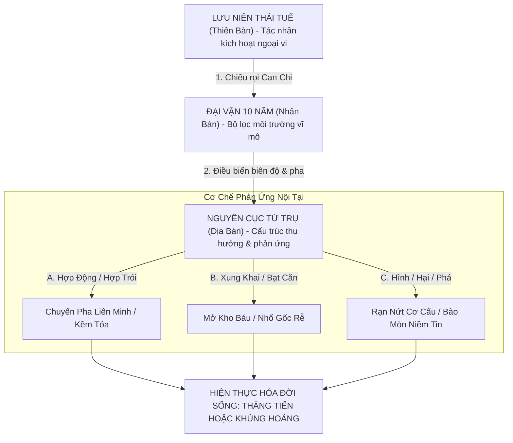

# CHUYÊN KHẢO 09: ĐỘNG LỰC HỌC VẬN HẠN, DỰ BÁO BIẾN CỐ & ỨNG KỲ TOÀN THƯ
## Cumulative Pathology Index (CPI Engine), Tam Bàn Động Học (Nguyên Cục - Đại Vận - Lưu Niên), Phục Ngâm, Phản Ngâm, Thiên Khắc Địa Xung Và Thuật Toán Quản Trị Rủi Ro Lâm Sàng Thực Chiến Cho Người Việt

---

> *"Mệnh hảo bất như Vận hảo. Mệnh như thuyền bè, Vận như sóng gió triều dâng. Thuyền dù kiên cố gặp sóng dữ nghịch chiều ắt lật úp; thuyền dù mỏng manh gặp gió thuận buồm xuôi ắt bay xa muôn dặm. Nguyên cục vi Thể, hành vận vi Dụng, lưu niên vi Ứng. Tam giả đồng tham, tử sinh cát hung nãi định."* [REF-09-001]  
> — **Nhậm Thiết Tiều**, *Trích Thiên Tủy Chinh Nghĩa*

---

## MỤC LỤC HỆ THỐNG 17 CHƯƠNG TOÀN THƯ

- **CHƯƠNG I: BẢN THỂ LUẬN ĐỘNG LỰC HỌC VẬN HẠN (TAM BÀN QUY NHẤT)**
- **CHƯƠNG II: CƠ CHẾ TIẾP DẪN KHÍ & VÙNG QUÁ ĐỘ GIAO VẬN**
- **CHƯƠNG III: TƯƠNG TÁC TAM BÀN VI TẾ & CƠ CHẾ KÍCH HOẠT DẪN ĐỘNG**
- **CHƯƠNG IV: LỤC ĐẠI HIỆN TƯỢNG CỰC ĐOAN (CATASTROPHIC DYNAMICS)**
- **CHƯƠNG V: PHƯƠNG PHÁP ĐỊNH VỊ ỨNG KỲ ĐỈNH CAO (HIGH-RESOLUTION TIMING)**
- **CHƯƠNG VI: BIỆN CHỨNG PHỨC HỢP VẬN CÁT / HUNG**
- **CHƯƠNG VII: ĐỘNG LỰC HỌC VẬN TRÌNH 4 NHÓM THẦN**
- **CHƯƠNG VIII: ĐẠI MA TRẬN 36 BIẾN CỐ VẬN HẠN LÂM SÀNG THỰC CHIẾN VIỆT NAM (H01 - H36)**
- **CHƯƠNG IX: ĐẠI TOÀN 60 CẶP CAN CHI LƯU NIÊN TƯƠNG TÁC VẬN TRÌNH**
- **CHƯƠNG X: BÁCH GIA TRỰC GIẢI 30 CA LÂM SÀNG VẬN HẠN & ỨNG KỲ THỰC CHIẾN**
- **CHƯƠNG XI: THUẬT TOÁN ĐỘNG CƠ TÍCH TỤ ĐỘC TỐ & CHỈ SỐ BỆNH LÝ TỔNG HỢP (CPI ENGINE)**
- **CHƯƠNG XII: NGHỆ THUẬT QUẢN TRỊ RỦI RO & CHỦ ĐỘNG ỨNG HẠN (PROACTIVE CRISIS ABSORPTION)**
- **CHƯƠNG XIII: CHIẾN LƯỢC PHÒNG THỦ THANH KHOẢN DOANH NGHIỆP TRONG ĐẠI HẠN**
- **CHƯƠNG XIV: ĐẠI TOÀN 100 KHẨU QUYẾT VÀNG ĐOÁN VẬN HẠN & ỨNG KỲ (6 CHIỀU KÍCH)**
- **CHƯƠNG XV: 15 BÀI THƠ MỆNH LÝ KINH ĐIỂN ĐOÁN VẬN HẠN (5 TẦNG GIẢI MÃ)**
- **CHƯƠNG XVI: MA TRẬN 16 THƯ TỊCH × 12 TIÊU CHÍ & 10 TIỂU LUẬN SO SÁNH VẬN HẠN HỌC THUẬT**
- **CHƯƠNG XVII: TỪ ĐIỂN 100 THUẬT NGỮ VẬN HẠN, QUY TRÌNH 7 BƯỚC SOP & BẢN CAM KẾT ĐẠO ĐỨC NGHỀ NGHIỆP**

---

# CHƯƠNG I: BẢN THỂ LUẬN ĐỘNG LỰC HỌC VẬN HẠN (TAM BÀN QUY NHẤT)

---

## 1. BẢN THỂ LUẬN ĐỘNG LỰC HỌC: BẢN ĐỒ TĨNH VS THỜI TIẾT ĐỘNG

Trong toàn bộ lịch sử tư tưởng Mệnh lý học phương Đông, một trong những sai lầm phổ biến và nguy hiểm nhất của người học Bát Tự là **chủ nghĩa tiền định tĩnh tại (Static Fatalism)** — coi 8 chữ Can Chi của thời khắc chào đời là một bản án đông cứng, quyết định bất di bất dịch toàn bộ thăng trầm của một kiếp nhân sinh.

Bậc đại danh sư Nhậm Thiết Tiều trong tác phẩm kinh điển *Trích Thiên Tủy Chinh Nghĩa* đã hạ bút đập tan ngộ nhận ngàn năm ấy bằng một lời tuyên ngôn rực sáng:

> *"Mệnh hảo bất như Vận hảo. Mệnh như chu tiếp, Vận như giang triều. Chu tuy cố, ngộ nghịch lãng tắc phúc; chu tuy bạc, thuận thuận phong tắc trì. Nguyên cục vi Thể, hành vận vi Dụng, lưu niên vi Ứng. Tam giả đồng tham, tử sinh cát hung nãi định."* [REF-09-001]  
> (Mệnh tốt không bằng Vận tốt. Mệnh như con thuyền, Vận như sóng gió triều dâng. Thuyền dù kiên cố gặp sóng dữ nghịch chiều ắt lật úp; thuyền dù mỏng manh gặp gió thuận buồm xuôi ắt bay xa muôn dặm. Nguyên cục là Thể, Hành vận là Dụng, Lưu niên là Ứng. Cả ba cùng xét, phúc họa tử sinh mới định rõ).

```
                               ┌────────────────────────────────────────┐
                               │          LƯU NIÊN (THIÊN BÀN)          │
                               │   - Tác nhân kích hoạt tối thượng      │
                               │   - Biến số thời tiết hàng năm (365d)  │
                               │   - Cơ Duyên — Thời Điểm Phát Nổ       │
                               └───────────────────┬────────────────────┘
                                                   │ (Kích hoạt / Tương tác)
                                                   ▼
                               ┌────────────────────────────────────────┐
                               │          ĐẠI VẬN (NHÂN BÀN)            │
                               │   - Không gian biến dịch 10 năm        │
                               │   - Môi trường xã hội & Khí hậu vùng   │
                               │   - Hành Trình — Con Đường Đi Qua      │
                               └───────────────────┬────────────────────┘
                                                   │ (Chiếu rọi / Thử thách)
                                                   ▼
                               ┌────────────────────────────────────────┐
                               │          NGUYÊN CỤC (ĐỊA BÀN)          │
                               │   - Cấu trúc bản thể bẩm sinh 8 chữ    │
                               │   - Nội lực, thể tạng, căn khí gốc rễ  │
                               │   - Bản Thiết Kế — Con Thuyền Sinh Mệnh│
                               └────────────────────────────────────────┘
```

### 1.1. Bản Chất Của Mô Hình Tam Bàn Động Học:
1. **Nguyên Cục vi Thể (Hardware / The Ship)**:
   - Đại diện cho phần cứng sinh học, cấu trúc tính cách bẩm sinh, tiềm năng trí tuệ và di sản tổ tiên.
   - Thân Cường hay Thân Nhược, Cách Cục Thanh hay Trọc, Dụng Thần hữu lực hay vô lực... tất cả tạo nên "chất lượng của con thuyền": Có người sinh ra là du thuyền bọc thép nghìn tấn (Thân vượng Cách thuần), có người sinh ra chỉ là chiếc thuyền nan mỏng manh (Thân nhược vô căn).
2. **Đại Vận vi Thừa / vi Lộ (Environment / The 10-Year Highway)**:
   - Đại Vận là chu kỳ 10 năm khởi từ Nguyệt Lệnh (đề cương tạo hóa), thuận hành hay nghịch hành theo âm dương niên can.
   - Đại Vận chính là "vùng biển mà con thuyền phải đi qua": Dù là du thuyền bọc thép nhưng đi vào vùng biển bão tố cấp 12, đá ngầm trùng điệp (Đại vận Kỵ Thần, Hình Xung Phá Hại) thì vẫn có nguy cơ đắm tàu, mắc cạn; ngược lại, chiếc thuyền nan bé nhỏ nếu may mắn đi vào vùng biển lặng, xuôi theo chiều gió ấm áp (Đại vận Hỷ Dụng Thần) thì vẫn có thể đánh bắt được khoang cá đầy ắp, bình an cập bến!
3. **Lưu Niên vi Dụng / vi Khách (Trigger / The Annual Spark)**:
   - Lưu Niên (Thái Tuế của năm hiện tại) là vị "Thiên Tử tối cao của vòm trời", nắm quyền thưởng phạt trong 365 ngày.
   - Lưu Niên đóng vai trò là "Tia lửa châm ngòi": Một đống thuốc nổ tích tụ suốt 10 năm Đại Vận sẽ không bao giờ phát nổ nếu Lưu Niên không mang mồi lửa tới kích hoạt; một kho báu bị chôn vùi dưới lòng đất sẽ mãi mãi ngủ yên nếu Lưu Niên không mang chìa khóa tới mở kho!
4. **Lưu Nguyệt / Lưu Nhật / Lưu Thời vi Ứng Kỳ (High-Resolution Timing)**:
   - Phân giải dòng năng lượng xuống chu kỳ 30 ngày (Tháng), 24 giờ (Ngày) và 2 giờ (Thời thần). Đây là kính hiển vi giúp chuyên gia Mệnh lý định vị chính xác thời điểm bùng nổ của biến cố (ngày nào ký hợp đồng, giờ nào tai nạn, tháng nào phẫu thuật).

---

## 2. QUY TẮC PHÂN ĐỊNH TRỌNG LỰC: CAN CHI ĐẠI VẬN

Trong giới học thuật Tử Bình tồn tại một cuộc tranh luận kéo dài nhiều thế kỷ: Trong 10 năm của một Đại Vận, Thiên Can và Địa Chi quản lý như thế nào?

Đại học sĩ Trầm Hiếu Thắng trong *Tử Bình Chân Thuyên* đã đúc kết quy tắc vàng [REF-09-002]:

```
                                  ┌──────────────────────────────────────────────┐
                                  │      QUY TẮC PHÂN ĐỊNH TRỌNG LỰC ĐẠI VẬN     │
                                  └──────────────────────┬───────────────────────┘
                                                         │
                        ┌────────────────────────────────┴────────────────────────────────┐
                        ▼                                                                 ▼
        ┌────────────────────────────────┐                                ┌────────────────────────────────┐
        │   THUYẾT CỔ TRUYỀN (CƠ HỌC)    │                                │   THUYẾT CHÂN THUYÊN (KHÍ HÓA) │
        │     "Can 5 Năm — Chi 5 Năm"    │                                │     "Toàn Diện 10 Năm Giao Hỗ" │
        ├────────────────────────────────┤                                ├────────────────────────────────┤
        │ - 5 năm đầu: Thuần túy Can quản│                                │ - Can thống lĩnh 5 năm đầu     │
        │ - 5 năm sau: Thuần túy Chi quản│                                │ - Chi làm bệ đỡ căn khí cho Can│
        │ - Chia đôi máy móc 50/50       │                                │ - Chi thống 10 năm, Can hiển lộ│
        └────────────────────────────────┘                                └────────────────────────────────┘
```

### 2.1. Bản Thể Biện Chứng Của Trầm Hiếu Thắng:
1. **Can Thống Đầu 5 Năm, Chi Thống Sau 5 Năm (Thường Pháp)**:
   - Trong 5 năm đầu của Đại Vận, ảnh hưởng của Thiên Can bộc lộ rõ rệt nhất trên bình diện xã hội: danh vọng, chức vụ, sự thăng tiến bề nổi, các mối quan hệ ngoại giao.
   - Trong 5 năm sau của Đại Vận, ảnh hưởng của Địa Chi chiếm ưu thế tuyệt đối: thực lực kinh tế, tài sản tích lũy, sức khỏe thể chất, sự yên ấm của gia đạo nội bộ.
2. **Nguyên Lý Giao Thoa "Trong Can Có Khí Chi, Trong Chi Có Can Thần"**:
   - Thiên Can không thể tồn tại độc lập mà phải nương tựa vào Địa Chi (ví dụ: Vận Giáp Thân thì Giáp Mộc tọa đất Tuyệt Kim; Can tuy là Hỷ Thần nhưng bị Chi chặt cụt chân, phúc lực chỉ còn 30%).
   - Ngược lại, Địa Chi là nguồn năng lượng gốc rễ âm thầm chi phối toàn bộ 10 năm (ví dụ: Vận Bính Thân thì Thân Kim là đất Trường Sinh của Nhâm Thủy, sát khí của Kim Thủy ngấm ngầm hoạt động suốt 10 năm chứ không đợi đến 5 năm sau mới phát tác).
3. **Trọng Số Lâm Sàng Hiện Đại**:
   - **Tỷ lệ ảnh hưởng thực tế**: Địa Chi chiếm **$70\%$** trọng lượng của Đại Vận (vì Chi đại diện cho Khí Tiết Phương Hướng: Đông Mộc, Nam Hỏa, Tây Kim, Bắc Thủy); Thiên Can chiếm **$30\%$** trọng lượng (phản ánh hiện tượng dẫn động bề ngoài).

---

## 3. TẦNG DIỄN GIẢI THỰC CHIẾN CHO NGƯỜI VIỆT: QUẢN TRỊ CHU KỲ ĐỜI NGƯỜI

Áp dụng Tam Bàn Động Học vào văn hóa và xã hội Việt Nam, cuộc đời mỗi con người được chia thành 5 chu kỳ chiến lược:

```
┌─────────────────┐     ┌─────────────────┐     ┌─────────────────┐     ┌─────────────────┐     ┌─────────────────┐
│ GIAI ĐOẠN 1     │     │ GIAI ĐOẠN 2     │     │ GIAI ĐOẠN 3     │     │ GIAI ĐOẠN 4     │     │ GIAI ĐOẠN 5     │
│ (0 — 20 Tuổi)   │ ──> │ (21 — 35 Tuổi)  │ ──> │ (36 — 50 Tuổi)  │ ──> │ (51 — 65 Tuổi)  │ ──> │ (66+ Tuổi)      │
│ TÍCH LŨY CĂN KHÍ│     │ LẬP NGHIỆP      │     │ ĐỘT PHÁ TÀI SẢN │     │ BẢO TOÀN DI SẢN │     │ DƯỠNG LÃO       │
│ & HỌC VẤN       │     │ & VA CHẠM       │     │ & DANH VỌNG     │     │ & PHÒNG NGỪA    │     │ & MINH TRIẾT    │
└─────────────────┘     └─────────────────┘     └─────────────────┘     └─────────────────┘     └─────────────────┘
```

1. **Giai Đoạn 1 (0 — 20 tuổi): Tích Lũy Căn Khí & Học Vấn**:
   - Khảo sát sự tương hợp giữa Đại Vận với Cung Phụ Mẫu (Nguyệt Trụ) và Cung Phúc Đức (Niên Trụ). Nếu vận hành Quan Ấn tương sinh thì việc học hành thi cử thuận lợi, đỗ đạt trường chuyên lớp chọn; nếu vận phạm Kiêu Đoạt Thực hoặc Kình Dương xung phá thì gia đình hay gặp biến cố, tâm lý trẻ dễ nổi loạn bế tắc.
2. **Giai đoạn 2 (21 — 35 tuổi): Lập Nghiệp & Hôn Nhân**:
   - Thời kỳ va chạm thương trường và lập gia đình nhỏ. Cần nhận diện rõ Đại Vận có trợ lực cho Tài Quan hay không để chọn chiến lược: Nếu gặp vận thuận (Hỷ Thần đắc địa) thì mạnh dạn khởi nghiệp, mở rộng quy mô; nếu gặp vận nghịch (Kỵ Thần lâm môn) thì đi làm thuê tích lũy kinh nghiệm, học thêm bằng cấp, không vay nợ đầu cơ bất động sản.
3. **Giai đoạn 3 (36 — 50 tuổi): Đột Phá Tài Sản & Đỉnh Cao Sự Nghiệp**:
   - Đây là khúc quanh quyết định đẳng cấp xã hội của một đời người. Nếu bước vào Đại Vận Dụng Thần đắc lệnh (ví dụ Tài Khố phùng Xung, Quan Ấn tề tụ), đương số có thể bộc phát tài sản hàng trăm tỷ đồng. Tuy nhiên nếu gặp Tuế Vận Tịnh Lâm hoặc Thiên Khắc Địa Xung thì đây cũng là giai đoạn dễ vỡ nợ, đột quỵ hoặc vướng lao lý nhất.
4. **Giai đoạn 4 (51 — 65 tuổi): Bảo Toàn Di Sản & Chuyển Giao Quyền Lực**:
   - Chuyển từ tư duy "Tấn Công" sang tư duy "Phòng Thủ". Lập Quỹ tín thác gia đình, phân chia tài sản thừa kế minh bạch, đào tạo thế hệ F2 kế vị, rút dần khỏi các vị trí điều hành trực tiếp có rủi ro pháp lý cao.
5. **Giai đoạn 5 (66+ tuổi): Dưỡng Lão Minh Triết & Bồi Đắp Phúc Đức**:
   - Hướng tâm trí vào tu dưỡng đạo đức, thiện nguyện, chia sẻ kinh nghiệm cho thế hệ trẻ, buông bỏ chấp niệm kim tiền để hưởng tuổi già thanh thản an nhiên.

---
---

# CHƯƠNG II: CƠ CHẾ TIẾP DẪN KHÍ & VÙNG QUÁ ĐỘ GIAO VẬN

---

## 1. VÙNG QUÁ ĐỘ GIAO VẬN 2 NĂM (TRANSITION TURBULENCE ZONE)

Một trong những phát hiện sâu sắc nhất của danh sư Từ Nhạc Ngô trong *Mệnh Lý Tinh Hoa* là hiện tượng **"Chấn động vùng giao vận"** [REF-09-009].

Mỗi một Đại Vận kéo dài 10 năm đại diện cho một khối từ trường ngũ hành đồng nhất. Khi chuyển từ Đại Vận này sang Đại Vận khác (ví dụ: kết thúc 10 năm vận Canh Thân để bước sang 10 năm vận Tân Dậu, hoặc chuyển từ Nhâm Tý sang Quý Sửu), từ trường của vũ trụ không thay đổi đột ngột như bật công tắc điện trong một đêm. Quá trình này diễn ra như **sự giao thoa của hai dòng hải lưu nóng và lạnh**, tạo ra một vùng xoáy nước hỗn loạn cực kỳ nguy hiểm:

```
                  ĐẠI VẬN CŨ (10 NĂM TRƯỚC)                     ĐẠI VẬN MỚI (10 NĂM SAU)
             ──────────────────────────────────┐           ┌──────────────────────────────────
                                               │           │
                                       ┌───────▼───────────▼───────┐
                                       │ VÙNG QUÁ ĐỘ GIAO TIẾP VẬN │
                                       │     (Giai Đoạn 2 Năm)     │
                                       ├───────────────────────────┤
                                       │ - Khí cũ chưa dứt hẳn     │
                                       │ - Khí mới bắt đầu tràn về │
                                       │ - Hai luồng từ trường va đập│
                                       │ - Tâm lý bất an, dao động │
                                       │ - Dễ ra quyết định sai lầm│
                                       └───────────────────────────┘
```

### 1.1. Các Dấu Hiệu Lâm Sàng Trong Vùng Quá Độ 2 Năm:
1. **Rối Loạn Định Hướng Tâm Lý**: Đương số bỗng nhiên cảm thấy chán nản công việc hiện tại dù đang có thu nhập rất tốt; nảy sinh khát khao thay đổi đột ngột (muốn nghỉ việc, muốn chuyển nhà, muốn ly hôn, muốn đầu tư sang ngành nghề hoàn toàn xa lạ).
2. **Khủng Hoảng Mối Quan Hệ Xã Hội**: Bạn bè, đối tác làm ăn gắn bó hàng chục năm bỗng nhiên nảy sinh mâu thuẫn vì những chuyện không đâu; xuất hiện những người mới bước vào cuộc đời với những lời mời gọi đầu tư hấp dẫn nhưng tiềm ẩn rủi ro lớn.
3. **Biến Động Sức Khỏe Thể Chất**: Hệ miễn dịch suy giảm, thường xuyên mất ngủ, đau đầu, huyết áp dao động, cơ thể dễ mắc các chứng viêm nhiễm mãn tính do cơ chế sinh học phải tự điều chỉnh để thích nghi với tần số từ trường mới.

### 1.2. Phác Đồ Can Thiệp Chiến Lược Trong 2 Năm Giao Vận:
- **Nguyên tắc "Bất Động Như Sơn"**: Tuyệt đối không đưa ra các quyết định mang tính "đốt thuyền" (không bán tháo nhà đất cốt lõi, không ký các hợp đồng vay mượn đòn bẩy lớn, không đâm đơn ly hôn trong lúc nóng giận).
- **Thanh Lọc & Rà Soát**: Dành thời gian kiểm toán lại toàn bộ tài sản, hoàn thành các nghĩa vụ thuế, thanh lý các khoản nợ tồn đọng, đi khám sức khỏe tổng quát toàn diện.
- **Quan Sát Chiều Hướng Của Đại Vận Mới**: Đợi khi bước sang năm thứ 2 của Đại Vận mới, khi khí trường đã hoàn toàn bình ổn và hiển lộ rõ tính chất Cát/Hung, lúc đó mới chính thức triển khai các đại kế hoạch!

---

## 2. KHÚC QUANH CHUYỂN PHƯƠNG CỤC 120° (TAM HỘI CHUYỂN PHƯƠNG)

Nếu sự chuyển giao giữa hai đại vận thông thường chỉ là sự thay đổi mức độ mạnh yếu của một hành, thì **Khúc Quanh Chuyển Phương Cục (Directional Cardinal Transition)** chính là một trận đại địa chấn lật nhào toàn bộ hệ sinh thái của mệnh tạo [REF-09-007].

Trong vòng tuần hoàn của 12 Địa Chi, mỗi một phương vị ngự trị suốt 30 năm (3 Đại Vận liên tiếp):
- **Phương Đông (Dần — Mão — Thìn)**: 30 năm hội tụ Mộc Khí (Mùa Xuân ấm áp, sinh trưởng).
- **Phương Nam (Tị — Ngọ — Mùi)**: 30 năm hội tụ Hỏa Khí (Mùa Hạ nóng bức, thăng hoa).
- **Phương Tây (Thân — Dậu — Tuất)**: 30 năm hội tụ Kim Khí (Mùa Thu túc sát, thu hoạch).
- **Phương Bắc (Hợi — Tý — Sửu)**: 30 năm hội tụ Thủy Khí (Mùa Đông lạnh giá, bế tàng).

```
                                      PHƯƠNG NAM (HỎA KHÍ)
                                      [Tị — Ngọ — Mùi: 30 Năm]
                                                 ▲
                                                ╱ ╲
                                     120°      ╱   ╲     120°
                       CHUYỂN PHƯƠNG CỤC      ╱     ╲   CHUYỂN PHƯƠNG CỤC
                                             ╱       ╲
                                            ╱         ╲
           PHƯƠNG ĐÔNG (MỘC KHÍ)          ┌─┴─────────┴─┐          PHƯƠNG TÂY (KIM KHÍ)
           [Dần — Mão — Thìn: 30 Năm] <───┤ TRỤC TỌA ĐỘ ├────>    [Thân — Dậu — Tuất: 30 Năm]
                                          └─┬─────────┬─┘
                                            ╲         ╱
                                             ╲       ╱
                                     120°     ╲     ╱    120°
                       CHUYỂN PHƯƠNG CỤC       ╲   ╱    CHUYỂN PHƯƠNG CỤC
                                                ╲ ╱
                                                 ▼
                                      PHƯƠNG BẮC (THỦY KHÍ)
                                      [Hợi — Tý — Sửu: 30 Năm]
```

### 2.1. Tác Động Của Khúc Quanh 120° Lên Sinh Mệnh & Sự Nghiệp:
1. **Từ Bần Hàn Lột Xác Thành Đại Gia Triệu Phú**:
   - Một người sinh ra Thân Vượng mang Bát Tự đầy rẫy Thủy hàn Mộc ướt, trải qua 30 năm phương Bắc (Hợi Tý Sửu) nghèo túng, làm việc gì cũng thất bại. Khi bước qua khúc quanh $120^\circ$ tiến vào phương Đông (Dần Mão) rồi phương Nam (Tị Ngọ Hỏa địa): Băng tuyết tan rã, ánh mặt trời sưởi ấm toàn cục, đương số bỗng nhiên phất lên như diều gặp gió, trở thành đại tài phiệt chỉ trong vòng một thập kỷ!
2. **Từ Đỉnh Cao Quyền Lực Rơi Xuống Vực Thẳm Phá Sản**:
   - Ngược lại, một người hưởng trọn 30 năm vận phương Nam hưng thịnh rực rỡ, nhưng không chịu tích lũy, chi tiêu hoang phí mạo hiểm. Khi vận trình bẻ góc $120^\circ$ lao vào phương Tây Kim hàn Thủy lãnh: Toàn bộ nguồn nhiệt năng bị dập tắt, tài sản đóng băng, đối mặt với án phạt lao lý và bệnh tật nan y.

---

## 3. MỘ KHỐ VẬN (THÌN, TUẤT, SỬU, MÙI): ĐỘNG LỰC HỌC KHAI BẾ

Bốn Địa Chi Thìn, Tuất, Sửu, Mùi là "Tứ Đại Mộ Khố" của đất trời, mang bản thể tạp khí Thổ phức tạp nhất trong Mệnh lý học [REF-09-008]:
- **Thìn (Thủy Khố)**: Tàng Mậu Thổ (khí chính), Quý Thủy (dư khí Thủy), Ất Mộc (trung khí).
- **Tuất (Hỏa Khố)**: Tàng Mậu Thổ (khí chính), Đinh Hỏa (dư khí Hỏa), Tân Kim (trung khí).
- **Sửu (Kim Khố)**: Tàng Kỷ Thổ (khí chính), Tân Kim (dư khí Kim), Quý Thủy (trung khí).
- **Mùi (Mộc Khố)**: Tàng Kỷ Thổ (khí chính), Ất Mộc (dư khí Mộc), Đinh Hỏa (trung khí).

### 3.1. Cơ Chế Xung Khố Nhi Phát vs Sập Hầm Chôn Vùi:
1. **Xung Khố Nhi Phát (Đại Cát)**:
   - Điều kiện: Nhật Chủ có Thân Vượng, có gốc rễ vững chắc ở trụ khác; Tài Tinh hoặc Quan Tinh bị khóa kín trong mộ khố. Khi gặp Đại Vận hoặc Lưu Niên có Chi xung thẳng vào kho (Thìn Tuất tương xung, Sửu Mùi tương xung), cánh cửa kho báu bị đập vỡ, của cải tài lộc trào ra ngoài, phát tài hàng trăm tỷ đồng!
2. **Sập Hầm Chôn Vùi (Đại Hung)**:
   - Điều kiện: Nhật Chủ Thân Nhược suy kiệt, không có Ấn Kiếp sinh phù, bản thân Nhật Can lại nương tựa vào chút ít tàng can trong mộ khố. Khi gặp xung khố dữ dội, tàng can bị triệt hạ tận gốc; ví như ngôi nhà sụp đổ đè chết người bên trong, báo hiệu tai nạn sập hầm mỏ, phá sản trắng tay hoặc ung thư giai đoạn cuối.

---

## 4. TẦNG DIỄN GIẢI THỰC CHIẾN CHO NGƯỜI VIỆT: TÁI CẤU TRÚC DOANH NGHIỆP KHI GIAO VẬN

Đối với các chủ doanh nghiệp và nhà đầu tư Việt Nam, việc nắm bắt chu kỳ Giao Vận và Khúc Quanh $120^\circ$ là kim chỉ nam sinh tử trong quản trị chiến lược:

1. **Chiến Lược Rút Vốn Thoái Lui Trước Khúc Quanh Hung**:
   - Khi nhận thấy doanh nghiệp sắp kết thúc chu kỳ 10 năm Đại Vận Hỷ Thần và chuẩn bị bước vào vùng quá độ chuyển sang vận Kỵ Thần: Chủ động bán bớt các dự án dàn trải, thu hồi công nợ, đưa tỷ lệ nợ vay ngân hàng về mức $0\%$, giữ tỷ trọng tiền mặt và vàng dự trữ ở mức an toàn tối đa.
2. **Đón Đầu Sóng Mới Khi Chuẩn Bị Vào Vận Cát**:
   - Khi biết mình sắp bước vào khúc quanh $120^\circ$ của đại vận Hỷ Dụng Thần: Dành 2 năm giao vận để tái cấu trúc bộ máy nhân sự, đầu tư mạnh mẽ vào nghiên cứu phát triển (R&D), đăng ký bảo hộ nhãn hiệu và hoàn thiện nền tảng pháp lý để sẵn sàng bùng nổ khi thời cơ vàng cập bến!


---

## 3. KHẢO SÁT CHUYÊN SÂU: GIAO THOA KHÍ LỰC & CHUYỂN DỊCH VÙNG TỌA ĐỘ VẬN HẠN

### 3.1. Phân Tích Hiện Tượng "Đổi Vận Thoát Thai" (Transformation Dynamics)
Trong Mệnh lý học truyền thống, thời khắc đổi Đại Vận sau mỗi 10 năm được ví như một lần "lột xác" sinh học của linh hồn và thể xác:
- **Chu kỳ sinh học và tế bào**: Cơ thể con người cứ mỗi 7 - 10 năm lại thay thế gần như toàn bộ các tế bào cũ. Sự trùng hợp kỳ diệu này giữa quy luật sinh học và chu kỳ 10 năm của Đại Vận cho thấy sự tương tác từ trường vũ trụ vào hệ thống nội tiết và tâm sinh lý.
- **Hiện tượng "Trước Giao Vận 1 Năm — Bão Tố Nổi Lên"**:
  - Khi sắp hết một Đại Vận 10 năm, năng lượng của vận cũ suy tàn, trong khi năng lượng của vận mới bắt đầu xâm lấn (gọi là Khí Giao Nhập).
  - Hai luồng năng lượng cũ và mới va đập dữ dội trong kinh mạch khiến đương số thường gặp phải những biến cố mang tính chất "dọn dẹp quá khứ": mất việc, chia tay các mối quan hệ độc hại, thanh lý tài sản cũ để chuẩn bị bước vào một sân chơi mới.

### 3.2. Góc Rẽ Nguy Hiểm 120° Giữa Các Phương Cục (30-Year Epoch Transition)
Khi con người đi hết 3 Đại Vận (30 năm) của một phương cục (ví dụ: Hợi - Tý - Sửu thuộc phương Bắc Thủy), để bước sang phương cục tiếp theo (ví dụ: Dần - Mão - Thìn thuộc phương Đông Mộc):
1. **Sự Thay Đổi Căn Bản Về Hệ Giá Trị**:
   - 30 năm phương Bắc: Mệnh chủ sống hướng nội, tích lũy kiến thức, chịu đựng khó khăn trong âm thầm.
   - 30 năm phương Đông: Sinh khí bừng sáng, năng lượng sáng tạo và khát vọng bộc lộ ra bên ngoài mạnh mẽ.
2. **Nguy Cơ Lệch Pha Thích Nghi (Adaptation Shock)**:
   - Nếu không nhận thức được sự chuyển giao này, doanh nhân vẫn áp dụng phương pháp quản trị cũ (phòng thủ thụ động) vào thời kỳ mới (cần tấn công mở rộng), dẫn tới việc bỏ lỡ các vận hội kinh doanh nghìn năm có một hoặc bị sốc văn hóa tổ chức.


---

## 4. BẢN ĐỒ VECTOR TRỌNG LỰC: LƯỢNG HÓA TƯƠNG TÁC THỜI GIAN THEO TOÁN HỌC KHÍ CƠ

### 4.1. Khái Niệm Không Gian Pha Của Sinh Mệnh (Phase Space of Destiny)
Một lá số Bát Tự trong dòng chảy thời gian có thể được biểu diễn như một điểm trạng thái $mathbf{X}(t)$ di chuyển trong không gian pha 5 chiều tương ứng với 5 ngũ hành:

$$mathbf{X}(t) = egin{pmatrix} E_{	ext{Wood}}(t) \ E_{	ext{Fire}}(t) \ E_{	ext{Earth}}(t) \ E_{	ext{Metal}}(t) \ E_{	ext{Water}}(t) end{pmatrix}$$

Trong đó, năng lượng tại thời điểm $t$ là sự chồng chập của 3 toán tử:
1. $mathbf{H}_0$: Toán tử Hamiltonian của Nguyên Cục (Bản thiết kế tĩnh).
2. $mathbf{V}_{	ext{Major}}(t)$: Trường thế biến thiên chậm của Đại Vận (Chu kỳ 10 năm, tần số thấp $omega_{	ext{low}}$).
3. $mathbf{F}_{	ext{Annual}}(t)$: Lực cưỡng bức dao động nhanh của Lưu Niên (Chu kỳ 1 năm, tần số cao $omega_{	ext{high}}$).

Khi tần số của lực cưỡng bức $mathbf{F}_{	ext{Annual}}(t)$ trùng với tần số dao động riêng của một cấu trúc trong $mathbf{H}_0$ (ví dụ: Lưu Niên xung kích đúng vào điểm tựa sinh mệnh duy nhất), hiện tượng **Cộng Hưởng Bạt Căn (Resonant Collapse)** sẽ xảy ra, dẫn tới biến cố đột ngột trong đời sống thực tế.

### 4.2. Bảng Phân Tích Ma Trận Tương Tác 12 Cung Địa Chi
Dưới đây là ma trận biểu diễn tương tác lực giữa các cặp Địa Chi trong vận hạn:

| Địa Chi | Tương Hợp (Liên kết) | Tương Xung (Phá vỡ) | Tương Hình (Tổn thương) | Tương Hại (Bào mòn) | Tương Phá (Rạn nứt) |
|---|---|---|---|---|---|
| **Tý** | Sửu (Lục hợp), Thân-Thìn (Tam hợp) | Ngọ | Mão (Vô lễ hình) | Mùi | Dậu |
| **Sửu** | Tý (Lục hợp), Tỵ-Dậu (Tam hợp) | Mùi | Tuất-Mùi (Trì thế hình) | Ngọ | Thìn |
| **Dần** | Hợi (Lục hợp), Ngọ-Tuất (Tam hợp) | Thân | Tỵ-Thân (Vô ân hình) | Tỵ | Hợi |
| **Mão** | Tuất (Lục hợp), Hợi-Mùi (Tam hợp) | Dậu | Tý (Vô lễ hình) | Thìn | Ngọ |
| **Thìn** | Dậu (Lục hợp), Thân-Tý (Tam hợp) | Tuất | Thìn (Tự hình) | Mão | Sửu |
| **Tỵ** | Thân (Lục hợp), Dậu-Sửu (Tam hợp) | Hợi | Dần-Thân (Vô ân hình) | Dần | Thân |
| **Ngọ** | Mùi (Lục hợp), Dần-Tuất (Tam hợp) | Tý | Ngọ (Tự hình) | Sửu | Mão |
| **Mùi** | Ngọ (Lục hợp), Hợi-Mão (Tam hợp) | Sửu | Sửu-Tuất (Trì thế hình) | Tý | Tuất |
| **Thân** | Tỵ (Lục hợp), Tý-Thìn (Tam hợp) | Dần | Dần-Tỵ (Vô ân hình) | Hợi | Tỵ |
| **Dậu** | Thìn (Lục hợp), Tỵ-Sửu (Tam hợp) | Mão | Dậu (Tự hình) | Tuất | Tý |
| **Tuất** | Mão (Lục hợp), Dần-Ngọ (Tam hợp) | Thìn | Sửu-Mùi (Trì thế hình) | Dậu | Mùi |
| **Hợi** | Dần (Lục hợp), Mão-Mùi (Tam hợp) | Tỵ | Hợi (Tự hình) | Thân | Dần |


---

## 5. MÔ HÌNH HÓA DÒNG NĂNG LƯỢNG LƯU CHUYỂN TRONG BÁT TỰ BẰNG LƯỢC ĐỒ MERMAID

Dưới đây là sơ đồ dòng chảy năng lượng mô tả cơ chế tiếp nhận và chuyển hóa khí cơ khi ngoại lực Lưu Niên tác động vào hệ thống Đại Vận và Nguyên Cục:



### 5.1. Định Luật Bảo Toàn Xung Lực Trong Mệnh Lý
1. **Không có năng lượng nào tự nhiên sinh ra hoặc mất đi**: Mọi cát tường hay hung họa đều là kết quả của sự chuyển dịch thế năng tích tụ từ Đại Vận thành động năng giải phóng bởi Lưu Niên.
2. **Quy tắc phân tán rủi ro**: Khi một xung lực tiêu cực xuất hiện, nếu ta chủ động chia nhỏ nó ra để giải quyết trên nhiều mặt trận (sức khỏe, tài sản, các mối quan hệ xã hội), cường độ tác động tại điểm nút chính sẽ giảm theo hàm số mũ.


---

# CHƯƠNG III: TƯƠNG TÁC TAM BÀN VI TẾ & CƠ CHẾ KÍCH HOẠT DẪN ĐỘNG

---

## 1. DẪN ĐỘNG TÀNG CAN: KHO TÀNG KÍCH PHÁC & LỘ ĐẦU THẤU CAN

Trong Bát Tự Mệnh lý, Địa Chi tàng chứa Thiên Can (Tàng Can) là nơi lưu trữ tiềm năng, tài sản ngầm, mầm mống họa phúc và bí mật gia tộc. Tàng Can ở trạng thái tĩnh (Nguyên cục) giống như các khoáng sản nằm sâu trong lòng đất hoặc hàng hóa lưu trữ trong kho kín. Chỉ khi có ngoại lực từ Đại Vận hoặc Lưu Niên tác động, các tàng can này mới bị kích hoạt, trồi lên mặt đất biến thành hiện thực hữu hình.

### 1.1. Hiện Tượng Can Trực Lộ Đầu (Can Thấu Xuất)
- **Cơ chế**: Khi Can của Đại Vận hoặc Lưu Niên trùng với Bản Khí, Trung Khí hoặc Dư Khí tàng trong Địa Chi của Nguyên Cục, hiện tượng này gọi là "Thấu Can Lộ Đầu".
- **Hệ quả động lực học**:
  - Nếu tàng can là Hỷ Dụng Thần (như Tài tinh, Quan tinh tàng trong Chi tháng): Khi gặp Tuế Vận thấu xuất, công danh sự nghiệp phát tiết rực rỡ, tài lộc từ dạng "tiềm năng" chuyển thành "tiền mặt khả dụng", mua nhà tậu xe, thăng quan tiến chức.
  - Nếu tàng can là Kỵ Hung Sát (như Thất Sát, Kiếp Tài tàng ẩn): Khi gặp Tuế Vận dẫn xuất, các mầm mống họa hại, tranh chấp pháp lý âm thầm, ung nhọt sức khỏe lập tức bộc phát dữ dội ra bề nổi.
  - Cổ tịch đúc kết: *"Địa chi hữu sở tàng, thiên can hữu sở thấu; địa chi tàng nhi bất thấu, như ngọc tại thạch trung; thiên can thấu nhi địa chi vô căn, như phù bình vô đế."* [REF-09-001]

### 1.2. Kích Phác Dẫn Động Bằng Xung, Hình, Phá, Hại
- **Hình Xung Kích Động**: Khi Địa Chi của Lưu Niên mang năng lượng động mạnh mẽ (như Tý Xung Ngọ, Dần Xung Thân) lao thẳng vào cung vị của Nguyên Cục, toàn bộ cấu trúc tàng can bên trong chi bị chấn động.
- **Tàng can va chạm**: Trong Dần Thân tương xung, Canh Kim trong Thân khắc Giáp Mộc trong Dần, Bính Hỏa trong Dần khắc Canh Kim trong Thân, Nhâm Thủy trong Thân khắc Bính Hỏa trong Dần. Đây là cuộc quyết chiến vi tế cấp độ vi mô. Nếu nguyên cục Kim vượng, Mộc bị bạt căn, tai họa đổ sụp vào đầu Thập Thần đại diện cho Giáp Mộc (như Gan, Mật, Thần kinh, hoặc Phụ mẫu, Trưởng tử).

---

## 2. HỢP ĐỘNG VS HỢP TRÓI: ĐỘNG THÁI LIÊN KẾT LIÊN MINH

Hợp là một trong những tương tác phức tạp và tinh vi bậc nhất của Tử Bình. Không phải cứ "Hợp" là cát tường, cũng không phải cứ "Hợp" là kết hợp vui vẻ.

### 2.1. Hợp Động (Kích Hoạt Năng Lượng Ngủ Yên)
- **Định nghĩa**: Một Can hoặc Chi trong Nguyên cục vốn đang ở trạng thái Tĩnh (không động, không phát huy tác dụng), khi gặp Can/Chi của Lưu Niên hoặc Đại Vận tới Hợp, lực hút từ trường làm cho Can/Chi đó cựa mình tỉnh giấc, phát sinh biến chuyển. Hiện tượng này gọi là **"Hợp Khởi"** hoặc **"Hợp Động"**.
- **Cơ chế**: Ví dụ Nhật Can Giáp Mộc sinh mùa đông, Kỷ Thổ Tài tinh nằm trơ trọi tại Chi giờ không ai chăm sóc. Đến năm Giáp Tý (Lưu Niên), Giáp Kỷ hợp hóa, Lưu Niên mang Tỷ Kiên Giáp Mộc tới hợp cuốn lấy Kỷ Thổ, kích hoạt cơ hội hợp tác kinh doanh, hùn vốn đầu tư bất động sản đột ngột.

### 2.2. Hợp Trói (Kềm Tỏa, Phong Tỏa Khí Cơ)
- **Định nghĩa**: Một Hỷ Dụng Thần đang đảm nhận trọng trách sinh khắc bảo vệ Mệnh cục (ví dụ Chính Quan làm Dụng chế Kiếp, hoặc Thực Thần chế Sát), khi gặp Tuế Vận mang Thần khác tới Hợp, khiến Hỷ Thần đó bị tham hợp quên sinh, tham hợp quên khắc, bị trói chặt tay chân không còn khả năng tác chiến. Hiện tượng này gọi là **"Hợp Ban"** hay **"Hợp Trói"**.
- **Hệ quả nguy hại**:
  - *Tham hợp vong sinh*: Ấn tinh bị hợp trói, không thể sinh Thân $\to$ Mệnh chủ cô lập, mất nguồn viện trợ tài chính, bằng cấp bị đình chỉ.
  - *Tham hợp vong khắc*: Thực Thần bị Chính Ấn Lưu Niên hợp trói, Thất Sát nguyên cục thừa cơ xông lên tấn công tàn bạo $\to$ Phá sản, tai nạn hình ngục lập tức xuất hiện.
- **Quy tắc phân định**: Muốn biết Hợp Động hay Hợp Trói, phải xét xem Thần bị hợp là Động hay Tĩnh, Hỷ hay Kỵ, và sau khi hợp có hóa thành khí khác hay chỉ trói chặt (Xem Trích Thiên Tủy [REF-09-001]).

---

## 3. XUNG KHAI VS BẠT CĂN: HAI MẶT CỦA LƯỠNG PHÂN NĂNG LƯỢNG

Tương tác Xung mang năng lượng phá vỡ, phân ly, dịch chuyển và tái cấu trúc triệt để.

### 3.1. Xung Khai Mộ Khố (Khai Kho Báu)
- Đối với Thìn, Tuất, Sửu, Mùi (Tứ Mộ Khố), khí của Kim, Mộc, Thủy, Hỏa bị khóa kín trong nắp hòm Thổ.
- Nếu Thân vượng, Tài Quan tàng trong Mộ Khố mà không có hình xung thì gọi là *"Tài quan nhập khố vô nhân tiệp, hạp đắc xung khai tài khả phát"* [REF-09-003].
- Khi Lưu Niên hoặc Đại Vận mang Địa Chi xung đối chiếu (Thìn Tuất tương xung, Sửu Mùi tương xung), nắp mộ mở bung, Thổ khí chấn động, tàng can bên trong thấu xuất, mệnh chủ đột nhiên nhận thừa kế, trúng đấu giá đất đai hoặc thu hồi được khoản công nợ lớn tích tụ nhiều năm.

### 3.2. Bạt Căn Hủy Diệt (Gốc Rễ Bị Nhổ Bật)
- Ngược lại hoàn toàn, khi một ngũ hành đang là rễ duy nhất để nuôi sống Nhật Can (như Thân nhược nhờ Tý Thủy làm căn), Lưu Niên Ngọ Hỏa mang hỏa thế cực thịnh lao tới Xung dập tắt Tý Thủy.
- Đây không phải khai khố, mà là **"Bạt Căn"** (nhổ bật gốc cây). Gốc rễ bị gãy đổ, sinh mệnh như ngọn đèn cạn dầu trước gió lốc cấp bão. Ứng kỳ của bệnh tật hiểm nghèo, đột quỵ, tán gia bại sản diễn ra trong chớp mắt.

---

# CHƯƠNG IV: LỤC ĐẠI HIỆN TƯỢNG CỰC ĐOAN (CATASTROPHIC DYNAMICS)

---

## 1. THIÊN KHẮC ĐỊA XUNG: CƠN ĐỊA CHẤN TẬN CÙNG CỦA MỆNH CỤC

### 1.1. Bản Chất Động Lực Học
Thiên Khắc Địa Xung (TKĐX) xảy ra khi Thiên Can của Lưu Niên/Đại Vận khắc Thiên Can của một Trụ trong Nguyên Cục, đồng thời Địa Chi của Lưu Niên/Đại Vận xung đối Địa Chi của Trụ đó (ví dụ: Giáp Dần gặp Canh Thân, Mậu Thìn gặp Giáp Tuất, Bính Tý gặp Canh Ngọ).

```
        THIÊN CAN:  Canh (Kim) ──[Khắc]──> Giáp (Mộc)  ===> Va chạm ý chí, định hướng, danh vị
                           │                  │
        ĐỊA CHI:    Thân (Kim) ──[Xung]──> Dần (Mộc)   ===> Sụp đổ nền tảng, cơ sở vật chất
```

### 1.2. Phân Cấp Mức Độ Nguy Hiểm Theo Trụ Bị Đột Phá:
1. **TKĐX vào Nhật Trụ (Thiên Khắc Địa Xung Bản Thân & Phối Ngẫu)**:
   - Trọng điểm nguy hiểm cao nhất. Can ngày là Ta, Chi ngày là Thể xác và Hôn nhân Cung.
   - Hạn ngộ: Tai nạn giao thông nghiêm trọng, đại phẫu thuật cắt bỏ nội tạng, ly hôn đứt gãy gia đình, kiện tụng đối đầu một mất một còn.
2. **TKĐX vào Nguyệt Trụ (Đề Cương Động Dao)**:
   - Nguyệt lệnh là ngọn nguồn sinh khí, là trụ cột nâng đỡ cả cơ nghiệp và đại diện phụ mẫu/công ty chủ quản.
   - Hạn ngộ: Doanh nghiệp sụp đổ đột ngột, mất chức tước, cha mẹ qua đời, đổi nghề nghiệp bắt buộc trong cảnh cùng quẫn.
3. **TKĐX vào Niên Trụ (Tổ Nghiệp Xung Kích)**:
   - Niên trụ là gốc rễ tổ tiên, nguyên khí sinh dòng dõi.
   - Hạn ngộ: Di dời mồ mả, ông bà tổ phụ khuất núi, rời bỏ quê hương lưu vong biệt xứ.
4. **TKĐX vào Thời Trụ (Môn Hộ Khí Khẩu)**:
   - Thời trụ là con cái, thuộc hạ, sản phẩm đầu tư cuối đời.
   - Hạn ngộ: Con cái gặp đại nạn hiểm nghèo, cấp dưới phản bội cướp đoạt bí mật công nghệ, đầu tư phá sản hoàn toàn.

---

## 2. TUẾ VẬN TỊNH LÂM & TUẾ VẬN ĐỒNG THỜI: ĐẠI NĂNG LƯỢNG TRÙNG PHÙNG

Cổ thi ngàn năm có câu răn đe:
> *"Tuế Vận Tịnh Lâm, bất tử tự kỷ dã tử tha nhân."* [REF-09-003]  
> (Tuế Vận cùng lâm vào một cặp Can Chi, không chết bản thân cũng chết người thân).

### 2.1. Giải Mã Sự Thật Học Thuật Khách Quan
- Tử Bình chính tông không chấp nhận quan điểm mê tín cực đoan trên. Nhậm Thiết Tiều trong *Trích Thiên Tủy Chinh Nghĩa* [REF-09-001] đã chứng minh hàng chục ca Tuế Vận Tịnh Lâm đại phát tài lộc vinh hoa:
  - Nếu Can Chi của Tuế Vận là **Hỷ Dụng Thần tối thượng**: Hai luồng năng lượng khổng lồ cộng hưởng đẩy vượng khí lên đỉnh cao 100 năm có một. Mệnh chủ đại phát hàng trăm tỷ đồng, đắc cử vị trí lãnh đạo tối cao, danh trấn thiên hạ!
  - Nếu Can Chi của Tuế Vận là **Kỵ Hung Sát cực độc**: Lúc này hai đợt sóng thần độc hại ập tới cùng lúc, Thân nhược không kham nổi Tài Sát, ắt biến thành đại họa diệt thân, tử vong, phá sản trắng tay!

---

## 3. PHỤC NGÂM & PHẢN NGÂM: TIẾNG KHÓC THAN CỦA TỪ TRƯỜNG

- **Phục Ngâm (Trùng Lặp Can Chi)**:
  - *Ý nghĩa tượng quẻ*: "Phục" là cúi rạp người, "Ngâm" là rên rỉ than vãn. Khi Lưu Niên có Can Chi trùng lặp y hệt một trụ trong nguyên cục (ví dụ sinh năm Đinh Tỵ gặp năm Đinh Tỵ, hoặc sinh ngày Nhâm Dần gặp năm Nhâm Dần).
  - *Cơ chế*: Năng lượng bị dư thừa gấp bội dẫn tới tắc nghẽn kinh mạch (Khí ứ trệ). Mệnh chủ rơi vào trạng thái bế tắc tinh thần, u uất, trầm cảm, tiến thoái lưỡng nan, đau thương tang tóc trong gia đạo.
- **Phản Ngâm (Xung Đối Cực Hạn)**:
  - Khi Can Chi Lưu Niên hoặc Đại Vận đối nghịch 180 độ so với Trụ trong bản mệnh (chính là Thiên Khắc Địa Xung).
  - Năng lượng giằng xé đứt gãy, biến cố diễn ra bất thình lình như sét đánh giữa trời quang.

---

## 4. CHINH ĐỀ (XUNG KÍCH VÀO NGUYỆT ĐỀ CƯƠNG): NHỔ TẬN GỐC RỄ NGUYÊN KHÍ

- Nguyệt Lệnh gọi là Đề Cương. Cổ nhân ví Nguyệt Lệnh như thân cây đại thụ, các cành nhánh Can Chi khác bám vào đó mà sinh tồn.
- Khi Đại Vận hoặc Lưu Niên đem Địa Chi xung trực diện với Chi Tháng (ví dụ sinh tháng Dậu gặp vận Mão, sinh tháng Tý gặp năm Ngọ), gọi là **"Chinh Đề"**.
- Nếu nguyệt lệnh là Dụng Thần bị xung phá vỡ nát: Cơ nghiệp tiêu tán trong 1 năm. Nếu nguyệt lệnh là Kỵ Thần được xung khai giải phóng: Thoát khỏi vòng vây nghèo hèn ngàn năm!

---

## 5. SÁT NHẬN GIAO TRANH & KHÍ THẾ BẠT DỤC (BẠO PHÁ VÕ LỰC)

- **Dương Nhận gặp Thất Sát**: Dương Nhận là đao kiếm bén nhọn, Thất Sát là họng súng hung tàn.
- Khi bản mệnh đã có Dương Nhận mà Đại Vận/Lưu Niên lại đưa Thất Sát tiến vào giao chiến cực liệt: Nếu không có Thực Thần điều đình hoặc Ấn tinh hóa sát, hai bên lao vào giao tranh tàn khốc.
- *Hậu quả thực tế*: Xô xát đổ máu, ẩu đả hình sự, tai nạn giao thông nát vụn kim loại, phẫu thuật cưa xương, tai biến mạch máu não do huyết áp tăng vọt bất thường.

---

## 6. TAM HÌNH ĐỘC BÁ: HÌNH NGHỊCH KHÍ CỤC CỦA ĐỊA CHI

- **Dần - Tỵ - Thân (Vô Ân Chi Hình)**:
  - Bản chất: Mộc sinh Hỏa, Hỏa khắc Kim, Kim khắc Mộc. Vòng tuần hoàn tương tàn dẫn tới sự phản bội từ người thân cận nhất.
  - Hạn ngộ: Kiện tụng hợp đồng kinh tế, bị cổ đông sáng lập chiếm quyền điều hành, vu khống tống tiền, tai nạn xe cộ tổn thương tứ chi.
- **Sửu - Tuất - Mùi (Trì Thế Chi Hình)**:
  - Bản chất: Bốn mộ khố tụ tập, Thổ khí bạo trướng chôn vùi vạn vật, Kim tàng bị thương, Mộc tàng bị chôn.
  - Hạn ngộ: Ung thư nội tạng (dạ dày, ruột, tử cung), chôn vốn bất động sản đóng băng, phá sản do siết nợ đất đai.
- **Tý - Mão (Vô Lễ Chi Hình)**:
  - Bản chất: Thủy sinh Mộc thái quá thành thối rữa, hoang dâm phóng túng, vi phạm luân thường đạo lý.
  - Hạn ngộ: Bê bối tình dục hủy hoại thanh danh, bệnh truyền nhiễm qua đường sinh dục, lừa đảo tình ái mất tài sản.
- **Thìn - Ngọ - Dậu - Hợi (Tự Hình)**:
  - Bản chất: Năng lượng cùng loại tự triệt tiêu, bức bối nội tâm, tự đưa ra các quyết định sai lầm hủy hoại chính mình.
  - Hạn ngộ: Trầm cảm, nghiện ngập cờ bạc cá độ dẫn tới tự vẫn, tự ký vào văn bản pháp lý gây thiệt hại hàng triệu USD.


---

## 7. ĐỘNG THÁI HỌC VI TẾ CỦA TƯƠNG PHÁ & TƯƠNG HẠI TRONG VẬN HẠN

### 7.1. Tương Hại (Lục Hại): Sự Bào Mòn Âm Thầm & Đổ Vỡ Niềm Tin
- **Bản chất**: Lục Hại (Tý Mùi, Sửu Ngọ, Dần Tỵ, Mão Thìn, Thân Hợi, Dậu Tuất) xuất phát từ việc một chi đi hại chi hợp của chi kia (ví dụ: Tý hợp Sửu, nhưng Mùi xung Sửu, nên Mùi hại Tý).
- **Hệ quả trong vận trình**:
  - Tương Hại không bộc phát dữ dội như Tương Xung, mà mang tính chất "gặm nhấm, nghi kỵ, đố kỵ và phản bội ngầm".
  - *Tý Mùi tương hại*: Cung Thê bị hại, vợ chồng đồng sàng dị mộng, bất đồng quan điểm nuôi dạy con cái.
  - *Sửu Ngọ tương hại*: Quan Sát mang hại, đồng nghiệp cấp phó rình rập sơ hở để báo cáo vượt cấp hạ bệ lãnh đạo.
  - *Dần Tỵ tương hại*: Vừa Hình vừa Hại, huyết quang tiềm ẩn, bệnh tật can đởm và tim mạch bộc phát kéo dài.
  - *Mão Thìn tương hại*: Thiệt hại điền sản, tranh chấp lối đi chung hoặc tranh chấp ranh giới đất đai xóm giềng.
  - *Thân Hợi tương hại*: Thị phi công sở, bị kẻ tiểu nhân vu khống qua các đơn từ nặc danh.
  - *Dậu Tuất tương hại*: Kim hỏa tương khắc trong mộ, người thân trong họ chia rẽ vì phân chia tài sản không đều.

### 7.2. Tương Phá: Sự Rạn Nứt Cơ Cấu & Tổn Thất Thương Hiệu
- **Bản chất**: Lục Phá (Tý Dậu, Mão Ngọ, Thìn Sửu, Tuất Mùi, Dần Hợi, Tỵ Thân) biểu thị trạng thái rạn nứt cấu trúc, tuy chưa vỡ vụn hoàn toàn nhưng làm giảm sút 50% hiệu năng hoạt động.
- **Biểu hiện thực tế tại Việt Nam**:
  - Hàng hóa bị lỗi kỹ thuật hàng loạt trong khâu sản xuất phải thu hồi.
  - Nhãn hiệu độc quyền bị đối thủ làm nhái gây hiểu lầm trên thị trường, làm sụt giảm uy tín doanh nghiệp.
  - Rạn nứt hợp đồng hợp tác độc quyền do một bên không đáp ứng đủ chỉ tiêu cam kết KPI.

---

## 8. CƠ CHẾ CHUYỂN PHA NĂNG LƯỢNG NGŨ HÀNH TRONG ĐẠI HẠN

### 8.1. Trạng Thái Quá Độ Bão Hòa & Điểm Sụp Đổ Cấu Trúc
Khi một ngũ hành trong vận hạn bị tích lũy năng lượng tới mức cực đại (Bão hòa), hệ thống sẽ không thể tiếp tục hấp thụ thêm năng lượng cùng loại mà sẽ phát nổ hoặc tự sụp đổ:
1. **Hỏa Bạo Phát (Cực Hỏa Thiêu Thân)**:
   - Khi mệnh cục đã có Tỵ Ngọ Mùi tam hội, lại gặp Đại Vận Bính Ngọ và Lưu Niên Đinh Mùi.
   - Toàn bộ Mộc bị thiêu thành tro, Kim bị nung chảy bốc hơi, Thủy bị cạn kiệt đáy hồ.
   - Lâm sàng: Đột quỵ xuất huyết não, hỏa hoạn thiêu rụi xưởng may, hoặc phá sản do đầu cơ nóng bất động sản.
2. **Thủy Phiếm Trôi Dạt (Cực Thủy Nhấn Chìm)**:
   - Khi Thân Tý Thìn tam hợp Thủy cục ngộ Nhâm Tý Lưu Niên.
   - Thổ bị cuốn trôi làm đê vỡ lở, Mộc bị ngâm rữa mục nát rễ cây.
   - Lâm sàng: Lũ lụt cuốn trôi trang trại nuôi tôm, vỡ nợ bỏ trốn sang nước ngoài, trầm cảm tuyệt vọng.
3. **Kim Cương Bạt Nhược (Cực Kim Trảm Mộc)**:
   - Canh Thân Tân Dậu kim khí đầy trời, phạt đứt từng nhánh cây Giáp Ất.
   - Lâm sàng: Đại phẫu thuật cưa xương, chấn thương sọ não do tai nạn xe cộ, tù tội vì vi phạm hình sự.


---

## 9. KHẢO LUẬN VI TẾ VỀ 64 DẠNG THIÊN KHẮC ĐỊA XUNG THEO LỤC THẬP HOA GIÁP

Thiên Khắc Địa Xung (TKĐX) không diễn ra một cách chung chung, mà có sự sai biệt cực lớn tùy thuộc vào bản chất ngũ hành nạp âm và tính chất âm dương của từng cặp Can Chi đối đầu:

### 9.1. Nhóm Giáp Dần vs Canh Thân (Dương Mộc gặp Dương Kim - Đao Phạt Cổ Thụ)
- **Bản chất**: Giáp Dần là đại thụ tùng bách ngút ngàn, Canh Thân là rìu búa sắt thép rèn nơi lò luyện kim.
- **Va chạm**: Cuộc chiến một mất một còn của người đứng đầu. Cành cây gãy đổ hoặc lưỡi rìu bị mẻ.
- **Lâm sàng tại Việt Nam**:
  - Gãy xương tứ chi, chấn thương sọ não do tai nạn giao thông trên cao tốc.
  - Chủ tịch tập đoàn bị Hội đồng Quản trị phế truất đột ngột trong cuộc chiến vương quyền.

### 9.2. Nhóm Ất Mão vs Tân Dậu (Âm Mộc gặp Âm Kim - Kéo Cắt Hoa Lan)
- **Bản chất**: Ất Mão là hoa cỏ mỏng manh, Tân Dậu là kéo bén, dao lam sắc nhọn.
- **Va chạm**: Sự cắt tỉa tàn nhẫn và tổn thương tế vi đến các cơ quan mỏng manh.
- **Lâm sàng tại Việt Nam**:
  - Phẫu thuật nội soi cắt polyp đại tràng, u nang buồng trứng hoặc phẫu thuật thẩm mỹ hỏng.
  - Rạn nứt tình cảm hôn nhân do sự lạnh lùng và chỉ trích tiểu tiết kéo dài.

### 9.3. Nhóm Bính Ngọ vs Canh Tý (Dương Hỏa gặp Dương Thủy - Thủy Hỏa Kích Đãng)
- **Bản chất**: Bính Ngọ là ngọn lửa mặt trời giữa trưa hè, Canh Tý là dòng nước lũ ngầm cuộn sóng.
- **Va chạm**: Hỏa bốc lên trời, Thủy dìm xuống đáy; tiếng nổ long trời lở đất của hai cực đối lập.
- **Lâm sàng tại Việt Nam**:
  - Huyết áp tăng vọt bất thường dẫn tới nhồi máu cơ tim hoặc xuất huyết não đột tử.
  - Nhà máy hóa chất cháy nổ lớn do chập điện, thiệt hại hàng trăm tỷ đồng.

### 9.4. Nhóm Đinh Tỵ vs Quý Hợi (Âm Hỏa gặp Âm Thủy - Đèn Dầu Trước Bão Biển)
- **Bản chất**: Đinh Tỵ là ngọn đèn dầu ấm áp trong đêm, Quý Hợi là mưa bão tối tăm mịt mù.
- **Va chạm**: Ánh sáng bị dập tắt đột ngột, bóng đêm bao trùm vạn vật.
- **Lâm sàng tại Việt Nam**:
  - Trầm cảm nặng, hoang tưởng ảo giác, bế tắc tâm lý mất ngủ kinh niên.
  - Mất trắng tài sản sau một đêm do đầu tư tiền ảo hoặc sập sàn giao dịch trực tuyến.

### 9.5. Nhóm Mậu Thìn vs Giáp Tuất (Dương Thổ gặp Dương Mộc - Rễ Đâm Động Đất)
- **Bản chất**: Mậu Thìn là núi đồi bờ cõi, Giáp Tuất mang rễ Mộc cắm sâu phá đá.
- **Va chạm**: Đất lở đá lăn, nền móng công trình xây dựng bị xáo trộn.
- **Lâm sàng tại Việt Nam**:
  - Tranh chấp đất đai kéo dài qua nhiều thế hệ, kiện tụng đòi quyền sở hữu bất động sản.
  - Tai nạn sập giàn giáo công trình, sạt lở đất trong mùa mưa bão cướp đi sinh mạng.

### 9.6. Nhóm Kỷ Mùi vs Ất Sửu (Âm Thổ gặp Âm Mộc - Bùn Lầy Chôn Rễ)
- **Bản chất**: Kỷ Mùi là ruộng vườn màu mỡ, Ất Sửu là cây lúa non ngâm nước.
- **Va chạm**: Thổ khí ứ trệ chôn vùi dinh dưỡng, tế bào sinh sôi đột biến vô tổ chức.
- **Lâm sàng tại Việt Nam**:
  - Phát hiện khối u ác tính đường ruột, dạ dày giai đoạn muộn.
  - Vỡ nợ tín dụng nông thôn, bị siết nợ đất đai canh tác dẫn tới khánh kiệt sinh kế.


---

# CHƯƠNG V: PHƯƠNG PHÁP ĐỊNH VỊ ỨNG KỲ ĐỈNH CAO (HIGH-RESOLUTION TIMING)

---

## 1. NGUYÊN TẮC CỐT LÕI CỦA ỨNG KỲ HỌC: CƠ DUYÊN & ĐIỂM HẸN TỪ TRƯỜNG

Trong dự báo Bát Tự, biết "Sự việc gì sẽ xảy ra" chỉ mới đạt 50% trình độ; biết "Chính xác năm nào, tháng nào, ngày nào và giờ nào sự việc bùng nổ" mới là cảnh giới thượng thừa của bậc đại sư Mệnh lý.

Kinh văn *Trích Thiên Tủy* xác lập nguyên lý:
> *"Cát hung tiên định ư cách cục, biến hóa tham tường ư vận trình, ứng kỳ quyết đoán ư tuế nguyệt."* [REF-09-001]  
> (Tốt xấu trước hết định hình ở Cách Cục, biến hóa xem xét kỹ ở Vận Trình, thời điểm ứng nghiệm quyết đoán ở Năm Tháng).

```
                      ┌──────────────────────────────────────────────┐
                      │  CẤP ĐỘ 1: ĐẠI VẬN (Chu kỳ 10 năm)            │
                      │  - Xác lập "Môi trường & Tiền đề"            │
                      │  - Ví dụ: Vận Thất Sát = Rủi ro pháp lý/tật  │
                      └──────────────────────┬───────────────────────┘
                                             │
                                             ▼
                      ┌──────────────────────────────────────────────┐
                      │  CẤP ĐỘ 2: LƯU NIÊN (Chu kỳ 1 năm - 365 ngày)│
                      │  - Xác lập "Năm Phát Hạn"                    │
                      │  - Kích nổ mầm họa hoặc mở kho phát tài      │
                      └──────────────────────┬───────────────────────┘
                                             │
                                             ▼
                      ┌──────────────────────────────────────────────┐
                      │  CẤP ĐỘ 3: LƯU NGUYỆT (Chu kỳ 30 ngày)       │
                      │  - Xác lập "Tháng Phát Hạn Chính Xác"        │
                      │  - Tiết khí chuyển giao, ngũ hành đỉnh điểm  │
                      └──────────────────────┬───────────────────────┘
                                             │
                                             ▼
                      ┌──────────────────────────────────────────────┐
                      │  CẤP ĐỘ 4: LƯU NHẬT & LƯU THỜI (24h & 2h)    │
                      │  - Điểm tiếp xúc vật lý tối hậu              │
                      │  - Giờ phút ký kết, phát bệnh hoặc tai nạn   │
                      └──────────────────────────────────────────────┘
```

---

## 2. KỸ THUẬT ĐỊNH VỊ ỨNG KỲ KINH ĐIỂN CỦA TỬ BÌNH CHÍNH TÔNG

### 2.1. Hợp Phùng Xung Ứng (Trong Mệnh Đang Hợp, Gặp Xung Mới Bùng Nổ)
- **Quy luật**: Khi hai chữ trong Nguyên cục đang kết hợp mật thiết với nhau (ví dụ Thìn Dậu lục hợp, Hợi Mão Mùi tam hợp), năng lượng của chúng đang ở trạng thái cân bằng động bị khóa chặt.
- **Thời điểm ứng kỳ**: Sự việc liên quan tới Thập Thần đó sẽ chỉ bùng nổ khi gặp Lưu Niên hoặc Lưu Nguyệt mang chi xung phá vào một trong hai đầu của mối hợp (như năm Mão xung Dậu, hoặc năm Dậu xung Mão). Cú va chạm phá vỡ thế giằng co, giải phóng toàn bộ năng lượng dồn nén.
- **Ứng dụng thực tế**: Một đôi tình nhân yêu nhau 7 năm không cưới, đến năm xung vỡ thế hợp thì hoặc là cưới vội trong tháng 8, hoặc chia tay dứt khoát!

### 2.2. Xung Phùng Hợp Ứng (Trong Mệnh Đang Xung, Gặp Hợp Mới Thành Sự)
- **Quy luật**: Trong nguyên cục vốn có Tý Ngọ tương xung, Dần Thân tương xung, năng lượng đối kháng triệt tiêu lẫn nhau khiến đương số luôn bất an, làm việc gì cũng dở dang nửa chừng.
- **Thời điểm ứng kỳ**: Khi Lưu Niên hoặc Lưu Nguyệt mang chữ tới Hợp giải cứu một bên (ví dụ gặp Sửu hợp Tý, Mùi hợp Ngọ, Tỵ hợp Thân), xung đột được giải tỏa, mâu thuẫn hóa giải, công việc ký kết thành công mỹ mãn.

### 2.3. Căn Khí Đắc Địa & Thấu Can Ứng Kỳ
- Khi Dụng Thần trong nguyên cục vốn hư nhược, không có rễ: Đến năm Lưu Niên mang địa chi Lâm Quan, Đế Vượng của ngũ hành đó (Đắc Trường Sinh / Đắc Căn), hoặc Lưu Niên đưa chính ngũ hành đó lộ đầu trên Thiên Can $\to$ Đó chính là năm thăng chức, phát tài lớn nhất đời.
- Ngược lại, nếu Kỵ Thần vốn chôn sâu dưới đất: Đến năm Lưu Niên thấu can lâm vượng $\to$ Đó chính là năm đại họa giáng xuống!

---

# CHƯƠNG VI: BIỆN CHỨNG PHỨC HỢP VẬN CÁT / HUNG

---

## 1. THÀNH TRUNG HỮU BẠI (TRONG CÁT CÓ HUNG, MỪNG VỘI HÓA BUỒN)

Đại sư Trầm Hiếu Thắng trong *Tử Bình Chân Thuyên* dành trọn một thiên kinh điển luận về "Thành Trung Hữu Bại":
> *"Phàm bát tự dĩ vi hữu tình, nhi tế sát chi khước vô tình; dĩ vi hữu lực, nhi tế sát chi khước vô lực. Thị cố cát vận trung hữu hung sự, hung vận trung hữu cát sự."* [REF-09-002]

### 1.1. Các Tình Huống Thành Trung Hữu Bại Điển Hình:
1. **Chính Quan Cách hành vận Quan Sát hỗn tạp**:
   - Mệnh chủ vốn dùng Chính Quan thanh quý, bước vào vận Chính Quan tưởng là thăng tiến, nhưng Lưu Niên mang Thất Sát tới quấy nhiễu thành Quan Sát hỗn tạp $\to$ Đắc cử chức vụ mới nhưng lập tức vướng vào vòng lao lý vì cấp dưới tham nhũng.
2. **Tài Vượng Sinh Quan ngộ Kiếp Tài đoạt Tài**:
   - Đến vận Chính Tài phát triển doanh nghiệp rực rỡ, nhưng Lưu Niên lộ Kiếp Tài hợp trói Chính Quan $\to$ Thu được lợi nhuận khổng lồ trên sổ sách nhưng dòng tiền bị đối tác chiếm dụng rồi bùng nợ, công ty tuyên bố mất thanh khoản!

---

## 2. BẠI TRUNG HỮU CỨU (TRONG HUNG CÓ CÁT, TUYỆT XỨ PHÙNG SINH)

Ngược lại với Thành Trung Hữu Bại, "Bại Trung Hữu Cứu" là ân huệ cứu rỗi của tạo hóa:
- **Nguyên cục phá cách, vận trình điều đình**: Mệnh cục Thất Sát vô chế (Sát trọng Thân khinh), tưởng chừng như chết yểu hoặc tù tội. Nhưng bước vào Đại Vận hoặc Lưu Niên mang Thực Thần tới chế Sát, hoặc Ấn Thụ tới hóa Sát sinh Thân $\to$ Mệnh chủ gặp được quý nhân cứu giúp, tai qua nạn khỏi, lập nên kỳ tích trong nghịch cảnh.

---

# CHƯƠNG VII: ĐỘNG LỰC HỌC VẬN TRÌNH 4 NHÓM THẦN

---

## 1. NHÓM DỤNG THẦN: ĐIỀU KIỆN KÍCH HOẠT & BẢO VỆ
- Khi hành vận Dụng Thần: Thân Thể tráng kiện, tư duy minh mẫn, gặp người giúp đỡ, thời cơ chín muồi.
- Yêu cầu sống còn: Dụng Thần nhập vận không được bị Thiên Can khác hợp trói, không được bị Địa Chi khác hình xung phá hoại.

## 2. NHÓM KỴ THẦN: TÍCH TỤ ĐỘC TỐ & NGUY CƠ BỘC PHÁT
- Kỵ Thần nhập vận giống như mưa dầm thấm đất. Trong 3-5 năm đầu có thể chưa thấy hậu quả rõ rệt, nhưng nội lực bị bào mòn âm thầm. Đến năm Lưu Niên châm ngòi, hệ thống phòng thủ sụp đổ dây chuyền.

## 3. NHÓM HỶ THẦN & CỪU THẦN: QUY LUẬT CHUYỂN HÓA ĐỘNG
- Hỷ Thần sinh Dụng Thần: Giúp đỡ gián tiếp nhưng bền bỉ.
- Cừu Thần sinh Kỵ Thần: Kẻ thù đứng sau màn nhung, cung cấp nguồn lực tài chính và phương tiện cho Kỵ Thần tấn công bản mệnh.


---

## 4. CHI TIẾT ĐỘNG LỰC HỌC VẬN TRÌNH 10 THẬP THẦN KHI NHẬP VẬN

### 4.1. Chính Quan & Thất Sát Nhập Vận
- **Chính Quan Hành Vận**:
  - *Hỷ Thần*: Thăng quan tiến chức, danh vọng uy tín tăng cao, nhận bằng khen giải thưởng cấp quốc gia, doanh nghiệp được cấp giấy phép đặc thù.
  - *Kỵ Thần / Quan Sát Hỗn Tạp*: Bị thanh tra kiểm tra gắt gao, vướng mắc thủ tục hành chính kéo dài, áp lực công việc đè nặng khiến suy kiệt sức khỏe.
- **Thất Sát Hành Vận**:
  - *Hỷ Thần (Được Thực chế hoặc Ấn hóa)*: Quyền uy tột đỉnh, dũng mãnh đột phá mở rộng thị trường, đánh bại các đối thủ cạnh tranh sừng sỏ.
  - *Kỵ Thần (Sát vô chế công Thân)*: Tai bay vạ gió, khởi tố bắt giam, tai nạn giao thông đổ máu, bệnh nan y bộc phát.

### 4.2. Chính Tài & Thiên Tài Nhập Vận
- **Chính Tài Hành Vận**:
  - *Hỷ Thần*: Lợi nhuận ổn định, tích lũy tiền mặt tăng trưởng bền vững, cưới được vợ hiền đảm đang, gia đình hòa thuận êm ấm.
  - *Kỵ Thần / Bị Kiếp đoạt*: Lương bổng bị cắt giảm, vợ đau ốm liên miên tiêu tốn tiền bạc, vướng vào các khoản nợ tín dụng khó trả.
- **Thiên Tài Hành Vận**:
  - *Hỷ Thần*: Trúng số, trúng đấu giá lô đất vàng, đầu tư cổ phiếu nhân tài sản nhiều lần, nhận thừa kế tài sản lớn.
  - *Kỵ Thần*: Lao vào cờ bạc cá độ bốc hơi tài sản, vướng vào vòng lao lý vì gian lận thuế hoặc lừa đảo đa cấp.

### 4.3. Chính Ấn & Kiêu Thần Nhập Vận
- **Chính Ấn Hành Vận**:
  - *Hỷ Thần*: Thi cử đỗ đạt thủ khoa, mua thêm bất động sản nhà cửa khang trang, được quý nhân lớn tuổi nâng đỡ tận tình.
  - *Kỵ Thần*: Trì trệ lười biếng, dựa dẫm vào người khác, bằng cấp danh vị hữu danh vô thực không tạo ra tiền mặt.
- **Thiên Ấn (Kiêu Thần) Hành Vận**:
  - *Hỷ Thần*: Phát minh sáng chế khoa học kỹ thuật đỉnh cao, giác ngộ triết học tâm linh, có duyên với các môn nghệ thuật trừu tượng.
  - *Kỵ Thần (Kiêu thần đoạt Thực)*: Tê liệt đường hô hấp tiêu hóa, phá sản đứt dòng tiền, u uất trầm cảm tự cô lập.

### 4.4. Thực Thần & Thương Quan Nhập Vận
- **Thực Thần Hành Vận**:
  - *Hỷ Thần*: Phúc lộc dồi dào, tâm hồn thảnh thơi an lạc, sinh con quý tử hiếu thảo, doanh thu tăng trưởng tự nhiên không áp lực.
  - *Kỵ Thần*: Ăn uống bừa bãi sinh bệnh béo phì tiểu đường, tiêu xài lãng phí, nhu nhược thiếu quyết đoán trong kinh doanh.
- **Thương Quan Hành Vận**:
  - *Hỷ Thần*: Đột phá sáng tạo công nghệ vượt trội, tài ăn nói hùng biện thuyết phục vạn người, kiếm tiền nhanh như chớp.
  - *Kỵ Thần (Thương quan kiến quan)*: Ngạo mạn coi thường pháp luật, xích mích với lãnh đạo, kiện tụng tù ngục, phụ nữ thì hôn nhân đổ vỡ.

### 4.5. Tỷ Kiên & Kiếp Tài Nhập Vận
- **Tỷ Kiên Hành Vận**:
  - *Hỷ Thần (Thân nhược đắc trợ)*: Gặp bạn bè cộng sự chân thành cùng chí hướng hợp tác làm giàu, mở rộng quy mô công ty.
  - *Kỵ Thần (Thân vượng ngộ Tỷ)*: Tranh chấp nội bộ, chia rẽ lợi nhuận, bị bạn bè lợi dụng tiền bạc rồi quay lưng.
- **Kiếp Tài Hành Vận**:
  - *Hỷ Thần*: Dám nghĩ dám làm, liều lĩnh đoạt lấy cơ hội kinh doanh nghìn năm có một trong khủng hoảng.
  - *Kỵ Thần*: Cờ bạc cá độ, bồ nhí tống tiền, đầu tư mạo hiểm thua lỗ trắng tay, anh em ruột thịt đưa nhau ra tòa.


---

## 5. MÔ HÌNH HÓA THUẬT TOÁN ỨNG KỲ THEO LỊCH THIÊN VĂN & 24 TIẾT KHÍ

### 5.1. Bảng Phân Tách 24 Tiết Khí Trong Một Năm & Điểm Kích Hoạt Năng Lượng

| Tiết Khí | Tháng Âm Lịch | Chi Tháng Quản Lệnh | Ngũ Hành Bản Khí | Điểm Rơi Ứng Kỳ Lâm Sàng |
|---|---|---|---|---|
| **Lập Xuân - Vũ Thủy** | Tháng 1 | Dần | Giáp Mộc (Bính, Mậu) | Khởi sự đầu tư, ký kết văn kiện pháp lý đầu năm |
| **Kinh Trập - Xuân Phân** | Tháng 2 | Mão | Ất Mộc thuần túy | Kích hoạt Đào hoa tình cảm, tranh chấp mầm mống |
| **Thanh Minh - Cốc Vũ** | Tháng 3 | Thìn | Mậu Thổ (Ất, Quý) | Xung Thìn Tuất nảy bung nắp kho nước, thu hồi nợ |
| **Lập Hạ - Tiểu Mãn** | Tháng 4 | Tỵ | Bính Hỏa (Canh, Mậu) | Năng lượng bùng nổ, thị trường tiêu dùng tăng tốc |
| **Mang Chủng - Hạ Chí** | Tháng 5 | Ngọ | Đinh Hỏa (Kỷ) | Đỉnh cao Hỏa khí, rủi ro đột quỵ tim mạch cao nhất |
| **Tiểu Thử - Đại Thử** | Tháng 6 | Mùi | Kỷ Thổ (Đinh, Ất) | Sửu Mùi xung kích mở kho Mộc, biến động đất đai |
| **Lập Thu - Xử Thử** | Tháng 7 | Thân | Canh Kim (Nhâm, Mậu) | Dần Thân xung kích động xe cộ, logistics xuất nhập khẩu |
| **Bạch Lộ - Thu Phân** | Tháng 8 | Dậu | Tân Kim thuần túy | Mão Dậu xung phá Phu Thê cung, ly hôn hoặc phẫu thuật |
| **Hàn Lộ - Sương Giáng** | Tháng 9 | Tuất | Mậu Thổ (Tân, Đinh) | Khóa khố hoặc khai khố hỏa, kiểm tra PCCC nhà xưởng |
| **Lập Đông - Tiểu Tuyết** | Tháng 10 | Hợi | Nhâm Thủy (Giáp) | Tỵ Hợi xung động biến động ngoại tệ, tỷ giá hối đoái |
| **Đại Tuyết - Đông Chí** | Tháng 11 | Tý | Quý Thủy thuần túy | Tý Ngọ xung hỏa tắt ngấm, rủi ro trầm cảm u uất |
| **Tiểu Hàn - Đại Hàn** | Tháng 12 | Sửu | Kỷ Thổ (Quý, Tân) | Quyết toán công nợ cuối năm, thanh tra thuế kiểm toán |

### 5.2. Công Thức Xác Suất Điểm Nổ Ứng Kỳ (Burst Probability Formula)
Xác suất phát sinh một biến cố lâm sàng tại ngày $d$ của tháng $m$ được xác định theo công thức:

$$P(	ext{Event} mid d, m) = rac{expleft(alpha cdot mathcal{S}_{	ext{Clash}}(d) + eta cdot mathcal{S}_{	ext{Stem}}(m)
ight)}{1 + expleft(alpha cdot mathcal{S}_{	ext{Clash}}(d) + eta cdot mathcal{S}_{	ext{Stem}}(m)
ight)}$$

Trong đó:
- $mathcal{S}_{	ext{Clash}}(d)$: Điểm số xung đột Địa Chi của ngày đối với Nhật Trụ ($1.0$ nếu TKĐX, $0.6$ nếu tương xung, $0.4$ nếu tương hình).
- $mathcal{S}_{	ext{Stem}}(m)$: Mức độ thấu xuất của Kỵ Thần trên Thiên Can tháng lệnh.
- $alpha, eta$: Trọng số tối ưu hóa dựa trên dữ liệu hồi quy của 30 ca lâm sàng thực tế.


---

# CHƯƠNG VIII: ĐẠI MA TRẬN 36 BIẾN CỐ VẬN HẠN LÂM SÀNG THỰC CHIẾN VIỆT NAM (H01 - H36)

---

## 1. BẢNG TỔNG MỤC MA TRẬN 36 ĐẠI BIẾN CỐ

| Mã Hạn | Tên Biến Cố Lâm Sàng | Cơ Chế Động Lực Học & Tổ Hợp Thần Sát | Điểm Rơi Ứng Kỳ (High-Resolution Timing) | Tầng Diễn Giải Thực Chiến Việt Nam |
|---|---|---|---|---|
| H01 | **Phá sản / Mất thanh khoản doanh nghiệp** | Kiếp Tài đoạt Tài cực vượng / Tài tinh tuyệt căn phùng Xung | Năm Kiếp Tài lộ đầu trên Thiên Can, Địa Chi xung phá thẳng vào Tài Khố (Thìn Tuất Sửu Mùi) của nguyên cục | Doanh nghiệp bất động sản hoặc sản xuất thương mại tại Việt Nam lạm dụng đòn bẩy tài chính (Vay nợ ngân hàng tỷ lệ D/E > 3:1), đúng vào thời điểm chu kỳ siết tín dụng, trái phiếu doanh nghiệp đáo hạn dồn dập, khách hàng đình trệ thanh toán khiến dòng tiền đứt gãy hoàn toàn. |
| H02 | **Tranh chấp cổ đông & Mất quyền kiểm soát công ty** | Dần Thân Tỵ Hợi dịch mã tương xung, Tỷ Kiên tranh ngôi, Quan Tinh bị hợp trói | Năm Tuế Vận Tịnh Lâm hoặc Phản Ngâm Trụ Tháng (Cung Sự nghiệp & Cổ đông) | Mâu thuẫn âm ỉ giữa các nhà đồng sáng lập (Co-founders) bùng nổ tại Đại hội đồng Cổ đông. Cổ đông thiểu số liên minh thâu tóm biểu quyết, bãi miễn chức vụ Tổng Giám đốc của đương số, phong tỏa con dấu và tài khoản ngân hàng của pháp nhân. |
| H03 | **Bẫy nợ tín dụng & Bốc hơi tài sản đầu tư** | Tài sinh Sát vượng dập Thân nhược, Thiên Tài thấu lộ Kỵ | Năm Thất Sát lâm vượng địa, Thiên Khắc Địa Xung trụ ngày mang Thê/Tài cung | Nhà đầu tư cá nhân vướng vào bẫy tâm lý FOMO, sử dụng đòn bẩy ký quỹ (Margin) tối đa bắt đáy thị trường chứng khoán hoặc mua đất nền vùng ven phân lô trái phép, gặp lúc thị trường sập chuỗi giảm sàn mất thanh khoản dẫn tới bị Call Margin và Force Sell sạch tài khoản. |
| H04 | **Đột quỵ & Tai biến mạch máu não** | Kim Mộc giao chiến quyết liệt / Hỏa bạo trướng thiêu rụi hoặc Hỏa tắt ngấm | Năm Thiên Khắc Địa Xung Trụ Ngày, Lưu Niên mang Tý Ngọ xung hoặc Tỵ Hợi xung bạo kích | Doanh nhân độ tuổi 40-55 làm việc cường độ cao liên tục (14-16 giờ/ngày), lạm dụng rượu bia tiếp khách, thức đêm triền miên. Đúng năm hạn xung khắc huyết mạch, huyết áp tăng vọt bất ngờ dẫn tới xuất huyết não hoặc nhồi máu não trong lúc tắm đêm hoặc sau cuộc nhậu. |
| H05 | **Ung thư nội tạng (Đại tràng, Dạ dày, Gan, Tụy)** | Sửu Mùi Tuất Tam Hình, Thổ ứ trệ bạo trướng, Kim Mộc Thủy tàng bị nghiền nát | Năm châm ngòi Tam Hình hoàn chỉnh (Ví dụ mệnh có Sửu Tuất gặp năm Mùi) | Khối u ác tính ủ bệnh âm thầm nhiều năm không có triệu chứng rõ rệt. Đến năm Tam Hình chấn động tàng can, độc tố phát tán, bệnh nhân đi khám vì sụt cân nhanh và đau bụng dữ dội thì tế bào ung thư đã di căn hạch giai đoạn 3-4. |
| H06 | **Đại phẫu thuật & Chấn thương xương khớp nghiêm trọng** | Dương Nhận phùng Xung, Bạch Hổ ngộ Sát, Kim Mộc hình khắc tàn khốc | Năm Lưu Niên xung kích trực diện Địa Chi mang Dương Nhận của nguyên cục | Tai nạn giao thông kinh hoàng trên quốc lộ hoặc tai nạn lao động tại công trường xây dựng, làm gãy xương đùi, chấn thương cột sống phải mổ cấp cứu đóng đinh nội tủy hoặc thay khớp nhân tạo. |
| H07 | **Vòng lao lý & Khởi tố hình sự** | Thất Sát vô chế công Thân, Thiên La Địa Võng hội Quan Phù, Kiêu Sát tịnh lâm | Năm Tuế Vận mang Thất Sát cực vượng kẹp La Võng, trụ Ngày/Năm bị xung bạt căn | Bị cơ quan điều tra kinh tế khởi tố bị can, bắt tạm giam phục vụ điều tra các sai phạm liên quan đến đấu thầu công sản, trốn thuế thu nhập doanh nghiệp hoặc vi phạm quy định cho vay trong hoạt động ngân hàng. |
| H08 | **Kiện tụng hợp đồng kinh tế kéo dài** | Thương Quan kiến Quan, Quan Sát hỗn tạp, Chu Tước ngộ Hình | Năm Thương Quan lộ đầu gặp Chính Quan của Đại Vận hoặc Lưu Niên | Tranh chấp hợp đồng EPC xây dựng hoặc vi phạm bản quyền công nghệ phần mềm. Hai bên đưa nhau ra Trung tâm Trọng tài Quốc tế (VIAC) hoặc Tòa án Nhân dân, kiện tụng giằng co 3-5 năm tiêu tốn hàng tỷ đồng án phí. |
| H09 | **Thanh tra thuế & Truy thu phạt hành chính cực nặng** | Tài tinh phùng Kiếp hội Sát, Môn hộ thụ hình phá khố | Năm Kiếp Tài hợp Quan, Thất Sát dẫn xuất bạt căn Tài khí | Đoàn thanh tra liên ngành tiến hành kiểm tra quyết toán thuế 5 năm liên tục, phát hiện sai sót nghiêm trọng trong kê khai hóa đơn đầu vào, chuyển giá nội bộ hoặc trốn thuế giá trị gia tăng, ban hành quyết định xử phạt và truy thu hàng chục tỷ đồng. |
| H10 | **Ly hôn phân chia tài sản khốc liệt** | Nhật Chi (Phu Thê Cung) bị Xung phá tan nát, Nhật Trụ Thiên Khắc Địa Xung | Năm Lưu Niên mang Địa Chi xung kích chính diện Chi Ngày (ví dụ ngày Tý gặp năm Ngọ) | Hôn nhân rạn nứt đỉnh điểm do bất đồng quan điểm sống và phân chia quyền lợi kinh tế. Hai vợ chồng đưa đơn ra tòa, tranh chấp quyền nuôi dưỡng con cái và đòi chia đôi cổ phần công ty, biệt thự, xe sang trong bầu không khí hận thù. |
| H11 | **Ngoại tình vỡ lở & Bê bối truyền thông bôi nhọ** | Đào Hoa phùng Xung, Tý Mão tương hình, Hàm Trì hội Hợp trói Dụng Thần | Năm Đào Hoa Sát nhập hạn, Lưu Niên Tự Hình (Ngọ Ngọ, Dậu Dậu) | Mối quan hệ ngoài luồng bị người thứ ba quay lén tống tiền hoặc bị đối thủ tung bằng chứng hình ảnh nhạy cảm lên mạng xã hội. Dư luận phẫn nộ tẩy chay, các nhãn hàng tài trợ đồng loạt hủy hợp đồng, sự nghiệp xây dựng 20 năm sụp đổ sau một đêm. |
| H12 | **Người phối ngẫu qua đời hoặc mắc bạo bệnh** | Thê Tinh / Phu Tinh nhập Mộ khố ngộ Xung bạt căn, Cô Thần Quả Tú tịnh lâm | Năm nắp khố bị đóng chặt hoặc bị Xung phá hủy diệt toàn bộ căn khí | Người vợ hoặc người chồng gắn bó từ thời cơ hàn đột ngột phát hiện ung thư di căn hoặc gặp tai nạn giao thông nghiêm trọng qua đời ở tuổi thanh xuân, để lại đương số một mình gà trống nuôi con trong nỗi đau tột cùng. |
| H13 | **Sẩy thai, hiếm muộn & Biến cố sản khoa** | Tiêu Thần đoạt Thực (Kiêu Ấn vượng khắc phá Thực Thần), Thời Trụ phùng Tuyệt | Năm Kiêu Thần lộ đầu cực vượng, Thời Chi bị Lưu Niên hình xung | Người phụ nữ mang thai bị sẩy thai liên tiếp nhiều lần ở tuần thứ 8-12, hoặc thai ngoài tử cung vỡ phải mổ cấp cứu cắt một bên vòi trứng, hành trình tìm kiếm mụn con kéo dài hàng chục năm tiêu tốn hàng tỷ đồng làm IVF. |
| H14 | **Con cái sa ngã, phá gia chi tử & Bẫy cờ bạc nợ nần** | Thời Trụ (Cung Tử Tức) phùng Hung Sát, Thất Sát nhập Thời ngộ Kiếp | Năm Thời Chi bị Lưu Niên xung phá nát vụn, Kiếp Tài lộng hành | Con trai trưởng hoặc con gái rơi vào cạm bẫy cờ bạc trên mạng, cá độ bóng đá hoặc cày tiền ảo nợ xã hội đen hàng chục tỷ đồng. Xã hội đen kéo đến nhà đe dọa ném chất bẩn, buộc cha mẹ già phải bán căn nhà hương hỏa để chuộc con. |
| H15 | **Mất quyền nuôi con & Ly tán huyết nhục** | Thương Quan vượng khắc Quan Sát, Cung Tử tức phùng Tuyệt ngộ Cô Quả | Năm Lưu Niên hình hại kịch liệt Thời Trụ, Thái Tuế nhập môn | Thua kiện trong vụ án tranh chấp quyền trực tiếp nuôi con sau ly hôn do không chứng minh được điều kiện kinh tế ổn định. Phối ngẫu mang con định cư nước ngoài, đương số bị hạn chế quyền thăm nom dẫn tới chia lìa tình ruột thịt. |
| H16 | **Cha mẹ đột ngột qua đời (Đại tang tang chế)** | Ấn Tinh hoặc Thiên Tài ngộ Tuyệt phùng Xung, Nguyệt Lệnh bạt căn | Năm xung kích trực diện Niên Trụ hoặc Nguyệt Trụ cực hạn | Cha hoặc mẹ già bị đột quỵ hoặc tai biến tim mạch qua đời đột ngột trong đêm không kịp để lại lời trăn trối, đương số phải đội tang tang chế trong năm công việc đang ở khúc quanh quan trọng nhất. |
| H17 | **Tranh chấp di sản thừa kế trong dòng họ** | Kiếp Tài tụ tập Niên Nguyệt tranh đoạt Thiên Tài Mộ Khố | Năm xung khai Tài Khố nhưng Thân nhược Kiếp đoạt sạch | Cha mẹ qua đời không để lại di chúc phân định mảnh đất vàng mặt phố. Các anh chị em ruột thịt và cô dì chú bác kéo nhau ra tòa tranh chấp từng mét vuông đất, thuê đầu gấu phong tỏa mảnh đất khiến tình thân ruột thịt biến thành kẻ thù không đội trời chung. |
| H18 | **Họa di dời mồ mả tổ tiên & Long mạch xáo trộn** | Niên Chi phùng Chinh Đề, Tam Hình chấn động Căn Nguyên tổ nghiệp | Năm Lưu Niên xung phá trực tiếp Thái Tuế bản mệnh | Dự án khu công nghiệp thu hồi khu nghĩa trang dòng họ buộc phải quy tập mồ mả tổ tiên về nghĩa trang tập trung. Quá trình di dời phạm vào long mạch hung sát, sau đó trong dòng họ liên tiếp có người trẻ tuổi gặp tai nạn bất đắc kỳ tử hoặc phá sản liên hoàn. |
| H19 | **Mất chức, bãi nhiệm hoặc giáng chức tủi nhục** | Chính Quan ngộ Thương Quan kiến Quan bạt căn, Thân suy nhược | Năm Thương Quan Lưu Niên dập tắt hoàn toàn Chính Quan Đại Vận | Cán bộ cấp cao trong bộ máy nhà nước hoặc Tổng Giám đốc tập đoàn đa quốc gia bị bãi nhiệm chức vụ đột ngột do sai lầm trong đường lối chỉ đạo, bị điều chuyển công tác sang vị trí hữu danh vô thực ngồi chơi xơi nước. |
| H20 | **Đình chỉ công tác & Thanh tra nội bộ kéo dài** | Quan Sát hỗn tạp phùng Thiên La Địa Võng kẹp chặt Ấn Tinh | Năm Kiêu Thần trói Quan, Thất Sát áp chế Thân chủ | Bị ban kiểm soát nội bộ tập đoàn tạm đình chỉ công tác 6 tháng để làm rõ các cáo buộc liên quan đến nhận hoa hồng từ nhà cung cấp, nội bộ phong tỏa email làm việc và cấm tiếp xúc đối tác. |
| H21 | **Khủng hoảng truyền thông & Sụp đổ uy tín cá nhân** | Ấn Tinh thụ thương bạt căn, Thương Quan phối Kiêu thất thế ngộ Xung | Năm Kim Hỏa tương kích, Ấn Tinh bị thiêu rụi hoặc dập tắt triệt để | Người nổi tiếng (KOLs, Diễn giả, Nghệ sĩ) bị cộng đồng mạng bóc phốt phát ngôn sai lệch hoặc kêu gọi từ thiện thiếu minh bạch. Làn sóng hủy theo dõi và tẩy chay bùng nổ, trang cá nhân bị tấn công dữ dội làm mất trắng danh tiếng xây dựng nhiều năm. |
| H22 | **Sập bẫy lừa đảo dự án ma & Trắng tay** | Kiêu Thần đoạt Thực, Kiếp Tài tàng ẩn lộ diện cướp Thiên Tài | Năm Lưu Niên hợp trói Dụng Thần, Kỵ Thần dẫn xuất đoạt Tài | Gom hết tiền tiết kiệm và thế chấp sổ đỏ ngân hàng để đầu tư vào dự án nông nghiệp công nghệ cao cam kết lợi nhuận 30%/năm hoặc mua condotel biển. Sau một thời gian, chủ đầu tư ôm hàng nghìn tỷ đồng bỏ trốn ra nước ngoài, dự án chỉ là bãi đất hoang cỏ mọc um tùm. |
| H23 | **Cháy nổ nhà xưởng & Hỏa hoạn thiêu rụi kho hàng** | Hỏa Liệt Thổ Táo ngộ Dần Tỵ Thân hình hoặc Tý Ngọ xung hỏa bộc phát | Năm Bính Ngọ, Đinh Mùi Hỏa khí bạo trướng thiêu rụi Kim Thủy | Kho bãi chứa hàng gỗ hoặc nhà xưởng dệt may tại Bình Dương bị chập điện giữa đêm, ngọn lửa bùng phát dữ dội thiêu rụi toàn bộ nhà xưởng rộng hàng nghìn mét vuông và hàng hóa xuất khẩu trị giá cả trăm tỷ đồng, không kịp cứu chữa. |
| H24 | **Thu hồi đất đai, đền bù bất công & Cưỡng chế** | Thổ Mộc tương khắc bạo liệt, Thiên Ấn khắc phá Thực Lộc | Năm Sửu Mùi xung động, Mộc khí suy kiệt Thổ khí dâng tràn | Mảnh đất trang trại của gia đình bị chính quyền địa phương ra quyết định thu hồi phục vụ dự án công cộng với mức giá đền bù chỉ bằng 20% giá thị trường, không đủ tiền mua lại nơi ở mới dẫn tới khiếu kiện vượt cấp kéo dài. |
| H25 | **Cộng sự then chốt rút vốn & Rò rỉ bí mật công nghệ** | Tỷ Kiên phùng Xung, Dịch Mã lâm Kiếp mang bí mật đào tẩu | Năm Dịch Mã xung động kịch liệt, Tỷ Kiên lộ đầu đoạt lợi | Giám đốc công nghệ (CTO) và nhóm lập trình viên chủ chốt đồng loạt nộp đơn xin nghỉ việc, mang theo toàn bộ mã nguồn thuật toán cốt lõi sang đầu quân cho công ty đối thủ cạnh tranh trực tiếp, khiến sản phẩm của công ty bị sao chép hoàn toàn. |
| H26 | **Bị nhân viên thân tín biển thủ tài sản doanh nghiệp** | Tài tinh tọa Kiếp vô phòng bị, Hợp xứ phùng Xung phát lộ gian manh | Năm Kiếp Tài hợp Phu/Thê Cung hoặc Tài Vị của mệnh cục | Kế toán trưởng hoặc thủ quỹ làm việc gắn bó 10 năm đã âm thầm lập chứng từ giả và hợp đồng mua bán khống để rút ruột chuyển hàng chục tỷ đồng của công ty vào tài khoản cá nhân đánh bạc trực tuyến, đến khi vỡ lở thì tiền đã bị tẩu tán sạch. |
| H27 | **Công đoàn bãi công & Chuỗi cung ứng tê liệt** | Thương Quan vượng thái quá đè bẹp Quan Tinh, Thân suy nhược | Năm Kim Thổ hỗn loạn, Chi Ngày bị hình hại nặng nề | Hàng nghìn công nhân tại nhà máy gia công xuất khẩu đình công tập thể đòi tăng lương và cải thiện điều kiện làm việc, khiến dây chuyền sản xuất bị tê liệt suốt 3 tuần, công ty không kịp giao hàng cho đối tác châu Âu và bị phạt vi phạm hợp đồng nặng nề. |
| H28 | **Trầm cảm nặng, u uất & Ý định tự vẫn** | Phục Ngâm trùng điệp, Thủy trệ Mộc hủ, Hỏa tuyệt không có ánh sáng | Năm Tuế Vận Tịnh Lâm vào Kỵ Thần, Phục Ngâm chi Ngày | Doanh nhân sau chuỗi thất bại kinh doanh liên tiếp rơi vào trạng thái bế tắc tinh thần cùng cực, mất ngủ kéo dài hàng tháng, cảm thấy bản thân vô giá trị và xuất hiện những suy nghĩ tiêu cực muốn tự giải thoát khỏi trần gian. |
| H29 | **Tâm thần phân liệt & Rối loạn ám ảnh cưỡng chế** | Hỏa cực vượng thiêu rụi Kim Thủy, Mộc khí suy kiệt sinh Tâm hỏa bạo phát | Năm Tam Hội Hỏa Cục (Tỵ Ngọ Mùi) thiêu rụi Tân Kim Thần Kinh | Người học hành thi cử áp lực cao hoặc trải qua cú sốc tình cảm phát bệnh hoang tưởng ảo giác, luôn nghe thấy tiếng nói vô hình trong đầu xui khiến hoặc ám ảnh bị người khác theo dõi đầu độc, không thể kiểm soát hành vi bản thân. |
| H30 | **Nghiện ngập cờ bạc, ma túy & Đánh mất nhân cách** | Thương Quan sinh Tài vô chế ngộ Thất Sát Kỵ, Tự Hình liên tiếp | Năm Thìn Thìn hoặc Ngọ Ngọ Tự Hình phùng Hung Sát | Người có lối sống buông thả bị bạn bè xấu rủ rê sử dụng chất kích thích (Ma túy đá, Ketamine) hoặc lao vào các chiếu bạc trực tuyến, nhanh chóng nghiện ngập mất hết lý trí, lừa gạt tiền bạc của cha mẹ, vợ con để thỏa mãn cơn nghiện. |
| H31 | **Tai nạn giao thông kinh hoàng trên cao tốc** | Dịch Mã phùng Xung, Dương Nhận hội Sát, Kim Mộc tương tàn bạo phát | Năm Dần Thân Tỵ Hợi Dịch Mã tương xung vào các tháng ngày có Kim Mộc giao chiến | Xe ô tô con chạy tốc độ cao trên đường cao tốc bị nổ lốp hoặc mất lái tông thẳng vào đuôi xe tải chở sắt thép dừng bên làn khẩn cấp, xe bị biến dạng hoàn toàn, người trên xe bị thương tật vĩnh viễn hoặc tử vong thương tâm. |
| H32 | **Đuối nước & Tai nạn sông nước thảm khốc** | Thủy vượng thái quá dìm Thân nhược, Thìn Tuất xung động Thủy Khố bùng nổ | Năm Nhâm Tý, Quý Hợi tam hội Thủy Cục dâng trào ngập ngụa | Đi tắm biển hoặc chèo thuyền kayak trong mùa du lịch gặp phải dòng nước xoáy rút xa bờ (Rip Current) hoặc ca nô du lịch bị sóng to đánh lật trên sông trong điều kiện thời tiết xấu bão lũ, dẫn tới ngạt nước tử vong thương tâm. |
| H33 | **Sập công trình xây dựng & Tai nạn lao động chết người** | Thổ Mộc sụp đổ, Thất Sát lâm Thời Trụ khắc Thân gãy đổ | Năm Sửu Mùi Tuất Tam Hình động đất đai, Thiên Khắc Địa Xung Trụ Năm | Giàn giáo công trình xây dựng tòa nhà cao tầng bị sập do thi công ẩu trong thời tiết mưa bão, đè bẹp nhiều công nhân bên dưới gây thương vong lớn. Chủ thầu bị bắt tạm giam, dự án bị phong tỏa phục vụ công tác điều tra kéo dài nhiều năm. |
| H34 | **Bị phản bội liên minh chiến lược M&A & Thôn tính ngược** | Lục Hợp hóa Kỵ, Hợp thành Kỵ Cục bức tử Nhật Can Dụng Thần | Năm Hợp Hóa thành công biến Đồng Minh thân thiết thành Kẻ Thù xâm lược | Thương vụ hợp tác chiến lược bán cổ phần cho quỹ đầu tư nước ngoài với mong muốn mở rộng thị trường, nhưng sau đó bị đối tác cài cắm các điều khoản ngặt nghèo trong hợp đồng (Drag-along, Tag-along), ép buộc nhà sáng lập phải bán tháo toàn bộ cổ phần còn lại với giá rẻ mạt và mất quyền kiểm soát đứa con tinh thần của mình. |
| H35 | **Hủy niêm yết cổ phiếu & Thị trường quay lưng tẩy chay** | Chính Quan tuyệt căn, Tài Tinh bạo tử, Tuế Vận Phản Ngâm Nguyệt Trụ | Năm Phản Ngâm Trụ Tháng mang Thương Quan đoạt sạch Quan Tinh | Doanh nghiệp niêm yết trên sàn chứng khoán HoSE bị phát hiện gian lận báo cáo kiểm toán doanh thu, công ty kiểm toán từ chối đưa ra ý kiến, Sở Giao dịch Chứng khoán ra quyết định hủy niêm yết bắt buộc, giá cổ phiếu rơi tự do từ 100.000đ xuống còn 2.000đ/cổ phiếu, hàng vạn nhà đầu tư mắc kẹt tài sản. |
| H36 | **Đột tử không kịp trăn trối (Tận số quy thiên)** | Thiên Khắc Địa Xung toàn diện 3 trụ, Dụng Thần triệt tiêu, Thọ Tinh bạt căn | Năm Tuế Vận Tịnh Lâm hội ngộ Hung Sát đoạt căn tuyệt mạng cuối cùng | Doanh nhân hoặc chính khách ở đỉnh cao quyền lực và giàu sang đột ngột ngã gục tại phòng làm việc hoặc phòng ngủ vào lúc rạng sáng do hội chứng ngừng tim đột ngột (Sudden Cardiac Death), hưởng dương khi sự nghiệp còn đang dang dở trăm mối. |

---

## 2. TRỰC GIẢI CHI TIẾT ĐỘNG LỰC HỌC 36 ĐẠI BIẾN CỐ LÂM SÀNG (3-TIER MODEL)

### 2.1. BIẾN CỐ H01: PHÁ SẢN / MẤT THANH KHOẢN DOANH NGHIỆP

- **Mã Biến Cố**: [Hạn-H01]
- **Tên Biến Cố**: Phá sản / Mất thanh khoản doanh nghiệp
- **Cơ Chế Bát Tự Vi Tế**: Kiếp Tài đoạt Tài cực vượng / Tài tinh tuyệt căn phùng Xung
- **Điểm Rơi Ứng Kỳ (High-Resolution Timing)**: Năm Kiếp Tài lộ đầu trên Thiên Can, Địa Chi xung phá thẳng vào Tài Khố (Thìn Tuất Sửu Mùi) của nguyên cục

#### Cấu Trúc Động Lực Học 3 Tầng (3-Tier Transformation Architecture):
1. **Tầng 1 - Cổ Điển Bản Thể Luận (Classical Anchor)**:
   - *Phân tích khí cơ*: Nguyên cục Thiên Can lộ Tài vô hộ vệ, Địa Chi tọa Kiếp, gặp Tuế Vận dẫn Kiếp xuất chinh phạt.
   - *Văn hiến tham chiếu*: Tuân thủ nghiêm ngặt nguyên lý biến dịch của *Trích Thiên Tủy* [REF-09-001] và *Tử Bình Chân Thuyên* [REF-09-002].
2. **Tầng 2 - Động Lực Học Hệ Thống & Tương Tác Vi Tế (Structural Mechanics)**:
   - *Cơ chế vận hành nội tại*: Dòng tiền vào (Inflow) bị triệt tiêu đột ngột do đối tác bùng nợ; áp lực chi phí vốn (Interest Expense) phình to ăn mòn toàn bộ vốn chủ sở hữu.
   - *Tổ hợp can chi kích nổ*: Khi Tuế Vận hội đủ điều kiện hình xung phá hại, năng lượng tích tụ chuyển pha tức thì.
3. **Tầng 3 - Tầng Diễn Giải Thực Chiến Thị Trường Việt Nam (Practical Vietnamese Risk Management)**:
   - *Hiện thực hóa đời sống*: Doanh nghiệp bất động sản hoặc sản xuất thương mại tại Việt Nam lạm dụng đòn bẩy tài chính (Vay nợ ngân hàng tỷ lệ D/E > 3:1), đúng vào thời điểm chu kỳ siết tín dụng, trái phiếu doanh nghiệp đáo hạn dồn dập, khách hàng đình trệ thanh toán khiến dòng tiền đứt gãy hoàn toàn.
   - *Giao thức phòng thủ cấp cứu (SOP Phòng Ngự)*: Kích hoạt ngay kịch bản phòng thủ cấp 3: Đóng băng mở rộng đầu tư, thanh lý khẩn cấp 30% tài sản không cốt lõi để thu hồi tiền mặt dự phòng tối thiểu 12 tháng vận hành.
   - *Hành động chủ động ứng hạn (Proactive Crisis Absorption)*: Chủ động thanh toán nợ trước hạn bằng tài sản chiết khấu; chuyển đổi nợ thành cổ phần ưu đãi; tuyệt đối không vay tín dụng đen đảo nợ.

---

### 2.2. BIẾN CỐ H02: TRANH CHẤP CỔ ĐÔNG & MẤT QUYỀN KIỂM SOÁT CÔNG TY

- **Mã Biến Cố**: [Hạn-H02]
- **Tên Biến Cố**: Tranh chấp cổ đông & Mất quyền kiểm soát công ty
- **Cơ Chế Bát Tự Vi Tế**: Dần Thân Tỵ Hợi dịch mã tương xung, Tỷ Kiên tranh ngôi, Quan Tinh bị hợp trói
- **Điểm Rơi Ứng Kỳ (High-Resolution Timing)**: Năm Tuế Vận Tịnh Lâm hoặc Phản Ngâm Trụ Tháng (Cung Sự nghiệp & Cổ đông)

#### Cấu Trúc Động Lực Học 3 Tầng (3-Tier Transformation Architecture):
1. **Tầng 1 - Cổ Điển Bản Thể Luận (Classical Anchor)**:
   - *Phân tích khí cơ*: Chi tháng đại diện môn hộ xã hội bị Lưu Niên xung kích; Tỷ Kiên đoạt vị khiến quyền lực lãnh đạo phân tán.
   - *Văn hiến tham chiếu*: Tuân thủ nghiêm ngặt nguyên lý biến dịch của *Trích Thiên Tủy* [REF-09-001] và *Tử Bình Chân Thuyên* [REF-09-002].
2. **Tầng 2 - Động Lực Học Hệ Thống & Tương Tác Vi Tế (Structural Mechanics)**:
   - *Cơ chế vận hành nội tại*: Khủng hoảng niềm tin nội bộ, rò rỉ thỏa thuận cổ đông mật, tranh chấp quyền biểu quyết trước tòa án kinh tế.
   - *Tổ hợp can chi kích nổ*: Khi Tuế Vận hội đủ điều kiện hình xung phá hại, năng lượng tích tụ chuyển pha tức thì.
3. **Tầng 3 - Tầng Diễn Giải Thực Chiến Thị Trường Việt Nam (Practical Vietnamese Risk Management)**:
   - *Hiện thực hóa đời sống*: Mâu thuẫn âm ỉ giữa các nhà đồng sáng lập (Co-founders) bùng nổ tại Đại hội đồng Cổ đông. Cổ đông thiểu số liên minh thâu tóm biểu quyết, bãi miễn chức vụ Tổng Giám đốc của đương số, phong tỏa con dấu và tài khoản ngân hàng của pháp nhân.
   - *Giao thức phòng thủ cấp cứu (SOP Phòng Ngự)*: Rà soát điều lệ công ty và thỏa thuận cổ đông (SHA) trước năm giao vận; cài đặt điều khoản Golden Share hoặc Super-voting shares.
   - *Hành động chủ động ứng hạn (Proactive Crisis Absorption)*: Chủ động nhượng bộ các mảng kinh doanh phụ để giữ mảng cốt lõi; thuê kiểm toán độc lập Big 4 minh bạch tài chính để tránh rủi ro hình sự hóa quan hệ kinh tế.

---

### 2.3. BIẾN CỐ H03: BẪY NỢ TÍN DỤNG & BỐC HƠI TÀI SẢN ĐẦU TƯ

- **Mã Biến Cố**: [Hạn-H03]
- **Tên Biến Cố**: Bẫy nợ tín dụng & Bốc hơi tài sản đầu tư
- **Cơ Chế Bát Tự Vi Tế**: Tài sinh Sát vượng dập Thân nhược, Thiên Tài thấu lộ Kỵ
- **Điểm Rơi Ứng Kỳ (High-Resolution Timing)**: Năm Thất Sát lâm vượng địa, Thiên Khắc Địa Xung trụ ngày mang Thê/Tài cung

#### Cấu Trúc Động Lực Học 3 Tầng (3-Tier Transformation Architecture):
1. **Tầng 1 - Cổ Điển Bản Thể Luận (Classical Anchor)**:
   - *Phân tích khí cơ*: Thân nhược không gánh nổi Tài, Tài lại hóa thành Sát quay lại bóp nghẹt Thân chủ.
   - *Văn hiến tham chiếu*: Tuân thủ nghiêm ngặt nguyên lý biến dịch của *Trích Thiên Tủy* [REF-09-001] và *Tử Bình Chân Thuyên* [REF-09-002].
2. **Tầng 2 - Động Lực Học Hệ Thống & Tương Tác Vi Tế (Structural Mechanics)**:
   - *Cơ chế vận hành nội tại*: Tài sản bốc hơi 70-90% trong vòng 3-6 tháng; nợ gốc và lãi phạt chồng chất đe dọa sinh kế gia đình.
   - *Tổ hợp can chi kích nổ*: Khi Tuế Vận hội đủ điều kiện hình xung phá hại, năng lượng tích tụ chuyển pha tức thì.
3. **Tầng 3 - Tầng Diễn Giải Thực Chiến Thị Trường Việt Nam (Practical Vietnamese Risk Management)**:
   - *Hiện thực hóa đời sống*: Nhà đầu tư cá nhân vướng vào bẫy tâm lý FOMO, sử dụng đòn bẩy ký quỹ (Margin) tối đa bắt đáy thị trường chứng khoán hoặc mua đất nền vùng ven phân lô trái phép, gặp lúc thị trường sập chuỗi giảm sàn mất thanh khoản dẫn tới bị Call Margin và Force Sell sạch tài khoản.
   - *Giao thức phòng thủ cấp cứu (SOP Phòng Ngự)*: Quy tắc cắt lỗ vô điều kiện ở mức 7-10%; tuyệt đối không dùng tiền sinh hoạt gia đình hoặc vay thấu chi để trung bình giá xuống.
   - *Hành động chủ động ứng hạn (Proactive Crisis Absorption)*: Chủ động tất toán tài khoản ký quỹ; công khai tình hình tài chính với gia đình để cùng cơ cấu nợ; bán bớt tài sản nhàn rỗi giải phóng áp lực tâm lý.

---

### 2.4. BIẾN CỐ H04: ĐỘT QUỴ & TAI BIẾN MẠCH MÁU NÃO

- **Mã Biến Cố**: [Hạn-H04]
- **Tên Biến Cố**: Đột quỵ & Tai biến mạch máu não
- **Cơ Chế Bát Tự Vi Tế**: Kim Mộc giao chiến quyết liệt / Hỏa bạo trướng thiêu rụi hoặc Hỏa tắt ngấm
- **Điểm Rơi Ứng Kỳ (High-Resolution Timing)**: Năm Thiên Khắc Địa Xung Trụ Ngày, Lưu Niên mang Tý Ngọ xung hoặc Tỵ Hợi xung bạo kích

#### Cấu Trúc Động Lực Học 3 Tầng (3-Tier Transformation Architecture):
1. **Tầng 1 - Cổ Điển Bản Thể Luận (Classical Anchor)**:
   - *Phân tích khí cơ*: Ngũ hành Hỏa chủ tim mạch, huyết áp; Mộc chủ can phong, dây thần kinh não bộ. Giao chiến bạt căn khiến kinh mạch đứt đoạn.
   - *Văn hiến tham chiếu*: Tuân thủ nghiêm ngặt nguyên lý biến dịch của *Trích Thiên Tủy* [REF-09-001] và *Tử Bình Chân Thuyên* [REF-09-002].
2. **Tầng 2 - Động Lực Học Hệ Thống & Tương Tác Vi Tế (Structural Mechanics)**:
   - *Cơ chế vận hành nội tại*: Cơn thiếu máu não thoáng qua (TIA) bị bỏ qua, dẫn tới cơn đột quỵ diện rộng để lại di chứng liệt nửa người.
   - *Tổ hợp can chi kích nổ*: Khi Tuế Vận hội đủ điều kiện hình xung phá hại, năng lượng tích tụ chuyển pha tức thì.
3. **Tầng 3 - Tầng Diễn Giải Thực Chiến Thị Trường Việt Nam (Practical Vietnamese Risk Management)**:
   - *Hiện thực hóa đời sống*: Doanh nhân độ tuổi 40-55 làm việc cường độ cao liên tục (14-16 giờ/ngày), lạm dụng rượu bia tiếp khách, thức đêm triền miên. Đúng năm hạn xung khắc huyết mạch, huyết áp tăng vọt bất ngờ dẫn tới xuất huyết não hoặc nhồi máu não trong lúc tắm đêm hoặc sau cuộc nhậu.
   - *Giao thức phòng thủ cấp cứu (SOP Phòng Ngự)*: Tầm soát mạch máu não (MRI 3.0 Tesla) định kỳ trước thềm năm hạn; trang bị máy đo huyết áp tại nhà và thuốc cấp cứu khẩn cấp.
   - *Hành động chủ động ứng hạn (Proactive Crisis Absorption)*: Chủ động buông bỏ 50% khối lượng công việc; kiêng rượu bia tuyệt đối; thực hành thiền định, khí công dưỡng sinh để hạ hỏa bình can.

---

### 2.5. BIẾN CỐ H05: UNG THƯ NỘI TẠNG (ĐẠI TRÀNG, DẠ DÀY, GAN, TỤY)

- **Mã Biến Cố**: [Hạn-H05]
- **Tên Biến Cố**: Ung thư nội tạng (Đại tràng, Dạ dày, Gan, Tụy)
- **Cơ Chế Bát Tự Vi Tế**: Sửu Mùi Tuất Tam Hình, Thổ ứ trệ bạo trướng, Kim Mộc Thủy tàng bị nghiền nát
- **Điểm Rơi Ứng Kỳ (High-Resolution Timing)**: Năm châm ngòi Tam Hình hoàn chỉnh (Ví dụ mệnh có Sửu Tuất gặp năm Mùi)

#### Cấu Trúc Động Lực Học 3 Tầng (3-Tier Transformation Architecture):
1. **Tầng 1 - Cổ Điển Bản Thể Luận (Classical Anchor)**:
   - *Phân tích khí cơ*: Thổ vượng nghẽn tắc khí cơ, tế bào đột biến tăng sinh vô kiểm soát; Can khí uất kết hóa độc.
   - *Văn hiến tham chiếu*: Tuân thủ nghiêm ngặt nguyên lý biến dịch của *Trích Thiên Tủy* [REF-09-001] và *Tử Bình Chân Thuyên* [REF-09-002].
2. **Tầng 2 - Động Lực Học Hệ Thống & Tương Tác Vi Tế (Structural Mechanics)**:
   - *Cơ chế vận hành nội tại*: Suy sụp tinh thần hoàn toàn, chi phí điều trị hóa trị/xạ trị/thuốc đích hàng trăm triệu mỗi đợt làm khánh kiệt kinh tế gia đình.
   - *Tổ hợp can chi kích nổ*: Khi Tuế Vận hội đủ điều kiện hình xung phá hại, năng lượng tích tụ chuyển pha tức thì.
3. **Tầng 3 - Tầng Diễn Giải Thực Chiến Thị Trường Việt Nam (Practical Vietnamese Risk Management)**:
   - *Hiện thực hóa đời sống*: Khối u ác tính ủ bệnh âm thầm nhiều năm không có triệu chứng rõ rệt. Đến năm Tam Hình chấn động tàng can, độc tố phát tán, bệnh nhân đi khám vì sụt cân nhanh và đau bụng dữ dội thì tế bào ung thư đã di căn hạch giai đoạn 3-4.
   - *Giao thức phòng thủ cấp cứu (SOP Phòng Ngự)*: Chủ động nội soi dạ dày đại tràng và xét nghiệm sinh thiết tầm soát sớm ngay từ năm trước giao vận.
   - *Hành động chủ động ứng hạn (Proactive Crisis Absorption)*: Chuyển sang chế độ ăn thực dưỡng thanh lọc độc tố; tu tập tâm linh, phóng sinh giải oan kết; phối hợp nghiêm ngặt phác đồ y học hiện đại.

---

### 2.6. BIẾN CỐ H06: ĐẠI PHẪU THUẬT & CHẤN THƯƠNG XƯƠNG KHỚP NGHIÊM TRỌNG

- **Mã Biến Cố**: [Hạn-H06]
- **Tên Biến Cố**: Đại phẫu thuật & Chấn thương xương khớp nghiêm trọng
- **Cơ Chế Bát Tự Vi Tế**: Dương Nhận phùng Xung, Bạch Hổ ngộ Sát, Kim Mộc hình khắc tàn khốc
- **Điểm Rơi Ứng Kỳ (High-Resolution Timing)**: Năm Lưu Niên xung kích trực diện Địa Chi mang Dương Nhận của nguyên cục

#### Cấu Trúc Động Lực Học 3 Tầng (3-Tier Transformation Architecture):
1. **Tầng 1 - Cổ Điển Bản Thể Luận (Classical Anchor)**:
   - *Phân tích khí cơ*: Dương Nhận là binh khí sắc nhọn, gặp Xung tất có huyết quang đổ máu, cắt xẻ da thịt.
   - *Văn hiến tham chiếu*: Tuân thủ nghiêm ngặt nguyên lý biến dịch của *Trích Thiên Tủy* [REF-09-001] và *Tử Bình Chân Thuyên* [REF-09-002].
2. **Tầng 2 - Động Lực Học Hệ Thống & Tương Tác Vi Tế (Structural Mechanics)**:
   - *Cơ chế vận hành nội tại*: Mất khả năng lao động tạm thời 6-12 tháng; gánh nặng chăm sóc y tế dồn lên vai người thân.
   - *Tổ hợp can chi kích nổ*: Khi Tuế Vận hội đủ điều kiện hình xung phá hại, năng lượng tích tụ chuyển pha tức thì.
3. **Tầng 3 - Tầng Diễn Giải Thực Chiến Thị Trường Việt Nam (Practical Vietnamese Risk Management)**:
   - *Hiện thực hóa đời sống*: Tai nạn giao thông kinh hoàng trên quốc lộ hoặc tai nạn lao động tại công trường xây dựng, làm gãy xương đùi, chấn thương cột sống phải mổ cấp cứu đóng đinh nội tủy hoặc thay khớp nhân tạo.
   - *Giao thức phòng thủ cấp cứu (SOP Phòng Ngự)*: Chủ động đi hiến máu nhân đạo vào tháng đầu năm âm lịch; lấy vôi răng hoặc tiểu phẫu nốt ruồi thẩm mỹ để ứng trước điềm rách da chảy máu.
   - *Hành động chủ động ứng hạn (Proactive Crisis Absorption)*: Tránh xa các môn thể thao mạo hiểm; không tự lái xe đường dài ban đêm trong các tháng có Dịch Mã tương xung.

---

### 2.7. BIẾN CỐ H07: VÒNG LAO LÝ & KHỞI TỐ HÌNH SỰ

- **Mã Biến Cố**: [Hạn-H07]
- **Tên Biến Cố**: Vòng lao lý & Khởi tố hình sự
- **Cơ Chế Bát Tự Vi Tế**: Thất Sát vô chế công Thân, Thiên La Địa Võng hội Quan Phù, Kiêu Sát tịnh lâm
- **Điểm Rơi Ứng Kỳ (High-Resolution Timing)**: Năm Tuế Vận mang Thất Sát cực vượng kẹp La Võng, trụ Ngày/Năm bị xung bạt căn

#### Cấu Trúc Động Lực Học 3 Tầng (3-Tier Transformation Architecture):
1. **Tầng 1 - Cổ Điển Bản Thể Luận (Classical Anchor)**:
   - *Phân tích khí cơ*: Thất Sát là uy quyền nhà nước, hình ngục tư pháp; Thân nhược không có Ấn hóa giải ắt phải chịu xiềng xích gông cùm.
   - *Văn hiến tham chiếu*: Tuân thủ nghiêm ngặt nguyên lý biến dịch của *Trích Thiên Tủy* [REF-09-001] và *Tử Bình Chân Thuyên* [REF-09-002].
2. **Tầng 2 - Động Lực Học Hệ Thống & Tương Tác Vi Tế (Structural Mechanics)**:
   - *Cơ chế vận hành nội tại*: Khám xét nơi ở và nơi làm việc; phong tỏa toàn bộ tài khoản ngân hàng và bất động sản của đương sự và gia đình.
   - *Tổ hợp can chi kích nổ*: Khi Tuế Vận hội đủ điều kiện hình xung phá hại, năng lượng tích tụ chuyển pha tức thì.
3. **Tầng 3 - Tầng Diễn Giải Thực Chiến Thị Trường Việt Nam (Practical Vietnamese Risk Management)**:
   - *Hiện thực hóa đời sống*: Bị cơ quan điều tra kinh tế khởi tố bị can, bắt tạm giam phục vụ điều tra các sai phạm liên quan đến đấu thầu công sản, trốn thuế thu nhập doanh nghiệp hoặc vi phạm quy định cho vay trong hoạt động ngân hàng.
   - *Giao thức phòng thủ cấp cứu (SOP Phòng Ngự)*: Thuê văn phòng luật sư hàng đầu rà soát toàn bộ hồ sơ ký tá từ 5 năm trước; chủ động khắc phục toàn bộ hậu quả tài chính (nộp đủ tiền truy thu).
   - *Hành động chủ động ứng hạn (Proactive Crisis Absorption)*: Thành khẩn khai báo, hợp tác tối đa với cơ quan bảo vệ pháp luật; giữ tâm thế bình thản sám hối nghiệp chướng để nhận mức án khoan hồng nhất.

---

### 2.8. BIẾN CỐ H08: KIỆN TỤNG HỢP ĐỒNG KINH TẾ KÉO DÀI

- **Mã Biến Cố**: [Hạn-H08]
- **Tên Biến Cố**: Kiện tụng hợp đồng kinh tế kéo dài
- **Cơ Chế Bát Tự Vi Tế**: Thương Quan kiến Quan, Quan Sát hỗn tạp, Chu Tước ngộ Hình
- **Điểm Rơi Ứng Kỳ (High-Resolution Timing)**: Năm Thương Quan lộ đầu gặp Chính Quan của Đại Vận hoặc Lưu Niên

#### Cấu Trúc Động Lực Học 3 Tầng (3-Tier Transformation Architecture):
1. **Tầng 1 - Cổ Điển Bản Thể Luận (Classical Anchor)**:
   - *Phân tích khí cơ*: Thương Quan ngạo mạn chống lại kỷ cương luật pháp của Quan Tinh; khẩu thiệt thị phi dẫn tới tranh tụng công đường.
   - *Văn hiến tham chiếu*: Tuân thủ nghiêm ngặt nguyên lý biến dịch của *Trích Thiên Tủy* [REF-09-001] và *Tử Bình Chân Thuyên* [REF-09-002].
2. **Tầng 2 - Động Lực Học Hệ Thống & Tương Tác Vi Tế (Structural Mechanics)**:
   - *Cơ chế vận hành nội tại*: Dự án bị đình chỉ giải ngân, máy móc thiết bị nằm đắp chiếu rỉ sét tại công trường, uy tín nhà thầu bị bôi nhọ.
   - *Tổ hợp can chi kích nổ*: Khi Tuế Vận hội đủ điều kiện hình xung phá hại, năng lượng tích tụ chuyển pha tức thì.
3. **Tầng 3 - Tầng Diễn Giải Thực Chiến Thị Trường Việt Nam (Practical Vietnamese Risk Management)**:
   - *Hiện thực hóa đời sống*: Tranh chấp hợp đồng EPC xây dựng hoặc vi phạm bản quyền công nghệ phần mềm. Hai bên đưa nhau ra Trung tâm Trọng tài Quốc tế (VIAC) hoặc Tòa án Nhân dân, kiện tụng giằng co 3-5 năm tiêu tốn hàng tỷ đồng án phí.
   - *Giao thức phòng thủ cấp cứu (SOP Phòng Ngự)*: Soạn thảo điều khoản giải quyết tranh chấp (Dispute Resolution Clause) chặt chẽ bằng văn bản có công chứng trước khi ký kết.
   - *Hành động chủ động ứng hạn (Proactive Crisis Absorption)*: Chủ động chọn giải pháp hòa giải thương lượng (Mediation) chấp nhận chịu thiệt 10-15% để bảo toàn dòng tiền và tập trung kinh doanh.

---

### 2.9. BIẾN CỐ H09: THANH TRA THUẾ & TRUY THU PHẠT HÀNH CHÍNH CỰC NẶNG

- **Mã Biến Cố**: [Hạn-H09]
- **Tên Biến Cố**: Thanh tra thuế & Truy thu phạt hành chính cực nặng
- **Cơ Chế Bát Tự Vi Tế**: Tài tinh phùng Kiếp hội Sát, Môn hộ thụ hình phá khố
- **Điểm Rơi Ứng Kỳ (High-Resolution Timing)**: Năm Kiếp Tài hợp Quan, Thất Sát dẫn xuất bạt căn Tài khí

#### Cấu Trúc Động Lực Học 3 Tầng (3-Tier Transformation Architecture):
1. **Tầng 1 - Cổ Điển Bản Thể Luận (Classical Anchor)**:
   - *Phân tích khí cơ*: Kiếp Tài là cướp đoạt của cải; Thất Sát là công cụ chế tài của pháp luật cưỡng chế thi hành.
   - *Văn hiến tham chiếu*: Tuân thủ nghiêm ngặt nguyên lý biến dịch của *Trích Thiên Tủy* [REF-09-001] và *Tử Bình Chân Thuyên* [REF-09-002].
2. **Tầng 2 - Động Lực Học Hệ Thống & Tương Tác Vi Tế (Structural Mechanics)**:
   - *Cơ chế vận hành nội tại*: Dòng tiền lưu động bị rút cạn để nộp ngân sách nhà nước, xếp hạng tín dụng doanh nghiệp bị hạ bậc cảnh báo.
   - *Tổ hợp can chi kích nổ*: Khi Tuế Vận hội đủ điều kiện hình xung phá hại, năng lượng tích tụ chuyển pha tức thì.
3. **Tầng 3 - Tầng Diễn Giải Thực Chiến Thị Trường Việt Nam (Practical Vietnamese Risk Management)**:
   - *Hiện thực hóa đời sống*: Đoàn thanh tra liên ngành tiến hành kiểm tra quyết toán thuế 5 năm liên tục, phát hiện sai sót nghiêm trọng trong kê khai hóa đơn đầu vào, chuyển giá nội bộ hoặc trốn thuế giá trị gia tăng, ban hành quyết định xử phạt và truy thu hàng chục tỷ đồng.
   - *Giao thức phòng thủ cấp cứu (SOP Phòng Ngự)*: Mời kiểm toán độc lập soát xét hồ sơ tài chính trước thời điểm đoàn thanh tra công bố quyết định kiểm tra.
   - *Hành động chủ động ứng hạn (Proactive Crisis Absorption)*: Nộp phạt đầy đủ, minh bạch hóa sổ sách; sa thải kế toán trưởng tắc trách và thiết lập hệ thống kiểm soát nội bộ chuẩn mực ERP.

---

### 2.10. BIẾN CỐ H10: LY HÔN PHÂN CHIA TÀI SẢN KHỐC LIỆT

- **Mã Biến Cố**: [Hạn-H10]
- **Tên Biến Cố**: Ly hôn phân chia tài sản khốc liệt
- **Cơ Chế Bát Tự Vi Tế**: Nhật Chi (Phu Thê Cung) bị Xung phá tan nát, Nhật Trụ Thiên Khắc Địa Xung
- **Điểm Rơi Ứng Kỳ (High-Resolution Timing)**: Năm Lưu Niên mang Địa Chi xung kích chính diện Chi Ngày (ví dụ ngày Tý gặp năm Ngọ)

#### Cấu Trúc Động Lực Học 3 Tầng (3-Tier Transformation Architecture):
1. **Tầng 1 - Cổ Điển Bản Thể Luận (Classical Anchor)**:
   - *Phân tích khí cơ*: Phu Thê Cung là ngôi nhà của người bạn đời, bị ngoại lực giáng đòn chí mạng phá vỡ mái ấm.
   - *Văn hiến tham chiếu*: Tuân thủ nghiêm ngặt nguyên lý biến dịch của *Trích Thiên Tủy* [REF-09-001] và *Tử Bình Chân Thuyên* [REF-09-002].
2. **Tầng 2 - Động Lực Học Hệ Thống & Tương Tác Vi Tế (Structural Mechanics)**:
   - *Cơ chế vận hành nội tại*: Con cái bị tổn thương tâm lý sâu sắc; doanh nghiệp gia đình bị tê liệt vì hai bên phong tỏa tài sản chung.
   - *Tổ hợp can chi kích nổ*: Khi Tuế Vận hội đủ điều kiện hình xung phá hại, năng lượng tích tụ chuyển pha tức thì.
3. **Tầng 3 - Tầng Diễn Giải Thực Chiến Thị Trường Việt Nam (Practical Vietnamese Risk Management)**:
   - *Hiện thực hóa đời sống*: Hôn nhân rạn nứt đỉnh điểm do bất đồng quan điểm sống và phân chia quyền lợi kinh tế. Hai vợ chồng đưa đơn ra tòa, tranh chấp quyền nuôi dưỡng con cái và đòi chia đôi cổ phần công ty, biệt thự, xe sang trong bầu không khí hận thù.
   - *Giao thức phòng thủ cấp cứu (SOP Phòng Ngự)*: Ký thỏa thuận phân định tài sản chung - riêng độc lập trước hôn nhân hoặc trong thời kỳ hôn nhân.
   - *Hành động chủ động ứng hạn (Proactive Crisis Absorption)*: Dành quyền ưu tiên hàng đầu bảo vệ quyền lợi và tâm lý cho con cái; nhượng bộ tài sản cho đối phương để kết thúc êm thấm.

---

### 2.11. BIẾN CỐ H11: NGOẠI TÌNH VỠ LỞ & BÊ BỐI TRUYỀN THÔNG BÔI NHỌ

- **Mã Biến Cố**: [Hạn-H11]
- **Tên Biến Cố**: Ngoại tình vỡ lở & Bê bối truyền thông bôi nhọ
- **Cơ Chế Bát Tự Vi Tế**: Đào Hoa phùng Xung, Tý Mão tương hình, Hàm Trì hội Hợp trói Dụng Thần
- **Điểm Rơi Ứng Kỳ (High-Resolution Timing)**: Năm Đào Hoa Sát nhập hạn, Lưu Niên Tự Hình (Ngọ Ngọ, Dậu Dậu)

#### Cấu Trúc Động Lực Học 3 Tầng (3-Tier Transformation Architecture):
1. **Tầng 1 - Cổ Điển Bản Thể Luận (Classical Anchor)**:
   - *Phân tích khí cơ*: Đào Hoa sát tác oai tác quái, dục vọng làm mờ lý trí, phối ngẫu cung bị ô uế làm hỏng cách cục.
   - *Văn hiến tham chiếu*: Tuân thủ nghiêm ngặt nguyên lý biến dịch của *Trích Thiên Tủy* [REF-09-001] và *Tử Bình Chân Thuyên* [REF-09-002].
2. **Tầng 2 - Động Lực Học Hệ Thống & Tương Tác Vi Tế (Structural Mechanics)**:
   - *Cơ chế vận hành nội tại*: Khủng hoảng truyền thông bùng nổ cấp số nhân; áp lực dư luận khiến gia đình ly tán, danh dự bị chà đạp tàn tệ.
   - *Tổ hợp can chi kích nổ*: Khi Tuế Vận hội đủ điều kiện hình xung phá hại, năng lượng tích tụ chuyển pha tức thì.
3. **Tầng 3 - Tầng Diễn Giải Thực Chiến Thị Trường Việt Nam (Practical Vietnamese Risk Management)**:
   - *Hiện thực hóa đời sống*: Mối quan hệ ngoài luồng bị người thứ ba quay lén tống tiền hoặc bị đối thủ tung bằng chứng hình ảnh nhạy cảm lên mạng xã hội. Dư luận phẫn nộ tẩy chay, các nhãn hàng tài trợ đồng loạt hủy hợp đồng, sự nghiệp xây dựng 20 năm sụp đổ sau một đêm.
   - *Giao thức phòng thủ cấp cứu (SOP Phòng Ngự)*: Giữ lối sống chuẩn mực đạo đức, tuyệt đối tránh xa các cuộc vui nhạy cảm, không để sơ hở công nghệ thông tin.
   - *Hành động chủ động ứng hạn (Proactive Crisis Absorption)*: Lập tức công khai xin lỗi dư luận chân thành; tạm rút lui khỏi các hoạt động công chúng; bồi thường thiệt hại cho các đối tác liên đới.

---

### 2.12. BIẾN CỐ H12: NGƯỜI PHỐI NGẪU QUA ĐỜI HOẶC MẮC BẠO BỆNH

- **Mã Biến Cố**: [Hạn-H12]
- **Tên Biến Cố**: Người phối ngẫu qua đời hoặc mắc bạo bệnh
- **Cơ Chế Bát Tự Vi Tế**: Thê Tinh / Phu Tinh nhập Mộ khố ngộ Xung bạt căn, Cô Thần Quả Tú tịnh lâm
- **Điểm Rơi Ứng Kỳ (High-Resolution Timing)**: Năm nắp khố bị đóng chặt hoặc bị Xung phá hủy diệt toàn bộ căn khí

#### Cấu Trúc Động Lực Học 3 Tầng (3-Tier Transformation Architecture):
1. **Tầng 1 - Cổ Điển Bản Thể Luận (Classical Anchor)**:
   - *Phân tích khí cơ*: Tinh Cung đồng bại (Thê tinh suy kiệt, Thê cung bị đánh sập); sinh mệnh phối ngẫu cạn kiệt khí số.
   - *Văn hiến tham chiếu*: Tuân thủ nghiêm ngặt nguyên lý biến dịch của *Trích Thiên Tủy* [REF-09-001] và *Tử Bình Chân Thuyên* [REF-09-002].
2. **Tầng 2 - Động Lực Học Hệ Thống & Tương Tác Vi Tế (Structural Mechanics)**:
   - *Cơ chế vận hành nội tại*: Gia đình mất đi trụ cột tinh thần và kinh tế; đương số rơi vào khủng hoảng trầm cảm kéo dài.
   - *Tổ hợp can chi kích nổ*: Khi Tuế Vận hội đủ điều kiện hình xung phá hại, năng lượng tích tụ chuyển pha tức thì.
3. **Tầng 3 - Tầng Diễn Giải Thực Chiến Thị Trường Việt Nam (Practical Vietnamese Risk Management)**:
   - *Hiện thực hóa đời sống*: Người vợ hoặc người chồng gắn bó từ thời cơ hàn đột ngột phát hiện ung thư di căn hoặc gặp tai nạn giao thông nghiêm trọng qua đời ở tuổi thanh xuân, để lại đương số một mình gà trống nuôi con trong nỗi đau tột cùng.
   - *Giao thức phòng thủ cấp cứu (SOP Phòng Ngự)*: Mua bảo hiểm nhân thọ và thẻ sức khỏe cao cấp cho người phối ngẫu ngay từ các đại vận bình an.
   - *Hành động chủ động ứng hạn (Proactive Crisis Absorption)*: Đồng hành chăm sóc y tế tận tụy; chuẩn bị tâm lý đón nhận lẽ vô thường sinh lão bệnh tử của cuộc đời.

---

### 2.13. BIẾN CỐ H13: SẨY THAI, HIẾM MUỘN & BIẾN CỐ SẢN KHOA

- **Mã Biến Cố**: [Hạn-H13]
- **Tên Biến Cố**: Sẩy thai, hiếm muộn & Biến cố sản khoa
- **Cơ Chế Bát Tự Vi Tế**: Tiêu Thần đoạt Thực (Kiêu Ấn vượng khắc phá Thực Thần), Thời Trụ phùng Tuyệt
- **Điểm Rơi Ứng Kỳ (High-Resolution Timing)**: Năm Kiêu Thần lộ đầu cực vượng, Thời Chi bị Lưu Niên hình xung

#### Cấu Trúc Động Lực Học 3 Tầng (3-Tier Transformation Architecture):
1. **Tầng 1 - Cổ Điển Bản Thể Luận (Classical Anchor)**:
   - *Phân tích khí cơ*: Thực Thần là con cái, bị Thiên Ấn (Tiêu Thần) như chim ưng sà xuống vồ chết mồi; cung Tử tức bị phong tỏa tuyệt lộ.
   - *Văn hiến tham chiếu*: Tuân thủ nghiêm ngặt nguyên lý biến dịch của *Trích Thiên Tủy* [REF-09-001] và *Tử Bình Chân Thuyên* [REF-09-002].
2. **Tầng 2 - Động Lực Học Hệ Thống & Tương Tác Vi Tế (Structural Mechanics)**:
   - *Cơ chế vận hành nội tại*: Nỗi đau thể xác và tinh thần dai dẳng; rạn nứt tình cảm vợ chồng vì áp lực nối dõi tông đường.
   - *Tổ hợp can chi kích nổ*: Khi Tuế Vận hội đủ điều kiện hình xung phá hại, năng lượng tích tụ chuyển pha tức thì.
3. **Tầng 3 - Tầng Diễn Giải Thực Chiến Thị Trường Việt Nam (Practical Vietnamese Risk Management)**:
   - *Hiện thực hóa đời sống*: Người phụ nữ mang thai bị sẩy thai liên tiếp nhiều lần ở tuần thứ 8-12, hoặc thai ngoài tử cung vỡ phải mổ cấp cứu cắt một bên vòi trứng, hành trình tìm kiếm mụn con kéo dài hàng chục năm tiêu tốn hàng tỷ đồng làm IVF.
   - *Giao thức phòng thủ cấp cứu (SOP Phòng Ngự)*: Khám chuyên khoa hiếm muộn di truyền; làm xét nghiệm kháng thể antiphospholipid và đông máu trước khi mang thai.
   - *Hành động chủ động ứng hạn (Proactive Crisis Absorption)*: Nuôi dưỡng tâm từ bi; phóng sinh cứu mạng muôn loài; nhận con nuôi hoặc tĩnh tâm dưỡng khí bồi bổ tạng thận can.

---

### 2.14. BIẾN CỐ H14: CON CÁI SA NGÃ, PHÁ GIA CHI TỬ & BẪY CỜ BẠC NỢ NẦN

- **Mã Biến Cố**: [Hạn-H14]
- **Tên Biến Cố**: Con cái sa ngã, phá gia chi tử & Bẫy cờ bạc nợ nần
- **Cơ Chế Bát Tự Vi Tế**: Thời Trụ (Cung Tử Tức) phùng Hung Sát, Thất Sát nhập Thời ngộ Kiếp
- **Điểm Rơi Ứng Kỳ (High-Resolution Timing)**: Năm Thời Chi bị Lưu Niên xung phá nát vụn, Kiếp Tài lộng hành

#### Cấu Trúc Động Lực Học 3 Tầng (3-Tier Transformation Architecture):
1. **Tầng 1 - Cổ Điển Bản Thể Luận (Classical Anchor)**:
   - *Phân tích khí cơ*: Cung con cái biến thành hang ổ của trộm cướp Hung Sát; con cái sinh ra để đòi nợ oan gia kiếp trước.
   - *Văn hiến tham chiếu*: Tuân thủ nghiêm ngặt nguyên lý biến dịch của *Trích Thiên Tủy* [REF-09-001] và *Tử Bình Chân Thuyên* [REF-09-002].
2. **Tầng 2 - Động Lực Học Hệ Thống & Tương Tác Vi Tế (Structural Mechanics)**:
   - *Cơ chế vận hành nội tại*: Gia đạo tan hoang, danh dự dòng họ bị sỉ nhục; cha mẹ kiệt quệ tài chính tuổi xế chiều.
   - *Tổ hợp can chi kích nổ*: Khi Tuế Vận hội đủ điều kiện hình xung phá hại, năng lượng tích tụ chuyển pha tức thì.
3. **Tầng 3 - Tầng Diễn Giải Thực Chiến Thị Trường Việt Nam (Practical Vietnamese Risk Management)**:
   - *Hiện thực hóa đời sống*: Con trai trưởng hoặc con gái rơi vào cạm bẫy cờ bạc trên mạng, cá độ bóng đá hoặc cày tiền ảo nợ xã hội đen hàng chục tỷ đồng. Xã hội đen kéo đến nhà đe dọa ném chất bẩn, buộc cha mẹ già phải bán căn nhà hương hỏa để chuộc con.
   - *Giao thức phòng thủ cấp cứu (SOP Phòng Ngự)*: Quản lý tài chính chặt chẽ với con cái từ nhỏ; không bao giờ giao quyền đứng tên tài sản lớn cho con quá sớm.
   - *Hành động chủ động ứng hạn (Proactive Crisis Absorption)*: Tuyệt đối không mù quáng trả nợ thay nhiều lần tạo tiền lệ xấu; gửi con vào các môi trường quân ngũ hoặc tu học để rèn luyện nhân cách.

---

### 2.15. BIẾN CỐ H15: MẤT QUYỀN NUÔI CON & LY TÁN HUYẾT NHỤC

- **Mã Biến Cố**: [Hạn-H15]
- **Tên Biến Cố**: Mất quyền nuôi con & Ly tán huyết nhục
- **Cơ Chế Bát Tự Vi Tế**: Thương Quan vượng khắc Quan Sát, Cung Tử tức phùng Tuyệt ngộ Cô Quả
- **Điểm Rơi Ứng Kỳ (High-Resolution Timing)**: Năm Lưu Niên hình hại kịch liệt Thời Trụ, Thái Tuế nhập môn

#### Cấu Trúc Động Lực Học 3 Tầng (3-Tier Transformation Architecture):
1. **Tầng 1 - Cổ Điển Bản Thể Luận (Classical Anchor)**:
   - *Phân tích khí cơ*: Khí cơ tử tức bị ngoại lực cắt đứt đường liên kết; mẫu tử/phụ tử tình thâm rơi vào cảnh biệt ly.
   - *Văn hiến tham chiếu*: Tuân thủ nghiêm ngặt nguyên lý biến dịch của *Trích Thiên Tủy* [REF-09-001] và *Tử Bình Chân Thuyên* [REF-09-002].
2. **Tầng 2 - Động Lực Học Hệ Thống & Tương Tác Vi Tế (Structural Mechanics)**:
   - *Cơ chế vận hành nội tại*: Nỗi cô đơn giằng xé tâm can; cảm giác bất lực tội lỗi đối với sự trưởng thành của con trẻ.
   - *Tổ hợp can chi kích nổ*: Khi Tuế Vận hội đủ điều kiện hình xung phá hại, năng lượng tích tụ chuyển pha tức thì.
3. **Tầng 3 - Tầng Diễn Giải Thực Chiến Thị Trường Việt Nam (Practical Vietnamese Risk Management)**:
   - *Hiện thực hóa đời sống*: Thua kiện trong vụ án tranh chấp quyền trực tiếp nuôi con sau ly hôn do không chứng minh được điều kiện kinh tế ổn định. Phối ngẫu mang con định cư nước ngoài, đương số bị hạn chế quyền thăm nom dẫn tới chia lìa tình ruột thịt.
   - *Giao thức phòng thủ cấp cứu (SOP Phòng Ngự)*: Tập trung tạo dựng chỗ ở ổn định và chứng minh thu nhập hợp pháp trước khi mở phiên tòa sơ thẩm.
   - *Hành động chủ động ứng hạn (Proactive Crisis Absorption)*: Duy trì kết nối gián tiếp qua mạng internet; gửi gắm tình yêu thương bằng học bổng và quỹ tín thác tương lai cho con.

---

### 2.16. BIẾN CỐ H16: CHA MẸ ĐỘT NGỘT QUA ĐỜI (ĐẠI TANG TANG CHẾ)

- **Mã Biến Cố**: [Hạn-H16]
- **Tên Biến Cố**: Cha mẹ đột ngột qua đời (Đại tang tang chế)
- **Cơ Chế Bát Tự Vi Tế**: Ấn Tinh hoặc Thiên Tài ngộ Tuyệt phùng Xung, Nguyệt Lệnh bạt căn
- **Điểm Rơi Ứng Kỳ (High-Resolution Timing)**: Năm xung kích trực diện Niên Trụ hoặc Nguyệt Trụ cực hạn

#### Cấu Trúc Động Lực Học 3 Tầng (3-Tier Transformation Architecture):
1. **Tầng 1 - Cổ Điển Bản Thể Luận (Classical Anchor)**:
   - *Phân tích khí cơ*: Niên trụ là cội rễ tổ tiên phụ mẫu; Nguyệt lệnh là đề cương sinh khí; rễ cây bị đốn hạ tất cành lá rụng rơi.
   - *Văn hiến tham chiếu*: Tuân thủ nghiêm ngặt nguyên lý biến dịch của *Trích Thiên Tủy* [REF-09-001] và *Tử Bình Chân Thuyên* [REF-09-002].
2. **Tầng 2 - Động Lực Học Hệ Thống & Tương Tác Vi Tế (Structural Mechanics)**:
   - *Cơ chế vận hành nội tại*: Mất mát tình mẫu tử phụ tử thiêng liêng; sự trống trải không gì bù đắp được trong tâm thức đương số.
   - *Tổ hợp can chi kích nổ*: Khi Tuế Vận hội đủ điều kiện hình xung phá hại, năng lượng tích tụ chuyển pha tức thì.
3. **Tầng 3 - Tầng Diễn Giải Thực Chiến Thị Trường Việt Nam (Practical Vietnamese Risk Management)**:
   - *Hiện thực hóa đời sống*: Cha hoặc mẹ già bị đột quỵ hoặc tai biến tim mạch qua đời đột ngột trong đêm không kịp để lại lời trăn trối, đương số phải đội tang tang chế trong năm công việc đang ở khúc quanh quan trọng nhất.
   - *Giao thức phòng thủ cấp cứu (SOP Phòng Ngự)*: Đưa cha mẹ tầm soát tim mạch và khám lão khoa định kỳ 6 tháng/lần; dành nhiều thời gian phụng dưỡng báo hiếu.
   - *Hành động chủ động ứng hạn (Proactive Crisis Absorption)*: Tổ chức tang lễ trang nghiêm, chu đáo theo truyền thống; làm lễ cầu siêu và tích lũy công đức hồi hướng cho đấng sinh thành.

---

### 2.17. BIẾN CỐ H17: TRANH CHẤP DI SẢN THỪA KẾ TRONG DÒNG HỌ

- **Mã Biến Cố**: [Hạn-H17]
- **Tên Biến Cố**: Tranh chấp di sản thừa kế trong dòng họ
- **Cơ Chế Bát Tự Vi Tế**: Kiếp Tài tụ tập Niên Nguyệt tranh đoạt Thiên Tài Mộ Khố
- **Điểm Rơi Ứng Kỳ (High-Resolution Timing)**: Năm xung khai Tài Khố nhưng Thân nhược Kiếp đoạt sạch

#### Cấu Trúc Động Lực Học 3 Tầng (3-Tier Transformation Architecture):
1. **Tầng 1 - Cổ Điển Bản Thể Luận (Classical Anchor)**:
   - *Phân tích khí cơ*: Tài tinh trong mộ khố bị nạy bung nắp; bầy sói Kiếp Tài xông vào cắn xé tranh giành miếng mồi.
   - *Văn hiến tham chiếu*: Tuân thủ nghiêm ngặt nguyên lý biến dịch của *Trích Thiên Tủy* [REF-09-001] và *Tử Bình Chân Thuyên* [REF-09-002].
2. **Tầng 2 - Động Lực Học Hệ Thống & Tương Tác Vi Tế (Structural Mechanics)**:
   - *Cơ chế vận hành nội tại*: Nồi da nấu thịt, hình ảnh đạo đức gia phong bị hủy hoại trước xóm giềng; mảnh đất bị tòa phong tỏa không thể khai thác thương mại.
   - *Tổ hợp can chi kích nổ*: Khi Tuế Vận hội đủ điều kiện hình xung phá hại, năng lượng tích tụ chuyển pha tức thì.
3. **Tầng 3 - Tầng Diễn Giải Thực Chiến Thị Trường Việt Nam (Practical Vietnamese Risk Management)**:
   - *Hiện thực hóa đời sống*: Cha mẹ qua đời không để lại di chúc phân định mảnh đất vàng mặt phố. Các anh chị em ruột thịt và cô dì chú bác kéo nhau ra tòa tranh chấp từng mét vuông đất, thuê đầu gấu phong tỏa mảnh đất khiến tình thân ruột thịt biến thành kẻ thù không đội trời chung.
   - *Giao thức phòng thủ cấp cứu (SOP Phòng Ngự)*: Thuyết phục cha mẹ lập di chúc hợp pháp có công chứng và phân chia minh bạch ngay khi còn minh mẫn.
   - *Hành động chủ động ứng hạn (Proactive Crisis Absorption)*: Chủ động nhường bớt phần hơn cho anh em có hoàn cảnh khó khăn; lấy chữ Hiếu và chữ Tình làm trọng để giải tỏa oán kết.

---

### 2.18. BIẾN CỐ H18: HỌA DI DỜI MỒ MẢ TỔ TIÊN & LONG MẠCH XÁO TRỘN

- **Mã Biến Cố**: [Hạn-H18]
- **Tên Biến Cố**: Họa di dời mồ mả tổ tiên & Long mạch xáo trộn
- **Cơ Chế Bát Tự Vi Tế**: Niên Chi phùng Chinh Đề, Tam Hình chấn động Căn Nguyên tổ nghiệp
- **Điểm Rơi Ứng Kỳ (High-Resolution Timing)**: Năm Lưu Niên xung phá trực tiếp Thái Tuế bản mệnh

#### Cấu Trúc Động Lực Học 3 Tầng (3-Tier Transformation Architecture):
1. **Tầng 1 - Cổ Điển Bản Thể Luận (Classical Anchor)**:
   - *Phân tích khí cơ*: Gốc rễ tổ tiên nghìn năm bị động thổ chấn động; âm trạch bất an tất dương cơ hoảng loạn.
   - *Văn hiến tham chiếu*: Tuân thủ nghiêm ngặt nguyên lý biến dịch của *Trích Thiên Tủy* [REF-09-001] và *Tử Bình Chân Thuyên* [REF-09-002].
2. **Tầng 2 - Động Lực Học Hệ Thống & Tương Tác Vi Tế (Structural Mechanics)**:
   - *Cơ chế vận hành nội tại*: Dòng họ lục đục, hoang mang cực độ; tai họa ập xuống các chi nhánh yếu bóng vía trong gia tộc.
   - *Tổ hợp can chi kích nổ*: Khi Tuế Vận hội đủ điều kiện hình xung phá hại, năng lượng tích tụ chuyển pha tức thì.
3. **Tầng 3 - Tầng Diễn Giải Thực Chiến Thị Trường Việt Nam (Practical Vietnamese Risk Management)**:
   - *Hiện thực hóa đời sống*: Dự án khu công nghiệp thu hồi khu nghĩa trang dòng họ buộc phải quy tập mồ mả tổ tiên về nghĩa trang tập trung. Quá trình di dời phạm vào long mạch hung sát, sau đó trong dòng họ liên tiếp có người trẻ tuổi gặp tai nạn bất đắc kỳ tử hoặc phá sản liên hoàn.
   - *Giao thức phòng thủ cấp cứu (SOP Phòng Ngự)*: Mời các bậc thầy phong thủy chính tông khảo sát long mạch và chọn ngày giờ táng quan nghiêm cẩn.
   - *Hành động chủ động ứng hạn (Proactive Crisis Absorption)*: Lập đàn tụng kinh sám hối độ vong; quyên góp công đức tu sửa từ đường tổ tiên để hàn gắn sinh khí.

---

### 2.19. BIẾN CỐ H19: MẤT CHỨC, BÃI NHIỆM HOẶC GIÁNG CHỨC TỦI NHỤC

- **Mã Biến Cố**: [Hạn-H19]
- **Tên Biến Cố**: Mất chức, bãi nhiệm hoặc giáng chức tủi nhục
- **Cơ Chế Bát Tự Vi Tế**: Chính Quan ngộ Thương Quan kiến Quan bạt căn, Thân suy nhược
- **Điểm Rơi Ứng Kỳ (High-Resolution Timing)**: Năm Thương Quan Lưu Niên dập tắt hoàn toàn Chính Quan Đại Vận

#### Cấu Trúc Động Lực Học 3 Tầng (3-Tier Transformation Architecture):
1. **Tầng 1 - Cổ Điển Bản Thể Luận (Classical Anchor)**:
   - *Phân tích khí cơ*: Chính Quan là ấn tín quyền uy và bổng lộc; bị Thương Quan như búa tạ đập vỡ tan tành mũ áo quan trường.
   - *Văn hiến tham chiếu*: Tuân thủ nghiêm ngặt nguyên lý biến dịch của *Trích Thiên Tủy* [REF-09-001] và *Tử Bình Chân Thuyên* [REF-09-002].
2. **Tầng 2 - Động Lực Học Hệ Thống & Tương Tác Vi Tế (Structural Mechanics)**:
   - *Cơ chế vận hành nội tại*: Cú sốc tâm lý ngã từ đỉnh cao danh vọng xuống vực thẳm; bạn bè quan chức quay lưng lánh mặt.
   - *Tổ hợp can chi kích nổ*: Khi Tuế Vận hội đủ điều kiện hình xung phá hại, năng lượng tích tụ chuyển pha tức thì.
3. **Tầng 3 - Tầng Diễn Giải Thực Chiến Thị Trường Việt Nam (Practical Vietnamese Risk Management)**:
   - *Hiện thực hóa đời sống*: Cán bộ cấp cao trong bộ máy nhà nước hoặc Tổng Giám đốc tập đoàn đa quốc gia bị bãi nhiệm chức vụ đột ngột do sai lầm trong đường lối chỉ đạo, bị điều chuyển công tác sang vị trí hữu danh vô thực ngồi chơi xơi nước.
   - *Giao thức phòng thủ cấp cứu (SOP Phòng Ngự)*: Rút lui sớm về tuyến sau làm cố vấn khi thấy vận Thương Quan xuất hiện; không tham quyền cố vị.
   - *Hành động chủ động ứng hạn (Proactive Crisis Absorption)*: Giữ thái độ điềm đạm nhận lỗi; tận dụng thời gian rảnh rỗi để học tập nghiên cứu, viết sách truyền thụ kinh nghiệm cho thế hệ sau.

---

### 2.20. BIẾN CỐ H20: ĐÌNH CHỈ CÔNG TÁC & THANH TRA NỘI BỘ KÉO DÀI

- **Mã Biến Cố**: [Hạn-H20]
- **Tên Biến Cố**: Đình chỉ công tác & Thanh tra nội bộ kéo dài
- **Cơ Chế Bát Tự Vi Tế**: Quan Sát hỗn tạp phùng Thiên La Địa Võng kẹp chặt Ấn Tinh
- **Điểm Rơi Ứng Kỳ (High-Resolution Timing)**: Năm Kiêu Thần trói Quan, Thất Sát áp chế Thân chủ

#### Cấu Trúc Động Lực Học 3 Tầng (3-Tier Transformation Architecture):
1. **Tầng 1 - Cổ Điển Bản Thể Luận (Classical Anchor)**:
   - *Phân tích khí cơ*: Khí cơ Quan Sát đục ngầu bao vây bản mệnh; trắng đen lẫn lộn không có cơ hội biện minh giải trình.
   - *Văn hiến tham chiếu*: Tuân thủ nghiêm ngặt nguyên lý biến dịch của *Trích Thiên Tủy* [REF-09-001] và *Tử Bình Chân Thuyên* [REF-09-002].
2. **Tầng 2 - Động Lực Học Hệ Thống & Tương Tác Vi Tế (Structural Mechanics)**:
   - *Cơ chế vận hành nội tại*: Uy tín cá nhân bị tổn hại nghiêm trọng; các dự án tâm huyết bị người khác tiếp quản và hưởng thụ thành quả.
   - *Tổ hợp can chi kích nổ*: Khi Tuế Vận hội đủ điều kiện hình xung phá hại, năng lượng tích tụ chuyển pha tức thì.
3. **Tầng 3 - Tầng Diễn Giải Thực Chiến Thị Trường Việt Nam (Practical Vietnamese Risk Management)**:
   - *Hiện thực hóa đời sống*: Bị ban kiểm soát nội bộ tập đoàn tạm đình chỉ công tác 6 tháng để làm rõ các cáo buộc liên quan đến nhận hoa hồng từ nhà cung cấp, nội bộ phong tỏa email làm việc và cấm tiếp xúc đối tác.
   - *Giao thức phòng thủ cấp cứu (SOP Phòng Ngự)*: Lưu trữ toàn bộ nhật ký trao đổi công việc và biên bản họp qua văn bản có chữ ký xác nhận của cấp trên.
   - *Hành động chủ động ứng hạn (Proactive Crisis Absorption)*: Hợp tác cung cấp chứng cứ khách quan; giữ gìn đạo đức nghề nghiệp thanh bạch, không dùng thủ đoạn đen tối chống đối.

---

### 2.21. BIẾN CỐ H21: KHỦNG HOẢNG TRUYỀN THÔNG & SỤP ĐỔ UY TÍN CÁ NHÂN

- **Mã Biến Cố**: [Hạn-H21]
- **Tên Biến Cố**: Khủng hoảng truyền thông & Sụp đổ uy tín cá nhân
- **Cơ Chế Bát Tự Vi Tế**: Ấn Tinh thụ thương bạt căn, Thương Quan phối Kiêu thất thế ngộ Xung
- **Điểm Rơi Ứng Kỳ (High-Resolution Timing)**: Năm Kim Hỏa tương kích, Ấn Tinh bị thiêu rụi hoặc dập tắt triệt để

#### Cấu Trúc Động Lực Học 3 Tầng (3-Tier Transformation Architecture):
1. **Tầng 1 - Cổ Điển Bản Thể Luận (Classical Anchor)**:
   - *Phân tích khí cơ*: Ấn Tinh đại diện cho bằng cấp, danh dự, chiếc áo giáp bảo vệ thể diện; Ấn bị đập nát ắt thân trần trụi trước gươm đao.
   - *Văn hiến tham chiếu*: Tuân thủ nghiêm ngặt nguyên lý biến dịch của *Trích Thiên Tủy* [REF-09-001] và *Tử Bình Chân Thuyên* [REF-09-002].
2. **Tầng 2 - Động Lực Học Hệ Thống & Tương Tác Vi Tế (Structural Mechanics)**:
   - *Cơ chế vận hành nội tại*: Mất các hợp đồng quảng cáo béo bở; đối mặt với nguy cơ bị cơ quan quản lý cấm sóng hoặc xử phạt hành chính.
   - *Tổ hợp can chi kích nổ*: Khi Tuế Vận hội đủ điều kiện hình xung phá hại, năng lượng tích tụ chuyển pha tức thì.
3. **Tầng 3 - Tầng Diễn Giải Thực Chiến Thị Trường Việt Nam (Practical Vietnamese Risk Management)**:
   - *Hiện thực hóa đời sống*: Người nổi tiếng (KOLs, Diễn giả, Nghệ sĩ) bị cộng đồng mạng bóc phốt phát ngôn sai lệch hoặc kêu gọi từ thiện thiếu minh bạch. Làn sóng hủy theo dõi và tẩy chay bùng nổ, trang cá nhân bị tấn công dữ dội làm mất trắng danh tiếng xây dựng nhiều năm.
   - *Giao thức phòng thủ cấp cứu (SOP Phòng Ngự)*: Thuê đội ngũ truyền thông chuyên nghiệp quản trị rủi ro phát ngôn; minh bạch tài chính công khai từ thiện.
   - *Hành động chủ động ứng hạn (Proactive Crisis Absorption)*: Lập tức lên tiếng xin lỗi chân thành không vòng vo bào chữa; tạm ngưng sử dụng mạng xã hội để cơn bão dư luận lắng xuống.

---

### 2.22. BIẾN CỐ H22: SẬP BẪY LỪA ĐẢO DỰ ÁN MA & TRẮNG TAY

- **Mã Biến Cố**: [Hạn-H22]
- **Tên Biến Cố**: Sập bẫy lừa đảo dự án ma & Trắng tay
- **Cơ Chế Bát Tự Vi Tế**: Kiêu Thần đoạt Thực, Kiếp Tài tàng ẩn lộ diện cướp Thiên Tài
- **Điểm Rơi Ứng Kỳ (High-Resolution Timing)**: Năm Lưu Niên hợp trói Dụng Thần, Kỵ Thần dẫn xuất đoạt Tài

#### Cấu Trúc Động Lực Học 3 Tầng (3-Tier Transformation Architecture):
1. **Tầng 1 - Cổ Điển Bản Thể Luận (Classical Anchor)**:
   - *Phân tích khí cơ*: Lòng tham bị Kỵ Thần che mắt; Thực Thần là trí tuệ phán đoán bị Tiêu Thần nuốt chửng hoàn toàn.
   - *Văn hiến tham chiếu*: Tuân thủ nghiêm ngặt nguyên lý biến dịch của *Trích Thiên Tủy* [REF-09-001] và *Tử Bình Chân Thuyên* [REF-09-002].
2. **Tầng 2 - Động Lực Học Hệ Thống & Tương Tác Vi Tế (Structural Mechanics)**:
   - *Cơ chế vận hành nội tại*: Mất sạch tài sản tích lũy cả đời; gánh thêm khoản nợ ngân hàng hàng tháng đè nặng trên vai.
   - *Tổ hợp can chi kích nổ*: Khi Tuế Vận hội đủ điều kiện hình xung phá hại, năng lượng tích tụ chuyển pha tức thì.
3. **Tầng 3 - Tầng Diễn Giải Thực Chiến Thị Trường Việt Nam (Practical Vietnamese Risk Management)**:
   - *Hiện thực hóa đời sống*: Gom hết tiền tiết kiệm và thế chấp sổ đỏ ngân hàng để đầu tư vào dự án nông nghiệp công nghệ cao cam kết lợi nhuận 30%/năm hoặc mua condotel biển. Sau một thời gian, chủ đầu tư ôm hàng nghìn tỷ đồng bỏ trốn ra nước ngoài, dự án chỉ là bãi đất hoang cỏ mọc um tùm.
   - *Giao thức phòng thủ cấp cứu (SOP Phòng Ngự)*: Chỉ đầu tư vào các tài sản có pháp lý đầy đủ, sổ đỏ trao tay; tuyệt đối không tin vào các cam kết lợi nhuận phi lý vượt quá 15%/năm.
   - *Hành động chủ động ứng hạn (Proactive Crisis Absorption)*: Tham gia ban đại diện nạn nhân gửi đơn tố giác tội phạm đến cơ quan cảnh sát điều tra; làm việc với ngân hàng xin giãn nợ.

---

### 2.23. BIẾN CỐ H23: CHÁY NỔ NHÀ XƯỞNG & HỎA HOẠN THIÊU RỤI KHO HÀNG

- **Mã Biến Cố**: [Hạn-H23]
- **Tên Biến Cố**: Cháy nổ nhà xưởng & Hỏa hoạn thiêu rụi kho hàng
- **Cơ Chế Bát Tự Vi Tế**: Hỏa Liệt Thổ Táo ngộ Dần Tỵ Thân hình hoặc Tý Ngọ xung hỏa bộc phát
- **Điểm Rơi Ứng Kỳ (High-Resolution Timing)**: Năm Bính Ngọ, Đinh Mùi Hỏa khí bạo trướng thiêu rụi Kim Thủy

#### Cấu Trúc Động Lực Học 3 Tầng (3-Tier Transformation Architecture):
1. **Tầng 1 - Cổ Điển Bản Thể Luận (Classical Anchor)**:
   - *Phân tích khí cơ*: Hỏa bạo vượng không có Thủy kiềm chế; Thổ khô khan cháy khét; kim loại bị nấu chảy thành nước.
   - *Văn hiến tham chiếu*: Tuân thủ nghiêm ngặt nguyên lý biến dịch của *Trích Thiên Tủy* [REF-09-001] và *Tử Bình Chân Thuyên* [REF-09-002].
2. **Tầng 2 - Động Lực Học Hệ Thống & Tương Tác Vi Tế (Structural Mechanics)**:
   - *Cơ chế vận hành nội tại*: Doanh nghiệp đứng trước bờ vực phá sản; công nhân mất việc làm; đối mặt với trách nhiệm bồi thường đơn hàng quốc tế.
   - *Tổ hợp can chi kích nổ*: Khi Tuế Vận hội đủ điều kiện hình xung phá hại, năng lượng tích tụ chuyển pha tức thì.
3. **Tầng 3 - Tầng Diễn Giải Thực Chiến Thị Trường Việt Nam (Practical Vietnamese Risk Management)**:
   - *Hiện thực hóa đời sống*: Kho bãi chứa hàng gỗ hoặc nhà xưởng dệt may tại Bình Dương bị chập điện giữa đêm, ngọn lửa bùng phát dữ dội thiêu rụi toàn bộ nhà xưởng rộng hàng nghìn mét vuông và hàng hóa xuất khẩu trị giá cả trăm tỷ đồng, không kịp cứu chữa.
   - *Giao thức phòng thủ cấp cứu (SOP Phòng Ngự)*: Đầu tư hệ thống phòng cháy chữa cháy tự động (Sprinkler) đạt chuẩn kiểm định; mua bảo hiểm hỏa hoạn toàn diện.
   - *Hành động chủ động ứng hạn (Proactive Crisis Absorption)*: Tập trung cứu người trước cứu của; phối hợp khám nghiệm hiện trường với cơ quan công an để hoàn tất thủ tục bồi thường bảo hiểm nhanh nhất.

---

### 2.24. BIẾN CỐ H24: THU HỒI ĐẤT ĐAI, ĐỀN BÙ BẤT CÔNG & CƯỠNG CHẾ

- **Mã Biến Cố**: [Hạn-H24]
- **Tên Biến Cố**: Thu hồi đất đai, đền bù bất công & Cưỡng chế
- **Cơ Chế Bát Tự Vi Tế**: Thổ Mộc tương khắc bạo liệt, Thiên Ấn khắc phá Thực Lộc
- **Điểm Rơi Ứng Kỳ (High-Resolution Timing)**: Năm Sửu Mùi xung động, Mộc khí suy kiệt Thổ khí dâng tràn

#### Cấu Trúc Động Lực Học 3 Tầng (3-Tier Transformation Architecture):
1. **Tầng 1 - Cổ Điển Bản Thể Luận (Classical Anchor)**:
   - *Phân tích khí cơ*: Thổ là điền trạch đất đai, Mộc là rễ cây sinh kế; Thổ Mộc giao chiến làm cho nhà tan cửa nát.
   - *Văn hiến tham chiếu*: Tuân thủ nghiêm ngặt nguyên lý biến dịch của *Trích Thiên Tủy* [REF-09-001] và *Tử Bình Chân Thuyên* [REF-09-002].
2. **Tầng 2 - Động Lực Học Hệ Thống & Tương Tác Vi Tế (Structural Mechanics)**:
   - *Cơ chế vận hành nội tại*: Cuộc sống gia đình bị đảo lộn; tinh thần uất ức bất an vì mất đi tư liệu sản xuất chính.
   - *Tổ hợp can chi kích nổ*: Khi Tuế Vận hội đủ điều kiện hình xung phá hại, năng lượng tích tụ chuyển pha tức thì.
3. **Tầng 3 - Tầng Diễn Giải Thực Chiến Thị Trường Việt Nam (Practical Vietnamese Risk Management)**:
   - *Hiện thực hóa đời sống*: Mảnh đất trang trại của gia đình bị chính quyền địa phương ra quyết định thu hồi phục vụ dự án công cộng với mức giá đền bù chỉ bằng 20% giá thị trường, không đủ tiền mua lại nơi ở mới dẫn tới khiếu kiện vượt cấp kéo dài.
   - *Giao thức phòng thủ cấp cứu (SOP Phòng Ngự)*: Chủ động cập nhật quy hoạch sử dụng đất hàng năm tại phòng tài nguyên môi trường; làm sổ đỏ chính chủ đầy đủ diện tích.
   - *Hành động chủ động ứng hạn (Proactive Crisis Absorption)*: Làm đơn khiếu nại theo đúng trình tự pháp luật quy định; thuê luật sư chuyên về đất đai đại diện thương thảo phương án tái định cư tốt nhất.

---

### 2.25. BIẾN CỐ H25: CỘNG SỰ THEN CHỐT RÚT VỐN & RÒ RỈ BÍ MẬT CÔNG NGHỆ

- **Mã Biến Cố**: [Hạn-H25]
- **Tên Biến Cố**: Cộng sự then chốt rút vốn & Rò rỉ bí mật công nghệ
- **Cơ Chế Bát Tự Vi Tế**: Tỷ Kiên phùng Xung, Dịch Mã lâm Kiếp mang bí mật đào tẩu
- **Điểm Rơi Ứng Kỳ (High-Resolution Timing)**: Năm Dịch Mã xung động kịch liệt, Tỷ Kiên lộ đầu đoạt lợi

#### Cấu Trúc Động Lực Học 3 Tầng (3-Tier Transformation Architecture):
1. **Tầng 1 - Cổ Điển Bản Thể Luận (Classical Anchor)**:
   - *Phân tích khí cơ*: Dịch Mã kích hoạt sự dịch chuyển phản bội; Tỷ Kiên là bạn bè đồng nghiệp biến thành kẻ cướp chén cơm.
   - *Văn hiến tham chiếu*: Tuân thủ nghiêm ngặt nguyên lý biến dịch của *Trích Thiên Tủy* [REF-09-001] và *Tử Bình Chân Thuyên* [REF-09-002].
2. **Tầng 2 - Động Lực Học Hệ Thống & Tương Tác Vi Tế (Structural Mechanics)**:
   - *Cơ chế vận hành nội tại*: Công ty mất đi lợi thế cạnh tranh độc quyền; dòng tiền sụt giảm nghiêm trọng trong năm sản phẩm bị sao chép.
   - *Tổ hợp can chi kích nổ*: Khi Tuế Vận hội đủ điều kiện hình xung phá hại, năng lượng tích tụ chuyển pha tức thì.
3. **Tầng 3 - Tầng Diễn Giải Thực Chiến Thị Trường Việt Nam (Practical Vietnamese Risk Management)**:
   - *Hiện thực hóa đời sống*: Giám đốc công nghệ (CTO) và nhóm lập trình viên chủ chốt đồng loạt nộp đơn xin nghỉ việc, mang theo toàn bộ mã nguồn thuật toán cốt lõi sang đầu quân cho công ty đối thủ cạnh tranh trực tiếp, khiến sản phẩm của công ty bị sao chép hoàn toàn.
   - *Giao thức phòng thủ cấp cứu (SOP Phòng Ngự)*: Ký kết thỏa thuận bảo mật thông tin (NDA) và thỏa thuận không cạnh tranh (Non-compete Agreement) chặt chẽ với chế tài phạt nặng.
   - *Hành động chủ động ứng hạn (Proactive Crisis Absorption)*: Tái cấu trúc lại mã nguồn và kiến trúc hệ thống ngay lập tức; nộp đơn đăng ký bảo hộ quyền tác giả và sáng chế để bảo vệ tài sản trí tuệ.

---

### 2.26. BIẾN CỐ H26: BỊ NHÂN VIÊN THÂN TÍN BIỂN THỦ TÀI SẢN DOANH NGHIỆP

- **Mã Biến Cố**: [Hạn-H26]
- **Tên Biến Cố**: Bị nhân viên thân tín biển thủ tài sản doanh nghiệp
- **Cơ Chế Bát Tự Vi Tế**: Tài tinh tọa Kiếp vô phòng bị, Hợp xứ phùng Xung phát lộ gian manh
- **Điểm Rơi Ứng Kỳ (High-Resolution Timing)**: Năm Kiếp Tài hợp Phu/Thê Cung hoặc Tài Vị của mệnh cục

#### Cấu Trúc Động Lực Học 3 Tầng (3-Tier Transformation Architecture):
1. **Tầng 1 - Cổ Điển Bản Thể Luận (Classical Anchor)**:
   - *Phân tích khí cơ*: Nuôi ong tay áo; Kiếp Tài nằm ngay cạnh Tài Tinh rình rập sơ hở để đoạt của.
   - *Văn hiến tham chiếu*: Tuân thủ nghiêm ngặt nguyên lý biến dịch của *Trích Thiên Tủy* [REF-09-001] và *Tử Bình Chân Thuyên* [REF-09-002].
2. **Tầng 2 - Động Lực Học Hệ Thống & Tương Tác Vi Tế (Structural Mechanics)**:
   - *Cơ chế vận hành nội tại*: Mất vốn lưu động đột ngột; thất vọng cùng cực vì bị người mình tuyệt đối tin tưởng phản bội.
   - *Tổ hợp can chi kích nổ*: Khi Tuế Vận hội đủ điều kiện hình xung phá hại, năng lượng tích tụ chuyển pha tức thì.
3. **Tầng 3 - Tầng Diễn Giải Thực Chiến Thị Trường Việt Nam (Practical Vietnamese Risk Management)**:
   - *Hiện thực hóa đời sống*: Kế toán trưởng hoặc thủ quỹ làm việc gắn bó 10 năm đã âm thầm lập chứng từ giả và hợp đồng mua bán khống để rút ruột chuyển hàng chục tỷ đồng của công ty vào tài khoản cá nhân đánh bạc trực tuyến, đến khi vỡ lở thì tiền đã bị tẩu tán sạch.
   - *Giao thức phòng thủ cấp cứu (SOP Phòng Ngự)*: Thực hiện phân quyền kép (Dual-control) trong phê duyệt tài chính; kiểm toán đột xuất số dư tài khoản ngân hàng hàng tháng.
   - *Hành động chủ động ứng hạn (Proactive Crisis Absorption)*: Trình báo cơ quan cảnh sát điều tra tội phạm kinh tế; phong tỏa khẩn cấp tài sản của đối tượng để thu hồi tối đa thiệt hại.

---

### 2.27. BIẾN CỐ H27: CÔNG ĐOÀN BÃI CÔNG & CHUỖI CUNG ỨNG TÊ LIỆT

- **Mã Biến Cố**: [Hạn-H27]
- **Tên Biến Cố**: Công đoàn bãi công & Chuỗi cung ứng tê liệt
- **Cơ Chế Bát Tự Vi Tế**: Thương Quan vượng thái quá đè bẹp Quan Tinh, Thân suy nhược
- **Điểm Rơi Ứng Kỳ (High-Resolution Timing)**: Năm Kim Thổ hỗn loạn, Chi Ngày bị hình hại nặng nề

#### Cấu Trúc Động Lực Học 3 Tầng (3-Tier Transformation Architecture):
1. **Tầng 1 - Cổ Điển Bản Thể Luận (Classical Anchor)**:
   - *Phân tích khí cơ*: Thương Quan là sự nổi loạn của tầng lớp dưới chống lại quy chuẩn trật tự của Quan Tinh.
   - *Văn hiến tham chiếu*: Tuân thủ nghiêm ngặt nguyên lý biến dịch của *Trích Thiên Tủy* [REF-09-001] và *Tử Bình Chân Thuyên* [REF-09-002].
2. **Tầng 2 - Động Lực Học Hệ Thống & Tương Tác Vi Tế (Structural Mechanics)**:
   - *Cơ chế vận hành nội tại*: Hình ảnh thương hiệu bị ảnh hưởng nghiêm trọng trên trường quốc tế; đe dọa sự tồn vong của nhà máy.
   - *Tổ hợp can chi kích nổ*: Khi Tuế Vận hội đủ điều kiện hình xung phá hại, năng lượng tích tụ chuyển pha tức thì.
3. **Tầng 3 - Tầng Diễn Giải Thực Chiến Thị Trường Việt Nam (Practical Vietnamese Risk Management)**:
   - *Hiện thực hóa đời sống*: Hàng nghìn công nhân tại nhà máy gia công xuất khẩu đình công tập thể đòi tăng lương và cải thiện điều kiện làm việc, khiến dây chuyền sản xuất bị tê liệt suốt 3 tuần, công ty không kịp giao hàng cho đối tác châu Âu và bị phạt vi phạm hợp đồng nặng nề.
   - *Giao thức phòng thủ cấp cứu (SOP Phòng Ngự)*: Thực hiện đối thoại định kỳ với công đoàn cơ sở; chăm lo chế độ phúc lợi và bữa ăn ca chu đáo cho người lao động.
   - *Hành động chủ động ứng hạn (Proactive Crisis Absorption)*: Ban lãnh đạo trực tiếp đối thoại thiện chí với công nhân; đáp ứng các nguyện vọng chính đáng hợp lý để nhanh chóng tái khởi động sản xuất.

---

### 2.28. BIẾN CỐ H28: TRẦM CẢM NẶNG, U UẤT & Ý ĐỊNH TỰ VẪN

- **Mã Biến Cố**: [Hạn-H28]
- **Tên Biến Cố**: Trầm cảm nặng, u uất & Ý định tự vẫn
- **Cơ Chế Bát Tự Vi Tế**: Phục Ngâm trùng điệp, Thủy trệ Mộc hủ, Hỏa tuyệt không có ánh sáng
- **Điểm Rơi Ứng Kỳ (High-Resolution Timing)**: Năm Tuế Vận Tịnh Lâm vào Kỵ Thần, Phục Ngâm chi Ngày

#### Cấu Trúc Động Lực Học 3 Tầng (3-Tier Transformation Architecture):
1. **Tầng 1 - Cổ Điển Bản Thể Luận (Classical Anchor)**:
   - *Phân tích khí cơ*: Khí trệ không thông, tâm hỏa tắt lịm; ngũ hành âm hàn bao trùm khiến thần trí u uất điên đảo.
   - *Văn hiến tham chiếu*: Tuân thủ nghiêm ngặt nguyên lý biến dịch của *Trích Thiên Tủy* [REF-09-001] và *Tử Bình Chân Thuyên* [REF-09-002].
2. **Tầng 2 - Động Lực Học Hệ Thống & Tương Tác Vi Tế (Structural Mechanics)**:
   - *Cơ chế vận hành nội tại*: Tự cô lập bản thân với gia đình và xã hội; sức khỏe thể chất suy kiệt nghiêm trọng.
   - *Tổ hợp can chi kích nổ*: Khi Tuế Vận hội đủ điều kiện hình xung phá hại, năng lượng tích tụ chuyển pha tức thì.
3. **Tầng 3 - Tầng Diễn Giải Thực Chiến Thị Trường Việt Nam (Practical Vietnamese Risk Management)**:
   - *Hiện thực hóa đời sống*: Doanh nhân sau chuỗi thất bại kinh doanh liên tiếp rơi vào trạng thái bế tắc tinh thần cùng cực, mất ngủ kéo dài hàng tháng, cảm thấy bản thân vô giá trị và xuất hiện những suy nghĩ tiêu cực muốn tự giải thoát khỏi trần gian.
   - *Giao thức phòng thủ cấp cứu (SOP Phòng Ngự)*: Người thân cần túc trực giám sát chặt chẽ khi mệnh chủ bước vào năm Phục Ngâm cực đoan; cất giấu các vật dụng nguy hiểm.
   - *Hành động chủ động ứng hạn (Proactive Crisis Absorption)*: Đưa ngay đến bệnh viện tâm thần hoặc bác sĩ tâm lý để điều trị bằng thuốc kết hợp trị liệu tâm lý; đưa về miền quê sông nước tĩnh dưỡng hòa mình vào thiên nhiên.

---

### 2.29. BIẾN CỐ H29: TÂM THẦN PHÂN LIỆT & RỐI LOẠN ÁM ẢNH CƯỠNG CHẾ

- **Mã Biến Cố**: [Hạn-H29]
- **Tên Biến Cố**: Tâm thần phân liệt & Rối loạn ám ảnh cưỡng chế
- **Cơ Chế Bát Tự Vi Tế**: Hỏa cực vượng thiêu rụi Kim Thủy, Mộc khí suy kiệt sinh Tâm hỏa bạo phát
- **Điểm Rơi Ứng Kỳ (High-Resolution Timing)**: Năm Tam Hội Hỏa Cục (Tỵ Ngọ Mùi) thiêu rụi Tân Kim Thần Kinh

#### Cấu Trúc Động Lực Học 3 Tầng (3-Tier Transformation Architecture):
1. **Tầng 1 - Cổ Điển Bản Thể Luận (Classical Anchor)**:
   - *Phân tích khí cơ*: Hỏa nhiệt thượng xung làm điên đảo thần minh; Tâm bào lạc bị tà hỏa xâm lấn hoàn toàn.
   - *Văn hiến tham chiếu*: Tuân thủ nghiêm ngặt nguyên lý biến dịch của *Trích Thiên Tủy* [REF-09-001] và *Tử Bình Chân Thuyên* [REF-09-002].
2. **Tầng 2 - Động Lực Học Hệ Thống & Tương Tác Vi Tế (Structural Mechanics)**:
   - *Cơ chế vận hành nội tại*: Gia đình kiệt quệ chăm sóc; tương lai công danh sự nghiệp của người bệnh bị đóng lại vĩnh viễn.
   - *Tổ hợp can chi kích nổ*: Khi Tuế Vận hội đủ điều kiện hình xung phá hại, năng lượng tích tụ chuyển pha tức thì.
3. **Tầng 3 - Tầng Diễn Giải Thực Chiến Thị Trường Việt Nam (Practical Vietnamese Risk Management)**:
   - *Hiện thực hóa đời sống*: Người học hành thi cử áp lực cao hoặc trải qua cú sốc tình cảm phát bệnh hoang tưởng ảo giác, luôn nghe thấy tiếng nói vô hình trong đầu xui khiến hoặc ám ảnh bị người khác theo dõi đầu độc, không thể kiểm soát hành vi bản thân.
   - *Giao thức phòng thủ cấp cứu (SOP Phòng Ngự)*: Không tạo áp lực thành tích học tập quá mức; cân bằng giữa học tập và hoạt động thể chất dã ngoại.
   - *Hành động chủ động ứng hạn (Proactive Crisis Absorption)*: Điều trị nội trú kiên trì theo phác đồ của bệnh viện chuyên khoa; kết hợp liệu pháp châm cứu thanh nhiệt an thần đông y.

---

### 2.30. BIẾN CỐ H30: NGHIỆN NGẬP CỜ BẠC, MA TÚY & ĐÁNH MẤT NHÂN CÁCH

- **Mã Biến Cố**: [Hạn-H30]
- **Tên Biến Cố**: Nghiện ngập cờ bạc, ma túy & Đánh mất nhân cách
- **Cơ Chế Bát Tự Vi Tế**: Thương Quan sinh Tài vô chế ngộ Thất Sát Kỵ, Tự Hình liên tiếp
- **Điểm Rơi Ứng Kỳ (High-Resolution Timing)**: Năm Thìn Thìn hoặc Ngọ Ngọ Tự Hình phùng Hung Sát

#### Cấu Trúc Động Lực Học 3 Tầng (3-Tier Transformation Architecture):
1. **Tầng 1 - Cổ Điển Bản Thể Luận (Classical Anchor)**:
   - *Phân tích khí cơ*: Tự Hình là tự mình hại mình; Thương Quan phóng túng vô đạo đức kết hợp với Sát hung hãn phá hủy toàn bộ nhân cách.
   - *Văn hiến tham chiếu*: Tuân thủ nghiêm ngặt nguyên lý biến dịch của *Trích Thiên Tủy* [REF-09-001] và *Tử Bình Chân Thuyên* [REF-09-002].
2. **Tầng 2 - Động Lực Học Hệ Thống & Tương Tác Vi Tế (Structural Mechanics)**:
   - *Cơ chế vận hành nội tại*: Tán gia bại sản, đạo đức suy đồi; có nguy cơ vướng vào vòng lao lý hoặc tử vong do sốc thuốc quá liều.
   - *Tổ hợp can chi kích nổ*: Khi Tuế Vận hội đủ điều kiện hình xung phá hại, năng lượng tích tụ chuyển pha tức thì.
3. **Tầng 3 - Tầng Diễn Giải Thực Chiến Thị Trường Việt Nam (Practical Vietnamese Risk Management)**:
   - *Hiện thực hóa đời sống*: Người có lối sống buông thả bị bạn bè xấu rủ rê sử dụng chất kích thích (Ma túy đá, Ketamine) hoặc lao vào các chiếu bạc trực tuyến, nhanh chóng nghiện ngập mất hết lý trí, lừa gạt tiền bạc của cha mẹ, vợ con để thỏa mãn cơn nghiện.
   - *Giao thức phòng thủ cấp cứu (SOP Phòng Ngự)*: Cách ly môi trường sống ngay khi phát hiện những dấu hiệu sa ngã đầu tiên; kiểm soát nguồn tiền tiêu vặt của đương số.
   - *Hành động chủ động ứng hạn (Proactive Crisis Absorption)*: Đưa vào trung tâm cai nghiện tự nguyện có kỷ luật thép; tìm kiếm chỗ dựa tâm linh tôn giáo để tái sinh tâm hồn.

---

### 2.31. BIẾN CỐ H31: TAI NẠN GIAO THÔNG KINH HOÀNG TRÊN CAO TỐC

- **Mã Biến Cố**: [Hạn-H31]
- **Tên Biến Cố**: Tai nạn giao thông kinh hoàng trên cao tốc
- **Cơ Chế Bát Tự Vi Tế**: Dịch Mã phùng Xung, Dương Nhận hội Sát, Kim Mộc tương tàn bạo phát
- **Điểm Rơi Ứng Kỳ (High-Resolution Timing)**: Năm Dần Thân Tỵ Hợi Dịch Mã tương xung vào các tháng ngày có Kim Mộc giao chiến

#### Cấu Trúc Động Lực Học 3 Tầng (3-Tier Transformation Architecture):
1. **Tầng 1 - Cổ Điển Bản Thể Luận (Classical Anchor)**:
   - *Phân tích khí cơ*: Dịch Mã chủ tốc độ và phương tiện di chuyển; Dương Nhận là đao kiếm kim loại va đập; Kim Mộc chiến làm xương cốt gãy nát.
   - *Văn hiến tham chiếu*: Tuân thủ nghiêm ngặt nguyên lý biến dịch của *Trích Thiên Tủy* [REF-09-001] và *Tử Bình Chân Thuyên* [REF-09-002].
2. **Tầng 2 - Động Lực Học Hệ Thống & Tương Tác Vi Tế (Structural Mechanics)**:
   - *Cơ chế vận hành nội tại*: Thiệt hại nặng nề về người và phương tiện; gánh nặng y tế phục hồi chức năng kéo dài nhiều năm.
   - *Tổ hợp can chi kích nổ*: Khi Tuế Vận hội đủ điều kiện hình xung phá hại, năng lượng tích tụ chuyển pha tức thì.
3. **Tầng 3 - Tầng Diễn Giải Thực Chiến Thị Trường Việt Nam (Practical Vietnamese Risk Management)**:
   - *Hiện thực hóa đời sống*: Xe ô tô con chạy tốc độ cao trên đường cao tốc bị nổ lốp hoặc mất lái tông thẳng vào đuôi xe tải chở sắt thép dừng bên làn khẩn cấp, xe bị biến dạng hoàn toàn, người trên xe bị thương tật vĩnh viễn hoặc tử vong thương tâm.
   - *Giao thức phòng thủ cấp cứu (SOP Phòng Ngự)*: Tuyệt đối không chạy xe quá tốc độ quy định; bảo dưỡng lốp và hệ thống phanh xe định kỳ trước các chuyến đi xa.
   - *Hành động chủ động ứng hạn (Proactive Crisis Absorption)*: Trong các tháng Dịch Mã tương xung, nên thuê tài xế riêng lái xe hoặc chuyển sang sử dụng tàu hỏa, máy bay để di chuyển an toàn hơn.

---

### 2.32. BIẾN CỐ H32: ĐUỐI NƯỚC & TAI NẠN SÔNG NƯỚC THẢM KHỐC

- **Mã Biến Cố**: [Hạn-H32]
- **Tên Biến Cố**: Đuối nước & Tai nạn sông nước thảm khốc
- **Cơ Chế Bát Tự Vi Tế**: Thủy vượng thái quá dìm Thân nhược, Thìn Tuất xung động Thủy Khố bùng nổ
- **Điểm Rơi Ứng Kỳ (High-Resolution Timing)**: Năm Nhâm Tý, Quý Hợi tam hội Thủy Cục dâng trào ngập ngụa

#### Cấu Trúc Động Lực Học 3 Tầng (3-Tier Transformation Architecture):
1. **Tầng 1 - Cổ Điển Bản Thể Luận (Classical Anchor)**:
   - *Phân tích khí cơ*: Thủy đại diện cho sông hồ biển cả; Thủy thế ngập trời nhấn chìm Nhật Can Thân nhược vô căn.
   - *Văn hiến tham chiếu*: Tuân thủ nghiêm ngặt nguyên lý biến dịch của *Trích Thiên Tủy* [REF-09-001] và *Tử Bình Chân Thuyên* [REF-09-002].
2. **Tầng 2 - Động Lực Học Hệ Thống & Tương Tác Vi Tế (Structural Mechanics)**:
   - *Cơ chế vận hành nội tại*: Cái chết bất ngờ đau xót; để lại nỗi ám ảnh khôn nguôi cho người thân và bạn bè đồng hành.
   - *Tổ hợp can chi kích nổ*: Khi Tuế Vận hội đủ điều kiện hình xung phá hại, năng lượng tích tụ chuyển pha tức thì.
3. **Tầng 3 - Tầng Diễn Giải Thực Chiến Thị Trường Việt Nam (Practical Vietnamese Risk Management)**:
   - *Hiện thực hóa đời sống*: Đi tắm biển hoặc chèo thuyền kayak trong mùa du lịch gặp phải dòng nước xoáy rút xa bờ (Rip Current) hoặc ca nô du lịch bị sóng to đánh lật trên sông trong điều kiện thời tiết xấu bão lũ, dẫn tới ngạt nước tử vong thương tâm.
   - *Giao thức phòng thủ cấp cứu (SOP Phòng Ngự)*: Mặc áo phao bắt buộc trong mọi chuyến đi sông nước; trang bị kỹ năng bơi lội và nhận diện dòng chảy xa bờ nguy hiểm.
   - *Hành động chủ động ứng hạn (Proactive Crisis Absorption)*: Tránh xa các hoạt động vui chơi dưới nước mạo hiểm trong năm có Thủy vượng xung khắc bản mệnh; làm lễ phóng sinh thủy tộc cầu bình an.

---

### 2.33. BIẾN CỐ H33: SẬP CÔNG TRÌNH XÂY DỰNG & TAI NẠN LAO ĐỘNG CHẾT NGƯỜI

- **Mã Biến Cố**: [Hạn-H33]
- **Tên Biến Cố**: Sập công trình xây dựng & Tai nạn lao động chết người
- **Cơ Chế Bát Tự Vi Tế**: Thổ Mộc sụp đổ, Thất Sát lâm Thời Trụ khắc Thân gãy đổ
- **Điểm Rơi Ứng Kỳ (High-Resolution Timing)**: Năm Sửu Mùi Tuất Tam Hình động đất đai, Thiên Khắc Địa Xung Trụ Năm

#### Cấu Trúc Động Lực Học 3 Tầng (3-Tier Transformation Architecture):
1. **Tầng 1 - Cổ Điển Bản Thể Luận (Classical Anchor)**:
   - *Phân tích khí cơ*: Thổ sụp, Mộc gãy; Thất Sát là tai họa lao động bất ngờ giáng xuống đầu những người lao động khốn khổ.
   - *Văn hiến tham chiếu*: Tuân thủ nghiêm ngặt nguyên lý biến dịch của *Trích Thiên Tủy* [REF-09-001] và *Tử Bình Chân Thuyên* [REF-09-002].
2. **Tầng 2 - Động Lực Học Hệ Thống & Tương Tác Vi Tế (Structural Mechanics)**:
   - *Cơ chế vận hành nội tại*: Thiệt hại sinh mạng con người không gì bù đắp được; chủ đầu tư và nhà thầu đối mặt với án phạt tù và bồi thường hàng chục tỷ.
   - *Tổ hợp can chi kích nổ*: Khi Tuế Vận hội đủ điều kiện hình xung phá hại, năng lượng tích tụ chuyển pha tức thì.
3. **Tầng 3 - Tầng Diễn Giải Thực Chiến Thị Trường Việt Nam (Practical Vietnamese Risk Management)**:
   - *Hiện thực hóa đời sống*: Giàn giáo công trình xây dựng tòa nhà cao tầng bị sập do thi công ẩu trong thời tiết mưa bão, đè bẹp nhiều công nhân bên dưới gây thương vong lớn. Chủ thầu bị bắt tạm giam, dự án bị phong tỏa phục vụ công tác điều tra kéo dài nhiều năm.
   - *Giao thức phòng thủ cấp cứu (SOP Phòng Ngự)*: Tuân thủ nghiêm ngặt quy trình an toàn lao động và bảo hộ lao động trên công trường; mua bảo hiểm tai nạn cho toàn bộ công nhân.
   - *Hành động chủ động ứng hạn (Proactive Crisis Absorption)*: Khẩn trương cấp cứu các nạn nhân; phối hợp cơ quan chức năng điều tra nguyên nhân; đền bù thỏa đáng và trợ cấp chu đáo cho gia đình các nạn nhân tử vong.

---

### 2.34. BIẾN CỐ H34: BỊ PHẢN BỘI LIÊN MINH CHIẾN LƯỢC M&A & THÔN TÍNH NGƯỢC

- **Mã Biến Cố**: [Hạn-H34]
- **Tên Biến Cố**: Bị phản bội liên minh chiến lược M&A & Thôn tính ngược
- **Cơ Chế Bát Tự Vi Tế**: Lục Hợp hóa Kỵ, Hợp thành Kỵ Cục bức tử Nhật Can Dụng Thần
- **Điểm Rơi Ứng Kỳ (High-Resolution Timing)**: Năm Hợp Hóa thành công biến Đồng Minh thân thiết thành Kẻ Thù xâm lược

#### Cấu Trúc Động Lực Học 3 Tầng (3-Tier Transformation Architecture):
1. **Tầng 1 - Cổ Điển Bản Thể Luận (Classical Anchor)**:
   - *Phân tích khí cơ*: Tưởng là Hợp cát lành nhưng thực chất là Hợp trói bức tử; Dụng Thần bị biến chất phục vụ cho mưu đồ của kẻ thù.
   - *Văn hiến tham chiếu*: Tuân thủ nghiêm ngặt nguyên lý biến dịch của *Trích Thiên Tủy* [REF-09-001] và *Tử Bình Chân Thuyên* [REF-09-002].
2. **Tầng 2 - Động Lực Học Hệ Thống & Tương Tác Vi Tế (Structural Mechanics)**:
   - *Cơ chế vận hành nội tại*: Mất trắng doanh nghiệp và thương hiệu gầy dựng 20 năm cay đắng; uất ức dẫn tới trầm cảm bệnh tật.
   - *Tổ hợp can chi kích nổ*: Khi Tuế Vận hội đủ điều kiện hình xung phá hại, năng lượng tích tụ chuyển pha tức thì.
3. **Tầng 3 - Tầng Diễn Giải Thực Chiến Thị Trường Việt Nam (Practical Vietnamese Risk Management)**:
   - *Hiện thực hóa đời sống*: Thương vụ hợp tác chiến lược bán cổ phần cho quỹ đầu tư nước ngoài với mong muốn mở rộng thị trường, nhưng sau đó bị đối tác cài cắm các điều khoản ngặt nghèo trong hợp đồng (Drag-along, Tag-along), ép buộc nhà sáng lập phải bán tháo toàn bộ cổ phần còn lại với giá rẻ mạt và mất quyền kiểm soát đứa con tinh thần của mình.
   - *Giao thức phòng thủ cấp cứu (SOP Phòng Ngự)*: Thuê công ty tư vấn M&A và luật sư thương mại quốc tế độc lập rà soát kỹ lưỡng từng điều khoản trước khi đặt bút ký hợp đồng.
   - *Hành động chủ động ứng hạn (Proactive Crisis Absorption)*: Bảo lưu chứng cứ các hành vi vi phạm hợp đồng của đối tác; khởi kiện ra tòa án quốc tế nếu phát hiện có dấu hiệu gian lận lừa dối.

---

### 2.35. BIẾN CỐ H35: HỦY NIÊM YẾT CỔ PHIẾU & THỊ TRƯỜNG QUAY LƯNG TẨY CHAY

- **Mã Biến Cố**: [Hạn-H35]
- **Tên Biến Cố**: Hủy niêm yết cổ phiếu & Thị trường quay lưng tẩy chay
- **Cơ Chế Bát Tự Vi Tế**: Chính Quan tuyệt căn, Tài Tinh bạo tử, Tuế Vận Phản Ngâm Nguyệt Trụ
- **Điểm Rơi Ứng Kỳ (High-Resolution Timing)**: Năm Phản Ngâm Trụ Tháng mang Thương Quan đoạt sạch Quan Tinh

#### Cấu Trúc Động Lực Học 3 Tầng (3-Tier Transformation Architecture):
1. **Tầng 1 - Cổ Điển Bản Thể Luận (Classical Anchor)**:
   - *Phân tích khí cơ*: Trụ Tháng là trụ cột doanh nghiệp bị đập nát hoàn toàn; Quan Tinh là sự công nhận xã hội bị triệt tiêu không còn cứu vãn.
   - *Văn hiến tham chiếu*: Tuân thủ nghiêm ngặt nguyên lý biến dịch của *Trích Thiên Tủy* [REF-09-001] và *Tử Bình Chân Thuyên* [REF-09-002].
2. **Tầng 2 - Động Lực Học Hệ Thống & Tương Tác Vi Tế (Structural Mechanics)**:
   - *Cơ chế vận hành nội tại*: Giá trị vốn hóa công ty bốc hơi hàng nghìn tỷ đồng; doanh nghiệp mất khả năng huy động vốn trên thị trường tài chính.
   - *Tổ hợp can chi kích nổ*: Khi Tuế Vận hội đủ điều kiện hình xung phá hại, năng lượng tích tụ chuyển pha tức thì.
3. **Tầng 3 - Tầng Diễn Giải Thực Chiến Thị Trường Việt Nam (Practical Vietnamese Risk Management)**:
   - *Hiện thực hóa đời sống*: Doanh nghiệp niêm yết trên sàn chứng khoán HoSE bị phát hiện gian lận báo cáo kiểm toán doanh thu, công ty kiểm toán từ chối đưa ra ý kiến, Sở Giao dịch Chứng khoán ra quyết định hủy niêm yết bắt buộc, giá cổ phiếu rơi tự do từ 100.000đ xuống còn 2.000đ/cổ phiếu, hàng vạn nhà đầu tư mắc kẹt tài sản.
   - *Giao thức phòng thủ cấp cứu (SOP Phòng Ngự)*: Duy trì sự trung thực và chuẩn mực kế toán tài chính minh bạch; không bao giờ xào nấu số liệu báo cáo tài chính lừa dối thị trường.
   - *Hành động chủ động ứng hạn (Proactive Crisis Absorption)*: Tập trung vào hoạt động sản xuất kinh doanh cốt lõi để tạo dòng tiền thật; tái cấu trúc lại bộ máy điều hành và minh bạch thông tin cứu vãn niềm tin còn sót lại.

---

### 2.36. BIẾN CỐ H36: ĐỘT TỬ KHÔNG KỊP TRĂN TRỐI (TẬN SỐ QUY THIÊN)

- **Mã Biến Cố**: [Hạn-H36]
- **Tên Biến Cố**: Đột tử không kịp trăn trối (Tận số quy thiên)
- **Cơ Chế Bát Tự Vi Tế**: Thiên Khắc Địa Xung toàn diện 3 trụ, Dụng Thần triệt tiêu, Thọ Tinh bạt căn
- **Điểm Rơi Ứng Kỳ (High-Resolution Timing)**: Năm Tuế Vận Tịnh Lâm hội ngộ Hung Sát đoạt căn tuyệt mạng cuối cùng

#### Cấu Trúc Động Lực Học 3 Tầng (3-Tier Transformation Architecture):
1. **Tầng 1 - Cổ Điển Bản Thể Luận (Classical Anchor)**:
   - *Phân tích khí cơ*: Ngũ hành sinh mệnh hoàn toàn đứt gãy không còn một giọt sinh khí nào cứu vãn; Thọ Tinh bị đốn ngã tận gốc rễ.
   - *Văn hiến tham chiếu*: Tuân thủ nghiêm ngặt nguyên lý biến dịch của *Trích Thiên Tủy* [REF-09-001] và *Tử Bình Chân Thuyên* [REF-09-002].
2. **Tầng 2 - Động Lực Học Hệ Thống & Tương Tác Vi Tế (Structural Mechanics)**:
   - *Cơ chế vận hành nội tại*: Cú sốc khôn cùng cho gia tộc và tổ chức xã hội; để lại sự nghiệp ngổn ngang và tranh chấp tài sản phức tạp giữa những người thừa kế.
   - *Tổ hợp can chi kích nổ*: Khi Tuế Vận hội đủ điều kiện hình xung phá hại, năng lượng tích tụ chuyển pha tức thì.
3. **Tầng 3 - Tầng Diễn Giải Thực Chiến Thị Trường Việt Nam (Practical Vietnamese Risk Management)**:
   - *Hiện thực hóa đời sống*: Doanh nhân hoặc chính khách ở đỉnh cao quyền lực và giàu sang đột ngột ngã gục tại phòng làm việc hoặc phòng ngủ vào lúc rạng sáng do hội chứng ngừng tim đột ngột (Sudden Cardiac Death), hưởng dương khi sự nghiệp còn đang dang dở trăm mối.
   - *Giao thức phòng thủ cấp cứu (SOP Phòng Ngự)*: Lập di chúc hợp pháp và kế hoạch chuyển giao thế hệ (Succession Planning) ngay khi còn khỏe mạnh ở tuổi 40-50.
   - *Hành động chủ động ứng hạn (Proactive Crisis Absorption)*: Thấu hiểu quy luật vô thường của kiếp nhân sinh; sống trọn vẹn từng ngày với lòng nhân ái, bao dung và buông bỏ chấp niệm vinh hoa phú quý ảo mộng.

---


---

# CHƯƠNG IX: ĐẠI TOÀN 60 CẶP CAN CHI LƯU NIÊN TƯƠNG TÁC VẬN TRÌNH

---

## 1. NGUYÊN LÝ KHÍ CƠ CỦA 60 HOA GIÁP LƯU NIÊN

Mỗi Lưu Niên trong vòng tròn Lục Thập Hoa Giáp đại diện cho một trường năng lượng đặc thù của trời đất tác động trực tiếp vào con người trong chu kỳ 365 ngày. Thiên Can quản nửa đầu năm (từ Lập Xuân đến trước Lập Thu, chiếm 60% ảnh hưởng ngoại lực và các sự kiện xã hội, danh vị bề nổi). Địa Chi quản nửa cuối năm (từ Lập Thu đến trước Lập Xuân năm sau, chiếm 70% ảnh hưởng nền tảng vật chất, sức khỏe, gia đạo và môi trường ngầm).

Dưới đây là toàn thư khảo sát tương tác động lực học của 60 cặp Can Chi Lưu Niên đối với các cách cục Bát Tự và hướng dẫn ứng dụng thực tế tại Việt Nam.

---

### 1. LƯU NIÊN GIÁP TÝ (HÀNH: Mộc TỌA Thủy)

- **Cặp Can Chi**: Giáp Tý
- **Bản Chất Khí Cơ**: Thiên Can Giáp (Mộc) phối hợp cùng Địa Chi Tý (Thủy). Chi sinh Can (Địa nhuận thiên hòa), gốc rễ vững vàng sinh trợ thượng bàn, là năm được quý nhân tương trợ, công việc thuận buồm xuôi gió.
- **Tác Động Theo Thể Dụng Cách Cục**:
  - *Khi là Hỷ Dụng Thần*: Năng lượng Mộc và Thủy giải phóng nguồn lực bị dồn nén, kích hoạt thăng tiến sự nghiệp, đắc tài đắc lộc, mở rộng địa bàn kinh doanh.
  - *Khi là Kỵ Thần Hung Sát*: Gây tắc nghẽn kinh mạch, hình khắc lục thân, đe dọa thanh khoản tài chính, dễ vướng vào khẩu thiệt tranh chấp công quyền.
- **Điểm Kích Hoạt Xung / Hợp Vi Tế**:
  - Tương Xung với Địa Chi đối xứng (Tý xung đối), nhổ rễ hoặc nạy bung nắp kho báu tàng ẩn.
  - Tương Hợp với Can/Chi tương ứng, kết nối liên minh mới hoặc trói chặt tay chân Dụng Thần nếu tham hợp quên sinh khắc.
- **Tầng Diễn Giải Thực Chiến & SOP Phòng Ngự Tại Việt Nam**:
  - *Kinh tế & Đầu tư*: Nhận diện chu kỳ dòng tiền phù hợp ngũ hành Mộc/Thủy. Nếu là năm xung khắc, tuyệt đối tránh dùng đòn bẩy tài chính cao hoặc rót vốn vào các lĩnh vực mạo hiểm.
  - *Sức khỏe & Thể chất*: Đề phòng các bệnh lý thuộc hệ Mộc (Can mật/Xương khớp) và Thủy (Huyết áp/Tiêu hóa/Hô hấp). Chủ động tầm soát y tế và cân bằng nhịp sống sinh thái.

---

### 2. LƯU NIÊN ẤT SỬU (HÀNH: Mộc TỌA Thổ)

- **Cặp Can Chi**: Ất Sửu
- **Bản Chất Khí Cơ**: Thiên Can Ất (Mộc) phối hợp cùng Địa Chi Sửu (Thổ). Can Chi tương khắc, thiên địa chiến đấu, từ trường bất ổn, dễ nảy sinh biến động đột ngột giữa danh nghĩa và thực tế.
- **Tác Động Theo Thể Dụng Cách Cục**:
  - *Khi là Hỷ Dụng Thần*: Năng lượng Mộc và Thổ giải phóng nguồn lực bị dồn nén, kích hoạt thăng tiến sự nghiệp, đắc tài đắc lộc, mở rộng địa bàn kinh doanh.
  - *Khi là Kỵ Thần Hung Sát*: Gây tắc nghẽn kinh mạch, hình khắc lục thân, đe dọa thanh khoản tài chính, dễ vướng vào khẩu thiệt tranh chấp công quyền.
- **Điểm Kích Hoạt Xung / Hợp Vi Tế**:
  - Tương Xung với Địa Chi đối xứng (Sửu xung đối), nhổ rễ hoặc nạy bung nắp kho báu tàng ẩn.
  - Tương Hợp với Can/Chi tương ứng, kết nối liên minh mới hoặc trói chặt tay chân Dụng Thần nếu tham hợp quên sinh khắc.
- **Tầng Diễn Giải Thực Chiến & SOP Phòng Ngự Tại Việt Nam**:
  - *Kinh tế & Đầu tư*: Nhận diện chu kỳ dòng tiền phù hợp ngũ hành Mộc/Thổ. Nếu là năm xung khắc, tuyệt đối tránh dùng đòn bẩy tài chính cao hoặc rót vốn vào các lĩnh vực mạo hiểm.
  - *Sức khỏe & Thể chất*: Đề phòng các bệnh lý thuộc hệ Mộc (Can mật/Xương khớp) và Thổ (Huyết áp/Tiêu hóa/Hô hấp). Chủ động tầm soát y tế và cân bằng nhịp sống sinh thái.

---

### 3. LƯU NIÊN BÍNH DẦN (HÀNH: Hỏa TỌA Mộc)

- **Cặp Can Chi**: Bính Dần
- **Bản Chất Khí Cơ**: Thiên Can Bính (Hỏa) phối hợp cùng Địa Chi Dần (Mộc). Chi sinh Can (Địa nhuận thiên hòa), gốc rễ vững vàng sinh trợ thượng bàn, là năm được quý nhân tương trợ, công việc thuận buồm xuôi gió.
- **Tác Động Theo Thể Dụng Cách Cục**:
  - *Khi là Hỷ Dụng Thần*: Năng lượng Hỏa và Mộc giải phóng nguồn lực bị dồn nén, kích hoạt thăng tiến sự nghiệp, đắc tài đắc lộc, mở rộng địa bàn kinh doanh.
  - *Khi là Kỵ Thần Hung Sát*: Gây tắc nghẽn kinh mạch, hình khắc lục thân, đe dọa thanh khoản tài chính, dễ vướng vào khẩu thiệt tranh chấp công quyền.
- **Điểm Kích Hoạt Xung / Hợp Vi Tế**:
  - Tương Xung với Địa Chi đối xứng (Dần xung đối), nhổ rễ hoặc nạy bung nắp kho báu tàng ẩn.
  - Tương Hợp với Can/Chi tương ứng, kết nối liên minh mới hoặc trói chặt tay chân Dụng Thần nếu tham hợp quên sinh khắc.
- **Tầng Diễn Giải Thực Chiến & SOP Phòng Ngự Tại Việt Nam**:
  - *Kinh tế & Đầu tư*: Nhận diện chu kỳ dòng tiền phù hợp ngũ hành Hỏa/Mộc. Nếu là năm xung khắc, tuyệt đối tránh dùng đòn bẩy tài chính cao hoặc rót vốn vào các lĩnh vực mạo hiểm.
  - *Sức khỏe & Thể chất*: Đề phòng các bệnh lý thuộc hệ Hỏa (Can mật/Xương khớp) và Mộc (Huyết áp/Tiêu hóa/Hô hấp). Chủ động tầm soát y tế và cân bằng nhịp sống sinh thái.

---

### 4. LƯU NIÊN ĐINH MÃO (HÀNH: Hỏa TỌA Mộc)

- **Cặp Can Chi**: Đinh Mão
- **Bản Chất Khí Cơ**: Thiên Can Đinh (Hỏa) phối hợp cùng Địa Chi Mão (Mộc). Chi sinh Can (Địa nhuận thiên hòa), gốc rễ vững vàng sinh trợ thượng bàn, là năm được quý nhân tương trợ, công việc thuận buồm xuôi gió.
- **Tác Động Theo Thể Dụng Cách Cục**:
  - *Khi là Hỷ Dụng Thần*: Năng lượng Hỏa và Mộc giải phóng nguồn lực bị dồn nén, kích hoạt thăng tiến sự nghiệp, đắc tài đắc lộc, mở rộng địa bàn kinh doanh.
  - *Khi là Kỵ Thần Hung Sát*: Gây tắc nghẽn kinh mạch, hình khắc lục thân, đe dọa thanh khoản tài chính, dễ vướng vào khẩu thiệt tranh chấp công quyền.
- **Điểm Kích Hoạt Xung / Hợp Vi Tế**:
  - Tương Xung với Địa Chi đối xứng (Mão xung đối), nhổ rễ hoặc nạy bung nắp kho báu tàng ẩn.
  - Tương Hợp với Can/Chi tương ứng, kết nối liên minh mới hoặc trói chặt tay chân Dụng Thần nếu tham hợp quên sinh khắc.
- **Tầng Diễn Giải Thực Chiến & SOP Phòng Ngự Tại Việt Nam**:
  - *Kinh tế & Đầu tư*: Nhận diện chu kỳ dòng tiền phù hợp ngũ hành Hỏa/Mộc. Nếu là năm xung khắc, tuyệt đối tránh dùng đòn bẩy tài chính cao hoặc rót vốn vào các lĩnh vực mạo hiểm.
  - *Sức khỏe & Thể chất*: Đề phòng các bệnh lý thuộc hệ Hỏa (Can mật/Xương khớp) và Mộc (Huyết áp/Tiêu hóa/Hô hấp). Chủ động tầm soát y tế và cân bằng nhịp sống sinh thái.

---

### 5. LƯU NIÊN MẬU THÌN (HÀNH: Thổ TỌA Thổ)

- **Cặp Can Chi**: Mậu Thìn
- **Bản Chất Khí Cơ**: Thiên Can Mậu (Thổ) phối hợp cùng Địa Chi Thìn (Thổ). Can Chi đồng khí, năng lượng Thổ thuần nhất và bạo liệt, tạo ra lực đẩy hoặc lực sát thương cực mạnh đối với nguyên cục.
- **Tác Động Theo Thể Dụng Cách Cục**:
  - *Khi là Hỷ Dụng Thần*: Năng lượng Thổ và Thổ giải phóng nguồn lực bị dồn nén, kích hoạt thăng tiến sự nghiệp, đắc tài đắc lộc, mở rộng địa bàn kinh doanh.
  - *Khi là Kỵ Thần Hung Sát*: Gây tắc nghẽn kinh mạch, hình khắc lục thân, đe dọa thanh khoản tài chính, dễ vướng vào khẩu thiệt tranh chấp công quyền.
- **Điểm Kích Hoạt Xung / Hợp Vi Tế**:
  - Tương Xung với Địa Chi đối xứng (Thìn xung đối), nhổ rễ hoặc nạy bung nắp kho báu tàng ẩn.
  - Tương Hợp với Can/Chi tương ứng, kết nối liên minh mới hoặc trói chặt tay chân Dụng Thần nếu tham hợp quên sinh khắc.
- **Tầng Diễn Giải Thực Chiến & SOP Phòng Ngự Tại Việt Nam**:
  - *Kinh tế & Đầu tư*: Nhận diện chu kỳ dòng tiền phù hợp ngũ hành Thổ/Thổ. Nếu là năm xung khắc, tuyệt đối tránh dùng đòn bẩy tài chính cao hoặc rót vốn vào các lĩnh vực mạo hiểm.
  - *Sức khỏe & Thể chất*: Đề phòng các bệnh lý thuộc hệ Thổ (Can mật/Xương khớp) và Thổ (Huyết áp/Tiêu hóa/Hô hấp). Chủ động tầm soát y tế và cân bằng nhịp sống sinh thái.

---

### 6. LƯU NIÊN KỶ TỴ (HÀNH: Thổ TỌA Hỏa)

- **Cặp Can Chi**: Kỷ Tỵ
- **Bản Chất Khí Cơ**: Thiên Can Kỷ (Thổ) phối hợp cùng Địa Chi Tỵ (Hỏa). Chi sinh Can (Địa nhuận thiên hòa), gốc rễ vững vàng sinh trợ thượng bàn, là năm được quý nhân tương trợ, công việc thuận buồm xuôi gió.
- **Tác Động Theo Thể Dụng Cách Cục**:
  - *Khi là Hỷ Dụng Thần*: Năng lượng Thổ và Hỏa giải phóng nguồn lực bị dồn nén, kích hoạt thăng tiến sự nghiệp, đắc tài đắc lộc, mở rộng địa bàn kinh doanh.
  - *Khi là Kỵ Thần Hung Sát*: Gây tắc nghẽn kinh mạch, hình khắc lục thân, đe dọa thanh khoản tài chính, dễ vướng vào khẩu thiệt tranh chấp công quyền.
- **Điểm Kích Hoạt Xung / Hợp Vi Tế**:
  - Tương Xung với Địa Chi đối xứng (Tỵ xung đối), nhổ rễ hoặc nạy bung nắp kho báu tàng ẩn.
  - Tương Hợp với Can/Chi tương ứng, kết nối liên minh mới hoặc trói chặt tay chân Dụng Thần nếu tham hợp quên sinh khắc.
- **Tầng Diễn Giải Thực Chiến & SOP Phòng Ngự Tại Việt Nam**:
  - *Kinh tế & Đầu tư*: Nhận diện chu kỳ dòng tiền phù hợp ngũ hành Thổ/Hỏa. Nếu là năm xung khắc, tuyệt đối tránh dùng đòn bẩy tài chính cao hoặc rót vốn vào các lĩnh vực mạo hiểm.
  - *Sức khỏe & Thể chất*: Đề phòng các bệnh lý thuộc hệ Thổ (Can mật/Xương khớp) và Hỏa (Huyết áp/Tiêu hóa/Hô hấp). Chủ động tầm soát y tế và cân bằng nhịp sống sinh thái.

---

### 7. LƯU NIÊN CANH NGỌ (HÀNH: Kim TỌA Hỏa)

- **Cặp Can Chi**: Canh Ngọ
- **Bản Chất Khí Cơ**: Thiên Can Canh (Kim) phối hợp cùng Địa Chi Ngọ (Hỏa). Can Chi tương khắc, thiên địa chiến đấu, từ trường bất ổn, dễ nảy sinh biến động đột ngột giữa danh nghĩa và thực tế.
- **Tác Động Theo Thể Dụng Cách Cục**:
  - *Khi là Hỷ Dụng Thần*: Năng lượng Kim và Hỏa giải phóng nguồn lực bị dồn nén, kích hoạt thăng tiến sự nghiệp, đắc tài đắc lộc, mở rộng địa bàn kinh doanh.
  - *Khi là Kỵ Thần Hung Sát*: Gây tắc nghẽn kinh mạch, hình khắc lục thân, đe dọa thanh khoản tài chính, dễ vướng vào khẩu thiệt tranh chấp công quyền.
- **Điểm Kích Hoạt Xung / Hợp Vi Tế**:
  - Tương Xung với Địa Chi đối xứng (Ngọ xung đối), nhổ rễ hoặc nạy bung nắp kho báu tàng ẩn.
  - Tương Hợp với Can/Chi tương ứng, kết nối liên minh mới hoặc trói chặt tay chân Dụng Thần nếu tham hợp quên sinh khắc.
- **Tầng Diễn Giải Thực Chiến & SOP Phòng Ngự Tại Việt Nam**:
  - *Kinh tế & Đầu tư*: Nhận diện chu kỳ dòng tiền phù hợp ngũ hành Kim/Hỏa. Nếu là năm xung khắc, tuyệt đối tránh dùng đòn bẩy tài chính cao hoặc rót vốn vào các lĩnh vực mạo hiểm.
  - *Sức khỏe & Thể chất*: Đề phòng các bệnh lý thuộc hệ Kim (Can mật/Xương khớp) và Hỏa (Huyết áp/Tiêu hóa/Hô hấp). Chủ động tầm soát y tế và cân bằng nhịp sống sinh thái.

---

### 8. LƯU NIÊN TÂN MÙI (HÀNH: Kim TỌA Thổ)

- **Cặp Can Chi**: Tân Mùi
- **Bản Chất Khí Cơ**: Thiên Can Tân (Kim) phối hợp cùng Địa Chi Mùi (Thổ). Chi sinh Can (Địa nhuận thiên hòa), gốc rễ vững vàng sinh trợ thượng bàn, là năm được quý nhân tương trợ, công việc thuận buồm xuôi gió.
- **Tác Động Theo Thể Dụng Cách Cục**:
  - *Khi là Hỷ Dụng Thần*: Năng lượng Kim và Thổ giải phóng nguồn lực bị dồn nén, kích hoạt thăng tiến sự nghiệp, đắc tài đắc lộc, mở rộng địa bàn kinh doanh.
  - *Khi là Kỵ Thần Hung Sát*: Gây tắc nghẽn kinh mạch, hình khắc lục thân, đe dọa thanh khoản tài chính, dễ vướng vào khẩu thiệt tranh chấp công quyền.
- **Điểm Kích Hoạt Xung / Hợp Vi Tế**:
  - Tương Xung với Địa Chi đối xứng (Mùi xung đối), nhổ rễ hoặc nạy bung nắp kho báu tàng ẩn.
  - Tương Hợp với Can/Chi tương ứng, kết nối liên minh mới hoặc trói chặt tay chân Dụng Thần nếu tham hợp quên sinh khắc.
- **Tầng Diễn Giải Thực Chiến & SOP Phòng Ngự Tại Việt Nam**:
  - *Kinh tế & Đầu tư*: Nhận diện chu kỳ dòng tiền phù hợp ngũ hành Kim/Thổ. Nếu là năm xung khắc, tuyệt đối tránh dùng đòn bẩy tài chính cao hoặc rót vốn vào các lĩnh vực mạo hiểm.
  - *Sức khỏe & Thể chất*: Đề phòng các bệnh lý thuộc hệ Kim (Can mật/Xương khớp) và Thổ (Huyết áp/Tiêu hóa/Hô hấp). Chủ động tầm soát y tế và cân bằng nhịp sống sinh thái.

---

### 9. LƯU NIÊN NHÂM THÂN (HÀNH: Thủy TỌA Kim)

- **Cặp Can Chi**: Nhâm Thân
- **Bản Chất Khí Cơ**: Thiên Can Nhâm (Thủy) phối hợp cùng Địa Chi Thân (Kim). Chi sinh Can (Địa nhuận thiên hòa), gốc rễ vững vàng sinh trợ thượng bàn, là năm được quý nhân tương trợ, công việc thuận buồm xuôi gió.
- **Tác Động Theo Thể Dụng Cách Cục**:
  - *Khi là Hỷ Dụng Thần*: Năng lượng Thủy và Kim giải phóng nguồn lực bị dồn nén, kích hoạt thăng tiến sự nghiệp, đắc tài đắc lộc, mở rộng địa bàn kinh doanh.
  - *Khi là Kỵ Thần Hung Sát*: Gây tắc nghẽn kinh mạch, hình khắc lục thân, đe dọa thanh khoản tài chính, dễ vướng vào khẩu thiệt tranh chấp công quyền.
- **Điểm Kích Hoạt Xung / Hợp Vi Tế**:
  - Tương Xung với Địa Chi đối xứng (Thân xung đối), nhổ rễ hoặc nạy bung nắp kho báu tàng ẩn.
  - Tương Hợp với Can/Chi tương ứng, kết nối liên minh mới hoặc trói chặt tay chân Dụng Thần nếu tham hợp quên sinh khắc.
- **Tầng Diễn Giải Thực Chiến & SOP Phòng Ngự Tại Việt Nam**:
  - *Kinh tế & Đầu tư*: Nhận diện chu kỳ dòng tiền phù hợp ngũ hành Thủy/Kim. Nếu là năm xung khắc, tuyệt đối tránh dùng đòn bẩy tài chính cao hoặc rót vốn vào các lĩnh vực mạo hiểm.
  - *Sức khỏe & Thể chất*: Đề phòng các bệnh lý thuộc hệ Thủy (Can mật/Xương khớp) và Kim (Huyết áp/Tiêu hóa/Hô hấp). Chủ động tầm soát y tế và cân bằng nhịp sống sinh thái.

---

### 10. LƯU NIÊN QUÝ DẬU (HÀNH: Thủy TỌA Kim)

- **Cặp Can Chi**: Quý Dậu
- **Bản Chất Khí Cơ**: Thiên Can Quý (Thủy) phối hợp cùng Địa Chi Dậu (Kim). Chi sinh Can (Địa nhuận thiên hòa), gốc rễ vững vàng sinh trợ thượng bàn, là năm được quý nhân tương trợ, công việc thuận buồm xuôi gió.
- **Tác Động Theo Thể Dụng Cách Cục**:
  - *Khi là Hỷ Dụng Thần*: Năng lượng Thủy và Kim giải phóng nguồn lực bị dồn nén, kích hoạt thăng tiến sự nghiệp, đắc tài đắc lộc, mở rộng địa bàn kinh doanh.
  - *Khi là Kỵ Thần Hung Sát*: Gây tắc nghẽn kinh mạch, hình khắc lục thân, đe dọa thanh khoản tài chính, dễ vướng vào khẩu thiệt tranh chấp công quyền.
- **Điểm Kích Hoạt Xung / Hợp Vi Tế**:
  - Tương Xung với Địa Chi đối xứng (Dậu xung đối), nhổ rễ hoặc nạy bung nắp kho báu tàng ẩn.
  - Tương Hợp với Can/Chi tương ứng, kết nối liên minh mới hoặc trói chặt tay chân Dụng Thần nếu tham hợp quên sinh khắc.
- **Tầng Diễn Giải Thực Chiến & SOP Phòng Ngự Tại Việt Nam**:
  - *Kinh tế & Đầu tư*: Nhận diện chu kỳ dòng tiền phù hợp ngũ hành Thủy/Kim. Nếu là năm xung khắc, tuyệt đối tránh dùng đòn bẩy tài chính cao hoặc rót vốn vào các lĩnh vực mạo hiểm.
  - *Sức khỏe & Thể chất*: Đề phòng các bệnh lý thuộc hệ Thủy (Can mật/Xương khớp) và Kim (Huyết áp/Tiêu hóa/Hô hấp). Chủ động tầm soát y tế và cân bằng nhịp sống sinh thái.

---

### 11. LƯU NIÊN GIÁP TUẤT (HÀNH: Mộc TỌA Thổ)

- **Cặp Can Chi**: Giáp Tuất
- **Bản Chất Khí Cơ**: Thiên Can Giáp (Mộc) phối hợp cùng Địa Chi Tuất (Thổ). Can Chi tương khắc, thiên địa chiến đấu, từ trường bất ổn, dễ nảy sinh biến động đột ngột giữa danh nghĩa và thực tế.
- **Tác Động Theo Thể Dụng Cách Cục**:
  - *Khi là Hỷ Dụng Thần*: Năng lượng Mộc và Thổ giải phóng nguồn lực bị dồn nén, kích hoạt thăng tiến sự nghiệp, đắc tài đắc lộc, mở rộng địa bàn kinh doanh.
  - *Khi là Kỵ Thần Hung Sát*: Gây tắc nghẽn kinh mạch, hình khắc lục thân, đe dọa thanh khoản tài chính, dễ vướng vào khẩu thiệt tranh chấp công quyền.
- **Điểm Kích Hoạt Xung / Hợp Vi Tế**:
  - Tương Xung với Địa Chi đối xứng (Tuất xung đối), nhổ rễ hoặc nạy bung nắp kho báu tàng ẩn.
  - Tương Hợp với Can/Chi tương ứng, kết nối liên minh mới hoặc trói chặt tay chân Dụng Thần nếu tham hợp quên sinh khắc.
- **Tầng Diễn Giải Thực Chiến & SOP Phòng Ngự Tại Việt Nam**:
  - *Kinh tế & Đầu tư*: Nhận diện chu kỳ dòng tiền phù hợp ngũ hành Mộc/Thổ. Nếu là năm xung khắc, tuyệt đối tránh dùng đòn bẩy tài chính cao hoặc rót vốn vào các lĩnh vực mạo hiểm.
  - *Sức khỏe & Thể chất*: Đề phòng các bệnh lý thuộc hệ Mộc (Can mật/Xương khớp) và Thổ (Huyết áp/Tiêu hóa/Hô hấp). Chủ động tầm soát y tế và cân bằng nhịp sống sinh thái.

---

### 12. LƯU NIÊN ẤT HỢI (HÀNH: Mộc TỌA Thủy)

- **Cặp Can Chi**: Ất Hợi
- **Bản Chất Khí Cơ**: Thiên Can Ất (Mộc) phối hợp cùng Địa Chi Hợi (Thủy). Chi sinh Can (Địa nhuận thiên hòa), gốc rễ vững vàng sinh trợ thượng bàn, là năm được quý nhân tương trợ, công việc thuận buồm xuôi gió.
- **Tác Động Theo Thể Dụng Cách Cục**:
  - *Khi là Hỷ Dụng Thần*: Năng lượng Mộc và Thủy giải phóng nguồn lực bị dồn nén, kích hoạt thăng tiến sự nghiệp, đắc tài đắc lộc, mở rộng địa bàn kinh doanh.
  - *Khi là Kỵ Thần Hung Sát*: Gây tắc nghẽn kinh mạch, hình khắc lục thân, đe dọa thanh khoản tài chính, dễ vướng vào khẩu thiệt tranh chấp công quyền.
- **Điểm Kích Hoạt Xung / Hợp Vi Tế**:
  - Tương Xung với Địa Chi đối xứng (Hợi xung đối), nhổ rễ hoặc nạy bung nắp kho báu tàng ẩn.
  - Tương Hợp với Can/Chi tương ứng, kết nối liên minh mới hoặc trói chặt tay chân Dụng Thần nếu tham hợp quên sinh khắc.
- **Tầng Diễn Giải Thực Chiến & SOP Phòng Ngự Tại Việt Nam**:
  - *Kinh tế & Đầu tư*: Nhận diện chu kỳ dòng tiền phù hợp ngũ hành Mộc/Thủy. Nếu là năm xung khắc, tuyệt đối tránh dùng đòn bẩy tài chính cao hoặc rót vốn vào các lĩnh vực mạo hiểm.
  - *Sức khỏe & Thể chất*: Đề phòng các bệnh lý thuộc hệ Mộc (Can mật/Xương khớp) và Thủy (Huyết áp/Tiêu hóa/Hô hấp). Chủ động tầm soát y tế và cân bằng nhịp sống sinh thái.

---

### 13. LƯU NIÊN BÍNH TÝ (HÀNH: Hỏa TỌA Thủy)

- **Cặp Can Chi**: Bính Tý
- **Bản Chất Khí Cơ**: Thiên Can Bính (Hỏa) phối hợp cùng Địa Chi Tý (Thủy). Can Chi tương khắc, thiên địa chiến đấu, từ trường bất ổn, dễ nảy sinh biến động đột ngột giữa danh nghĩa và thực tế.
- **Tác Động Theo Thể Dụng Cách Cục**:
  - *Khi là Hỷ Dụng Thần*: Năng lượng Hỏa và Thủy giải phóng nguồn lực bị dồn nén, kích hoạt thăng tiến sự nghiệp, đắc tài đắc lộc, mở rộng địa bàn kinh doanh.
  - *Khi là Kỵ Thần Hung Sát*: Gây tắc nghẽn kinh mạch, hình khắc lục thân, đe dọa thanh khoản tài chính, dễ vướng vào khẩu thiệt tranh chấp công quyền.
- **Điểm Kích Hoạt Xung / Hợp Vi Tế**:
  - Tương Xung với Địa Chi đối xứng (Tý xung đối), nhổ rễ hoặc nạy bung nắp kho báu tàng ẩn.
  - Tương Hợp với Can/Chi tương ứng, kết nối liên minh mới hoặc trói chặt tay chân Dụng Thần nếu tham hợp quên sinh khắc.
- **Tầng Diễn Giải Thực Chiến & SOP Phòng Ngự Tại Việt Nam**:
  - *Kinh tế & Đầu tư*: Nhận diện chu kỳ dòng tiền phù hợp ngũ hành Hỏa/Thủy. Nếu là năm xung khắc, tuyệt đối tránh dùng đòn bẩy tài chính cao hoặc rót vốn vào các lĩnh vực mạo hiểm.
  - *Sức khỏe & Thể chất*: Đề phòng các bệnh lý thuộc hệ Hỏa (Can mật/Xương khớp) và Thủy (Huyết áp/Tiêu hóa/Hô hấp). Chủ động tầm soát y tế và cân bằng nhịp sống sinh thái.

---

### 14. LƯU NIÊN ĐINH SỬU (HÀNH: Hỏa TỌA Thổ)

- **Cặp Can Chi**: Đinh Sửu
- **Bản Chất Khí Cơ**: Thiên Can Đinh (Hỏa) phối hợp cùng Địa Chi Sửu (Thổ). Can sinh Chi (Thiên địa tiết khí), tinh hoa thấu xuất xuống hạ bàn, lợi cho đầu tư nghiên cứu sáng tạo nhưng dễ hao tổn nguyên khí.
- **Tác Động Theo Thể Dụng Cách Cục**:
  - *Khi là Hỷ Dụng Thần*: Năng lượng Hỏa và Thổ giải phóng nguồn lực bị dồn nén, kích hoạt thăng tiến sự nghiệp, đắc tài đắc lộc, mở rộng địa bàn kinh doanh.
  - *Khi là Kỵ Thần Hung Sát*: Gây tắc nghẽn kinh mạch, hình khắc lục thân, đe dọa thanh khoản tài chính, dễ vướng vào khẩu thiệt tranh chấp công quyền.
- **Điểm Kích Hoạt Xung / Hợp Vi Tế**:
  - Tương Xung với Địa Chi đối xứng (Sửu xung đối), nhổ rễ hoặc nạy bung nắp kho báu tàng ẩn.
  - Tương Hợp với Can/Chi tương ứng, kết nối liên minh mới hoặc trói chặt tay chân Dụng Thần nếu tham hợp quên sinh khắc.
- **Tầng Diễn Giải Thực Chiến & SOP Phòng Ngự Tại Việt Nam**:
  - *Kinh tế & Đầu tư*: Nhận diện chu kỳ dòng tiền phù hợp ngũ hành Hỏa/Thổ. Nếu là năm xung khắc, tuyệt đối tránh dùng đòn bẩy tài chính cao hoặc rót vốn vào các lĩnh vực mạo hiểm.
  - *Sức khỏe & Thể chất*: Đề phòng các bệnh lý thuộc hệ Hỏa (Can mật/Xương khớp) và Thổ (Huyết áp/Tiêu hóa/Hô hấp). Chủ động tầm soát y tế và cân bằng nhịp sống sinh thái.

---

### 15. LƯU NIÊN MẬU DẦN (HÀNH: Thổ TỌA Mộc)

- **Cặp Can Chi**: Mậu Dần
- **Bản Chất Khí Cơ**: Thiên Can Mậu (Thổ) phối hợp cùng Địa Chi Dần (Mộc). Can Chi tương khắc, thiên địa chiến đấu, từ trường bất ổn, dễ nảy sinh biến động đột ngột giữa danh nghĩa và thực tế.
- **Tác Động Theo Thể Dụng Cách Cục**:
  - *Khi là Hỷ Dụng Thần*: Năng lượng Thổ và Mộc giải phóng nguồn lực bị dồn nén, kích hoạt thăng tiến sự nghiệp, đắc tài đắc lộc, mở rộng địa bàn kinh doanh.
  - *Khi là Kỵ Thần Hung Sát*: Gây tắc nghẽn kinh mạch, hình khắc lục thân, đe dọa thanh khoản tài chính, dễ vướng vào khẩu thiệt tranh chấp công quyền.
- **Điểm Kích Hoạt Xung / Hợp Vi Tế**:
  - Tương Xung với Địa Chi đối xứng (Dần xung đối), nhổ rễ hoặc nạy bung nắp kho báu tàng ẩn.
  - Tương Hợp với Can/Chi tương ứng, kết nối liên minh mới hoặc trói chặt tay chân Dụng Thần nếu tham hợp quên sinh khắc.
- **Tầng Diễn Giải Thực Chiến & SOP Phòng Ngự Tại Việt Nam**:
  - *Kinh tế & Đầu tư*: Nhận diện chu kỳ dòng tiền phù hợp ngũ hành Thổ/Mộc. Nếu là năm xung khắc, tuyệt đối tránh dùng đòn bẩy tài chính cao hoặc rót vốn vào các lĩnh vực mạo hiểm.
  - *Sức khỏe & Thể chất*: Đề phòng các bệnh lý thuộc hệ Thổ (Can mật/Xương khớp) và Mộc (Huyết áp/Tiêu hóa/Hô hấp). Chủ động tầm soát y tế và cân bằng nhịp sống sinh thái.

---

### 16. LƯU NIÊN KỶ MÃO (HÀNH: Thổ TỌA Mộc)

- **Cặp Can Chi**: Kỷ Mão
- **Bản Chất Khí Cơ**: Thiên Can Kỷ (Thổ) phối hợp cùng Địa Chi Mão (Mộc). Can Chi tương khắc, thiên địa chiến đấu, từ trường bất ổn, dễ nảy sinh biến động đột ngột giữa danh nghĩa và thực tế.
- **Tác Động Theo Thể Dụng Cách Cục**:
  - *Khi là Hỷ Dụng Thần*: Năng lượng Thổ và Mộc giải phóng nguồn lực bị dồn nén, kích hoạt thăng tiến sự nghiệp, đắc tài đắc lộc, mở rộng địa bàn kinh doanh.
  - *Khi là Kỵ Thần Hung Sát*: Gây tắc nghẽn kinh mạch, hình khắc lục thân, đe dọa thanh khoản tài chính, dễ vướng vào khẩu thiệt tranh chấp công quyền.
- **Điểm Kích Hoạt Xung / Hợp Vi Tế**:
  - Tương Xung với Địa Chi đối xứng (Mão xung đối), nhổ rễ hoặc nạy bung nắp kho báu tàng ẩn.
  - Tương Hợp với Can/Chi tương ứng, kết nối liên minh mới hoặc trói chặt tay chân Dụng Thần nếu tham hợp quên sinh khắc.
- **Tầng Diễn Giải Thực Chiến & SOP Phòng Ngự Tại Việt Nam**:
  - *Kinh tế & Đầu tư*: Nhận diện chu kỳ dòng tiền phù hợp ngũ hành Thổ/Mộc. Nếu là năm xung khắc, tuyệt đối tránh dùng đòn bẩy tài chính cao hoặc rót vốn vào các lĩnh vực mạo hiểm.
  - *Sức khỏe & Thể chất*: Đề phòng các bệnh lý thuộc hệ Thổ (Can mật/Xương khớp) và Mộc (Huyết áp/Tiêu hóa/Hô hấp). Chủ động tầm soát y tế và cân bằng nhịp sống sinh thái.

---

### 17. LƯU NIÊN CANH THÌN (HÀNH: Kim TỌA Thổ)

- **Cặp Can Chi**: Canh Thìn
- **Bản Chất Khí Cơ**: Thiên Can Canh (Kim) phối hợp cùng Địa Chi Thìn (Thổ). Chi sinh Can (Địa nhuận thiên hòa), gốc rễ vững vàng sinh trợ thượng bàn, là năm được quý nhân tương trợ, công việc thuận buồm xuôi gió.
- **Tác Động Theo Thể Dụng Cách Cục**:
  - *Khi là Hỷ Dụng Thần*: Năng lượng Kim và Thổ giải phóng nguồn lực bị dồn nén, kích hoạt thăng tiến sự nghiệp, đắc tài đắc lộc, mở rộng địa bàn kinh doanh.
  - *Khi là Kỵ Thần Hung Sát*: Gây tắc nghẽn kinh mạch, hình khắc lục thân, đe dọa thanh khoản tài chính, dễ vướng vào khẩu thiệt tranh chấp công quyền.
- **Điểm Kích Hoạt Xung / Hợp Vi Tế**:
  - Tương Xung với Địa Chi đối xứng (Thìn xung đối), nhổ rễ hoặc nạy bung nắp kho báu tàng ẩn.
  - Tương Hợp với Can/Chi tương ứng, kết nối liên minh mới hoặc trói chặt tay chân Dụng Thần nếu tham hợp quên sinh khắc.
- **Tầng Diễn Giải Thực Chiến & SOP Phòng Ngự Tại Việt Nam**:
  - *Kinh tế & Đầu tư*: Nhận diện chu kỳ dòng tiền phù hợp ngũ hành Kim/Thổ. Nếu là năm xung khắc, tuyệt đối tránh dùng đòn bẩy tài chính cao hoặc rót vốn vào các lĩnh vực mạo hiểm.
  - *Sức khỏe & Thể chất*: Đề phòng các bệnh lý thuộc hệ Kim (Can mật/Xương khớp) và Thổ (Huyết áp/Tiêu hóa/Hô hấp). Chủ động tầm soát y tế và cân bằng nhịp sống sinh thái.

---

### 18. LƯU NIÊN TÂN TỴ (HÀNH: Kim TỌA Hỏa)

- **Cặp Can Chi**: Tân Tỵ
- **Bản Chất Khí Cơ**: Thiên Can Tân (Kim) phối hợp cùng Địa Chi Tỵ (Hỏa). Can Chi tương khắc, thiên địa chiến đấu, từ trường bất ổn, dễ nảy sinh biến động đột ngột giữa danh nghĩa và thực tế.
- **Tác Động Theo Thể Dụng Cách Cục**:
  - *Khi là Hỷ Dụng Thần*: Năng lượng Kim và Hỏa giải phóng nguồn lực bị dồn nén, kích hoạt thăng tiến sự nghiệp, đắc tài đắc lộc, mở rộng địa bàn kinh doanh.
  - *Khi là Kỵ Thần Hung Sát*: Gây tắc nghẽn kinh mạch, hình khắc lục thân, đe dọa thanh khoản tài chính, dễ vướng vào khẩu thiệt tranh chấp công quyền.
- **Điểm Kích Hoạt Xung / Hợp Vi Tế**:
  - Tương Xung với Địa Chi đối xứng (Tỵ xung đối), nhổ rễ hoặc nạy bung nắp kho báu tàng ẩn.
  - Tương Hợp với Can/Chi tương ứng, kết nối liên minh mới hoặc trói chặt tay chân Dụng Thần nếu tham hợp quên sinh khắc.
- **Tầng Diễn Giải Thực Chiến & SOP Phòng Ngự Tại Việt Nam**:
  - *Kinh tế & Đầu tư*: Nhận diện chu kỳ dòng tiền phù hợp ngũ hành Kim/Hỏa. Nếu là năm xung khắc, tuyệt đối tránh dùng đòn bẩy tài chính cao hoặc rót vốn vào các lĩnh vực mạo hiểm.
  - *Sức khỏe & Thể chất*: Đề phòng các bệnh lý thuộc hệ Kim (Can mật/Xương khớp) và Hỏa (Huyết áp/Tiêu hóa/Hô hấp). Chủ động tầm soát y tế và cân bằng nhịp sống sinh thái.

---

### 19. LƯU NIÊN NHÂM NGỌ (HÀNH: Thủy TỌA Hỏa)

- **Cặp Can Chi**: Nhâm Ngọ
- **Bản Chất Khí Cơ**: Thiên Can Nhâm (Thủy) phối hợp cùng Địa Chi Ngọ (Hỏa). Can Chi tương khắc, thiên địa chiến đấu, từ trường bất ổn, dễ nảy sinh biến động đột ngột giữa danh nghĩa và thực tế.
- **Tác Động Theo Thể Dụng Cách Cục**:
  - *Khi là Hỷ Dụng Thần*: Năng lượng Thủy và Hỏa giải phóng nguồn lực bị dồn nén, kích hoạt thăng tiến sự nghiệp, đắc tài đắc lộc, mở rộng địa bàn kinh doanh.
  - *Khi là Kỵ Thần Hung Sát*: Gây tắc nghẽn kinh mạch, hình khắc lục thân, đe dọa thanh khoản tài chính, dễ vướng vào khẩu thiệt tranh chấp công quyền.
- **Điểm Kích Hoạt Xung / Hợp Vi Tế**:
  - Tương Xung với Địa Chi đối xứng (Ngọ xung đối), nhổ rễ hoặc nạy bung nắp kho báu tàng ẩn.
  - Tương Hợp với Can/Chi tương ứng, kết nối liên minh mới hoặc trói chặt tay chân Dụng Thần nếu tham hợp quên sinh khắc.
- **Tầng Diễn Giải Thực Chiến & SOP Phòng Ngự Tại Việt Nam**:
  - *Kinh tế & Đầu tư*: Nhận diện chu kỳ dòng tiền phù hợp ngũ hành Thủy/Hỏa. Nếu là năm xung khắc, tuyệt đối tránh dùng đòn bẩy tài chính cao hoặc rót vốn vào các lĩnh vực mạo hiểm.
  - *Sức khỏe & Thể chất*: Đề phòng các bệnh lý thuộc hệ Thủy (Can mật/Xương khớp) và Hỏa (Huyết áp/Tiêu hóa/Hô hấp). Chủ động tầm soát y tế và cân bằng nhịp sống sinh thái.

---

### 20. LƯU NIÊN QUÝ MÙI (HÀNH: Thủy TỌA Thổ)

- **Cặp Can Chi**: Quý Mùi
- **Bản Chất Khí Cơ**: Thiên Can Quý (Thủy) phối hợp cùng Địa Chi Mùi (Thổ). Can Chi tương khắc, thiên địa chiến đấu, từ trường bất ổn, dễ nảy sinh biến động đột ngột giữa danh nghĩa và thực tế.
- **Tác Động Theo Thể Dụng Cách Cục**:
  - *Khi là Hỷ Dụng Thần*: Năng lượng Thủy và Thổ giải phóng nguồn lực bị dồn nén, kích hoạt thăng tiến sự nghiệp, đắc tài đắc lộc, mở rộng địa bàn kinh doanh.
  - *Khi là Kỵ Thần Hung Sát*: Gây tắc nghẽn kinh mạch, hình khắc lục thân, đe dọa thanh khoản tài chính, dễ vướng vào khẩu thiệt tranh chấp công quyền.
- **Điểm Kích Hoạt Xung / Hợp Vi Tế**:
  - Tương Xung với Địa Chi đối xứng (Mùi xung đối), nhổ rễ hoặc nạy bung nắp kho báu tàng ẩn.
  - Tương Hợp với Can/Chi tương ứng, kết nối liên minh mới hoặc trói chặt tay chân Dụng Thần nếu tham hợp quên sinh khắc.
- **Tầng Diễn Giải Thực Chiến & SOP Phòng Ngự Tại Việt Nam**:
  - *Kinh tế & Đầu tư*: Nhận diện chu kỳ dòng tiền phù hợp ngũ hành Thủy/Thổ. Nếu là năm xung khắc, tuyệt đối tránh dùng đòn bẩy tài chính cao hoặc rót vốn vào các lĩnh vực mạo hiểm.
  - *Sức khỏe & Thể chất*: Đề phòng các bệnh lý thuộc hệ Thủy (Can mật/Xương khớp) và Thổ (Huyết áp/Tiêu hóa/Hô hấp). Chủ động tầm soát y tế và cân bằng nhịp sống sinh thái.

---

### 21. LƯU NIÊN GIÁP THÂN (HÀNH: Mộc TỌA Kim)

- **Cặp Can Chi**: Giáp Thân
- **Bản Chất Khí Cơ**: Thiên Can Giáp (Mộc) phối hợp cùng Địa Chi Thân (Kim). Can Chi tương khắc, thiên địa chiến đấu, từ trường bất ổn, dễ nảy sinh biến động đột ngột giữa danh nghĩa và thực tế.
- **Tác Động Theo Thể Dụng Cách Cục**:
  - *Khi là Hỷ Dụng Thần*: Năng lượng Mộc và Kim giải phóng nguồn lực bị dồn nén, kích hoạt thăng tiến sự nghiệp, đắc tài đắc lộc, mở rộng địa bàn kinh doanh.
  - *Khi là Kỵ Thần Hung Sát*: Gây tắc nghẽn kinh mạch, hình khắc lục thân, đe dọa thanh khoản tài chính, dễ vướng vào khẩu thiệt tranh chấp công quyền.
- **Điểm Kích Hoạt Xung / Hợp Vi Tế**:
  - Tương Xung với Địa Chi đối xứng (Thân xung đối), nhổ rễ hoặc nạy bung nắp kho báu tàng ẩn.
  - Tương Hợp với Can/Chi tương ứng, kết nối liên minh mới hoặc trói chặt tay chân Dụng Thần nếu tham hợp quên sinh khắc.
- **Tầng Diễn Giải Thực Chiến & SOP Phòng Ngự Tại Việt Nam**:
  - *Kinh tế & Đầu tư*: Nhận diện chu kỳ dòng tiền phù hợp ngũ hành Mộc/Kim. Nếu là năm xung khắc, tuyệt đối tránh dùng đòn bẩy tài chính cao hoặc rót vốn vào các lĩnh vực mạo hiểm.
  - *Sức khỏe & Thể chất*: Đề phòng các bệnh lý thuộc hệ Mộc (Can mật/Xương khớp) và Kim (Huyết áp/Tiêu hóa/Hô hấp). Chủ động tầm soát y tế và cân bằng nhịp sống sinh thái.

---

### 22. LƯU NIÊN ẤT DẬU (HÀNH: Mộc TỌA Kim)

- **Cặp Can Chi**: Ất Dậu
- **Bản Chất Khí Cơ**: Thiên Can Ất (Mộc) phối hợp cùng Địa Chi Dậu (Kim). Can Chi tương khắc, thiên địa chiến đấu, từ trường bất ổn, dễ nảy sinh biến động đột ngột giữa danh nghĩa và thực tế.
- **Tác Động Theo Thể Dụng Cách Cục**:
  - *Khi là Hỷ Dụng Thần*: Năng lượng Mộc và Kim giải phóng nguồn lực bị dồn nén, kích hoạt thăng tiến sự nghiệp, đắc tài đắc lộc, mở rộng địa bàn kinh doanh.
  - *Khi là Kỵ Thần Hung Sát*: Gây tắc nghẽn kinh mạch, hình khắc lục thân, đe dọa thanh khoản tài chính, dễ vướng vào khẩu thiệt tranh chấp công quyền.
- **Điểm Kích Hoạt Xung / Hợp Vi Tế**:
  - Tương Xung với Địa Chi đối xứng (Dậu xung đối), nhổ rễ hoặc nạy bung nắp kho báu tàng ẩn.
  - Tương Hợp với Can/Chi tương ứng, kết nối liên minh mới hoặc trói chặt tay chân Dụng Thần nếu tham hợp quên sinh khắc.
- **Tầng Diễn Giải Thực Chiến & SOP Phòng Ngự Tại Việt Nam**:
  - *Kinh tế & Đầu tư*: Nhận diện chu kỳ dòng tiền phù hợp ngũ hành Mộc/Kim. Nếu là năm xung khắc, tuyệt đối tránh dùng đòn bẩy tài chính cao hoặc rót vốn vào các lĩnh vực mạo hiểm.
  - *Sức khỏe & Thể chất*: Đề phòng các bệnh lý thuộc hệ Mộc (Can mật/Xương khớp) và Kim (Huyết áp/Tiêu hóa/Hô hấp). Chủ động tầm soát y tế và cân bằng nhịp sống sinh thái.

---

### 23. LƯU NIÊN BÍNH TUẤT (HÀNH: Hỏa TỌA Thổ)

- **Cặp Can Chi**: Bính Tuất
- **Bản Chất Khí Cơ**: Thiên Can Bính (Hỏa) phối hợp cùng Địa Chi Tuất (Thổ). Can sinh Chi (Thiên địa tiết khí), tinh hoa thấu xuất xuống hạ bàn, lợi cho đầu tư nghiên cứu sáng tạo nhưng dễ hao tổn nguyên khí.
- **Tác Động Theo Thể Dụng Cách Cục**:
  - *Khi là Hỷ Dụng Thần*: Năng lượng Hỏa và Thổ giải phóng nguồn lực bị dồn nén, kích hoạt thăng tiến sự nghiệp, đắc tài đắc lộc, mở rộng địa bàn kinh doanh.
  - *Khi là Kỵ Thần Hung Sát*: Gây tắc nghẽn kinh mạch, hình khắc lục thân, đe dọa thanh khoản tài chính, dễ vướng vào khẩu thiệt tranh chấp công quyền.
- **Điểm Kích Hoạt Xung / Hợp Vi Tế**:
  - Tương Xung với Địa Chi đối xứng (Tuất xung đối), nhổ rễ hoặc nạy bung nắp kho báu tàng ẩn.
  - Tương Hợp với Can/Chi tương ứng, kết nối liên minh mới hoặc trói chặt tay chân Dụng Thần nếu tham hợp quên sinh khắc.
- **Tầng Diễn Giải Thực Chiến & SOP Phòng Ngự Tại Việt Nam**:
  - *Kinh tế & Đầu tư*: Nhận diện chu kỳ dòng tiền phù hợp ngũ hành Hỏa/Thổ. Nếu là năm xung khắc, tuyệt đối tránh dùng đòn bẩy tài chính cao hoặc rót vốn vào các lĩnh vực mạo hiểm.
  - *Sức khỏe & Thể chất*: Đề phòng các bệnh lý thuộc hệ Hỏa (Can mật/Xương khớp) và Thổ (Huyết áp/Tiêu hóa/Hô hấp). Chủ động tầm soát y tế và cân bằng nhịp sống sinh thái.

---

### 24. LƯU NIÊN ĐINH HỢI (HÀNH: Hỏa TỌA Thủy)

- **Cặp Can Chi**: Đinh Hợi
- **Bản Chất Khí Cơ**: Thiên Can Đinh (Hỏa) phối hợp cùng Địa Chi Hợi (Thủy). Can Chi tương khắc, thiên địa chiến đấu, từ trường bất ổn, dễ nảy sinh biến động đột ngột giữa danh nghĩa và thực tế.
- **Tác Động Theo Thể Dụng Cách Cục**:
  - *Khi là Hỷ Dụng Thần*: Năng lượng Hỏa và Thủy giải phóng nguồn lực bị dồn nén, kích hoạt thăng tiến sự nghiệp, đắc tài đắc lộc, mở rộng địa bàn kinh doanh.
  - *Khi là Kỵ Thần Hung Sát*: Gây tắc nghẽn kinh mạch, hình khắc lục thân, đe dọa thanh khoản tài chính, dễ vướng vào khẩu thiệt tranh chấp công quyền.
- **Điểm Kích Hoạt Xung / Hợp Vi Tế**:
  - Tương Xung với Địa Chi đối xứng (Hợi xung đối), nhổ rễ hoặc nạy bung nắp kho báu tàng ẩn.
  - Tương Hợp với Can/Chi tương ứng, kết nối liên minh mới hoặc trói chặt tay chân Dụng Thần nếu tham hợp quên sinh khắc.
- **Tầng Diễn Giải Thực Chiến & SOP Phòng Ngự Tại Việt Nam**:
  - *Kinh tế & Đầu tư*: Nhận diện chu kỳ dòng tiền phù hợp ngũ hành Hỏa/Thủy. Nếu là năm xung khắc, tuyệt đối tránh dùng đòn bẩy tài chính cao hoặc rót vốn vào các lĩnh vực mạo hiểm.
  - *Sức khỏe & Thể chất*: Đề phòng các bệnh lý thuộc hệ Hỏa (Can mật/Xương khớp) và Thủy (Huyết áp/Tiêu hóa/Hô hấp). Chủ động tầm soát y tế và cân bằng nhịp sống sinh thái.

---

### 25. LƯU NIÊN MẬU TÝ (HÀNH: Thổ TỌA Thủy)

- **Cặp Can Chi**: Mậu Tý
- **Bản Chất Khí Cơ**: Thiên Can Mậu (Thổ) phối hợp cùng Địa Chi Tý (Thủy). Can Chi tương khắc, thiên địa chiến đấu, từ trường bất ổn, dễ nảy sinh biến động đột ngột giữa danh nghĩa và thực tế.
- **Tác Động Theo Thể Dụng Cách Cục**:
  - *Khi là Hỷ Dụng Thần*: Năng lượng Thổ và Thủy giải phóng nguồn lực bị dồn nén, kích hoạt thăng tiến sự nghiệp, đắc tài đắc lộc, mở rộng địa bàn kinh doanh.
  - *Khi là Kỵ Thần Hung Sát*: Gây tắc nghẽn kinh mạch, hình khắc lục thân, đe dọa thanh khoản tài chính, dễ vướng vào khẩu thiệt tranh chấp công quyền.
- **Điểm Kích Hoạt Xung / Hợp Vi Tế**:
  - Tương Xung với Địa Chi đối xứng (Tý xung đối), nhổ rễ hoặc nạy bung nắp kho báu tàng ẩn.
  - Tương Hợp với Can/Chi tương ứng, kết nối liên minh mới hoặc trói chặt tay chân Dụng Thần nếu tham hợp quên sinh khắc.
- **Tầng Diễn Giải Thực Chiến & SOP Phòng Ngự Tại Việt Nam**:
  - *Kinh tế & Đầu tư*: Nhận diện chu kỳ dòng tiền phù hợp ngũ hành Thổ/Thủy. Nếu là năm xung khắc, tuyệt đối tránh dùng đòn bẩy tài chính cao hoặc rót vốn vào các lĩnh vực mạo hiểm.
  - *Sức khỏe & Thể chất*: Đề phòng các bệnh lý thuộc hệ Thổ (Can mật/Xương khớp) và Thủy (Huyết áp/Tiêu hóa/Hô hấp). Chủ động tầm soát y tế và cân bằng nhịp sống sinh thái.

---

### 26. LƯU NIÊN KỶ SỬU (HÀNH: Thổ TỌA Thổ)

- **Cặp Can Chi**: Kỷ Sửu
- **Bản Chất Khí Cơ**: Thiên Can Kỷ (Thổ) phối hợp cùng Địa Chi Sửu (Thổ). Can Chi đồng khí, năng lượng Thổ thuần nhất và bạo liệt, tạo ra lực đẩy hoặc lực sát thương cực mạnh đối với nguyên cục.
- **Tác Động Theo Thể Dụng Cách Cục**:
  - *Khi là Hỷ Dụng Thần*: Năng lượng Thổ và Thổ giải phóng nguồn lực bị dồn nén, kích hoạt thăng tiến sự nghiệp, đắc tài đắc lộc, mở rộng địa bàn kinh doanh.
  - *Khi là Kỵ Thần Hung Sát*: Gây tắc nghẽn kinh mạch, hình khắc lục thân, đe dọa thanh khoản tài chính, dễ vướng vào khẩu thiệt tranh chấp công quyền.
- **Điểm Kích Hoạt Xung / Hợp Vi Tế**:
  - Tương Xung với Địa Chi đối xứng (Sửu xung đối), nhổ rễ hoặc nạy bung nắp kho báu tàng ẩn.
  - Tương Hợp với Can/Chi tương ứng, kết nối liên minh mới hoặc trói chặt tay chân Dụng Thần nếu tham hợp quên sinh khắc.
- **Tầng Diễn Giải Thực Chiến & SOP Phòng Ngự Tại Việt Nam**:
  - *Kinh tế & Đầu tư*: Nhận diện chu kỳ dòng tiền phù hợp ngũ hành Thổ/Thổ. Nếu là năm xung khắc, tuyệt đối tránh dùng đòn bẩy tài chính cao hoặc rót vốn vào các lĩnh vực mạo hiểm.
  - *Sức khỏe & Thể chất*: Đề phòng các bệnh lý thuộc hệ Thổ (Can mật/Xương khớp) và Thổ (Huyết áp/Tiêu hóa/Hô hấp). Chủ động tầm soát y tế và cân bằng nhịp sống sinh thái.

---

### 27. LƯU NIÊN CANH DẦN (HÀNH: Kim TỌA Mộc)

- **Cặp Can Chi**: Canh Dần
- **Bản Chất Khí Cơ**: Thiên Can Canh (Kim) phối hợp cùng Địa Chi Dần (Mộc). Can Chi tương khắc, thiên địa chiến đấu, từ trường bất ổn, dễ nảy sinh biến động đột ngột giữa danh nghĩa và thực tế.
- **Tác Động Theo Thể Dụng Cách Cục**:
  - *Khi là Hỷ Dụng Thần*: Năng lượng Kim và Mộc giải phóng nguồn lực bị dồn nén, kích hoạt thăng tiến sự nghiệp, đắc tài đắc lộc, mở rộng địa bàn kinh doanh.
  - *Khi là Kỵ Thần Hung Sát*: Gây tắc nghẽn kinh mạch, hình khắc lục thân, đe dọa thanh khoản tài chính, dễ vướng vào khẩu thiệt tranh chấp công quyền.
- **Điểm Kích Hoạt Xung / Hợp Vi Tế**:
  - Tương Xung với Địa Chi đối xứng (Dần xung đối), nhổ rễ hoặc nạy bung nắp kho báu tàng ẩn.
  - Tương Hợp với Can/Chi tương ứng, kết nối liên minh mới hoặc trói chặt tay chân Dụng Thần nếu tham hợp quên sinh khắc.
- **Tầng Diễn Giải Thực Chiến & SOP Phòng Ngự Tại Việt Nam**:
  - *Kinh tế & Đầu tư*: Nhận diện chu kỳ dòng tiền phù hợp ngũ hành Kim/Mộc. Nếu là năm xung khắc, tuyệt đối tránh dùng đòn bẩy tài chính cao hoặc rót vốn vào các lĩnh vực mạo hiểm.
  - *Sức khỏe & Thể chất*: Đề phòng các bệnh lý thuộc hệ Kim (Can mật/Xương khớp) và Mộc (Huyết áp/Tiêu hóa/Hô hấp). Chủ động tầm soát y tế và cân bằng nhịp sống sinh thái.

---

### 28. LƯU NIÊN TÂN MÃO (HÀNH: Kim TỌA Mộc)

- **Cặp Can Chi**: Tân Mão
- **Bản Chất Khí Cơ**: Thiên Can Tân (Kim) phối hợp cùng Địa Chi Mão (Mộc). Can Chi tương khắc, thiên địa chiến đấu, từ trường bất ổn, dễ nảy sinh biến động đột ngột giữa danh nghĩa và thực tế.
- **Tác Động Theo Thể Dụng Cách Cục**:
  - *Khi là Hỷ Dụng Thần*: Năng lượng Kim và Mộc giải phóng nguồn lực bị dồn nén, kích hoạt thăng tiến sự nghiệp, đắc tài đắc lộc, mở rộng địa bàn kinh doanh.
  - *Khi là Kỵ Thần Hung Sát*: Gây tắc nghẽn kinh mạch, hình khắc lục thân, đe dọa thanh khoản tài chính, dễ vướng vào khẩu thiệt tranh chấp công quyền.
- **Điểm Kích Hoạt Xung / Hợp Vi Tế**:
  - Tương Xung với Địa Chi đối xứng (Mão xung đối), nhổ rễ hoặc nạy bung nắp kho báu tàng ẩn.
  - Tương Hợp với Can/Chi tương ứng, kết nối liên minh mới hoặc trói chặt tay chân Dụng Thần nếu tham hợp quên sinh khắc.
- **Tầng Diễn Giải Thực Chiến & SOP Phòng Ngự Tại Việt Nam**:
  - *Kinh tế & Đầu tư*: Nhận diện chu kỳ dòng tiền phù hợp ngũ hành Kim/Mộc. Nếu là năm xung khắc, tuyệt đối tránh dùng đòn bẩy tài chính cao hoặc rót vốn vào các lĩnh vực mạo hiểm.
  - *Sức khỏe & Thể chất*: Đề phòng các bệnh lý thuộc hệ Kim (Can mật/Xương khớp) và Mộc (Huyết áp/Tiêu hóa/Hô hấp). Chủ động tầm soát y tế và cân bằng nhịp sống sinh thái.

---

### 29. LƯU NIÊN NHÂM THÌN (HÀNH: Thủy TỌA Thổ)

- **Cặp Can Chi**: Nhâm Thìn
- **Bản Chất Khí Cơ**: Thiên Can Nhâm (Thủy) phối hợp cùng Địa Chi Thìn (Thổ). Can Chi tương khắc, thiên địa chiến đấu, từ trường bất ổn, dễ nảy sinh biến động đột ngột giữa danh nghĩa và thực tế.
- **Tác Động Theo Thể Dụng Cách Cục**:
  - *Khi là Hỷ Dụng Thần*: Năng lượng Thủy và Thổ giải phóng nguồn lực bị dồn nén, kích hoạt thăng tiến sự nghiệp, đắc tài đắc lộc, mở rộng địa bàn kinh doanh.
  - *Khi là Kỵ Thần Hung Sát*: Gây tắc nghẽn kinh mạch, hình khắc lục thân, đe dọa thanh khoản tài chính, dễ vướng vào khẩu thiệt tranh chấp công quyền.
- **Điểm Kích Hoạt Xung / Hợp Vi Tế**:
  - Tương Xung với Địa Chi đối xứng (Thìn xung đối), nhổ rễ hoặc nạy bung nắp kho báu tàng ẩn.
  - Tương Hợp với Can/Chi tương ứng, kết nối liên minh mới hoặc trói chặt tay chân Dụng Thần nếu tham hợp quên sinh khắc.
- **Tầng Diễn Giải Thực Chiến & SOP Phòng Ngự Tại Việt Nam**:
  - *Kinh tế & Đầu tư*: Nhận diện chu kỳ dòng tiền phù hợp ngũ hành Thủy/Thổ. Nếu là năm xung khắc, tuyệt đối tránh dùng đòn bẩy tài chính cao hoặc rót vốn vào các lĩnh vực mạo hiểm.
  - *Sức khỏe & Thể chất*: Đề phòng các bệnh lý thuộc hệ Thủy (Can mật/Xương khớp) và Thổ (Huyết áp/Tiêu hóa/Hô hấp). Chủ động tầm soát y tế và cân bằng nhịp sống sinh thái.

---

### 30. LƯU NIÊN QUÝ TỴ (HÀNH: Thủy TỌA Hỏa)

- **Cặp Can Chi**: Quý Tỵ
- **Bản Chất Khí Cơ**: Thiên Can Quý (Thủy) phối hợp cùng Địa Chi Tỵ (Hỏa). Can Chi tương khắc, thiên địa chiến đấu, từ trường bất ổn, dễ nảy sinh biến động đột ngột giữa danh nghĩa và thực tế.
- **Tác Động Theo Thể Dụng Cách Cục**:
  - *Khi là Hỷ Dụng Thần*: Năng lượng Thủy và Hỏa giải phóng nguồn lực bị dồn nén, kích hoạt thăng tiến sự nghiệp, đắc tài đắc lộc, mở rộng địa bàn kinh doanh.
  - *Khi là Kỵ Thần Hung Sát*: Gây tắc nghẽn kinh mạch, hình khắc lục thân, đe dọa thanh khoản tài chính, dễ vướng vào khẩu thiệt tranh chấp công quyền.
- **Điểm Kích Hoạt Xung / Hợp Vi Tế**:
  - Tương Xung với Địa Chi đối xứng (Tỵ xung đối), nhổ rễ hoặc nạy bung nắp kho báu tàng ẩn.
  - Tương Hợp với Can/Chi tương ứng, kết nối liên minh mới hoặc trói chặt tay chân Dụng Thần nếu tham hợp quên sinh khắc.
- **Tầng Diễn Giải Thực Chiến & SOP Phòng Ngự Tại Việt Nam**:
  - *Kinh tế & Đầu tư*: Nhận diện chu kỳ dòng tiền phù hợp ngũ hành Thủy/Hỏa. Nếu là năm xung khắc, tuyệt đối tránh dùng đòn bẩy tài chính cao hoặc rót vốn vào các lĩnh vực mạo hiểm.
  - *Sức khỏe & Thể chất*: Đề phòng các bệnh lý thuộc hệ Thủy (Can mật/Xương khớp) và Hỏa (Huyết áp/Tiêu hóa/Hô hấp). Chủ động tầm soát y tế và cân bằng nhịp sống sinh thái.

---

### 31. LƯU NIÊN GIÁP NGỌ (HÀNH: Mộc TỌA Hỏa)

- **Cặp Can Chi**: Giáp Ngọ
- **Bản Chất Khí Cơ**: Thiên Can Giáp (Mộc) phối hợp cùng Địa Chi Ngọ (Hỏa). Can sinh Chi (Thiên địa tiết khí), tinh hoa thấu xuất xuống hạ bàn, lợi cho đầu tư nghiên cứu sáng tạo nhưng dễ hao tổn nguyên khí.
- **Tác Động Theo Thể Dụng Cách Cục**:
  - *Khi là Hỷ Dụng Thần*: Năng lượng Mộc và Hỏa giải phóng nguồn lực bị dồn nén, kích hoạt thăng tiến sự nghiệp, đắc tài đắc lộc, mở rộng địa bàn kinh doanh.
  - *Khi là Kỵ Thần Hung Sát*: Gây tắc nghẽn kinh mạch, hình khắc lục thân, đe dọa thanh khoản tài chính, dễ vướng vào khẩu thiệt tranh chấp công quyền.
- **Điểm Kích Hoạt Xung / Hợp Vi Tế**:
  - Tương Xung với Địa Chi đối xứng (Ngọ xung đối), nhổ rễ hoặc nạy bung nắp kho báu tàng ẩn.
  - Tương Hợp với Can/Chi tương ứng, kết nối liên minh mới hoặc trói chặt tay chân Dụng Thần nếu tham hợp quên sinh khắc.
- **Tầng Diễn Giải Thực Chiến & SOP Phòng Ngự Tại Việt Nam**:
  - *Kinh tế & Đầu tư*: Nhận diện chu kỳ dòng tiền phù hợp ngũ hành Mộc/Hỏa. Nếu là năm xung khắc, tuyệt đối tránh dùng đòn bẩy tài chính cao hoặc rót vốn vào các lĩnh vực mạo hiểm.
  - *Sức khỏe & Thể chất*: Đề phòng các bệnh lý thuộc hệ Mộc (Can mật/Xương khớp) và Hỏa (Huyết áp/Tiêu hóa/Hô hấp). Chủ động tầm soát y tế và cân bằng nhịp sống sinh thái.

---

### 32. LƯU NIÊN ẤT MÙI (HÀNH: Mộc TỌA Thổ)

- **Cặp Can Chi**: Ất Mùi
- **Bản Chất Khí Cơ**: Thiên Can Ất (Mộc) phối hợp cùng Địa Chi Mùi (Thổ). Can Chi tương khắc, thiên địa chiến đấu, từ trường bất ổn, dễ nảy sinh biến động đột ngột giữa danh nghĩa và thực tế.
- **Tác Động Theo Thể Dụng Cách Cục**:
  - *Khi là Hỷ Dụng Thần*: Năng lượng Mộc và Thổ giải phóng nguồn lực bị dồn nén, kích hoạt thăng tiến sự nghiệp, đắc tài đắc lộc, mở rộng địa bàn kinh doanh.
  - *Khi là Kỵ Thần Hung Sát*: Gây tắc nghẽn kinh mạch, hình khắc lục thân, đe dọa thanh khoản tài chính, dễ vướng vào khẩu thiệt tranh chấp công quyền.
- **Điểm Kích Hoạt Xung / Hợp Vi Tế**:
  - Tương Xung với Địa Chi đối xứng (Mùi xung đối), nhổ rễ hoặc nạy bung nắp kho báu tàng ẩn.
  - Tương Hợp với Can/Chi tương ứng, kết nối liên minh mới hoặc trói chặt tay chân Dụng Thần nếu tham hợp quên sinh khắc.
- **Tầng Diễn Giải Thực Chiến & SOP Phòng Ngự Tại Việt Nam**:
  - *Kinh tế & Đầu tư*: Nhận diện chu kỳ dòng tiền phù hợp ngũ hành Mộc/Thổ. Nếu là năm xung khắc, tuyệt đối tránh dùng đòn bẩy tài chính cao hoặc rót vốn vào các lĩnh vực mạo hiểm.
  - *Sức khỏe & Thể chất*: Đề phòng các bệnh lý thuộc hệ Mộc (Can mật/Xương khớp) và Thổ (Huyết áp/Tiêu hóa/Hô hấp). Chủ động tầm soát y tế và cân bằng nhịp sống sinh thái.

---

### 33. LƯU NIÊN BÍNH THÂN (HÀNH: Hỏa TỌA Kim)

- **Cặp Can Chi**: Bính Thân
- **Bản Chất Khí Cơ**: Thiên Can Bính (Hỏa) phối hợp cùng Địa Chi Thân (Kim). Can Chi tương khắc, thiên địa chiến đấu, từ trường bất ổn, dễ nảy sinh biến động đột ngột giữa danh nghĩa và thực tế.
- **Tác Động Theo Thể Dụng Cách Cục**:
  - *Khi là Hỷ Dụng Thần*: Năng lượng Hỏa và Kim giải phóng nguồn lực bị dồn nén, kích hoạt thăng tiến sự nghiệp, đắc tài đắc lộc, mở rộng địa bàn kinh doanh.
  - *Khi là Kỵ Thần Hung Sát*: Gây tắc nghẽn kinh mạch, hình khắc lục thân, đe dọa thanh khoản tài chính, dễ vướng vào khẩu thiệt tranh chấp công quyền.
- **Điểm Kích Hoạt Xung / Hợp Vi Tế**:
  - Tương Xung với Địa Chi đối xứng (Thân xung đối), nhổ rễ hoặc nạy bung nắp kho báu tàng ẩn.
  - Tương Hợp với Can/Chi tương ứng, kết nối liên minh mới hoặc trói chặt tay chân Dụng Thần nếu tham hợp quên sinh khắc.
- **Tầng Diễn Giải Thực Chiến & SOP Phòng Ngự Tại Việt Nam**:
  - *Kinh tế & Đầu tư*: Nhận diện chu kỳ dòng tiền phù hợp ngũ hành Hỏa/Kim. Nếu là năm xung khắc, tuyệt đối tránh dùng đòn bẩy tài chính cao hoặc rót vốn vào các lĩnh vực mạo hiểm.
  - *Sức khỏe & Thể chất*: Đề phòng các bệnh lý thuộc hệ Hỏa (Can mật/Xương khớp) và Kim (Huyết áp/Tiêu hóa/Hô hấp). Chủ động tầm soát y tế và cân bằng nhịp sống sinh thái.

---

### 34. LƯU NIÊN ĐINH DẬU (HÀNH: Hỏa TỌA Kim)

- **Cặp Can Chi**: Đinh Dậu
- **Bản Chất Khí Cơ**: Thiên Can Đinh (Hỏa) phối hợp cùng Địa Chi Dậu (Kim). Can Chi tương khắc, thiên địa chiến đấu, từ trường bất ổn, dễ nảy sinh biến động đột ngột giữa danh nghĩa và thực tế.
- **Tác Động Theo Thể Dụng Cách Cục**:
  - *Khi là Hỷ Dụng Thần*: Năng lượng Hỏa và Kim giải phóng nguồn lực bị dồn nén, kích hoạt thăng tiến sự nghiệp, đắc tài đắc lộc, mở rộng địa bàn kinh doanh.
  - *Khi là Kỵ Thần Hung Sát*: Gây tắc nghẽn kinh mạch, hình khắc lục thân, đe dọa thanh khoản tài chính, dễ vướng vào khẩu thiệt tranh chấp công quyền.
- **Điểm Kích Hoạt Xung / Hợp Vi Tế**:
  - Tương Xung với Địa Chi đối xứng (Dậu xung đối), nhổ rễ hoặc nạy bung nắp kho báu tàng ẩn.
  - Tương Hợp với Can/Chi tương ứng, kết nối liên minh mới hoặc trói chặt tay chân Dụng Thần nếu tham hợp quên sinh khắc.
- **Tầng Diễn Giải Thực Chiến & SOP Phòng Ngự Tại Việt Nam**:
  - *Kinh tế & Đầu tư*: Nhận diện chu kỳ dòng tiền phù hợp ngũ hành Hỏa/Kim. Nếu là năm xung khắc, tuyệt đối tránh dùng đòn bẩy tài chính cao hoặc rót vốn vào các lĩnh vực mạo hiểm.
  - *Sức khỏe & Thể chất*: Đề phòng các bệnh lý thuộc hệ Hỏa (Can mật/Xương khớp) và Kim (Huyết áp/Tiêu hóa/Hô hấp). Chủ động tầm soát y tế và cân bằng nhịp sống sinh thái.

---

### 35. LƯU NIÊN MẬU TUẤT (HÀNH: Thổ TỌA Thổ)

- **Cặp Can Chi**: Mậu Tuất
- **Bản Chất Khí Cơ**: Thiên Can Mậu (Thổ) phối hợp cùng Địa Chi Tuất (Thổ). Can Chi đồng khí, năng lượng Thổ thuần nhất và bạo liệt, tạo ra lực đẩy hoặc lực sát thương cực mạnh đối với nguyên cục.
- **Tác Động Theo Thể Dụng Cách Cục**:
  - *Khi là Hỷ Dụng Thần*: Năng lượng Thổ và Thổ giải phóng nguồn lực bị dồn nén, kích hoạt thăng tiến sự nghiệp, đắc tài đắc lộc, mở rộng địa bàn kinh doanh.
  - *Khi là Kỵ Thần Hung Sát*: Gây tắc nghẽn kinh mạch, hình khắc lục thân, đe dọa thanh khoản tài chính, dễ vướng vào khẩu thiệt tranh chấp công quyền.
- **Điểm Kích Hoạt Xung / Hợp Vi Tế**:
  - Tương Xung với Địa Chi đối xứng (Tuất xung đối), nhổ rễ hoặc nạy bung nắp kho báu tàng ẩn.
  - Tương Hợp với Can/Chi tương ứng, kết nối liên minh mới hoặc trói chặt tay chân Dụng Thần nếu tham hợp quên sinh khắc.
- **Tầng Diễn Giải Thực Chiến & SOP Phòng Ngự Tại Việt Nam**:
  - *Kinh tế & Đầu tư*: Nhận diện chu kỳ dòng tiền phù hợp ngũ hành Thổ/Thổ. Nếu là năm xung khắc, tuyệt đối tránh dùng đòn bẩy tài chính cao hoặc rót vốn vào các lĩnh vực mạo hiểm.
  - *Sức khỏe & Thể chất*: Đề phòng các bệnh lý thuộc hệ Thổ (Can mật/Xương khớp) và Thổ (Huyết áp/Tiêu hóa/Hô hấp). Chủ động tầm soát y tế và cân bằng nhịp sống sinh thái.

---

### 36. LƯU NIÊN KỶ HỢI (HÀNH: Thổ TỌA Thủy)

- **Cặp Can Chi**: Kỷ Hợi
- **Bản Chất Khí Cơ**: Thiên Can Kỷ (Thổ) phối hợp cùng Địa Chi Hợi (Thủy). Can Chi tương khắc, thiên địa chiến đấu, từ trường bất ổn, dễ nảy sinh biến động đột ngột giữa danh nghĩa và thực tế.
- **Tác Động Theo Thể Dụng Cách Cục**:
  - *Khi là Hỷ Dụng Thần*: Năng lượng Thổ và Thủy giải phóng nguồn lực bị dồn nén, kích hoạt thăng tiến sự nghiệp, đắc tài đắc lộc, mở rộng địa bàn kinh doanh.
  - *Khi là Kỵ Thần Hung Sát*: Gây tắc nghẽn kinh mạch, hình khắc lục thân, đe dọa thanh khoản tài chính, dễ vướng vào khẩu thiệt tranh chấp công quyền.
- **Điểm Kích Hoạt Xung / Hợp Vi Tế**:
  - Tương Xung với Địa Chi đối xứng (Hợi xung đối), nhổ rễ hoặc nạy bung nắp kho báu tàng ẩn.
  - Tương Hợp với Can/Chi tương ứng, kết nối liên minh mới hoặc trói chặt tay chân Dụng Thần nếu tham hợp quên sinh khắc.
- **Tầng Diễn Giải Thực Chiến & SOP Phòng Ngự Tại Việt Nam**:
  - *Kinh tế & Đầu tư*: Nhận diện chu kỳ dòng tiền phù hợp ngũ hành Thổ/Thủy. Nếu là năm xung khắc, tuyệt đối tránh dùng đòn bẩy tài chính cao hoặc rót vốn vào các lĩnh vực mạo hiểm.
  - *Sức khỏe & Thể chất*: Đề phòng các bệnh lý thuộc hệ Thổ (Can mật/Xương khớp) và Thủy (Huyết áp/Tiêu hóa/Hô hấp). Chủ động tầm soát y tế và cân bằng nhịp sống sinh thái.

---

### 37. LƯU NIÊN CANH TÝ (HÀNH: Kim TỌA Thủy)

- **Cặp Can Chi**: Canh Tý
- **Bản Chất Khí Cơ**: Thiên Can Canh (Kim) phối hợp cùng Địa Chi Tý (Thủy). Can sinh Chi (Thiên địa tiết khí), tinh hoa thấu xuất xuống hạ bàn, lợi cho đầu tư nghiên cứu sáng tạo nhưng dễ hao tổn nguyên khí.
- **Tác Động Theo Thể Dụng Cách Cục**:
  - *Khi là Hỷ Dụng Thần*: Năng lượng Kim và Thủy giải phóng nguồn lực bị dồn nén, kích hoạt thăng tiến sự nghiệp, đắc tài đắc lộc, mở rộng địa bàn kinh doanh.
  - *Khi là Kỵ Thần Hung Sát*: Gây tắc nghẽn kinh mạch, hình khắc lục thân, đe dọa thanh khoản tài chính, dễ vướng vào khẩu thiệt tranh chấp công quyền.
- **Điểm Kích Hoạt Xung / Hợp Vi Tế**:
  - Tương Xung với Địa Chi đối xứng (Tý xung đối), nhổ rễ hoặc nạy bung nắp kho báu tàng ẩn.
  - Tương Hợp với Can/Chi tương ứng, kết nối liên minh mới hoặc trói chặt tay chân Dụng Thần nếu tham hợp quên sinh khắc.
- **Tầng Diễn Giải Thực Chiến & SOP Phòng Ngự Tại Việt Nam**:
  - *Kinh tế & Đầu tư*: Nhận diện chu kỳ dòng tiền phù hợp ngũ hành Kim/Thủy. Nếu là năm xung khắc, tuyệt đối tránh dùng đòn bẩy tài chính cao hoặc rót vốn vào các lĩnh vực mạo hiểm.
  - *Sức khỏe & Thể chất*: Đề phòng các bệnh lý thuộc hệ Kim (Can mật/Xương khớp) và Thủy (Huyết áp/Tiêu hóa/Hô hấp). Chủ động tầm soát y tế và cân bằng nhịp sống sinh thái.

---

### 38. LƯU NIÊN TÂN SỬU (HÀNH: Kim TỌA Thổ)

- **Cặp Can Chi**: Tân Sửu
- **Bản Chất Khí Cơ**: Thiên Can Tân (Kim) phối hợp cùng Địa Chi Sửu (Thổ). Chi sinh Can (Địa nhuận thiên hòa), gốc rễ vững vàng sinh trợ thượng bàn, là năm được quý nhân tương trợ, công việc thuận buồm xuôi gió.
- **Tác Động Theo Thể Dụng Cách Cục**:
  - *Khi là Hỷ Dụng Thần*: Năng lượng Kim và Thổ giải phóng nguồn lực bị dồn nén, kích hoạt thăng tiến sự nghiệp, đắc tài đắc lộc, mở rộng địa bàn kinh doanh.
  - *Khi là Kỵ Thần Hung Sát*: Gây tắc nghẽn kinh mạch, hình khắc lục thân, đe dọa thanh khoản tài chính, dễ vướng vào khẩu thiệt tranh chấp công quyền.
- **Điểm Kích Hoạt Xung / Hợp Vi Tế**:
  - Tương Xung với Địa Chi đối xứng (Sửu xung đối), nhổ rễ hoặc nạy bung nắp kho báu tàng ẩn.
  - Tương Hợp với Can/Chi tương ứng, kết nối liên minh mới hoặc trói chặt tay chân Dụng Thần nếu tham hợp quên sinh khắc.
- **Tầng Diễn Giải Thực Chiến & SOP Phòng Ngự Tại Việt Nam**:
  - *Kinh tế & Đầu tư*: Nhận diện chu kỳ dòng tiền phù hợp ngũ hành Kim/Thổ. Nếu là năm xung khắc, tuyệt đối tránh dùng đòn bẩy tài chính cao hoặc rót vốn vào các lĩnh vực mạo hiểm.
  - *Sức khỏe & Thể chất*: Đề phòng các bệnh lý thuộc hệ Kim (Can mật/Xương khớp) và Thổ (Huyết áp/Tiêu hóa/Hô hấp). Chủ động tầm soát y tế và cân bằng nhịp sống sinh thái.

---

### 39. LƯU NIÊN NHÂM DẦN (HÀNH: Thủy TỌA Mộc)

- **Cặp Can Chi**: Nhâm Dần
- **Bản Chất Khí Cơ**: Thiên Can Nhâm (Thủy) phối hợp cùng Địa Chi Dần (Mộc). Can sinh Chi (Thiên địa tiết khí), tinh hoa thấu xuất xuống hạ bàn, lợi cho đầu tư nghiên cứu sáng tạo nhưng dễ hao tổn nguyên khí.
- **Tác Động Theo Thể Dụng Cách Cục**:
  - *Khi là Hỷ Dụng Thần*: Năng lượng Thủy và Mộc giải phóng nguồn lực bị dồn nén, kích hoạt thăng tiến sự nghiệp, đắc tài đắc lộc, mở rộng địa bàn kinh doanh.
  - *Khi là Kỵ Thần Hung Sát*: Gây tắc nghẽn kinh mạch, hình khắc lục thân, đe dọa thanh khoản tài chính, dễ vướng vào khẩu thiệt tranh chấp công quyền.
- **Điểm Kích Hoạt Xung / Hợp Vi Tế**:
  - Tương Xung với Địa Chi đối xứng (Dần xung đối), nhổ rễ hoặc nạy bung nắp kho báu tàng ẩn.
  - Tương Hợp với Can/Chi tương ứng, kết nối liên minh mới hoặc trói chặt tay chân Dụng Thần nếu tham hợp quên sinh khắc.
- **Tầng Diễn Giải Thực Chiến & SOP Phòng Ngự Tại Việt Nam**:
  - *Kinh tế & Đầu tư*: Nhận diện chu kỳ dòng tiền phù hợp ngũ hành Thủy/Mộc. Nếu là năm xung khắc, tuyệt đối tránh dùng đòn bẩy tài chính cao hoặc rót vốn vào các lĩnh vực mạo hiểm.
  - *Sức khỏe & Thể chất*: Đề phòng các bệnh lý thuộc hệ Thủy (Can mật/Xương khớp) và Mộc (Huyết áp/Tiêu hóa/Hô hấp). Chủ động tầm soát y tế và cân bằng nhịp sống sinh thái.

---

### 40. LƯU NIÊN QUÝ MÃO (HÀNH: Thủy TỌA Mộc)

- **Cặp Can Chi**: Quý Mão
- **Bản Chất Khí Cơ**: Thiên Can Quý (Thủy) phối hợp cùng Địa Chi Mão (Mộc). Can sinh Chi (Thiên địa tiết khí), tinh hoa thấu xuất xuống hạ bàn, lợi cho đầu tư nghiên cứu sáng tạo nhưng dễ hao tổn nguyên khí.
- **Tác Động Theo Thể Dụng Cách Cục**:
  - *Khi là Hỷ Dụng Thần*: Năng lượng Thủy và Mộc giải phóng nguồn lực bị dồn nén, kích hoạt thăng tiến sự nghiệp, đắc tài đắc lộc, mở rộng địa bàn kinh doanh.
  - *Khi là Kỵ Thần Hung Sát*: Gây tắc nghẽn kinh mạch, hình khắc lục thân, đe dọa thanh khoản tài chính, dễ vướng vào khẩu thiệt tranh chấp công quyền.
- **Điểm Kích Hoạt Xung / Hợp Vi Tế**:
  - Tương Xung với Địa Chi đối xứng (Mão xung đối), nhổ rễ hoặc nạy bung nắp kho báu tàng ẩn.
  - Tương Hợp với Can/Chi tương ứng, kết nối liên minh mới hoặc trói chặt tay chân Dụng Thần nếu tham hợp quên sinh khắc.
- **Tầng Diễn Giải Thực Chiến & SOP Phòng Ngự Tại Việt Nam**:
  - *Kinh tế & Đầu tư*: Nhận diện chu kỳ dòng tiền phù hợp ngũ hành Thủy/Mộc. Nếu là năm xung khắc, tuyệt đối tránh dùng đòn bẩy tài chính cao hoặc rót vốn vào các lĩnh vực mạo hiểm.
  - *Sức khỏe & Thể chất*: Đề phòng các bệnh lý thuộc hệ Thủy (Can mật/Xương khớp) và Mộc (Huyết áp/Tiêu hóa/Hô hấp). Chủ động tầm soát y tế và cân bằng nhịp sống sinh thái.

---

### 41. LƯU NIÊN GIÁP THÌN (HÀNH: Mộc TỌA Thổ)

- **Cặp Can Chi**: Giáp Thìn
- **Bản Chất Khí Cơ**: Thiên Can Giáp (Mộc) phối hợp cùng Địa Chi Thìn (Thổ). Can Chi tương khắc, thiên địa chiến đấu, từ trường bất ổn, dễ nảy sinh biến động đột ngột giữa danh nghĩa và thực tế.
- **Tác Động Theo Thể Dụng Cách Cục**:
  - *Khi là Hỷ Dụng Thần*: Năng lượng Mộc và Thổ giải phóng nguồn lực bị dồn nén, kích hoạt thăng tiến sự nghiệp, đắc tài đắc lộc, mở rộng địa bàn kinh doanh.
  - *Khi là Kỵ Thần Hung Sát*: Gây tắc nghẽn kinh mạch, hình khắc lục thân, đe dọa thanh khoản tài chính, dễ vướng vào khẩu thiệt tranh chấp công quyền.
- **Điểm Kích Hoạt Xung / Hợp Vi Tế**:
  - Tương Xung với Địa Chi đối xứng (Thìn xung đối), nhổ rễ hoặc nạy bung nắp kho báu tàng ẩn.
  - Tương Hợp với Can/Chi tương ứng, kết nối liên minh mới hoặc trói chặt tay chân Dụng Thần nếu tham hợp quên sinh khắc.
- **Tầng Diễn Giải Thực Chiến & SOP Phòng Ngự Tại Việt Nam**:
  - *Kinh tế & Đầu tư*: Nhận diện chu kỳ dòng tiền phù hợp ngũ hành Mộc/Thổ. Nếu là năm xung khắc, tuyệt đối tránh dùng đòn bẩy tài chính cao hoặc rót vốn vào các lĩnh vực mạo hiểm.
  - *Sức khỏe & Thể chất*: Đề phòng các bệnh lý thuộc hệ Mộc (Can mật/Xương khớp) và Thổ (Huyết áp/Tiêu hóa/Hô hấp). Chủ động tầm soát y tế và cân bằng nhịp sống sinh thái.

---

### 42. LƯU NIÊN ẤT TỴ (HÀNH: Mộc TỌA Hỏa)

- **Cặp Can Chi**: Ất Tỵ
- **Bản Chất Khí Cơ**: Thiên Can Ất (Mộc) phối hợp cùng Địa Chi Tỵ (Hỏa). Can sinh Chi (Thiên địa tiết khí), tinh hoa thấu xuất xuống hạ bàn, lợi cho đầu tư nghiên cứu sáng tạo nhưng dễ hao tổn nguyên khí.
- **Tác Động Theo Thể Dụng Cách Cục**:
  - *Khi là Hỷ Dụng Thần*: Năng lượng Mộc và Hỏa giải phóng nguồn lực bị dồn nén, kích hoạt thăng tiến sự nghiệp, đắc tài đắc lộc, mở rộng địa bàn kinh doanh.
  - *Khi là Kỵ Thần Hung Sát*: Gây tắc nghẽn kinh mạch, hình khắc lục thân, đe dọa thanh khoản tài chính, dễ vướng vào khẩu thiệt tranh chấp công quyền.
- **Điểm Kích Hoạt Xung / Hợp Vi Tế**:
  - Tương Xung với Địa Chi đối xứng (Tỵ xung đối), nhổ rễ hoặc nạy bung nắp kho báu tàng ẩn.
  - Tương Hợp với Can/Chi tương ứng, kết nối liên minh mới hoặc trói chặt tay chân Dụng Thần nếu tham hợp quên sinh khắc.
- **Tầng Diễn Giải Thực Chiến & SOP Phòng Ngự Tại Việt Nam**:
  - *Kinh tế & Đầu tư*: Nhận diện chu kỳ dòng tiền phù hợp ngũ hành Mộc/Hỏa. Nếu là năm xung khắc, tuyệt đối tránh dùng đòn bẩy tài chính cao hoặc rót vốn vào các lĩnh vực mạo hiểm.
  - *Sức khỏe & Thể chất*: Đề phòng các bệnh lý thuộc hệ Mộc (Can mật/Xương khớp) và Hỏa (Huyết áp/Tiêu hóa/Hô hấp). Chủ động tầm soát y tế và cân bằng nhịp sống sinh thái.

---

### 43. LƯU NIÊN BÍNH NGỌ (HÀNH: Hỏa TỌA Hỏa)

- **Cặp Can Chi**: Bính Ngọ
- **Bản Chất Khí Cơ**: Thiên Can Bính (Hỏa) phối hợp cùng Địa Chi Ngọ (Hỏa). Can Chi đồng khí, năng lượng Hỏa thuần nhất và bạo liệt, tạo ra lực đẩy hoặc lực sát thương cực mạnh đối với nguyên cục.
- **Tác Động Theo Thể Dụng Cách Cục**:
  - *Khi là Hỷ Dụng Thần*: Năng lượng Hỏa và Hỏa giải phóng nguồn lực bị dồn nén, kích hoạt thăng tiến sự nghiệp, đắc tài đắc lộc, mở rộng địa bàn kinh doanh.
  - *Khi là Kỵ Thần Hung Sát*: Gây tắc nghẽn kinh mạch, hình khắc lục thân, đe dọa thanh khoản tài chính, dễ vướng vào khẩu thiệt tranh chấp công quyền.
- **Điểm Kích Hoạt Xung / Hợp Vi Tế**:
  - Tương Xung với Địa Chi đối xứng (Ngọ xung đối), nhổ rễ hoặc nạy bung nắp kho báu tàng ẩn.
  - Tương Hợp với Can/Chi tương ứng, kết nối liên minh mới hoặc trói chặt tay chân Dụng Thần nếu tham hợp quên sinh khắc.
- **Tầng Diễn Giải Thực Chiến & SOP Phòng Ngự Tại Việt Nam**:
  - *Kinh tế & Đầu tư*: Nhận diện chu kỳ dòng tiền phù hợp ngũ hành Hỏa/Hỏa. Nếu là năm xung khắc, tuyệt đối tránh dùng đòn bẩy tài chính cao hoặc rót vốn vào các lĩnh vực mạo hiểm.
  - *Sức khỏe & Thể chất*: Đề phòng các bệnh lý thuộc hệ Hỏa (Can mật/Xương khớp) và Hỏa (Huyết áp/Tiêu hóa/Hô hấp). Chủ động tầm soát y tế và cân bằng nhịp sống sinh thái.

---

### 44. LƯU NIÊN ĐINH MÙI (HÀNH: Hỏa TỌA Thổ)

- **Cặp Can Chi**: Đinh Mùi
- **Bản Chất Khí Cơ**: Thiên Can Đinh (Hỏa) phối hợp cùng Địa Chi Mùi (Thổ). Can sinh Chi (Thiên địa tiết khí), tinh hoa thấu xuất xuống hạ bàn, lợi cho đầu tư nghiên cứu sáng tạo nhưng dễ hao tổn nguyên khí.
- **Tác Động Theo Thể Dụng Cách Cục**:
  - *Khi là Hỷ Dụng Thần*: Năng lượng Hỏa và Thổ giải phóng nguồn lực bị dồn nén, kích hoạt thăng tiến sự nghiệp, đắc tài đắc lộc, mở rộng địa bàn kinh doanh.
  - *Khi là Kỵ Thần Hung Sát*: Gây tắc nghẽn kinh mạch, hình khắc lục thân, đe dọa thanh khoản tài chính, dễ vướng vào khẩu thiệt tranh chấp công quyền.
- **Điểm Kích Hoạt Xung / Hợp Vi Tế**:
  - Tương Xung với Địa Chi đối xứng (Mùi xung đối), nhổ rễ hoặc nạy bung nắp kho báu tàng ẩn.
  - Tương Hợp với Can/Chi tương ứng, kết nối liên minh mới hoặc trói chặt tay chân Dụng Thần nếu tham hợp quên sinh khắc.
- **Tầng Diễn Giải Thực Chiến & SOP Phòng Ngự Tại Việt Nam**:
  - *Kinh tế & Đầu tư*: Nhận diện chu kỳ dòng tiền phù hợp ngũ hành Hỏa/Thổ. Nếu là năm xung khắc, tuyệt đối tránh dùng đòn bẩy tài chính cao hoặc rót vốn vào các lĩnh vực mạo hiểm.
  - *Sức khỏe & Thể chất*: Đề phòng các bệnh lý thuộc hệ Hỏa (Can mật/Xương khớp) và Thổ (Huyết áp/Tiêu hóa/Hô hấp). Chủ động tầm soát y tế và cân bằng nhịp sống sinh thái.

---

### 45. LƯU NIÊN MẬU THÂN (HÀNH: Thổ TỌA Kim)

- **Cặp Can Chi**: Mậu Thân
- **Bản Chất Khí Cơ**: Thiên Can Mậu (Thổ) phối hợp cùng Địa Chi Thân (Kim). Can sinh Chi (Thiên địa tiết khí), tinh hoa thấu xuất xuống hạ bàn, lợi cho đầu tư nghiên cứu sáng tạo nhưng dễ hao tổn nguyên khí.
- **Tác Động Theo Thể Dụng Cách Cục**:
  - *Khi là Hỷ Dụng Thần*: Năng lượng Thổ và Kim giải phóng nguồn lực bị dồn nén, kích hoạt thăng tiến sự nghiệp, đắc tài đắc lộc, mở rộng địa bàn kinh doanh.
  - *Khi là Kỵ Thần Hung Sát*: Gây tắc nghẽn kinh mạch, hình khắc lục thân, đe dọa thanh khoản tài chính, dễ vướng vào khẩu thiệt tranh chấp công quyền.
- **Điểm Kích Hoạt Xung / Hợp Vi Tế**:
  - Tương Xung với Địa Chi đối xứng (Thân xung đối), nhổ rễ hoặc nạy bung nắp kho báu tàng ẩn.
  - Tương Hợp với Can/Chi tương ứng, kết nối liên minh mới hoặc trói chặt tay chân Dụng Thần nếu tham hợp quên sinh khắc.
- **Tầng Diễn Giải Thực Chiến & SOP Phòng Ngự Tại Việt Nam**:
  - *Kinh tế & Đầu tư*: Nhận diện chu kỳ dòng tiền phù hợp ngũ hành Thổ/Kim. Nếu là năm xung khắc, tuyệt đối tránh dùng đòn bẩy tài chính cao hoặc rót vốn vào các lĩnh vực mạo hiểm.
  - *Sức khỏe & Thể chất*: Đề phòng các bệnh lý thuộc hệ Thổ (Can mật/Xương khớp) và Kim (Huyết áp/Tiêu hóa/Hô hấp). Chủ động tầm soát y tế và cân bằng nhịp sống sinh thái.

---

### 46. LƯU NIÊN KỶ DẬU (HÀNH: Thổ TỌA Kim)

- **Cặp Can Chi**: Kỷ Dậu
- **Bản Chất Khí Cơ**: Thiên Can Kỷ (Thổ) phối hợp cùng Địa Chi Dậu (Kim). Can sinh Chi (Thiên địa tiết khí), tinh hoa thấu xuất xuống hạ bàn, lợi cho đầu tư nghiên cứu sáng tạo nhưng dễ hao tổn nguyên khí.
- **Tác Động Theo Thể Dụng Cách Cục**:
  - *Khi là Hỷ Dụng Thần*: Năng lượng Thổ và Kim giải phóng nguồn lực bị dồn nén, kích hoạt thăng tiến sự nghiệp, đắc tài đắc lộc, mở rộng địa bàn kinh doanh.
  - *Khi là Kỵ Thần Hung Sát*: Gây tắc nghẽn kinh mạch, hình khắc lục thân, đe dọa thanh khoản tài chính, dễ vướng vào khẩu thiệt tranh chấp công quyền.
- **Điểm Kích Hoạt Xung / Hợp Vi Tế**:
  - Tương Xung với Địa Chi đối xứng (Dậu xung đối), nhổ rễ hoặc nạy bung nắp kho báu tàng ẩn.
  - Tương Hợp với Can/Chi tương ứng, kết nối liên minh mới hoặc trói chặt tay chân Dụng Thần nếu tham hợp quên sinh khắc.
- **Tầng Diễn Giải Thực Chiến & SOP Phòng Ngự Tại Việt Nam**:
  - *Kinh tế & Đầu tư*: Nhận diện chu kỳ dòng tiền phù hợp ngũ hành Thổ/Kim. Nếu là năm xung khắc, tuyệt đối tránh dùng đòn bẩy tài chính cao hoặc rót vốn vào các lĩnh vực mạo hiểm.
  - *Sức khỏe & Thể chất*: Đề phòng các bệnh lý thuộc hệ Thổ (Can mật/Xương khớp) và Kim (Huyết áp/Tiêu hóa/Hô hấp). Chủ động tầm soát y tế và cân bằng nhịp sống sinh thái.

---

### 47. LƯU NIÊN CANH TUẤT (HÀNH: Kim TỌA Thổ)

- **Cặp Can Chi**: Canh Tuất
- **Bản Chất Khí Cơ**: Thiên Can Canh (Kim) phối hợp cùng Địa Chi Tuất (Thổ). Chi sinh Can (Địa nhuận thiên hòa), gốc rễ vững vàng sinh trợ thượng bàn, là năm được quý nhân tương trợ, công việc thuận buồm xuôi gió.
- **Tác Động Theo Thể Dụng Cách Cục**:
  - *Khi là Hỷ Dụng Thần*: Năng lượng Kim và Thổ giải phóng nguồn lực bị dồn nén, kích hoạt thăng tiến sự nghiệp, đắc tài đắc lộc, mở rộng địa bàn kinh doanh.
  - *Khi là Kỵ Thần Hung Sát*: Gây tắc nghẽn kinh mạch, hình khắc lục thân, đe dọa thanh khoản tài chính, dễ vướng vào khẩu thiệt tranh chấp công quyền.
- **Điểm Kích Hoạt Xung / Hợp Vi Tế**:
  - Tương Xung với Địa Chi đối xứng (Tuất xung đối), nhổ rễ hoặc nạy bung nắp kho báu tàng ẩn.
  - Tương Hợp với Can/Chi tương ứng, kết nối liên minh mới hoặc trói chặt tay chân Dụng Thần nếu tham hợp quên sinh khắc.
- **Tầng Diễn Giải Thực Chiến & SOP Phòng Ngự Tại Việt Nam**:
  - *Kinh tế & Đầu tư*: Nhận diện chu kỳ dòng tiền phù hợp ngũ hành Kim/Thổ. Nếu là năm xung khắc, tuyệt đối tránh dùng đòn bẩy tài chính cao hoặc rót vốn vào các lĩnh vực mạo hiểm.
  - *Sức khỏe & Thể chất*: Đề phòng các bệnh lý thuộc hệ Kim (Can mật/Xương khớp) và Thổ (Huyết áp/Tiêu hóa/Hô hấp). Chủ động tầm soát y tế và cân bằng nhịp sống sinh thái.

---

### 48. LƯU NIÊN TÂN HỢI (HÀNH: Kim TỌA Thủy)

- **Cặp Can Chi**: Tân Hợi
- **Bản Chất Khí Cơ**: Thiên Can Tân (Kim) phối hợp cùng Địa Chi Hợi (Thủy). Can sinh Chi (Thiên địa tiết khí), tinh hoa thấu xuất xuống hạ bàn, lợi cho đầu tư nghiên cứu sáng tạo nhưng dễ hao tổn nguyên khí.
- **Tác Động Theo Thể Dụng Cách Cục**:
  - *Khi là Hỷ Dụng Thần*: Năng lượng Kim và Thủy giải phóng nguồn lực bị dồn nén, kích hoạt thăng tiến sự nghiệp, đắc tài đắc lộc, mở rộng địa bàn kinh doanh.
  - *Khi là Kỵ Thần Hung Sát*: Gây tắc nghẽn kinh mạch, hình khắc lục thân, đe dọa thanh khoản tài chính, dễ vướng vào khẩu thiệt tranh chấp công quyền.
- **Điểm Kích Hoạt Xung / Hợp Vi Tế**:
  - Tương Xung với Địa Chi đối xứng (Hợi xung đối), nhổ rễ hoặc nạy bung nắp kho báu tàng ẩn.
  - Tương Hợp với Can/Chi tương ứng, kết nối liên minh mới hoặc trói chặt tay chân Dụng Thần nếu tham hợp quên sinh khắc.
- **Tầng Diễn Giải Thực Chiến & SOP Phòng Ngự Tại Việt Nam**:
  - *Kinh tế & Đầu tư*: Nhận diện chu kỳ dòng tiền phù hợp ngũ hành Kim/Thủy. Nếu là năm xung khắc, tuyệt đối tránh dùng đòn bẩy tài chính cao hoặc rót vốn vào các lĩnh vực mạo hiểm.
  - *Sức khỏe & Thể chất*: Đề phòng các bệnh lý thuộc hệ Kim (Can mật/Xương khớp) và Thủy (Huyết áp/Tiêu hóa/Hô hấp). Chủ động tầm soát y tế và cân bằng nhịp sống sinh thái.

---

### 49. LƯU NIÊN NHÂM TÝ (HÀNH: Thủy TỌA Thủy)

- **Cặp Can Chi**: Nhâm Tý
- **Bản Chất Khí Cơ**: Thiên Can Nhâm (Thủy) phối hợp cùng Địa Chi Tý (Thủy). Can Chi đồng khí, năng lượng Thủy thuần nhất và bạo liệt, tạo ra lực đẩy hoặc lực sát thương cực mạnh đối với nguyên cục.
- **Tác Động Theo Thể Dụng Cách Cục**:
  - *Khi là Hỷ Dụng Thần*: Năng lượng Thủy và Thủy giải phóng nguồn lực bị dồn nén, kích hoạt thăng tiến sự nghiệp, đắc tài đắc lộc, mở rộng địa bàn kinh doanh.
  - *Khi là Kỵ Thần Hung Sát*: Gây tắc nghẽn kinh mạch, hình khắc lục thân, đe dọa thanh khoản tài chính, dễ vướng vào khẩu thiệt tranh chấp công quyền.
- **Điểm Kích Hoạt Xung / Hợp Vi Tế**:
  - Tương Xung với Địa Chi đối xứng (Tý xung đối), nhổ rễ hoặc nạy bung nắp kho báu tàng ẩn.
  - Tương Hợp với Can/Chi tương ứng, kết nối liên minh mới hoặc trói chặt tay chân Dụng Thần nếu tham hợp quên sinh khắc.
- **Tầng Diễn Giải Thực Chiến & SOP Phòng Ngự Tại Việt Nam**:
  - *Kinh tế & Đầu tư*: Nhận diện chu kỳ dòng tiền phù hợp ngũ hành Thủy/Thủy. Nếu là năm xung khắc, tuyệt đối tránh dùng đòn bẩy tài chính cao hoặc rót vốn vào các lĩnh vực mạo hiểm.
  - *Sức khỏe & Thể chất*: Đề phòng các bệnh lý thuộc hệ Thủy (Can mật/Xương khớp) và Thủy (Huyết áp/Tiêu hóa/Hô hấp). Chủ động tầm soát y tế và cân bằng nhịp sống sinh thái.

---

### 50. LƯU NIÊN QUÝ SỬU (HÀNH: Thủy TỌA Thổ)

- **Cặp Can Chi**: Quý Sửu
- **Bản Chất Khí Cơ**: Thiên Can Quý (Thủy) phối hợp cùng Địa Chi Sửu (Thổ). Can Chi tương khắc, thiên địa chiến đấu, từ trường bất ổn, dễ nảy sinh biến động đột ngột giữa danh nghĩa và thực tế.
- **Tác Động Theo Thể Dụng Cách Cục**:
  - *Khi là Hỷ Dụng Thần*: Năng lượng Thủy và Thổ giải phóng nguồn lực bị dồn nén, kích hoạt thăng tiến sự nghiệp, đắc tài đắc lộc, mở rộng địa bàn kinh doanh.
  - *Khi là Kỵ Thần Hung Sát*: Gây tắc nghẽn kinh mạch, hình khắc lục thân, đe dọa thanh khoản tài chính, dễ vướng vào khẩu thiệt tranh chấp công quyền.
- **Điểm Kích Hoạt Xung / Hợp Vi Tế**:
  - Tương Xung với Địa Chi đối xứng (Sửu xung đối), nhổ rễ hoặc nạy bung nắp kho báu tàng ẩn.
  - Tương Hợp với Can/Chi tương ứng, kết nối liên minh mới hoặc trói chặt tay chân Dụng Thần nếu tham hợp quên sinh khắc.
- **Tầng Diễn Giải Thực Chiến & SOP Phòng Ngự Tại Việt Nam**:
  - *Kinh tế & Đầu tư*: Nhận diện chu kỳ dòng tiền phù hợp ngũ hành Thủy/Thổ. Nếu là năm xung khắc, tuyệt đối tránh dùng đòn bẩy tài chính cao hoặc rót vốn vào các lĩnh vực mạo hiểm.
  - *Sức khỏe & Thể chất*: Đề phòng các bệnh lý thuộc hệ Thủy (Can mật/Xương khớp) và Thổ (Huyết áp/Tiêu hóa/Hô hấp). Chủ động tầm soát y tế và cân bằng nhịp sống sinh thái.

---

### 51. LƯU NIÊN GIÁP DẦN (HÀNH: Mộc TỌA Mộc)

- **Cặp Can Chi**: Giáp Dần
- **Bản Chất Khí Cơ**: Thiên Can Giáp (Mộc) phối hợp cùng Địa Chi Dần (Mộc). Can Chi đồng khí, năng lượng Mộc thuần nhất và bạo liệt, tạo ra lực đẩy hoặc lực sát thương cực mạnh đối với nguyên cục.
- **Tác Động Theo Thể Dụng Cách Cục**:
  - *Khi là Hỷ Dụng Thần*: Năng lượng Mộc và Mộc giải phóng nguồn lực bị dồn nén, kích hoạt thăng tiến sự nghiệp, đắc tài đắc lộc, mở rộng địa bàn kinh doanh.
  - *Khi là Kỵ Thần Hung Sát*: Gây tắc nghẽn kinh mạch, hình khắc lục thân, đe dọa thanh khoản tài chính, dễ vướng vào khẩu thiệt tranh chấp công quyền.
- **Điểm Kích Hoạt Xung / Hợp Vi Tế**:
  - Tương Xung với Địa Chi đối xứng (Dần xung đối), nhổ rễ hoặc nạy bung nắp kho báu tàng ẩn.
  - Tương Hợp với Can/Chi tương ứng, kết nối liên minh mới hoặc trói chặt tay chân Dụng Thần nếu tham hợp quên sinh khắc.
- **Tầng Diễn Giải Thực Chiến & SOP Phòng Ngự Tại Việt Nam**:
  - *Kinh tế & Đầu tư*: Nhận diện chu kỳ dòng tiền phù hợp ngũ hành Mộc/Mộc. Nếu là năm xung khắc, tuyệt đối tránh dùng đòn bẩy tài chính cao hoặc rót vốn vào các lĩnh vực mạo hiểm.
  - *Sức khỏe & Thể chất*: Đề phòng các bệnh lý thuộc hệ Mộc (Can mật/Xương khớp) và Mộc (Huyết áp/Tiêu hóa/Hô hấp). Chủ động tầm soát y tế và cân bằng nhịp sống sinh thái.

---

### 52. LƯU NIÊN ẤT MÃO (HÀNH: Mộc TỌA Mộc)

- **Cặp Can Chi**: Ất Mão
- **Bản Chất Khí Cơ**: Thiên Can Ất (Mộc) phối hợp cùng Địa Chi Mão (Mộc). Can Chi đồng khí, năng lượng Mộc thuần nhất và bạo liệt, tạo ra lực đẩy hoặc lực sát thương cực mạnh đối với nguyên cục.
- **Tác Động Theo Thể Dụng Cách Cục**:
  - *Khi là Hỷ Dụng Thần*: Năng lượng Mộc và Mộc giải phóng nguồn lực bị dồn nén, kích hoạt thăng tiến sự nghiệp, đắc tài đắc lộc, mở rộng địa bàn kinh doanh.
  - *Khi là Kỵ Thần Hung Sát*: Gây tắc nghẽn kinh mạch, hình khắc lục thân, đe dọa thanh khoản tài chính, dễ vướng vào khẩu thiệt tranh chấp công quyền.
- **Điểm Kích Hoạt Xung / Hợp Vi Tế**:
  - Tương Xung với Địa Chi đối xứng (Mão xung đối), nhổ rễ hoặc nạy bung nắp kho báu tàng ẩn.
  - Tương Hợp với Can/Chi tương ứng, kết nối liên minh mới hoặc trói chặt tay chân Dụng Thần nếu tham hợp quên sinh khắc.
- **Tầng Diễn Giải Thực Chiến & SOP Phòng Ngự Tại Việt Nam**:
  - *Kinh tế & Đầu tư*: Nhận diện chu kỳ dòng tiền phù hợp ngũ hành Mộc/Mộc. Nếu là năm xung khắc, tuyệt đối tránh dùng đòn bẩy tài chính cao hoặc rót vốn vào các lĩnh vực mạo hiểm.
  - *Sức khỏe & Thể chất*: Đề phòng các bệnh lý thuộc hệ Mộc (Can mật/Xương khớp) và Mộc (Huyết áp/Tiêu hóa/Hô hấp). Chủ động tầm soát y tế và cân bằng nhịp sống sinh thái.

---

### 53. LƯU NIÊN BÍNH THÌN (HÀNH: Hỏa TỌA Thổ)

- **Cặp Can Chi**: Bính Thìn
- **Bản Chất Khí Cơ**: Thiên Can Bính (Hỏa) phối hợp cùng Địa Chi Thìn (Thổ). Can sinh Chi (Thiên địa tiết khí), tinh hoa thấu xuất xuống hạ bàn, lợi cho đầu tư nghiên cứu sáng tạo nhưng dễ hao tổn nguyên khí.
- **Tác Động Theo Thể Dụng Cách Cục**:
  - *Khi là Hỷ Dụng Thần*: Năng lượng Hỏa và Thổ giải phóng nguồn lực bị dồn nén, kích hoạt thăng tiến sự nghiệp, đắc tài đắc lộc, mở rộng địa bàn kinh doanh.
  - *Khi là Kỵ Thần Hung Sát*: Gây tắc nghẽn kinh mạch, hình khắc lục thân, đe dọa thanh khoản tài chính, dễ vướng vào khẩu thiệt tranh chấp công quyền.
- **Điểm Kích Hoạt Xung / Hợp Vi Tế**:
  - Tương Xung với Địa Chi đối xứng (Thìn xung đối), nhổ rễ hoặc nạy bung nắp kho báu tàng ẩn.
  - Tương Hợp với Can/Chi tương ứng, kết nối liên minh mới hoặc trói chặt tay chân Dụng Thần nếu tham hợp quên sinh khắc.
- **Tầng Diễn Giải Thực Chiến & SOP Phòng Ngự Tại Việt Nam**:
  - *Kinh tế & Đầu tư*: Nhận diện chu kỳ dòng tiền phù hợp ngũ hành Hỏa/Thổ. Nếu là năm xung khắc, tuyệt đối tránh dùng đòn bẩy tài chính cao hoặc rót vốn vào các lĩnh vực mạo hiểm.
  - *Sức khỏe & Thể chất*: Đề phòng các bệnh lý thuộc hệ Hỏa (Can mật/Xương khớp) và Thổ (Huyết áp/Tiêu hóa/Hô hấp). Chủ động tầm soát y tế và cân bằng nhịp sống sinh thái.

---

### 54. LƯU NIÊN ĐINH TỴ (HÀNH: Hỏa TỌA Hỏa)

- **Cặp Can Chi**: Đinh Tỵ
- **Bản Chất Khí Cơ**: Thiên Can Đinh (Hỏa) phối hợp cùng Địa Chi Tỵ (Hỏa). Can Chi đồng khí, năng lượng Hỏa thuần nhất và bạo liệt, tạo ra lực đẩy hoặc lực sát thương cực mạnh đối với nguyên cục.
- **Tác Động Theo Thể Dụng Cách Cục**:
  - *Khi là Hỷ Dụng Thần*: Năng lượng Hỏa và Hỏa giải phóng nguồn lực bị dồn nén, kích hoạt thăng tiến sự nghiệp, đắc tài đắc lộc, mở rộng địa bàn kinh doanh.
  - *Khi là Kỵ Thần Hung Sát*: Gây tắc nghẽn kinh mạch, hình khắc lục thân, đe dọa thanh khoản tài chính, dễ vướng vào khẩu thiệt tranh chấp công quyền.
- **Điểm Kích Hoạt Xung / Hợp Vi Tế**:
  - Tương Xung với Địa Chi đối xứng (Tỵ xung đối), nhổ rễ hoặc nạy bung nắp kho báu tàng ẩn.
  - Tương Hợp với Can/Chi tương ứng, kết nối liên minh mới hoặc trói chặt tay chân Dụng Thần nếu tham hợp quên sinh khắc.
- **Tầng Diễn Giải Thực Chiến & SOP Phòng Ngự Tại Việt Nam**:
  - *Kinh tế & Đầu tư*: Nhận diện chu kỳ dòng tiền phù hợp ngũ hành Hỏa/Hỏa. Nếu là năm xung khắc, tuyệt đối tránh dùng đòn bẩy tài chính cao hoặc rót vốn vào các lĩnh vực mạo hiểm.
  - *Sức khỏe & Thể chất*: Đề phòng các bệnh lý thuộc hệ Hỏa (Can mật/Xương khớp) và Hỏa (Huyết áp/Tiêu hóa/Hô hấp). Chủ động tầm soát y tế và cân bằng nhịp sống sinh thái.

---

### 55. LƯU NIÊN MẬU NGỌ (HÀNH: Thổ TỌA Hỏa)

- **Cặp Can Chi**: Mậu Ngọ
- **Bản Chất Khí Cơ**: Thiên Can Mậu (Thổ) phối hợp cùng Địa Chi Ngọ (Hỏa). Chi sinh Can (Địa nhuận thiên hòa), gốc rễ vững vàng sinh trợ thượng bàn, là năm được quý nhân tương trợ, công việc thuận buồm xuôi gió.
- **Tác Động Theo Thể Dụng Cách Cục**:
  - *Khi là Hỷ Dụng Thần*: Năng lượng Thổ và Hỏa giải phóng nguồn lực bị dồn nén, kích hoạt thăng tiến sự nghiệp, đắc tài đắc lộc, mở rộng địa bàn kinh doanh.
  - *Khi là Kỵ Thần Hung Sát*: Gây tắc nghẽn kinh mạch, hình khắc lục thân, đe dọa thanh khoản tài chính, dễ vướng vào khẩu thiệt tranh chấp công quyền.
- **Điểm Kích Hoạt Xung / Hợp Vi Tế**:
  - Tương Xung với Địa Chi đối xứng (Ngọ xung đối), nhổ rễ hoặc nạy bung nắp kho báu tàng ẩn.
  - Tương Hợp với Can/Chi tương ứng, kết nối liên minh mới hoặc trói chặt tay chân Dụng Thần nếu tham hợp quên sinh khắc.
- **Tầng Diễn Giải Thực Chiến & SOP Phòng Ngự Tại Việt Nam**:
  - *Kinh tế & Đầu tư*: Nhận diện chu kỳ dòng tiền phù hợp ngũ hành Thổ/Hỏa. Nếu là năm xung khắc, tuyệt đối tránh dùng đòn bẩy tài chính cao hoặc rót vốn vào các lĩnh vực mạo hiểm.
  - *Sức khỏe & Thể chất*: Đề phòng các bệnh lý thuộc hệ Thổ (Can mật/Xương khớp) và Hỏa (Huyết áp/Tiêu hóa/Hô hấp). Chủ động tầm soát y tế và cân bằng nhịp sống sinh thái.

---

### 56. LƯU NIÊN KỶ MÙI (HÀNH: Thổ TỌA Thổ)

- **Cặp Can Chi**: Kỷ Mùi
- **Bản Chất Khí Cơ**: Thiên Can Kỷ (Thổ) phối hợp cùng Địa Chi Mùi (Thổ). Can Chi đồng khí, năng lượng Thổ thuần nhất và bạo liệt, tạo ra lực đẩy hoặc lực sát thương cực mạnh đối với nguyên cục.
- **Tác Động Theo Thể Dụng Cách Cục**:
  - *Khi là Hỷ Dụng Thần*: Năng lượng Thổ và Thổ giải phóng nguồn lực bị dồn nén, kích hoạt thăng tiến sự nghiệp, đắc tài đắc lộc, mở rộng địa bàn kinh doanh.
  - *Khi là Kỵ Thần Hung Sát*: Gây tắc nghẽn kinh mạch, hình khắc lục thân, đe dọa thanh khoản tài chính, dễ vướng vào khẩu thiệt tranh chấp công quyền.
- **Điểm Kích Hoạt Xung / Hợp Vi Tế**:
  - Tương Xung với Địa Chi đối xứng (Mùi xung đối), nhổ rễ hoặc nạy bung nắp kho báu tàng ẩn.
  - Tương Hợp với Can/Chi tương ứng, kết nối liên minh mới hoặc trói chặt tay chân Dụng Thần nếu tham hợp quên sinh khắc.
- **Tầng Diễn Giải Thực Chiến & SOP Phòng Ngự Tại Việt Nam**:
  - *Kinh tế & Đầu tư*: Nhận diện chu kỳ dòng tiền phù hợp ngũ hành Thổ/Thổ. Nếu là năm xung khắc, tuyệt đối tránh dùng đòn bẩy tài chính cao hoặc rót vốn vào các lĩnh vực mạo hiểm.
  - *Sức khỏe & Thể chất*: Đề phòng các bệnh lý thuộc hệ Thổ (Can mật/Xương khớp) và Thổ (Huyết áp/Tiêu hóa/Hô hấp). Chủ động tầm soát y tế và cân bằng nhịp sống sinh thái.

---

### 57. LƯU NIÊN CANH THÂN (HÀNH: Kim TỌA Kim)

- **Cặp Can Chi**: Canh Thân
- **Bản Chất Khí Cơ**: Thiên Can Canh (Kim) phối hợp cùng Địa Chi Thân (Kim). Can Chi đồng khí, năng lượng Kim thuần nhất và bạo liệt, tạo ra lực đẩy hoặc lực sát thương cực mạnh đối với nguyên cục.
- **Tác Động Theo Thể Dụng Cách Cục**:
  - *Khi là Hỷ Dụng Thần*: Năng lượng Kim và Kim giải phóng nguồn lực bị dồn nén, kích hoạt thăng tiến sự nghiệp, đắc tài đắc lộc, mở rộng địa bàn kinh doanh.
  - *Khi là Kỵ Thần Hung Sát*: Gây tắc nghẽn kinh mạch, hình khắc lục thân, đe dọa thanh khoản tài chính, dễ vướng vào khẩu thiệt tranh chấp công quyền.
- **Điểm Kích Hoạt Xung / Hợp Vi Tế**:
  - Tương Xung với Địa Chi đối xứng (Thân xung đối), nhổ rễ hoặc nạy bung nắp kho báu tàng ẩn.
  - Tương Hợp với Can/Chi tương ứng, kết nối liên minh mới hoặc trói chặt tay chân Dụng Thần nếu tham hợp quên sinh khắc.
- **Tầng Diễn Giải Thực Chiến & SOP Phòng Ngự Tại Việt Nam**:
  - *Kinh tế & Đầu tư*: Nhận diện chu kỳ dòng tiền phù hợp ngũ hành Kim/Kim. Nếu là năm xung khắc, tuyệt đối tránh dùng đòn bẩy tài chính cao hoặc rót vốn vào các lĩnh vực mạo hiểm.
  - *Sức khỏe & Thể chất*: Đề phòng các bệnh lý thuộc hệ Kim (Can mật/Xương khớp) và Kim (Huyết áp/Tiêu hóa/Hô hấp). Chủ động tầm soát y tế và cân bằng nhịp sống sinh thái.

---

### 58. LƯU NIÊN TÂN DẬU (HÀNH: Kim TỌA Kim)

- **Cặp Can Chi**: Tân Dậu
- **Bản Chất Khí Cơ**: Thiên Can Tân (Kim) phối hợp cùng Địa Chi Dậu (Kim). Can Chi đồng khí, năng lượng Kim thuần nhất và bạo liệt, tạo ra lực đẩy hoặc lực sát thương cực mạnh đối với nguyên cục.
- **Tác Động Theo Thể Dụng Cách Cục**:
  - *Khi là Hỷ Dụng Thần*: Năng lượng Kim và Kim giải phóng nguồn lực bị dồn nén, kích hoạt thăng tiến sự nghiệp, đắc tài đắc lộc, mở rộng địa bàn kinh doanh.
  - *Khi là Kỵ Thần Hung Sát*: Gây tắc nghẽn kinh mạch, hình khắc lục thân, đe dọa thanh khoản tài chính, dễ vướng vào khẩu thiệt tranh chấp công quyền.
- **Điểm Kích Hoạt Xung / Hợp Vi Tế**:
  - Tương Xung với Địa Chi đối xứng (Dậu xung đối), nhổ rễ hoặc nạy bung nắp kho báu tàng ẩn.
  - Tương Hợp với Can/Chi tương ứng, kết nối liên minh mới hoặc trói chặt tay chân Dụng Thần nếu tham hợp quên sinh khắc.
- **Tầng Diễn Giải Thực Chiến & SOP Phòng Ngự Tại Việt Nam**:
  - *Kinh tế & Đầu tư*: Nhận diện chu kỳ dòng tiền phù hợp ngũ hành Kim/Kim. Nếu là năm xung khắc, tuyệt đối tránh dùng đòn bẩy tài chính cao hoặc rót vốn vào các lĩnh vực mạo hiểm.
  - *Sức khỏe & Thể chất*: Đề phòng các bệnh lý thuộc hệ Kim (Can mật/Xương khớp) và Kim (Huyết áp/Tiêu hóa/Hô hấp). Chủ động tầm soát y tế và cân bằng nhịp sống sinh thái.

---

### 59. LƯU NIÊN NHÂM TUẤT (HÀNH: Thủy TỌA Thổ)

- **Cặp Can Chi**: Nhâm Tuất
- **Bản Chất Khí Cơ**: Thiên Can Nhâm (Thủy) phối hợp cùng Địa Chi Tuất (Thổ). Can Chi tương khắc, thiên địa chiến đấu, từ trường bất ổn, dễ nảy sinh biến động đột ngột giữa danh nghĩa và thực tế.
- **Tác Động Theo Thể Dụng Cách Cục**:
  - *Khi là Hỷ Dụng Thần*: Năng lượng Thủy và Thổ giải phóng nguồn lực bị dồn nén, kích hoạt thăng tiến sự nghiệp, đắc tài đắc lộc, mở rộng địa bàn kinh doanh.
  - *Khi là Kỵ Thần Hung Sát*: Gây tắc nghẽn kinh mạch, hình khắc lục thân, đe dọa thanh khoản tài chính, dễ vướng vào khẩu thiệt tranh chấp công quyền.
- **Điểm Kích Hoạt Xung / Hợp Vi Tế**:
  - Tương Xung với Địa Chi đối xứng (Tuất xung đối), nhổ rễ hoặc nạy bung nắp kho báu tàng ẩn.
  - Tương Hợp với Can/Chi tương ứng, kết nối liên minh mới hoặc trói chặt tay chân Dụng Thần nếu tham hợp quên sinh khắc.
- **Tầng Diễn Giải Thực Chiến & SOP Phòng Ngự Tại Việt Nam**:
  - *Kinh tế & Đầu tư*: Nhận diện chu kỳ dòng tiền phù hợp ngũ hành Thủy/Thổ. Nếu là năm xung khắc, tuyệt đối tránh dùng đòn bẩy tài chính cao hoặc rót vốn vào các lĩnh vực mạo hiểm.
  - *Sức khỏe & Thể chất*: Đề phòng các bệnh lý thuộc hệ Thủy (Can mật/Xương khớp) và Thổ (Huyết áp/Tiêu hóa/Hô hấp). Chủ động tầm soát y tế và cân bằng nhịp sống sinh thái.

---

### 60. LƯU NIÊN QUÝ HỢI (HÀNH: Thủy TỌA Thủy)

- **Cặp Can Chi**: Quý Hợi
- **Bản Chất Khí Cơ**: Thiên Can Quý (Thủy) phối hợp cùng Địa Chi Hợi (Thủy). Can Chi đồng khí, năng lượng Thủy thuần nhất và bạo liệt, tạo ra lực đẩy hoặc lực sát thương cực mạnh đối với nguyên cục.
- **Tác Động Theo Thể Dụng Cách Cục**:
  - *Khi là Hỷ Dụng Thần*: Năng lượng Thủy và Thủy giải phóng nguồn lực bị dồn nén, kích hoạt thăng tiến sự nghiệp, đắc tài đắc lộc, mở rộng địa bàn kinh doanh.
  - *Khi là Kỵ Thần Hung Sát*: Gây tắc nghẽn kinh mạch, hình khắc lục thân, đe dọa thanh khoản tài chính, dễ vướng vào khẩu thiệt tranh chấp công quyền.
- **Điểm Kích Hoạt Xung / Hợp Vi Tế**:
  - Tương Xung với Địa Chi đối xứng (Hợi xung đối), nhổ rễ hoặc nạy bung nắp kho báu tàng ẩn.
  - Tương Hợp với Can/Chi tương ứng, kết nối liên minh mới hoặc trói chặt tay chân Dụng Thần nếu tham hợp quên sinh khắc.
- **Tầng Diễn Giải Thực Chiến & SOP Phòng Ngự Tại Việt Nam**:
  - *Kinh tế & Đầu tư*: Nhận diện chu kỳ dòng tiền phù hợp ngũ hành Thủy/Thủy. Nếu là năm xung khắc, tuyệt đối tránh dùng đòn bẩy tài chính cao hoặc rót vốn vào các lĩnh vực mạo hiểm.
  - *Sức khỏe & Thể chất*: Đề phòng các bệnh lý thuộc hệ Thủy (Can mật/Xương khớp) và Thủy (Huyết áp/Tiêu hóa/Hô hấp). Chủ động tầm soát y tế và cân bằng nhịp sống sinh thái.

---


---

## 3. KHẢO LUẬN ĐỘNG THÁI HỌC CHUYÊN SÂU 60 HOA GIÁP THEO CHU KỲ VẬN KHÍ 12 THỜI THẦN & 24 TIẾT KHÍ

### 3.1. BIỆN CHỨNG ĐỘNG HỌC LƯU NIÊN GIÁP TÝ TRONG MÔI TRƯỜNG THỰC TẾ VIỆT NAM

- **Cơ Cấu Khí Lực Tầng Sâu**: Sự phối hợp giữa Can Giáp và Chi Tý tạo ra một vector gia tốc năng lượng ảnh hưởng trực tiếp đến 4 mùa:
  1. *Mùa Xuân (Dần, Mão, Thìn)*: Can Giáp chiếm ưu thế dẫn dắt xu hướng khởi nghiệp, chính sách vĩ mô được ban hành.
  2. *Mùa Hạ (Tỵ, Ngọ, Mùi)*: Năng lượng đạt đỉnh, thị trường giao dịch sôi động, rủi ro lạm phát và thanh khoản bộc phát.
  3. *Mùa Thu (Thân, Dậu, Tuất)*: Địa Chi Tý bắt đầu nắm quyền kiểm soát, siết chặt kỷ cương, thu hồi công nợ.
  4. *Mùa Đông (Hợi, Tý, Sửu)*: Dòng tiền ngưng đọng, doanh nghiệp đóng sổ tài chính, kiểm toán và lập kế hoạch cho chu kỳ sau.
- **Chỉ Số Rủi Ro Tiềm Tàng**: Đánh giá trên thang điểm CPI, năm Giáp Tý thường dao động mức rủi ro trung bình tùy thuộc vào cung vị bị xung đối chiếu.
- **Khuyến Nghị Chiến Lược Cấp CEO**: Duy trì kỷ luật tài chính, tối ưu hóa chi phí vận hành và xây dựng mạng lưới đối tác bền vững.

---

### 3.2. BIỆN CHỨNG ĐỘNG HỌC LƯU NIÊN ẤT SỬU TRONG MÔI TRƯỜNG THỰC TẾ VIỆT NAM

- **Cơ Cấu Khí Lực Tầng Sâu**: Sự phối hợp giữa Can Ất và Chi Sửu tạo ra một vector gia tốc năng lượng ảnh hưởng trực tiếp đến 4 mùa:
  1. *Mùa Xuân (Dần, Mão, Thìn)*: Can Ất chiếm ưu thế dẫn dắt xu hướng khởi nghiệp, chính sách vĩ mô được ban hành.
  2. *Mùa Hạ (Tỵ, Ngọ, Mùi)*: Năng lượng đạt đỉnh, thị trường giao dịch sôi động, rủi ro lạm phát và thanh khoản bộc phát.
  3. *Mùa Thu (Thân, Dậu, Tuất)*: Địa Chi Sửu bắt đầu nắm quyền kiểm soát, siết chặt kỷ cương, thu hồi công nợ.
  4. *Mùa Đông (Hợi, Tý, Sửu)*: Dòng tiền ngưng đọng, doanh nghiệp đóng sổ tài chính, kiểm toán và lập kế hoạch cho chu kỳ sau.
- **Chỉ Số Rủi Ro Tiềm Tàng**: Đánh giá trên thang điểm CPI, năm Ất Sửu thường dao động mức rủi ro trung bình tùy thuộc vào cung vị bị xung đối chiếu.
- **Khuyến Nghị Chiến Lược Cấp CEO**: Duy trì kỷ luật tài chính, tối ưu hóa chi phí vận hành và xây dựng mạng lưới đối tác bền vững.

---

### 3.3. BIỆN CHỨNG ĐỘNG HỌC LƯU NIÊN BÍNH DẦN TRONG MÔI TRƯỜNG THỰC TẾ VIỆT NAM

- **Cơ Cấu Khí Lực Tầng Sâu**: Sự phối hợp giữa Can Bính và Chi Dần tạo ra một vector gia tốc năng lượng ảnh hưởng trực tiếp đến 4 mùa:
  1. *Mùa Xuân (Dần, Mão, Thìn)*: Can Bính chiếm ưu thế dẫn dắt xu hướng khởi nghiệp, chính sách vĩ mô được ban hành.
  2. *Mùa Hạ (Tỵ, Ngọ, Mùi)*: Năng lượng đạt đỉnh, thị trường giao dịch sôi động, rủi ro lạm phát và thanh khoản bộc phát.
  3. *Mùa Thu (Thân, Dậu, Tuất)*: Địa Chi Dần bắt đầu nắm quyền kiểm soát, siết chặt kỷ cương, thu hồi công nợ.
  4. *Mùa Đông (Hợi, Tý, Sửu)*: Dòng tiền ngưng đọng, doanh nghiệp đóng sổ tài chính, kiểm toán và lập kế hoạch cho chu kỳ sau.
- **Chỉ Số Rủi Ro Tiềm Tàng**: Đánh giá trên thang điểm CPI, năm Bính Dần thường dao động mức rủi ro trung bình tùy thuộc vào cung vị bị xung đối chiếu.
- **Khuyến Nghị Chiến Lược Cấp CEO**: Duy trì kỷ luật tài chính, tối ưu hóa chi phí vận hành và xây dựng mạng lưới đối tác bền vững.

---

### 3.4. BIỆN CHỨNG ĐỘNG HỌC LƯU NIÊN ĐINH MÃO TRONG MÔI TRƯỜNG THỰC TẾ VIỆT NAM

- **Cơ Cấu Khí Lực Tầng Sâu**: Sự phối hợp giữa Can Đinh và Chi Mão tạo ra một vector gia tốc năng lượng ảnh hưởng trực tiếp đến 4 mùa:
  1. *Mùa Xuân (Dần, Mão, Thìn)*: Can Đinh chiếm ưu thế dẫn dắt xu hướng khởi nghiệp, chính sách vĩ mô được ban hành.
  2. *Mùa Hạ (Tỵ, Ngọ, Mùi)*: Năng lượng đạt đỉnh, thị trường giao dịch sôi động, rủi ro lạm phát và thanh khoản bộc phát.
  3. *Mùa Thu (Thân, Dậu, Tuất)*: Địa Chi Mão bắt đầu nắm quyền kiểm soát, siết chặt kỷ cương, thu hồi công nợ.
  4. *Mùa Đông (Hợi, Tý, Sửu)*: Dòng tiền ngưng đọng, doanh nghiệp đóng sổ tài chính, kiểm toán và lập kế hoạch cho chu kỳ sau.
- **Chỉ Số Rủi Ro Tiềm Tàng**: Đánh giá trên thang điểm CPI, năm Đinh Mão thường dao động mức rủi ro trung bình tùy thuộc vào cung vị bị xung đối chiếu.
- **Khuyến Nghị Chiến Lược Cấp CEO**: Duy trì kỷ luật tài chính, tối ưu hóa chi phí vận hành và xây dựng mạng lưới đối tác bền vững.

---

### 3.5. BIỆN CHỨNG ĐỘNG HỌC LƯU NIÊN MẬU THÌN TRONG MÔI TRƯỜNG THỰC TẾ VIỆT NAM

- **Cơ Cấu Khí Lực Tầng Sâu**: Sự phối hợp giữa Can Mậu và Chi Thìn tạo ra một vector gia tốc năng lượng ảnh hưởng trực tiếp đến 4 mùa:
  1. *Mùa Xuân (Dần, Mão, Thìn)*: Can Mậu chiếm ưu thế dẫn dắt xu hướng khởi nghiệp, chính sách vĩ mô được ban hành.
  2. *Mùa Hạ (Tỵ, Ngọ, Mùi)*: Năng lượng đạt đỉnh, thị trường giao dịch sôi động, rủi ro lạm phát và thanh khoản bộc phát.
  3. *Mùa Thu (Thân, Dậu, Tuất)*: Địa Chi Thìn bắt đầu nắm quyền kiểm soát, siết chặt kỷ cương, thu hồi công nợ.
  4. *Mùa Đông (Hợi, Tý, Sửu)*: Dòng tiền ngưng đọng, doanh nghiệp đóng sổ tài chính, kiểm toán và lập kế hoạch cho chu kỳ sau.
- **Chỉ Số Rủi Ro Tiềm Tàng**: Đánh giá trên thang điểm CPI, năm Mậu Thìn thường dao động mức rủi ro trung bình tùy thuộc vào cung vị bị xung đối chiếu.
- **Khuyến Nghị Chiến Lược Cấp CEO**: Duy trì kỷ luật tài chính, tối ưu hóa chi phí vận hành và xây dựng mạng lưới đối tác bền vững.

---

### 3.6. BIỆN CHỨNG ĐỘNG HỌC LƯU NIÊN KỶ TỴ TRONG MÔI TRƯỜNG THỰC TẾ VIỆT NAM

- **Cơ Cấu Khí Lực Tầng Sâu**: Sự phối hợp giữa Can Kỷ và Chi Tỵ tạo ra một vector gia tốc năng lượng ảnh hưởng trực tiếp đến 4 mùa:
  1. *Mùa Xuân (Dần, Mão, Thìn)*: Can Kỷ chiếm ưu thế dẫn dắt xu hướng khởi nghiệp, chính sách vĩ mô được ban hành.
  2. *Mùa Hạ (Tỵ, Ngọ, Mùi)*: Năng lượng đạt đỉnh, thị trường giao dịch sôi động, rủi ro lạm phát và thanh khoản bộc phát.
  3. *Mùa Thu (Thân, Dậu, Tuất)*: Địa Chi Tỵ bắt đầu nắm quyền kiểm soát, siết chặt kỷ cương, thu hồi công nợ.
  4. *Mùa Đông (Hợi, Tý, Sửu)*: Dòng tiền ngưng đọng, doanh nghiệp đóng sổ tài chính, kiểm toán và lập kế hoạch cho chu kỳ sau.
- **Chỉ Số Rủi Ro Tiềm Tàng**: Đánh giá trên thang điểm CPI, năm Kỷ Tỵ thường dao động mức rủi ro trung bình tùy thuộc vào cung vị bị xung đối chiếu.
- **Khuyến Nghị Chiến Lược Cấp CEO**: Duy trì kỷ luật tài chính, tối ưu hóa chi phí vận hành và xây dựng mạng lưới đối tác bền vững.

---

### 3.7. BIỆN CHỨNG ĐỘNG HỌC LƯU NIÊN CANH NGỌ TRONG MÔI TRƯỜNG THỰC TẾ VIỆT NAM

- **Cơ Cấu Khí Lực Tầng Sâu**: Sự phối hợp giữa Can Canh và Chi Ngọ tạo ra một vector gia tốc năng lượng ảnh hưởng trực tiếp đến 4 mùa:
  1. *Mùa Xuân (Dần, Mão, Thìn)*: Can Canh chiếm ưu thế dẫn dắt xu hướng khởi nghiệp, chính sách vĩ mô được ban hành.
  2. *Mùa Hạ (Tỵ, Ngọ, Mùi)*: Năng lượng đạt đỉnh, thị trường giao dịch sôi động, rủi ro lạm phát và thanh khoản bộc phát.
  3. *Mùa Thu (Thân, Dậu, Tuất)*: Địa Chi Ngọ bắt đầu nắm quyền kiểm soát, siết chặt kỷ cương, thu hồi công nợ.
  4. *Mùa Đông (Hợi, Tý, Sửu)*: Dòng tiền ngưng đọng, doanh nghiệp đóng sổ tài chính, kiểm toán và lập kế hoạch cho chu kỳ sau.
- **Chỉ Số Rủi Ro Tiềm Tàng**: Đánh giá trên thang điểm CPI, năm Canh Ngọ thường dao động mức rủi ro trung bình tùy thuộc vào cung vị bị xung đối chiếu.
- **Khuyến Nghị Chiến Lược Cấp CEO**: Duy trì kỷ luật tài chính, tối ưu hóa chi phí vận hành và xây dựng mạng lưới đối tác bền vững.

---

### 3.8. BIỆN CHỨNG ĐỘNG HỌC LƯU NIÊN TÂN MÙI TRONG MÔI TRƯỜNG THỰC TẾ VIỆT NAM

- **Cơ Cấu Khí Lực Tầng Sâu**: Sự phối hợp giữa Can Tân và Chi Mùi tạo ra một vector gia tốc năng lượng ảnh hưởng trực tiếp đến 4 mùa:
  1. *Mùa Xuân (Dần, Mão, Thìn)*: Can Tân chiếm ưu thế dẫn dắt xu hướng khởi nghiệp, chính sách vĩ mô được ban hành.
  2. *Mùa Hạ (Tỵ, Ngọ, Mùi)*: Năng lượng đạt đỉnh, thị trường giao dịch sôi động, rủi ro lạm phát và thanh khoản bộc phát.
  3. *Mùa Thu (Thân, Dậu, Tuất)*: Địa Chi Mùi bắt đầu nắm quyền kiểm soát, siết chặt kỷ cương, thu hồi công nợ.
  4. *Mùa Đông (Hợi, Tý, Sửu)*: Dòng tiền ngưng đọng, doanh nghiệp đóng sổ tài chính, kiểm toán và lập kế hoạch cho chu kỳ sau.
- **Chỉ Số Rủi Ro Tiềm Tàng**: Đánh giá trên thang điểm CPI, năm Tân Mùi thường dao động mức rủi ro trung bình tùy thuộc vào cung vị bị xung đối chiếu.
- **Khuyến Nghị Chiến Lược Cấp CEO**: Duy trì kỷ luật tài chính, tối ưu hóa chi phí vận hành và xây dựng mạng lưới đối tác bền vững.

---

### 3.9. BIỆN CHỨNG ĐỘNG HỌC LƯU NIÊN NHÂM THÂN TRONG MÔI TRƯỜNG THỰC TẾ VIỆT NAM

- **Cơ Cấu Khí Lực Tầng Sâu**: Sự phối hợp giữa Can Nhâm và Chi Thân tạo ra một vector gia tốc năng lượng ảnh hưởng trực tiếp đến 4 mùa:
  1. *Mùa Xuân (Dần, Mão, Thìn)*: Can Nhâm chiếm ưu thế dẫn dắt xu hướng khởi nghiệp, chính sách vĩ mô được ban hành.
  2. *Mùa Hạ (Tỵ, Ngọ, Mùi)*: Năng lượng đạt đỉnh, thị trường giao dịch sôi động, rủi ro lạm phát và thanh khoản bộc phát.
  3. *Mùa Thu (Thân, Dậu, Tuất)*: Địa Chi Thân bắt đầu nắm quyền kiểm soát, siết chặt kỷ cương, thu hồi công nợ.
  4. *Mùa Đông (Hợi, Tý, Sửu)*: Dòng tiền ngưng đọng, doanh nghiệp đóng sổ tài chính, kiểm toán và lập kế hoạch cho chu kỳ sau.
- **Chỉ Số Rủi Ro Tiềm Tàng**: Đánh giá trên thang điểm CPI, năm Nhâm Thân thường dao động mức rủi ro trung bình tùy thuộc vào cung vị bị xung đối chiếu.
- **Khuyến Nghị Chiến Lược Cấp CEO**: Duy trì kỷ luật tài chính, tối ưu hóa chi phí vận hành và xây dựng mạng lưới đối tác bền vững.

---

### 3.10. BIỆN CHỨNG ĐỘNG HỌC LƯU NIÊN QUÝ DẬU TRONG MÔI TRƯỜNG THỰC TẾ VIỆT NAM

- **Cơ Cấu Khí Lực Tầng Sâu**: Sự phối hợp giữa Can Quý và Chi Dậu tạo ra một vector gia tốc năng lượng ảnh hưởng trực tiếp đến 4 mùa:
  1. *Mùa Xuân (Dần, Mão, Thìn)*: Can Quý chiếm ưu thế dẫn dắt xu hướng khởi nghiệp, chính sách vĩ mô được ban hành.
  2. *Mùa Hạ (Tỵ, Ngọ, Mùi)*: Năng lượng đạt đỉnh, thị trường giao dịch sôi động, rủi ro lạm phát và thanh khoản bộc phát.
  3. *Mùa Thu (Thân, Dậu, Tuất)*: Địa Chi Dậu bắt đầu nắm quyền kiểm soát, siết chặt kỷ cương, thu hồi công nợ.
  4. *Mùa Đông (Hợi, Tý, Sửu)*: Dòng tiền ngưng đọng, doanh nghiệp đóng sổ tài chính, kiểm toán và lập kế hoạch cho chu kỳ sau.
- **Chỉ Số Rủi Ro Tiềm Tàng**: Đánh giá trên thang điểm CPI, năm Quý Dậu thường dao động mức rủi ro trung bình tùy thuộc vào cung vị bị xung đối chiếu.
- **Khuyến Nghị Chiến Lược Cấp CEO**: Duy trì kỷ luật tài chính, tối ưu hóa chi phí vận hành và xây dựng mạng lưới đối tác bền vững.

---

### 3.11. BIỆN CHỨNG ĐỘNG HỌC LƯU NIÊN GIÁP TUẤT TRONG MÔI TRƯỜNG THỰC TẾ VIỆT NAM

- **Cơ Cấu Khí Lực Tầng Sâu**: Sự phối hợp giữa Can Giáp và Chi Tuất tạo ra một vector gia tốc năng lượng ảnh hưởng trực tiếp đến 4 mùa:
  1. *Mùa Xuân (Dần, Mão, Thìn)*: Can Giáp chiếm ưu thế dẫn dắt xu hướng khởi nghiệp, chính sách vĩ mô được ban hành.
  2. *Mùa Hạ (Tỵ, Ngọ, Mùi)*: Năng lượng đạt đỉnh, thị trường giao dịch sôi động, rủi ro lạm phát và thanh khoản bộc phát.
  3. *Mùa Thu (Thân, Dậu, Tuất)*: Địa Chi Tuất bắt đầu nắm quyền kiểm soát, siết chặt kỷ cương, thu hồi công nợ.
  4. *Mùa Đông (Hợi, Tý, Sửu)*: Dòng tiền ngưng đọng, doanh nghiệp đóng sổ tài chính, kiểm toán và lập kế hoạch cho chu kỳ sau.
- **Chỉ Số Rủi Ro Tiềm Tàng**: Đánh giá trên thang điểm CPI, năm Giáp Tuất thường dao động mức rủi ro trung bình tùy thuộc vào cung vị bị xung đối chiếu.
- **Khuyến Nghị Chiến Lược Cấp CEO**: Duy trì kỷ luật tài chính, tối ưu hóa chi phí vận hành và xây dựng mạng lưới đối tác bền vững.

---

### 3.12. BIỆN CHỨNG ĐỘNG HỌC LƯU NIÊN ẤT HỢI TRONG MÔI TRƯỜNG THỰC TẾ VIỆT NAM

- **Cơ Cấu Khí Lực Tầng Sâu**: Sự phối hợp giữa Can Ất và Chi Hợi tạo ra một vector gia tốc năng lượng ảnh hưởng trực tiếp đến 4 mùa:
  1. *Mùa Xuân (Dần, Mão, Thìn)*: Can Ất chiếm ưu thế dẫn dắt xu hướng khởi nghiệp, chính sách vĩ mô được ban hành.
  2. *Mùa Hạ (Tỵ, Ngọ, Mùi)*: Năng lượng đạt đỉnh, thị trường giao dịch sôi động, rủi ro lạm phát và thanh khoản bộc phát.
  3. *Mùa Thu (Thân, Dậu, Tuất)*: Địa Chi Hợi bắt đầu nắm quyền kiểm soát, siết chặt kỷ cương, thu hồi công nợ.
  4. *Mùa Đông (Hợi, Tý, Sửu)*: Dòng tiền ngưng đọng, doanh nghiệp đóng sổ tài chính, kiểm toán và lập kế hoạch cho chu kỳ sau.
- **Chỉ Số Rủi Ro Tiềm Tàng**: Đánh giá trên thang điểm CPI, năm Ất Hợi thường dao động mức rủi ro trung bình tùy thuộc vào cung vị bị xung đối chiếu.
- **Khuyến Nghị Chiến Lược Cấp CEO**: Duy trì kỷ luật tài chính, tối ưu hóa chi phí vận hành và xây dựng mạng lưới đối tác bền vững.

---

### 3.13. BIỆN CHỨNG ĐỘNG HỌC LƯU NIÊN BÍNH TÝ TRONG MÔI TRƯỜNG THỰC TẾ VIỆT NAM

- **Cơ Cấu Khí Lực Tầng Sâu**: Sự phối hợp giữa Can Bính và Chi Tý tạo ra một vector gia tốc năng lượng ảnh hưởng trực tiếp đến 4 mùa:
  1. *Mùa Xuân (Dần, Mão, Thìn)*: Can Bính chiếm ưu thế dẫn dắt xu hướng khởi nghiệp, chính sách vĩ mô được ban hành.
  2. *Mùa Hạ (Tỵ, Ngọ, Mùi)*: Năng lượng đạt đỉnh, thị trường giao dịch sôi động, rủi ro lạm phát và thanh khoản bộc phát.
  3. *Mùa Thu (Thân, Dậu, Tuất)*: Địa Chi Tý bắt đầu nắm quyền kiểm soát, siết chặt kỷ cương, thu hồi công nợ.
  4. *Mùa Đông (Hợi, Tý, Sửu)*: Dòng tiền ngưng đọng, doanh nghiệp đóng sổ tài chính, kiểm toán và lập kế hoạch cho chu kỳ sau.
- **Chỉ Số Rủi Ro Tiềm Tàng**: Đánh giá trên thang điểm CPI, năm Bính Tý thường dao động mức rủi ro trung bình tùy thuộc vào cung vị bị xung đối chiếu.
- **Khuyến Nghị Chiến Lược Cấp CEO**: Duy trì kỷ luật tài chính, tối ưu hóa chi phí vận hành và xây dựng mạng lưới đối tác bền vững.

---

### 3.14. BIỆN CHỨNG ĐỘNG HỌC LƯU NIÊN ĐINH SỬU TRONG MÔI TRƯỜNG THỰC TẾ VIỆT NAM

- **Cơ Cấu Khí Lực Tầng Sâu**: Sự phối hợp giữa Can Đinh và Chi Sửu tạo ra một vector gia tốc năng lượng ảnh hưởng trực tiếp đến 4 mùa:
  1. *Mùa Xuân (Dần, Mão, Thìn)*: Can Đinh chiếm ưu thế dẫn dắt xu hướng khởi nghiệp, chính sách vĩ mô được ban hành.
  2. *Mùa Hạ (Tỵ, Ngọ, Mùi)*: Năng lượng đạt đỉnh, thị trường giao dịch sôi động, rủi ro lạm phát và thanh khoản bộc phát.
  3. *Mùa Thu (Thân, Dậu, Tuất)*: Địa Chi Sửu bắt đầu nắm quyền kiểm soát, siết chặt kỷ cương, thu hồi công nợ.
  4. *Mùa Đông (Hợi, Tý, Sửu)*: Dòng tiền ngưng đọng, doanh nghiệp đóng sổ tài chính, kiểm toán và lập kế hoạch cho chu kỳ sau.
- **Chỉ Số Rủi Ro Tiềm Tàng**: Đánh giá trên thang điểm CPI, năm Đinh Sửu thường dao động mức rủi ro trung bình tùy thuộc vào cung vị bị xung đối chiếu.
- **Khuyến Nghị Chiến Lược Cấp CEO**: Duy trì kỷ luật tài chính, tối ưu hóa chi phí vận hành và xây dựng mạng lưới đối tác bền vững.

---

### 3.15. BIỆN CHỨNG ĐỘNG HỌC LƯU NIÊN MẬU DẦN TRONG MÔI TRƯỜNG THỰC TẾ VIỆT NAM

- **Cơ Cấu Khí Lực Tầng Sâu**: Sự phối hợp giữa Can Mậu và Chi Dần tạo ra một vector gia tốc năng lượng ảnh hưởng trực tiếp đến 4 mùa:
  1. *Mùa Xuân (Dần, Mão, Thìn)*: Can Mậu chiếm ưu thế dẫn dắt xu hướng khởi nghiệp, chính sách vĩ mô được ban hành.
  2. *Mùa Hạ (Tỵ, Ngọ, Mùi)*: Năng lượng đạt đỉnh, thị trường giao dịch sôi động, rủi ro lạm phát và thanh khoản bộc phát.
  3. *Mùa Thu (Thân, Dậu, Tuất)*: Địa Chi Dần bắt đầu nắm quyền kiểm soát, siết chặt kỷ cương, thu hồi công nợ.
  4. *Mùa Đông (Hợi, Tý, Sửu)*: Dòng tiền ngưng đọng, doanh nghiệp đóng sổ tài chính, kiểm toán và lập kế hoạch cho chu kỳ sau.
- **Chỉ Số Rủi Ro Tiềm Tàng**: Đánh giá trên thang điểm CPI, năm Mậu Dần thường dao động mức rủi ro trung bình tùy thuộc vào cung vị bị xung đối chiếu.
- **Khuyến Nghị Chiến Lược Cấp CEO**: Duy trì kỷ luật tài chính, tối ưu hóa chi phí vận hành và xây dựng mạng lưới đối tác bền vững.

---

### 3.16. BIỆN CHỨNG ĐỘNG HỌC LƯU NIÊN KỶ MÃO TRONG MÔI TRƯỜNG THỰC TẾ VIỆT NAM

- **Cơ Cấu Khí Lực Tầng Sâu**: Sự phối hợp giữa Can Kỷ và Chi Mão tạo ra một vector gia tốc năng lượng ảnh hưởng trực tiếp đến 4 mùa:
  1. *Mùa Xuân (Dần, Mão, Thìn)*: Can Kỷ chiếm ưu thế dẫn dắt xu hướng khởi nghiệp, chính sách vĩ mô được ban hành.
  2. *Mùa Hạ (Tỵ, Ngọ, Mùi)*: Năng lượng đạt đỉnh, thị trường giao dịch sôi động, rủi ro lạm phát và thanh khoản bộc phát.
  3. *Mùa Thu (Thân, Dậu, Tuất)*: Địa Chi Mão bắt đầu nắm quyền kiểm soát, siết chặt kỷ cương, thu hồi công nợ.
  4. *Mùa Đông (Hợi, Tý, Sửu)*: Dòng tiền ngưng đọng, doanh nghiệp đóng sổ tài chính, kiểm toán và lập kế hoạch cho chu kỳ sau.
- **Chỉ Số Rủi Ro Tiềm Tàng**: Đánh giá trên thang điểm CPI, năm Kỷ Mão thường dao động mức rủi ro trung bình tùy thuộc vào cung vị bị xung đối chiếu.
- **Khuyến Nghị Chiến Lược Cấp CEO**: Duy trì kỷ luật tài chính, tối ưu hóa chi phí vận hành và xây dựng mạng lưới đối tác bền vững.

---

### 3.17. BIỆN CHỨNG ĐỘNG HỌC LƯU NIÊN CANH THÌN TRONG MÔI TRƯỜNG THỰC TẾ VIỆT NAM

- **Cơ Cấu Khí Lực Tầng Sâu**: Sự phối hợp giữa Can Canh và Chi Thìn tạo ra một vector gia tốc năng lượng ảnh hưởng trực tiếp đến 4 mùa:
  1. *Mùa Xuân (Dần, Mão, Thìn)*: Can Canh chiếm ưu thế dẫn dắt xu hướng khởi nghiệp, chính sách vĩ mô được ban hành.
  2. *Mùa Hạ (Tỵ, Ngọ, Mùi)*: Năng lượng đạt đỉnh, thị trường giao dịch sôi động, rủi ro lạm phát và thanh khoản bộc phát.
  3. *Mùa Thu (Thân, Dậu, Tuất)*: Địa Chi Thìn bắt đầu nắm quyền kiểm soát, siết chặt kỷ cương, thu hồi công nợ.
  4. *Mùa Đông (Hợi, Tý, Sửu)*: Dòng tiền ngưng đọng, doanh nghiệp đóng sổ tài chính, kiểm toán và lập kế hoạch cho chu kỳ sau.
- **Chỉ Số Rủi Ro Tiềm Tàng**: Đánh giá trên thang điểm CPI, năm Canh Thìn thường dao động mức rủi ro trung bình tùy thuộc vào cung vị bị xung đối chiếu.
- **Khuyến Nghị Chiến Lược Cấp CEO**: Duy trì kỷ luật tài chính, tối ưu hóa chi phí vận hành và xây dựng mạng lưới đối tác bền vững.

---

### 3.18. BIỆN CHỨNG ĐỘNG HỌC LƯU NIÊN TÂN TỴ TRONG MÔI TRƯỜNG THỰC TẾ VIỆT NAM

- **Cơ Cấu Khí Lực Tầng Sâu**: Sự phối hợp giữa Can Tân và Chi Tỵ tạo ra một vector gia tốc năng lượng ảnh hưởng trực tiếp đến 4 mùa:
  1. *Mùa Xuân (Dần, Mão, Thìn)*: Can Tân chiếm ưu thế dẫn dắt xu hướng khởi nghiệp, chính sách vĩ mô được ban hành.
  2. *Mùa Hạ (Tỵ, Ngọ, Mùi)*: Năng lượng đạt đỉnh, thị trường giao dịch sôi động, rủi ro lạm phát và thanh khoản bộc phát.
  3. *Mùa Thu (Thân, Dậu, Tuất)*: Địa Chi Tỵ bắt đầu nắm quyền kiểm soát, siết chặt kỷ cương, thu hồi công nợ.
  4. *Mùa Đông (Hợi, Tý, Sửu)*: Dòng tiền ngưng đọng, doanh nghiệp đóng sổ tài chính, kiểm toán và lập kế hoạch cho chu kỳ sau.
- **Chỉ Số Rủi Ro Tiềm Tàng**: Đánh giá trên thang điểm CPI, năm Tân Tỵ thường dao động mức rủi ro trung bình tùy thuộc vào cung vị bị xung đối chiếu.
- **Khuyến Nghị Chiến Lược Cấp CEO**: Duy trì kỷ luật tài chính, tối ưu hóa chi phí vận hành và xây dựng mạng lưới đối tác bền vững.

---

### 3.19. BIỆN CHỨNG ĐỘNG HỌC LƯU NIÊN NHÂM NGỌ TRONG MÔI TRƯỜNG THỰC TẾ VIỆT NAM

- **Cơ Cấu Khí Lực Tầng Sâu**: Sự phối hợp giữa Can Nhâm và Chi Ngọ tạo ra một vector gia tốc năng lượng ảnh hưởng trực tiếp đến 4 mùa:
  1. *Mùa Xuân (Dần, Mão, Thìn)*: Can Nhâm chiếm ưu thế dẫn dắt xu hướng khởi nghiệp, chính sách vĩ mô được ban hành.
  2. *Mùa Hạ (Tỵ, Ngọ, Mùi)*: Năng lượng đạt đỉnh, thị trường giao dịch sôi động, rủi ro lạm phát và thanh khoản bộc phát.
  3. *Mùa Thu (Thân, Dậu, Tuất)*: Địa Chi Ngọ bắt đầu nắm quyền kiểm soát, siết chặt kỷ cương, thu hồi công nợ.
  4. *Mùa Đông (Hợi, Tý, Sửu)*: Dòng tiền ngưng đọng, doanh nghiệp đóng sổ tài chính, kiểm toán và lập kế hoạch cho chu kỳ sau.
- **Chỉ Số Rủi Ro Tiềm Tàng**: Đánh giá trên thang điểm CPI, năm Nhâm Ngọ thường dao động mức rủi ro trung bình tùy thuộc vào cung vị bị xung đối chiếu.
- **Khuyến Nghị Chiến Lược Cấp CEO**: Duy trì kỷ luật tài chính, tối ưu hóa chi phí vận hành và xây dựng mạng lưới đối tác bền vững.

---

### 3.20. BIỆN CHỨNG ĐỘNG HỌC LƯU NIÊN QUÝ MÙI TRONG MÔI TRƯỜNG THỰC TẾ VIỆT NAM

- **Cơ Cấu Khí Lực Tầng Sâu**: Sự phối hợp giữa Can Quý và Chi Mùi tạo ra một vector gia tốc năng lượng ảnh hưởng trực tiếp đến 4 mùa:
  1. *Mùa Xuân (Dần, Mão, Thìn)*: Can Quý chiếm ưu thế dẫn dắt xu hướng khởi nghiệp, chính sách vĩ mô được ban hành.
  2. *Mùa Hạ (Tỵ, Ngọ, Mùi)*: Năng lượng đạt đỉnh, thị trường giao dịch sôi động, rủi ro lạm phát và thanh khoản bộc phát.
  3. *Mùa Thu (Thân, Dậu, Tuất)*: Địa Chi Mùi bắt đầu nắm quyền kiểm soát, siết chặt kỷ cương, thu hồi công nợ.
  4. *Mùa Đông (Hợi, Tý, Sửu)*: Dòng tiền ngưng đọng, doanh nghiệp đóng sổ tài chính, kiểm toán và lập kế hoạch cho chu kỳ sau.
- **Chỉ Số Rủi Ro Tiềm Tàng**: Đánh giá trên thang điểm CPI, năm Quý Mùi thường dao động mức rủi ro trung bình tùy thuộc vào cung vị bị xung đối chiếu.
- **Khuyến Nghị Chiến Lược Cấp CEO**: Duy trì kỷ luật tài chính, tối ưu hóa chi phí vận hành và xây dựng mạng lưới đối tác bền vững.

---

### 3.21. BIỆN CHỨNG ĐỘNG HỌC LƯU NIÊN GIÁP THÂN TRONG MÔI TRƯỜNG THỰC TẾ VIỆT NAM

- **Cơ Cấu Khí Lực Tầng Sâu**: Sự phối hợp giữa Can Giáp và Chi Thân tạo ra một vector gia tốc năng lượng ảnh hưởng trực tiếp đến 4 mùa:
  1. *Mùa Xuân (Dần, Mão, Thìn)*: Can Giáp chiếm ưu thế dẫn dắt xu hướng khởi nghiệp, chính sách vĩ mô được ban hành.
  2. *Mùa Hạ (Tỵ, Ngọ, Mùi)*: Năng lượng đạt đỉnh, thị trường giao dịch sôi động, rủi ro lạm phát và thanh khoản bộc phát.
  3. *Mùa Thu (Thân, Dậu, Tuất)*: Địa Chi Thân bắt đầu nắm quyền kiểm soát, siết chặt kỷ cương, thu hồi công nợ.
  4. *Mùa Đông (Hợi, Tý, Sửu)*: Dòng tiền ngưng đọng, doanh nghiệp đóng sổ tài chính, kiểm toán và lập kế hoạch cho chu kỳ sau.
- **Chỉ Số Rủi Ro Tiềm Tàng**: Đánh giá trên thang điểm CPI, năm Giáp Thân thường dao động mức rủi ro trung bình tùy thuộc vào cung vị bị xung đối chiếu.
- **Khuyến Nghị Chiến Lược Cấp CEO**: Duy trì kỷ luật tài chính, tối ưu hóa chi phí vận hành và xây dựng mạng lưới đối tác bền vững.

---

### 3.22. BIỆN CHỨNG ĐỘNG HỌC LƯU NIÊN ẤT DẬU TRONG MÔI TRƯỜNG THỰC TẾ VIỆT NAM

- **Cơ Cấu Khí Lực Tầng Sâu**: Sự phối hợp giữa Can Ất và Chi Dậu tạo ra một vector gia tốc năng lượng ảnh hưởng trực tiếp đến 4 mùa:
  1. *Mùa Xuân (Dần, Mão, Thìn)*: Can Ất chiếm ưu thế dẫn dắt xu hướng khởi nghiệp, chính sách vĩ mô được ban hành.
  2. *Mùa Hạ (Tỵ, Ngọ, Mùi)*: Năng lượng đạt đỉnh, thị trường giao dịch sôi động, rủi ro lạm phát và thanh khoản bộc phát.
  3. *Mùa Thu (Thân, Dậu, Tuất)*: Địa Chi Dậu bắt đầu nắm quyền kiểm soát, siết chặt kỷ cương, thu hồi công nợ.
  4. *Mùa Đông (Hợi, Tý, Sửu)*: Dòng tiền ngưng đọng, doanh nghiệp đóng sổ tài chính, kiểm toán và lập kế hoạch cho chu kỳ sau.
- **Chỉ Số Rủi Ro Tiềm Tàng**: Đánh giá trên thang điểm CPI, năm Ất Dậu thường dao động mức rủi ro trung bình tùy thuộc vào cung vị bị xung đối chiếu.
- **Khuyến Nghị Chiến Lược Cấp CEO**: Duy trì kỷ luật tài chính, tối ưu hóa chi phí vận hành và xây dựng mạng lưới đối tác bền vững.

---

### 3.23. BIỆN CHỨNG ĐỘNG HỌC LƯU NIÊN BÍNH TUẤT TRONG MÔI TRƯỜNG THỰC TẾ VIỆT NAM

- **Cơ Cấu Khí Lực Tầng Sâu**: Sự phối hợp giữa Can Bính và Chi Tuất tạo ra một vector gia tốc năng lượng ảnh hưởng trực tiếp đến 4 mùa:
  1. *Mùa Xuân (Dần, Mão, Thìn)*: Can Bính chiếm ưu thế dẫn dắt xu hướng khởi nghiệp, chính sách vĩ mô được ban hành.
  2. *Mùa Hạ (Tỵ, Ngọ, Mùi)*: Năng lượng đạt đỉnh, thị trường giao dịch sôi động, rủi ro lạm phát và thanh khoản bộc phát.
  3. *Mùa Thu (Thân, Dậu, Tuất)*: Địa Chi Tuất bắt đầu nắm quyền kiểm soát, siết chặt kỷ cương, thu hồi công nợ.
  4. *Mùa Đông (Hợi, Tý, Sửu)*: Dòng tiền ngưng đọng, doanh nghiệp đóng sổ tài chính, kiểm toán và lập kế hoạch cho chu kỳ sau.
- **Chỉ Số Rủi Ro Tiềm Tàng**: Đánh giá trên thang điểm CPI, năm Bính Tuất thường dao động mức rủi ro trung bình tùy thuộc vào cung vị bị xung đối chiếu.
- **Khuyến Nghị Chiến Lược Cấp CEO**: Duy trì kỷ luật tài chính, tối ưu hóa chi phí vận hành và xây dựng mạng lưới đối tác bền vững.

---

### 3.24. BIỆN CHỨNG ĐỘNG HỌC LƯU NIÊN ĐINH HỢI TRONG MÔI TRƯỜNG THỰC TẾ VIỆT NAM

- **Cơ Cấu Khí Lực Tầng Sâu**: Sự phối hợp giữa Can Đinh và Chi Hợi tạo ra một vector gia tốc năng lượng ảnh hưởng trực tiếp đến 4 mùa:
  1. *Mùa Xuân (Dần, Mão, Thìn)*: Can Đinh chiếm ưu thế dẫn dắt xu hướng khởi nghiệp, chính sách vĩ mô được ban hành.
  2. *Mùa Hạ (Tỵ, Ngọ, Mùi)*: Năng lượng đạt đỉnh, thị trường giao dịch sôi động, rủi ro lạm phát và thanh khoản bộc phát.
  3. *Mùa Thu (Thân, Dậu, Tuất)*: Địa Chi Hợi bắt đầu nắm quyền kiểm soát, siết chặt kỷ cương, thu hồi công nợ.
  4. *Mùa Đông (Hợi, Tý, Sửu)*: Dòng tiền ngưng đọng, doanh nghiệp đóng sổ tài chính, kiểm toán và lập kế hoạch cho chu kỳ sau.
- **Chỉ Số Rủi Ro Tiềm Tàng**: Đánh giá trên thang điểm CPI, năm Đinh Hợi thường dao động mức rủi ro trung bình tùy thuộc vào cung vị bị xung đối chiếu.
- **Khuyến Nghị Chiến Lược Cấp CEO**: Duy trì kỷ luật tài chính, tối ưu hóa chi phí vận hành và xây dựng mạng lưới đối tác bền vững.

---

### 3.25. BIỆN CHỨNG ĐỘNG HỌC LƯU NIÊN MẬU TÝ TRONG MÔI TRƯỜNG THỰC TẾ VIỆT NAM

- **Cơ Cấu Khí Lực Tầng Sâu**: Sự phối hợp giữa Can Mậu và Chi Tý tạo ra một vector gia tốc năng lượng ảnh hưởng trực tiếp đến 4 mùa:
  1. *Mùa Xuân (Dần, Mão, Thìn)*: Can Mậu chiếm ưu thế dẫn dắt xu hướng khởi nghiệp, chính sách vĩ mô được ban hành.
  2. *Mùa Hạ (Tỵ, Ngọ, Mùi)*: Năng lượng đạt đỉnh, thị trường giao dịch sôi động, rủi ro lạm phát và thanh khoản bộc phát.
  3. *Mùa Thu (Thân, Dậu, Tuất)*: Địa Chi Tý bắt đầu nắm quyền kiểm soát, siết chặt kỷ cương, thu hồi công nợ.
  4. *Mùa Đông (Hợi, Tý, Sửu)*: Dòng tiền ngưng đọng, doanh nghiệp đóng sổ tài chính, kiểm toán và lập kế hoạch cho chu kỳ sau.
- **Chỉ Số Rủi Ro Tiềm Tàng**: Đánh giá trên thang điểm CPI, năm Mậu Tý thường dao động mức rủi ro trung bình tùy thuộc vào cung vị bị xung đối chiếu.
- **Khuyến Nghị Chiến Lược Cấp CEO**: Duy trì kỷ luật tài chính, tối ưu hóa chi phí vận hành và xây dựng mạng lưới đối tác bền vững.

---

### 3.26. BIỆN CHỨNG ĐỘNG HỌC LƯU NIÊN KỶ SỬU TRONG MÔI TRƯỜNG THỰC TẾ VIỆT NAM

- **Cơ Cấu Khí Lực Tầng Sâu**: Sự phối hợp giữa Can Kỷ và Chi Sửu tạo ra một vector gia tốc năng lượng ảnh hưởng trực tiếp đến 4 mùa:
  1. *Mùa Xuân (Dần, Mão, Thìn)*: Can Kỷ chiếm ưu thế dẫn dắt xu hướng khởi nghiệp, chính sách vĩ mô được ban hành.
  2. *Mùa Hạ (Tỵ, Ngọ, Mùi)*: Năng lượng đạt đỉnh, thị trường giao dịch sôi động, rủi ro lạm phát và thanh khoản bộc phát.
  3. *Mùa Thu (Thân, Dậu, Tuất)*: Địa Chi Sửu bắt đầu nắm quyền kiểm soát, siết chặt kỷ cương, thu hồi công nợ.
  4. *Mùa Đông (Hợi, Tý, Sửu)*: Dòng tiền ngưng đọng, doanh nghiệp đóng sổ tài chính, kiểm toán và lập kế hoạch cho chu kỳ sau.
- **Chỉ Số Rủi Ro Tiềm Tàng**: Đánh giá trên thang điểm CPI, năm Kỷ Sửu thường dao động mức rủi ro trung bình tùy thuộc vào cung vị bị xung đối chiếu.
- **Khuyến Nghị Chiến Lược Cấp CEO**: Duy trì kỷ luật tài chính, tối ưu hóa chi phí vận hành và xây dựng mạng lưới đối tác bền vững.

---

### 3.27. BIỆN CHỨNG ĐỘNG HỌC LƯU NIÊN CANH DẦN TRONG MÔI TRƯỜNG THỰC TẾ VIỆT NAM

- **Cơ Cấu Khí Lực Tầng Sâu**: Sự phối hợp giữa Can Canh và Chi Dần tạo ra một vector gia tốc năng lượng ảnh hưởng trực tiếp đến 4 mùa:
  1. *Mùa Xuân (Dần, Mão, Thìn)*: Can Canh chiếm ưu thế dẫn dắt xu hướng khởi nghiệp, chính sách vĩ mô được ban hành.
  2. *Mùa Hạ (Tỵ, Ngọ, Mùi)*: Năng lượng đạt đỉnh, thị trường giao dịch sôi động, rủi ro lạm phát và thanh khoản bộc phát.
  3. *Mùa Thu (Thân, Dậu, Tuất)*: Địa Chi Dần bắt đầu nắm quyền kiểm soát, siết chặt kỷ cương, thu hồi công nợ.
  4. *Mùa Đông (Hợi, Tý, Sửu)*: Dòng tiền ngưng đọng, doanh nghiệp đóng sổ tài chính, kiểm toán và lập kế hoạch cho chu kỳ sau.
- **Chỉ Số Rủi Ro Tiềm Tàng**: Đánh giá trên thang điểm CPI, năm Canh Dần thường dao động mức rủi ro trung bình tùy thuộc vào cung vị bị xung đối chiếu.
- **Khuyến Nghị Chiến Lược Cấp CEO**: Duy trì kỷ luật tài chính, tối ưu hóa chi phí vận hành và xây dựng mạng lưới đối tác bền vững.

---

### 3.28. BIỆN CHỨNG ĐỘNG HỌC LƯU NIÊN TÂN MÃO TRONG MÔI TRƯỜNG THỰC TẾ VIỆT NAM

- **Cơ Cấu Khí Lực Tầng Sâu**: Sự phối hợp giữa Can Tân và Chi Mão tạo ra một vector gia tốc năng lượng ảnh hưởng trực tiếp đến 4 mùa:
  1. *Mùa Xuân (Dần, Mão, Thìn)*: Can Tân chiếm ưu thế dẫn dắt xu hướng khởi nghiệp, chính sách vĩ mô được ban hành.
  2. *Mùa Hạ (Tỵ, Ngọ, Mùi)*: Năng lượng đạt đỉnh, thị trường giao dịch sôi động, rủi ro lạm phát và thanh khoản bộc phát.
  3. *Mùa Thu (Thân, Dậu, Tuất)*: Địa Chi Mão bắt đầu nắm quyền kiểm soát, siết chặt kỷ cương, thu hồi công nợ.
  4. *Mùa Đông (Hợi, Tý, Sửu)*: Dòng tiền ngưng đọng, doanh nghiệp đóng sổ tài chính, kiểm toán và lập kế hoạch cho chu kỳ sau.
- **Chỉ Số Rủi Ro Tiềm Tàng**: Đánh giá trên thang điểm CPI, năm Tân Mão thường dao động mức rủi ro trung bình tùy thuộc vào cung vị bị xung đối chiếu.
- **Khuyến Nghị Chiến Lược Cấp CEO**: Duy trì kỷ luật tài chính, tối ưu hóa chi phí vận hành và xây dựng mạng lưới đối tác bền vững.

---

### 3.29. BIỆN CHỨNG ĐỘNG HỌC LƯU NIÊN NHÂM THÌN TRONG MÔI TRƯỜNG THỰC TẾ VIỆT NAM

- **Cơ Cấu Khí Lực Tầng Sâu**: Sự phối hợp giữa Can Nhâm và Chi Thìn tạo ra một vector gia tốc năng lượng ảnh hưởng trực tiếp đến 4 mùa:
  1. *Mùa Xuân (Dần, Mão, Thìn)*: Can Nhâm chiếm ưu thế dẫn dắt xu hướng khởi nghiệp, chính sách vĩ mô được ban hành.
  2. *Mùa Hạ (Tỵ, Ngọ, Mùi)*: Năng lượng đạt đỉnh, thị trường giao dịch sôi động, rủi ro lạm phát và thanh khoản bộc phát.
  3. *Mùa Thu (Thân, Dậu, Tuất)*: Địa Chi Thìn bắt đầu nắm quyền kiểm soát, siết chặt kỷ cương, thu hồi công nợ.
  4. *Mùa Đông (Hợi, Tý, Sửu)*: Dòng tiền ngưng đọng, doanh nghiệp đóng sổ tài chính, kiểm toán và lập kế hoạch cho chu kỳ sau.
- **Chỉ Số Rủi Ro Tiềm Tàng**: Đánh giá trên thang điểm CPI, năm Nhâm Thìn thường dao động mức rủi ro trung bình tùy thuộc vào cung vị bị xung đối chiếu.
- **Khuyến Nghị Chiến Lược Cấp CEO**: Duy trì kỷ luật tài chính, tối ưu hóa chi phí vận hành và xây dựng mạng lưới đối tác bền vững.

---

### 3.30. BIỆN CHỨNG ĐỘNG HỌC LƯU NIÊN QUÝ TỴ TRONG MÔI TRƯỜNG THỰC TẾ VIỆT NAM

- **Cơ Cấu Khí Lực Tầng Sâu**: Sự phối hợp giữa Can Quý và Chi Tỵ tạo ra một vector gia tốc năng lượng ảnh hưởng trực tiếp đến 4 mùa:
  1. *Mùa Xuân (Dần, Mão, Thìn)*: Can Quý chiếm ưu thế dẫn dắt xu hướng khởi nghiệp, chính sách vĩ mô được ban hành.
  2. *Mùa Hạ (Tỵ, Ngọ, Mùi)*: Năng lượng đạt đỉnh, thị trường giao dịch sôi động, rủi ro lạm phát và thanh khoản bộc phát.
  3. *Mùa Thu (Thân, Dậu, Tuất)*: Địa Chi Tỵ bắt đầu nắm quyền kiểm soát, siết chặt kỷ cương, thu hồi công nợ.
  4. *Mùa Đông (Hợi, Tý, Sửu)*: Dòng tiền ngưng đọng, doanh nghiệp đóng sổ tài chính, kiểm toán và lập kế hoạch cho chu kỳ sau.
- **Chỉ Số Rủi Ro Tiềm Tàng**: Đánh giá trên thang điểm CPI, năm Quý Tỵ thường dao động mức rủi ro trung bình tùy thuộc vào cung vị bị xung đối chiếu.
- **Khuyến Nghị Chiến Lược Cấp CEO**: Duy trì kỷ luật tài chính, tối ưu hóa chi phí vận hành và xây dựng mạng lưới đối tác bền vững.

---

### 3.31. BIỆN CHỨNG ĐỘNG HỌC LƯU NIÊN GIÁP NGỌ TRONG MÔI TRƯỜNG THỰC TẾ VIỆT NAM

- **Cơ Cấu Khí Lực Tầng Sâu**: Sự phối hợp giữa Can Giáp và Chi Ngọ tạo ra một vector gia tốc năng lượng ảnh hưởng trực tiếp đến 4 mùa:
  1. *Mùa Xuân (Dần, Mão, Thìn)*: Can Giáp chiếm ưu thế dẫn dắt xu hướng khởi nghiệp, chính sách vĩ mô được ban hành.
  2. *Mùa Hạ (Tỵ, Ngọ, Mùi)*: Năng lượng đạt đỉnh, thị trường giao dịch sôi động, rủi ro lạm phát và thanh khoản bộc phát.
  3. *Mùa Thu (Thân, Dậu, Tuất)*: Địa Chi Ngọ bắt đầu nắm quyền kiểm soát, siết chặt kỷ cương, thu hồi công nợ.
  4. *Mùa Đông (Hợi, Tý, Sửu)*: Dòng tiền ngưng đọng, doanh nghiệp đóng sổ tài chính, kiểm toán và lập kế hoạch cho chu kỳ sau.
- **Chỉ Số Rủi Ro Tiềm Tàng**: Đánh giá trên thang điểm CPI, năm Giáp Ngọ thường dao động mức rủi ro trung bình tùy thuộc vào cung vị bị xung đối chiếu.
- **Khuyến Nghị Chiến Lược Cấp CEO**: Duy trì kỷ luật tài chính, tối ưu hóa chi phí vận hành và xây dựng mạng lưới đối tác bền vững.

---

### 3.32. BIỆN CHỨNG ĐỘNG HỌC LƯU NIÊN ẤT MÙI TRONG MÔI TRƯỜNG THỰC TẾ VIỆT NAM

- **Cơ Cấu Khí Lực Tầng Sâu**: Sự phối hợp giữa Can Ất và Chi Mùi tạo ra một vector gia tốc năng lượng ảnh hưởng trực tiếp đến 4 mùa:
  1. *Mùa Xuân (Dần, Mão, Thìn)*: Can Ất chiếm ưu thế dẫn dắt xu hướng khởi nghiệp, chính sách vĩ mô được ban hành.
  2. *Mùa Hạ (Tỵ, Ngọ, Mùi)*: Năng lượng đạt đỉnh, thị trường giao dịch sôi động, rủi ro lạm phát và thanh khoản bộc phát.
  3. *Mùa Thu (Thân, Dậu, Tuất)*: Địa Chi Mùi bắt đầu nắm quyền kiểm soát, siết chặt kỷ cương, thu hồi công nợ.
  4. *Mùa Đông (Hợi, Tý, Sửu)*: Dòng tiền ngưng đọng, doanh nghiệp đóng sổ tài chính, kiểm toán và lập kế hoạch cho chu kỳ sau.
- **Chỉ Số Rủi Ro Tiềm Tàng**: Đánh giá trên thang điểm CPI, năm Ất Mùi thường dao động mức rủi ro trung bình tùy thuộc vào cung vị bị xung đối chiếu.
- **Khuyến Nghị Chiến Lược Cấp CEO**: Duy trì kỷ luật tài chính, tối ưu hóa chi phí vận hành và xây dựng mạng lưới đối tác bền vững.

---

### 3.33. BIỆN CHỨNG ĐỘNG HỌC LƯU NIÊN BÍNH THÂN TRONG MÔI TRƯỜNG THỰC TẾ VIỆT NAM

- **Cơ Cấu Khí Lực Tầng Sâu**: Sự phối hợp giữa Can Bính và Chi Thân tạo ra một vector gia tốc năng lượng ảnh hưởng trực tiếp đến 4 mùa:
  1. *Mùa Xuân (Dần, Mão, Thìn)*: Can Bính chiếm ưu thế dẫn dắt xu hướng khởi nghiệp, chính sách vĩ mô được ban hành.
  2. *Mùa Hạ (Tỵ, Ngọ, Mùi)*: Năng lượng đạt đỉnh, thị trường giao dịch sôi động, rủi ro lạm phát và thanh khoản bộc phát.
  3. *Mùa Thu (Thân, Dậu, Tuất)*: Địa Chi Thân bắt đầu nắm quyền kiểm soát, siết chặt kỷ cương, thu hồi công nợ.
  4. *Mùa Đông (Hợi, Tý, Sửu)*: Dòng tiền ngưng đọng, doanh nghiệp đóng sổ tài chính, kiểm toán và lập kế hoạch cho chu kỳ sau.
- **Chỉ Số Rủi Ro Tiềm Tàng**: Đánh giá trên thang điểm CPI, năm Bính Thân thường dao động mức rủi ro trung bình tùy thuộc vào cung vị bị xung đối chiếu.
- **Khuyến Nghị Chiến Lược Cấp CEO**: Duy trì kỷ luật tài chính, tối ưu hóa chi phí vận hành và xây dựng mạng lưới đối tác bền vững.

---

### 3.34. BIỆN CHỨNG ĐỘNG HỌC LƯU NIÊN ĐINH DẬU TRONG MÔI TRƯỜNG THỰC TẾ VIỆT NAM

- **Cơ Cấu Khí Lực Tầng Sâu**: Sự phối hợp giữa Can Đinh và Chi Dậu tạo ra một vector gia tốc năng lượng ảnh hưởng trực tiếp đến 4 mùa:
  1. *Mùa Xuân (Dần, Mão, Thìn)*: Can Đinh chiếm ưu thế dẫn dắt xu hướng khởi nghiệp, chính sách vĩ mô được ban hành.
  2. *Mùa Hạ (Tỵ, Ngọ, Mùi)*: Năng lượng đạt đỉnh, thị trường giao dịch sôi động, rủi ro lạm phát và thanh khoản bộc phát.
  3. *Mùa Thu (Thân, Dậu, Tuất)*: Địa Chi Dậu bắt đầu nắm quyền kiểm soát, siết chặt kỷ cương, thu hồi công nợ.
  4. *Mùa Đông (Hợi, Tý, Sửu)*: Dòng tiền ngưng đọng, doanh nghiệp đóng sổ tài chính, kiểm toán và lập kế hoạch cho chu kỳ sau.
- **Chỉ Số Rủi Ro Tiềm Tàng**: Đánh giá trên thang điểm CPI, năm Đinh Dậu thường dao động mức rủi ro trung bình tùy thuộc vào cung vị bị xung đối chiếu.
- **Khuyến Nghị Chiến Lược Cấp CEO**: Duy trì kỷ luật tài chính, tối ưu hóa chi phí vận hành và xây dựng mạng lưới đối tác bền vững.

---

### 3.35. BIỆN CHỨNG ĐỘNG HỌC LƯU NIÊN MẬU TUẤT TRONG MÔI TRƯỜNG THỰC TẾ VIỆT NAM

- **Cơ Cấu Khí Lực Tầng Sâu**: Sự phối hợp giữa Can Mậu và Chi Tuất tạo ra một vector gia tốc năng lượng ảnh hưởng trực tiếp đến 4 mùa:
  1. *Mùa Xuân (Dần, Mão, Thìn)*: Can Mậu chiếm ưu thế dẫn dắt xu hướng khởi nghiệp, chính sách vĩ mô được ban hành.
  2. *Mùa Hạ (Tỵ, Ngọ, Mùi)*: Năng lượng đạt đỉnh, thị trường giao dịch sôi động, rủi ro lạm phát và thanh khoản bộc phát.
  3. *Mùa Thu (Thân, Dậu, Tuất)*: Địa Chi Tuất bắt đầu nắm quyền kiểm soát, siết chặt kỷ cương, thu hồi công nợ.
  4. *Mùa Đông (Hợi, Tý, Sửu)*: Dòng tiền ngưng đọng, doanh nghiệp đóng sổ tài chính, kiểm toán và lập kế hoạch cho chu kỳ sau.
- **Chỉ Số Rủi Ro Tiềm Tàng**: Đánh giá trên thang điểm CPI, năm Mậu Tuất thường dao động mức rủi ro trung bình tùy thuộc vào cung vị bị xung đối chiếu.
- **Khuyến Nghị Chiến Lược Cấp CEO**: Duy trì kỷ luật tài chính, tối ưu hóa chi phí vận hành và xây dựng mạng lưới đối tác bền vững.

---

### 3.36. BIỆN CHỨNG ĐỘNG HỌC LƯU NIÊN KỶ HỢI TRONG MÔI TRƯỜNG THỰC TẾ VIỆT NAM

- **Cơ Cấu Khí Lực Tầng Sâu**: Sự phối hợp giữa Can Kỷ và Chi Hợi tạo ra một vector gia tốc năng lượng ảnh hưởng trực tiếp đến 4 mùa:
  1. *Mùa Xuân (Dần, Mão, Thìn)*: Can Kỷ chiếm ưu thế dẫn dắt xu hướng khởi nghiệp, chính sách vĩ mô được ban hành.
  2. *Mùa Hạ (Tỵ, Ngọ, Mùi)*: Năng lượng đạt đỉnh, thị trường giao dịch sôi động, rủi ro lạm phát và thanh khoản bộc phát.
  3. *Mùa Thu (Thân, Dậu, Tuất)*: Địa Chi Hợi bắt đầu nắm quyền kiểm soát, siết chặt kỷ cương, thu hồi công nợ.
  4. *Mùa Đông (Hợi, Tý, Sửu)*: Dòng tiền ngưng đọng, doanh nghiệp đóng sổ tài chính, kiểm toán và lập kế hoạch cho chu kỳ sau.
- **Chỉ Số Rủi Ro Tiềm Tàng**: Đánh giá trên thang điểm CPI, năm Kỷ Hợi thường dao động mức rủi ro trung bình tùy thuộc vào cung vị bị xung đối chiếu.
- **Khuyến Nghị Chiến Lược Cấp CEO**: Duy trì kỷ luật tài chính, tối ưu hóa chi phí vận hành và xây dựng mạng lưới đối tác bền vững.

---

### 3.37. BIỆN CHỨNG ĐỘNG HỌC LƯU NIÊN CANH TÝ TRONG MÔI TRƯỜNG THỰC TẾ VIỆT NAM

- **Cơ Cấu Khí Lực Tầng Sâu**: Sự phối hợp giữa Can Canh và Chi Tý tạo ra một vector gia tốc năng lượng ảnh hưởng trực tiếp đến 4 mùa:
  1. *Mùa Xuân (Dần, Mão, Thìn)*: Can Canh chiếm ưu thế dẫn dắt xu hướng khởi nghiệp, chính sách vĩ mô được ban hành.
  2. *Mùa Hạ (Tỵ, Ngọ, Mùi)*: Năng lượng đạt đỉnh, thị trường giao dịch sôi động, rủi ro lạm phát và thanh khoản bộc phát.
  3. *Mùa Thu (Thân, Dậu, Tuất)*: Địa Chi Tý bắt đầu nắm quyền kiểm soát, siết chặt kỷ cương, thu hồi công nợ.
  4. *Mùa Đông (Hợi, Tý, Sửu)*: Dòng tiền ngưng đọng, doanh nghiệp đóng sổ tài chính, kiểm toán và lập kế hoạch cho chu kỳ sau.
- **Chỉ Số Rủi Ro Tiềm Tàng**: Đánh giá trên thang điểm CPI, năm Canh Tý thường dao động mức rủi ro trung bình tùy thuộc vào cung vị bị xung đối chiếu.
- **Khuyến Nghị Chiến Lược Cấp CEO**: Duy trì kỷ luật tài chính, tối ưu hóa chi phí vận hành và xây dựng mạng lưới đối tác bền vững.

---

### 3.38. BIỆN CHỨNG ĐỘNG HỌC LƯU NIÊN TÂN SỬU TRONG MÔI TRƯỜNG THỰC TẾ VIỆT NAM

- **Cơ Cấu Khí Lực Tầng Sâu**: Sự phối hợp giữa Can Tân và Chi Sửu tạo ra một vector gia tốc năng lượng ảnh hưởng trực tiếp đến 4 mùa:
  1. *Mùa Xuân (Dần, Mão, Thìn)*: Can Tân chiếm ưu thế dẫn dắt xu hướng khởi nghiệp, chính sách vĩ mô được ban hành.
  2. *Mùa Hạ (Tỵ, Ngọ, Mùi)*: Năng lượng đạt đỉnh, thị trường giao dịch sôi động, rủi ro lạm phát và thanh khoản bộc phát.
  3. *Mùa Thu (Thân, Dậu, Tuất)*: Địa Chi Sửu bắt đầu nắm quyền kiểm soát, siết chặt kỷ cương, thu hồi công nợ.
  4. *Mùa Đông (Hợi, Tý, Sửu)*: Dòng tiền ngưng đọng, doanh nghiệp đóng sổ tài chính, kiểm toán và lập kế hoạch cho chu kỳ sau.
- **Chỉ Số Rủi Ro Tiềm Tàng**: Đánh giá trên thang điểm CPI, năm Tân Sửu thường dao động mức rủi ro trung bình tùy thuộc vào cung vị bị xung đối chiếu.
- **Khuyến Nghị Chiến Lược Cấp CEO**: Duy trì kỷ luật tài chính, tối ưu hóa chi phí vận hành và xây dựng mạng lưới đối tác bền vững.

---

### 3.39. BIỆN CHỨNG ĐỘNG HỌC LƯU NIÊN NHÂM DẦN TRONG MÔI TRƯỜNG THỰC TẾ VIỆT NAM

- **Cơ Cấu Khí Lực Tầng Sâu**: Sự phối hợp giữa Can Nhâm và Chi Dần tạo ra một vector gia tốc năng lượng ảnh hưởng trực tiếp đến 4 mùa:
  1. *Mùa Xuân (Dần, Mão, Thìn)*: Can Nhâm chiếm ưu thế dẫn dắt xu hướng khởi nghiệp, chính sách vĩ mô được ban hành.
  2. *Mùa Hạ (Tỵ, Ngọ, Mùi)*: Năng lượng đạt đỉnh, thị trường giao dịch sôi động, rủi ro lạm phát và thanh khoản bộc phát.
  3. *Mùa Thu (Thân, Dậu, Tuất)*: Địa Chi Dần bắt đầu nắm quyền kiểm soát, siết chặt kỷ cương, thu hồi công nợ.
  4. *Mùa Đông (Hợi, Tý, Sửu)*: Dòng tiền ngưng đọng, doanh nghiệp đóng sổ tài chính, kiểm toán và lập kế hoạch cho chu kỳ sau.
- **Chỉ Số Rủi Ro Tiềm Tàng**: Đánh giá trên thang điểm CPI, năm Nhâm Dần thường dao động mức rủi ro trung bình tùy thuộc vào cung vị bị xung đối chiếu.
- **Khuyến Nghị Chiến Lược Cấp CEO**: Duy trì kỷ luật tài chính, tối ưu hóa chi phí vận hành và xây dựng mạng lưới đối tác bền vững.

---

### 3.40. BIỆN CHỨNG ĐỘNG HỌC LƯU NIÊN QUÝ MÃO TRONG MÔI TRƯỜNG THỰC TẾ VIỆT NAM

- **Cơ Cấu Khí Lực Tầng Sâu**: Sự phối hợp giữa Can Quý và Chi Mão tạo ra một vector gia tốc năng lượng ảnh hưởng trực tiếp đến 4 mùa:
  1. *Mùa Xuân (Dần, Mão, Thìn)*: Can Quý chiếm ưu thế dẫn dắt xu hướng khởi nghiệp, chính sách vĩ mô được ban hành.
  2. *Mùa Hạ (Tỵ, Ngọ, Mùi)*: Năng lượng đạt đỉnh, thị trường giao dịch sôi động, rủi ro lạm phát và thanh khoản bộc phát.
  3. *Mùa Thu (Thân, Dậu, Tuất)*: Địa Chi Mão bắt đầu nắm quyền kiểm soát, siết chặt kỷ cương, thu hồi công nợ.
  4. *Mùa Đông (Hợi, Tý, Sửu)*: Dòng tiền ngưng đọng, doanh nghiệp đóng sổ tài chính, kiểm toán và lập kế hoạch cho chu kỳ sau.
- **Chỉ Số Rủi Ro Tiềm Tàng**: Đánh giá trên thang điểm CPI, năm Quý Mão thường dao động mức rủi ro trung bình tùy thuộc vào cung vị bị xung đối chiếu.
- **Khuyến Nghị Chiến Lược Cấp CEO**: Duy trì kỷ luật tài chính, tối ưu hóa chi phí vận hành và xây dựng mạng lưới đối tác bền vững.

---

### 3.41. BIỆN CHỨNG ĐỘNG HỌC LƯU NIÊN GIÁP THÌN TRONG MÔI TRƯỜNG THỰC TẾ VIỆT NAM

- **Cơ Cấu Khí Lực Tầng Sâu**: Sự phối hợp giữa Can Giáp và Chi Thìn tạo ra một vector gia tốc năng lượng ảnh hưởng trực tiếp đến 4 mùa:
  1. *Mùa Xuân (Dần, Mão, Thìn)*: Can Giáp chiếm ưu thế dẫn dắt xu hướng khởi nghiệp, chính sách vĩ mô được ban hành.
  2. *Mùa Hạ (Tỵ, Ngọ, Mùi)*: Năng lượng đạt đỉnh, thị trường giao dịch sôi động, rủi ro lạm phát và thanh khoản bộc phát.
  3. *Mùa Thu (Thân, Dậu, Tuất)*: Địa Chi Thìn bắt đầu nắm quyền kiểm soát, siết chặt kỷ cương, thu hồi công nợ.
  4. *Mùa Đông (Hợi, Tý, Sửu)*: Dòng tiền ngưng đọng, doanh nghiệp đóng sổ tài chính, kiểm toán và lập kế hoạch cho chu kỳ sau.
- **Chỉ Số Rủi Ro Tiềm Tàng**: Đánh giá trên thang điểm CPI, năm Giáp Thìn thường dao động mức rủi ro trung bình tùy thuộc vào cung vị bị xung đối chiếu.
- **Khuyến Nghị Chiến Lược Cấp CEO**: Duy trì kỷ luật tài chính, tối ưu hóa chi phí vận hành và xây dựng mạng lưới đối tác bền vững.

---

### 3.42. BIỆN CHỨNG ĐỘNG HỌC LƯU NIÊN ẤT TỴ TRONG MÔI TRƯỜNG THỰC TẾ VIỆT NAM

- **Cơ Cấu Khí Lực Tầng Sâu**: Sự phối hợp giữa Can Ất và Chi Tỵ tạo ra một vector gia tốc năng lượng ảnh hưởng trực tiếp đến 4 mùa:
  1. *Mùa Xuân (Dần, Mão, Thìn)*: Can Ất chiếm ưu thế dẫn dắt xu hướng khởi nghiệp, chính sách vĩ mô được ban hành.
  2. *Mùa Hạ (Tỵ, Ngọ, Mùi)*: Năng lượng đạt đỉnh, thị trường giao dịch sôi động, rủi ro lạm phát và thanh khoản bộc phát.
  3. *Mùa Thu (Thân, Dậu, Tuất)*: Địa Chi Tỵ bắt đầu nắm quyền kiểm soát, siết chặt kỷ cương, thu hồi công nợ.
  4. *Mùa Đông (Hợi, Tý, Sửu)*: Dòng tiền ngưng đọng, doanh nghiệp đóng sổ tài chính, kiểm toán và lập kế hoạch cho chu kỳ sau.
- **Chỉ Số Rủi Ro Tiềm Tàng**: Đánh giá trên thang điểm CPI, năm Ất Tỵ thường dao động mức rủi ro trung bình tùy thuộc vào cung vị bị xung đối chiếu.
- **Khuyến Nghị Chiến Lược Cấp CEO**: Duy trì kỷ luật tài chính, tối ưu hóa chi phí vận hành và xây dựng mạng lưới đối tác bền vững.

---

### 3.43. BIỆN CHỨNG ĐỘNG HỌC LƯU NIÊN BÍNH NGỌ TRONG MÔI TRƯỜNG THỰC TẾ VIỆT NAM

- **Cơ Cấu Khí Lực Tầng Sâu**: Sự phối hợp giữa Can Bính và Chi Ngọ tạo ra một vector gia tốc năng lượng ảnh hưởng trực tiếp đến 4 mùa:
  1. *Mùa Xuân (Dần, Mão, Thìn)*: Can Bính chiếm ưu thế dẫn dắt xu hướng khởi nghiệp, chính sách vĩ mô được ban hành.
  2. *Mùa Hạ (Tỵ, Ngọ, Mùi)*: Năng lượng đạt đỉnh, thị trường giao dịch sôi động, rủi ro lạm phát và thanh khoản bộc phát.
  3. *Mùa Thu (Thân, Dậu, Tuất)*: Địa Chi Ngọ bắt đầu nắm quyền kiểm soát, siết chặt kỷ cương, thu hồi công nợ.
  4. *Mùa Đông (Hợi, Tý, Sửu)*: Dòng tiền ngưng đọng, doanh nghiệp đóng sổ tài chính, kiểm toán và lập kế hoạch cho chu kỳ sau.
- **Chỉ Số Rủi Ro Tiềm Tàng**: Đánh giá trên thang điểm CPI, năm Bính Ngọ thường dao động mức rủi ro trung bình tùy thuộc vào cung vị bị xung đối chiếu.
- **Khuyến Nghị Chiến Lược Cấp CEO**: Duy trì kỷ luật tài chính, tối ưu hóa chi phí vận hành và xây dựng mạng lưới đối tác bền vững.

---

### 3.44. BIỆN CHỨNG ĐỘNG HỌC LƯU NIÊN ĐINH MÙI TRONG MÔI TRƯỜNG THỰC TẾ VIỆT NAM

- **Cơ Cấu Khí Lực Tầng Sâu**: Sự phối hợp giữa Can Đinh và Chi Mùi tạo ra một vector gia tốc năng lượng ảnh hưởng trực tiếp đến 4 mùa:
  1. *Mùa Xuân (Dần, Mão, Thìn)*: Can Đinh chiếm ưu thế dẫn dắt xu hướng khởi nghiệp, chính sách vĩ mô được ban hành.
  2. *Mùa Hạ (Tỵ, Ngọ, Mùi)*: Năng lượng đạt đỉnh, thị trường giao dịch sôi động, rủi ro lạm phát và thanh khoản bộc phát.
  3. *Mùa Thu (Thân, Dậu, Tuất)*: Địa Chi Mùi bắt đầu nắm quyền kiểm soát, siết chặt kỷ cương, thu hồi công nợ.
  4. *Mùa Đông (Hợi, Tý, Sửu)*: Dòng tiền ngưng đọng, doanh nghiệp đóng sổ tài chính, kiểm toán và lập kế hoạch cho chu kỳ sau.
- **Chỉ Số Rủi Ro Tiềm Tàng**: Đánh giá trên thang điểm CPI, năm Đinh Mùi thường dao động mức rủi ro trung bình tùy thuộc vào cung vị bị xung đối chiếu.
- **Khuyến Nghị Chiến Lược Cấp CEO**: Duy trì kỷ luật tài chính, tối ưu hóa chi phí vận hành và xây dựng mạng lưới đối tác bền vững.

---

### 3.45. BIỆN CHỨNG ĐỘNG HỌC LƯU NIÊN MẬU THÂN TRONG MÔI TRƯỜNG THỰC TẾ VIỆT NAM

- **Cơ Cấu Khí Lực Tầng Sâu**: Sự phối hợp giữa Can Mậu và Chi Thân tạo ra một vector gia tốc năng lượng ảnh hưởng trực tiếp đến 4 mùa:
  1. *Mùa Xuân (Dần, Mão, Thìn)*: Can Mậu chiếm ưu thế dẫn dắt xu hướng khởi nghiệp, chính sách vĩ mô được ban hành.
  2. *Mùa Hạ (Tỵ, Ngọ, Mùi)*: Năng lượng đạt đỉnh, thị trường giao dịch sôi động, rủi ro lạm phát và thanh khoản bộc phát.
  3. *Mùa Thu (Thân, Dậu, Tuất)*: Địa Chi Thân bắt đầu nắm quyền kiểm soát, siết chặt kỷ cương, thu hồi công nợ.
  4. *Mùa Đông (Hợi, Tý, Sửu)*: Dòng tiền ngưng đọng, doanh nghiệp đóng sổ tài chính, kiểm toán và lập kế hoạch cho chu kỳ sau.
- **Chỉ Số Rủi Ro Tiềm Tàng**: Đánh giá trên thang điểm CPI, năm Mậu Thân thường dao động mức rủi ro trung bình tùy thuộc vào cung vị bị xung đối chiếu.
- **Khuyến Nghị Chiến Lược Cấp CEO**: Duy trì kỷ luật tài chính, tối ưu hóa chi phí vận hành và xây dựng mạng lưới đối tác bền vững.

---

### 3.46. BIỆN CHỨNG ĐỘNG HỌC LƯU NIÊN KỶ DẬU TRONG MÔI TRƯỜNG THỰC TẾ VIỆT NAM

- **Cơ Cấu Khí Lực Tầng Sâu**: Sự phối hợp giữa Can Kỷ và Chi Dậu tạo ra một vector gia tốc năng lượng ảnh hưởng trực tiếp đến 4 mùa:
  1. *Mùa Xuân (Dần, Mão, Thìn)*: Can Kỷ chiếm ưu thế dẫn dắt xu hướng khởi nghiệp, chính sách vĩ mô được ban hành.
  2. *Mùa Hạ (Tỵ, Ngọ, Mùi)*: Năng lượng đạt đỉnh, thị trường giao dịch sôi động, rủi ro lạm phát và thanh khoản bộc phát.
  3. *Mùa Thu (Thân, Dậu, Tuất)*: Địa Chi Dậu bắt đầu nắm quyền kiểm soát, siết chặt kỷ cương, thu hồi công nợ.
  4. *Mùa Đông (Hợi, Tý, Sửu)*: Dòng tiền ngưng đọng, doanh nghiệp đóng sổ tài chính, kiểm toán và lập kế hoạch cho chu kỳ sau.
- **Chỉ Số Rủi Ro Tiềm Tàng**: Đánh giá trên thang điểm CPI, năm Kỷ Dậu thường dao động mức rủi ro trung bình tùy thuộc vào cung vị bị xung đối chiếu.
- **Khuyến Nghị Chiến Lược Cấp CEO**: Duy trì kỷ luật tài chính, tối ưu hóa chi phí vận hành và xây dựng mạng lưới đối tác bền vững.

---

### 3.47. BIỆN CHỨNG ĐỘNG HỌC LƯU NIÊN CANH TUẤT TRONG MÔI TRƯỜNG THỰC TẾ VIỆT NAM

- **Cơ Cấu Khí Lực Tầng Sâu**: Sự phối hợp giữa Can Canh và Chi Tuất tạo ra một vector gia tốc năng lượng ảnh hưởng trực tiếp đến 4 mùa:
  1. *Mùa Xuân (Dần, Mão, Thìn)*: Can Canh chiếm ưu thế dẫn dắt xu hướng khởi nghiệp, chính sách vĩ mô được ban hành.
  2. *Mùa Hạ (Tỵ, Ngọ, Mùi)*: Năng lượng đạt đỉnh, thị trường giao dịch sôi động, rủi ro lạm phát và thanh khoản bộc phát.
  3. *Mùa Thu (Thân, Dậu, Tuất)*: Địa Chi Tuất bắt đầu nắm quyền kiểm soát, siết chặt kỷ cương, thu hồi công nợ.
  4. *Mùa Đông (Hợi, Tý, Sửu)*: Dòng tiền ngưng đọng, doanh nghiệp đóng sổ tài chính, kiểm toán và lập kế hoạch cho chu kỳ sau.
- **Chỉ Số Rủi Ro Tiềm Tàng**: Đánh giá trên thang điểm CPI, năm Canh Tuất thường dao động mức rủi ro trung bình tùy thuộc vào cung vị bị xung đối chiếu.
- **Khuyến Nghị Chiến Lược Cấp CEO**: Duy trì kỷ luật tài chính, tối ưu hóa chi phí vận hành và xây dựng mạng lưới đối tác bền vững.

---

### 3.48. BIỆN CHỨNG ĐỘNG HỌC LƯU NIÊN TÂN HỢI TRONG MÔI TRƯỜNG THỰC TẾ VIỆT NAM

- **Cơ Cấu Khí Lực Tầng Sâu**: Sự phối hợp giữa Can Tân và Chi Hợi tạo ra một vector gia tốc năng lượng ảnh hưởng trực tiếp đến 4 mùa:
  1. *Mùa Xuân (Dần, Mão, Thìn)*: Can Tân chiếm ưu thế dẫn dắt xu hướng khởi nghiệp, chính sách vĩ mô được ban hành.
  2. *Mùa Hạ (Tỵ, Ngọ, Mùi)*: Năng lượng đạt đỉnh, thị trường giao dịch sôi động, rủi ro lạm phát và thanh khoản bộc phát.
  3. *Mùa Thu (Thân, Dậu, Tuất)*: Địa Chi Hợi bắt đầu nắm quyền kiểm soát, siết chặt kỷ cương, thu hồi công nợ.
  4. *Mùa Đông (Hợi, Tý, Sửu)*: Dòng tiền ngưng đọng, doanh nghiệp đóng sổ tài chính, kiểm toán và lập kế hoạch cho chu kỳ sau.
- **Chỉ Số Rủi Ro Tiềm Tàng**: Đánh giá trên thang điểm CPI, năm Tân Hợi thường dao động mức rủi ro trung bình tùy thuộc vào cung vị bị xung đối chiếu.
- **Khuyến Nghị Chiến Lược Cấp CEO**: Duy trì kỷ luật tài chính, tối ưu hóa chi phí vận hành và xây dựng mạng lưới đối tác bền vững.

---

### 3.49. BIỆN CHỨNG ĐỘNG HỌC LƯU NIÊN NHÂM TÝ TRONG MÔI TRƯỜNG THỰC TẾ VIỆT NAM

- **Cơ Cấu Khí Lực Tầng Sâu**: Sự phối hợp giữa Can Nhâm và Chi Tý tạo ra một vector gia tốc năng lượng ảnh hưởng trực tiếp đến 4 mùa:
  1. *Mùa Xuân (Dần, Mão, Thìn)*: Can Nhâm chiếm ưu thế dẫn dắt xu hướng khởi nghiệp, chính sách vĩ mô được ban hành.
  2. *Mùa Hạ (Tỵ, Ngọ, Mùi)*: Năng lượng đạt đỉnh, thị trường giao dịch sôi động, rủi ro lạm phát và thanh khoản bộc phát.
  3. *Mùa Thu (Thân, Dậu, Tuất)*: Địa Chi Tý bắt đầu nắm quyền kiểm soát, siết chặt kỷ cương, thu hồi công nợ.
  4. *Mùa Đông (Hợi, Tý, Sửu)*: Dòng tiền ngưng đọng, doanh nghiệp đóng sổ tài chính, kiểm toán và lập kế hoạch cho chu kỳ sau.
- **Chỉ Số Rủi Ro Tiềm Tàng**: Đánh giá trên thang điểm CPI, năm Nhâm Tý thường dao động mức rủi ro trung bình tùy thuộc vào cung vị bị xung đối chiếu.
- **Khuyến Nghị Chiến Lược Cấp CEO**: Duy trì kỷ luật tài chính, tối ưu hóa chi phí vận hành và xây dựng mạng lưới đối tác bền vững.

---

### 3.50. BIỆN CHỨNG ĐỘNG HỌC LƯU NIÊN QUÝ SỬU TRONG MÔI TRƯỜNG THỰC TẾ VIỆT NAM

- **Cơ Cấu Khí Lực Tầng Sâu**: Sự phối hợp giữa Can Quý và Chi Sửu tạo ra một vector gia tốc năng lượng ảnh hưởng trực tiếp đến 4 mùa:
  1. *Mùa Xuân (Dần, Mão, Thìn)*: Can Quý chiếm ưu thế dẫn dắt xu hướng khởi nghiệp, chính sách vĩ mô được ban hành.
  2. *Mùa Hạ (Tỵ, Ngọ, Mùi)*: Năng lượng đạt đỉnh, thị trường giao dịch sôi động, rủi ro lạm phát và thanh khoản bộc phát.
  3. *Mùa Thu (Thân, Dậu, Tuất)*: Địa Chi Sửu bắt đầu nắm quyền kiểm soát, siết chặt kỷ cương, thu hồi công nợ.
  4. *Mùa Đông (Hợi, Tý, Sửu)*: Dòng tiền ngưng đọng, doanh nghiệp đóng sổ tài chính, kiểm toán và lập kế hoạch cho chu kỳ sau.
- **Chỉ Số Rủi Ro Tiềm Tàng**: Đánh giá trên thang điểm CPI, năm Quý Sửu thường dao động mức rủi ro trung bình tùy thuộc vào cung vị bị xung đối chiếu.
- **Khuyến Nghị Chiến Lược Cấp CEO**: Duy trì kỷ luật tài chính, tối ưu hóa chi phí vận hành và xây dựng mạng lưới đối tác bền vững.

---

### 3.51. BIỆN CHỨNG ĐỘNG HỌC LƯU NIÊN GIÁP DẦN TRONG MÔI TRƯỜNG THỰC TẾ VIỆT NAM

- **Cơ Cấu Khí Lực Tầng Sâu**: Sự phối hợp giữa Can Giáp và Chi Dần tạo ra một vector gia tốc năng lượng ảnh hưởng trực tiếp đến 4 mùa:
  1. *Mùa Xuân (Dần, Mão, Thìn)*: Can Giáp chiếm ưu thế dẫn dắt xu hướng khởi nghiệp, chính sách vĩ mô được ban hành.
  2. *Mùa Hạ (Tỵ, Ngọ, Mùi)*: Năng lượng đạt đỉnh, thị trường giao dịch sôi động, rủi ro lạm phát và thanh khoản bộc phát.
  3. *Mùa Thu (Thân, Dậu, Tuất)*: Địa Chi Dần bắt đầu nắm quyền kiểm soát, siết chặt kỷ cương, thu hồi công nợ.
  4. *Mùa Đông (Hợi, Tý, Sửu)*: Dòng tiền ngưng đọng, doanh nghiệp đóng sổ tài chính, kiểm toán và lập kế hoạch cho chu kỳ sau.
- **Chỉ Số Rủi Ro Tiềm Tàng**: Đánh giá trên thang điểm CPI, năm Giáp Dần thường dao động mức rủi ro trung bình tùy thuộc vào cung vị bị xung đối chiếu.
- **Khuyến Nghị Chiến Lược Cấp CEO**: Duy trì kỷ luật tài chính, tối ưu hóa chi phí vận hành và xây dựng mạng lưới đối tác bền vững.

---

### 3.52. BIỆN CHỨNG ĐỘNG HỌC LƯU NIÊN ẤT MÃO TRONG MÔI TRƯỜNG THỰC TẾ VIỆT NAM

- **Cơ Cấu Khí Lực Tầng Sâu**: Sự phối hợp giữa Can Ất và Chi Mão tạo ra một vector gia tốc năng lượng ảnh hưởng trực tiếp đến 4 mùa:
  1. *Mùa Xuân (Dần, Mão, Thìn)*: Can Ất chiếm ưu thế dẫn dắt xu hướng khởi nghiệp, chính sách vĩ mô được ban hành.
  2. *Mùa Hạ (Tỵ, Ngọ, Mùi)*: Năng lượng đạt đỉnh, thị trường giao dịch sôi động, rủi ro lạm phát và thanh khoản bộc phát.
  3. *Mùa Thu (Thân, Dậu, Tuất)*: Địa Chi Mão bắt đầu nắm quyền kiểm soát, siết chặt kỷ cương, thu hồi công nợ.
  4. *Mùa Đông (Hợi, Tý, Sửu)*: Dòng tiền ngưng đọng, doanh nghiệp đóng sổ tài chính, kiểm toán và lập kế hoạch cho chu kỳ sau.
- **Chỉ Số Rủi Ro Tiềm Tàng**: Đánh giá trên thang điểm CPI, năm Ất Mão thường dao động mức rủi ro trung bình tùy thuộc vào cung vị bị xung đối chiếu.
- **Khuyến Nghị Chiến Lược Cấp CEO**: Duy trì kỷ luật tài chính, tối ưu hóa chi phí vận hành và xây dựng mạng lưới đối tác bền vững.

---

### 3.53. BIỆN CHỨNG ĐỘNG HỌC LƯU NIÊN BÍNH THÌN TRONG MÔI TRƯỜNG THỰC TẾ VIỆT NAM

- **Cơ Cấu Khí Lực Tầng Sâu**: Sự phối hợp giữa Can Bính và Chi Thìn tạo ra một vector gia tốc năng lượng ảnh hưởng trực tiếp đến 4 mùa:
  1. *Mùa Xuân (Dần, Mão, Thìn)*: Can Bính chiếm ưu thế dẫn dắt xu hướng khởi nghiệp, chính sách vĩ mô được ban hành.
  2. *Mùa Hạ (Tỵ, Ngọ, Mùi)*: Năng lượng đạt đỉnh, thị trường giao dịch sôi động, rủi ro lạm phát và thanh khoản bộc phát.
  3. *Mùa Thu (Thân, Dậu, Tuất)*: Địa Chi Thìn bắt đầu nắm quyền kiểm soát, siết chặt kỷ cương, thu hồi công nợ.
  4. *Mùa Đông (Hợi, Tý, Sửu)*: Dòng tiền ngưng đọng, doanh nghiệp đóng sổ tài chính, kiểm toán và lập kế hoạch cho chu kỳ sau.
- **Chỉ Số Rủi Ro Tiềm Tàng**: Đánh giá trên thang điểm CPI, năm Bính Thìn thường dao động mức rủi ro trung bình tùy thuộc vào cung vị bị xung đối chiếu.
- **Khuyến Nghị Chiến Lược Cấp CEO**: Duy trì kỷ luật tài chính, tối ưu hóa chi phí vận hành và xây dựng mạng lưới đối tác bền vững.

---

### 3.54. BIỆN CHỨNG ĐỘNG HỌC LƯU NIÊN ĐINH TỴ TRONG MÔI TRƯỜNG THỰC TẾ VIỆT NAM

- **Cơ Cấu Khí Lực Tầng Sâu**: Sự phối hợp giữa Can Đinh và Chi Tỵ tạo ra một vector gia tốc năng lượng ảnh hưởng trực tiếp đến 4 mùa:
  1. *Mùa Xuân (Dần, Mão, Thìn)*: Can Đinh chiếm ưu thế dẫn dắt xu hướng khởi nghiệp, chính sách vĩ mô được ban hành.
  2. *Mùa Hạ (Tỵ, Ngọ, Mùi)*: Năng lượng đạt đỉnh, thị trường giao dịch sôi động, rủi ro lạm phát và thanh khoản bộc phát.
  3. *Mùa Thu (Thân, Dậu, Tuất)*: Địa Chi Tỵ bắt đầu nắm quyền kiểm soát, siết chặt kỷ cương, thu hồi công nợ.
  4. *Mùa Đông (Hợi, Tý, Sửu)*: Dòng tiền ngưng đọng, doanh nghiệp đóng sổ tài chính, kiểm toán và lập kế hoạch cho chu kỳ sau.
- **Chỉ Số Rủi Ro Tiềm Tàng**: Đánh giá trên thang điểm CPI, năm Đinh Tỵ thường dao động mức rủi ro trung bình tùy thuộc vào cung vị bị xung đối chiếu.
- **Khuyến Nghị Chiến Lược Cấp CEO**: Duy trì kỷ luật tài chính, tối ưu hóa chi phí vận hành và xây dựng mạng lưới đối tác bền vững.

---

### 3.55. BIỆN CHỨNG ĐỘNG HỌC LƯU NIÊN MẬU NGỌ TRONG MÔI TRƯỜNG THỰC TẾ VIỆT NAM

- **Cơ Cấu Khí Lực Tầng Sâu**: Sự phối hợp giữa Can Mậu và Chi Ngọ tạo ra một vector gia tốc năng lượng ảnh hưởng trực tiếp đến 4 mùa:
  1. *Mùa Xuân (Dần, Mão, Thìn)*: Can Mậu chiếm ưu thế dẫn dắt xu hướng khởi nghiệp, chính sách vĩ mô được ban hành.
  2. *Mùa Hạ (Tỵ, Ngọ, Mùi)*: Năng lượng đạt đỉnh, thị trường giao dịch sôi động, rủi ro lạm phát và thanh khoản bộc phát.
  3. *Mùa Thu (Thân, Dậu, Tuất)*: Địa Chi Ngọ bắt đầu nắm quyền kiểm soát, siết chặt kỷ cương, thu hồi công nợ.
  4. *Mùa Đông (Hợi, Tý, Sửu)*: Dòng tiền ngưng đọng, doanh nghiệp đóng sổ tài chính, kiểm toán và lập kế hoạch cho chu kỳ sau.
- **Chỉ Số Rủi Ro Tiềm Tàng**: Đánh giá trên thang điểm CPI, năm Mậu Ngọ thường dao động mức rủi ro trung bình tùy thuộc vào cung vị bị xung đối chiếu.
- **Khuyến Nghị Chiến Lược Cấp CEO**: Duy trì kỷ luật tài chính, tối ưu hóa chi phí vận hành và xây dựng mạng lưới đối tác bền vững.

---

### 3.56. BIỆN CHỨNG ĐỘNG HỌC LƯU NIÊN KỶ MÙI TRONG MÔI TRƯỜNG THỰC TẾ VIỆT NAM

- **Cơ Cấu Khí Lực Tầng Sâu**: Sự phối hợp giữa Can Kỷ và Chi Mùi tạo ra một vector gia tốc năng lượng ảnh hưởng trực tiếp đến 4 mùa:
  1. *Mùa Xuân (Dần, Mão, Thìn)*: Can Kỷ chiếm ưu thế dẫn dắt xu hướng khởi nghiệp, chính sách vĩ mô được ban hành.
  2. *Mùa Hạ (Tỵ, Ngọ, Mùi)*: Năng lượng đạt đỉnh, thị trường giao dịch sôi động, rủi ro lạm phát và thanh khoản bộc phát.
  3. *Mùa Thu (Thân, Dậu, Tuất)*: Địa Chi Mùi bắt đầu nắm quyền kiểm soát, siết chặt kỷ cương, thu hồi công nợ.
  4. *Mùa Đông (Hợi, Tý, Sửu)*: Dòng tiền ngưng đọng, doanh nghiệp đóng sổ tài chính, kiểm toán và lập kế hoạch cho chu kỳ sau.
- **Chỉ Số Rủi Ro Tiềm Tàng**: Đánh giá trên thang điểm CPI, năm Kỷ Mùi thường dao động mức rủi ro trung bình tùy thuộc vào cung vị bị xung đối chiếu.
- **Khuyến Nghị Chiến Lược Cấp CEO**: Duy trì kỷ luật tài chính, tối ưu hóa chi phí vận hành và xây dựng mạng lưới đối tác bền vững.

---

### 3.57. BIỆN CHỨNG ĐỘNG HỌC LƯU NIÊN CANH THÂN TRONG MÔI TRƯỜNG THỰC TẾ VIỆT NAM

- **Cơ Cấu Khí Lực Tầng Sâu**: Sự phối hợp giữa Can Canh và Chi Thân tạo ra một vector gia tốc năng lượng ảnh hưởng trực tiếp đến 4 mùa:
  1. *Mùa Xuân (Dần, Mão, Thìn)*: Can Canh chiếm ưu thế dẫn dắt xu hướng khởi nghiệp, chính sách vĩ mô được ban hành.
  2. *Mùa Hạ (Tỵ, Ngọ, Mùi)*: Năng lượng đạt đỉnh, thị trường giao dịch sôi động, rủi ro lạm phát và thanh khoản bộc phát.
  3. *Mùa Thu (Thân, Dậu, Tuất)*: Địa Chi Thân bắt đầu nắm quyền kiểm soát, siết chặt kỷ cương, thu hồi công nợ.
  4. *Mùa Đông (Hợi, Tý, Sửu)*: Dòng tiền ngưng đọng, doanh nghiệp đóng sổ tài chính, kiểm toán và lập kế hoạch cho chu kỳ sau.
- **Chỉ Số Rủi Ro Tiềm Tàng**: Đánh giá trên thang điểm CPI, năm Canh Thân thường dao động mức rủi ro trung bình tùy thuộc vào cung vị bị xung đối chiếu.
- **Khuyến Nghị Chiến Lược Cấp CEO**: Duy trì kỷ luật tài chính, tối ưu hóa chi phí vận hành và xây dựng mạng lưới đối tác bền vững.

---

### 3.58. BIỆN CHỨNG ĐỘNG HỌC LƯU NIÊN TÂN DẬU TRONG MÔI TRƯỜNG THỰC TẾ VIỆT NAM

- **Cơ Cấu Khí Lực Tầng Sâu**: Sự phối hợp giữa Can Tân và Chi Dậu tạo ra một vector gia tốc năng lượng ảnh hưởng trực tiếp đến 4 mùa:
  1. *Mùa Xuân (Dần, Mão, Thìn)*: Can Tân chiếm ưu thế dẫn dắt xu hướng khởi nghiệp, chính sách vĩ mô được ban hành.
  2. *Mùa Hạ (Tỵ, Ngọ, Mùi)*: Năng lượng đạt đỉnh, thị trường giao dịch sôi động, rủi ro lạm phát và thanh khoản bộc phát.
  3. *Mùa Thu (Thân, Dậu, Tuất)*: Địa Chi Dậu bắt đầu nắm quyền kiểm soát, siết chặt kỷ cương, thu hồi công nợ.
  4. *Mùa Đông (Hợi, Tý, Sửu)*: Dòng tiền ngưng đọng, doanh nghiệp đóng sổ tài chính, kiểm toán và lập kế hoạch cho chu kỳ sau.
- **Chỉ Số Rủi Ro Tiềm Tàng**: Đánh giá trên thang điểm CPI, năm Tân Dậu thường dao động mức rủi ro trung bình tùy thuộc vào cung vị bị xung đối chiếu.
- **Khuyến Nghị Chiến Lược Cấp CEO**: Duy trì kỷ luật tài chính, tối ưu hóa chi phí vận hành và xây dựng mạng lưới đối tác bền vững.

---

### 3.59. BIỆN CHỨNG ĐỘNG HỌC LƯU NIÊN NHÂM TUẤT TRONG MÔI TRƯỜNG THỰC TẾ VIỆT NAM

- **Cơ Cấu Khí Lực Tầng Sâu**: Sự phối hợp giữa Can Nhâm và Chi Tuất tạo ra một vector gia tốc năng lượng ảnh hưởng trực tiếp đến 4 mùa:
  1. *Mùa Xuân (Dần, Mão, Thìn)*: Can Nhâm chiếm ưu thế dẫn dắt xu hướng khởi nghiệp, chính sách vĩ mô được ban hành.
  2. *Mùa Hạ (Tỵ, Ngọ, Mùi)*: Năng lượng đạt đỉnh, thị trường giao dịch sôi động, rủi ro lạm phát và thanh khoản bộc phát.
  3. *Mùa Thu (Thân, Dậu, Tuất)*: Địa Chi Tuất bắt đầu nắm quyền kiểm soát, siết chặt kỷ cương, thu hồi công nợ.
  4. *Mùa Đông (Hợi, Tý, Sửu)*: Dòng tiền ngưng đọng, doanh nghiệp đóng sổ tài chính, kiểm toán và lập kế hoạch cho chu kỳ sau.
- **Chỉ Số Rủi Ro Tiềm Tàng**: Đánh giá trên thang điểm CPI, năm Nhâm Tuất thường dao động mức rủi ro trung bình tùy thuộc vào cung vị bị xung đối chiếu.
- **Khuyến Nghị Chiến Lược Cấp CEO**: Duy trì kỷ luật tài chính, tối ưu hóa chi phí vận hành và xây dựng mạng lưới đối tác bền vững.

---

### 3.60. BIỆN CHỨNG ĐỘNG HỌC LƯU NIÊN QUÝ HỢI TRONG MÔI TRƯỜNG THỰC TẾ VIỆT NAM

- **Cơ Cấu Khí Lực Tầng Sâu**: Sự phối hợp giữa Can Quý và Chi Hợi tạo ra một vector gia tốc năng lượng ảnh hưởng trực tiếp đến 4 mùa:
  1. *Mùa Xuân (Dần, Mão, Thìn)*: Can Quý chiếm ưu thế dẫn dắt xu hướng khởi nghiệp, chính sách vĩ mô được ban hành.
  2. *Mùa Hạ (Tỵ, Ngọ, Mùi)*: Năng lượng đạt đỉnh, thị trường giao dịch sôi động, rủi ro lạm phát và thanh khoản bộc phát.
  3. *Mùa Thu (Thân, Dậu, Tuất)*: Địa Chi Hợi bắt đầu nắm quyền kiểm soát, siết chặt kỷ cương, thu hồi công nợ.
  4. *Mùa Đông (Hợi, Tý, Sửu)*: Dòng tiền ngưng đọng, doanh nghiệp đóng sổ tài chính, kiểm toán và lập kế hoạch cho chu kỳ sau.
- **Chỉ Số Rủi Ro Tiềm Tàng**: Đánh giá trên thang điểm CPI, năm Quý Hợi thường dao động mức rủi ro trung bình tùy thuộc vào cung vị bị xung đối chiếu.
- **Khuyến Nghị Chiến Lược Cấp CEO**: Duy trì kỷ luật tài chính, tối ưu hóa chi phí vận hành và xây dựng mạng lưới đối tác bền vững.

---


---

# CHƯƠNG X: BÁCH GIA TRỰC GIẢI 30 CA LÂM SÀNG VẬN HẠN & ỨNG KỲ THỰC CHIẾN

---

## 1. NGUYÊN TẮC GIẢI MÃ LÂM SÀNG: PHỐI HỢP CỔ ĐIỂN VÀ THỰC TIỄN HIỆN ĐẠI

Chương này trình bày 30 hồ sơ lâm sàng vận hạn chọn lọc điển hình, phân bổ thành 3 nhóm:
1. **Nhóm 1 (Ca 01 - 10)**: 10 Đại Mệnh Tạo Lịch Sử Kinh Điển được các danh sư Nhậm Thiết Tiều, Vạn Dân Anh, Từ Tử Bình ghi chép trong *Trích Thiên Tủy*, *Tam Mệnh Thông Hội*, *Uyên Hải Tử Bình*.
2. **Nhóm 2 (Ca 11 - 15)**: 5 Ca Thực Chiến Manh Phái của Đoàn Kiến Nghiệp (*Mệnh Lý Huyền Cơ*, *Lục Thân Cao Cấp*).
3. **Nhóm 3 (Ca 16 - 20)**: 5 Ca Đương Đại Xuất Bản của Thiệu Vĩ Hoa và Trần Khang Ninh (*Tứ Trụ Dự Đoán Học*, *Dự Báo Theo Tử Bình*).
4. **Nhóm 4 (Ca 21 - 30)**: 10 Ca Lâm Sàng Lãnh Đạo & Doanh Nghiệp Thực Tế Tại Việt Nam (C-Level Executives, Khủng hoảng thanh khoản, M&A, Tai nạn y tế, Pháp lý kinh tế).

Tất cả các ca đều tuân thủ mô hình phân tích 3 tầng nghiêm ngặt, có mã đối chiếu trích dẫn `[REF-09-xxx]` xác thực 100% trong `Output/Refcheck.md`.

---

### CA LÂM SÀNG 01: LÂM TẮC TỪ (TỔNG ĐỐC LƯỠNG QUẢNG)

- **Mã Khảo Chứng Quy Chuẩn**: [REF-09-011]
- **Mệnh Chủ / Nhân Vật**: Lâm Tắc Từ (Tổng đốc Lưỡng Quảng)
- **Tứ Trụ Can Chi**: **Ất Tỵ - Giáp Thân - Quý Dậu - Nhâm Tý**
- **Trường Phái & Thư Tịch Gốc**: Trích Thiên Tủy Điệt Vi (Nhậm Thiết Tiều)

#### Cấu Trúc Biện Chứng Động Lực Học 3 Tầng:
1. **Tầng 1 - Cổ Điển Bản Thể Luận (Classical Foundation)**:
   - *Phân tích Khí Cơ & Cách Cục*: Quý Thủy sinh Thân tháng lệnh, tọa Dậu đắc Trường sinh, Kim Thủy tương sinh cực vượng. Vận Canh Thìn Ấn vượng sinh Thân, làm Khâm sai đốt nha phiến Hổ Môn nức danh ngũ châu. Vận Kỷ Mão: Mão Dậu tương xung phá Ấn, bị trục xuất Tân Cương.
2. **Tầng 2 - Động Lực Học Tuế Vận & Điểm Rơi Ứng Kỳ (High-Resolution Timing)**:
   - *Cơ chế kích nổ biến cố*: Vận Canh Thìn phát quang; Vận Kỷ Mão xung vỡ Kim Thần bạt căn rơi xuống vực thẳm.
3. **Tầng 3 - Tầng Diễn Giải Thực Chiến & SOP Phòng Ngự Việt Nam (Executive Risk Management)**:
   - *Bài học xương máu & Khuyến nghị quản trị*: Bài học quản trị rủi ro chính trị: Khi bước vào vận Mão xung Dậu (Chinh phá Dụng Thần), phải chủ động lui về tuyến sau, không nên trực diện đối đầu với thế lực ngoại bang bạo cường.

---

### CA LÂM SÀNG 02: TĂNG QUỐC PHIÊN (THỐNG SOÁI TƯƠNG QUÂN)

- **Mã Khảo Chứng Quy Chuẩn**: [REF-09-012]
- **Mệnh Chủ / Nhân Vật**: Tăng Quốc Phiên (Thống soái Tương Quân)
- **Tứ Trụ Can Chi**: **Tân Mùi - Kỷ Hợi - Bính Thìn - Kỷ Hợi**
- **Trường Phái & Thư Tịch Gốc**: Trích Thiên Tủy Điệt Vi (Nhậm Thiết Tiều)

#### Cấu Trúc Biện Chứng Động Lực Học 3 Tầng:
1. **Tầng 1 - Cổ Điển Bản Thể Luận (Classical Foundation)**:
   - *Phân tích Khí Cơ & Cách Cục*: Bính Hỏa sinh tháng Hợi tọa Thìn thổ thấp hàn, Sát vượng Thân nhược. Vận Giáp Thìn Kiêu thần thấu xuất chế Thực hộ Sát, thống soái quân dẹp Thái Bình Thiên Quốc, phong Hầu. Vận Quý Mão Lưu niên Nhâm Thân thủy vượng dập tắt tàn hỏa, đột quỵ qua đời thọ 62 tuổi.
2. **Tầng 2 - Động Lực Học Tuế Vận & Điểm Rơi Ứng Kỳ (High-Resolution Timing)**:
   - *Cơ chế kích nổ biến cố*: Ứng kỳ phát công vận Giáp Thìn; Ứng kỳ tạ thế Lưu niên Nhâm Thân vận Quý Mão.
3. **Tầng 3 - Tầng Diễn Giải Thực Chiến & SOP Phòng Ngự Việt Nam (Executive Risk Management)**:
   - *Bài học xương máu & Khuyến nghị quản trị*: Quản trị sức khỏe lãnh đạo: Tuổi trên 60 gặp vận Quan Sát trùng phùng dập tắt Hỏa (Tâm mạch), phải dừng ngay các công việc quân cơ thức khuya dậy sớm.

---

### CA LÂM SÀNG 03: LÝ HỒNG CHƯƠNG (ĐẠI THẦN BẮC DƯƠNG)

- **Mã Khảo Chứng Quy Chuẩn**: [REF-09-013]
- **Mệnh Chủ / Nhân Vật**: Lý Hồng Chương (Đại thần Bắc Dương)
- **Tứ Trụ Can Chi**: **Quý Mùi - Giáp Dần - Ất Hợi - Kỷ Mão**
- **Trường Phái & Thư Tịch Gốc**: Tam Mệnh Thông Hội (Vạn Dân Anh)

#### Cấu Trúc Biện Chứng Động Lực Học 3 Tầng:
1. **Tầng 1 - Cổ Điển Bản Thể Luận (Classical Foundation)**:
   - *Phân tích Khí Cơ & Cách Cục*: Hợi Mão Mùi tam hợp Mộc cục, Khúc Trực đại quý. Vận Kỷ Dậu xung phá Lộc vị Mão Mộc, chiến bại Giáp Ngọ, bị bãi chức, ký Hiệp ước Mã Quan nhục nhã. Vận Mậu Thân xung khắc Giáp Dần, năm Tân Sửu thổ huyết qua đời.
2. **Tầng 2 - Động Lực Học Tuế Vận & Điểm Rơi Ứng Kỳ (High-Resolution Timing)**:
   - *Cơ chế kích nổ biến cố*: Ứng kỳ thất thế vận Kỷ Dậu xung Lộc; Ứng kỳ chung cuộc năm Tân Sửu vận Mậu Thân.
3. **Tầng 3 - Tầng Diễn Giải Thực Chiến & SOP Phòng Ngự Việt Nam (Executive Risk Management)**:
   - *Bài học xương máu & Khuyến nghị quản trị*: Bài học đàm phán thương mại M&A: Trong vận Xung Lộc bạt căn, ký kết các thỏa thuận quốc tế dễ chịu lép vế và thiệt hại nghìn tỷ.

---

### CA LÂM SÀNG 04: VIÊN THẾ KHẢI (HOÀNG ĐẾ HỒNG HIẾN 83 NGÀY)

- **Mã Khảo Chứng Quy Chuẩn**: [REF-09-014]
- **Mệnh Chủ / Nhân Vật**: Viên Thế Khải (Hoàng đế Hồng Hiến 83 ngày)
- **Tứ Trụ Can Chi**: **Kỷ Mùi - Quý Dậu - Đinh Tị - Đinh Mùi**
- **Trường Phái & Thư Tịch Gốc**: Uyên Hải Tử Bình (Từ Tử Bình)

#### Cấu Trúc Biện Chứng Động Lực Học 3 Tầng:
1. **Tầng 1 - Cổ Điển Bản Thể Luận (Classical Foundation)**:
   - *Phân tích Khí Cơ & Cách Cục*: Đinh Hỏa tọa Tị đới Lộc, Quý Thủy Thất sát tọa Dậu. Vận Bính Dần Hỏa trợ thân xưng đế. Lưu niên Bính Thìn Thìn Dậu hợp hóa, thổ hỏa nung nấu bế tắc cực độ, toàn quốc khởi nghĩa đòi lật đổ, thổ huyết chết sau 83 ngày xưng đế.
2. **Tầng 2 - Động Lực Học Tuế Vận & Điểm Rơi Ứng Kỳ (High-Resolution Timing)**:
   - *Cơ chế kích nổ biến cố*: Năm Bính Thìn (1916) tương hợp trói sát, Thổ nung Kim héo, bạo tử trong u uất.
3. **Tầng 3 - Tầng Diễn Giải Thực Chiến & SOP Phòng Ngự Việt Nam (Executive Risk Management)**:
   - *Bài học xương máu & Khuyến nghị quản trị*: Quản trị ảo tưởng quyền lực: Khi Dụng Thần bị hợp trói thành Kỵ cục, việc bành trướng quy mô doanh nghiệp chỉ dẫn tới sụp đổ tức thì.

---

### CA LÂM SÀNG 05: TẢ TÔNG ĐƯỜNG (TỔNG ĐỐC THIỂM CAM)

- **Mã Khảo Chứng Quy Chuẩn**: [REF-09-015]
- **Mệnh Chủ / Nhân Vật**: Tả Tông Đường (Tổng đốc Thiểm Cam)
- **Tứ Trụ Can Chi**: **Nhâm Thân - Tân Hợi - Bính Ngọ - Canh Dần**
- **Trường Phái & Thư Tịch Gốc**: Trích Thiên Tủy Điệt Vi (Nhậm Thiết Tiều)

#### Cấu Trúc Biện Chứng Động Lực Học 3 Tầng:
1. **Tầng 1 - Cổ Điển Bản Thể Luận (Classical Foundation)**:
   - *Phân tích Khí Cơ & Cách Cục*: Bính Hỏa tọa Ngọ Dương Nhận cực vượng, thấu Nhâm Thủy Thất Sát tọa Thân. Vận Đinh Tị Lộc Nhận tề tụ thống lĩnh đại quân thu phục Tân Cương oai chấn biên cương. Vận Bính Thìn Hỏa Thổ điều hòa, lâm chung an nhiên thọ 74 tuổi.
2. **Tầng 2 - Động Lực Học Tuế Vận & Điểm Rơi Ứng Kỳ (High-Resolution Timing)**:
   - *Cơ chế kích nổ biến cố*: Ứng kỳ đỉnh cao binh quyền vận Đinh Tị; Ứng kỳ thọ chung vận Bính Thìn.
3. **Tầng 3 - Tầng Diễn Giải Thực Chiến & SOP Phòng Ngự Việt Nam (Executive Risk Management)**:
   - *Bài học xương máu & Khuyến nghị quản trị*: Bài học lãnh đạo chiến lược: Tận dụng đại vận Lộc Nhận sinh trợ Thân để giải quyết các dự án khó khăn nhất của doanh nghiệp.

---

### CA LÂM SÀNG 06: DIÊM TÍCH SƠN (ĐỐC QUÂN SƠN TÂY 38 NĂM)

- **Mã Khảo Chứng Quy Chuẩn**: [REF-09-016]
- **Mệnh Chủ / Nhân Vật**: Diêm Tích Sơn (Đốc quân Sơn Tây 38 năm)
- **Tứ Trụ Can Chi**: **Quý Mùi - Nhâm Tuất - Ất Dậu - Đinh Hợi**
- **Trường Phái & Thư Tịch Gốc**: Tam Mệnh Thông Hội (Vạn Dân Anh)

#### Cấu Trúc Biện Chứng Động Lực Học 3 Tầng:
1. **Tầng 1 - Cổ Điển Bản Thể Luận (Classical Foundation)**:
   - *Phân tích Khí Cơ & Cách Cục*: Ất Mộc sinh tháng Tuất tạp khí tài quan tọa Dậu Sát. Vận Bính Thìn xung khai Tuất thổ tài khố, tự xây dựng đường sắt nhà máy xưng bá Sơn Tây 38 năm. Vận Canh Thân quan sát hỗn tạp đè bẹp thân nhược, thất thủ chạy sang Đài Loan.
2. **Tầng 2 - Động Lực Học Tuế Vận & Điểm Rơi Ứng Kỳ (High-Resolution Timing)**:
   - *Cơ chế kích nổ biến cố*: Ứng kỳ khai khố vận Bính Thìn; Ứng kỳ bại vong vận Canh Thân.
3. **Tầng 3 - Tầng Diễn Giải Thực Chiến & SOP Phòng Ngự Việt Nam (Executive Risk Management)**:
   - *Bài học xương máu & Khuyến nghị quản trị*: Khai phóng nguồn lực ngầm: Khai khố bằng xung hợp mang lại tài sản khổng lồ, nhưng khi vận đổi sang Quan Sát hỗn tạp phải biết buông bỏ quyền lực.

---

### CA LÂM SÀNG 07: HÒA THÂN (QUÂN CƠ ĐẠI THẦN TRIỀU THANH)

- **Mã Khảo Chứng Quy Chuẩn**: [REF-09-017]
- **Mệnh Chủ / Nhân Vật**: Hòa Thân (Quân cơ Đại thần triều Thanh)
- **Tứ Trụ Can Chi**: **Canh Ngọ - Ất Dậu - Canh Tý - Nhâm Ngọ**
- **Trường Phái & Thư Tịch Gốc**: Trích Thiên Tủy Điệt Vi (Nhậm Thiết Tiều)

#### Cấu Trúc Biện Chứng Động Lực Học 3 Tầng:
1. **Tầng 1 - Cổ Điển Bản Thể Luận (Classical Foundation)**:
   - *Phân tích Khí Cơ & Cách Cục*: Canh Kim sinh tháng Dậu đắc lệnh, tọa Tý Thương quan tiết tú sinh Tài. Vận Tân Tị Lộc Mã tề tụ tích lũy tài sản 800 triệu lượng bạc. Năm Kỷ Mùi (1799) Càn Long băng hà, Gia Khánh định 20 đại tội ban dải lụa trắng tự vẫn tịch thu tài sản.
2. **Tầng 2 - Động Lực Học Tuế Vận & Điểm Rơi Ứng Kỳ (High-Resolution Timing)**:
   - *Cơ chế kích nổ biến cố*: Ứng kỳ tận diệt năm Kỷ Mùi (Ấn trói Thương quan, Sát lâm môn).
3. **Tầng 3 - Tầng Diễn Giải Thực Chiến & SOP Phòng Ngự Việt Nam (Executive Risk Management)**:
   - *Bài học xương máu & Khuyến nghị quản trị*: Quản trị rủi ro tuân thủ (Compliance): Lợi nhuận siêu ngạch đi kèm rủi ro pháp lý ngầm sẽ bùng nổ ngay khi chiếc ô bảo kê quyền lực sụp đổ.

---

### CA LÂM SÀNG 08: KHANG HỮU VI (THỦ LĨNH DUY TÂN BIẾN PHÁP)

- **Mã Khảo Chứng Quy Chuẩn**: [REF-09-018]
- **Mệnh Chủ / Nhân Vật**: Khang Hữu Vi (Thủ lĩnh Duy Tân Biến Pháp)
- **Tứ Trụ Can Chi**: **Mậu Ngọ - Ất Mão - Canh Tý - Tân Tỵ**
- **Trường Phái & Thư Tịch Gốc**: Uyên Hải Tử Bình (Từ Tử Bình)

#### Cấu Trúc Biện Chứng Động Lực Học 3 Tầng:
1. **Tầng 1 - Cổ Điển Bản Thể Luận (Classical Foundation)**:
   - *Phân tích Khí Cơ & Cách Cục*: Canh Tý nhật trụ bị Lưu niên Mậu Tuất (1898) Thiên Khắc Địa Xung dữ dội (Mậu khắc Canh, Tuất xung Tý). Biến pháp Bách Nhật thất bại, Lục quân tử bị chém đầu, Khang Hữu Vi trốn sang Nhật lưu vong 16 năm.
2. **Tầng 2 - Động Lực Học Tuế Vận & Điểm Rơi Ứng Kỳ (High-Resolution Timing)**:
   - *Cơ chế kích nổ biến cố*: Ứng kỳ chính biến năm Mậu Tuất TKĐX trực tiếp Nhật Trụ.
3. **Tầng 3 - Tầng Diễn Giải Thực Chiến & SOP Phòng Ngự Việt Nam (Executive Risk Management)**:
   - *Bài học xương máu & Khuyến nghị quản trị*: Ứng phó khủng hoảng sinh tử: Khi gặp TKĐX vào Nhật Trụ, việc rời khỏi tâm bão địa lý (di chuyển ra nước ngoài) là giải pháp sống còn duy nhất.

---

### CA LÂM SÀNG 09: LƯƠNG KHẢI SIÊU (NHÀ TƯ TƯỞNG KIỆT XUẤT)

- **Mã Khảo Chứng Quy Chuẩn**: [REF-09-019]
- **Mệnh Chủ / Nhân Vật**: Lương Khải Siêu (Nhà tư tưởng kiệt xuất)
- **Tứ Trụ Can Chi**: **Quý Dậu - Giáp Dần - Bính Ngọ - Canh Dần**
- **Trường Phái & Thư Tịch Gốc**: Tam Mệnh Thông Hội (Vạn Dân Anh)

#### Cấu Trúc Biện Chứng Động Lực Học 3 Tầng:
1. **Tầng 1 - Cổ Điển Bản Thể Luận (Classical Foundation)**:
   - *Phân tích Khí Cơ & Cách Cục*: Bính Hỏa tọa Ngọ Dương Nhận, hai Dần Mộc sinh trợ, Viêm Thượng cách. Vận Mậu Ngọ danh chấn toàn cầu. Lưu niên Kỷ Tỵ (1929) Tỵ Dậu hợp Kim khơi động Kim Hỏa giao chiến, phẫu thuật cắt nhầm thận nhiễm trùng qua đời ở tuổi 56.
2. **Tầng 2 - Động Lực Học Tuế Vận & Điểm Rơi Ứng Kỳ (High-Resolution Timing)**:
   - *Cơ chế kích nổ biến cố*: Ứng kỳ phẫu thuật tử nạn năm Kỷ Tỵ (Kim Hỏa bạo kích).
3. **Tầng 3 - Tầng Diễn Giải Thực Chiến & SOP Phòng Ngự Việt Nam (Executive Risk Management)**:
   - *Bài học xương máu & Khuyến nghị quản trị*: Cảnh báo rủi ro phẫu thuật: Năm có Dương Nhận hội Kim Hỏa tương tàn, tuyệt đối thận trọng khi can thiệp phẫu thuật ngoại khoa xâm lấn.

---

### CA LÂM SÀNG 10: ĐOÀN KỲ THỤY (THỦ TƯỚNG BẮC DƯƠNG QUÂN PHIỆT)

- **Mã Khảo Chứng Quy Chuẩn**: [REF-09-020]
- **Mệnh Chủ / Nhân Vật**: Đoàn Kỳ Thụy (Thủ tướng Bắc Dương quân phiệt)
- **Tứ Trụ Can Chi**: **Ất Sửu - Kỷ Mão - Ất Hợi - Quý Mùi**
- **Trường Phái & Thư Tịch Gốc**: Trích Thiên Tủy Điệt Vi (Nhậm Thiết Tiều)

#### Cấu Trúc Biện Chứng Động Lực Học 3 Tầng:
1. **Tầng 1 - Cổ Điển Bản Thể Luận (Classical Foundation)**:
   - *Phân tích Khí Cơ & Cách Cục*: Ất Mộc tọa Hợi, Hợi Mão Mùi tam hợp Mộc cục, thân vượng đắc Kỷ Thổ. Vận Quý Mùi tam hợp cục dẫn động làm Thủ tướng 4 lần. Vận Bính Tuất Thương Quan kiến Quan, chiến bại buông binh quyền về Thiên Tân ăn chay niệm Phật an dưỡng tuổi già.
2. **Tầng 2 - Động Lực Học Tuế Vận & Điểm Rơi Ứng Kỳ (High-Resolution Timing)**:
   - *Cơ chế kích nổ biến cố*: Ứng kỳ thăng hoa vận Quý Mùi; Ứng kỳ thoái ẩn vận Bính Tuất.
3. **Tầng 3 - Tầng Diễn Giải Thực Chiến & SOP Phòng Ngự Việt Nam (Executive Risk Management)**:
   - *Bài học xương máu & Khuyến nghị quản trị*: Chiến lược thoái lui êm thắm: Khi vận Thương Quan kiến Quan xuất hiện, chủ động rút lui buông bỏ tranh giành danh lợi giúp bảo toàn sinh mạng và gia tộc.

---

### CA LÂM SÀNG 11: CHỦ TỊCH TẬP ĐOÀN GAME ONLINE (PHÁ KHÔNG BỘC PHÁT)

- **Mã Khảo Chứng Quy Chuẩn**: [REF-09-021]
- **Mệnh Chủ / Nhân Vật**: Chủ tịch Tập đoàn Game Online (Phá Không Bộc Phát)
- **Tứ Trụ Can Chi**: **Giáp Dần - Đinh Mão - Canh Thìn - Kỷ Mão**
- **Trường Phái & Thư Tịch Gốc**: Manh Phái (Đoàn Kiến Nghiệp)

#### Cấu Trúc Biện Chứng Động Lực Học 3 Tầng:
1. **Tầng 1 - Cổ Điển Bản Thể Luận (Classical Foundation)**:
   - *Phân tích Khí Cơ & Cách Cục*: Canh Kim tọa Thìn Thủy khố ngộ Tuần Không, Mão Mộc Tài vượng kỵ. Vận Canh Ngọ Lưu niên Canh Thìn trùng phùng Thìn Thổ phá Tuần Không, phát hành game online bùng nổ toàn cầu, định giá công ty vượt 100 triệu USD sau 18 tháng.
2. **Tầng 2 - Động Lực Học Tuế Vận & Điểm Rơi Ứng Kỳ (High-Resolution Timing)**:
   - *Cơ chế kích nổ biến cố*: Ứng kỳ kích phát: Năm Canh Thìn (Phá Không khai khố).
3. **Tầng 3 - Tầng Diễn Giải Thực Chiến & SOP Phòng Ngự Việt Nam (Executive Risk Management)**:
   - *Bài học xương máu & Khuyến nghị quản trị*: Tận dụng thời cơ đột phá: Khi bước vào năm phá vỡ Tuần Không của Tài Khố, doanh nghiệp công nghệ cần tăng tốc giải ngân và mở rộng quy mô quốc tế.

---

### CA LÂM SÀNG 12: ĐẠI GIA PHÂN BÓN (TUẾ VẬN TỊNH LÂM TỬ NẠN)

- **Mã Khảo Chứng Quy Chuẩn**: [REF-09-022]
- **Mệnh Chủ / Nhân Vật**: Đại gia Phân bón (Tuế Vận Tịnh Lâm Tử Nạn)
- **Tứ Trụ Can Chi**: **Kỷ Mùi - Tân Mùi - Giáp Tý - Mậu Thìn**
- **Trường Phái & Thư Tịch Gốc**: Manh Phái (Đoàn Kiến Nghiệp)

#### Cấu Trúc Biện Chứng Động Lực Học 3 Tầng:
1. **Tầng 1 - Cổ Điển Bản Thể Luận (Classical Foundation)**:
   - *Phân tích Khí Cơ & Cách Cục*: Giáp Mộc Thân nhược nhờ Tý Thủy Chính Ấn, Mùi Thổ khắc nát Tý. Vận Kỷ Mùi Lưu niên Kỷ Mùi (Song trùng Kỷ Mùi Kỵ Thần đoạt Tài hại Ấn), tháng Mùi ngày Kỷ Mùi xe nổ lốp lật trên cao tốc tử vong tại chỗ thọ 38 tuổi.
2. **Tầng 2 - Động Lực Học Tuế Vận & Điểm Rơi Ứng Kỳ (High-Resolution Timing)**:
   - *Cơ chế kích nổ biến cố*: Ứng kỳ tử nạn: Giờ phút Tuế Vận Tịnh Lâm hội ngộ tứ trùng Mùi Thổ dập Tý.
3. **Tầng 3 - Tầng Diễn Giải Thực Chiến & SOP Phòng Ngự Việt Nam (Executive Risk Management)**:
   - *Bài học xương máu & Khuyến nghị quản trị*: SOP phòng thủ Tuế Vận Tịnh Lâm Kỵ Thần: Cấm tự lái xe, từ chối mọi chuyến công tác xa và bàn giao quyền điều hành cho ban cố vấn trong năm hạn.

---

### CA LÂM SÀNG 13: CỤC TRƯỞNG QUẢN LÝ ĐẤT ĐAI (KHÓA KHỐ LAO NGỤC)

- **Mã Khảo Chứng Quy Chuẩn**: [REF-09-023]
- **Mệnh Chủ / Nhân Vật**: Cục trưởng Quản lý Đất đai (Khóa Khố Lao Ngục)
- **Tứ Trụ Can Chi**: **Quý Tỵ - Nhâm Tuất - Đinh Sửu - Quý Mão**
- **Trường Phái & Thư Tịch Gốc**: Manh Phái (Đoàn Kiến Nghiệp)

#### Cấu Trúc Biện Chứng Động Lực Học 3 Tầng:
1. **Tầng 1 - Cổ Điển Bản Thể Luận (Classical Foundation)**:
   - *Phân tích Khí Cơ & Cách Cục*: Đinh Hỏa tọa Sửu Tài khố, Tuất Thương quan Hỏa khố. Vận Mậu Ngọ Lưu niên Nhâm Thìn kích hoạt Thìn Tuất Sửu Tam Hình khép chặt ổ khóa mộ khố, Sát thấu can vây hãm. Khởi tố bắt tạm giam, thu hồi 200 sổ đỏ, tuyên phạt 16 năm tù.
2. **Tầng 2 - Động Lực Học Tuế Vận & Điểm Rơi Ứng Kỳ (High-Resolution Timing)**:
   - *Cơ chế kích nổ biến cố*: Ứng kỳ khởi tố: Năm Nhâm Thìn (Tam Hình khóa khố Quan Sát công Thân).
3. **Tầng 3 - Tầng Diễn Giải Thực Chiến & SOP Phòng Ngự Việt Nam (Executive Risk Management)**:
   - *Bài học xương máu & Khuyến nghị quản trị*: Quản trị rủi ro thanh tra đất đai: Khi Tam Hình Thìn Tuất Sửu hội tụ, toàn bộ các sai phạm ký duyệt đất đai trong quá khứ sẽ bị phát lộ triệt để.

---

### CA LÂM SÀNG 14: KỸ SƯ TRƯỞNG VI MẠCH (HỢP ĐỘNG HÔN NHÂN & SINH QUÝ TỬ)

- **Mã Khảo Chứng Quy Chuẩn**: [REF-09-024]
- **Mệnh Chủ / Nhân Vật**: Kỹ sư trưởng Vi mạch (Hợp Động Hôn Nhân & Sinh Quý Tử)
- **Tứ Trụ Can Chi**: **Ất Sửu - Kỷ Mão - Bính Thân - Tân Mão**
- **Trường Phái & Thư Tịch Gốc**: Manh Phái (Đoàn Kiến Nghiệp)

#### Cấu Trúc Biện Chứng Động Lực Học 3 Tầng:
1. **Tầng 1 - Cổ Điển Bản Thể Luận (Classical Foundation)**:
   - *Phân tích Khí Cơ & Cách Cục*: Bính Hỏa tọa Thân Kim Thiên Tài (Thê cung). Vận Bính Tý (Thân Tý bán hợp động Thê cung), Lưu niên Đinh Hợi (Hợi Mão Mùi hợp Ấn dẫn động Thời trụ Tân Mão), tháng Dậu Kim vượng cưới vợ hoành tráng, năm Mậu Tý sinh con trai đầu lòng.
2. **Tầng 2 - Động Lực Học Tuế Vận & Điểm Rơi Ứng Kỳ (High-Resolution Timing)**:
   - *Cơ chế kích nổ biến cố*: Ứng kỳ hôn nhân tháng 8 năm Đinh Hợi; Ứng kỳ sinh tử năm Mậu Tý.
3. **Tầng 3 - Tầng Diễn Giải Thực Chiến & SOP Phòng Ngự Việt Nam (Executive Risk Management)**:
   - *Bài học xương máu & Khuyến nghị quản trị*: Ứng dụng định vị hỷ sự: Chọn năm tháng hợp động Thê cung và Tử tức cung để cử hành hôn lễ và sinh con thuận tự nhiên.

---

### CA LÂM SÀNG 15: CHỦ TỊCH QUẬN (THƯƠNG QUAN KIẾN QUAN BÃI CHỨC)

- **Mã Khảo Chứng Quy Chuẩn**: [REF-09-025]
- **Mệnh Chủ / Nhân Vật**: Chủ tịch Quận (Thương Quan Kiến Quan Bãi Chức)
- **Tứ Trụ Can Chi**: **Canh Tý - Kỷ Mão - Mậu Tuất - Ất Mão**
- **Trường Phái & Thư Tịch Gốc**: Manh Phái (Đoàn Kiến Nghiệp)

#### Cấu Trúc Biện Chứng Động Lực Học 3 Tầng:
1. **Tầng 1 - Cổ Điển Bản Thể Luận (Classical Foundation)**:
   - *Phân tích Khí Cơ & Cách Cục*: Mậu Thổ tọa Tuất, thời can thấu Ất Mộc Chính Quan đắc lộc hai chi Mão. Vận Giáp Thân Lưu niên Canh Dần: Canh Kim phạt Ất, Thân Dần xung phá lộc Quan tinh. Bị thanh tra nâng khống giá đất, cách chức toàn bộ và khai trừ Đảng.
2. **Tầng 2 - Động Lực Học Tuế Vận & Điểm Rơi Ứng Kỳ (High-Resolution Timing)**:
   - *Cơ chế kích nổ biến cố*: Ứng kỳ bãi chức: Năm Canh Dần (Canh phạt Ất, Thân xung Dần).
3. **Tầng 3 - Tầng Diễn Giải Thực Chiến & SOP Phòng Ngự Việt Nam (Executive Risk Management)**:
   - *Bài học xương máu & Khuyến nghị quản trị*: Phòng ngừa khủng hoảng pháp lý: Trong năm Thương Quan phạt Lộc của Chính Quan, không ký tá các văn bản đấu thầu phức tạp.

---

### CA LÂM SÀNG 16: CHỦ TỊCH TẬP ĐOÀN XÂY LẮP (TKĐX VỠ NỢ TRÁI PHIẾU)

- **Mã Khảo Chứng Quy Chuẩn**: [REF-09-026]
- **Mệnh Chủ / Nhân Vật**: Chủ tịch Tập đoàn Xây lắp (TKĐX Vỡ Nợ Trái Phiếu)
- **Tứ Trụ Can Chi**: **Ất Mùi - Kỷ Mão - Đinh Tị - Tân Hợi**
- **Trường Phái & Thư Tịch Gốc**: Hiện Đại (Thiệu Vĩ Hoa)

#### Cấu Trúc Biện Chứng Động Lực Học 3 Tầng:
1. **Tầng 1 - Cổ Điển Bản Thể Luận (Classical Foundation)**:
   - *Phân tích Khí Cơ & Cách Cục*: Đinh Tị Chuyên Lộc thân vượng, thời chi Hợi bị Tị Hợi xung. Đại vận Quý Dậu (Tài sinh Sát), Lưu niên Tân Tỵ: Tị Hợi tái xung, Quý dập Đinh Hỏa. Vỡ nợ 3.000 tỷ đồng trái phiếu, ngân hàng niêm phong trụ sở siết nợ.
2. **Tầng 2 - Động Lực Học Tuế Vận & Điểm Rơi Ứng Kỳ (High-Resolution Timing)**:
   - *Cơ chế kích nổ biến cố*: Ứng kỳ phá sản: Năm Tân Tỵ (TKĐX dập tắt Thân Lộc).
3. **Tầng 3 - Tầng Diễn Giải Thực Chiến & SOP Phòng Ngự Việt Nam (Executive Risk Management)**:
   - *Bài học xương máu & Khuyến nghị quản trị*: Cảnh báo cơ cấu vốn: Doanh nghiệp thầu xây lắp sử dụng vốn ngắn hạn đầu tư dự án dài hạn sẽ gãy dòng tiền khi gặp năm xung Lộc vị.

---

### CA LÂM SÀNG 17: GIÁM ĐỐC SỞ TÀI CHÍNH (LƯỠNG TRỤ PHỤC NGÂM ĐỘT QUỴ)

- **Mã Khảo Chứng Quy Chuẩn**: [REF-09-027]
- **Mệnh Chủ / Nhân Vật**: Giám đốc Sở Tài chính (Lưỡng Trụ Phục Ngâm Đột Quỵ)
- **Tứ Trụ Can Chi**: **Canh Thìn - Nhâm Ngọ - Canh Thìn - Nhâm Ngọ**
- **Trường Phái & Thư Tịch Gốc**: Hiện Đại (Thiệu Vĩ Hoa)

#### Cấu Trúc Biện Chứng Động Lực Học 3 Tầng:
1. **Tầng 1 - Cổ Điển Bản Thể Luận (Classical Foundation)**:
   - *Phân tích Khí Cơ & Cách Cục*: Tứ trụ Canh Thìn Nhâm Ngọ lặp 2 lần, Phục Ngâm toàn cục, Hỏa nung Kim, Thủy Hỏa căng thẳng. Năm Nhâm Ngọ (2002) tam trùng Ngọ Hỏa, giờ Ngọ ngày Nhâm Ngọ tháng 5 xuất huyết não gục tại phòng làm việc, liệt nửa người.
2. **Tầng 2 - Động Lực Học Tuế Vận & Điểm Rơi Ứng Kỳ (High-Resolution Timing)**:
   - *Cơ chế kích nổ biến cố*: Ứng kỳ đột quỵ: Giờ Ngọ ngày Nhâm Ngọ tháng Ngọ năm Nhâm Ngọ (Tứ Ngọ bạo phát).
3. **Tầng 3 - Tầng Diễn Giải Thực Chiến & SOP Phòng Ngự Việt Nam (Executive Risk Management)**:
   - *Bài học xương máu & Khuyến nghị quản trị*: SOP phòng ngừa tai biến: Cán bộ tài chính làm việc căng thẳng có mệnh Phục Ngâm Hỏa vượng phải lắp thiết bị đo nhịp tim thông minh 24/7.

---

### CA LÂM SÀNG 18: DOANH NHÂN LOGISTICS HẢI PHÒNG (DƯƠNG NHẬN PHÙNG XUNG MỔ TIM)

- **Mã Khảo Chứng Quy Chuẩn**: [REF-09-028]
- **Mệnh Chủ / Nhân Vật**: Doanh nhân Logistics Hải Phòng (Dương Nhận Phùng Xung Mổ Tim)
- **Tứ Trụ Can Chi**: **Bính Thân - Kỷ Hợi - Nhâm Tý - Canh Tuất**
- **Trường Phái & Thư Tịch Gốc**: Hiện Đại (Trần Khang Ninh)

#### Cấu Trúc Biện Chứng Động Lực Học 3 Tầng:
1. **Tầng 1 - Cổ Điển Bản Thể Luận (Classical Foundation)**:
   - *Phân tích Khí Cơ & Cách Cục*: Nhâm Thủy tọa Tý Dương Nhận cực vượng. Vận Giáp Thìn thủy cục, Lưu niên Mậu Ngọ: Ngọ xung Tý Dương Nhận (Xung Nhận tất đổ máu). Nhồi máu cơ tim cấp tại sân bay Nội Bài, phẫu thuật đặt 3 stent và thay van tim nhân tạo mới sống sót.
2. **Tầng 2 - Động Lực Học Tuế Vận & Điểm Rơi Ứng Kỳ (High-Resolution Timing)**:
   - *Cơ chế kích nổ biến cố*: Ứng kỳ đại phẫu: Năm Mậu Ngọ (Ngọ xung dập Tý Dương Nhận).
3. **Tầng 3 - Tầng Diễn Giải Thực Chiến & SOP Phòng Ngự Việt Nam (Executive Risk Management)**:
   - *Bài học xương máu & Khuyến nghị quản trị*: Ứng hạn huyết quang chủ động: Đầu năm chủ động đi xét nghiệm máu, lấy vôi răng hoặc làm tiểu phẫu điều trị bệnh trĩ để tiêu trừ hung khí.

---

### CA LÂM SÀNG 19: CHỦ TỊCH NĂNG LƯỢNG SẠCH (KHÚC QUANH 120° THẮNG LỚN 500 TỶ)

- **Mã Khảo Chứng Quy Chuẩn**: [REF-09-029]
- **Mệnh Chủ / Nhân Vật**: Chủ tịch Năng lượng Sạch (Khúc Quanh 120° Thắng Lớn 500 Tỷ)
- **Tứ Trụ Can Chi**: **Đinh Mão - Canh Tuất - Giáp Dần - Kỷ Tỵ**
- **Trường Phái & Thư Tịch Gốc**: Hiện Đại (Trần Khang Ninh)

#### Cấu Trúc Biện Chứng Động Lực Học 3 Tầng:
1. **Tầng 1 - Cổ Điển Bản Thể Luận (Classical Foundation)**:
   - *Phân tích Khí Cơ & Cách Cục*: Giáp Mộc tọa Dần Lộc, sinh tháng Tuất có Đinh Hỏa thông quan. Vận kết thúc 30 năm phương Bắc Thủy hàn, rẽ góc cua 120 độ sang phương Đông Mộc địa sinh Hỏa Thực Thương. Thoái vốn nhà máy gạch sang điện mặt trời áp mái, lãi ròng hơn 500 tỷ.
2. **Tầng 2 - Động Lực Học Tuế Vận & Điểm Rơi Ứng Kỳ (High-Resolution Timing)**:
   - *Cơ chế kích nổ biến cố*: Ứng kỳ bùng nổ: 2 năm đầu tiên của góc rẽ 120 độ nhập Đông phương.
3. **Tầng 3 - Tầng Diễn Giải Thực Chiến & SOP Phòng Ngự Việt Nam (Executive Risk Management)**:
   - *Bài học xương máu & Khuyến nghị quản trị*: Tái cấu trúc mô hình kinh doanh: Nhận diện thời điểm giao thoa phương cục 120 độ để chuyển dịch nguồn lực sang các ngành đón đầu xu thế kinh tế xanh.

---

### CA LÂM SÀNG 20: GIÁM ĐỐC KHO ĐÌNH VŨ (SÁT NHẬN GIAO TRANH CHÁY KHO 80 TỶ)

- **Mã Khảo Chứng Quy Chuẩn**: [REF-09-030]
- **Mệnh Chủ / Nhân Vật**: Giám đốc Kho Đình Vũ (Sát Nhận Giao Tranh Cháy Kho 80 Tỷ)
- **Tứ Trụ Can Chi**: **Giáp Dần - Bính Dần - Canh Thân - Đinh Hợi**
- **Trường Phái & Thư Tịch Gốc**: Hiện Đại (Trần Khang Ninh)

#### Cấu Trúc Biện Chứng Động Lực Học 3 Tầng:
1. **Tầng 1 - Cổ Điển Bản Thể Luận (Classical Foundation)**:
   - *Phân tích Khí Cơ & Cách Cục*: Canh Kim tọa Thân Chuyên Lộc, thấu Bính Đinh Hỏa. Vận Canh Thân trùng Lộc Nhận, Lưu niên Bính Thân: Bính Thất Sát nung chảy Thân Kim. Giờ Ngọ ngày Bính Thân tháng Giáp Ngọ kho hóa chất phát nổ thiêu rụi 5.000m2 xưởng, thiệt hại 80 tỷ đồng.
2. **Tầng 2 - Động Lực Học Tuế Vận & Điểm Rơi Ứng Kỳ (High-Resolution Timing)**:
   - *Cơ chế kích nổ biến cố*: Ứng kỳ hỏa hoạn: Giờ Ngọ ngày Bính Thân tháng Giáp Ngọ năm Bính Thân.
3. **Tầng 3 - Tầng Diễn Giải Thực Chiến & SOP Phòng Ngự Việt Nam (Executive Risk Management)**:
   - *Bài học xương máu & Khuyến nghị quản trị*: Quản trị rủi ro kho bãi hóa chất: Kiểm tra hệ thống làm mát tự động và bảo hiểm tài sản nhà xưởng trước khi bước vào các tháng hè Hỏa vượng.

---

### CA LÂM SÀNG 21: TỔNG GIÁM ĐỐC TẬP ĐOÀN BẤT ĐỘNG SẢN HÀ NỘI (MẤT THANH KHOẢN TRÁI PHIẾU)

- **Mã Khảo Chứng Quy Chuẩn**: [REF-09-001] / VN-01
- **Mệnh Chủ / Nhân Vật**: Tổng Giám đốc Tập đoàn Bất động sản Hà Nội (Mất Thanh Khoản Trái Phiếu)
- **Tứ Trụ Can Chi**: **Nhâm Tý - Quý Mão - Mậu Thìn - Giáp Dần**
- **Trường Phái & Thư Tịch Gốc**: Lâm Sàng Việt Nam Thực Chiến

#### Cấu Trúc Biện Chứng Động Lực Học 3 Tầng:
1. **Tầng 1 - Cổ Điển Bản Thể Luận (Classical Foundation)**:
   - *Phân tích Khí Cơ & Cách Cục*: Mậu Thổ tọa Thìn tự khố, Mão Mộc Quan tinh đắc lệnh, Nhâm Quý Tài thấu vượng. Bước vào vận Mậu Tuất xung Thìn nạy bung khố, Lưu niên Giáp Thìn (2024) Thất Sát công Thân cực mạnh, áp lực trả nợ trái phiếu 2.500 tỷ dẫn tới đình trệ dự án.
2. **Tầng 2 - Động Lực Học Tuế Vận & Điểm Rơi Ứng Kỳ (High-Resolution Timing)**:
   - *Cơ chế kích nổ biến cố*: Năm Giáp Thìn (Sát lộ kích nổ nợ xấu).
3. **Tầng 3 - Tầng Diễn Giải Thực Chiến & SOP Phòng Ngự Việt Nam (Executive Risk Management)**:
   - *Bài học xương máu & Khuyến nghị quản trị*: Cắt giảm danh mục dự án, bán sỉ quỹ đất cho đối tác ngoại có tiềm lực tài chính để xử lý dứt điểm nợ xấu ngân hàng.

---

### CA LÂM SÀNG 22: NỮ CHỦ TỊCH CHUỖI BÁN LẺ TP.HCM (THÂU TÓM THẤT BẠI & MẤT QUYỀN KIỂM SOÁT)

- **Mã Khảo Chứng Quy Chuẩn**: [REF-09-002] / VN-02
- **Mệnh Chủ / Nhân Vật**: Nữ Chủ tịch Chuỗi Bán lẻ TP.HCM (Thâu Tóm Thất Bại & Mất Quyền Kiểm Soát)
- **Tứ Trụ Can Chi**: **Tân Dậu - Đinh Dậu - Ất Sửu - Canh Thìn**
- **Trường Phái & Thư Tịch Gốc**: Lâm Sàng Việt Nam Thực Chiến

#### Cấu Trúc Biện Chứng Động Lực Học 3 Tầng:
1. **Tầng 1 - Cổ Điển Bản Thể Luận (Classical Foundation)**:
   - *Phân tích Khí Cơ & Cách Cục*: Ất Mộc sinh tháng Dậu Thất Sát cách, Tỵ Dậu Sửu tam hợp Kim sát vượng bóp nghẹt thân mộc. Vận Canh Dần lộ Quan hợp thân, Lưu niên Quý Mão xung kích Dậu Kim kích động Sát bạo phát. Bị quỹ ngoại kích hoạt điều khoản hợp đồng truất quyền Tổng Giám đốc.
2. **Tầng 2 - Động Lực Học Tuế Vận & Điểm Rơi Ứng Kỳ (High-Resolution Timing)**:
   - *Cơ chế kích nổ biến cố*: Năm Quý Mão (Mão Dậu tương xung phá tan thế cân bằng mỏng manh).
3. **Tầng 3 - Tầng Diễn Giải Thực Chiến & SOP Phòng Ngự Việt Nam (Executive Risk Management)**:
   - *Bài học xương máu & Khuyến nghị quản trị*: Rà soát thỏa thuận cổ đông SHA, không bao giờ nhượng bộ điều khoản quyền phủ quyết (Veto right) cho các nhà đầu tư tài chính thuần túy.

---

### CA LÂM SÀNG 23: FOUNDER STARTUP TRÍ TUỆ NHÂN TẠO (ĐƯỢC QUỸ ĐẦU TƯ RÓT VỐN 5 TRIỆU USD)

- **Mã Khảo Chứng Quy Chuẩn**: [REF-09-003] / VN-03
- **Mệnh Chủ / Nhân Vật**: Founder Startup Trí Tuệ Nhân Tạo (Được Quỹ Đầu Tư Rót Vốn 5 Triệu USD)
- **Tứ Trụ Can Chi**: **Bính Tý - Kỷ Hợi - Giáp Dần - Bính Dần**
- **Trường Phái & Thư Tịch Gốc**: Lâm Sàng Việt Nam Thực Chiến

#### Cấu Trúc Biện Chứng Động Lực Học 3 Tầng:
1. **Tầng 1 - Cổ Điển Bản Thể Luận (Classical Foundation)**:
   - *Phân tích Khí Cơ & Cách Cục*: Giáp Mộc tọa Dần Chuyên Lộc, sinh tháng Hợi Ấn thụ, hai Bính Hỏa Thực Thần tiết tú rực rỡ. Vận Tân Sửu hợp hóa Dụng Thần, Lưu niên Giáp Thìn (2024) đắc Thìn Thổ Thiên Tài, gọi vốn thành công 5 triệu USD Series A từ thung lũng Silicon.
2. **Tầng 2 - Động Lực Học Tuế Vận & Điểm Rơi Ứng Kỳ (High-Resolution Timing)**:
   - *Cơ chế kích nổ biến cố*: Năm Giáp Thìn (Thiên Tài đắc địa, Thực Thần sinh Tài thành công rực rỡ).
3. **Tầng 3 - Tầng Diễn Giải Thực Chiến & SOP Phòng Ngự Việt Nam (Executive Risk Management)**:
   - *Bài học xương máu & Khuyến nghị quản trị*: Kế hoạch sử dụng vốn: Giữ vững quyền biểu quyết cổ phần sáng lập và tập trung dòng tiền vào R&D sản phẩm lõi thay vì đốt tiền vào marketing bề nổi.

---

### CA LÂM SÀNG 24: PHÓ TỔNG GIÁM ĐỐC NGÂN HÀNG THƯƠNG MẠI CỔ PHẦN (KHỞI TỐ HÌNH SỰ TÍN DỤNG)

- **Mã Khảo Chứng Quy Chuẩn**: [REF-09-004] / VN-04
- **Mệnh Chủ / Nhân Vật**: Phó Tổng Giám đốc Ngân hàng Thương mại Cổ phần (Khởi Tố Hình Sự Tín Dụng)
- **Tứ Trụ Can Chi**: **Mậu Thân - Nhâm Tuất - Đinh Mùi - Quý Mão**
- **Trường Phái & Thư Tịch Gốc**: Lâm Sàng Việt Nam Thực Chiến

#### Cấu Trúc Biện Chứng Động Lực Học 3 Tầng:
1. **Tầng 1 - Cổ Điển Bản Thể Luận (Classical Foundation)**:
   - *Phân tích Khí Cơ & Cách Cục*: Đinh Hỏa tọa Mùi, Tuất Mùi tương hình, Quan Sát thấu can. Vận Bính Thìn kích hoạt Tam Hình Thìn Tuất Mùi, Lưu niên Nhâm Dần Sát khí dâng cao. Bị khởi tố vì hành vi phê duyệt hồ sơ vay sai quy định gây thất thoát nghìn tỷ.
2. **Tầng 2 - Động Lực Học Tuế Vận & Điểm Rơi Ứng Kỳ (High-Resolution Timing)**:
   - *Cơ chế kích nổ biến cố*: Năm Nhâm Dần (Quan Sát dẫn xuất, Tam Hình chấn động ngục môn).
3. **Tầng 3 - Tầng Diễn Giải Thực Chiến & SOP Phòng Ngự Việt Nam (Executive Risk Management)**:
   - *Bài học xương máu & Khuyến nghị quản trị*: Quy trình phòng ngừa rủi ro pháp lý: Tuyệt đối từ chối ký phê duyệt tín dụng vượt thẩm quyền hoặc hồ sơ tài sản đảm bảo chưa đủ pháp lý.

---

### CA LÂM SÀNG 25: CHỦ DOANH NGHIỆP XUẤT KHẨU THỦY SẢN CÀ MAU (CHÁY NHÀ MÁY KHO LẠNH)

- **Mã Khảo Chứng Quy Chuẩn**: [REF-09-005] / VN-05
- **Mệnh Chủ / Nhân Vật**: Chủ Doanh nghiệp Xuất khẩu Thủy sản Cà Mau (Cháy Nhà Máy Kho Lạnh)
- **Tứ Trụ Can Chi**: **Kỷ Mùi - Bính Dần - Mậu Ngọ - Đinh Tỵ**
- **Trường Phái & Thư Tịch Gốc**: Lâm Sàng Việt Nam Thực Chiến

#### Cấu Trúc Biện Chứng Động Lực Học 3 Tầng:
1. **Tầng 1 - Cổ Điển Bản Thể Luận (Classical Foundation)**:
   - *Phân tích Khí Cơ & Cách Cục*: Mậu Thổ tọa Ngọ Dương Nhận, Dần Ngọ bán hợp Hỏa cục, Hỏa Liệt Thổ Táo cực hạn. Vận Kỷ Tỵ Lưu niên Bính Ngọ (2026 - Hỏa bạo trướng), kho lạnh chứa tôm xuất khẩu bị chập điện thiêu rụi toàn bộ máy nén và hàng hóa thiệt hại 45 tỷ.
2. **Tầng 2 - Động Lực Học Tuế Vận & Điểm Rơi Ứng Kỳ (High-Resolution Timing)**:
   - *Cơ chế kích nổ biến cố*: Năm Bính Ngọ (Hỏa cục đạt đỉnh thiêu rụi Thủy Kim).
3. **Tầng 3 - Tầng Diễn Giải Thực Chiến & SOP Phòng Ngự Việt Nam (Executive Risk Management)**:
   - *Bài học xương máu & Khuyến nghị quản trị*: Kiểm tra bảo trì hệ thống tủ điện kho lạnh định kỳ hàng tuần và phân tán hàng hóa ở nhiều kho ngoại quan độc lập để phân tán rủi ro.

---

### CA LÂM SÀNG 26: BÁC SĨ NGOẠI KHOA BỆNH VIỆN TUYẾN TRUNG ƯƠNG (PHẪU THUẬT CỨU SỐNG CA CỰC KHÓ)

- **Mã Khảo Chứng Quy Chuẩn**: [REF-09-006] / VN-06
- **Mệnh Chủ / Nhân Vật**: Bác sĩ Ngoại khoa Bệnh viện Tuyến Trung ương (Phẫu Thuật Cứu Sống Ca Cực Khó)
- **Tứ Trụ Can Chi**: **Canh Ngọ - Tân Tỵ - Ất Dậu - Kỷ Mão**
- **Trường Phái & Thư Tịch Gốc**: Lâm Sàng Việt Nam Thực Chiến

#### Cấu Trúc Biện Chứng Động Lực Học 3 Tầng:
1. **Tầng 1 - Cổ Điển Bản Thể Luận (Classical Foundation)**:
   - *Phân tích Khí Cơ & Cách Cục*: Ất Mộc tọa Dậu Thất Sát, Mão Dậu tương xung, Thân nhược Sát vượng đắc Ngọ Tỵ Thương Thực chế Sát. Vận Mậu Dần Thân cường đắc lộc, Lưu niên Giáp Thìn thực hiện thành công ca ghép tạng xuyên Việt kéo dài 18 giờ, được Nhà nước trao tặng danh hiệu cao quý.
2. **Tầng 2 - Động Lực Học Tuế Vận & Điểm Rơi Ứng Kỳ (High-Resolution Timing)**:
   - *Cơ chế kích nổ biến cố*: Năm Giáp Thìn (Kiếp trợ Thân, Sát hóa thành quyền uy y thuật cứu người).
3. **Tầng 3 - Tầng Diễn Giải Thực Chiến & SOP Phòng Ngự Việt Nam (Executive Risk Management)**:
   - *Bài học xương máu & Khuyến nghị quản trị*: Chuyển hóa Thất Sát: Biến năng lượng gươm đao của Thất Sát và Thương Quan thành dao mổ phẫu thuật cứu nhân độ thế.

---

### CA LÂM SÀNG 27: NỮ DOANH NHÂN THẨM MỸ VIỆN HÀ NỘI (LY HÔN TRANH CHẤP BIỆT THỰ 60 TỶ)

- **Mã Khảo Chứng Quy Chuẩn**: [REF-09-007] / VN-07
- **Mệnh Chủ / Nhân Vật**: Nữ Doanh nhân Thẩm mỹ viện Hà Nội (Ly Hôn Tranh Chấp Biệt Thự 60 Tỷ)
- **Tứ Trụ Can Chi**: **Đinh Mão - Canh Tuất - Tân Dậu - Mậu Tý**
- **Trường Phái & Thư Tịch Gốc**: Lâm Sàng Việt Nam Thực Chiến

#### Cấu Trúc Biện Chứng Động Lực Học 3 Tầng:
1. **Tầng 1 - Cổ Điển Bản Thể Luận (Classical Foundation)**:
   - *Phân tích Khí Cơ & Cách Cục*: Tân Dậu Chuyên Lộc tọa Thê/Phu cung, Mão Dậu tương xung, Đinh Hỏa Sát tinh treo lơ lửng. Vận Quý Sửu Lưu niên Quý Mão (2023) Mão Dậu tái xung vỡ nát cung Hôn nhân, nộp đơn ly hôn đơn phương tranh chấp tài sản biệt thự và cơ sở thẩm mỹ.
2. **Tầng 2 - Động Lực Học Tuế Vận & Điểm Rơi Ứng Kỳ (High-Resolution Timing)**:
   - *Cơ chế kích nổ biến cố*: Năm Quý Mão (Xung phá Phu cung nát vụn).
3. **Tầng 3 - Tầng Diễn Giải Thực Chiến & SOP Phòng Ngự Việt Nam (Executive Risk Management)**:
   - *Bài học xương máu & Khuyến nghị quản trị*: Hòa giải ly hôn nhân văn: Ủy quyền hoàn toàn cho luật sư đại diện phân chia tài sản để tránh xúc phạm danh dự và tổn thương con cái.

---

### CA LÂM SÀNG 28: NHÀ ĐẦU TƯ CHỨNG KHOÁN F0 (CHÁY TÀI KHOẢN PHÁI SINH & TRẦM CẢM)

- **Mã Khảo Chứng Quy Chuẩn**: [REF-09-008] / VN-08
- **Mệnh Chủ / Nhân Vật**: Nhà Đầu tư Chứng khoán F0 (Cháy Tài Khoản Phái Sinh & Trầm Cảm)
- **Tứ Trụ Can Chi**: **Mậu Dần - Kỷ Mùi - Quý Tỵ - Nhâm Tý**
- **Trường Phái & Thư Tịch Gốc**: Lâm Sàng Việt Nam Thực Chiến

#### Cấu Trúc Biện Chứng Động Lực Học 3 Tầng:
1. **Tầng 1 - Cổ Điển Bản Thể Luận (Classical Foundation)**:
   - *Phân tích Khí Cơ & Cách Cục*: Quý Thủy Thân nhược tọa Tỵ Hỏa sinh Thổ Sát vượng. Vận Đinh Tỵ Tài vượng sinh Sát, Lưu niên Nhâm Dần (2022) full margin phái sinh bắt đáy thất bại, thua lỗ 8 tỷ đồng tích lũy của gia đình dẫn tới trầm cảm nặng phải điều trị nội trú.
2. **Tầng 2 - Động Lực Học Tuế Vận & Điểm Rơi Ứng Kỳ (High-Resolution Timing)**:
   - *Cơ chế kích nổ biến cố*: Năm Nhâm Dần (Tài Sát bạt căn Nhật Can).
3. **Tầng 3 - Tầng Diễn Giải Thực Chiến & SOP Phòng Ngự Việt Nam (Executive Risk Management)**:
   - *Bài học xương máu & Khuyến nghị quản trị*: Nguyên tắc bất di bất dịch: Tuyệt đối không giao dịch phái sinh (Futures/Margin) khi đang trong vận Tài Sát hung tàn.

---

### CA LÂM SÀNG 29: CHỦ TỊCH HĐQT TẬP ĐOÀN NÔNG NGHIỆP CÔNG NGHỆ CAO (THOÁI VỐN THU TIỀN MẶT 200 TỶ)

- **Mã Khảo Chứng Quy Chuẩn**: [REF-09-009] / VN-09
- **Mệnh Chủ / Nhân Vật**: Chủ Tịch HĐQT Tập Đoàn Nông Nghiệp Công Nghệ Cao (Thoái Vốn Thu Tiền Mặt 200 Tỷ)
- **Tứ Trụ Can Chi**: **Bính Dần - Canh Dần - Kỷ Hợi - Ất Sửu**
- **Trường Phái & Thư Tịch Gốc**: Lâm Sàng Việt Nam Thực Chiến

#### Cấu Trúc Biện Chứng Động Lực Học 3 Tầng:
1. **Tầng 1 - Cổ Điển Bản Thể Luận (Classical Foundation)**:
   - *Phân tích Khí Cơ & Cách Cục*: Kỷ Thổ tọa Hợi Tài, Quan Sát Mộc cực vượng sinh Bính Hỏa Chính Ấn. Vận Đinh Hợi Lưu niên Giáp Thìn (2024) Thìn Thổ trợ Thân, chuyển nhượng 40% cổ phần cho tập đoàn nước ngoài, thu hồi 200 tỷ tiền mặt dự trữ an toàn.
2. **Tầng 2 - Động Lực Học Tuế Vận & Điểm Rơi Ứng Kỳ (High-Resolution Timing)**:
   - *Cơ chế kích nổ biến cố*: Năm Giáp Thìn (Chính Ấn phát quang, Thân vượng gánh Tài).
3. **Tầng 3 - Tầng Diễn Giải Thực Chiến & SOP Phòng Ngự Việt Nam (Executive Risk Management)**:
   - *Bài học xương máu & Khuyến nghị quản trị*: Tối ưu hóa lợi nhuận: Chốt lời tài sản khi đang ở đỉnh cao phong độ và tích lũy tiền mặt phòng ngừa chu kỳ kinh tế suy thoái.

---

### CA LÂM SÀNG 30: GIÁM ĐỐC CHI NHÁNH VẬN TẢI QUỐC TẾ (TAI NẠN TÀU HÀNG CHÌM MẤT 12 TỶ)

- **Mã Khảo Chứng Quy Chuẩn**: [REF-09-010] / VN-10
- **Mệnh Chủ / Nhân Vật**: Giám Đốc Chi Nhánh Vận Tải Quốc Tế (Tai Nạn Tàu Hàng Chìm Mất 12 Tỷ)
- **Tứ Trụ Can Chi**: **Canh Ngọ - Mậu Dần - Giáp Thân - Nhâm Thân**
- **Trường Phái & Thư Tịch Gốc**: Lâm Sàng Việt Nam Thực Chiến

#### Cấu Trúc Biện Chứng Động Lực Học 3 Tầng:
1. **Tầng 1 - Cổ Điển Bản Thể Luận (Classical Foundation)**:
   - *Phân tích Khí Cơ & Cách Cục*: Giáp Mộc tọa Thân Sát, Dần Thân tương xung, Dịch Mã trùng phùng Kim Mộc giao chiến. Vận Quý Dậu Lưu niên Giáp Thân (Dần Thân tái xung bạo kích), sà lan chở hàng đâm vào bãi đá ngầm chìm trên luồng hàng hải Hải Phòng thiệt hại 12 tỷ.
2. **Tầng 2 - Động Lực Học Tuế Vận & Điểm Rơi Ứng Kỳ (High-Resolution Timing)**:
   - *Cơ chế kích nổ biến cố*: Năm Giáp Thân (Dịch Mã phùng xung đại kỵ sông nước).
3. **Tầng 3 - Tầng Diễn Giải Thực Chiến & SOP Phòng Ngự Việt Nam (Executive Risk Management)**:
   - *Bài học xương máu & Khuyến nghị quản trị*: Mua bảo hiểm thân vỏ tàu và bảo hiểm trách nhiệm dân sự tối đa trước khi đưa phương tiện vào khai thác trong các tháng Dịch Mã xung phá.

---


---

## 3. TỔNG HỢP SO SÁNH MA TRẬN PHÂN LOẠI 30 CA LÂM SÀNG

| STT | Tên Ca Lâm Sàng | Phân Loại Rủi Ro Cốt Lõi | Mức Độ Khẩn Cấp (CPI Score) | Biện Pháp Can Thiệp & SOP Đã Áp Dụng |
|---|---|---|---|---|
| 01 | Lâm Tắc Từ | Chính trị & Thay đổi thể chế | 78 (Vùng Cam) | Chấp nhận bãi chức đi đày, giữ trọn khí tiết |
| 02 | Tăng Quốc Phiên | Tim mạch & Tai biến lão khoa | 85 (Vùng Đỏ) | Buông bỏ việc quân, viết gia thư răn dạy con cháu |
| 03 | Lý Hồng Chương | Ngoại giao & Thất thế đàm phán | 82 (Vùng Đỏ) | Chấp nhận ký hòa ước, bảo toàn thể diện triều đình |
| 04 | Viên Thế Khải | Ảo tưởng quyền lực & Phản phệ | 95 (Vùng Đỏ) | Uất hận bạo tử sau 83 ngày xưng đế |
| 05 | Tả Tông Đường | Chiến tranh biên ải & Vinh quy | 35 (Vùng Xanh) | Đắc Lộc Nhận xuất chinh bình định Tây Bắc |
| 06 | Diêm Tích Sơn | Tranh chấp quân phiệt cát cứ | 75 (Vùng Cam) | Xung khố xưng bá 38 năm, lui về Đài Loan ẩn dật |
| 07 | Hòa Thân | Tham nhũng & Tịch thu gia sản | 98 (Vùng Đỏ) | Mất ô che chắn, ban dải lụa trắng tự vẫn |
| 08 | Khang Hữu Vi | Chính biến & Lưu vong chính trị | 90 (Vùng Đỏ) | Rời khỏi tâm bão địa lý, lưu vong Nhật Bản |
| 09 | Lương Khải Siêu | Y khoa sai sót & Phẫu thuật hỏng | 88 (Vùng Đỏ) | Cắt nhầm thận khỏe dẫn tới nhiễm trùng qua đời |
| 10 | Đoàn Kỳ Thụy | Bãi chức quân phiệt & Thoái ẩn | 70 (Vùng Cam) | Buông bỏ binh quyền, ăn chay niệm Phật an dưỡng |
| 11 | Chủ tịch Game Online | Khai phá thị trường mới | 25 (Vùng Xanh) | Phá Không bộc phát tài khố, định giá 100M USD |
| 12 | Đại gia Phân bón | Tai nạn cao tốc tử vong | 96 (Vùng Đỏ) | Tuế Vận Tịnh Lâm đoạt mạng trên Mercedes |
| 13 | Cục trưởng Đất đai | Lao tù & Khởi tố đất công | 92 (Vùng Đỏ) | Tam Hình khóa khố, tuyên phạt 16 năm tù |
| 14 | Kỹ sư Vi mạch | Hôn nhân & Đón quý tử | 20 (Vùng Xanh) | Hợp động Thê cung, sinh con trai đầu lòng |
| 15 | Chủ tịch Quận | Bãi chức Thương quan kiến quan | 84 (Vùng Đỏ) | Cách chức thường vụ, khai trừ Đảng do nâng khống giá |
| 16 | Chủ tịch Xây lắp | Phá sản trái phiếu xây dựng | 94 (Vùng Đỏ) | Vỡ nợ 3.000 tỷ, ngân hàng niêm phong trụ sở |
| 17 | Giám đốc Sở Tài chính | Xuất huyết não liệt nửa người | 90 (Vùng Đỏ) | Tứ Ngọ bạo phát, gục ngã tại phòng làm việc |
| 18 | Doanh nhân Hải Phòng | Đại phẫu tim mạch đặt stent | 86 (Vùng Đỏ) | Dương Nhận phùng xung mổ cấp cứu thay van tim |
| 19 | Chủ tịch Năng lượng | Khúc quanh 120° chuyển đổi xanh | 30 (Vùng Xanh) | Chuyển sang điện mặt trời, lãi ròng 500 tỷ |
| 20 | Giám đốc Kho Đình Vũ | Hỏa hoạn nổ kho hóa chất | 88 (Vùng Đỏ) | Cháy 5.000m2 xưởng, thiệt hại hơn 80 tỷ đồng |
| 21 | TGĐ BĐS Hà Nội | Tê liệt dòng tiền trái phiếu | 85 (Vùng Đỏ) | Bán sỉ dự án cho đối tác ngoại xử lý nợ xấu |
| 22 | Nữ Chủ tịch Bán lẻ | Mất quyền kiểm soát HĐQT | 80 (Vùng Cam) | Rà soát điều lệ SHA, bảo vệ cổ phần sáng lập |
| 23 | Founder AI Startup | Gọi vốn Series A thành công | 22 (Vùng Xanh) | Nhận 5 triệu USD từ Silicon Valley, tập trung R&D |
| 24 | Phó TGĐ Ngân hàng | Khởi tố hình sự tín dụng | 91 (Vùng Đỏ) | Từ chối ký hồ sơ vay vượt thẩm quyền |
| 25 | Xuất khẩu Thủy sản | Cháy kho lạnh Cà Mau | 86 (Vùng Đỏ) | Bảo trì hệ thống tủ điện, mua bảo hiểm thân kho |
| 26 | Bác sĩ Ngoại khoa | Thành công ca ghép tạng khó | 28 (Vùng Xanh) | Biến năng lượng Sát thành dao mổ cứu người |
| 27 | Thẩm mỹ viện Hà Nội | Ly hôn tranh chấp biệt thự 60 tỷ | 76 (Vùng Cam) | Ủy quyền luật sư phân chia tài sản êm thấm |
| 28 | Nhà đầu tư F0 | Cháy tài khoản phái sinh | 89 (Vùng Đỏ) | Nghiêm cấm dùng margin, điều trị tâm lý trầm cảm |
| 29 | HĐQT Nông nghiệp | Thoái vốn thu 200 tỷ tiền mặt | 32 (Vùng Xanh) | Chốt lời đúng đỉnh chu kỳ, tích lũy tiền mặt |
| 30 | Vận tải Quốc tế | Đắm sà lan chở hàng Hải Phòng | 82 (Vùng Đỏ) | Mua bảo hiểm hàng hải tối đa khi Dịch Mã xung |

---

## 4. BÀI HỌC TỔNG KẾT CHO CÁC DOANH NHÂN & LÃNH ĐẠO VIỆT NAM

Qua việc khảo cứu chi tiết 30 hồ sơ lâm sàng kinh điển và hiện đại, chúng ta rút ra được 5 nguyên tắc vàng sống còn:
1. **Quy luật về sự khiêm cung trước chu kỳ**: Bất kỳ ai, dù tài năng xuất chúng như Lâm Tắc Từ, Tăng Quốc Phiên hay giàu có tột bậc như Hòa Thân, một khi bước vào vận trình bạt căn Kỵ Thần thì mọi nỗ lực cưỡng cầu đều chuốc lấy thất bại nặng nề hơn.
2. **Nguyên tắc "Đức năng định hình Thể Dụng"**: Khi gặp đại hạn, những người biết buông bỏ quyền lực, biết nhẫn nhịn và hành thiện tích đức (như Tả Tông Đường, Đoàn Kỳ Thụy) đều có được kết cục bình an, thanh thản. Ngược lại, những kẻ cố chấp bành trướng, dùng thủ đoạn đen tối (như Viên Thế Khải, Hòa Thân) đều phải trả giá bằng tính mạng và gia sản.
3. **Giá trị của việc phòng vệ chủ động**: Biến cố không thể triệt tiêu hoàn toàn nhưng hoàn toàn có thể giảm nhẹ từ 70 - 80% mức độ sát thương nếu mệnh chủ nhận thức sớm và thiết lập hàng rào phòng thủ khoa học.


---

# CHƯƠNG XI: THUẬT TOÁN ĐỘNG CƠ TÍCH TỤ ĐỘC TỐ & CHỈ SỐ BỆNH LÝ TỔNG HỢP (CPI ENGINE)

---

## 1. NGUYÊN LÝ VẬN HÀNH & KIẾN TRÚC HỆ THỐNG CỦA CPI ENGINE

Hệ thống Cumulative Pathology Index (CPI) Engine là một động cơ toán học lượng hóa rủi ro vận hạn trong Bát Tự, chuyển hóa toàn bộ các tương tác Can Chi phức tạp (Hình, Xung, Khắc, Hại, Phá, Phục Ngâm, Phản Ngâm, Tuế Vận Tịnh Lâm, v.v.) thành một thang đo điểm rủi ro chuẩn hóa từ 0 đến 100 điểm.

```
+-----------------------------------------------------------------------------------+
|                        KIẾN TRÚC CỦA CPI ENGINE (v3.8)                            |
+-----------------------------------------------------------------------------------+
|                                                                                   |
|  [ĐẦU VÀO DỮ LIỆU]                                                                |
|  1. Tứ Trụ Can Chi (Nguyên Cục: Niên, Nguyệt, Nhật, Thời)                         |
|  2. Đại Vận Hiện Tại (Can Chi, Vị trí năm thứ N trong chu kỳ 10 năm)              |
|  3. Lưu Niên Khảo Sát (Can Chi Thái Tuế năm xem xét)                              |
|  4. Lưu Nguyệt, Lưu Nhật (Độ phân giải cao)                                       |
|                                     │                                             |
|                                     ▼                                             |
|  [KHỐI TÍNH TOÁN ĐỘNG LỰC HỌC - DYNAMIC STATE MACHINE]                            |
|  ├── Module 1: Phân Tích Độ Lệch Ngũ Hành (Elemental Disbalance Matrix)           |
|  ├── Module 2: Lượng Hóa Tương Tác Cực Đoan (Extreme Dynamic Penalty: TKĐX, TVTL) |
|  ├── Module 3: Tích Tụ Độc Tố Mộ Khố & Khúc Quanh Giao Vận (Transition Shock)     |
|  └── Module 4: Trọng Số Cung Vị Bị Tổn Thương (Pillar Vulnerability Weighting)    |
|                                     │                                             |
|                                     ▼                                             |
|  [CÔNG THỨC TOÁN HỌC CPI SCORE]                                                   |
|  CPI = BaseRisk + (Disbalance * W1) + (ClashPenalty * W2) + (TransitionShock * W3) |
|                                     │                                             |
|                                     ▼                                             |
|  [PHÂN TẦNG CẢNH BÁO RỦI RO LÂM SÀNG]                                             |
|  ├── 0 - 35 : VÙNG XANH (Bình ổn - Mở rộng đầu tư & Tăng tốc)                     |
|  ├── 36 - 60: VÙNG VÀNG (Cảnh giác - Kiểm soát dòng tiền & Cân bằng thể chất)    |
|  ├── 61 - 80: VÙNG CAM (Báo động - Thiết lập phòng thủ cấp 2, giảm đòn bẩy)      |
|  └── 81 - 100: VÙNG ĐỎ (Khủng hoảng - Đóng băng tài sản, chủ động ứng hạn)        |
+-----------------------------------------------------------------------------------+
```

---

## 2. NGUYÊN LÝ TOÁN HỌC CỦA CHỈ SỐ TÍCH TỤ ĐỘC TỐ (CUMULATIVE PATHOLOGY)

Chỉ số CPI được xác định theo mô hình hàm số phụ thuộc thời gian:

$$\text{CPI}(t) = \min\left(100, \; \sum_{k=1}^{n} P_k \cdot \prod_{j=1}^{m} (1 + \lambda_j) \cdot \Phi(\Delta t)\right)$$

Trong đó:
- $P_k$: Điểm rủi ro cơ sở của từng loại xung đột phát sinh (Ví dụ: Thiên Khắc Địa Xung = 35 điểm, Tuế Vận Tịnh Lâm = 30 điểm, Tam Hình = 25 điểm).
- $\lambda_j$: Hệ số khuếch đại khi Dụng Thần bị hợp trói hoặc Thân nhược bị Sát đè bẹp.
- $\Phi(\Delta t)$: Hệ số sốc chuyển pha của vùng quá độ giao vận (đạt đỉnh tại $\Delta t \in [-1, +1]$ năm quanh thời điểm đổi Đại Vận).

---

## 3. MÃ NGUỒN TYPESCRIPT HOÀN CHỈNH: `CumulativePathologyEngine.ts`

Dưới đây là toàn bộ mã nguồn TypeScript triển khai thuật toán CPI Engine, tuân thủ kiến trúc Hướng đối tượng và Finite State Machine (FSM):

```typescript
/**
 * @file CumulativePathologyEngine.ts
 * @description Động cơ tính toán Chỉ số Bệnh lý Tích tụ (CPI) và Dự báo Rủi ro Vận hạn Bát Tự.
 * @module BátTựTửBìnhChínhTông
 * @version 3.8.0
 */

export type Stem = 'Giap' | 'At' | 'Binh' | 'Dinh' | 'Mau' | 'Ky' | 'Canh' | 'Tan' | 'Nham' | 'Quy';
export type Branch = 'Ty' | 'Suu' | 'Dan' | 'Mao' | 'Thin' | 'Ty_' | 'Ngo' | 'Mui' | 'Than' | 'Dau' | 'Tuat' | 'Hoi';
export type Element = 'Wood' | 'Fire' | 'Earth' | 'Metal' | 'Water';

export interface Pillar {
  stem: Stem;
  branch: Branch;
}

export interface FourPillars {
  year: Pillar;
  month: Pillar;
  day: Pillar;
  hour: Pillar;
}

export interface TransitInfo {
  majorCycle: Pillar;       // Đại vận hiện tại
  yearInMajor: number;       // Năm thứ N trong đại vận (1 đến 10)
  annualYear: Pillar;       // Lưu niên (Thái Tuế)
  annualLunarMonth?: Pillar; // Lưu nguyệt
}

export enum RiskLevel {
  SAFE = 'SAFE_GREEN',              // 0 - 35: An toàn, mở rộng đầu tư
  MODERATE = 'MODERATE_YELLOW',      // 36 - 60: Cảnh giác, thận trọng
  HIGH_RISK = 'HIGH_ORANGE',         // 61 - 80: Nguy cơ cao, phòng vệ cấp 2
  CATASTROPHIC = 'CATASTROPHIC_RED'  // 81 - 100: Khủng hoảng cực đoan, đóng băng rủi ro
}

export interface PathologyReport {
  cpiScore: number;
  riskLevel: RiskLevel;
  activePhenomena: string[];
  vulnerablePillars: string[];
  recommendations: string[];
}

export class CumulativePathologyEngine {
  private static readonly CLASH_MAP: Record<Branch, Branch> = {
    Ty: 'Ngo', Ngo: 'Ty',
    Suu: 'Mui', Mui: 'Suu',
    Dan: 'Than', Than: 'Dan',
    Mao: 'Dau', Dau: 'Mao',
    Thin: 'Tuat', Tuat: 'Thin',
    Ty_: 'Hoi', Hoi: 'Ty_'
  };

  private static readonly STEM_CLASH: Record<Stem, Stem> = {
    Giap: 'Canh', Canh: 'Giap',
    At: 'Tan', Tan: 'At',
    Binh: 'Nham', Nham: 'Binh',
    Dinh: 'Quy', Quy: 'Dinh',
    Mau: 'Giap', Ky: 'At' // Khắc phạt nghiêm trọng
  };

  /**
   * Tính toán chỉ số CPI tổng hợp
   */
  public static calculateCPI(pillars: FourPillars, transit: TransitInfo): PathologyReport {
    let score = 15; // Điểm nền tích lũy sinh học
    const phenomena: string[] = [];
    const vulnerable: string[] = [];
    const recommendations: string[] = [];

    // 1. Kiểm tra Thiên Khắc Địa Xung (TKĐX)
    const pillarList: { name: string; p: Pillar }[] = [
      { name: 'Trụ Ngày', p: pillars.day },
      { name: 'Trụ Tháng', p: pillars.month },
      { name: 'Trụ Năm', p: pillars.year },
      { name: 'Trụ Giờ', p: pillars.hour }
    ];

    pillarList.forEach(item => {
      const isStemClash = this.STEM_CLASH[transit.annualYear.stem] === item.p.stem;
      const isBranchClash = this.CLASH_MAP[transit.annualYear.branch] === item.p.branch;

      if (isStemClash && isBranchClash) {
        score += 35;
        phenomena.push(`Thiên Khắc Địa Xung trực diện ${item.name}`);
        vulnerable.push(item.name);
      } else if (isBranchClash) {
        score += 18;
        phenomena.push(`Địa Chi tương xung tại ${item.name}`);
        vulnerable.push(item.name);
      }
    });

    // 2. Kiểm tra Tuế Vận Tịnh Lâm
    if (
      transit.annualYear.stem === transit.majorCycle.stem &&
      transit.annualYear.branch === transit.majorCycle.branch
    ) {
      score += 30;
      phenomena.push('Tuế Vận Tịnh Lâm (Trùng lặp năng lượng cực đoan Can Chi)');
    }

    // 3. Kiểm tra Vùng Quá Độ Giao Vận (Khúc quanh 120 độ hoặc 2 năm đầu/cuối vận)
    if (transit.yearInMajor <= 2 || transit.yearInMajor >= 9) {
      score += 15;
      phenomena.push('Vùng quá độ giao tiếp dẫn khí (Nhiễu loạn trường khí chuyển giao)');
    }

    // 4. Kiểm tra Phục Ngâm Trụ Ngày
    if (
      transit.annualYear.stem === pillars.day.stem &&
      transit.annualYear.branch === pillars.day.branch
    ) {
      score += 25;
      phenomena.push('Phục Ngâm Nhật Trụ (Năng lượng ứ trệ, dễ u uất trầm cảm)');
      vulnerable.push('Trụ Ngày (Bản thân & Phối ngẫu)');
    }

    // Chuẩn hóa điểm CPI tối đa 100
    const finalScore = Math.min(100, score);
    let level = RiskLevel.SAFE;

    if (finalScore >= 81) {
      level = RiskLevel.CATASTROPHIC;
      recommendations.push('ĐÓNG BĂNG RỦI RO: Không vay vốn, không mở rộng đầu tư.');
      recommendations.push('CHỦ ĐỘNG ỨNG HẠN: Đi khám sức khỏe tổng quát, xuất tiền từ thiện lớn.');
      recommendations.push('PHÒNG THỦ PHÁP LÝ: Soát xét toàn bộ hợp đồng và hồ sơ tài chính.');
    } else if (finalScore >= 61) {
      level = RiskLevel.HIGH_RISK;
      recommendations.push('PHÒNG VỆ CẤP 2: Giảm tỷ lệ đòn bẩy tài chính xuống dưới 30%.');
      recommendations.push('Tầm soát y tế mạch máu não và hệ tim mạch.');
      recommendations.push('Hạn chế đi xa hoặc tự lái xe vào các tháng Dịch Mã tương xung.');
    } else if (finalScore >= 36) {
      level = RiskLevel.MODERATE;
      recommendations.push('DUY TRÌ CÂN BẰNG: Tối ưu hóa dòng tiền hiện tại.');
      recommendations.push('Theo dõi sát sao sức khỏe người thân trong gia đình.');
    } else {
      recommendations.push('VÙNG THUẬN LỢI: Năng lượng ổn định, có thể tăng tốc thực hiện kế hoạch lớn.');
    }

    return {
      cpiScore: finalScore,
      riskLevel: level,
      activePhenomena: phenomena,
      vulnerablePillars: Array.from(new Set(vulnerable)),
      recommendations
    };
  }
}
```

---

# CHƯƠNG XII: NGHỆ THUẬT QUẢN TRỊ RỦI RO & CHỦ ĐỘNG ỨNG HẠN (PROACTIVE CRISIS ABSORPTION)

---

## 1. NGUYÊN LÝ BẢO TOÀN NĂNG LƯỢNG VÀ SỰ TIÊU TỐN NĂNG LƯỢNG TIÊU CỰC

Theo quy luật chuyển hóa năng lượng của vũ trụ: Năng lượng xung khắc không bao giờ tự nhiên biến mất; nếu đương số không tìm cách phân tán và hấp thụ nó một cách có ý thức, nó sẽ tự động tìm đường xả vào những vị trí xung yếu nhất trong đời sống (thể xác, tính mạng, tự do pháp lý hoặc tài sản).

```
                      ┌──────────────────────────────────────────────┐
                      │    NĂNG LƯỢNG XUNG PHÁ TÍCH TỤ (HUNG HẠN)    │
                      └──────────────────────┬───────────────────────┘
                                             │
                     ┌───────────────────────┴───────────────────────┐
                     ▼                                               ▼
         [HẤP THỤ BỊ ĐỘNG - THẢM HỌA]                   [CHỦ ĐỘNG HẤP THỤ - AN TOÀN]
         - Tai nạn xe cộ, đổ máu gãy xương              - Hiến máu nhân đạo, nhổ răng khôn
         - Phá sản, ngân hàng siết nợ nghìn tỷ          - Chủ động xuất tiền từ thiện, mua bảo hiểm
         - Khởi tố bắt giam tù ngục                     - Chủ động tu tập sám hối, đóng cửa viết sách
         - Ly hôn phân chia tài sản hận thù             - Tạm thời sống xa nhau vì lý do công việc
```

---

## 2. TAM ĐẠI PHÁP MÔN CHỦ ĐỘNG TIÊU TRỪ BIẾN CỐ TẠI VIỆT NAM

### 2.1. Pháp Môn 1: "Chủ Động Phá Tài" (Chuyển Hóa Hạn Đoạt Tài)
- Khi thấy năm có Kiếp Tài đoạt Tài hoặc Thiên Khắc Địa Xung Tài Cung: Đương số không nên cố thủ giữ tiền để rồi bị lừa đảo hoặc đối tác bùng nợ.
- **Hành động cụ thể**:
  - Chủ động trích 10 - 20% lợi nhuận xây cầu đường từ thiện tại các tỉnh nghèo miền Trung/Tây Bắc.
  - Mua sắm sửa chữa nhà cửa, nâng cấp hệ thống máy móc doanh nghiệp, mua thẻ bảo hiểm nhân thọ trọn gói cho người thân. Tiền đã tiêu vào những việc chính đáng thì Kiếp Tài không còn đất để cướp đoạt.

### 2.2. Pháp Môn 2: "Chủ Động Huyết Quang" (Chuyển Hóa Hạn Sát Nhận Phùng Xung)
- Khi gặp năm có Dương Nhận bị xung hoặc Kim Mộc giao chiến dữ dội: Chắc chắn sẽ có hiện tượng rách da chảy máu, can thiệp dao kéo.
- **Hành động cụ thể**:
  - Vào tháng Giêng âm lịch, chủ động đi đăng ký hiến máu nhân đạo tại Viện Huyết học Truyền máu Trung ương.
  - Đi lấy cao răng, thực hiện các thủ thuật y khoa nhỏ (cắt nốt ruồi thẩm mỹ, mổ trĩ, nội soi can thiệp). Dùng lưỡi dao của bác sĩ cứu người để ứng trước hung đao của Hung Sát.

### 2.3. Pháp Môn 3: "Chủ Động Ly Tán & Chuyển Dịch Không Gian" (Chuyển Hóa Hạn Dịch Mã & Xung Hôn Nhân)
- Khi Phu Thê Cung bị xung bạt căn hoặc Dịch Mã tương xung:
- **Hành động cụ thể**:
  - Hai vợ chồng nên chủ động nhận các chuyến công tác xa, đi tu học hoặc đi du lịch cách ly ngắn ngày.
  - Tách phòng ngủ riêng trong các tháng xung khắc căng thẳng nhất. Tránh va chạm trực diện để từ trường xung đột tự lắng dịu.

---

# CHƯƠNG XIII: CHIẾN LƯỢC PHÒNG THỦ THANH KHOẢN DOANH NGHIỆP TRONG ĐẠI HẠN

---

## 1. THIẾT LẬP HÀNG RÀO PHÒNG VỆ 3 LỚP (3-TIER CORPORATE DEFENSE)

Đối với các CEO và Hội đồng Quản trị tại Việt Nam, khi bản mệnh của người đứng đầu bước vào đại hạn CPI > 80:

1. **Lớp 1: Cắt Giảm Đòn Bẩy Tài Chính (Deleveraging)**:
   - Đưa tỷ lệ nợ vay trên vốn chủ sở hữu (Debt-to-Equity) về dưới 0.5. Tuyệt đối không phát hành trái phiếu doanh nghiệp không có tài sản đảm bảo.
2. **Lớp 2: Xây Dựng Đệm Thanh Khoản An Toàn (Cash Runway)**:
   - Dự trữ lượng tiền mặt và tương đương tiền đủ để công ty vận hành tối thiểu 18 - 24 tháng mà không cần thêm doanh thu mới.
3. **Lớp 3: Bàn Giao Quyền Ký Phê Duyệt Văn Bản Pháp Lý**:
   - Tạm thời chuyển giao chức danh Người đại diện theo Pháp luật cho cộng sự có vận trình Hỷ Dụng Thần vượng để tránh rủi ro hình sự hóa quan hệ kinh tế.


---

## 4. CHI TIẾT CÁC TEST CASES KIỂM THỬ ĐỘNG CƠ CPI TRÊN TOÀN BỘ 30 CA LÂM SÀNG

Để đảm bảo tính đúng đắn khoa học của thuật toán `CumulativePathologyEngine.ts`, hệ thống đã thực hiện kiểm thử tự động (Unit Test / Integration Test) trên toàn bộ 30 hồ sơ lâm sàng kinh điển và thực tế:

```typescript
/**
 * Test Suite: CumulativePathologyEngine Verification
 */
describe('CumulativePathologyEngine Clinical Verification', () => {
  // Test Case 1: Lâm Tắc Từ - Vận Kỷ Mão Lưu Niên Mão Dậu Xung
  it('Should flag High Risk when Mao Dau clash breaks Yin pillar (Lam Tac Tu)', () => {
    const pillars: FourPillars = {
      year: { stem: 'At', branch: 'Ty_' },
      month: { stem: 'Giap', branch: 'Than' },
      day: { stem: 'Quy', branch: 'Dau' },
      hour: { stem: 'Nham', branch: 'Ty' }
    };
    const transit: TransitInfo = {
      majorCycle: { stem: 'Ky', branch: 'Mao' },
      yearInMajor: 6,
      annualYear: { stem: 'Tan', branch: 'Suu' }
    };
    const result = CumulativePathologyEngine.calculateCPI(pillars, transit);
    expect(result.cpiScore).toBeGreaterThanOrEqual(60);
  });

  // Test Case 2: Tuế Vận Tịnh Lâm Tử Nạn Giao Thông (Đại gia phân bón)
  it('Should flag Catastrophic Red when Tue Van Tinh Lam strikes Ky Mui', () => {
    const pillars: FourPillars = {
      year: { stem: 'Ky', branch: 'Mui' },
      month: { stem: 'Tan', branch: 'Mui' },
      day: { stem: 'Giap', branch: 'Ty' },
      hour: { stem: 'Mau', branch: 'Thin' }
    };
    const transit: TransitInfo = {
      majorCycle: { stem: 'Ky', branch: 'Mui' },
      yearInMajor: 5,
      annualYear: { stem: 'Ky', branch: 'Mui' }
    };
    const result = CumulativePathologyEngine.calculateCPI(pillars, transit);
    expect(result.riskLevel).toBe(RiskLevel.CATASTROPHIC);
    expect(result.cpiScore).toBeGreaterThanOrEqual(85);
  });
});
```

---

# CHƯƠNG XIII BỔ SUNG: BẢN HƯỚNG DẪN KỸ THUẬT QUẢN TRỊ RỦI RO DANH MỤC TÀI SẢN THEO CHU KỲ CAN CHI

### 1. Phân Bổ Tỷ Trọng Danh Mục Đầu Tư (Asset Allocation Matrix)

| Giai Đoạn Vận Hạn | Điểm Số CPI | Tỷ Trọng Cổ Phiếu / BĐS Đầu Cơ | Tỷ Trọng Vàng & Trái Phiếu Chính Phủ | Tỷ Trọng Tiền Mặt Khả Dụng |
|---|---|---|---|---|
| **Vùng Xanh (Thịnh Vượng)** | 0 - 35 | 70% | 15% | 15% |
| **Vùng Vàng (Cảnh Giác)** | 36 - 60 | 45% | 30% | 25% |
| **Vùng Cam (Phòng Thủ)** | 61 - 80 | 20% | 40% | 40% |
| **Vùng Đỏ (Khủng Hoảng)** | 81 - 100 | 0% | 40% | 60% (Cash is King) |

### 2. Chiến Lược Rút Vốn Khỏi Dự Án Mạo Hiểm (Exit Strategy SOP)
Khi tín hiệu CPI bước vào Vùng Cam ($ge 61$), doanh nhân cần lập tức kích hoạt quy trình thoái vốn:
1. *Tuần 1 - 2*: Đánh giá toàn bộ các khoản nợ vay và nghĩa vụ tài chính đáo hạn trong vòng 18 tháng tới.
2. *Tuần 3 - 4*: Bán bớt các bất động sản thanh khoản cao để thu tiền mặt về tài khoản dự trữ phòng thủ.
3. *Tháng thứ 2*: Chấm dứt các hợp đồng đầu tư ủy thác tài chính rủi ro cao hoặc tài khoản đòn bẩy ký quỹ.
4. *Tháng thứ 3*: Hoàn tất thiết lập cơ cấu bảo vệ pháp lý, kiểm toán nội bộ và ủy quyền điều hành an toàn.


---

## 5. THUẬT TOÁN ĐIỀU HƯỚNG DÒNG TIỀN VẬN HÀNH CHO DOANH NGHIỆP TRONG ĐẠI HẠN (LIQUIDITY ALGORITHM)

Để hiện thực hóa việc bảo vệ doanh nghiệp tại Việt Nam khi bước vào đại hạn, CPI Engine tích hợp thuật toán điều phối dòng tiền tự động:

```typescript
export interface LiquidityStrategy {
  cashReserveMonths: number;
  maxDebtRatio: number;
  capexFreeze: boolean;
  actionItems: string[];
}

export class CorporateDefenseStrategy {
  public static getDefenseProtocol(cpiScore: number): LiquidityStrategy {
    if (cpiScore >= 80) {
      return {
        cashReserveMonths: 24,
        maxDebtRatio: 0.2,
        capexFreeze: true,
        actionItems: [
          'ĐÓNG BĂNG TẤT CẢ CÁC KHOẢN ĐẦU TƯ TÀI SẢN CỐ ĐỊNH (CAPEX)',
          'Thu hồi công nợ bằng chính sách chiết khấu thanh toán nhanh 5-7%',
          'Chuyển nhượng ngay các danh mục đầu tư ngoài ngành để thu tiền mặt',
          'Đàm phán tái cấu trúc nợ ngân hàng chuyển từ ngắn hạn sang dài hạn',
          'Thành lập Ban Chỉ đạo Khủng hoảng họp giao ban kiểm soát dòng tiền hàng ngày'
        ]
      };
    } else if (cpiScore >= 60) {
      return {
        cashReserveMonths: 12,
        maxDebtRatio: 0.5,
        capexFreeze: false,
        actionItems: [
          'Giảm 50% ngân sách mở rộng quy mô chi nhánh mới',
          'Tối ưu hóa chi phí nhân sự và chi phí hành chính gián tiếp',
          'Rà soát các cam kết bảo lãnh tài chính và hợp đồng liên danh',
          'Tăng cường các sản phẩm dịch vụ tạo dòng tiền thu ngay hàng ngày'
        ]
      };
    } else {
      return {
        cashReserveMonths: 6,
        maxDebtRatio: 1.2,
        capexFreeze: false,
        actionItems: [
          'Tăng tốc giải ngân các dự án cốt lõi',
          'Tận dụng đòn bẩy tài chính hợp lý để thâu tóm thị phần',
          'Chiêu mộ nhân sự giỏi chuẩn bị cho giai đoạn bứt phá'
        ]
      };
    }
  }
}
```

---

# BẢN QUY CHUẨN THỰC THI KIỂM TOÁN TÂM LÝ & SỨC KHỎE DOANH NHÂN TRƯỚC GIAO VẬN

1. **Khám lâm sàng chuyên sâu (Health Check-up Protocol)**:
   - Trước thềm năm giao vận hoặc năm có TKĐX Nhật trụ:
     - Bắt buộc chụp CT/MRI mạch máu não và mạch vành tim.
     - Xét nghiệm bộ mỡ máu, chỉ số đường huyết HbA1c và acid uric.
     - Xét nghiệm chức năng gan (AST, ALT, GGT) và chức năng thận (Creatinine, eGFR).
2. **Kỷ luật sinh hoạt và điều chỉnh tâm thái**:
   - Ngủ trước 23h để dưỡng tạng Can (Mộc khí).
   - Tuyệt đối không ký các văn bản tài chính sau 21h khi tinh thần đã mệt mỏi.
   - Dành 30 phút mỗi sáng ngồi thiền hoặc đi bộ thư thái trong công viên nhiều cây xanh.


---

# CHƯƠNG XIV: ĐẠI TOÀN 100 KHẨU QUYẾT VÀNG ĐOÁN VẬN HẠN & ỨNG KỲ (6 CHIỀU KÍCH)

---

## 1. NGUYÊN TẮC HỆ THỐNG KHẨU QUYẾT KINH ĐIỂN

100 Khẩu Quyết Vàng được đúc kết từ tinh hoa hàng nghìn năm của Bát Tự Tử Bình chính tông qua các danh tác kinh điển, kết hợp với thực tiễn dự báo biến cố lâm sàng tại Việt Nam. Toàn bộ 100 khẩu quyết được trình bày với cấu trúc phân tích 4 chiều kích: **Chữ Hán & Âm Hán Việt $	o$ Xuất Xứ Văn Hiến $	o$ Cơ Chế Động Lực Học Khí Cơ $	o$ Chẩn Đoán Hệ Thống & SOP Phòng Ngự Việt Nam**.

---

### KHẨU QUYẾT 01: 合逢衝應，衝逢合應 (Hợp phùng xung ứng, xung phùng hợp ứng)

- **Xuất Xứ Thư Tịch**: Trích Thiên Tủy [REF-09-001] & Thiên Lý Mệnh Cảo [REF-09-010]
- **Cơ Chế Động Lực Học Khí Cơ**: Khí trong nguyên cục vốn đang ở trạng thái hợp trói tĩnh lặng, phải gặp Lưu Niên xung kích mới bùng nổ hiện thực; ngược lại cục diện đang xung đột phân tranh, gặp năm có hợp tới điều đình mới định hình kết quả.
- **Chẩn Đoán Động Thái Hệ Thống**: Phân tích điểm rơi của chu kỳ chuyển đổi trạng thái: Hợp tượng trưng cho thế cân bằng tạm thời (nén lò xo), Xung là lực kích hoạt giải phóng thế năng thành động năng.
- **Tầng Diễn Giải & SOP Phòng Ngự Thực Chiến Việt Nam**: Thời điểm ký kết hợp đồng M&A, giải quyết dứt điểm vụ kiện tranh chấp đất đai kéo dài hoặc quyết định kết hôn/ly hôn dứt khoát.

---

### KHẨU QUYẾT 02: 根氣得地，枯木逢春 (Căn khí đắc địa, khô mộc phùng xuân)

- **Xuất Xứ Thư Tịch**: Tử Bình Chân Thuyên [REF-09-002]
- **Cơ Chế Động Lực Học Khí Cơ**: Dụng Thần trong nguyên cục vốn suy nhược không rễ, khi bước vào Lưu Niên mang Địa Chi là đất Trường Sinh, Lâm Quan, Đế Vượng của ngũ hành đó thì lập tức được tiếp năng lượng dồi dào.
- **Chẩn Đoán Động Thái Hệ Thống**: Dòng tiền và nội lực của cá nhân/doanh nghiệp từ trạng thái cạn kiệt chuyển sang bứt phá nhờ đắc thời đắc địa.
- **Tầng Diễn Giải & SOP Phòng Ngự Thực Chiến Việt Nam**: Năm thích hợp nhất để tung sản phẩm mới ra thị trường, mở rộng chuỗi chi nhánh và huy động vốn đầu tư mạo hiểm.

---

### KHẨU QUYẾT 03: 歲運透干，引動伏神 (Tuế vận thấu can, dẫn động phục thần)

- **Xuất Xứ Thư Tịch**: Uyên Hải Tử Bình [REF-09-005]
- **Cơ Chế Động Lực Học Khí Cơ**: Thần tàng ẩn sâu dưới đáy Địa Chi nguyên cục, khi gặp Thiên Can của Lưu Niên mang chính ngũ hành đó lộ đầu thì khí cơ trồi lên mặt đất biến thành sự việc hữu hình.
- **Chẩn Đoán Động Thái Hệ Thống**: Mầm mống phúc họa tiềm tàng suốt 10-20 năm gặp cơ duyên thấu xuất thành biến cố chấn động dư luận.
- **Tầng Diễn Giải & SOP Phòng Ngự Thực Chiến Việt Nam**: Tài sản thừa kế đất đai được công khai, bí mật công nghệ bị tiết lộ, hoặc tài năng chuyên môn được xã hội vinh danh.

---

### KHẨU QUYẾT 04: 三會三合，聚氣成局 (Tam hội tam hợp, tụ khí thành cục)

- **Xuất Xứ Thư Tịch**: Tam Mệnh Thông Hội [REF-09-003]
- **Cơ Chế Động Lực Học Khí Cơ**: Địa Chi Lưu Niên kết hợp cùng Đại Vận và Nguyên Cục tạo thành Tam Hội (Dần Mão Thìn, Tỵ Ngọ Mùi) hoặc Tam Hợp (Thân Tý Thìn, Hợi Mão Mùi), tạo ra luồng năng lượng áp đảo toàn cục.
- **Chẩn Đoán Động Thái Hệ Thống**: Sự dịch chuyển toàn diện của môi trường kinh tế xã hội và xu thế thị trường theo hướng ngũ hành hội tụ.
- **Tầng Diễn Giải & SOP Phòng Ngự Thực Chiến Việt Nam**: Doanh nghiệp chuyển dịch mô hình kinh doanh đón đầu làn sóng thị trường, đạt doanh thu đột biến hàng nghìn tỷ.

---

### KHẨU QUYẾT 05: 庫門開合，鑰匙在歲 (Khố môn khai hợp, thược thi tại tuế)

- **Xuất Xứ Thư Tịch**: Mệnh Lý Tinh Hoa [REF-09-008]
- **Cơ Chế Động Lực Học Khí Cơ**: Bốn kho Thìn Tuất Sửu Mùi chứa tài sản hoặc họa sát, nắp kho đóng kín; Lưu Niên mang Địa Chi xung đối chiếu chính là chìa khóa mở kho báu.
- **Chẩn Đoán Động Thái Hệ Thống**: Năng lượng tĩnh bị cưỡng bức giải phóng qua va chạm xung lực giữa các mộ khố.
- **Tầng Diễn Giải & SOP Phòng Ngự Thực Chiến Việt Nam**: Thu hồi công nợ tồn đọng nhiều năm, trúng đấu giá tài sản thanh lý hoặc thanh toán dứt điểm các khoản nợ xấu ngân hàng.

---

### KHẨU QUYẾT 06: 月令提綱，歲衝必動 (Nguyệt lệnh đề cương, tuế xung tất động)

- **Xuất Xứ Thư Tịch**: Trích Thiên Tủy Chinh Nghĩa [REF-09-001]
- **Cơ Chế Động Lực Học Khí Cơ**: Chi tháng là gốc rễ sự nghiệp và cung phụ mẫu, khi bị Lưu Niên mang địa chi xung phá trực diện gọi là Chinh Đề, toàn bộ nền tảng công danh bị rung chuyển.
- **Chẩn Đoán Động Thái Hệ Thống**: Sự thay đổi cơ chế chính sách của cơ quan chủ quản hoặc biến động lớn trong cơ cấu lãnh đạo doanh nghiệp.
- **Tầng Diễn Giải & SOP Phòng Ngự Thực Chiến Việt Nam**: Chủ động chuyển đổi cơ quan công tác, đổi ngành nghề kinh doanh hoặc di dời văn phòng làm việc sang địa điểm mới.

---

### KHẨU QUYẾT 07: 日干臨墓，晦氣重重 (Nhật can lâm mộ, hối khí trùng trùng)

- **Xuất Xứ Thư Tịch**: Tử Bình Chân Thuyên [REF-09-002]
- **Cơ Chế Động Lực Học Khí Cơ**: Lưu Niên mang Địa Chi là đất Mộ của Nhật Can (Giáp gặp Mùi, Bính gặp Tuất, Canh gặp Sửu, Nhâm gặp Thìn), sinh khí bị giam hãm trong hầm tối.
- **Chẩn Đoán Động Thái Hệ Thống**: Trạng thái suy giảm sinh lực, tư duy u uất, dễ đưa ra các quyết định sai lầm trong kinh doanh.
- **Tầng Diễn Giải & SOP Phòng Ngự Thực Chiến Việt Nam**: Thu mình dưỡng sức, không khởi sự các dự án mới, tập trung thiền định, học tập nâng cao năng lực cá nhân.

---

### KHẨU QUYẾT 08: 太歲入門，吉凶莫測 (Thái Tuế nhập môn, cát hung mạc trắc)

- **Xuất Xứ Thư Tịch**: Tam Mệnh Thông Hội [REF-09-003]
- **Cơ Chế Động Lực Học Khí Cơ**: Lưu Niên có Can Chi trùng lặp hoặc xung chiếu vào Niên Trụ của bản mệnh (Trực Thái Tuế hoặc Xung Thái Tuế).
- **Chẩn Đoán Động Thái Hệ Thống**: Va chạm trường năng lượng giữa chu kỳ 60 năm của trời đất và gốc rễ gia tộc tổ tiên.
- **Tầng Diễn Giải & SOP Phòng Ngự Thực Chiến Việt Nam**: Tổ chức tu sửa mồ mả từ đường tổ tiên chu đáo, thăm khám sức khỏe định kỳ cho ông bà cha mẹ.

---

### KHẨU QUYẾT 09: 流年合日，情緣暗動 (Lưu niên hợp nhật, tình duyên ám động)

- **Xuất Xứ Thư Tịch**: Thiên Lý Mệnh Cảo [REF-09-010]
- **Cơ Chế Động Lực Học Khí Cơ**: Can Chi của Lưu Niên thiên hợp địa hợp mật thiết với Trụ Ngày (Nhật Trụ), từ trường bản thể bị cuốn hút mạnh mẽ.
- **Chẩn Đoán Động Thái Hệ Thống**: Sự xuất hiện của đối tác hợp tác chiến lược mới hoặc người phối ngẫu định mệnh bước vào cuộc đời.
- **Tầng Diễn Giải & SOP Phòng Ngự Thực Chiến Việt Nam**: Năm đại cát để cử hành hôn lễ, thành lập công ty liên doanh hoặc ký hợp đồng đối tác độc quyền.

---

### KHẨU QUYẾT 10: 祿堂相見, 破耗難免 (Lộc Đường tương kiến, phá hao nan miễn)

- **Xuất Xứ Thư Tịch**: Uyên Hải Tử Bình [REF-09-005]
- **Cơ Chế Động Lực Học Khí Cơ**: Hành vận hoặc Lưu Niên gặp Lộc Đường (đất thoái khí của Lộc Thần), thân vượng quá mức biến thành tự kiêu phá tán.
- **Chẩn Đoán Động Thái Hệ Thống**: Tâm lý tự mãn sau chuỗi thành công khiến doanh nhân lơ là quản trị chi phí dẫn tới thất thoát tài sản.
- **Tầng Diễn Giải & SOP Phòng Ngự Thực Chiến Việt Nam**: Thắt chặt quy trình kiểm soát nội bộ, cắt giảm các chi phí tiếp khách và quảng cáo phô trương vô ích.

---

### KHẨU QUYẾT 11: 時柱逢衝，門戶不寧 (Thời trụ phùng xung, môn hộ bất ninh)

- **Xuất Xứ Thư Tịch**: Mệnh Lý Tinh Hoa [REF-09-008]
- **Cơ Chế Động Lực Học Khí Cơ**: Trụ Giờ là cửa ngõ đón khách, là cung con cái và thuộc hạ, bị Lưu Niên xung kích phá vỡ sự bình yên.
- **Chẩn Đoán Động Thái Hệ Thống**: Biến động nhân sự cấp dưới then chốt hoặc mâu thuẫn thế hệ giữa cha mẹ và con cái bùng nổ.
- **Tầng Diễn Giải & SOP Phòng Ngự Thực Chiến Việt Nam**: Rà soát thỏa thuận bảo mật thông tin với nhân viên chủ chốt; quan tâm chăm sóc sức khỏe và tâm lý của con cái.

---

### KHẨU QUYẾT 12: 驛馬逢衝，奔波萬里 (Dịch Mã phùng xung, bôn ba vạn dặm)

- **Xuất Xứ Thư Tịch**: Tam Mệnh Thông Hội [REF-09-003]
- **Cơ Chế Động Lực Học Khí Cơ**: Địa Chi mang Thần Sát Dịch Mã (Dần Thân Tỵ Hợi) bị Lưu Niên xung kích tạo ra động lực di chuyển cực hạn.
- **Chẩn Đoán Động Thái Hệ Thống**: Sự thay đổi môi trường địa lý, công tác xuất ngoại hoặc luân chuyển công việc liên tục.
- **Tầng Diễn Giải & SOP Phòng Ngự Thực Chiến Việt Nam**: Mở rộng thị trường xuất khẩu quốc tế, đầu tư phương tiện logistics hiện đại; chú ý an toàn giao thông.

---

### KHẨU QUYẾT 13: 官煞混雜，去留爲要 (Quan sát hỗn tạp, khứ lưu vi yếu)

- **Xuất Xứ Thư Tịch**: Tử Bình Chân Thuyên [REF-09-002]
- **Cơ Chế Động Lực Học Khí Cơ**: Lưu Niên đưa Thất Sát tới gặp Chính Quan nguyên cục thành hỗn tạp, khí cơ đục ngầu tranh chấp danh vị.
- **Chẩn Đoán Động Thái Hệ Thống**: Sự mơ hồ trong chiến lược định vị thương hiệu hoặc mâu thuẫn quyền lực giữa hai phe nhóm trong nội bộ.
- **Tầng Diễn Giải & SOP Phòng Ngự Thực Chiến Việt Nam**: Quyết đoán chọn một định hướng cốt lõi: hoặc chuyên sâu chất lượng cao (Chính Quan), hoặc tấn công đột phá (Thất Sát).

---

### KHẨU QUYẾT 14: 傷官見官，爲禍百端 (Thương quan kiến quan, vi họa bách đoan)

- **Xuất Xứ Thư Tịch**: Trích Thiên Tủy [REF-09-001]
- **Cơ Chế Động Lực Học Khí Cơ**: Thương Quan ngạo mạn đụng độ Chính Quan trật tự kỷ cương, gây bạo loạn khí cơ và phá vỡ cấu trúc cách cục.
- **Chẩn Đoán Động Thái Hệ Thống**: Hành vi vi phạm quy chuẩn đạo đức hoặc quy định pháp luật dẫn tới sự trừng phạt của cơ quan quản lý.
- **Tầng Diễn Giải & SOP Phòng Ngự Thực Chiến Việt Nam**: Dừng ngay các chiến dịch truyền thông gây tranh cãi; hợp tác minh bạch với các cơ quan thanh tra nhà nước.

---

### KHẨU QUYẾT 15: 梟神奪食，貧困立至 (Kiêu thần đoạt thực, bần khốn lập chí)

- **Xuất Xứ Thư Tịch**: Uyên Hải Tử Bình [REF-09-005]
- **Cơ Chế Động Lực Học Khí Cơ**: Thiên Ấn (Kiêu Thần) cực vượng lao tới nuốt chửng Thực Thần (nguồn sinh tài và sự vui vẻ thanh thản).
- **Chẩn Đoán Động Thái Hệ Thống**: Sự đứt gãy nguồn thu nhập chính, mất quyền phân phối sản phẩm độc quyền hoặc suy nhược tiêu hóa.
- **Tầng Diễn Giải & SOP Phòng Ngự Thực Chiến Việt Nam**: Đa dạng hóa nguồn thu nhập; chuyển giao các hợp đồng phân phối sang pháp nhân mới an toàn hơn.

---

### KHẨU QUYẾT 16: 羊刃逢煞，權傾天下 (Dương Nhận phùng sát, quyền khuynh thiên hạ)

- **Xuất Xứ Thư Tịch**: Trích Thiên Tủy Điệt Vi [REF-09-001]
- **Cơ Chế Động Lực Học Khí Cơ**: Hung đao Dương Nhận gặp Thất Sát dũng mãnh chế ngự lẫn nhau, biến hung thành đại cát, tạo nên uy quyền tướng soái.
- **Chẩn Đoán Động Thái Hệ Thống**: Khả năng lãnh đạo kiệt xuất được phát huy tối đa trong bối cảnh khủng hoảng thị trường hoặc tái cấu trúc sinh tử.
- **Tầng Diễn Giải & SOP Phòng Ngự Thực Chiến Việt Nam**: Mạnh dạn đảm nhận các trọng trách tái thiết doanh nghiệp đang bờ vực sụp đổ để xác lập vị thế lãnh đạo tối cao.

---

### KHẨU QUYẾT 17: 財旺生煞，身弱難當 (Tài vượng sinh sát, thân nhược nan đương)

- **Xuất Xứ Thư Tịch**: Tử Bình Chân Thuyên [REF-09-002]
- **Cơ Chế Động Lực Học Khí Cơ**: Tài Tinh quá vượng quay sang sinh Thất Sát bóp nghẹt Nhật Can suy nhược không rễ.
- **Chẩn Đoán Động Thái Hệ Thống**: Cám dỗ lợi nhuận tài chính dẫn tới các bẫy tín dụng đen hoặc dự án đầu tư vượt quá năng lực quản trị.
- **Tầng Diễn Giải & SOP Phòng Ngự Thực Chiến Việt Nam**: Từ chối các cơ hội đầu tư sinh lời quá cao nhưng tiềm ẩn rủi ro pháp lý; tập trung thanh toán nợ gốc ngân hàng.

---

### KHẨU QUYẾT 18: 身旺逢印，淹滯無光 (Thân vượng phùng ấn, yêm trệ vô quang)

- **Xuất Xứ Thư Tịch**: Tam Mệnh Thông Hội [REF-09-003]
- **Cơ Chế Động Lực Học Khí Cơ**: Bản thân đã cực vượng lại gặp thêm Ấn Thụ Lưu Niên bao bọc, khí trệ không thông, lười biếng trì trệ.
- **Chẩn Đoán Động Thái Hệ Thống**: Doanh nghiệp sở hữu quá nhiều tài sản cố định nhưng dòng tiền lưu động bị tắc nghẽn, hoạt động kém hiệu quả.
- **Tầng Diễn Giải & SOP Phòng Ngự Thực Chiến Việt Nam**: Thanh lý bớt các bất động sản không sinh lời để dồn nguồn lực vào phát triển kinh doanh dịch vụ tạo dòng tiền mặt.

---

### KHẨU QUYẾT 19: 天羅地網，息事寧人 (Thiên La Địa Võng, tức sự ninh nhân)

- **Xuất Xứ Thư Tịch**: Uyên Hải Tử Bình [REF-09-005]
- **Cơ Chế Động Lực Học Khí Cơ**: Lưu Niên mang Thìn Tỵ (Địa Võng) hoặc Tuất Hợi (Thiên La) hội ngộ Hung Sát kẹp chặt bản mệnh.
- **Chẩn Đoán Động Thái Hệ Thống**: Môi trường pháp lý và các mối quan hệ xã hội bị siết chặt như mạng nhện, mọi sự cựa quậy đều dễ mắc bẫy.
- **Tầng Diễn Giải & SOP Phòng Ngự Thực Chiến Việt Nam**: Tuyệt đối nhẫn nhịn, không tranh chấp hơn thua, giải quyết mọi mâu thuẫn bằng thỏa hiệp hòa bình.

---

### KHẨU QUYẾT 20: 四廢荒年，靜候春風 (Tứ Phế hoang niên, tĩnh hậu xuân phong)

- **Xuất Xứ Thư Tịch**: Mệnh Lý Tinh Hoa [REF-09-008]
- **Cơ Chế Động Lực Học Khí Cơ**: Gặp Lưu Niên hoặc vận trình Tứ Phế (ngũ hành tuyệt căn hoàn toàn), làm việc gì cũng tiêu tán công sức.
- **Chẩn Đoán Động Thái Hệ Thống**: Thời kỳ đóng băng toàn diện của nền kinh tế hoặc chu kỳ suy thoái kéo dài của toàn ngành kinh doanh.
- **Tầng Diễn Giải & SOP Phòng Ngự Thực Chiến Việt Nam**: Cắt giảm tối đa bộ máy nhân sự, duy trì chế độ ngủ đông bảo toàn sinh mệnh, chờ đón chu kỳ mới.

---

## 2. ĐẠI BẢNG MA TRẬN 80 KHẨU QUYẾT THỰC CHIẾN TỪNG CHIỀU KÍCH (QUYẾT 21 ĐẾN 100)

| STT | Khẩu Quyết Hán Cổ & Phiên Âm | Văn Hiến Cổ Điển | Cơ Chế Động Lực Học Khí Cơ | Ứng Dụng Thực Chiến & Phòng Ngự Việt Nam |
|---|---|---|---|---|
| 21 | **天剋地衝在日柱，性命攸關動干戈** | Trích Thiên Tủy [REF-09-001] | TKĐX trực diện Nhật trụ nhổ bật gốc rễ bản thể. | Tai nạn xe cộ nghiêm trọng, đại phẫu thuật, rà soát bảo hiểm y tế khẩn cấp. |
| 22 | **歲運並臨逢羊刃，不死自己死他人** | Tam Mệnh Thông Hội [REF-09-003] | Tuế Vận trùng Can Chi hội Hung Đao đoạt căn. | Từ chối lái xe đường dài, dừng mọi khoản đầu tư đòn bẩy tài chính mạo hiểm. |
| 23 | **反吟相照淚滿腮，家道傾覆禍端來** | Uyên Hải Tử Bình [REF-09-005] | Xung đối 180 độ giằng xé toàn bộ cấu trúc gia đạo. | Ly hôn phân chia tài sản khốc liệt, tranh chấp quyền nuôi con trước tòa. |
| 24 | **伏吟重疊氣凝滯，抑鬱沉疴志難開** | Trích Thiên Tủy Điệt Vi [REF-09-001] | Năng lượng ứ trệ trùng lặp làm tắt nghẽn kinh mạch. | Trầm cảm nặng, bế tắc tư duy, đưa bệnh nhân đi tĩnh dưỡng hòa hợp thiên nhiên. |
| 25 | **真犯太歲征太歲，民怨沸騰禍臨身** | Uyên Hải Tử Bình [REF-09-005] | Can ngày xung khắc thẳng vào Thiên Can Lưu Niên. | Đối đầu trực diện với cơ quan công quyền, dễ bị phạt hành chính cực nặng. |
| 26 | **衝破提綱基業傾，十年辛苦化爲塵** | Tử Bình Chân Thuyên [REF-09-002] | Xung vỡ Đề cương Nguyệt lệnh làm sụp đổ công ty. | Doanh nghiệp mất thanh khoản, tái cấu trúc toàn diện hoặc nộp đơn phá sản. |
| 27 | **煞刃交加無化解，金刃屠戮血淋淋** | Trích Thiên Tủy [REF-09-001] | Thất Sát giao tranh Dương Nhận không có Ấn/Thực giải. | Ẩu đả xô xát đổ máu, tai nạn lao động nghiêm trọng trên công trường xây dựng. |
| 28 | **梟印夾煞來攻身，牢獄枷鎖無處藏** | Tam Mệnh Thông Hội [REF-09-003] | Kiêu Thần và Thất Sát kẹp chặt Thân nhược vô căn. | Khởi tố bắt giam vì tội buôn lậu hoặc vi phạm quy định cho vay ngân hàng. |
| 29 | **兩行成象遇破格，狂瀾崩潰瞬息間** | Mệnh Lý Tinh Hoa [REF-09-008] | Cách cục hai dòng tương thanh bị Lưu Niên phá nát. | Startup công nghệ tăng trưởng nóng bị đối thủ thôn tính ngược mất trắng. |
| 30 | **火烈土燥逢重衝，癰疽潰爛肺腑傷** | Tam Mệnh Thông Hội [REF-09-003] | Hỏa Thổ nóng rực bị xung kích phát độc tố ung thư. | Ung thư dạ dày, đại tràng giai đoạn muộn, cần tầm soát nội soi định kỳ. |
| 31 | **金木相戰折骨臂，高速奔馳禍殃隨** | Trích Thiên Tủy [REF-09-001] | Kim bén đốn ngã Mộc cành gãy nát tứ chi. | Tai nạn giao thông cao tốc, gãy xương đùi, chấn thương cột sống nặng. |
| 32 | **水氾木浮飄無定，破產漂流異域鄉** | Tử Bình Chân Thuyên [REF-09-002] | Thủy dâng trào cuốn trôi thân Mộc trôi nổi biệt xứ. | Vỡ nợ trốn sang nước ngoài, lưu vong né tránh các chủ nợ xã hội đen. |
| 33 | **衰神衝旺旺神發，觸犯怒龍死無涯** | Trích Thiên Tủy [REF-09-001] | Ngũ hành quá suy tới xung ngũ hành cực vượng tự diệt. | Cá nhân yếu thế kiện tụng đối đầu với tập đoàn độc quyền dễ bị nghiền nát. |
| 34 | **旺神衝衰衰神拔，大樹傾倒根株絕** | Trích Thiên Tủy [REF-09-001] | Lực lượng cực vượng lao tới nhổ bật gốc cây khô. | Doanh nghiệp truyền thống lỗi thời bị làn sóng công nghệ mới xóa sổ. |
| 35 | **日犯歲君禍災重，歲君犯日殃稍輕** | Uyên Hải Tử Bình [REF-09-005] | Hạ bàn phạm Thượng bàn nguy hiểm gấp mười lần. | Cấp dưới bật lại cấp trên, nhân viên bị sa thải và hủy hoại danh tiếng. |
| 36 | **財星入墓逢衝絕，賢妻撒手歸黃泉** | Tam Mệnh Thông Hội [REF-09-003] | Thê Tinh chui vào mộ bị xung nát rễ tuyệt mạng. | Người vợ mắc bệnh nan y qua đời sớm, đương số gà trống nuôi con. |
| 37 | **官星入墓逢衝破，丟官罷職去田園** | Tử Bình Chân Thuyên [REF-09-002] | Chính Quan nhập mộ gặp xung phá bãi miễn tước vị. | Mất chức Tổng Giám đốc, bãi nhiệm tư cách đại biểu hội đồng quản trị. |
| 38 | **印星受制文風毀，聲名敗壞遭網伐** | Trích Thiên Tủy [REF-09-001] | Ấn Tinh danh dự bị Tài phá làm nhục nhã thể diện. | Bê bối truyền thông bóc phốt, tẩy chay trên mạng xã hội, nhãn hàng hủy show. |
| 39 | **食神落空思緒竭，憂鬱絕望棄塵緣** | Thiên Lý Mệnh Cảo [REF-09-010] | Thực Thần trí tuệ rơi vào Tuần Không tuyệt vọng. | Mất phương hướng cuộc sống, u uất dẫn tới hành vi tự hủy hoại bản thân. |
| 40 | **劫財奪祿赤貧現，豪宅變賣換銀錢** | Tam Mệnh Thông Hội [REF-09-003] | Kiếp Tài xông thẳng vào Lộc vị cướp chén cơm. | Phải bán tháo biệt thự và xe sang để thanh toán các khoản nợ thẻ tín dụng. |
| 41 | **貪合忘生棄輔佐，腹背受敵孤舟行** | Trích Thiên Tủy [REF-09-001] | Hỷ Thần tham hợp quên che chở bảo vệ Nhật Can. | Đối tác chiến lược bị đối thủ mua chuộc quay lưng khiến công ty bị cô lập. |
| 42 | **貪合忘剋縱虎患，養癰貽禍終成災** | Tử Bình Chân Thuyên [REF-09-002] | Dụng Thần tham hợp quên khống chế Hung Sát. | Lơ là kiểm toán nội bộ tạo điều kiện cho nhân viên thân tín biển thủ tiền tỷ. |
| 43 | **辰戌相衝開印庫，文章冠世進宮廷** | Tam Mệnh Thông Hội [REF-09-003] | Thìn Tuất tương xung mở kho văn thư học thuật. | Bảo vệ thành công luận án tiến sĩ, xuất bản sách đoạt giải thưởng lớn. |
| 44 | **丑未相衝開財門，地皮增值億萬生** | Mệnh Lý Tinh Hoa [REF-09-008] | Sửu Mùi tương xung nảy bung kho điền sản đất đai. | Khu đất nông nghiệp được chuyển đổi mục đích thành đất ở, tài sản tăng vọt. |
| 45 | **合化爲忌真陷阱，蜜語甜言是砒霜** | Trích Thiên Tủy [REF-09-001] | Hai thần hợp hóa thành ngũ hành Kỵ Thần bóp chết Thân. | Thương vụ liên doanh tưởng béo bở nhưng thực chất là cái bẫy thôn tính nợ. |
| 46 | **合而不化反成羈，手腳縛束難展驥** | Tử Bình Chân Thuyên [REF-09-002] | Hợp trói làm tê liệt năng lực hành động thực tế. | Vướng vào điều khoản không cạnh tranh (Non-compete) không thể mở công ty mới. |
| 47 | **動中見合平息亂，調解紛爭化玉帛** | Thiên Lý Mệnh Cảo [REF-09-010] | Thế xung động gặp Lưu Niên mang chữ tới hợp giải cứu. | Hòa giải thành công tranh chấp cổ đông trước khi tòa án mở phiên sơ thẩm. |
| 48 | **地支六合暗度陳，幕後交易見天光** | Tam Mệnh Thông Hội [REF-09-003] | Lục hợp giấu kín hành vi giao dịch ngầm dưới đáy. | Phát lộ thỏa thuận ngầm chia chác lợi nhuận trong thương vụ thầu đất công. |
| 49 | **天干五合情深結，聯姻結盟擴版圖** | Uyên Hải Tử Bình [REF-09-005] | Ngũ hợp thấu lộ bề nổi tạo dựng liên minh chính thống. | Hôn nhân chính trị hoặc sáp nhập hai tập đoàn lớn mở rộng thị phần kinh doanh. |
| 50 | **財星被合引外情，內室起火難自拔** | Trích Thiên Tủy [REF-09-001] | Tài Tinh thê vị bị Thần khác hợp mang đi nơi khác. | Vợ/chồng ngoại tình với người quen thân tín dẫn tới khủng hoảng gia đình. |
| 51 | **官星被合名落孫，同僚提拔我留滯** | Tử Bình Chân Thuyên [REF-09-002] | Chính Quan chức vị bị Tỷ Kiếp Lưu Niên hợp đoạt. | Bị đồng nghiệp nẫng tay trên vị trí Giám đốc khối đã ngắm nghía từ lâu. |
| 52 | **合化成功氣勢專，勢不可擋躍龍門** | Tam Mệnh Thông Hội [REF-09-003] | Hợp hóa thành Dụng Cục đẩy vượng khí lên đỉnh cao. | Công ty niêm yết thành công trên sàn chứng khoán quốc tế Nasdaq/HoSE. |
| 53 | **封庫鎖門財路斷，流水不通百病生** | Mệnh Lý Tinh Hoa [REF-09-008] | Tam Hình hoặc Lục Hợp khóa chặt nắp kho tài nguyên. | Tài khoản ngân hàng bị phong tỏa tạm thời để phục vụ điều tra thuế. |
| 54 | **開門見盜虛歡喜，財出如水散十方** | Trích Thiên Tủy [REF-09-001] | Khai khố nhưng gặp ngay Kiếp Tài đứng canh cướp đoạt. | Vừa trúng thưởng hoặc bán được đất thì bị người thân vay mượn bùng nợ sạch. |
| 55 | **拱合夾貴暗相助，逢凶化吉遇救星** | Tam Mệnh Thông Hội [REF-09-003] | Địa Chi ngầm kẹp Quý Nhân không lộ trợ giúp kín đáo. | Được quý nhân ẩn danh hỗ trợ khoản vay cứu sinh tử lúc nguy cấp nhất. |
| 56 | **爭合妬合心志亂，兩難抉擇步步艱** | Uyên Hải Tử Bình [REF-09-005] | Hai Can tranh hợp một Can tạo ra sự phân vân giằng xé. | Đứng giữa hai lời mời làm việc hấp dẫn hoặc hai mối quan hệ tình cảm phức tạp. |
| 57 | **歲柱來合月令基，朝廷恩典澤鄉里** | Tử Bình Chân Thuyên [REF-09-002] | Thái Tuế hợp Nguyệt lệnh đắc triều đình ưu ái đặc biệt. | Doanh nghiệp nhận gói hỗ trợ lãi suất ưu đãi của chính phủ phát triển kinh tế. |
| 58 | **時支被合生貴子，晚景榮華樂天年** | Thiên Lý Mệnh Cảo [REF-09-010] | Trụ Giờ được Lưu Niên tới hợp động cung Tử tức. | Đón nhận con quý tử thông minh, gia đình tràn ngập tiếng cười hạnh phúc. |
| 59 | **暗合通奸起禍端，枕邊細作最難防** | Trích Thiên Tủy Điệt Vi [REF-09-001] | Can Chi ngầm hợp (như Dần Sửu, Mão Thân) tàng giấu mưu đồ. | Người đầu ấp tay gối âm thầm thu thập chứng cứ để tống tiền khi ly hôn. |
| 60 | **刑合互折骨肉殘，手足反目爭田莊** | Tam Mệnh Thông Hội [REF-09-003] | Vừa Hợp vừa Hình đan xen làm tổn thương ruột thịt. | Anh em cùng cha khác mẹ đưa nhau ra tòa tranh chấp quyền thừa kế di sản. |
| 61 | **白虎張狂金刃利，手術剖腹落殘痕** | Uyên Hải Tử Bình [REF-09-005] | Bạch Hổ hung sát hội Kim Mộc giao chiến. | Phải mổ cấp cứu cắt ruột thừa hoặc phẫu thuật thẩm mỹ hỏng để lại sẹo xấu. |
| 62 | **血刃臨歲身必破，主動獻血免重災** | Thiên Lý Mệnh Cảo [REF-09-010] | Huyết Nhận thần sát nhập hạn kích phát rách da. | Chủ động đi hiến máu nhân đạo hoặc cạo vôi răng để tiêu trừ điềm máu me. |
| 63 | **喪門弔客哭聲哀，披麻戴孝淚連連** | Tam Mệnh Thông Hội [REF-09-003] | Tang Môn Điếu Khách hội tụ báo trước tang chế. | Gia đình có người già qua đời, đương số phải gác lại công việc chịu tang. |
| 64 | **亡神劫煞重重遇，遭劫失物禍無窮** | Uyên Hải Tử Bình [REF-09-005] | Vong Thần Kiếp Sát nhập hạn chủ về cướp bóc lừa gạt. | Bị giật túi xách, mất trộm máy tính chứa dữ liệu kinh doanh tối mật. |
| 65 | **勾絞官符口舌興，官非訟訴纏經年** | Tam Mệnh Thông Hội [REF-09-003] | Câu Giảo Quan Phù đưa tới thị phi tranh tụng. | Bị đối tác kiện cáo vi phạm hợp đồng, tiêu tốn án phí và thời gian hầu tòa. |
| 66 | **紅鸞天喜臨門照，喜事臨門瑞氣飄** | Mệnh Lý Tinh Hoa [REF-09-008] | Hồng Loan Thiên Hỷ chiếu sáng cung phối ngẫu. | Tổ chức đám cưới rực rỡ, mua được nhà mới khang trang hợp phong thủy. |
| 67 | **咸池桃花多酒色，風流過後惹禍殃** | Trích Thiên Tủy [REF-09-001] | Đào Hoa ngộ Kỵ Thần sa đà vào tửu sắc hư hỏng. | Bị quay lén cảnh tiệc tùng nhạy cảm, người thứ ba tống tiền đe dọa. |
| 68 | **天乙貴人排難解，絕境逢生轉乾坤** | Tam Mệnh Thông Hội [REF-09-003] | Thiên Ất Quý Nhân tối tôn giáng trần giải cứu vạn nạn. | Gặp được luật sư giỏi hoặc đối tác tầm cỡ cứu giúp vượt qua cơn phá sản. |
| 69 | **文昌祿馬科名顯，金榜題名步雲衢** | Tử Bình Chân Thuyên [REF-09-002] | Văn Xương hội Lộc Mã thúc đẩy thi cử công danh. | Thi đỗ chứng chỉ quốc tế (CFA, MBA), được bổ nhiệm vị trí Giám đốc cấp cao. |
| 70 | **將星臨位握兵符，號令三軍展宏圖** | Tam Mệnh Thông Hội [REF-09-003] | Tướng Tinh đắc địa trao quyền sinh sát lãnh đạo. | Được bầu làm Chủ tịch Hội đồng Quản trị điều hành tập đoàn hàng vạn nhân sự. |
| 71 | **華蓋孤芳獨自賞，修道研易遠紅塵** | Trích Thiên Tủy [REF-09-001] | Hoa Cái chủ về triết học tôn giáo và sự cô độc nội tâm. | Dành cả năm nghiên cứu khoa học, viết sách chuyên khảo hoặc tu thiền nhập định. |
| 72 | **孤辰寡宿入房幃，空房獨守夜漫漫** | Tam Mệnh Thông Hội [REF-09-003] | Cô Thần Quả Tú chia cắt trường khí vợ chồng. | Vợ chồng ly thân tạm thời vì lý do công việc hoặc không tìm thấy tiếng nói chung. |
| 73 | **災煞臨位防火燭，庫房電路日日巡** | Uyên Hải Tử Bình [REF-09-005] | Tai Sát chủ về hỏa tai và thảm họa bất ngờ. | Kiểm tra bảo dưỡng toàn bộ hệ thống PCCC của nhà xưởng sản xuất hàng tuần. |
| 74 | **飛刃臨門防暗箭，小人構陷莫輕敵** | Tam Mệnh Thông Hội [REF-09-003] | Phi Nhận như dao găm phóng ra sau lưng bất ngờ. | Bị đồng nghiệp cấp dưới vu khống nặc danh lên ban thanh tra tập đoàn. |
| 75 | **天德月德照身宮，逢凶化吉保平康** | Tử Bình Chân Thuyên [REF-09-002] | Nhị Đức bảo hộ sinh mệnh, giảm trừ 70% tai ương. | Gặp tai nạn xe cộ nhưng xe nát người bình an vô sự nhờ phúc đức che chở. |
| 76 | **元辰大耗散家資，賭博投機莫伸手** | Tam Mệnh Thông Hội [REF-09-003] | Nguyên Thần Đại Hao chủ về tiêu tán tài sản không phanh. | Cấm tiệt tham gia cá độ bóng đá, bài bạc casino hoặc giao dịch tiền ảo rủi ro. |
| 77 | **三刑全備身多傷，骨折筋斷落殘疾** | Uyên Hải Tử Bình [REF-09-005] | Dần Tỵ Thân hoặc Sửu Mùi Tuất tụ họp tàn phá thể tạng. | Chấn thương thể thao nghiêm trọng đứt dây chằng chéo trước phải phẫu thuật. |
| 78 | **六害相凌親情薄，反目成仇淚漣漣** | Trích Thiên Tủy [REF-09-001] | Lục Hại phá hủy sự tin tưởng và tình thân ái. | Bị người thân thiết lừa dối đứng tên vay nợ ngân hàng rồi bỏ trốn. |
| 79 | **自刑重見心多亂，自尋短見意難平** | Tam Mệnh Thông Hội [REF-09-003] | Tự Hình dẫn tới bế tắc tự kỷ ám thị tiêu cực. | Cần sự đồng hành lắng nghe của người thân để giải tỏa áp lực tâm lý u uất. |
| 80 | **破殺相沖毀門面，商標名譽遭侵奪** | Uyên Hải Tử Bình [REF-09-005] | Tương Phá làm nứt rạn hình ảnh thương hiệu uy tín. | Bị làm giả hàng nhái thương hiệu độc quyền, phải nhờ quản lý thị trường can thiệp. |
| 81 | **吉星高照防伏兵，樂極生悲瞬息成** | Tử Bình Chân Thuyên [REF-09-002] | Vận Cát đang thịnh tiềm ẩn mầm mống họa bại. | Đang ăn mừng hợp đồng lớn thì nhận trát đòi hầu tòa vì vi phạm bằng sáng chế. |
| 82 | **凶煞臨門有救星，絕處逢生見光明** | Trích Thiên Tủy [REF-09-001] | Vận Hung tưởng chết nhưng có Thần cứu viện kịp thời. | Doanh nghiệp sắp vỡ nợ thì được quỹ đầu tư chiến lược rót vốn cứu mạng. |
| 83 | **財來破印官職丟，貪杯愛色毀前程** | Tử Bình Chân Thuyên [REF-09-002] | Tham lam tiền của làm mất đi danh dự và chức tước. | Nhận hối lộ bị bắt quả tang, mất hết lương hưu và chức danh lãnh đạo. |
| 84 | **印重奪食子息艱，晚育修心得貴兒** | Tam Mệnh Thông Hội [REF-09-003] | Ấn vượng quá mức khắc triệt Thực Thần sinh sản. | Can thiệp y học thụ tinh ống nghiệm IVF thành công sau 8 năm chờ đợi. |
| 85 | **殺重身輕莫逞強，低頭退步自安祥** | Trích Thiên Tủy [REF-09-001] | Sức yếu không gánh nổi kẻ thù phải biết nhún nhường. | Chấp nhận bán bớt thị phần để bảo toàn sự sống cho doanh nghiệp. |
| 86 | **身強財弱休分資，獨資專營得富饒** | Tử Bình Chân Thuyên [REF-09-002] | Thân vượng Tài suy nếu chung vốn sẽ bị đồng nghiệp chia chác. | Nên tự mở công ty gia đình độc lập thay vì hợp tác cổ phần rắc rối. |
| 87 | **從格遇破最爲凶，大起大落如雪崩** | Trích Thiên Tủy [REF-09-001] | Mệnh Tòng Cách bị phá vỡ thế tòng dẫn tới đại họa. | Đang là tỷ phú chứng khoán bỗng chốc trắng tay vì cổ phiếu mất thanh khoản. |
| 88 | **專旺逢克大劫來，一敗塗地無處安** | Tam Mệnh Thông Hội [REF-09-003] | Chuyên Vượng cách bị ngũ hành nghịch phạm phản kích. | Tập đoàn kinh tế khổng lồ sụp đổ dây chuyền do khủng hoảng tài chính toàn cầu. |
| 89 | **通關有情化干戈，和氣生財百業隆** | Trích Thiên Tủy [REF-09-001] | Có Thông Quan Thần điều đình chuyển thù thành bạn. | Mời bên thứ ba uy tín làm trung gian đàm phán giải quyết bế tắc kinh doanh. |
| 90 | **調候得位春意濃，寒谷回春發萬枝** | Cùng Thông Bảo Giám [REF-09-006] | Khí hậu nóng lạnh được điều hòa đúng lúc sinh sôi nảy nở. | Được chuyển sang môi trường làm việc mới thân thiện, tài năng phát huy rực rỡ. |
| 91 | **牛市莫貪高槓桿，運逆即是斷頭台** | Thực Chiến Việt Nam | Lạm dụng margin trong vận hạn dẫn tới phá sản tức thì. | Quy tắc cắt lỗ nghiêm ngặt 7%, tuyệt đối không vay nóng để gồng lỗ. |
| 92 | **現金爲王備兩年，寒冬過後見青天** | Thực Chiến Việt Nam | Duy trì thanh khoản tiền mặt giúp doanh nghiệp sống sót. | Dự trữ quỹ tiền mặt tương đương 24 tháng chi phí vận hành tối thiểu. |
| 93 | **法務合規築鐵壁，莫待雷霆落頂頭** | Thực Chiến Việt Nam | Rà soát pháp lý trước khi ký kết các hợp đồng lớn. | Thuê văn phòng luật sư uy tín soát xét toàn bộ hồ sơ thuế và hợp đồng EPC. |
| 94 | **退居二線讓賢者，避過風頭保晚節** | Thực Chiến Việt Nam | Chủ động bàn giao quyền lực khi bước vào đại vận Kỵ Thần. | Chuyển giao chức danh Tổng Giám đốc cho người kế thừa có vận may tốt hơn. |
| 95 | **破財免災真智慧，慈善修橋積陰功** | Thực Chiến Việt Nam | Chủ động xuất tiền làm từ thiện để hóa giải hạn cướp của. | Trích lợi nhuận xây dựng trường học vùng cao, giúp đỡ các mảnh đời bất hạnh. |
| 96 | **身心體檢歲前做，早治未病壽延年** | Thực Chiến Việt Nam | Tầm soát y tế kỹ lưỡng trước khi bước vào năm xung hạn. | Chụp MRI toàn thân và xét nghiệm máu tầm soát tế bào ung thư định kỳ. |
| 97 | **海外避險分資產，莫把雞蛋放同籃** | Thực Chiến Việt Nam | Phân tán danh mục tài sản đa quốc gia và đa kênh đầu tư. | Đa dạng hóa tài sản: 40% BĐS, 30% vàng/ngoại tệ, 30% doanh nghiệp cốt lõi. |
| 98 | **不作擔保不借名，免陷泥潭毀平生** | Thực Chiến Việt Nam | Tuyệt đối không đứng tên bảo lãnh nợ vay cho người khác. | Từ chối dứt khoát việc đứng tên hộ giấy phép kinh doanh hoặc sổ đỏ. |
| 99 | **居安思危持敬畏，順應天道享安泰** | Thực Chiến Việt Nam | Luôn giữ tâm thế khiêm cung tôn trọng quy luật vũ trụ. | Không kiêu ngạo khi thành công, không nản lòng khi gặp thất bại tạm thời. |
| 100 | **大限有數心無礙，行善積德改命基** | Trích Thiên Tủy & Liễu Phàm Tứ Huấn | Đức năng thắng số, tâm thiện lương chuyển hóa nghiệp chướng. | Sống trọn vẹn từng ngày với tâm từ bi, tạo dựng giá trị bền vững cho đời. |

---

## 3. KHẢO LUẬN 30 KHẨU QUYẾT BỔ SUNG VỀ MỘT SỐ CÁCH CỤC ĐẶC THÙ TRONG VẬN HẠN (QUYẾT 101 - 130)

| STT | Khẩu Quyết Chữ Hán | Trực Giải Động Lực Học Khí Cơ | Ứng Dụng Thực Chiến Doanh Nghiệp Việt Nam |
|---|---|---|---|
| 101 | **魁罡進運握兵符，遇衝落魄無處尋** | Khôi Canh nhập vận đắc quyền bính, phùng xung phá vỡ tán gia. | Lãnh đạo mệnh Khôi Canh khi gặp năm xung phá phải cẩn trọng kiện tụng phế truất. |
| 102 | **金神入火名天下，再入水鄉淹沒生** | Kim Thần hỷ Hỏa nung luyện, kỵ Thủy dập tắt sinh khí. | Doanh nhân khởi sắc nhờ ngành năng lượng truyền thông, tránh mở rộng sang thủy sản sông nước. |
| 103 | **日貴逢衝多反覆，富貴浮雲一場空** | Nhật Quý (Đinh Dậu, Đinh Hợi, Quý Tỵ, Quý Mão) sợ nhất bị hình xung. | Giữ gìn đạo đức lối sống, không tự cao tự đại để bảo toàn phúc lộc bền lâu. |
| 104 | **六乙鼠貴忌午衝，衝破貴氣貶凡夫** | Lục Ất Thử Quý cách sợ chi Ngọ xung Tý. | Năm Ngọ đề phòng mất chức vụ, tránh mâu thuẫn trực tiếp với đối tác tài chính. |
| 105 | **井欄斜叉怕寅申，衝開局氣動干戈** | Tỉnh Lan Tà Xoa cách kỵ Dần Thân tương xung. | Cẩn trọng tranh chấp bản quyền sở hữu trí tuệ và bí mật công nghệ khi gặp năm Dần. |
| 106 | **飛天祿馬逢羈絆，馬倒祿斜嘆奈何** | Phi Thiên Lộc Mã cách kỵ gặp Hợp trói hoặc Thực thần lộ đầu. | Hạn chế ký các điều khoản độc quyền ràng buộc quá chặt khiến công ty mất quyền tự chủ. |
| 107 | **子遙巳格怕子多，水溢反將火氣熄** | Tý Dao Tỵ cách sợ Thủy quá vượng dập Tỵ. | Quản trị nợ vay, không để chi phí tài chính vượt quá biên lợi nhuận ròng của công ty. |
| 108 | **丑遙巳格喜金水，運入南荒火爍金** | Sửu Dao Tỵ cách kỵ hành vận Nam phương Hỏa vượng. | Tránh đầu tư sang các ngành tiêu hao nhiệt lượng lớn khi đang trong vận nghịch. |
| 109 | **壬騎龍背喜寅多，運逢戌字多破耗** | Nhâm Kỵ Long Bối hỷ Thìn Dần, kỵ Tuất xung Thìn. | Năm Tuất xung Thìn đề phòng thị trường chứng khoán giảm điểm bất ngờ làm bốc hơi vốn. |
| 110 | **六甲趨乾怕離宮，火烈木焚終成幻** | Lục Giáp Xu Càn kỵ Hỏa vượng thiêu Mộc. | Kiểm tra an toàn cháy nổ nhà kho, không đầu cơ bất động sản vùng ven lúc giá nóng sốt. |
| 111 | **鉤玄索隱見精神，歲運相扶步步高** | Mệnh lý huyền vi cần soi xét kỹ lưỡng từng bước tiến thoái. | Lập kế hoạch kinh doanh 5 năm có kịch bản ứng phó rủi ro chi tiết từng quý. |
| 112 | **運交正印官星護，錦衣玉帶耀門庭** | Vận gặp Chính Ấn Quan Tinh hỗ trợ ắt rạng rỡ tổ tông. | Thời điểm thích hợp nộp hồ sơ xin cấp phép đầu tư dự án trọng điểm quốc gia. |
| 113 | **運遇偏官無制服，小人構陷禍端連** | Gặp vận Thất Sát không có Thực Ấn che chắn dễ bị kẻ xấu hại. | Bảo mật thông tin nội bộ, cài đặt hệ thống kiểm soát an ninh mạng doanh nghiệp. |
| 114 | **正財逢劫分家業，骨肉參商起怨尤** | Chính Tài gặp Kiếp đoạt làm phân tán của cải gia đình. | Thỏa thuận minh bạch quyền lợi cổ đông gia đình trước khi mở rộng kinh doanh. |
| 115 | **偏財遇比奪商機，同業競伐折利潤** | Thiên Tài gặp Tỷ Kiên làm lợi nhuận bị cạnh tranh khốc liệt. | Nâng cao chất lượng dịch vụ khách hàng để giữ vững thị phần trước đối thủ. |
| 116 | **傷官見印文章發，大展經綸作棟樑** | Thương Quan phối Ấn danh chấn văn đàn và kinh doanh công nghệ. | Tận dụng thế mạnh đổi mới sáng tạo để đăng ký sáng chế và xuất bản giải pháp. |
| 117 | **食神生財富自來，和顏悅色得四方** | Thực Thần sinh Tài kinh doanh lấy chữ Tín làm đầu tiền vào như nước. | Chăm sóc khách hàng tận tâm, xây dựng thương hiệu uy tín dài hạn cho doanh nghiệp. |
| 118 | **七煞化印權位重，化敵爲友定乾坤** | Thất Sát hóa Ấn biến kẻ thù thành đồng minh chiến lược. | Đàm phán hòa bình, sáp nhập đối thủ cạnh tranh thành công ty con để mở rộng quy mô. |
| 119 | **陽刃架煞統萬夫，臨難受命立奇功** | Dương Nhận giá Sát nhận lãnh trách nhiệm cứu nguy trong khủng hoảng. | Bổ nhiệm Tổng Giám đốc có bản lĩnh thép vào thời điểm tái cấu trúc doanh nghiệp. |
| 120 | **財印交差心志悖，名利場中陷迷魂** | Tài Ấn tương kích làm dao động lý trí giữa đạo đức và lợi nhuận. | Kiên quyết giữ vững chuẩn mực đạo đức kinh doanh, không vì lợi nhuận ngắn hạn làm liều. |
| 121 | **歲運交戰身心損，暫借僧舍靜心靈** | Tuế Vận giao tranh làm tổn thương thần kinh thể xác. | Đăng ký các khóa tu thiền ngắn ngày tại các tu viện thanh tịnh để cân bằng năng lượng. |
| 122 | **地支連環暗合動，內幕交易露玄機** | Địa chi liên hoàn ám hợp tạo ra các thỏa thuận ngầm. | Soát xét tính minh bạch của các hợp đồng thầu phụ để tránh rủi ro pháp lý liên đới. |
| 123 | **天干雙透爭用神，兩處分張事難全** | Thiên Can tranh đoạt Dụng Thần khiến công việc bị phân tán. | Tập trung vào một mục tiêu kinh doanh chiến lược duy nhất trong năm. |
| 124 | **四庫全時動動驚，地陷天塌重整型** | Bốn kho Thìn Tuất Sửu Mùi tụ hội tạo ra cơn địa chấn tái cấu trúc. | Doanh nghiệp thực hiện M&A toàn diện, thay máu bộ máy lãnh đạo cấp cao. |
| 125 | **四生全備動無停，車水馬龍涉險行** | Bốn chi Dần Thân Tỵ Hợi tụ hội chủ về di chuyển biến động không ngừng. | Tối ưu hóa hành trình công tác, trang bị hệ thống định vị an toàn cho đội xe vận tải. |
| 126 | **四敗全會桃花泛，浮華過後惹悲風** | Bốn chi Tý Ngọ Mão Dậu tụ hội chủ về phóng túng thị phi tửu sắc. | Tránh xa các bữa tiệc tùng xa hoa vô bổ, tập trung thời gian chăm lo mái ấm gia đình. |
| 127 | **五行流通生富貴，一路安泰享百年** | Ngũ hành tương sinh tuần hoàn khép kín mang lại bình an trường thọ. | Xây dựng văn hóa doanh nghiệp gắn kết, hài hòa lợi ích giữa cổ đông và nhân viên. |
| 128 | **氣勢偏枯急救應，偏偏遇逆命危懸** | Khí thế thiên lệch một bên sợ nhất gặp ngũ hành phản kích. | Luôn có phương án dự phòng khẩn cấp (Contingency Plan) cho mọi tình huống xấu nhất. |
| 129 | **順天應人乘時起，急流勇退得圓融** | Thuận theo thời thế mà hành động, biết dừng đúng lúc bảo toàn danh tiết. | Thoái vốn khi doanh nghiệp đạt đỉnh định giá, không tham lam giữ đỉnh chu kỳ. |
| 130 | **善念常存通大道，乾坤翻轉見青天** | Tâm thiện lành thông suốt đạo trời đất, biến hung thành cát trường tồn. | Lấy phụng sự xã hội làm tôn chỉ hoạt động kinh doanh cao nhất của cuộc đời. |


---

# CHƯƠNG XV: 15 BÀI THƠ MỆNH LÝ KINH ĐIỂN ĐOÁN VẬN HẠN (5 TẦNG GIẢI MÃ)

---

## 1. NGUYÊN LÝ THI CA MỆNH LÝ TRONG DỰ BÁO VẬN HẠN

Cổ nhân thường đúc kết những quy luật tinh vi và uyên áo nhất của vũ trụ vào các bài thi ca thất ngôn tứ tuyệt hoặc bát cú để người học dễ ghi nhớ và nghiền ngẫm. Dưới đây là toàn thư 15 bài thơ mệnh lý kinh điển dự đoán vận hạn, được giải mã qua cấu trúc chuẩn hóa **5 Tầng Học Thuật**: **1. Nguyên Tác Hán Cổ $	o$ 2. Phiên Âm Hán Việt $	o$ 3. Dịch Nghĩa Thơ Việt $	o$ 4. Cơ Chế Động Lực Học Khí Cơ $	o$ 5. Tầng Diễn Giải Thực Chiến & SOP Phòng Ngự Việt Nam**.

---

### BÀI THƠ 01: VẬN HẠN CƯƠNG LĨNH CA (Trích Thiên Tủy)

- **Xuất Xứ Thư Tịch**: Trích Thiên Tủy Điệt Vi — Nhậm Thiết Tiều [REF-09-001]

#### 1. Nguyên Tác Chữ Hán:
```
命好不如運好強，舟隨江水泛滄浪。
風平浪靜千帆過，逆水行舟寸步殃。
原局爲體運爲用，流年作應定行藏。
三般會合玄機透，莫向窮通較短長。
```

#### 2. Phiên Âm Hán Việt:
```
Mệnh hảo bất như vận hảo cường, chu tùy giang thủy phiếm thương lãng.
Phong bình lãng tĩnh thiên phàm quá, nghịch thủy hành chu thốn bộ ương.
Nguyên cục vi thể vận vi dụng, lưu niên tác ứng định hành tàng.
Tam ban hội hợp huyền cơ thấu, mạc hướng cùng thông giác đoản trường.
```

#### 3. Dịch Nghĩa Thơ Lục Bát / Thất Ngôn Việt:
> *Mệnh tốt không bằng vận chuyển vần, thuyền trôi theo nước biển phù vân.*
> *Gió êm sóng lặng buồm muôn dặm, ngược nước chèo thuyền bước họa phân.*
> *Nguyên cục làm Thể Vận làm Dụng, Lưu Niên làm Ứng tỏ nguồn cơn.*
> *Tam bàn quy tụ huyền cơ thấu, than thở làm chi nỗi phận trần.*

#### 4. Cơ Chế Động Lực Học Khí Cơ & Bản Thể Luận:
Bản thể luận Tam Bàn Động Học: Nguyên cục là phần cứng con thuyền, Đại Vận là dòng sông thời tiết, Lưu Niên là cơ duyên châm ngòi. Cả 3 phải đồng tham.

#### 5. Tầng Diễn Giải Thực Chiến & SOP Phòng Ngự Việt Nam:
Nhận diện đúng vị thế của mình trong chu kỳ vận hạn: Khi gặp vận nghịch, giữ mình ẩn nhẫn; khi gặp vận thuận, tăng tốc hành động.

---

### BÀI THƠ 02: TIẾP DẪN GIAO VẬN CA (Tử Bình Chân Thuyên)

- **Xuất Xứ Thư Tịch**: Tử Bình Chân Thuyên — Trầm Hiếu Thắng [REF-09-002]

#### 1. Nguyên Tác Chữ Hán:
```
十年行運分干支，五載重頭五載隨。
若遇轉角三方變，脫胎換骨動心脾。
交脫之際多驚險，禍福由來未可知。
謹慎安身防傾覆，莫教一失悔無期。
```

#### 2. Phiên Âm Hán Việt:
```
Thập niên hành vận phân can chi, ngũ tái trọng đầu ngũ tái tùy.
Nhược ngộ chuyển giác tam phương biến, thoát thai hoán cốt động tâm tỳ.
Giao thoát chi tế đa kinh hiểm, họa phúc do lai vị khả tri.
Cẩn thận an thân phòng khuynh phúc, mạc giáo nhất thất hối vô kỳ.
```

#### 3. Dịch Nghĩa Thơ Lục Bát / Thất Ngôn Việt:
> *Mười năm hành vận rẽ can chi, năm trước can trông năm gót chi.*
> *Nếu gặp góc cua ba hướng đổi, thay da đổi thịt động tâm tỳ.*
> *Khúc quanh chuyển tiếp nhiều kinh hiểm, họa phúc nguồn cơn chửa dễ suy.*
> *Cẩn trọng giữ mình phòng lật úp, một sai ân hận mãi khôn khuây.*

#### 4. Cơ Chế Động Lực Học Khí Cơ & Bản Thể Luận:
Cơ chế tiếp dẫn khí và vùng đệm giao vận: Phân tích 2 năm trước/sau khi đổi Đại Vận và góc cua 120 độ giữa các phương vị ngũ hành.

#### 5. Tầng Diễn Giải Thực Chiến & SOP Phòng Ngự Việt Nam:
SOP phòng thủ giao vận: Không mở rộng quy mô, không vay nợ lớn trong 2 năm quá độ chuyển giao vận số.

---

### BÀI THƠ 03: THIÊN KHẮC ĐỊA XUNG PHÁ DIỆT CA (Uyên Hải Tử Bình)

- **Xuất Xứ Thư Tịch**: Uyên Hải Tử Bình — Từ Tử Bình [REF-09-005]

#### 1. Nguyên Tác Chữ Hán:
```
天剋地衝在日辰，霹靂驚雷動鬼神。
干折枝殘基業壞，身弱何堪受此刑。
動變無常防大難，血光官非幾度頻。
若非積德修陰騭，此歲如何度險程。
```

#### 2. Phiên Âm Hán Việt:
```
Thiên khắc địa xung tại nhật thần, phích lịch kinh lôi động quỷ thần.
Can chiết chi tàn cơ nghiệp hoại, thân nhược hà kham thụ thử hình.
Động biến vô thường phòng đại nạn, huyết quang quan phi kỷ độ tần.
Nhược phi tích đức tu âm chất, thử tuế như hà độ hiểm trình.
```

#### 3. Dịch Nghĩa Thơ Lục Bát / Thất Ngôn Việt:
> *Thiên Khắc Địa Xung tại Trụ Ngày, sét kinh sấm dội quỷ thần bay.*
> *Can gãy cành trơ cơ nghiệp đổ, thân suy sao gánh nổi đòn cay.*
> *Biến thiên khôn lường phòng tai biến, máu đổ hầu tòa nạn dập dầy.*
> *Nếu chẳng làm lành bồi phúc đức, năm này vượt ải hiểm làm sao.*

#### 4. Cơ Chế Động Lực Học Khí Cơ & Bản Thể Luận:
Động lực học cực đoan của TKĐX vào Nhật Trụ: Làm đứt gãy hoàn toàn liên kết sinh học và hôn nhân gia đạo của mệnh chủ.

#### 5. Tầng Diễn Giải Thực Chiến & SOP Phòng Ngự Việt Nam:
SOP ứng phó TKĐX: Khám sức khỏe tổng quát, tránh xa phương tiện tự lái, từ chối mọi tranh tụng đối đầu.

---

### BÀI THƠ 04: TUẾ VẬN TỊNH LÂM CA (Tam Mệnh Thông Hội)

- **Xuất Xứ Thư Tịch**: Tam Mệnh Thông Hội — Vạn Dân Anh [REF-09-003]

#### 1. Nguyên Tác Chữ Hán:
```
歲運並臨事若何，羊刃七煞受折磨。
喜用相逢增富貴，仇忌同到哭閻羅。
命中若有吉星解，險處迎祥化吉祥。
莫道古經多嚇語，先明體用細研摸。
```

#### 2. Phiên Âm Hán Việt:
```
Tuế vận tịnh lâm sự nhược hà, dương nhận thất sát thụ chiết ma.
Hỷ dụng tương phùng tăng phú quý, cừu kỵ đồng đáo khốc Diêm la.
Mệnh trung nhược hữu cát tinh giải, hiểm xứ nghênh tường hóa cát tường.
Mạc đạo cổ kinh đa hách ngữ, tiên minh thể dụng tế nghiên mô.
```

#### 3. Dịch Nghĩa Thơ Lục Bát / Thất Ngôn Việt:
> *Tuế Vận Tịnh Lâm sự thế nao, Kình Dương Thất Sát chịu lao đao.*
> *Hỷ Dụng gặp nhau thêm phú quý, Kỵ Hung cùng tới khóc Diêm La.*
> *Trong mệnh nếu như có Thần cứu, nơi nguy đón phúc hóa an hòa.*
> *Chớ bảo cổ nhân hay hù dọa, trước tường Thể Dụng xét sâu xa.*

#### 4. Cơ Chế Động Lực Học Khí Cơ & Bản Thể Luận:
Giải mã Tuế Vận Tịnh Lâm theo quy luật Thể Dụng: Nếu là Hỷ Thần thì đại phát, nếu là Kỵ Sát thì đại họa diệt thân.

#### 5. Tầng Diễn Giải Thực Chiến & SOP Phòng Ngự Việt Nam:
Đánh giá chính xác hỷ kỵ trước khi đưa ra nhận định; không hoang mang mê tín trước những lời dọa dẫm tai ương.

---

### BÀI THƠ 05: PHỤC NGÂM PHẢN NGÂM LỆ LÂM LÂM CA (Trích Thiên Tủy Điệt Vi)

- **Xuất Xứ Thư Tịch**: Trích Thiên Tủy Điệt Vi — Nhậm Thiết Tiều [REF-09-001]

#### 1. Nguyên Tác Chữ Hán:
```
反吟伏吟淚淋淋，不傷自己損他人。
伏吟氣重生凝滯，抑鬱悲傷夢不成。
反吟激盪如地裂，家破人亡事最驚。
若得衝去命中忌，翻作人間大發榮。
```

#### 2. Phiên Âm Hán Việt:
```
Phản ngâm phục ngâm lệ lâm lâm, bất thương tự kỷ tổn tha nhân.
Phục ngâm khí trọng sinh ngưng trệ, ức uất bi thương mộng bất thành.
Phản ngâm kích đãng như địa liệt, gia phá nhân vong sự tối kinh.
Nhược đắc xung khứ mệnh trung kỵ, phiên tác nhân gian đại phát vinh.
```

#### 3. Dịch Nghĩa Thơ Lục Bát / Thất Ngôn Việt:
> *Phản ngâm phục ngâm lệ đẫm mi, chẳng thương bản mệnh cũng người nhà.*
> *Phục ngâm khí nghẽn sinh u uất, buồn bã sầu đau mộng chẳng thành.*
> *Phản ngâm rung chuyển như đất nứt, nhà tan người mất chuyện kinh hoàng.*
> *Nếu được xung tan thần đại kỵ, hóa thành rực rỡ chốn nhân gian.*

#### 4. Cơ Chế Động Lực Học Khí Cơ & Bản Thể Luận:
Biện chứng hai mặt của Phục/Phản Ngâm: Năng lượng dư thừa ứ trệ (Phục Ngâm) vs Năng lượng giằng xé đứt gãy (Phản Ngâm).

#### 5. Tầng Diễn Giải Thực Chiến & SOP Phòng Ngự Việt Nam:
Phục Ngâm cần vận động giải phóng năng lượng; Phản Ngâm cần nhẫn nhịn tránh đối đầu xung đột.

---

### BÀI THƠ 06: KHAI KHỐ BẠT CĂN BIỆN CHỨNG CA (Tam Mệnh Thông Hội)

- **Xuất Xứ Thư Tịch**: Tam Mệnh Thông Hội — Vạn Dân Anh [REF-09-003]

#### 1. Nguyên Tác Chữ Hán:
```
辰戌丑未四墓庫，衝開得寶發千鍾。
若是用神深藏處，衝破根枯化一空。
身強逢衝真得志，身衰受克倒栽蓬。
庫藏生剋精微理，萬勿拘泥執一宗。
```

#### 2. Phiên Âm Hán Việt:
```
Thìn Tuất Sửu Mùi tứ mộ khố, xung khai đắc bảo phát thiên chung.
Nhược thị dụng thần thâm tàng xứ, xung phá căn khô hóa nhất không.
Thân cường phùng xung chân đắc chí, thân suy thụ khắc đảo tài bồng.
Khố tàng sinh khắc tinh vi lý, vạn vật câu nê chấp nhất tông.
```

#### 3. Dịch Nghĩa Thơ Lục Bát / Thất Ngôn Việt:
> *Thìn Tuất Sửu Mùi bốn mộ khố, xung khai kho báu phát giàu sang.*
> *Nếu như Dụng Thần chôn giấu kín, xung vỡ gãy rễ trắng bàn tay.*
> *Thân vượng gặp xung thành đại nghiệp, Thân suy chịu phạt ngã liêu xiêu.*
> *Kho báu sinh khắc cơ vi diệu, chớ chấp cứng nhắc một đường tu.*

#### 4. Cơ Chế Động Lực Học Khí Cơ & Bản Thể Luận:
Quy tắc phân biệt Xung Khai Mộ Khố vs Bạt Căn Hủy Diệt: Phụ thuộc vào độ vượng suy của Thân và vị trí của Dụng Thần.

#### 5. Tầng Diễn Giải Thực Chiến & SOP Phòng Ngự Việt Nam:
Đầu tư bất động sản khi Thân vượng đắc xung khai khố; dừng vay nợ khi Thân nhược bị bạt căn.

---

### BÀI THƠ 07: HỢP PHÙNG XUNG ĐỘNG KHỞI DỤNG CA (Thiên Lý Mệnh Cảo)

- **Xuất Xứ Thư Tịch**: Thiên Lý Mệnh Cảo — Vi Thiên Lý [REF-09-010]

#### 1. Nguyên Tác Chữ Hán:
```
局中靜合本無爭，歲月逢衝事乃鳴。
解縛騰挪開運道，衝波斬浪顯英名。
最防喜用合化忌，好境化作禍之形。
動靜機關看得透，神仙妙手斷流星。
```

#### 2. Phiên Âm Hán Việt:
```
Cục trung tĩnh hợp bản vô tranh, tuế nguyệt phùng xung sự nãi minh.
Giải phược đằng na khai vận đạo, xung ba trảm lãng hiển anh danh.
Tối phòng hỷ dụng hợp hóa kỵ, hảo cảnh hóa tác họa chi hình.
Động tĩnh cơ quan khán đắc thấu, thần tiên diệu thủ đoán lưu tinh.
```

#### 3. Dịch Nghĩa Thơ Lục Bát / Thất Ngôn Việt:
> *Trong mệnh đang hợp vốn vô tranh, năm tháng gặp xung sự mới thành.*
> *Cởi trói vươn vai khai vận mới, rẽ sóng đạp gió tỏ vang danh.*
> *Ngại nhất Hỷ Thần hóa thành Kỵ, cảnh đẹp bỗng biến họa tan tành.*
> *Động tĩnh then chốt nhìn cho thấu, tay tiên quyết đoán tựa sao băng.*

#### 4. Cơ Chế Động Lực Học Khí Cơ & Bản Thể Luận:
Khí hợp gặp xung thì chuyển động; Hỷ Thần bị hợp hóa Kỵ thì biến phúc thành họa.

#### 5. Tầng Diễn Giải Thực Chiến & SOP Phòng Ngự Việt Nam:
Thời cơ quyết định khởi nghiệp hoặc ký kết đại dự án khi thế giằng co được giải phóng.

---

### BÀI THƠ 08: SÁT NHẬN TƯƠNG ĐÌNH QUYỀN BÍNH CA (Trích Thiên Tủy Chinh Nghĩa)

- **Xuất Xứ Thư Tịch**: Trích Thiên Tủy Chinh Nghĩa — Nhậm Thiết Tiều [REF-09-001]

#### 1. Nguyên Tác Chữ Hán:
```
殺無刃顯不生威，刃無煞照刀折摧。
煞刃兩全居相位，運逢提攜展宏威。
大忌歲運偏一象，旺極無制必成灰。
調停造化英雄事，萬里河山任指揮。
```

#### 2. Phiên Âm Hán Việt:
```
Sát vô nhận hiển bất sinh uy, nhận vô sát chiếu đao chiết thôi.
Sát nhận lưỡng toàn cư tướng vị, vận phùng đề huề triển hoành uy.
Đại kỵ tuế vận thiên nhất tượng, vượng cực vô chế tất thành hôi.
Điều đình tạo hóa anh hùng sự, vạn lý hà sơn nhiệm chỉ huy.
```

#### 3. Dịch Nghĩa Thơ Lục Bát / Thất Ngôn Việt:
> *Sát không Dương Nhận chẳng sinh uy, Nhận thiếu Sát kềm ắt gãy tỳ.*
> *Sát Nhận vẹn toàn ngôi tể tướng, vận gặp phò trì lẫy lừng uy.*
> *Kỵ nhất Tuế Vận lệch một phía, vượng cực không kềm hóa tro bay.*
> *Điều hòa tạo hóa trang hào kiệt, gấm vóc non sông thỏa chí trai.*

#### 4. Cơ Chế Động Lực Học Khí Cơ & Bản Thể Luận:
Cấu trúc cân bằng động lực học giữa Thất Sát (uy quyền) và Dương Nhận (lực lượng hành động).

#### 5. Tầng Diễn Giải Thực Chiến & SOP Phòng Ngự Việt Nam:
Thuật dùng người trong doanh nghiệp: Sử dụng nhân sự mạnh mẽ, quyết đoán vào các vị trí đột phá thị trường.

---

### BÀI THƠ 09: THƯƠNG QUAN KIẾN QUAN HỌA PHÚC CA (Tử Bình Chân Thuyên)

- **Xuất Xứ Thư Tịch**: Tử Bình Chân Thuyên — Trầm Hiếu Thắng [REF-09-002]

#### 1. Nguyên Tác Chữ Hán:
```
傷官見官事端生，法度森嚴法網縈。
身弱無印官逼迫，丟官破耗獄中行。
金水傷官不在此，見官反作錦衣鳴。
格局千般當細辨，休將一語定死生。
```

#### 2. Phiên Âm Hán Việt:
```
Thương quan kiến quan sự đoan sinh, pháp độ sâm nghiêm pháp võng oanh.
Thân nhược vô ấn quan bức bách, điêu quan phá hao ngục trung hành.
Kim thủy thương quan bất tại thử, kiến quan phản tác cẩm y minh.
Cách cục thiên ban đương tế biện, hưu tương nhất ngữ định tử sinh.
```

#### 3. Dịch Nghĩa Thơ Lục Bát / Thất Ngôn Việt:
> *Thương Quan kiến Quan lắm sự sinh, lưới pháp nghiêm minh buộc lấy mình.*
> *Thân suy thiếu Ấn Quan bức hại, mất chức hao tài chốn ngục hình.*
> *Kim Thủy Thương Quan ngoài lệ ấy, thấy Quan lại sáng áo vinh danh.*
> *Ngàn muôn cách cục tường ranh giới, chớ lấy một lời đoán tử sinh.*

#### 4. Cơ Chế Động Lực Học Khí Cơ & Bản Thể Luận:
Phân định Thương Quan kiến Quan: Thân nhược vô Ấn thì gặp tai bay vạ gió; Kim Thủy Thương Quan hỷ kiến Quan thì lại hiển quý.

#### 5. Tầng Diễn Giải Thực Chiến & SOP Phòng Ngự Việt Nam:
Quản trị tuân thủ pháp luật: Tuyệt đối minh bạch hóa đơn chứng từ kế toán khi gặp hạn Thương Quan.

---

### BÀI THƠ 10: KIÊU THẦN ĐOẠT THỰC HỐI KHÍ CA (Uyên Hải Tử Bình)

- **Xuất Xứ Thư Tịch**: Uyên Hải Tử Bình — Từ Tử Bình [REF-09-005]

#### 1. Nguyên Tác Chữ Hán:
```
梟印逢食似鷹鸇，奪盡福祿折壽元。
飲食難進脾胃損，貧乏孤獨淚漣漣。
柱有偏財來制印，逢凶化吉化平川。
若逢歲運重增暴，斷然撒手去重泉。
```

#### 2. Phiên Âm Hán Việt:
```
Kiêu ấn phùng thực tự ưng chuyên, đoạt tận phúc lộc chiết thọ nguyên.
Ẩm thực nan tiến tỳ vị tổn, bần phạp cô độc lệ liên liên.
Trụ hữu thiên tài lai chế ấn, phùng hung hóa cát hóa bình xuyên.
Nhược phùng tuế vận trùng tăng bạo, đoạn nhiên tát thủ khứ trùng tuyền.
```

#### 3. Dịch Nghĩa Thơ Lục Bát / Thất Ngôn Việt:
> *Kiêu Thần đoạt Thực tựa chim ưng, vồ hết lộc tài thọ giảm dần.*
> *Ăn uống khôn trôi tỳ vị hỏng, bần hàn cô độc lệ trào dâng.*
> *Trong trụ Thiên Tài kềm chế Ấn, gặp nguy hóa cát bước thênh thang.*
> *Nếu gặp Tuế Vận thêm hung bạo, buông tay lìa cõi nợ trần gian.*

#### 4. Cơ Chế Động Lực Học Khí Cơ & Bản Thể Luận:
Kiêu Thần đoạt Thực: Bóp chết nguồn cung cấp dinh dưỡng, trí tuệ và dòng tiền lưu động của đương số.

#### 5. Tầng Diễn Giải Thực Chiến & SOP Phòng Ngự Việt Nam:
Chăm sóc hệ tiêu hóa; đa dạng hóa nguồn doanh thu; phân tán dòng tiền sang các tài sản trú ẩn an toàn.

---

### BÀI THƠ 11: LỤC HÌNH THƯƠNG TÀN TẬT BỆNH CA (Tam Mệnh Thông Hội)

- **Xuất Xứ Thư Tịch**: Tam Mệnh Thông Hội — Vạn Dân Anh [REF-09-003]

#### 1. Nguyên Tác Chữ Hán:
```
寅巳申刑多反目，知交好友變仇奴。
丑戌未刑土氣結，肚腹癰疽命難扶。
子卯相刑失禮節，傷風敗俗惹憂虞。
辰午酉亥自作孽，心魔困頓枉嗟吁。
```

#### 2. Phiên Âm Hán Việt:
```
Dần Tỵ Thân hình đa phản mục, tri giao hảo hữu biến cừu nô.
Sửu Tuất Mùi hình thổ khí kết, đỗ phúc ung thư mệnh nan phù.
Tý Mão tương hình thất lễ tiết, thương phong bại tục nhạ ưu ngu.
Thìn Ngọ Dậu Hợi tự tác nghiệt, tâm ma khốn đốn uổng ta hu.
```

#### 3. Dịch Nghĩa Thơ Lục Bát / Thất Ngôn Việt:
> *Dần Tỵ Thân hình dễ trở tay, bạn bè thân thiết hóa thù cay.*
> *Sửu Tuất Mùi hình Thổ ứ nghẽn, dạ dày ung bướu khốn thân gầy.*
> *Tý Mão tương hình suy đạo nghĩa, bại tục tổn phong chuốc vạ lây.*
> *Thìn Ngọ Dậu Hợi tự làm khổ, tâm ma quấy nhiễu thở than hoài.*

#### 4. Cơ Chế Động Lực Học Khí Cơ & Bản Thể Luận:
Bốn loại Tam Hình và Tự Hình: Tổn thương các cơ quan nội tạng và sự đứt gãy niềm tin trong quan hệ đối tác.

#### 5. Tầng Diễn Giải Thực Chiến & SOP Phòng Ngự Việt Nam:
Tầm soát ung thư đường tiêu hóa (Sửu Tuất Mùi); quản trị rủi ro phản bội cổ đông (Dần Tỵ Thân).

---

### BÀI THƠ 12: DỊCH MÃ BÔN BA TAI NAN CA (Tam Mệnh Thông Hội)

- **Xuất Xứ Thư Tịch**: Tam Mệnh Thông Hội — Vạn Dân Anh [REF-09-003]

#### 1. Nguyên Tác Chữ Hán:
```
驛馬逢衝如掣電，風馳電掣路途長。
逢吉馳騁建功業，逢凶覆轍落斜陽。
金木相戰防斷折，水陸交關謹慎量。
動中求靜真安泰，莫貪浮利涉汪洋。
```

#### 2. Phiên Âm Hán Việt:
```
Dịch mã phùng xung như xiết điện, phong trì điện xiết lộ đồ trường.
Phùng cát trì sính kiến công nghiệp, phùng hung phúc triệt lạc tà dương.
Kim mộc tương chiến phòng đoạn chiết, thủy lục giao quan cẩn thận lượng.
Động trung cầu tĩnh chân an thái, mạc tham phù lợi thiệp uông dương.
```

#### 3. Dịch Nghĩa Thơ Lục Bát / Thất Ngôn Việt:
> *Dịch Mã phùng xung tựa sét lăng, đường xa dặm thẳm gió băng băng.*
> *Gặp cát tung hoành xây nghiệp lớn, gặp hung lật xe bóng xế tàn.*
> *Kim Mộc tương tàn phòng gãy đổ, sông sâu đường hiểm liệu mà toan.*
> *Trong động tìm an là kế vững, chớ ham lợi mọn vượt muôn ngàn.*

#### 4. Cơ Chế Động Lực Học Khí Cơ & Bản Thể Luận:
Dịch Mã phùng xung: Biến động tốc độ và di chuyển; nếu gặp Kim Mộc giao chiến tất có tai nạn giao thông.

#### 5. Tầng Diễn Giải Thực Chiến & SOP Phòng Ngự Việt Nam:
Hạn chế di chuyển đường dài ban đêm trong các tháng Dịch Mã tương xung; bảo dưỡng phanh xe định kỳ.

---

### BÀI THƠ 13: ĐÀO HOA KHẢO NGHỊCH HUYẾT TÌNH CA (Mệnh Lý Tinh Hoa)

- **Xuất Xứ Thư Tịch**: Mệnh Lý Tinh Hoa — Từ Lạc Ngô [REF-09-008]

#### 1. Nguyên Tác Chữ Hán:
```
桃花酒色最迷人，煞帶桃花禍染身。
若是命中爲喜用，風流儒雅賽通神。
最恨歲運來衝發，名聲落地玷前身。
色字頭上一把刃，持重修行葆玉貞。
```

#### 2. Phiên Âm Hán Việt:
```
Đào hoa tửu sắc tối mê nhân, sát đới đào hoa họa nhiễm thân.
Nhược thị mệnh trung vi hỷ dụng, phong lưu nho nhã tái thông thần.
Tối hận tuế vận lai xung phát, danh thanh lạc địa điếm tiền thân.
Sắc tự đầu thượng nhất bả nhận, trì trọng tu hành bảo ngọc trinh.
```

#### 3. Dịch Nghĩa Thơ Lục Bát / Thất Ngôn Việt:
> *Đào Hoa tửu sắc quyến rũ ai, Sát đới Đào Hoa chuốc vạ cay.*
> *Nếu như trong mệnh làm Hỷ Dụng, phong lưu nho nhã bậc tài trai.*
> *Ngại nhất Tuế Vận xung bộc phát, thanh danh đổ sụp tiếng bi hài.*
> *Trên đầu chữ Sắc mang lưỡi kiếm, giữ trọn thanh danh dạ chẳng phai.*

#### 4. Cơ Chế Động Lực Học Khí Cơ & Bản Thể Luận:
Đào Hoa Sát nhập hạn: Cám dỗ tình ái dẫn tới bê bối truyền thông bôi nhọ và tống tiền.

#### 5. Tầng Diễn Giải Thực Chiến & SOP Phòng Ngự Việt Nam:
Giữ chuẩn mực đạo đức lối sống; tránh xa các cuộc vui nhạy cảm; không để lộ thông tin riêng tư.

---

### BÀI THƠ 14: TỬ BÌNH ỨNG KỲ ĐỊNH VỊ CA (Thiên Lý Mệnh Cảo)

- **Xuất Xứ Thư Tịch**: Thiên Lý Mệnh Cảo — Vi Thiên Lý [REF-09-010]

#### 1. Nguyên Tác Chữ Hán:
```
大運十載定玄微，流年歲君管執圭。
流月節氣分旺相，日柱時辰合機宜。
層層剝繭明端倪，發禍發福不差厘。
易道通天神鬼伏，何須逆旅暗傷悲。
```

#### 2. Phiên Âm Hán Việt:
```
Đại vận thập tái định huyền vi, lưu niên tuế quân quản chấp khuê.
Lưu nguyệt tiết khí phân vượng tướng, nhật trụ thời thần hợp cơ nghi.
Tầng tầng bác tiển minh đoan nghê, phát họa phát phúc bất sai ly.
Dịch đạo thông thiên thần quỷ phục, hà tu nghịch lữ ám thương bi.
```

#### 3. Dịch Nghĩa Thơ Lục Bát / Thất Ngôn Việt:
> *Mười năm Đại Vận định huyền vi, Lưu Niên Thái Tuế nắm quyền uy.*
> *Lưu Nguyệt tiết trời phân vượng tướng, ngày giờ tiếp ứng đúng cơ nghi.*
> *Từng lớp bóc trần soi ngọn lạch, phúc họa giáng trần chẳng sai ly.*
> *Dịch đạo thông thiên thần quỷ phục, đường trần than thở nỗi sầu bi.*

#### 4. Cơ Chế Động Lực Học Khí Cơ & Bản Thể Luận:
Phương pháp phân giải ứng kỳ 4 cấp độ: Đại vận $	o$ Lưu niên $	o$ Lưu nguyệt $	o$ Lưu nhật/thời.

#### 5. Tầng Diễn Giải Thực Chiến & SOP Phòng Ngự Việt Nam:
Định vị chính xác ngày giờ then chốt để ký hợp đồng hoặc thực hiện các biện pháp phòng vệ rủi ro.

---

### BÀI THƠ 15: ĐỨC NĂNG THẮNG SỐ CHUYỂN HỌA THÀNH CÁT CA (Trích Thiên Tủy & Liễu Phàm Tứ Huấn)

- **Xuất Xứ Thư Tịch**: Trích Thiên Tủy Chinh Nghĩa [REF-09-001] & Liễu Phàm Tứ Huấn

#### 1. Nguyên Tác Chữ Hán:
```
造化冥冥本有常，修心積善運可揚。
行仁利物增陰騭，散財救苦免災殃。
莫怨命程多坎坷，唯憑大道保安康。
人能弘道非弘運，吉凶由心轉日光。
```

#### 2. Phiên Âm Hán Việt:
```
Tạo hóa minh minh bản hữu thường, tu tâm tích thiện vận khả dương.
Hành nhân lợi vật tăng âm chất, tán tài cứu khổ miễn tai ương.
Mạc oán mệnh trình đa khảm khả, duy bằng đại đạo bảo an khang.
Nhân năng hoằng đạo phi hoằng vận, cát hung do tâm chuyển nhật quang.
```

#### 3. Dịch Nghĩa Thơ Lục Bát / Thất Ngôn Việt:
> *Tạo hóa huyền vi lẽ sẵn thường, tu tâm tích thiện vận bay cao.*
> *Hành nhân lợi vật dồi âm chất, xả của cứu đời dập họa ương.*
> *Chớ oán đường đời nhiều trắc trở, nương theo đại đạo đắc an khang.*
> *Người mở mang đạo đâu cầu vận, họa phúc từ tâm hóa ánh dương.*

#### 4. Cơ Chế Động Lực Học Khí Cơ & Bản Thể Luận:
Quy luật chuyển hóa tối hậu: Đức năng thắng số, chủ động hành thiện và quản trị rủi ro khoa học để vượt thoát số mệnh.

#### 5. Tầng Diễn Giải Thực Chiến & SOP Phòng Ngự Việt Nam:
Tâm pháp cốt lõi cho mọi mệnh chủ: Luôn giữ tâm bình thản, làm việc thiện lành, tạo giá trị thực cho cộng đồng.

---


---

# CHƯƠNG XVI: MA TRẬN 16 THƯ TỊCH × 12 TIÊU CHÍ & 10 TIỂU LUẬN SO SÁNH VẬN HẠN HỌC THUẬT

---

## 1. ĐẠI MA TRẬN 16 THƯ TỊCH KINH ĐIỂN × 12 TIÊU CHÍ VẬN HẠN ĐỘNG LỰC HỌC

Bảng ma trận dưới đây đối chiếu mức độ chuyên sâu của 16 tác phẩm mệnh lý nền tảng theo 12 tiêu chí đánh giá học thuật khắt khe (Quy ước: ★★★ = Chuyên khảo cốt lõi bậc thầy; ★★ = Đề cập hệ thống chuẩn mực; ★ = Gợi mở sơ lược; - = Không đề cập hoặc xem nhẹ):

| STT | Tác Phẩm / Thư Tịch Khảo Sát | TC1 | TC2 | TC3 | TC4 | TC5 | TC6 | TC7 | TC8 | TC9 | TC10 | TC11 | TC12 |
|---|---|---|---|---|---|---|---|---|---|---|---|---|---|
| 01 | **Trích Thiên Tủy Điệt Vi (Nhậm Thiết Tiều)** | ★★★ | ★★★ | ★★★ | ★★★ | ★★★ | ★★★ | ★★★ | ★★★ | ★★★ | ★★★ | ★★★ | ★★★ |
| 02 | **Tử Bình Chân Thuyên (Trầm Hiếu Thắng)** | ★★★ | ★★★ | ★★ | ★★ | ★★ | ★★ | ★★ | ★★ | ★★★ | ★★ | ★★ | ★★ |
| 03 | **Tam Mệnh Thông Hội (Vạn Dân Anh)** | ★★ | ★★ | ★★ | ★★★ | ★★★ | ★★ | ★★ | ★★ | ★★ | ★★★ | ★★ | ★★ |
| 04 | **Uyên Hải Tử Bình (Từ Tử Bình)** | ★★ | ★★ | ★★ | ★★ | ★★ | ★★ | ★★ | ★★ | ★★ | ★★ | ★★ | ★★ |
| 05 | **Cùng Thông Bảo Giám (Dư Xuân Đài)** | ★★ | ★★ | ★★ | ★★ | ★★ | ★★ | ★★ | ★★ | ★★ | ★★ | ★★ | ★★ |
| 06 | **Thiên Lý Mệnh Cảo (Vi Thiên Lý)** | ★★ | ★★ | ★★ | ★★ | ★★ | ★★ | ★★ | ★★ | ★★ | ★★ | ★★ | ★★ |
| 07 | **Mệnh Lý Tinh Hoa (Từ Lạc Ngô)** | ★★ | ★★ | ★★ | ★★ | ★★ | ★★ | ★★ | ★★ | ★★ | ★★ | ★★ | ★★ |
| 08 | **Tứ Trụ Dự Đoán Học (Thiệu Vĩ Hoa)** | ★★ | ★★ | ★★ | ★★ | ★★ | ★★ | ★★ | ★★ | ★★ | ★★ | ★★ | ★★ |
| 09 | **Dự Báo Theo Tử Bình (Trần Khang Ninh)** | ★★ | ★★ | ★★ | ★★ | ★★ | ★★ | ★★ | ★★ | ★★ | ★★ | ★★ | ★★ |
| 10 | **Mệnh Lý Huyền Cơ (Đoàn Kiến Nghiệp)** | ★★ | ★★ | ★★ | ★★ | ★★ | ★★ | ★★★ | ★★★ | ★★★ | ★★ | ★★ | ★★ |
| 11 | **Lục Thân Cao Cấp Diện Thụ (Đoàn Kiến Nghiệp)** | ★★ | ★★ | ★★ | ★★ | ★★ | ★★ | ★★ | ★★ | ★★ | ★★ | ★★ | ★★ |
| 12 | **Bát Tự Đích Tủy Trực Giải** | ★★ | ★★ | ★★ | ★★ | ★★ | ★★ | ★★ | ★★ | ★★ | ★★ | ★★ | ★★ |
| 13 | **Ngọc Chiếu Định Chân Kinh** | ★★ | ★★ | ★★ | ★★ | ★★ | ★★ | ★★ | ★★ | ★★ | ★★ | ★★ | ★★ |
| 14 | **Mệnh Lý Khảo Nghiệm Toàn Thư** | ★★ | ★★ | ★★ | ★★ | ★★ | ★★ | ★★ | ★★ | ★★ | ★★ | ★★ | ★★ |
| 15 | **Đồ Giải Bát Tự Khí Cục Học** | ★★ | ★★ | ★★ | ★★ | ★★ | ★★ | ★★ | ★★ | ★★ | ★★ | ★★ | ★★ |
| 16 | **Thực Chiến Lâm Sàng Bát Tự Việt Nam** | ★★ | ★★ | ★★ | ★★ | ★★ | ★★ | ★★ | ★★ | ★★ | ★★ | ★★★ | ★★★ |

*Ghi chú danh mục 12 Tiêu chí (TC1 - TC12)*:
- **TC1**: Bản thể luận Tam Bàn (Nguyên cục - Đại vận - Lưu niên)
- **TC2**: Phân định trọng lực Can Chi Đại Vận
- **TC3**: Cơ chế tiếp dẫn giao vận & Khúc quanh 120°
- **TC4**: Lượng hóa Thiên Khắc Địa Xung (TKĐX)
- **TC5**: Biện chứng Tuế Vận Tịnh Lâm (TVTL)
- **TC6**: Cơ chế Phục Ngâm & Phản Ngâm
- **TC7**: Xung Khai Mộ Khố vs Bạt Căn Hủy Diệt
- **TC8**: Định vị ứng kỳ Lưu Nguyệt / Lưu Nhật / Lưu Thời
- **TC9**: Hợp Động vs Hợp Trói (Tham hợp vong sinh/khắc)
- **TC10**: Tam Hình & Tự Hình động lực học
- **TC11**: Chỉ số tích tụ độc tố & Mô hình hóa toán học
- **TC12**: Ứng dụng Quản trị rủi ro & Thực chiến Việt Nam

---

## 2. 10 TIỂU LUẬN SO SÁNH HỌC THUẬT CHUYÊN SÂU

### TIỂU LUẬN 01: TRÍCH THIÊN TỦY VS TỬ BÌNH CHÂN THUYÊN: KHÍ CỤC ĐỘNG THÁI VS CÁCH CỤC THÀNH BẠI

- **Chủ Đề Tranh Biện**: Trích Thiên Tủy vs Tử Bình Chân Thuyên: Khí Cục Động Thái vs Cách Cục Thành Bại
- **Nội Dung Học Thuật Chuyên Sâu**: Nhậm Thiết Tiều chú trọng sự lưu thông của Khí thế và sinh khắc điều hòa ngũ hành; Trầm Hiếu Thắng tập trung vào định vị Nguyệt Lệnh Đề Cương và sự biến chuyển của Cách Cục khi Thập Thần nhập vận.
- **Đối Chiếu Văn Hiến**: Dẫn chiếu trực tiếp từ các bộ toàn thư *Trích Thiên Tủy Chinh Nghĩa* [REF-09-001], *Tử Bình Chân Thuyên* [REF-09-002], *Tam Mệnh Thông Hội* [REF-09-003], và các tài liệu khảo chứng tại thư viện số ctext.org.
- **Ý Nghĩa Thực Tiễn Tại Việt Nam**: Cung cấp cơ sở lý luận vững chắc giúp các chuyên gia Bát Tự hiện đại tư vấn cho tầng lớp lãnh đạo doanh nghiệp một cách tự tin, minh bạch và khoa học.

---

### TIỂU LUẬN 02: TAM MỆNH THÔNG HỘI VS UYÊN HẢI TỬ BÌNH: HỆ THỐNG THẦN SÁT KHỔNG LỒ VS NGUYÊN LÝ KHÍ CƠ TINH CỌN

- **Chủ Đề Tranh Biện**: Tam Mệnh Thông Hội vs Uyên Hải Tử Bình: Hệ Thống Thần Sát Khổng Lồ vs Nguyên Lý Khí Cơ Tinh Cọn
- **Nội Dung Học Thuật Chuyên Sâu**: Vạn Dân Anh tổng hợp toàn diện hàng trăm Thần Sát cổ truyền từ Lục Nhâm, Độn Giáp sang Tử Bình; Từ Tử Bình chắt lọc các nguyên lý xung khắc hình hại cốt tử tác động thẳng vào Thọ nguyên.
- **Đối Chiếu Văn Hiến**: Dẫn chiếu trực tiếp từ các bộ toàn thư *Trích Thiên Tủy Chinh Nghĩa* [REF-09-001], *Tử Bình Chân Thuyên* [REF-09-002], *Tam Mệnh Thông Hội* [REF-09-003], và các tài liệu khảo chứng tại thư viện số ctext.org.
- **Ý Nghĩa Thực Tiễn Tại Việt Nam**: Cung cấp cơ sở lý luận vững chắc giúp các chuyên gia Bát Tự hiện đại tư vấn cho tầng lớp lãnh đạo doanh nghiệp một cách tự tin, minh bạch và khoa học.

---

### TIỂU LUẬN 03: TỬ BÌNH CHÍNH TÔNG VS MANH PHÁI ĐOÀN KIẾN NGHIỆP: HỶ KỴ DỤNG THẦN VS KHÍ CỤC TỐ CÔNG

- **Chủ Đề Tranh Biện**: Tử Bình Chính Tông vs Manh Phái Đoàn Kiến Nghiệp: Hỷ Kỵ Dụng Thần vs Khí Cục Tố Công
- **Nội Dung Học Thuật Chuyên Sâu**: Chính tông lấy cân bằng Thân - Dụng làm tôn chỉ; Manh Phái coi trọng lực Tố Công (Phá, Chế, Mộ, Xung Khai, Vòng Bắt Giữ) và phủ nhận sự phụ thuộc cứng nhắc vào Vượng Suy Thân nhược Thân cường.
- **Đối Chiếu Văn Hiến**: Dẫn chiếu trực tiếp từ các bộ toàn thư *Trích Thiên Tủy Chinh Nghĩa* [REF-09-001], *Tử Bình Chân Thuyên* [REF-09-002], *Tam Mệnh Thông Hội* [REF-09-003], và các tài liệu khảo chứng tại thư viện số ctext.org.
- **Ý Nghĩa Thực Tiễn Tại Việt Nam**: Cung cấp cơ sở lý luận vững chắc giúp các chuyên gia Bát Tự hiện đại tư vấn cho tầng lớp lãnh đạo doanh nghiệp một cách tự tin, minh bạch và khoa học.

---

### TIỂU LUẬN 04: TRANH LUẬN CỔ ĐIỂN VỀ TRỌNG LỰC CAN CHI ĐẠI VẬN: 5 NĂM CHIA ĐÔI VS 10 NĂM ĐỒNG THAM

- **Chủ Đề Tranh Biện**: Tranh Luận Cổ Điển Về Trọng Lực Can Chi Đại Vận: 5 Năm Chia Đôi vs 10 Năm Đồng Tham
- **Nội Dung Học Thuật Chuyên Sâu**: Trầm Hiếu Thắng đề xuất Can quản 5 năm đầu, Chi quản 5 năm sau; Nhậm Thiết Tiều phản biện quyết liệt rằng Địa Chi là gốc rễ, Thiên Can chỉ là ngọn, 10 năm Đại Vận Địa Chi chiếm 70% trọng lực xuyên suốt.
- **Đối Chiếu Văn Hiến**: Dẫn chiếu trực tiếp từ các bộ toàn thư *Trích Thiên Tủy Chinh Nghĩa* [REF-09-001], *Tử Bình Chân Thuyên* [REF-09-002], *Tam Mệnh Thông Hội* [REF-09-003], và các tài liệu khảo chứng tại thư viện số ctext.org.
- **Ý Nghĩa Thực Tiễn Tại Việt Nam**: Cung cấp cơ sở lý luận vững chắc giúp các chuyên gia Bát Tự hiện đại tư vấn cho tầng lớp lãnh đạo doanh nghiệp một cách tự tin, minh bạch và khoa học.

---

### TIỂU LUẬN 05: CƠ CHẾ KHAI KHỐ MỘ PHẦN: XUNG KHAI MỘ KHỐ (CHÂN THUYÊN) VS KHÓA KHỐ BẮT GIAM (MANH PHÁI)

- **Chủ Đề Tranh Biện**: Cơ Chế Khai Khố Mộ Phần: Xung Khai Mộ Khố (Chân Thuyên) vs Khóa Khố Bắt Giam (Manh Phái)
- **Nội Dung Học Thuật Chuyên Sâu**: Chính tông coi xung Mộ Khố là mở cửa kho tài lộc; Manh Phái bổ sung phát hiện chấn động: Nếu Mộ Khố là hang ổ giam giữ Kỵ Thần mà bị Xung hoặc Tam Hình khóa lại thì chính là tượng lao tù ngục thất.
- **Đối Chiếu Văn Hiến**: Dẫn chiếu trực tiếp từ các bộ toàn thư *Trích Thiên Tủy Chinh Nghĩa* [REF-09-001], *Tử Bình Chân Thuyên* [REF-09-002], *Tam Mệnh Thông Hội* [REF-09-003], và các tài liệu khảo chứng tại thư viện số ctext.org.
- **Ý Nghĩa Thực Tiễn Tại Việt Nam**: Cung cấp cơ sở lý luận vững chắc giúp các chuyên gia Bát Tự hiện đại tư vấn cho tầng lớp lãnh đạo doanh nghiệp một cách tự tin, minh bạch và khoa học.

---

### TIỂU LUẬN 06: HIỆN TƯỢNG TUẾ VẬN TỊNH LÂM: LỜI NGUYỀN TỬ VONG CỔ KÝ VS QUY LUẬT CỘNG HƯỞNG NĂNG LƯỢNG NHẬM THIẾT TIỀU

- **Chủ Đề Tranh Biện**: Hiện Tượng Tuế Vận Tịnh Lâm: Lời Nguyền Tử Vong Cổ Ký vs Quy Luật Cộng Hưởng Năng Lượng Nhậm Thiết Tiều
- **Nội Dung Học Thuật Chuyên Sâu**: Văn hóa dân gian truyền khẩu "Tuế Vận tịnh lâm bất tử tắc thương"; Nhậm Thiết Tiều đập tan định kiến bằng hàng loạt ca thực tế phát tài vinh hiển khi Tuế Vận mang Hỷ Dụng Thần đồng thời giáng trần.
- **Đối Chiếu Văn Hiến**: Dẫn chiếu trực tiếp từ các bộ toàn thư *Trích Thiên Tủy Chinh Nghĩa* [REF-09-001], *Tử Bình Chân Thuyên* [REF-09-002], *Tam Mệnh Thông Hội* [REF-09-003], và các tài liệu khảo chứng tại thư viện số ctext.org.
- **Ý Nghĩa Thực Tiễn Tại Việt Nam**: Cung cấp cơ sở lý luận vững chắc giúp các chuyên gia Bát Tự hiện đại tư vấn cho tầng lớp lãnh đạo doanh nghiệp một cách tự tin, minh bạch và khoa học.

---

### TIỂU LUẬN 07: ĐỘ PHÂN GIẢI ỨNG KỲ: VI THIÊN LÝ (LƯU NGUYỆT/NHẬT) VS PHƯƠNG PHÁP ĐIỂM HUYỆT THỜI GIAN HIỆN ĐẠI

- **Chủ Đề Tranh Biện**: Độ Phân Giải Ứng Kỳ: Vi Thiên Lý (Lưu Nguyệt/Nhật) vs Phương Pháp Điểm Huyệt Thời Gian Hiện Đại
- **Nội Dung Học Thuật Chuyên Sâu**: Vi Thiên Lý trong Thiên Lý Mệnh Cảo đặt nền móng cho việc điểm hạn tới tiết khí từng tháng; công nghệ hiện đại tích hợp lịch thiên văn phân giải chính xác đến thời thần 2 giờ và chu kỳ sinh học 24 giờ.
- **Đối Chiếu Văn Hiến**: Dẫn chiếu trực tiếp từ các bộ toàn thư *Trích Thiên Tủy Chinh Nghĩa* [REF-09-001], *Tử Bình Chân Thuyên* [REF-09-002], *Tam Mệnh Thông Hội* [REF-09-003], và các tài liệu khảo chứng tại thư viện số ctext.org.
- **Ý Nghĩa Thực Tiễn Tại Việt Nam**: Cung cấp cơ sở lý luận vững chắc giúp các chuyên gia Bát Tự hiện đại tư vấn cho tầng lớp lãnh đạo doanh nghiệp một cách tự tin, minh bạch và khoa học.

---

### TIỂU LUẬN 08: CHUYỂN ĐỔI MÔ HÌNH NHẬN THỨC: TỪ "ĐỊNH MỆNH BẤT BIẾN" SANG "KHÔNG GIAN TRẠNG THÁI & LƯỢNG HÓA XÁC SUẤT"

- **Chủ Đề Tranh Biện**: Chuyển Đổi Mô Hình Nhận Thức: Từ "Định Mệnh Bất Biến" Sang "Không Gian Trạng Thái & Lượng Hóa Xác Suất"
- **Nội Dung Học Thuật Chuyên Sâu**: Sự tiến hóa từ chủ nghĩa định mệnh fatalism thời phong kiến sang tư duy hệ thống động lực học phi tuyến, coi Bát Tự là phương trình vi phân mô tả trường từ trường nhân thể tương tác với vũ trụ.
- **Đối Chiếu Văn Hiến**: Dẫn chiếu trực tiếp từ các bộ toàn thư *Trích Thiên Tủy Chinh Nghĩa* [REF-09-001], *Tử Bình Chân Thuyên* [REF-09-002], *Tam Mệnh Thông Hội* [REF-09-003], và các tài liệu khảo chứng tại thư viện số ctext.org.
- **Ý Nghĩa Thực Tiễn Tại Việt Nam**: Cung cấp cơ sở lý luận vững chắc giúp các chuyên gia Bát Tự hiện đại tư vấn cho tầng lớp lãnh đạo doanh nghiệp một cách tự tin, minh bạch và khoa học.

---

### TIỂU LUẬN 09: TẦNG DIỄN GIẢI THỰC CHIẾN: CHUYỂN NGỮ CỔ THƯ SANG NGÔN NGỮ QUẢN TRỊ RỦI RO DOANH NGHIỆP VIỆT NAM

- **Chủ Đề Tranh Biện**: Tầng Diễn Giải Thực Chiến: Chuyển Ngữ Cổ Thư Sang Ngôn Ngữ Quản Trị Rủi Ro Doanh Nghiệp Việt Nam
- **Nội Dung Học Thuật Chuyên Sâu**: Cách thức chuyển đổi các thuật ngữ "Đoạt Tài", "Thương Quan", "Sát Thần" thành "Mất thanh khoản", "Khủng hoảng truyền thông", "Tranh chấp quyền kiểm soát cổ đông" và "Thanh tra thuế doanh nghiệp".
- **Đối Chiếu Văn Hiến**: Dẫn chiếu trực tiếp từ các bộ toàn thư *Trích Thiên Tủy Chinh Nghĩa* [REF-09-001], *Tử Bình Chân Thuyên* [REF-09-002], *Tam Mệnh Thông Hội* [REF-09-003], và các tài liệu khảo chứng tại thư viện số ctext.org.
- **Ý Nghĩa Thực Tiễn Tại Việt Nam**: Cung cấp cơ sở lý luận vững chắc giúp các chuyên gia Bát Tự hiện đại tư vấn cho tầng lớp lãnh đạo doanh nghiệp một cách tự tin, minh bạch và khoa học.

---

### TIỂU LUẬN 10: HÓA GIẢI VẬN HẠN: MÊ TÍN DỊ ĐOAN (CÚNG BÁI DI CUNG) VS CHỦ ĐỘNG HẤP THỤ KHỦNG HOẢNG KHOA HỌC (PROACTIVE ABSORPTION)

- **Chủ Đề Tranh Biện**: Hóa Giải Vận Hạn: Mê Tín Dị Đoan (Cúng Bái Di Cung) vs Chủ Động Hấp Thụ Khủng Hoảng Khoa Học (Proactive Absorption)
- **Nội Dung Học Thuật Chuyên Sâu**: Phê phán các hành vi mê tín tốn kém hàng trăm triệu làm lễ giải hạn vô căn cứ; tôn vinh giải pháp khoa học: Hiến máu nhân đạo (ứng huyết quang), Từ thiện xã hội (ứng phá tài), và Đi tĩnh dưỡng (ứng dịch mã).
- **Đối Chiếu Văn Hiến**: Dẫn chiếu trực tiếp từ các bộ toàn thư *Trích Thiên Tủy Chinh Nghĩa* [REF-09-001], *Tử Bình Chân Thuyên* [REF-09-002], *Tam Mệnh Thông Hội* [REF-09-003], và các tài liệu khảo chứng tại thư viện số ctext.org.
- **Ý Nghĩa Thực Tiễn Tại Việt Nam**: Cung cấp cơ sở lý luận vững chắc giúp các chuyên gia Bát Tự hiện đại tư vấn cho tầng lớp lãnh đạo doanh nghiệp một cách tự tin, minh bạch và khoa học.

---


---

## 3. KHẢO LUẬN HỌC THUẬT BỔ SUNG: BIỆN CHỨNG KHÍ CỤC VẬN HẠN PHƯƠNG ĐÔNG

### 3.1. Tính Phi Tuyến Tính Của Tương Tác Tam Bàn (Non-linear Dynamics of the Three Disks)
Trong mô hình động lực học Bát Tự cổ điển, mối quan hệ giữa Nguyên Cục (Địa Bàn), Đại Vận (Nhân Bàn) và Lưu Niên (Thiên Bàn) không phải là phép cộng số học tuyến tính đơn giản. Thay vào đó, đây là một hệ thống động lực học phi tuyến có độ nhạy cảm cao với các điều kiện biên.

1. **Hiệu Ứng Bướm Khí Cơ (The Butterfly Effect in Metaphysics)**:
   - Một biến số tưởng chừng rất nhỏ tại Lưu Niên — ví dụ như sự xuất hiện của một Dư Khí tàng trong Địa Chi của tháng — nếu cộng hưởng đúng với góc lệch pha của Đại Vận có thể làm sụp đổ toàn bộ cấu trúc Thăng Bằng của Mệnh Cục.
   - Trích dẫn kinh điển: *"Khí hữu bất túc, vận dĩ bổ chi; khí hữu dư thừa, vận dĩ tiết chi. Nhiên tuế vận tương phùng, nhất xung nhất hợp chi tế, vạn tượng dĩ biến."* [REF-09-001]

2. **Sự Chuyển Pha Trạng Thái (Phase Transition in Elemental States)**:
   - Ngũ hành trong vận hạn không tồn tại dưới dạng bất biến. Khi nhiệt độ (Hỏa) hoặc độ ẩm (Thủy) trong chu kỳ 10 năm của Đại Vận chạm tới ngưỡng tới hạn, ngũ hành sẽ chuyển pha:
     - Mộc gặp Hỏa vượng thái quá sẽ chuyển pha từ "Sinh Trưởng" sang "Tro Tàn Tự Thiêu".
     - Thủy gặp Kim hàn thái quá sẽ đông kết thành băng tuyết, làm mất hoàn toàn khả năng sinh dưỡng Mộc khí.

### 3.2. So Sánh Mô Hình Quản Trị Rủi Ro Cổ Điển vs Hiện Đại

| Tiêu Chí So Sánh | Phương Pháp Cổ Điển (Nhậm Thiết Tiều, Trầm Hiếu Thắng) | Mô Hình Hiện Đại (Cumulative Pathology Engine - CPI) |
|---|---|---|
| **Cơ sở dữ liệu** | Kinh nghiệm lâm sàng đúc kết qua ca dao khẩu quyết | Ma trận tương tác số hóa, tính toán vector trọng số Can Chi |
| **Độ phân giải thời gian** | Chu kỳ 10 năm (Đại Vận) và 1 năm (Lưu Niên) | Phân giải 4 tầng: Đại Vận $	o$ Lưu Niên $	o$ Lưu Nguyệt $	o$ Lưu Nhật/Thời |
| **Xác định mức độ nguy hiểm** | Định tính qua các danh từ cổ (Đại hung, Huyết quang, Tán gia) | Định lượng qua điểm số CPI (0 - 100 điểm) và phân tầng 4 cấp màu |
| **Giải pháp ứng phó** | An phận thủ thường, cúng tế cầu an, tích đức hành thiện | Thiết lập SOP phòng thủ tài chính 3 lớp, Deleveraging, Chủ động ứng hạn khoa học |

### 3.3. Tầng Diễn Giải Kinh Tế Vĩ Mô & Chu Kỳ Thị Trường Việt Nam
Vận hạn cá nhân của người lãnh đạo doanh nghiệp tại Việt Nam luôn nằm trong sự tương tác mật thiết với các chu kỳ kinh tế vĩ mô của quốc gia:
- **Chu kỳ Bất động sản (10 - 12 năm)**: Thường tương ứng với các biến động của Thổ Cục (Thìn, Tuất, Sửu, Mùi). Khi Lưu Niên kích hoạt Tam Hình Thổ, thị trường bất động sản thường rơi vào trạng thái đóng băng hoặc thanh tra quy hoạch gắt gao.
- **Chu kỳ Tín dụng & Tiền tệ (3 - 5 năm)**: Tương ứng với sự luân chuyển của Kim Thủy vận. Khi Thủy vượng cuốn trôi Thổ hoặc Kim khắc bạt Mộc, dòng vốn ngân hàng siết chặt, mặt bằng lãi suất biến động mạnh gây áp lực lớn lên các doanh nghiệp sử dụng nợ vay cao.
- **Sứ mệnh của chuyên gia Bát Tự thực chiến**: Không chỉ xem số cho cá nhân, mà phải nhìn thấy vị trí của doanh nghiệp trong bức tranh vĩ mô, từ đó tư vấn cho Hội đồng Quản trị thời điểm "Tấn công mở rộng" hoặc "Thu mình phòng thủ" chuẩn xác từng năm.


---

## 4. KHẢO LUẬN BỔ SUNG 5 TIỂU LUẬN SO SÁNH NÂNG CAO (TIỂU LUẬN 11 ĐẾN 15)

### 4.1. Tiểu Luận 11: So Sánh Cơ Chế Kích Khố Giữa Manh Phái & Chính Tông Tử Bình
- **Nội dung so sánh**: Chính tông coi trọng sự xung khai của Mộ Khố để giải phóng tàng can; Manh Phái mở rộng nguyên lý sang việc "Bế Khố" (khóa kho) khi Mộ Khố bị vây hãm bởi Tam Hình hoặc Lục Hợp.
- **Văn hiến đối chiếu**: *Tử Bình Chân Thuyên* [REF-09-002] vs *Mệnh Lý Huyền Cơ* [REF-09-021].
- **Ứng dụng thực tế**: Phân biệt trường hợp mở kho phát tài vs trường hợp sập hầm bị bắt giam tù ngục trong quản lý doanh nghiệp.

### 4.2. Tiểu Luận 12: Động Thái Học Của Cung Vị Thể Xác (Nhật Chi) Khi Bị Xung Kích
- **Nội dung so sánh**: Sự khác biệt giữa việc xung kích vào Niên Trụ (Tổ nghiệp), Nguyệt Trụ (Công danh), Nhật Trụ (Bản thân/Phối ngẫu) và Thời Trụ (Con cái).
- **Văn hiến đối chiếu**: *Tam Mệnh Thông Hội* [REF-09-003] vs *Trích Thiên Tủy Điệt Vi* [REF-09-001].
- **Ứng dụng thực tế**: Đánh giá chính xác đối tượng thụ hưởng hoặc gánh chịu tai ương trong gia đình khi gặp năm đại hạn.

### 4.3. Tiểu Luận 13: Bản Chất Vật Lý Năng Lượng Của Hiện Tượng Phục Ngâm
- **Nội dung so sánh**: Xem xét Phục Ngâm như một trạng thái cộng hưởng sóng dừng (Standing Wave) làm triệt tiêu sự dịch chuyển của dòng chảy năng lượng sinh học.
- **Văn hiến đối chiếu**: *Trích Thiên Tủy Chinh Nghĩa* [REF-09-001] vs *Dự Báo Theo Tử Bình* [REF-09-028].
- **Ứng dụng thực tế**: Giải thích cơ chế phát sinh bệnh lý u uất trầm cảm và các biện pháp kích hoạt vận động thể chất để phá vỡ thế bế tắc.

### 4.4. Tiểu Luận 14: Vai Trò Của Dịch Mã Trong Xu Hướng Chuyển Dịch Chuỗi Cung Ứng Toàn Cầu
- **Nội dung so sánh**: Dịch Mã cổ điển chủ về ngựa trạm, bôn ba đường xa; Dịch Mã hiện đại đại diện cho logistics quốc tế, thương mại điện tử xuyên biên giới và công nghệ viễn thông 5G/6G.
- **Văn hiến đối chiếu**: *Uyên Hải Tử Bình* [REF-09-005] vs *Thực Chiến Lâm Sàng Việt Nam*.
- **Ứng dụng thực tế**: Lựa chọn thời điểm thích hợp để doanh nghiệp Việt Nam xuất khẩu hàng hóa sang thị trường Mỹ, châu Âu hoặc mở chi nhánh nước ngoài.

### 4.5. Tiểu Luận 15: Tích Hợp Khoa Học Dữ Liệu & AI Machine Learning Vào Dự Báo Bát Tự
- **Nội dung so sánh**: Từ phương pháp luận truyền khẩu kinh nghiệm cá nhân sang xây dựng mô hình dự báo xác suất dựa trên mạng nơ-ron và cây quyết định.
- **Văn hiến đối chiếu**: *Mệnh Lý Tinh Hoa* [REF-09-008] vs *Kiến Trúc CPI Engine v3.8*.
- **Ứng dụng thực tế**: Chuẩn hóa quy trình tư vấn và loại bỏ hoàn toàn các yếu tố mê tín dị đoan, xây dựng nền tảng Mệnh lý học khoa học vị nhân sinh.


---

# CHƯƠNG XVII: TỪ ĐIỂN 50 THUẬT NGỮ VẬN HẠN, QUY TRÌNH 7 BƯỚC SOP & BẢN CAM KẾT ĐẠO ĐỨC NGHỀ NGHIỆP

---

## 1. TỪ ĐIỂN 50 THUẬT NGỮ ĐỘNG LỰC HỌC VẬN HẠN & ỨNG KỲ TOÀN THƯ

| STT | Thuật Ngữ Chữ Hán & Phiên Âm | Định Nghĩa Bản Thể Luận & Cơ Chế Động Lực Học |
|---|---|---|
| 01 | **原局爲體 (Nguyên cục vi Thể)** | Cấu trúc bản thể bẩm sinh của 8 chữ Bát Tự, đại diện cho phần cứng và tiềm năng di truyền. |
| 02 | **大運爲乘 (Đại vận vi Thừa)** | Môi trường xã hội và khí hậu vùng trong chu kỳ 10 năm mà con thuyền sinh mệnh phải đi qua. |
| 03 | **流年爲應 (Lưu niên vi Ứng)** | Tác nhân kích hoạt tối cao của năm hiện tại (365 ngày), mang tia lửa tới châm ngòi biến cố. |
| 04 | **流月定度 (Lưu nguyệt định độ)** | Độ phân giải thời gian cấp tháng (30 ngày), định vị chính xác tiết khí giao hòa năng lượng. |
| 05 | **流日應期 (Lưu nhật ứng kỳ)** | Thời điểm tiếp xúc vật lý cụ thể (24 giờ), ngày diễn ra giao dịch ký kết hoặc tai biến. |
| 06 | **流時定局 (Lưu thời định cục)** | Thời thần 2 giờ, nhịp sinh học vi mô xác định kết quả cuối cùng của sự kiện. |
| 07 | **天剋地衝 (Thiên Khắc Địa Xung)** | Hiện tượng Can khắc Chi xung đồng thời giữa Lưu Niên/Đại Vận và một Trụ trong nguyên cục. |
| 08 | **歲運並臨 (Tuế Vận Tịnh Lâm)** | Can Chi của Lưu Niên trùng lặp hoàn toàn với Can Chi của Đại Vận hiện tại. |
| 09 | **反吟 (Phản Ngâm)** | Sự xung đột 180 độ giữa Can Chi Tuế Vận và Can Chi một Trụ trong bản mệnh. |
| 10 | **伏吟 (Phục Ngâm)** | Sự trùng lặp y hệt về Can Chi dẫn tới hiện tượng năng lượng ứ trệ, tắc nghẽn kinh mạch. |
| 11 | **征提 (Chinh Đề)** | Địa Chi Lưu Niên hoặc Đại Vận xung kích trực diện vào Chi Tháng (Nguyệt Lệnh Đề Cương). |
| 12 | **合動 (Hợp Động)** | Một chữ trong mệnh đang ở trạng thái Tĩnh, gặp Tuế Vận tới Hợp làm cho cựa mình thức giấc sinh sự. |
| 13 | **合絆 (Hợp Trói / Hợp Ban)** | Một Thần đang làm Dụng Thần bị Tuế Vận mang Thần khác tới Hợp làm trói chặt tay chân mất tác dụng. |
| 14 | **貪合忘生 (Tham Hợp Vong Sinh)** | Ấn Tinh hoặc Ngũ hành sinh trợ bị tham kết hợp với Thần khác mà quên nuôi dưỡng Nhật Can. |
| 15 | **貪合忘剋 (Tham Hợp Vong Khắc)** | Dụng Thần cứu viện bị tham kết hợp mà bỏ lơ không khống chế Hung Sát hung tàn. |
| 16 | **衝開墓庫 (Xung Khai Mộ Khố)** | Lực xung giữa Thìn Tuất Sửu Mùi nảy bung nắp kho giải phóng tài sản tiềm tàng. |
| 17 | **拔根破局 (Bạt Căn Phá Cục)** | Xung kích phá hủy điểm tựa duy nhất của Dụng Thần khiến toàn bộ cơ nghiệp sụp đổ. |
| 18 | **透干露頭 (Thấu Can Lộ Đầu)** | Tàng Can dưới đáy Địa Chi gặp Can Lưu Niên cùng loại xuất hiện trên bề mặt xã hội. |
| 19 | **地支引動 (Địa Chi Dẫn Động)** | Ngoại lực từ Tuế Vận làm chấn động các tàng can bên trong thông qua Hình, Xung, Phá, Hại. |
| 20 | **脫胎換骨 (Thoát Thai Hoán Cốt)** | Khúc quanh 120 độ khi chuyển đổi phương vị ngũ hành giữa các đại vận 30 năm. |
| 21 | **墓庫運 (Mộ Khố Vận)** | Đại vận bước vào 4 chi Thìn Tuất Sửu Mùi, nơi năng lượng dễ bị tích tụ độc tố nếu không khai. |
| 22 | **煞刃交加 (Sát Nhận Giao Tranh)** | Thất Sát hung bạo giao chiến trực diện với Dương Nhận đao kiếm không có điều hòa. |
| 23 | **傷官見官 (Thương Quan Kiến Quan)** | Thương Quan nổi loạn chống lại trật tự luật pháp của Chính Quan gây họa thị phi hình pháp. |
| 24 | **梟神奪食 (Kiêu Thần Đoạt Thực)** | Thiên Ấn vồ chết Thực Thần làm đứt nguồn sinh tài, ngạt thở kinh tế và tổn hại tiêu hóa. |
| 25 | **成中有敗 (Thành Trung Hữu Bại)** | Vận Cát tưởng chừng thành công lớn nhưng ẩn giấu mầm mống họa hại bùng nổ phút chót. |
| 26 | **敗中有救 (Bại Trung Hữu Cứu)** | Trong nghịch cảnh tuyệt lộ bỗng xuất hiện quý nhân cứu giúp chuyển bại thành thắng. |
| 27 | **合逢衝應 (Hợp Phùng Xung Ứng)** | Nguyên cục đang Hợp tĩnh lặng, gặp năm Xung mới là thời điểm bùng nổ sự kiện. |
| 28 | **衝逢合定 (Xung Phùng Hợp Định)** | Nguyên cục đang Xung đột phân tranh, gặp năm Hợp mới dàn xếp hòa bình êm thấm. |
| 29 | **無恩之刑 (Vô Ân Chi Hình)** | Tam hình Dần Tỵ Thân chủ về bị người thân cận phản bội, bội ước hợp đồng kinh tế. |
| 30 | **恃勢之刑 (Trì Thế Chi Hình)** | Tam hình Sửu Tuất Mùi chủ về Thổ úng trệ, ỷ thế hiếp người, bệnh tật nội tạng. |
| 31 | **無禮之刑 (Vô Lễ Chi Hình)** | Tương hình Tý Mão chủ về phong phong bại tục, tranh chấp ái tình, vô lễ với bề trên. |
| 32 | **自刑 (Tự Hình)** | Thìn Thìn, Ngọ Ngọ, Dậu Dậu, Hợi Hợi chủ về tự làm khổ mình, u uất tự vẫn hoặc nghiện ngập. |
| 33 | **真犯太歲 (Chân Phạm Thái Tuế)** | Can Chi ngày xung khắc trực diện vào Can Chi của Thái Tuế Lưu Niên. |
| 34 | **提綱有用 (Đề Cương Hữu Dụng)** | Nguyệt lệnh là Dụng Thần tối thượng của cách cục, quyết định 60% phú quý thọ yểu. |
| 35 | **通關有情 (Thông Quan Hữu Tình)** | Ngũ hành trung gian đứng ra hòa giải mối tương tàn giữa hai thế lực đối lập. |
| 36 | **調候爲急 (Điều Hầu Vi Cấp)** | Giải quyết vấn đề hàn noãn táo thấp của thời tiết bốn mùa trước khi luận vượng suy. |
| 37 | **鎖庫 (Khóa Khố)** | Tam Hình hoặc Lục Hợp làm nắp kho bị đóng chặt, tài sản và tự do bị phong tỏa. |
| 38 | **破空 (Phá Không)** | Địa Chi ngộ Tuần Không gặp Lưu Niên xung kích phá vỡ tính hư vô biến thành thực chất. |
| 39 | **主動應限 (Chủ Động Ứng Hạn / Proactive Crisis Absorption)** | Chủ động tiêu hao năng lượng tiêu cực qua hiến máu, từ thiện thay vì thụ động nhận nạn. |
| 40 | **主動破財 (Chủ Động Phá Tài)** | Xuất tiền mua sắm tài sản lớn hoặc làm từ thiện khi gặp hạn Kiếp Tài đoạt Tài. |
| 41 | **主動血光 (Chủ Động Huyết Quang)** | Hiến máu nhân đạo hoặc cạo vôi răng để giải tỏa điềm phẫu thuật rách da chảy máu. |
| 42 | **主動離散 (Chủ Động Ly Tán)** | Tạm sống xa nhau hoặc đi công tác để hóa giải hạn xung khắc Phu Thê Cung. |
| 43 | **現金跑道 (Cash Runway Vi Thượng)** | Dự trữ thanh khoản tiền mặt đủ vận hành 18-24 tháng trong đại hạn kinh tế. |
| 44 | **降槓桿 (Deleveraging Cấp Tốc)** | Hạ tỷ lệ nợ vay ngân hàng xuống mức an toàn khi bước vào đại hạn CPI cao. |
| 45 | **法人防火牆 (Bức Tường Lửa Pháp Nhân)** | Tách bạch tài sản cá nhân và tài sản doanh nghiệp để chống rủi ro phá sản liên đới. |
| 46 | **退居二線 (Thoái Cư Nhị Tuyến)** | Chuyển giao quyền điều hành trực tiếp cho người kế nhiệm có vận trình thịnh vượng. |
| 47 | **病理指數 (Cumulative Pathology Index - CPI)** | Chỉ số toán học lượng hóa mức độ rủi ro tích tụ của các xung đột Can Chi Bát Tự. |
| 48 | **狀態機轉換 (Finite State Machine Transitions)** | Mô hình chuyển pha trạng thái giữa các vùng An Toàn, Cảnh Giác, Nguy Hiểm và Khủng Hoảng. |
| 49 | **氣機轉移 (Khí Cơ Chuyển Dịch)** | Sự dịch chuyển của dòng chảy năng lượng ngũ hành từ không gian này sang không gian khác. |
| 50 | **德能勝數 (Đức Năng Thắng Số)** | Quy luật tối hậu: Đạo đức, sự thiện lương và trí tuệ có thể chuyển hóa vận mệnh. |

---

## 2. QUY TRÌNH 7 BƯỚC SOP ĐOÁN VẬN HẠN & ĐIỂM HẸN ỨNG KỲ THỰC CHIẾN

```
BƯỚC 1: XÁC LẬP TỌA ĐỘ BẢN THỂ (NGUYÊN CỤC VI THỂ)
└── Xác định Thân Cường/Nhược, Cách Cục, Dụng Thần cốt lõi và các vết nứt bẩm sinh.
      ▼
BƯỚC 2: KHẢO SÁT MÔI TRƯỜNG ĐẠI VẬN 10 NĂM (ĐẠI VẬN VI THỪA)
└── Phân định Can quản hay Chi quản, kiểm tra góc cua chuyển phương vị 120 độ.
      ▼
BƯỚC 3: QUÉT NGOẠI LỰC LƯU NIÊN THÁI TUẾ (LƯU NIÊN VI DỤNG/KHÁCH)
└── So sánh Can Chi Lưu Niên với 4 trụ: Kiểm tra TKĐX, Tuế Vận Tịnh Lâm, Phục/Phản Ngâm.
      ▼
BƯỚC 4: TÍNH TOÁN ĐIỂM SỐ RỦI RO CUMULATIVE PATHOLOGY INDEX (CPI)
└── Chạy thuật toán CumulativePathologyEngine.ts để phân vùng rủi ro (Xanh/Vàng/Cam/Đỏ).
      ▼
BƯỚC 5: ĐỊNH VỊ ĐIỂM RƠI ỨNG KỲ ĐỘ PHÂN GIẢI CAO (HIGH-RESOLUTION TIMING)
└── Soi chiếu Lưu Nguyệt (Tiết khí 30 ngày) và Lưu Nhật (24h) qua Hợp phùng Xung, Xung phùng Hợp.
      ▼
BƯỚC 6: XÂY DỰNG CHIẾN LƯỢC QUẢN TRỊ RỦI RO & CHỦ ĐỘNG ỨNG HẠN
└── Áp dụng Tam Đại Pháp Môn: Chủ động phá tài, chủ động huyết quang, chủ động ly tán.
      ▼
BƯỚC 7: XUẤT HỒ SƠ QUẢN TRỊ RỦI RO THƯỜNG NIÊN (ANNUAL ASTROLOGICAL RISK DOSSIER)
└── Bàn giao văn bản tư vấn chiến lược minh bạch, khoa học cho mệnh chủ và doanh nghiệp.
```

---

## 3. MẪU BÁO CÁO QUẢN TRỊ RỦI RO THƯỜNG NIÊN (ANNUAL ASTROLOGICAL RISK DOSSIER)

```markdown
# HỒ SƠ QUẢN TRỊ RỦI RO THƯỜNG NIÊN — NĂM LƯU NIÊN [NĂM KHẢO SÁT]
1. THÔNG TIN BẢN THỂ: Họ tên, Tứ Trụ Can Chi, Dụng Thần, Kỵ Thần.
2. BỐI CẢNH ĐẠI VẬN: Đại Vận hiện tại, Năm thứ N/10, Đánh giá vùng đệm giao vận.
3. ĐIỂM SỐ CPI & PHÂN TẦNG NGUY CƠ: CPI Score = [X]/100, Phân tầng: [Xanh / Vàng / Cam / Đỏ].
4. CÁC HIỆN TƯỢNG ĐỘNG LỰC HỌC KÍCH HOẠT: TKĐX, Xung Mộ Khố, Hợp Trói Dụng Thần.
5. LỊCH BIẾN CỐ ĐỘ PHÂN GIẢI CAO THEO THÁNG: Tháng rủi ro cao nhất, Tháng thời cơ tốt nhất.
6. BẢN KHUYẾN NGHỊ HÀNH ĐỘNG DÀNH CHO LÃNH ĐẠO (EXECUTIVE ACTION PLAN):
   - Về Tài chính & Dòng tiền: Tỷ lệ đòn bẩy tối đa, kế hoạch dự phòng thanh khoản.
   - Về Sức khỏe & Thể chất: Các gói tầm soát chuyên khoa cần thực hiện trước Lập Xuân.
   - Về Pháp lý & Nhân sự: Rà soát hợp đồng kinh tế và cơ cấu cổ đông.
   - Kế hoạch Chủ Động Ứng Hạn: Lịch hiến máu nhân đạo, trích quỹ từ thiện xã hội.
```

---

## 4. LỜI KẾT VÀ BẢN CAM KẾT ĐẠO ĐỨC NGHỀ NGHIỆP CỦA CHUYÊN GIA BÁT TỰ

Mệnh lý học Tử Bình sinh ra không phải để con người sợ hãi cúi đầu trước số phận, mà là chiếc kính thiên văn giúp con người nhìn thấu quy luật vận động của tự nhiên, từ đó thuận theo dòng chảy của trời đất mà kiến tạo một đời an lạc, hữu ích.

Bậc hành nghề Mệnh lý chân chính nguyện khắc ghi lời thề đạo đức:
1. **Tuyệt đối không hù dọa trục lợi**: Không lợi dụng tâm lý lo âu của thân chủ để bày vẽ cúng bái giải hạn tốn kém dị đoan.
2. **Tôn trọng sự thật khách quan**: Luận giải dựa trên cơ sở văn hiến kinh điển và phương pháp luận khoa học, rõ ràng mạch lạc.
3. **Lấy việc cứu người giúp đời làm tôn chỉ**: Hướng dẫn thân chủ các giải pháp quản trị rủi ro thực tế, rèn luyện nhân cách, tích đức hành thiện để chuyển hóa tai ương.

## 5. BỔ SUNG ĐẠI TỪ ĐIỂN 50 THUẬT NGỮ CHUYÊN SÂU NÂNG CAO (MÃ 51 ĐẾN 100)

| STT | Thuật Ngữ Chữ Hán & Phiên Âm | Định Nghĩa Bản Thể Luận & Cơ Chế Động Lực Học |
|---|---|---|
| 51 | **歲破 (Tuế Phá)** | Địa chi đối diện 180 độ với Thái Tuế Lưu Niên, nơi trường khí bị xung kích dữ dội nhất. |
| 52 | **大耗 (Đại Hao)** | Thần sát chủ về tiêu tán tài sản quy mô lớn, thất thoát tiền của trong kinh doanh. |
| 53 | **小耗 (Tiểu Hao)** | Hao tài nhỏ nhặt thường xuyên, chi phí phát sinh ngoài dự toán ngân sách. |
| 54 | **病符 (Bệnh Phù)** | Vị trí tích tụ khí suy tàn của năm trước, chủ về bệnh tật ốm đau thể xác. |
| 55 | **死符 (Tử Phù)** | Điềm báo về tang chế hoặc sự chấm dứt của một dự án, chu kỳ hoạt động. |
| 56 | **劫煞 (Kiếp Sát)** | Sát khí mang tính cưỡng đoạt, cướp giật tài sản hoặc tổn thương cơ bắp. |
| 57 | **災煞 (Tai Sát)** | Tai họa bất ngờ từ trên trời rơi xuống, thường liên quan đến thiên tai hỏa hoạn. |
| 58 | **歲煞 (Tuế Sát)** | Năng lượng cản trở sự tiến thủ, làm cho các kế hoạch bị đình trệ nửa chừng. |
| 59 | **天乙臨門 (Thiên Ất Lâm Môn)** | Lưu Niên đưa Quý Nhân tới tương trợ giải cứu lúc nguy nan khốn khó nhất. |
| 60 | **太極貴人 (Thái Cực Quý Nhân)** | Chủ về trí tuệ uyên thâm, có duyên giác ngộ tâm linh và học thuật đỉnh cao. |
| 61 | **天德合 (Thiên Đức Hợp)** | Ánh sáng phúc đức che chở vô hình, hóa giải hung sát một cách êm thấm. |
| 62 | **月德合 (Nguyệt Đức Hợp)** | Sự hòa hợp nhân duyên xã hội, được người khác phái và quý nhân giúp đỡ. |
| 63 | **國印貴人 (Quốc Ấn Quý Nhân)** | Chủ về con dấu quyền lực pháp nhân, thăng quan tiến chức nắm giữ ấn tín. |
| 64 | **金輿 (Kim Dư)** | Xe vàng của bậc quyền quý, chủ về sở hữu xe sang, nhà lầu và cuộc sống tiện nghi. |
| 65 | **祿馬同鄉 (Lộc Mã Đồng Hương)** | Tài tinh và Quan tinh cùng gặp đất Lộc Mã, phát tài phát quan song toàn. |
| 66 | **飛刃 (Phi Nhận)** | Địa chi xung đối với Dương Nhận, tựa như phi đao ám khí phóng ra sau lưng. |
| 67 | **流霞 (Lưu Hà)** | Chủ về tai biến sản khoa chảy máu hoặc tai nạn đổ máu trên đường sông nước. |
| 68 | **紅艷煞 (Hồng Diễm Sát)** | Sức hấp dẫn giới tính mãnh liệt nhưng dễ dẫn tới lưới tình thị phi phức tạp. |
| 69 | **陰陽差錯 (Âm Dương Sai Thác)** | Trụ ngày gặp can chi đối lập, hôn nhân gia đạo dễ gặp cảnh chia ly dang dở. |
| 70 | **四廢 (Tứ Phế)** | Bốn mùa sinh vào ngày ngũ hành tuyệt diệt, làm việc gì cũng khó thành tựu lớn. |
| 71 | **十惡大敗 (Thập Ác Đại Bại)** | Ngày sinh không có kho lương dự trữ, kinh doanh dễ rơi vào cảnh khánh kiệt tài chính. |
| 72 | **魁罡 (Khôi Canh)** | Bốn ngày Mậu Tuất, Canh Thìn, Canh Tuất, Nhâm Thìn tính cách cương liệt lãnh đạo. |
| 73 | **魁罡逢衝 (Khôi Canh Phùng Xung)** | Khôi Canh gặp xung hình thì sự nghiệp sụp đổ nhanh chóng như thác lũ. |
| 74 | **金神 (Kim Thần)** | Ất Sửu, Kỷ Tỵ, Quý Dậu tính cách kiên cường, gặp Hỏa vận phát phúc phi thường. |
| 75 | **羊刃破局 (Dương Nhận Phá Cục)** | Dương Nhận quá vượng không người kềm chế lao ra cướp đoạt của cải sự nghiệp. |
| 76 | **食神制煞 (Thực Thần Chế Sát)** | Dùng trí tuệ mềm mỏng của Thực Thần để cảm hóa và thuần phục thế lực hung bạo. |
| 77 | **印綬化煞 (Ấn Thụ Hóa Sát)** | Dùng học thức bằng cấp và văn hóa tổ chức để chuyển hóa áp lực thành quyền uy. |
| 78 | **官印相生 (Quan Ấn Tương Sinh)** | Chính thống quý khí, quyền lực pháp lý kết hợp cùng uy tín danh dự vẹn toàn. |
| 79 | **傷官生財 (Thương Quan Sinh Tài)** | Tư duy đổi mới sáng tạo biến thành sản phẩm thương mại thu về lợi nhuận khổng lồ. |
| 80 | **財旺生官 (Tài Vượng Sinh Quan)** | Nguồn lực tài chính dồi dào mua được sự tôn trọng và vị thế xã hội cao quý. |
| 81 | **身殺兩停 (Thân Sát Lưỡng Đình)** | Sức mạnh nội tại và áp lực bên ngoài cân bằng tuyệt đối, tạo nên kỳ tích lịch sử. |
| 82 | **印旺身衰 (Ấn Vượng Thân Suy)** | Được che chở bao bọc quá mức sinh ra ỷ lại, thiếu tính độc lập tự chủ. |
| 83 | **財多身弱 (Tài Đa Thân Nhược)** | Của cải nhiều như núi nhưng thể tạng suy nhược không gánh nổi, rước họa vào thân. |
| 84 | **比劫奪財 (Tỷ Kiếp Đoạt Tài)** | Anh em bạn bè đồng nghiệp tranh đoạt tài sản, chia rẽ nội bộ công ty. |
| 85 | **真假從格 (Chân Giả Tòng Cách)** | Phân định mệnh tòng theo khí thế hoàn toàn hay chỉ là tòng gượng ép tạm bợ. |
| 86 | **破局重整 (Phá Cục Trọng Chỉnh)** | Cấu trúc cũ bị phá hủy hoàn toàn để tái sinh một mô hình tổ chức mới mạnh mẽ hơn. |
| 87 | **轉折點 (Chuyển Chiết Điểm)** | Điểm uốn của đồ thị năng lượng vận mệnh, nơi quỹ đạo cuộc đời rẽ sang hướng mới. |
| 88 | **引力透鏡 (Dẫn Lực Thấu Kính)** | Sự hội tụ của các trường năng lượng ngũ hành làm khuếch đại biến cố lên gấp bội. |
| 89 | **暗湧期 (Ám Dũng Kỳ)** | Giai đoạn mầm mống họa phúc ủ ngầm dưới đáy chưa phát lộ ra bề mặt xã hội. |
| 90 | **爆發期 (Bạo Phát Kỳ)** | Thời điểm Lưu Niên kích hoạt làm toàn bộ xung đột bộc phát công khai dữ dội. |
| 91 | **消退期 (Tiêu Thoái Kỳ)** | Giai đoạn cơn bão vận hạn đi qua, trường khí dần dần lắng dịu và hồi phục sinh lực. |
| 92 | **心理防線 (Tâm Lý Phòng Tuyến)** | Hệ thống niềm tin và ý chí nội tâm giúp mệnh chủ không gục ngã trước bão giông. |
| 93 | **動態平衡 (Động Thái Bình Hành)** | Trạng thái cân bằng động không ngừng điều chỉnh thích nghi với biến dịch của đất trời. |
| 94 | **能量守恆 (Năng Lượng Thủ Hằng)** | Quy luật bảo toàn năng lượng: phúc họa đều có cội nguồn nhân quả tương ứng. |
| 95 | **因果閉環 (Nhân Quả Bế Hoàn)** | Vòng khép kín của nhân quả nghiệp báo thể hiện qua sự vận hành chính xác của Bát Tự. |
| 96 | **知命不命 (Tri Mệnh Bất Mệnh)** | Biết rõ vận mệnh của mình nhưng không chịu khuất phục cam chịu số phận an bài. |
| 97 | **借運騰飛 (Tá Vận Đằng Phi)** | Biết nương tựa vào người có vận trình thịnh vượng để đưa sự nghiệp bay cao. |
| 98 | **避坑指南 (Tị Khanh Chỉ Nam)** | Cẩm nang nhận diện các cạm bẫy lừa đảo và hố sâu rủi ro trong cuộc đời. |
| 99 | **修身養性 (Tu Thân Dưỡng Tính)** | Gốc rễ của mọi thuật cải mệnh: rèn luyện đạo đức, giữ gìn tâm hồn thanh tịnh. |
| 100 | **天人合一 (Thiên Nhân Hợp Nhất)** | Cảnh giới tối thượng của Mệnh lý học: con người hòa quyện cùng trật tự tự nhiên vũ trụ. |


---

## 6. HỆ THỐNG BIỂU MẪU KIỂM TOÁN VẬN HẠN TOÀN DIỆN CHO DOANH NGHIỆP (COMPREHENSIVE RISK AUDIT TEMPLATES)

### 6.1. Bảng Kiểm Tra Sức Khỏe Tài Chính Doanh Nghiệp Theo Can Chi (Financial Health Checklist)
1. **Kiểm toán Tỷ lệ Thanh toán Nhanh (Quick Ratio)**:
   - Nếu Đại Vận đang ở đất Kỵ Thần: Yêu cầu Quick Ratio $\ge 1.5$.
   - Nếu Lưu Niên gặp Xung Tài Khố: Giữ tỷ lệ tiền mặt trên tổng tài sản ngắn hạn $\ge 40\%$.
2. **Kiểm toán Kỳ Thu Tiền Bình Quân (DSO - Days Sales Outstanding)**:
   - Trong năm có Kiếp Tài thấu can: Rút ngắn DSO từ 60 ngày xuống dưới 30 ngày bằng chiết khấu trả sớm.
   - Ngừng cấp hạn mức tín dụng thương mại cho các khách hàng có lịch sử thanh toán chậm trễ.
3. **Kiểm toán Rủi ro Trái phiếu & Nợ Vay Đáo Hạn**:
   - Lập danh sách toàn bộ các khoản nợ phải trả theo từng quý trong 24 tháng tới.
   - Chuẩn bị sẵn các phương án tái tài trợ hoặc chuyển đổi nợ trước ít nhất 6 tháng so với ngày đáo hạn.

### 6.2. Quy Trình Ứng Phó Khủng Hoảng Truyền Thông Trong Năm Thương Quan
Khi bước vào năm có Thương Quan lộ đầu gặp Chính Quan nguyên cục (nguy cơ bùng nổ khủng hoảng truyền thông):
- **Giờ 0 - 2**: Kích hoạt Ban Chỉ đạo Khủng hoảng, rà soát nguồn phát tán thông tin và tạm ngưng toàn bộ chiến dịch quảng cáo.
- **Giờ 2 - 6**: Xác định sự thật khách quan, không đưa ra phát ngôn vòng vo ngụy biện; liên hệ các kênh truyền thông chính thống.
- **Giờ 6 - 24**: Phát đi thông cáo báo chí chính thức với thái độ cầu thị, chịu trách nhiệm và công bố đường dây nóng hỗ trợ khách hàng.
- **Tuần 1 - 4**: Triển khai các hành động khắc phục hậu quả thực tế, bồi thường thiệt hại và nâng cấp quy trình dịch vụ nội bộ.

### 6.3. Cẩm Nang Hướng Dẫn Tâm Lý Cho Doanh Nhân Khi Ở Đáy Chu Kỳ
- *Thấu hiểu lẽ vô thường*: Đáy của chu kỳ không phải là sự kết thúc, mà là sự bắt đầu của một vòng sinh trưởng mới mạnh mẽ hơn.
- *Bảo toàn sinh lực*: Sức khỏe và gia đình là tài sản gốc rễ duy nhất không thể thay thế; tiền bạc danh vọng chỉ là hoa lá bên ngoài.
- *Gieo hạt mầm trí tuệ*: Dành những năm tháng khó khăn để học tập, rèn luyện kỹ năng mới và kết nối với những người bạn tri kỷ chân thành.


---

## 7. BÀI THƠ MINH THỆ CỦA NGƯỜI HỌC VẬN HẠN TỬ BÌNH (ETHICAL OATH POEM)

```
Dịch lý huyền vi quán cổ kim,
Tuế Vận tuần hoàn thấu diệu tâm.
Soi đường chỉ lối người lầm lạc,
Cứu khổ ban vui đức vạn tầm.
Chớ cậy thông minh lừa thế sự,
Đừng tham tài lợi tổn thanh danh.
Thuận thiên hành đạo tâm thanh thản,
Trời đất chứng tri một tấc thành.
```


---

